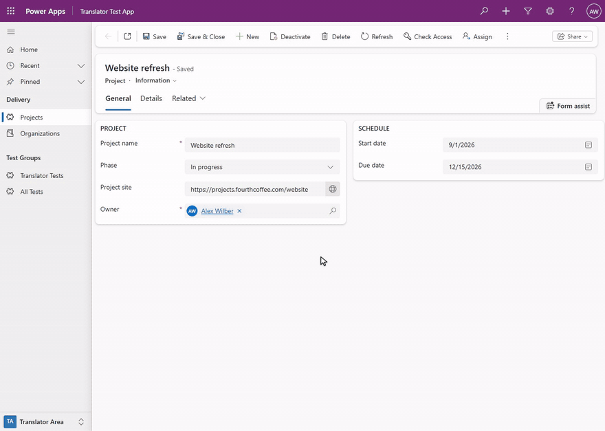

# Dynamics Translator

A bookmarklet for Microsoft Edge that translates the labels of a Dynamics 365 or Power Apps model-driven app **in
place**. Started on a record, a list or a dashboard, it marks the labels of the page, each on its own text; a click on
that text opens a small popup next to it with the label in each language of the environment. Changes are staged, not
written: **Review and publish** shows every change before anything is saved, then saves, publishes only the
components that changed and refreshes the page so the new texts show. For work in bulk, the **Workbench** is a
spreadsheet of every label of the chosen tables or solution, one sheet per kind of label, that reads and writes the
workbook format of the XrmToolBox tool Easy Translator.

The translator never suggests a translation: there is no machine translation and no translation memory. What you type
is what is published; a translation you empty is removed or, where Dataverse can't remove it, replaced by the text
that language would show without it. An emptied tooltip or other description of a table, column or choice is saved
empty: that language's users then see none.

It never changes a component that comes from a managed solution either: a translation there would add an unmanaged
layer on top of it, so its labels are read-only, marked grey, and are translated in the environment where that
solution is developed. Microsoft's own tables and forms (account, contact ...) come from managed solutions, so on
their pages almost every label is grey. Unmanaged components, such as your own in a development environment, can be
translated, also on a managed table: a form or a column you added to it.



The same demo as a [video (MP4)](docs/gallery/DynamicsTranslator-demo.mp4).

| Item | Value |
| --- | --- |
| Tool | A bookmarklet: a favourite whose address is a small program. On the favourites bar it is named *Translator*. Version 1.0.0 |
| Runs on | Any page of a model-driven app (`https://<org>.crm.dynamics.com/main.aspx...`), with your own sign-in: translation on the page for records, lists and dashboards, the Workbench on any page. See [Open it](#open-it) |
| Browser | Microsoft Edge, the supported and tested browser. The link unpacks itself with the browser's `DecompressionStream` |
| Link size | About 267,000 characters: the code is compressed inside the link and unpacked by the browser. Edge runs favourites of up to about 2,000,000 characters |
| Installs in the environment | Nothing: no solution, no app registration, no server code. Saving a classic command bar label creates a small temporary solution for the time of the save and deletes it again. See [Safety](#safety) |
| Documentation | [Technical reference (Word)](docs/Dynamics%20Translator%20-%20Technical%20Reference.docx)<br>[Developer guide: how the translator is built and how to change it](docs/developer-guide.md) (also as [Word](docs/Dynamics%20Translator%20-%20Developer%20Guide.docx)) |
| License | [MIT](LICENSE) |

**Why.** A label on a model-driven form can come from several places: the form's own label for that field, the
column's display name (which views and search show, and which the form shows where it has no label of its own), the
column's description (the field's tooltip), a choice's option label, a relationship's menu label, the app's
navigation, a business process flow's definition, the command bar's definitions. Translating them through a solution's
translation export means finding each text by its object id and column name in a spreadsheet, importing it again,
publishing, and reloading until Dynamics stops showing the old text. The translator starts from what you see: it marks
the labels of the page you are on, opens the right text when you click one, says where that text applies (*this form
only*, *everywhere*), and after publishing clears the copies of the labels that the browser keeps. Without that step,
in a test environment, a plain reload after a publish showed the new label one time in four (LIVE-FINDINGS 50).

> **Publishing changes the app for every user.** Review and publish saves the translations to the environment and
> publishes them: everyone who uses the app in those languages sees them. Try the translator in a test environment
> first. [Recent publishes](#recent-publishes-and-undo) keeps what each publish changed, so that it can be undone, for
> up to 90 days and in this browser only: another browser, another computer or another account signed in to this
> browser doesn't list it.

## Contents

* [Features](#features)
* [Screenshots](#screenshots): [Translating on the page](#translating-on-the-page), [Finding labels](#finding-labels),
  [Publishing and undoing](#publishing-and-undoing), [Working in the Workbench](#working-in-the-workbench),
  [Menu](#menu)
* [Download](#download)
* [Install](#install): [Create the favourite](#create-the-favourite),
  [Run it from the console](#run-it-from-the-console),
  [When bookmarklets are blocked](#when-bookmarklets-are-blocked), [Update to a new version](#update-to-a-new-version)
* [Use](#use)
  * [Open it](#open-it)
  * [Translation mode](#translation-mode): [Marks](#marks), [Clicking a label](#clicking-a-label),
    [Switching the area, the form and the view](#switching-the-area-the-form-and-the-view), [The bar](#the-bar),
    [What it loads](#what-it-loads)
  * [The popup](#the-popup): [What each popup holds](#what-each-popup-holds), [Typing](#typing),
    [Emptying a translation](#emptying-a-translation), [Choices](#choices),
    [Fields placed more than once](#fields-placed-more-than-once), [Buttons and closing](#buttons-and-closing)
  * [All labels](#all-labels)
  * [Changes on other pages](#changes-on-other-pages)
  * [Review and publish](#review-and-publish): [The list of changes](#the-list-of-changes), [Publishing](#publishing),
    [When something goes wrong](#when-something-goes-wrong), [After the refresh](#after-the-refresh)
  * [Recent publishes and Undo](#recent-publishes-and-undo): [Undo](#undo),
    [Publishing a save that wasn't published](#publishing-a-save-that-wasnt-published)
  * [The Workbench](#the-workbench): [The window](#the-window), [Export options](#export-options),
    [The workbook](#the-workbook), [Labels not loaded](#labels-not-loaded), [Editing cells](#editing-cells),
    [Tools](#tools), [Save and Publish](#save-and-publish)
  * [Excel and CSV](#excel-and-csv): [Downloads](#downloads), [Import](#import)
  * [The ⋯ menu](#the--menu)
  * [Keyboard](#keyboard)
* [What it can translate](#what-it-can-translate)
* [Safety](#safety)
* [Privacy](#privacy)
* [Messages](#messages): [Starting](#starting), [On the page](#on-the-page),
  [Saving and publishing](#saving-and-publishing), [Undoing a publish](#undoing-a-publish),
  [Workbench and files](#workbench-and-files), [Refresh and language](#refresh-and-language)
* [Troubleshooting](#troubleshooting)
* [Limitations](#limitations)
* [How it works](#how-it-works)
* [Comparison with Easy Translator](#comparison-with-easy-translator)
* [Repository layout](#repository-layout)
* [Build](#build)
* [License](#license)
* [Developer guide](docs/developer-guide.md): how the translator is built and how to change it (also as a
  [Word document](docs/Dynamics%20Translator%20-%20Developer%20Guide.docx))

## Features

| Screen | What you see |
| --- | --- |
| Translation mode | The page as usual, with a mark on the text of every label: blue when it is translated, orange when the target language has no text yet, green when it was changed and not published, red when its publish failed, grey when it can't be translated here (a label from a managed solution, Microsoft's built-in text). A click on a label's text opens its popup. The lists of areas, forms and views open as usual, their items marked too. A slim bar at the bottom, right of the app's navigation: the number of changes, **Review and publish**, **All labels**, **Workbench**, **⋯** and **✕** |
| The popup | Next to the label clicked: what it is and its title, then one block per text (a field's *Form label*, *Tooltip* and *Column name*, a tab's *Label*, a table's *Name* and *Plural name* ...) with one input per language, the choices of a choice column, and **Done**. It shows only once its place has held for a moment, so it opens without a jump (opened from an option of an open dropdown list, it waits for the field and shows there); a field's popup opens with the caret in its *Form label*, the text the form shows, or in its *Column name* when the form label is read-only. On a read-only label the inputs are disabled and a line with a lock says why. Under a translation emptied where Dataverse can't remove it, a line says what saving writes in its place: *Becomes “Start date”: Dataverse can't remove a translation here, so French gets the English text.*; under an emptied tooltip or description, *Saved empty: French users see no tooltip.* |
| All labels | A sheet docked on the right, or floating over the page once dragged by its header, that lists every label of the page, those not on screen too, in groups (*Form*, *Choices*, *Command bar* ...), each a grey band with its count that collapses and expands its rows with a click and stays at the top while they scroll. A row has the base-language text and its kind (a choice value: its column), and under it the target-language text or its state after a coloured dot. A search box, *All*, *Not translated* and *Changed* (every change of the page, on a tab not shown too), and the changes made on other pages, under the page each was made on. A click finds the label on the page and opens its popup |
| Review and publish | Every staged change, grouped by label, each language with its text before and after (for a translation emptied where Dataverse can't remove it, the text written in its place, with a note saying so; for an emptied tooltip or description, *(empty)* with the note *Saved empty: French users see no tooltip.*) and **Undo**; what else the publish publishes; **Publish**. Then *Saving*, *Publishing*, *Checking* and *Refreshing the page*, each with its progress |
| Recent publishes | The publishes you made from this browser in this environment, newest first, each with **Undo** (and **Publish** when its publish failed); a click on one shows what it changed |
| Undo this publish? | Each label of the publish, read again from the environment: whether it goes back, is already as before, or was changed since the publish. A translation the publish added that Dataverse can't remove gets the text that language shows without one: *1 translation this publish added gets the English text in its place: Dataverse can't remove it.* A label that is read-only now, such as one from a managed solution, is skipped, with the reason |
| Workbench: Export options | The tables of the environment or of a solution, the kinds of labels to extract, the languages and the label options, as in the Easy Translator workbook |
| Workbench: the workbook | One sheet per kind of label (*Entities*, *Attributes*, *OptionSets*, *Views*, *Forms Fields* ...) with its key columns and one column per language; sheet tabs at the bottom; filters, bulk tools, undo, the pending changes navigator, **Excel** and **Save and Publish** |
| Refresh page, Show Dynamics in | From the **⋯** menu: *Refreshing the page…* at the top of the page, then the page loaded again, showing the labels and the language Dynamics has now |

* **Translate where you see it.** Field labels and their tooltips, tabs, sections, column headers of lists and
  sub-grids, choice values, the business process flow's stages and steps, command bar buttons, the app's navigation,
  view, form, table and app names: each is marked on its own text, and a click on that text opens a popup next to it
  to translate it. Beside the text the page works as usual, except next to the text of a button, a tab, a link or a
  menu item, where a click does nothing, so a near miss never runs a command. A click there that only opens or closes
  part of the navigation (a group, *Recent*, *Pinned*), opens the list of areas, forms or views, or picks from that
  list, reaches the page all the same; Alt+click always does. Fields of quick views, columns of related tables, each
  value of a multi-select, and forms or lists opened in a side pane work the same way, each saved to its own form,
  column or choice. See [What it can translate](#what-it-can-translate).
* **Switch the area, the form and the view as usual.** The area switcher, the form selector and a list's view
  selector open their lists in translation mode, and the areas, forms and system views in an open list are marked like
  any other label, so their names can be translated there (a personal view is the user's own and gets no mark). A
  click beside an item's text switches to it. A selector's popup has **Change area**, **Change form** or **Change
  view**, which opens its list; an item's popup has **Open**, which switches to it, unless it is the current one. See
  [Switching the area, the form and the view](#switching-the-area-the-form-and-the-view).
* **Says where each text applies.** A field's popup has the form's own label for the field, the column's tooltip and
  the column's name, each with a short note: *this form only, shown instead of the column name*, *everywhere*,
  *everywhere: views, search and forms without a form label*. A form label is the form's own text, often a copy of the
  column's name saved when the field was added, and it doesn't follow a change to the column's name: to change what a
  form shows, edit its *Form label*. A field placed more than once on a form can be changed in every place at once.
* **Nothing is written until you publish.** Edits are staged. **Review and publish** lists each change, what it was
  and what it becomes, with **Undo** per change; changes that can't be saved (a blank base-language label, a text
  too long, a read-only label, an emptied translation that Dataverse can't remove and that has no text to put in its
  place) are shown in red and stay staged.
* **Emptying a translation.** Empty a translation to take it away. Where Dataverse can remove it (a view's, form's,
  chart's, dashboard's or app's name, a related menu item's label, an app navigation title ...), it is removed and its
  users see the base-language text again. Where it can't (the names of tables, columns, choices and relationships,
  form and dashboard tab, section and field labels, classic command bar labels, a process stage's or step's
  translation once Dynamics has stored it), the save writes the text that language shows without a translation of its
  own, so the page looks the same: for the label of a field that shows a column, the column's name in that language,
  else its base-language name; for anything else, its base-language text. The popup, the Publish dialog, Undo and the
  Workbench show that text before anything is written. Where that text isn't known (an empty base-language text, a
  column whose names aren't loaded), the change isn't saved, and says why. An emptied tooltip or other description of
  a table, column or choice is saved empty instead, whatever its base-language text: that language's users then see
  no tooltip there (*Saved empty: French users see no tooltip.*). See
  [Emptying a translation](#emptying-a-translation).
* **Nothing layered on a managed solution.** A label of a component from a managed solution is read-only, whatever
  its managed properties allow: tables, columns, choices, relationships, forms and dashboards, views, charts, apps and
  their navigation, processes, commands, environment variables and custom APIs. It is marked grey and its popup says
  why; the Workbench leaves it out unless asked for read-only labels, an import skips it and a save refuses it. Each
  component decides for itself: your own form or custom column on a managed table can be translated, and a managed
  column on your own form keeps its name and tooltip read-only while the form's label for it can be changed.
* **Targeted publishing.** Only the components you changed are published, never *Publish all*. Before publishing, the
  dialog says what else the publish publishes, and other unpublished work on the same tables when it can tell.
* **Checked writes.** Each label is read again right before it is written, so a text someone else changed since you
  loaded it becomes a conflict to resolve instead of being overwritten, and a component that this read shows to come
  from a managed solution is not written; every write is read back; the forms are checked to be published. The texts
  that an emptied translation is replaced with are read again too: one changed on the server since it was loaded
  stops that change, and one that the same publish writes (a column's new name) is used only if that write succeeds,
  so an old text is never written in its place. See [Safety](#safety). A save someone else makes in the split second
  between that last read and the write can still be overwritten: see [Limitations](#limitations).
* **Shows the result.** After a publish in translation mode the page is refreshed past the copies of the labels
  Dynamics keeps in the browser (after a publish from the Workbench, **Refresh page** in the dialog does it), and the
  next start checks that the page shows what was published: when it doesn't yet, it says so, with **Refresh again**.
* **Undo.** Every publish is kept in this browser for 90 days (at most the last 50); **Undo** first reads each label
  and shows what will happen to it, then writes the earlier texts back with the same checks. A translation the
  publish added is removed or, where Dataverse can't remove it, replaced by the text that language shows without one,
  so the page looks as before; a description that was saved empty before the publish is saved empty again.
* **A workbook like Easy Translator's.** The Workbench has the sheets, key columns and options of the Easy Translator
  workbook, Excel-like editing (paste from Excel, fill down, undo), bulk tools, filters and a navigator through the
  pending changes.
* **Excel and CSV.** Exports and imports workbooks in the XrmToolBox Easy Translator layout, with extra sheets for what
  Easy Translator doesn't cover, and CSV. An import only stages changes, and only texts it can rely on: a cell holding
  an Excel error, two different texts in one file for the same label and language, or an id that matches several
  labels only when case is ignored, is listed as not imported, and a damaged file or one with two columns for a
  language is refused.
* **No suggestions.** No machine translation, no translation memory, no proposed text: what you type is what is
  published. The Publish dialog only warns, for example when a translation starts or ends with a space, or when its
  placeholders like {0} don't match those of the base-language text.
* **Refresh and language.** The **⋯** menu's **Refresh page** clears the copies of the labels and of your language
  that Dynamics keeps in the browser and loads the page again; *Show Dynamics in* changes your Dynamics language for
  good and shows the page in it at once. See [The ⋯ menu](#the--menu).
* **Keyboard and screen readers.** Every control works from the keyboard; the popup, the bar, the sheet, the dialogs
  and the grid have their usual roles, and progress is announced.
* **Your own sign-in, nothing installed.** The translator runs in your browser with your own privileges and sends
  requests to your own environment only. See [Privacy](#privacy).

## Screenshots

The screenshots come from a test environment (shown as *contoso*) with made-up data: a demo table *Project*, which is
unmanaged, with records such as *Website refresh*, in an app whose navigation group *Delivery* holds *Projects* and
*Organizations* (the account table, which comes from a managed solution: its labels are grey). Every name in them is
fictitious. The environment has English as its base language and French as a second language.

### Translating on the page

**The marks.** The *Project* record *Website refresh* with the translator on. Each label has a mark on its own text,
in the colour of its state: blue translated, orange not translated yet, green changed and not published, grey
read-only. The bar at the bottom, right of the app's navigation, holds the translator's buttons.


**A field's popup**, next to the label of *Project site*, its French form label being typed: the form's own label,
the column's tooltip and the column's name, each in each language and with where it applies.


**An emptied translation.** The popup of *Start date* with the column's French name emptied. Dataverse can't remove a
column's translation, so the line under the input says what saving writes in its place: *Becomes “Start date”:
Dataverse can't remove a translation here, so French gets the English text.*


**A choice column's popup**: *Phase*, with its options (*Planning*, *In progress*, *Review*, *Closed*) listed under
*Choices*, English and French side by side.


**A label from a managed solution.** The popup of a field on the account form, which comes from a managed solution:
the reason at the top, with a lock (*From a managed solution: a translation here would add an unmanaged layer on top
of it. Translate it where its solution is developed*), and every input locked.


**A list.** The *Active Projects* view with its column headers marked, and the popup of the *Phase* header, which
edits the column's name and tooltip.


**A business process flow stage.** The stage's popup, with **Show stage** to open the stage's flyout.


**A classic command bar button.** The button's label and tooltip texts in each language; the tooltip's have no
French yet.


**The app's navigation.** The popup of the group *Delivery*: its title in each language.


**A list of views.** The *Projects* list with its view selector open, from a click on its chevron. The views
*Active Projects* and *Inactive Projects* are marked; the personal view *My open projects* and Microsoft's
*Manage and share views* are not.


**A list of forms.** A *Project* record with its form selector open: the forms *Information* and *Project overview*
are marked, each to translate its name; a click beside a name switches to that form.


### Finding labels

**All labels on this page**, docked on the right, with a search: the rows found, in groups under grey bands with their
counts, each band with a chevron that collapses and expands its group; each row has its base-language text and its
kind, and under it its French text or its state.


**All labels under Changed**: every change of the page. The change of *Goals*, a field on the *Details* tab, which
isn't shown, is listed with the others; its place is in the row's tooltip.


**All labels, floating.** The sheet dragged by its header over the *Project* record, so that the right of the form,
which it covers when docked (the dates of the *SCHEDULE* section), can be clicked; the bar takes its usual room again.
The pin button in the sheet's header (*Dock to the right*), or a double-click on the header, docks it again.


### Publishing and undoing

**Review and publish.** The staged changes of the *Project* form, each language with its text before and after, and
what the publish also publishes, next to **Publish**.


**Recent publishes**, one publish open to show what it changed on the *Project* form.


**Undo this publish?** Each label of the publish, on the *Project* form, as it is now on the server and the text it
goes back to.


**Undoing a translation Dataverse can't remove.** The Undo question of a publish that added a French tooltip to the
*Goals* column. Dataverse can't remove a column's translation, so the undo writes the English text in its place, and
French users see the English tooltip, as before the publish: *1 translation this publish added gets the English text
in its place: Dataverse can't remove it.*


### Working in the Workbench

**Export options**: the tables, the kinds of labels and the languages to extract. At the right of the window's title
bar, **✕** goes back to the page (*Back to page (Alt+1)*) when the translator was started on a record, a list or a
dashboard, and closes the translator elsewhere.


**A sheet of the workbook** with the labels of the *Project* table and a changed cell, light green with a green line
on its left edge until it is saved.


### Menu

**The ⋯ menu** of the bar: **Recent publishes**, **Refresh page**, *Show Dynamics in* and the version.


## Download

The files are attached to each release on the [Releases](../../releases) page:

| File | Use |
| --- | --- |
| `translator.bookmarklet.txt` | The translator's link (it starts with `javascript:`), to paste as the address of a favourite: see [Create the favourite](#create-the-favourite). Most people need only this file |
| `translator.min.js` | The translator's code, minified: the exact code the link runs, to paste into the browser's console where bookmarklets are blocked |
| `translator.debug.js` | The same code as a readable build, not minified, to see what the link runs; it runs from the console too |
| `SHA256SUMS.txt` | The SHA-256 checksums of the release's files, one line per file |
| *Source code (zip)*, *Source code (tar.gz)* | The repository at that version, source and documentation, which GitHub attaches to every release |

This README and the developer guide are also Word documents, in the repository's `docs/` folder
([Technical reference](docs/Dynamics%20Translator%20-%20Technical%20Reference.docx),
[Developer guide](docs/Dynamics%20Translator%20-%20Developer%20Guide.docx)), and so in the source code archives.

To check a file against its checksum in PowerShell: `Get-FileHash -Algorithm SHA256 .\translator.bookmarklet.txt`,
then compare the hash with the line for that file in `SHA256SUMS.txt` (PowerShell prints it in capitals). On Linux,
`sha256sum -c SHA256SUMS.txt` checks every file it lists at once; on macOS, `shasum -a 256 -c SHA256SUMS.txt` does the
same.

In the repository, the build (`npm run build`) writes the three files of the translator to `dist/`:
`translator.bookmarklet.txt`, `translator.min.js` and the readable `translator.debug.js`. To build them yourself, see
[Build](#build).

## Install

The translator is a favourite in Edge whose address is the content of `translator.bookmarklet.txt`. Where favourites
are blocked, the same code runs from the browser's console, pasted from `translator.min.js`.

### Create the favourite

1. Download `translator.bookmarklet.txt` from the [Releases](../../releases) page, open it in a text editor such as
   Notepad and copy its whole content (Ctrl+A, then Ctrl+C): the link, one long line that starts with `javascript:`.
2. Show the favourites bar: Ctrl+Shift+B.
3. Add any page to the favourites bar (Ctrl+D, folder *Favourites bar*).
4. Right-click the new favourite, select **Edit**, name it *Translator*, replace its URL with the link, then **Save**.

Another way: open the favourites (Ctrl+Shift+O), add a favourite named *Translator* and paste the link as its URL.
Pasting the link into the address bar does not run it: the browser removes the `javascript:` part of pasted text.

Then open a page of the model-driven app and click **Translator** on the favourites bar: see [Open it](#open-it).

### Run it from the console

Without a favourite, the same code runs from the browser's developer tools:

1. Open a page of the model-driven app, for example a record.
2. Press F12 and open **Console**.
3. Paste the whole content of `translator.min.js` and press Enter. If the console warns about pasting code, follow
   the instruction it gives to allow pasting (in Edge, type *allow pasting* and press Enter, then paste again).

### When bookmarklets are blocked

Some organizations block bookmarklets with a browser policy: clicking the favourite then does nothing. Use the
console (above), or ask the people who manage your browser.

The link runs the unpacked code with `eval`. If a page forbids that, the link loads the code as a script instead; if
that is refused too, it says "This page does not allow the translator to run." If the code can't be unpacked or fails
at once, the message is "The translator could not start: &lt;reason&gt;".

### Update to a new version

1. Replace the favourite's URL with the content of the new version's `translator.bookmarklet.txt` (right-click the
   favourite, **Edit**). In the console, paste the new `translator.min.js`.
2. Reload the pages where the translator is open, or close it there with **✕**. On a page where it is open, the
   favourite shows the running translator again (its bar pulses, or the Workbench window comes back) instead of
   starting the new version.

What the translator remembers is kept: the target language and the languages shown, the place of the bar, whether
the *All labels* sheet is docked or floating and where it floats, the **Show logical names** setting, the Workbench's
options, sheet and column widths, the Workbench window's place, and Recent publishes (a list that a build older than
1.0.0 kept for the whole environment rather than per account is removed unread: see [Privacy](#privacy)). To see which
version runs, open the [⋯ menu](#the--menu): its last line reads *Dynamics Translator 1.0.0*.

## Use

### Open it

Click **Translator** on the favourites bar on a page of a model-driven app: an address ending in `.dynamics.com`
(also `.dynamics.us`, `.microsoftdynamics.us`, `.dynamics.cn` and `.appsplatform.us`), for example
`https://contoso.crm.dynamics.com/main.aspx`. On any other site it says "Open a Dynamics 365 / Power Apps model-driven
app (https://&lt;org&gt;.crm.dynamics.com/main.aspx…), then click the bookmark again." It uses the sign-in your browser
already has with the environment.

At the start it reads who you are, the environment's languages, its base language (the organization's language) and
your Dynamics language as the database has it. What opens depends on the page:

| Page | What opens |
| --- | --- |
| A record (a form) | [Translation mode](#translation-mode): the labels of the page marked, and the bar at the bottom |
| A list (a view of a table) | Translation mode |
| A dashboard | Translation mode |
| Any other page | [The Workbench](#the-workbench) |

**The target language** is the language you translate into: your Dynamics language when it is not the base language,
otherwise the first other language of the environment by name. In an environment with three languages or more, the
language menu (on the bar and in the Workbench's title bar) chooses it, and which other languages are shown; the
choice is remembered for each environment. With two languages there is nothing to choose: both are always shown.

**One translator per page.** Clicking the favourite again shows the translator as you left it: the bar pulses, or the
Workbench window comes back from its pill. While it is still starting, it says "The translator is still starting.
Wait a moment." To close it, select **✕** on the bar, or in the Workbench's title bar when the translator was started
on a page that isn't a record, a list or a dashboard; started on one of those, the Workbench's **✕** (*Back to page
(Alt+1)*) goes back to translation mode, as Alt+1 does. With staged changes it asks first, *Close the translator?*
("You have 3 unpublished changes."), with **Publish**, **Discard** and **Keep editing**. **Publish** opens the
[Publish dialog](#review-and-publish): once everything is published the translator closes (in translation mode the
page is refreshed), and while anything is left staged it stays open. **Discard** drops every staged change and closes
it. While a save runs it can't be closed. Once closed, the next click starts it afresh.

**Staged changes live in the page.** They stay while you move around the app (Dynamics changes pages without loading
the browser page again) and the translator follows you from page to page. Reloading the page or closing the tab
loses them: while changes are staged or a save runs, the browser asks first (*Leave site?*).

**An interrupted save.** To read and save the tab and section labels of a form in another language (and to read the
stage and step names a business process flow shows in it), the translator switches your Dynamics language for about a
second and back (see [Safety](#safety)). The switch back goes to Dataverse in the same request, so it runs even when
the tab is closed. A few rarer saves (navigation and process labels retried in another language, the update of a
renamed process) switch in separate requests: if the page goes away during one of those, the translator asks Dataverse
to switch you back as it closes. Should your language still be the one switched to at the next start in this browser
(that request was lost, or the browser crashed), the start puts your language back and says "Your Dynamics language
was restored after an interrupted save." When the switch is more than 10 minutes old, it asks instead: "Your Dynamics
language is French. A translator save that was interrupted earlier had switched it from English. Switch it back to
English? Cancel keeps French."

### Translation mode

Translation mode is the page as you know it, with marks on its labels and a slim bar. There is no window and no side
panel: you translate where the label is.

#### Marks

A mark is a rounded box that hugs the label's own text (one box per line), never a box around a section or a
container:

| Mark | Meaning |
| --- | --- |
| Blue, dashed | Translated: the label has text in the target language (a tooltip or description saved empty on purpose counts as translated too) |
| Orange, dashed | Not translated: the target language has no text yet. A navigation item that was never named has no text in any language, the base language included |
| Green, solid, with a second line | Changed, not published yet |
| Red, solid, with a second line | Couldn't be published: the last publish failed for it, or found a conflict |
| Grey, dotted | Can't be translated here: a label from a managed solution, Microsoft's built-in text (already translated into every installed language), or another read-only label. Its popup says why |
| No mark | Not a label, or not loaded yet |

A form field without a label of its own in the target language shows the column's name in that language (verified in
a test environment, LIVE-FINDINGS 42). When the field's base-language label is the column's base-language name, the
column's name in the target language counts as the field's translation, and the mark is blue.

**Managed components are read-only.** The translator never adds an unmanaged layer on top of a component that comes
from a managed solution: every label of such a component is grey, whatever its managed properties allow, and its popup
says "From a managed solution: a translation here would add an unmanaged layer on top of it. Translate it where its
solution is developed." That goes for tables, columns, choices and their options, Yes/No and status values,
relationships, forms and dashboards, views, charts, apps, the app navigation, business process flows with their stages
and steps, command bar buttons (modern and classic), environment variables and custom APIs. Each component decides for
itself, and a form for all of its tabs, sections, field labels, header and related menu: a form of your own on a
managed table can be translated, and so can a custom column of your own on that table; on a form of your own, a managed
column's field label (the form's) can be translated, but not the column's name or tooltip. Microsoft's own tables and
forms (Account, Contact ...) come from managed solutions too, so on their pages almost every label is grey. A managed
solution's labels are translated in the environment where that solution is developed; in a development environment,
the components you made there (unmanaged) can be translated.

**What gets a mark.** Only text that names something in the app: a field, a column header, a tab, a section, an item
of the related menu, the title of a sub-grid, a quick view, the timeline or a web resource, a navigation entry, a
command bar button, the name of the view, form, table, app or process, a stage or a step, and a choice value (each
value of a multi-select on its own), and while the list of the area switcher, the form selector or a view selector is
open, each area, form and view in it. **What never gets a mark:** messages and notifications, statuses (*- Saved*,
*Active for 48 hours*), counts and paging, placeholders and search boxes, empty states, record data (the record's
title, field values, the owner, what *Recent* and *Pinned* list), the name of a personal view, the product name, and a
control's own buttons such as *Select all*, sort and filter menus, and *Manage and share views*. A text the translator
doesn't recognise stays without a mark; it is never called built-in by elimination.

**Pointing at a label's text** draws its mark with a thicker border and a small pencil badge after it (no pencil on
grey marks, nor on the text of the area switcher, the form selector or a view selector, where it would cover the
chevron that opens the list), and the pointer becomes a hand. Only the text counts (its mark and 2 pixels around it,
and the pencil once it shows): beside the text nothing changes, see [Clicking a label](#clicking-a-label). Marks lie
under Dynamics' own flyouts, dropdowns, menus and side panes: the part of a mark that one of them covers is not drawn
(the lists of areas, forms and views have marks of their own on their items). The same goes for another tool's panel
on the page, such as another bookmarklet's window, while it is on top: the marks under it come back when it closes.
While a dialog of Dynamics is open, only the labels in it are marked. A form opened in a dialog or in quick create is
left alone: its fields, tabs and sections get no mark.

**Your own language on the page.** When the page is shown in a language you changed, the label shows your staged text
in place of the old one, so you see the result before publishing (for an emptied translation, the text the page will
show without it: see [Emptying a translation](#emptying-a-translation)); undoing the change puts the page's text back.

**Changed choices.** The other options of a choice column are not on the page, so a staged change to one of them would
be invisible until its dropdown is opened. A form field whose column has changed options gets a small pill after its
value (or its label): *1 choice changed* in green, *2 choices not published* in red when a publish failed for one of
them, or only the count where the words don't fit. A click on the pill is a click on the value (or the label) it
follows: its popup opens with the column's choices open.

#### Clicking a label

A click on the text of a marked label opens its [popup](#the-popup) and does nothing else: a tab does not switch, a
navigation item does not open, a command does not run, a process stage does not move, a column header does not sort,
an area, a form or a view in its list is not switched to. The popup's second button does those things where it can
(**Open**, **Show tab**, **Show stage**; on the area switcher, the form selector and a view selector, **Change area**,
**Change form** or **Change view** opens the list). Clicks on text boxes, lookups and record data (its links included)
are never taken, and no click ever changes record data.

**Only the text is the label**: its mark and 2 pixels around it, and its pencil. A click beside the text, in the part
of the page the label belongs to:

* reaches the page where that part only shows the label (the space around a field's label, a section's header), as if
  the translator weren't there;
* reaches the page too where all that part does is open or close something, or pick from a list you opened: in the
  app's navigation, a group's header (beside its title, or its chevron), *Recent*, *Pinned*, the ☰ button and the area
  switcher; the form selector and a view selector, whose chevrons open their lists; and an item of the list of areas,
  forms or views, which it switches to (see
  [Switching the area, the form and the view](#switching-the-area-the-form-and-the-view));
* does nothing at all where that part acts when clicked (a button, a link, a tab, a menu item, an option, an entry of
  the navigation that opens a page, a column header, a closed choice or Yes/No control, a field label tied to a
  checkbox, a switch or a dropdown): nothing opens and the page doesn't act either, so a click that misses a label's
  text never runs a command, switches a tab or sorts a column. Alt+click does what the page does.

A press on the text that is released a few pixels beside it, still in that part of the page, opens the popup all the
same. A label whose mark isn't drawn yet (it has just loaded, or its text is scrolled out of its container) can be
clicked anywhere in its part of the page until it is, when it is the only label there. Where one text holds several
labels (the values of a multi-select, the two names of a related table's column header), each opens from its own part
of the text; a click between them or past them opens nothing. The records that *Recent* and *Pinned* list in the
navigation are not part of their entry: a click on one opens it.

**Right after Dynamics moves to another page** (it draws the new page's labels a moment before the translator sees the
move), a click on a label, or F2, first looks whether the page changed and reads it again if so: the popup is then the
new page's label, never the column of the same name in the previous list's table, and a label the new page doesn't
mark opens nothing.

**Hold Alt** to use the page as usual: while Alt is held the marks fade, the pencils and pills go, and a click
(Alt+click) reaches the page. **F2** on a focused label (a tab, a button or a navigation item reached with Tab) opens
its popup; Enter and Space on it still reach the page.

#### Switching the area, the form and the view

Three lists switch the page to something else: the app's areas (the area switcher at the foot of the navigation), the
record's forms (the form selector next to the table's name in the form's header) and a list's views (the view selector
above it). In translation mode they work as usual, and what they list can be translated while they are open.

* **Opening a list.** A click beside the selector's text (its chevron, its padding) opens the list, as without the
  translator. The text itself (the area, the form or the view shown) is a label like any other; pointing at it draws
  its mark thicker, but without the pencil, which would lie over the chevron. Its popup has **Change area**, **Change
  form** or **Change view**, which closes the popup and opens the list.
* **The items are marked.** While a list is open, each of its items has a mark like any other label: in the colour of
  its state when it can be translated, grey when it can't (an area, a form or a view from a managed solution). A
  personal view (one without a system view behind it) and Microsoft's *Manage and share views* never get a mark. The
  names of the forms and views the page hasn't read yet are loaded when the list shows them; a form or a view is
  marked only where the item's text is that form's or view's name.
* **Picking an item.** A click beside an item's text switches to it, as without the translator. That holds in these
  three lists only: beside the text of a navigation entry that opens a page, a click still does nothing. A click on the
  text opens the item's popup, where **Open** switches to it (the current item has no **Open**). A form is switched
  through Dynamics' form API, which asks about the record's unsaved changes itself, and only from the record's own form
  selector, not from one in a dialog or a side pane. For an area or a view the translator opens the list again and
  picks the item; when the list doesn't show it within 3 seconds, a message says so: "Couldn't change the view: the
  list of views didn't show it. Pick it from that list on the page." (or the same for the area).
* **The keyboard.** **F2** on an item reached with the arrow keys opens its popup, and the list closes as the popup
  takes the focus. When the popup closes (**Done**, **✕**, Enter, Esc), the focus goes back to the button that opens
  the list.

**The list of views** of *Projects*, open: the views *Active Projects* and *Inactive Projects* are marked; the
personal view *My open projects* and *Manage and share views* are not.


**The list of forms** of a *Project* record, open: the forms *Information* and *Project overview* are marked.


#### The bar

The bar floats at the bottom of the page, centred in the room right of Dynamics' navigation on the left and left of the
[All labels](#all-labels) sheet while it is docked (a floating sheet leaves the bar its usual room), so it never covers
the area switcher at the foot of the navigation.
While the area switcher's list of areas is open, which is wider than a collapsed navigation, the bar keeps right of it
too. In a window too narrow to leave 480 pixels beside the navigation, the bar's room starts at the window's left edge
instead, and the bar rises above the area switcher where it would cover it. From left to right:

* **The logo**: drag it to move the bar within that room, anywhere from the top of the page to the bottom;
  double-click it to put the bar back at the bottom, centred in that room. The place is remembered.
* *Translator*, and with three languages or more the language button (*English → French*), which opens the language
  menu: *Translate into* (the target language) and *Show languages* (the other languages shown in the popups; the base
  and the target language are always shown).
* **One status**, the first that applies: *Loading translations…* while the page's labels load; *Couldn't load some
  labels.* with **Try again** when a load failed (the tooltip lists what failed); the number of staged changes
  (*3 changes*), which opens the Publish dialog when selected; otherwise the hint *Click any highlighted text to
  translate it. Orange = no French yet, green = changed, not published yet, grey = can't be translated here. Hold Alt
  to click normally.*
* **Review and publish**: the [Publish dialog](#review-and-publish). Without changes it looks disabled, and a message
  says *Nothing to publish yet*.
* **All labels**: the [list of the page's labels](#all-labels).
* **Workbench**: the [Workbench](#the-workbench).
* **⋯**: the [menu](#the--menu) with Recent publishes, Refresh page, Show Dynamics in and the version.
* **✕**: closes the translator.

As the window narrows, *Translator* goes, the languages become codes (*EN → FR*), the button texts collapse to their
icons and **Review and publish** becomes **Publish**.

Messages (toasts) appear at the right, just above the bar (at the bottom right of the page when the bar is moved to
the upper half; in the Workbench, at the bottom right of its window), four at most. A message goes by itself after 5
seconds, a warning or one with a link (**Refresh again**, **Recent publishes**, **Undo**) after 8, and an error after
10; pointing at it keeps it, and its **✕** closes it.

#### What it loads

Everything the page shows is loaded when the page opens, every language at once, without a prompt; nothing waits for
a click. The labels get their marks as their loads come in.

| Page | Loaded |
| --- | --- |
| Record | The table with its columns and choices; the form (its tab and section labels through the short language switch); the tables of the sub-grids; the command bar's buttons (modern and classic); the record's business process flow; the app and its navigation |
| List | The table with its columns and choices; the view; the command bar; the app and its navigation |
| Dashboard | The dashboard; the app and its navigation |

On a record with a business process flow, the stage and step names Dynamics keeps in a language the process's
definition has none in are read for that record, through the short language switch (LIVE-FINDINGS 83, 85). The
stages and steps get their marks once, with those names, about 2 seconds after the page opens: a stage whose
translation only Dynamics keeps is blue from the start, never orange for a moment.

Some parts are loaded when they appear on the page: the table of a sub-grid or of a related view, a form opened in a
side pane, the form of a quick view, the query of a view (for columns of related tables), the names of the views in a
view selector and its list, the names of the forms in the form selector's list, the record's related menu, and the
table names some navigation entries and Microsoft's *New*, *Add Existing* and *Export* buttons show. A load that fails
shows on the bar (*Couldn't load some labels.*); **Try again** reads it again. The page can do without a few of them
(the form of a side pane or a quick view, the related menu, the query of a view): when one of those fails, its labels
just stay without a mark and the bar says nothing. A load that answers late never takes a newer text back: a text a
save or a later load brought in meanwhile stays, and so does what you typed over it.

A form that has no unpublished definition in Dynamics is read through its published one, which gives its tab and
section labels in every language but its field labels in your language only (LIVE-FINDINGS 52). In another target
language those field labels can't be translated here: they get no mark (on a read-only form they stay grey), and
their popup says *Not loaded yet* in the other languages. Reading again can't change that, so the bar doesn't count it
as a failed load. Every label of such a form is read-only (grey), in every language: the translator writes only over a
form's unpublished definition, and the popup says so: *Dynamics returns no unpublished definition of this form, and
translations are only written over that definition, so this form's labels can't be changed here.*

### The popup

The popup is a small window next to the label clicked: below it when there is room, else above it. Its header has a
kind word (*Field*, *Tab*, *Section*, *Column*, *Choice*, *Button*, *Menu item*, *Stage*, *Step*, *Table*, *View*,
*Process* ...), the title as the page shows it, and **✕**. Under it, one block per text, each headed by what the text
is; each block has one row per language: the base language first, then the target language, then the other languages
shown.

**It opens without a jump.** The popup shows only once its place has held for two frames, and fades in from its
label's side. A click on an option of an open dropdown (the *Review* option of *Phase*, say) closes that list as the
popup takes the focus: the popup waits for the field and shows once, there (after 300 milliseconds at most, it shows
wherever it is). Once shown, it keeps its side of the label: a scroll, or a message under an input that makes it
taller, doesn't flip it to the other side while it lacks at most 48 pixels there (its content scrolls instead).

#### What each popup holds

| Clicked | Blocks |
| --- | --- |
| A form field | In this order, whichever text was clicked: *Form label · this form only, shown instead of the column name* (for a field of a quick view: *this quick view (on every form that shows it), instead of the column name*); *Tooltip · everywhere* (the column's description, which Dynamics shows when you point at the field, LIVE-FINDINGS 43); *Column name · everywhere: views, search and forms without a form label*; and for a choice column, its *Choices* |
| A sub-grid's, quick view's or timeline's title, a web resource or another component of the form | *Label* (kind *Sub-grid*, *Quick view*, *Timeline* or *Component*) |
| A tab or a section | *Label* |
| A column header in a list or sub-grid | *Column name*, *Tooltip*, and for a choice column its *Choices* |
| A choice value (in a list, a dropdown, a multi-select) | The column's *Choices*, open, with the value clicked highlighted |
| An item of the record's related menu, or the tab of the view it opened | *Label · this form only*, then the text it shows where it has no label of its own: *Menu label · every form without its own title* (the relationship's) or *Table plural name · everywhere* |
| A table's name | *Name* and *Plural name* |
| A navigation entry that shows its table's plural name | *Plural name* (kind *Menu item*) |
| A navigation area, group or entry | *Title* |
| The name of a view, form, chart, dashboard, app or business process flow | *Name* |
| A process stage | *Label* |
| A process step | *Label*, the column's *Tooltip*, and for a choice column its *Choices* |
| A modern command bar button | *Label*, *Tooltip title*, *Tooltip text* (a button group: its *Label*) |
| A classic command bar button | *Label*, *Tooltip title*, *Tooltip text*, each saying where else that text shows: *also on 2 other buttons*, *on 3 buttons*, or *every table's command bar* for a label of the application ribbon. One save changes it everywhere |
| Microsoft's *New*, *Add Existing* or *Export* button of a sub-grid or list | The table's *Name* and *Plural name*, with a note: Microsoft builds the button's text from the table's name, so translate the name; the button follows. When the table's names are read-only (a table from a managed solution), the note only says where the text comes from, and the lock line says why |
| An environment variable or custom API | *Name*, *Description*, and for an environment variable its *Hint* |

**A form label is the form's own text.** Where a form has a label of its own for a field, it shows that label, not the
column's name. The form designer usually saves a copy of the column's name as the field's label when the field is
added to the form, and that copy doesn't follow a later change to the column's name: editing the *Column name* doesn't
change what such a form shows. To change what a form shows, edit its *Form label*; edit the *Column name* to change
views, search and the forms without a label of their own for the field.

The accessibility text of a command bar button (what a screen reader says for it) has no block in its popup: translate
it in the Workbench, on the *Commands* sheet (*Type* *Alt*) for a modern button, or for a classic one on the *Ribbon
Labels* sheet, by the *LocLabel Id* the button names for it.

**Built-in text** (grey) opens a popup without inputs: *Built-in*, its title, and "Built-in Microsoft text. It's
already translated into every language installed in this environment, so there's nothing to translate here."

**A read-only label** (grey) has its inputs disabled and shows its reason on a line with a lock. A label from a managed
solution says "From a managed solution: a translation here would add an unmanaged layer on top of it. Translate it
where its solution is developed"; another reason is, for example, "This column is marked as not customizable (its
“Allow customizations” managed property is off), so its labels can't be changed here". When nothing in the popup can be
changed (a field of a form from a managed solution, whose column is managed too), the reason is said once, at the top;
otherwise it is under each block it locks: on a form of your own, a managed column's field keeps its *Form label*
block, while its *Column name* and *Tooltip* blocks are locked.

**A navigation group never named** in the app designer is titled with the placeholder the page shows and says "This
group has no name of its own: Dynamics shows the app designer's placeholder. Name it in each language; other languages
will show the English name until you translate them." In an app navigation from a managed solution, it is read-only
like the rest, and can't be named here.

#### Typing

The popup opens with the caret at the end of the text you clicked, in the language the page is shown in: on an
English page in the English input, on a French page in the French one (where that input can't be typed in, that
language not loaded for example, in the text's first input that can). In a field's popup, that text is always the
*Form label*, the text the form shows, also while it is empty and the form shows the column's name in its place (its
placeholder then says which: *Shows “…”*); the caret goes to the *Column name* only when the *Form label* can't be
typed in (on a form from a managed solution, for a column of your own). In a column header's popup it is the *Column
name*. It stays on that text also when the *Choices* list opens because one of its options has a change; in other
popups such a list puts it on the first changed option, and a choice value's popup on the value clicked. Every
keystroke is staged at once (the mark turns green); nothing is written to the environment from the popup.

* **An empty input** of a name or label says what users of that language see now: *Shows “Priorité”* (in an empty
  *Form label* input, the column's name in that language, else its base-language name). A tooltip or other
  description of a table, column or choice says *No French tooltip* (*No French description*) only where French users
  see none: it is saved empty, you emptied it, or its English text is empty too; one never translated says *Shows “…”*
  with the English text they see. Other descriptions and tooltips (a view's, a command's) say *No French description*
  (*No French tooltip text*) by their heading, whatever their users see. An emptied translation that publishing
  replaces with another text has no such placeholder: the line under it says what it becomes.
* **Colours.** An orange input is a missing translation, a green one a changed text, and a red line under an input a
  change that can't be saved, with the reason: *Can't be empty* (a required base-language text, or only spaces where
  there is no translation and Dataverse would store them as a blank label), a translation emptied where there is no
  text to put in its place (see [Emptying a translation](#emptying-a-translation)), *Too long (max 100)* with a
  counter, *Read-only*, or *Name it in English too* (a navigation item named in another language only).
* **Emptying a translation.** Empty an input to remove that translation, so that its users see the base-language text
  again. Where Dataverse can't remove a translation, publishing writes in its place the text that language shows
  without one, and a grey line under the input says which; an emptied tooltip or description of a table, column or
  choice is saved empty, and the line says *Saved empty: French users see no tooltip.* See
  [Emptying a translation](#emptying-a-translation).
* **Undo.** Ctrl+Z and Ctrl+Y undo and redo what was typed in that input. In an input reopened on a staged text, with
  nothing typed yet, Ctrl+Z goes back to the text on the server (the change is unstaged) and Ctrl+Y stages it again.
* **Multi-line texts** (tooltips, descriptions) grow up to four lines. Enter closes the popup; Shift+Enter starts a
  new line. Spaces and line breaks at either end are removed when the popup closes.

#### Emptying a translation

Empty an input of a language other than the base language (only spaces count as empty) to take that language's own
text away. What publishing does with it depends on the label ([What it can translate](#what-it-can-translate) lists
which is which): it is removed, replaced, saved empty or refused.

* **Removed, where Dataverse can remove a translation**: the names and descriptions of views, charts, forms,
  dashboards, apps and processes, the texts of modern commands, environment variables and custom APIs (LIVE-FINDINGS
  33), the items of a form's related menu and the titles of an app's navigation (38). Users of that language then see
  the base-language text again. An emptied name's input says what they will see (*Shows “Active Projects”*); an
  emptied description says *No French description* by its heading, whatever its users see. The Publish dialog says
  "Removes the French translation; French users will see the English text."
* **Replaced, where it can't**: table, column, choice, Yes/No, status, global choice and relationship names
  (LIVE-FINDINGS 31, 67), form and dashboard tab, section and field labels (37), classic command texts (39), and a
  process stage or step name, which Dynamics keeps once it has stored a translation (83). Dataverse adds or changes
  such a translation but never removes it (and an empty table or column name would show as a blank one, 32). So
  publishing writes in its place the text that language shows where the label has no translation of its own, and the
  page looks as it would without one: for a form or dashboard field that shows a column, the column's name in that
  language, else the column's base-language name (LIVE-FINDINGS 42); for any other label, its own base-language text.
  A grey line under the input says what it becomes: "Becomes “Start date”: Dataverse can't remove a translation here,
  so French gets the English text." (a field label: "…, so French gets the column's French name."; a process stage:
  "…: Dynamics keeps a stage's translation, so French gets the English text."). The input has no *Shows …*
  placeholder then, and the mark turns green as for any change. Where the translation is that text already, the line
  says "Already the English text: Dataverse can't remove a translation here, so nothing changes.", and nothing is
  written.
* **Saved empty, for a description**: the description of a table, a column (the field's *Tooltip*), a choice value, a
  Yes/No value, a status or status reason, a global choice or one of its values. Emptied, it is saved empty, whatever
  its English text is: Dataverse keeps the empty text for that language, and French users then see no tooltip or
  description there (LIVE-FINDINGS 32). Nothing takes its place, and nothing is refused. A grey line under the input
  says "Saved empty: French users see no tooltip." (for any other description, "… see no description."), and its
  placeholder says *No French tooltip*. In the popup, spaces typed where there is no French text are removed when it
  closes, so nothing is saved, and the line says nothing.
* **Refused, where there is no text to put in its place**: the label's base-language text is empty, or a field's
  column has no name at all (none in that language nor in the base language). The line under the input is red:
  "Dataverse can't remove this translation, and its English text is empty: type the text instead." (a field: "…, and
  its column has no English name: type the text instead."). Where that text is only not loaded (a field's column
  names, for example), it says what loads it: "Dataverse can't remove this translation, and its column's names aren't
  loaded: load its table's columns to put the column's name in its place, or type the text." The Publish dialog skips
  such a change, and it stays staged.

The popup works out the text put in place of a translation from the texts as staged, the publish from the texts as it
leaves them: a base-language text or a column's name changed in the same publish counts with its new text. Just before
writing, the publish reads those texts again; when one has changed on the server since it was loaded, nothing is
written for that label, and its row says so: "Its English text changed on the server since it was loaded (now
“Start”), so nothing was written: Try again to put the new text in its place." A text the same publish writes in
another request (a column's French name, changed in the publish that empties the French *Form label* of one of its
fields) is written first, and the label only once that text is saved; when it isn't, nothing is written for the label
either: "Its column's French name wasn't saved, so nothing was written here either: Try again to save both." Where the
text put in place of a translation is that translation already, nothing needs writing, but the publish reads the
label's own text first: nothing is written while the server still holds it, and another text there (someone changed it
since it was loaded) is a conflict, as for any change.

The [Publish dialog](#the-list-of-changes) shows such a change as the text it replaces and the text written, with a
grey note: *English text: Dataverse can't remove a translation* (or *The column's French name: Dataverse can't remove a
translation*). The *Edit translations* dialog says under its inputs what the popup says. In the Workbench, the emptied
cell turns green and shows the text it becomes in grey italics, with the reason in its tooltip; only a cell with no
text to put in its place turns red (see [Editing cells](#editing-cells)). An empty cell in an imported file still
changes nothing. [Undo](#undo) treats a translation the publish added the same way: where Dataverse can't remove it,
the undo writes the text that language shows without one.

A description saved empty shows in the Publish dialog as its old text → *(empty)*, with the grey note *Saved empty:
French users see no tooltip.* (where it had no French text at all, the old side reads what French users saw there,
*Shows “…”* with the English text), and [Recent publishes](#recent-publishes-and-undo) shows it with the same note,
its old side reading *(no translation)* where it had no French text. In the Workbench, the emptied cell turns green
and shows a grey *(empty)*, its tooltip saying *Saved empty when you save: French users then see no tooltip. Was
“…”.* [Undo](#undo) puts the earlier text back: where the publish gave a description its first French text (or saved
it empty where it had none), French users saw the English one before, so the undo writes the English text in its
place (where its English text is empty too, the undo saves it empty: its users saw no text there); one that was saved
empty before the publish is saved empty again.

**A description saved empty counts as translated.** Its input isn't orange and says *No French tooltip*, All labels
doesn't list it under *Not translated*, and in the Workbench its cell shows a grey *(empty)*, not a missing
translation. A description that was never translated is still missing: its input is orange, and its placeholder says
what French users see, the English text (*Shows “…”*).

**Emptying a translation**: the French *Column name* of *Start date* emptied in its popup. Dataverse can't remove a
column's translation, so the line under the input says French gets the English text.


#### Choices

A choice column's popup ends with **Choices (5)**, closed unless it was opened from a choice value or one of its
options has a change that isn't published yet. Open, it lists every option in option order, one row each, with the
base language and the target language side by side. *Shared by 3 columns* says that the options belong to a global
choice, so a change applies to every column that uses it. While options have unpublished changes, the heading says so:
*Choices (5) · 1 changed*, or *· 1 not published* in red. The other languages shown are not in that list: to translate
the options into one of them, choose it in the language menu (*Translate into*), or use the *OptionSets*, *Booleans*
or *Global OptionSets* sheet of the Workbench.

#### Fields placed more than once

When the same column is on the form more than once with the same wording (in the header and on a tab, say), the
*Form label* block has "Also change the other copy of this field on this form" (or "the 2 other copies"). It is
ticked when every copy shows the same text: what you type then goes to every copy, and the Publish dialog shows them
as one entry with their places. Unticking it puts the other copies back as they were. A copy worded differently is a
different label and is never changed from here.

#### Buttons and closing

The footer has, from left to right:

* A second button, only where pressing it does something: **Open** (an item of the related menu, which opens its
  view; a navigation entry, which opens its page; an area, a form or a view in an open list of the area switcher, the
  form selector or a view selector, which switches to it unless it is the current one), **Change area**, **Change
  form** or **Change view** (the text of that switcher or selector, which opens its list: see
  [Switching the area, the form and the view](#switching-the-area-the-form-and-the-view)), **Show tab** (a tab that
  isn't the one shown) or **Show stage** (a process stage with steps, which opens its flyout). What was typed stays
  staged, and the popup closes. When it can't be done from there, the popup stays and says "Couldn't do that from
  here. Alt+click it on the page."
* **Undo changes**, once something was changed in this popup: every text back to what it was when the popup opened.
* **Done**.

**Done**, **✕**, Enter, Esc and a click outside the popup all close it and keep what was typed, staged. Tab and
Shift+Tab move through the inputs and buttons without leaving the popup. A popup opened from a row of
[All labels](#all-labels) points at its label when the page shows it outside the sheet; when the label isn't on screen
or the sheet (docked or floating) covers it, the popup points at the row and opens beside the sheet: to its left, or
to its right where the left has no room. It moves next to the label once the label shows outside the sheet. A popup
opened otherwise for a label that isn't on screen sits above the bar.

When no popup can be built for a label (a change listed under *Workbench* in All labels, for example), the *Edit
translations* dialog opens instead: every text of the component in every language shown, with **Revert** on a changed
text and, under **More actions**, **Review and publish this component** and **Revert all changes**.

### All labels

**All labels** on the bar opens *All labels on this page*, a sheet docked on the right of the page, or floating over
it where you dragged it. Nothing is edited in it: it finds labels.

* **The search box** (*Search labels*) finds every word typed, ignoring case, accents, ligatures and the kind of
  apostrophe: *tele* finds *Téléphone* and *Télécopie*. It looks in every language of the label, staged and as on the
  server, its names, its place and what its row shows.
* **All**, **Not translated** and **Changed**, each with its count, filter the rows (*Not translated* is not offered
  with a single language). A tooltip or description saved empty on purpose counts as translated.
* **Groups**: *Form*, *Choices*, *Command bar*, *Navigation*, *Process* and *Table and views*. Each group is a grey
  band with a chevron, its name and a count, which stays at the top of the sheet while its rows scroll by. A click on
  the band (or Enter or Space on it) collapses the group to its band, and another expands it again. The groups stay as
  you left them while the translator is open, also when the sheet is closed and opened again or you move to another
  page. A search opens the collapsed groups to show what it finds; a group collapsed during a search stays collapsed
  until the search is cleared, and then the groups are as before the search. Inside a group, the rows of one place
  (a form's tab and section, its header, a choice's column, a navigation group) are together, in page order, without
  a heading over them: the row's tooltip says where it is, and the search finds it by its place. A process stage heads
  its steps, and a navigation group its items.
* **Rows** show the base-language text, with a small grey tag on the right where its group doesn't say what it is:
  its kind (*Tab*, *Section*, *Column*, *View*, *Stage*, *Step*, *Related* for an item of the related menu ...), or
  for a choice value its column (or its global choice). Under it, smaller, comes the target-language text, or its
  state after a dot in the colour of its mark: an orange dot and *Not translated*; a green dot and the text in green
  when changed; a red dot and the text in red when its publish failed; a grey dot and *Read-only* (a label from a
  managed solution, or another read-only one) or *Built-in* (a read-only text already there in every installed
  language, such as the name Microsoft gives a system table or column). A row's tooltip has both texts in full, the
  kind and place, the technical name and what its colour means (for a grey row, why it can't be translated here).
* **Not on screen right now (hidden fields, other tabs)**, under **All** and **Not translated**, closed by default and
  open during a search, holds the labels of the page that aren't shown at the moment, in groups of their own that
  collapse in the same way. Under **Changed** there is no such section: every change of the page is listed with the
  others of its place, also one on a tab that isn't shown or of a hidden field. Long lists show 300 rows first, then
  **Show all**.
* **Changed on other pages** comes last, as a band of its own that collapses like the others: see
  [Changes on other pages](#changes-on-other-pages).

**Docked or floating.** The sheet opens docked on the right edge, the full height of the window, over the page (or
floating where you last left it). Drag it by its header to float it: it becomes a panel over the page, 360 pixels wide
and up to 640 high, which stays inside the window, so that what it covered (a field at the right of a form) shows and
can be clicked. While it floats, the bar takes its usual room again. **Dock to the right**, the pin in its header,
docks it again, and so does a double-click on the header; the pin shows pressed while the sheet is docked, and
selecting it then floats the sheet where it floated last (the first time, at the top left of the window). Whether the
sheet floats, and where, is remembered for each environment, also after the page is reloaded.

**The sheet floating** over a *Project* record, dragged away from the right edge: the right of the form, which the
docked sheet covers, shows again.


Pointing at a row makes its mark flash on the page. **A click on a row** finds the label: one the page shows is
scrolled into view; one it doesn't is shown by opening what hides it, when that changes nothing but the view: its form
tab, the header's flyout, its process stage's flyout. A field far down a tab, which Dynamics draws only when it comes
into view (LIVE-FINDINGS 96), is brought into view first. The mark then pulses three times and the popup opens next to
it. A label the form hides, one in a closed menu, one that doesn't show within 2.5 seconds, and one the sheet covers
open next to the row instead, beside the sheet (see [Buttons and closing](#buttons-and-closing)): to open a popup at a
label under the docked sheet, float the sheet away from it.

While the page's labels load, the list shows placeholder rows; a failed load shows *Couldn't load some labels.* with
**Try again** at the top. The arrow keys move through the bands and the rows, and Enter or Space on a band collapses
or expands its group. Esc clears the search, then closes the sheet; so do **✕** and **All labels** again.

### Changes on other pages

Staged changes stay staged while you move around the app, so the list of a page can hold changes made elsewhere. They
are listed after the page's own labels, in the group *Changed on other pages*, each under a heading that names the page
it was made on: *Project · Information* (a table and its form), *Projects · Active Projects* (a list and its view),
*Contoso Sales · App navigation*. A change that wasn't made on a page (in the Workbench, by an import) is listed under
*Workbench*, and *Another page* names a page without a name.

**A click on such a row goes back** to where the change was made: the same record with the same form, the same list
with the same view, the same dashboard, through Dynamics' own navigation (it asks about unsaved changes on the record,
as it always does). Once there, it opens the same tab, the same related view and the same flyout the label was in,
then finds the label and opens its popup. Another row, a click on a label, closing the sheet, opening the Workbench or
a dialog, arriving on a different page and 20 seconds without arriving all cancel it. A row under *Workbench* opens
the *Edit translations* dialog, since it has no page to go to.

On the page itself, a change whose label isn't shown at the moment (a column header changed in a related view while
another tab is shown) is found the same way: its tab or related view is opened again first.

### Review and publish

**Review and publish** on the bar, the number of changes on the bar, Ctrl+S in the translator, and **Save and
Publish** in the Workbench all open the same dialog, *Publish 3 changes*. Nothing has been written before it opens,
and nothing is written until you select **Publish**.

#### The list of changes

Under the title, "They're saved and published, then the page refreshes so you see them." (in the Workbench, "They're
saved and published."), and once each, how labels like these are saved: "Saving French tab and section labels briefly
switches your Dynamics language to French." or "Classic command labels are saved through a translation import (about
20 seconds per table)."

Each label is a group. Its header gives the title, what it is and where it is: *Project name · Form label ·
Information (Main form) › General › PROJECT*, *Phase · Tooltip (everywhere) · Project*, *Project · Plural name*. Each
changed language is a row: the language, the text it replaces and the text it becomes, word by word (removed words
struck through in red, added words in green; *(empty)* for no text), and **Undo**, which unstages that change. The
same edit of every copy of a field is one group, *Information (Main form) · 3 places (General, Details)*, with one
**Undo** for all of them. Groups with a problem come first. Past 300 groups, a line says how many more changes
there are; they are published too. **Publish** is disabled when every change is skipped, and undoing the last change
in the dialog closes it.

Under a row, when it applies:

* **In red, skipped**: a change that can't be saved, with its reason (*Can't be empty*, *Too long (max 100)*,
  *Read-only*, or for an emptied translation with no text to put in its place, "Dataverse can't remove this
  translation, and its English text is empty: type the text instead."). It is not published, and stays staged.
* **In grey, the text put in its place**: an emptied translation Dataverse can't remove shows the text written instead
  of it (see [Emptying a translation](#emptying-a-translation)), with *English text: Dataverse can't remove a
  translation*, *The column's French name: Dataverse can't remove a translation*, or for a process stage *English
  text: Dynamics keeps a stage's translation*. Where that is its text already: *Already the English text: nothing
  changes* (nothing is written while the server still holds that text; another text there is a conflict). It is
  worked out from the texts as this publish leaves them: a base-language text or a column's name published with it
  counts with its new text, a change that is skipped or in conflict doesn't count.
* **In grey, saved empty**: an emptied tooltip or description of a table, column or choice goes to *(empty)*, with
  *Saved empty: French users see no tooltip.* (see [Emptying a translation](#emptying-a-translation)). Where it had no
  French text at all, the text it replaces reads what French users saw there: *Shows “…”* with the English text, or
  *(no translation)*.
* **In amber, published all the same**: a warning, such as "Starts or ends with a space.", "Contains two spaces in a
  row.", "Placeholders like {0} don't match: ...", "Global choice: this changes all 3 columns that use it." or
  "Removes the French translation; French users will see the English text." A translation worded like the
  base-language text gets no warning: many labels read the same in both languages.
* "Changed on the server since you edited it": the label's text on the server is no longer the one you started from.
  Publishing it stops at a conflict rather than overwrite that text. Only a save someone makes in the moment between
  the translator's last check and its write can't be seen (see [Limitations](#limitations)).
* A conflict from an earlier attempt: "Someone changed this on the server after you loaded it:" with their text,
  **Keep mine** (yours is published next time) and **Use theirs** (yours is dropped).

Next to **Publish**, two lines say what publishing also publishes. Publishing a component publishes everything else
not yet published on it, so the dialog names the whole scope, for example "Publishing also publishes anything else not
yet published on: Project (table), Contoso Sales (navigation); the translator can only check a table's forms, views and
charts.", and checks the tables for other unpublished forms, views and charts: "Publishing Project also
publishes 2 other unpublished changes on it." (or "Couldn't check Project for other unpublished changes: publishing it
also publishes any there are."). A click on **Publish** before that check has answered waits for it (*Checking for
other unpublished changes…*): with nothing to say it goes on by itself; otherwise the sentence shows and the next click
publishes. **Cancel** closes the dialog and leaves everything staged.

#### Publishing

**Publish** (Ctrl+Enter) starts. The title becomes *Publishing 3 changes* and the steps follow, each with its state:

| Step | What happens |
| --- | --- |
| Saving 3 changes | Each label is read again and written, then read back (one whose component that read shows from a managed solution is not written); for an emptied translation written as another text, the texts it is taken from are read again first, and when one changed on the server since it was loaded that label is not written; one taken from a text this publish writes in another request is written after that text, and only once it is saved (see [Emptying a translation](#emptying-a-translation)); the counter (*2 of 3*) and the label being saved follow the step's name |
| Publishing &lt;names&gt; | One targeted publish of the components that changed, named: *Publishing Project and Contoso Sales*. When Dataverse is busy with another customization it waits and tries again, and the step says so |
| Checking | The forms that changed are read again to make sure they are published |
| Refreshing the page | In translation mode only: Dynamics' copies of the labels are cleared and the page is loaded again |

**Stop** ends the run before the next write ("Stop takes effect before the next write."); it ignores clicks in its
first moments, so a double-click on Publish never stops the publish it started. When everything went through: in
translation mode *Done. Refreshing the page…* and the page reloads; in the Workbench "Done. Published 3 changes." with
**Refresh page** and **Close**. A change whose text was already on the server, without a write of the translator that
may have put it there (someone saved the same text), is not counted as published, nor kept for its [Undo](#undo):
"Done. Published 2 changes. 1 change was already on the server, so Undo of this publish leaves it alone." (when that
is every change, "Done. 1 change was already on the server: nothing was written."). A **Try again** after a failed
attempt counts the same way: a text found there is this publish's own only when the failed attempt sent its write and
Dataverse didn't refuse it, so that it may have landed (its answer was lost, or didn't confirm it). An attempt that
was refused, turned away, or stopped before its write leaves nothing behind, and a text found there afterwards is
someone else's, unless an earlier attempt's write may have put it there.

The refresh after a publish asks first, as **Refresh page** in the [⋯ menu](#the--menu) does, when changes are still
staged (after **Review and publish this component**, for example: "You have 2 unpublished changes. Refreshing the page
discards them.") or when the record has unsaved changes ("This record has unsaved changes. Refresh anyway and lose
them?"), or may have them, when Dynamics can't tell ("This record may have unsaved changes. Refresh anyway and lose
them?"), with **Refresh anyway** and **Not now**. **Not now** leaves the page as it is (for the record, a message says
"Refresh the page later to see your changes."), and the dialog says "Done. Published 3 changes." with **Refresh page**
and **Close**.

#### When something goes wrong

The dialog stays open and never refreshes the page after a problem. Its title says what happened: *Some changes
weren't published*, *Saved, but not published* (the publish failed) or *Published, but not checked* (a form couldn't
be read to check it). The rows that need attention are listed with their reason; a conflict has **Keep mine** and
**Use theirs**; a failed label of a table, column, choice or relationship has **Copy details**, which copies what was
sent and what Dataverse answered, for support. The buttons:

* **Try again** writes the changes that failed or were stopped, and the conflicts resolved with Keep mine.
* **Publish again** publishes what was saved but not published, then checks again.
* **Refresh anyway** refreshes the page with what was published.
* **Close**. When saved changes are left unpublished, a message says "Your translations are saved, but not published
  yet. Publish them from Recent publishes." with a **Recent publishes** link (when only the check couldn't read a form:
  "Your translations are saved, but whether they're published couldn't be checked. Publish them again from Recent
  publishes.").

[Messages](#messages) lists the reasons the dialog can give.

#### After the refresh

The page loads again without the translator. Click **Translator** again: within the hour after that refresh, it
checks that the page shows what was published. When it doesn't yet, it says "1 change isn't showing yet" (or "2
changes aren't showing yet") with **Refresh again**; when it does, it says nothing, since the page shows the changes
itself. Labels that aren't on this page are not checked.

### Recent publishes and Undo

**Recent publishes** in the [⋯ menu](#the--menu) lists the publishes made with the translator from this browser in
this environment, with your account, newest first: the last 50 (in about 400 KB), for 90 days. Each row has:

* the date and time, the number of labels and the first titles (*3 labels · Project name, Phase, Delivery*);
  a click on it opens, in place, what the publish changed, in the Publish dialog's rows: each language's text before
  and after (a description saved empty with its note, and *(no translation)* before it where it had none);
* a badge when it applies: *Not published* (the save went through but its publish didn't), *Undone*, or *Undone · 1
  kept* (its tooltip says how many labels this publish wrote stayed because Dataverse can't take them back, and,
  where the publish named navigation items that had no name, that naming them can't be undone);
* **Publish**, for a save that wasn't published;
* **Undo**, disabled once the publish is undone.

A publish keeps only the texts the translator wrote: a text it found already on the server, which no write of the
translator may have put there, isn't part of it, so its **Undo** never puts back what that publish didn't write.
Publishes made in two tabs at the same moment are both kept: the browser's tabs take turns changing the list. A list
that an earlier version of the translator kept for the whole environment, without saying whose publishes it held, is
removed without being read, so no other account signed in to this browser sees or undoes them; those publishes can't
be undone from the translator.

A publish that only named a navigation item that had no name has no **Undo**: "Naming a group can't be undone:
Dynamics needs a name once it has one. Rename it here if needed."

#### Undo

**Undo** opens *Undo this publish?*: "Each label goes back to the text it had before this publish (&lt;date and
time&gt;), and the undo is published. Nothing changes until you choose Undo." The translator first reads each label's
current text on the server (*Reading the current text…*), writing nothing, and shows every label as current text → the
text it goes back to (or the text put in its place):

| Row | Meaning |
| --- | --- |
| Plain | It goes back to its earlier text |
| Plain, with a grey note: *English text: Dataverse can't remove a translation* (or *The column's French name: Dataverse can't remove a translation*) | A translation the publish added where Dataverse can't remove one: the undo writes in its place the text that language shows without a translation, as when [emptying a translation](#emptying-a-translation), so the page looks as before. So does a tooltip or description the publish translated, or saved empty, where it had no French text (where its English text is empty too, the undo saves it empty: its users saw no text there) |
| Plain, with a grey note: *Saved empty: French users see no tooltip.* | A tooltip or description that was saved empty before the publish, or one with no English text the publish had given its first French text: the undo saves it empty |
| *Already as before* | It already has its earlier text, or the text the undo would put in its place |
| *Changed since this publish: not undone unless you choose Undo anyway* | Someone changed it after the publish. It is left as it is, unless you tick **Undo anyway** on its row |
| *Stays: Dataverse can't remove it, and its English text is empty* | A translation the publish added where Dataverse can't remove one, with no text to put in its place (for a field, *…, and its column has no English name*). Not a tooltip or description: that one is saved empty |
| *Stays: the English text can't be blank* | A base-language text the publish added where that text is required |
| *Stays: naming a group can't be undone* | A name given to a navigation item that had none |
| *Read-only: ...*, or another reason a save would refuse it | The undo can't write it, and leaves it as it is. A component that now comes from a managed solution says *Read-only: From a managed solution: ...*: the undo never adds an unmanaged layer on it either |
| *Not loaded here: open the page it's on, or load it in the Workbench, to undo it* | The label isn't loaded in this translator |
| *Its column's names aren't loaded here: load its table's columns, then undo again* (or *Its English text isn't loaded here: load its labels in all languages, then undo again*) | The label is loaded, but not the texts to put in place of the translation the publish added. The undo skips it, and the publish can be undone again once they are loaded |
| *Couldn't read its current text (...). The undo checks it again before writing* | The read failed; the undo still checks it before writing |

The labels changed since come first, and a short note above the list counts the states, for example "1 translation
this publish added gets the English text in its place: Dataverse can't remove it." or "1 label can't be undone until
the texts put in its place are loaded." As in the Publish dialog, the lines next to the button say what publishing the
undo also publishes. The button reads **Undo 2 changes**, or **Mark as undone** when every label is already as before
or stays (that writes no label; like any undo, it publishes the labels already as before, and marks the publish
undone); **Cancel** leaves everything.

**The Undo question** of a publish that added a French tooltip to the *Goals* column: Dataverse can't remove it, so
the undo writes the English tooltip in its place.


The undo runs like a publish (*Undoing the publish*, with *Undoing 2 labels* and *Publishing*), with the same checks:
each label is written only where the server still holds the text the publish wrote, and a text put in place of a
translation only where the texts it is taken from haven't changed since they were loaded (and, where one of them is a
text the undo writes back in another request, only once that one is back). Its result shows each label's outcome in
the same rows (*Undone*, with the grey note where a text was put in place of a translation; *Already as before*;
*Changed since this publish, so it was left as it is*; *Stays: Dataverse can't remove it, and its English text is
empty*; or the reason it failed; a label changed since or failed has **Fix**, which opens it), a one-line count, and
"The previous text is live again. Refresh the page to see it." The buttons: **Try again** (only the labels not back
yet), **Redo** (undoes the undo), **Refresh page** and **Close**.

#### Publishing a save that wasn't published

**Publish** on a row marked *Not published* publishes that save, then checks its forms. Its labels must be loaded: on
the page they are on, or in the Workbench; otherwise it says "Some of these labels aren't loaded here. Open the page
they are on (or load them in the Workbench), then publish again." When the tables have other unpublished work, or
couldn't be checked for it, it asks first (*Publish this save?*). The result is *Published* ("Done. Refresh the page
to see the changes.", with **Refresh page**), or *Not published yet* or *Published, but not checked*, with **Try
again**.

### The Workbench

The Workbench is the Easy Translator workbook in the browser: choose tables and options, extract the translations,
edit them on one sheet per kind of label, then **Save and Publish** through the same [Publish
dialog](#review-and-publish). It opens with **Workbench** on the bar (Alt+2), and by itself on pages that are not a
record, a list or a dashboard. Changes are shared with translation mode: a change staged on the page is in the
workbook, and the other way round.

#### The window

The Workbench is a window over the page, large and centred (up to 1280 × 860 pixels, at most 92% of the browser
window) unless you docked or maximized it. Its title bar has the logo, *Translator*, the environment's badge (its type
and name, for example *Sandbox · contoso*), the language button (with three languages or more), **⋯**, **Dock to the
right**, **Maximize**, **Minimize** and **✕**. When the translator was started on a record, a list or a dashboard,
**✕** (*Back to page (Alt+1)*) goes back to translation mode, as Alt+1 does, and the bar's **✕** closes the
translator; started on another page, where the Workbench opened by itself, **✕** (*Close*) closes the translator,
also after you move to a record. The environment's badge is red for a production environment and amber for a sandbox,
developer, trial or preview one.

The title bar stays one row as the window narrows, and its window buttons always stay on it: below 670 pixels wide the
language button shows codes (*EN → FR*) instead of names, below 600 *Translator* is hidden, below 520 the environment's
badge shrinks to a dot of its colour (its text in the tooltip), below 400 the language button's globe is hidden, below
360 the button shows only the target language's code (*FR*), and below 320 the logo is hidden.

Move the window by its title bar, resize it from any edge or corner (docked, from its left edge), double-click the
title bar to maximize or restore it. Minimized, it is a round pill at the bottom right with *Translator* and the
number of pending changes. Its place and size are remembered for each environment. While the Workbench is open, the
marks and the bar are hidden. Its scrollbars always show, without pointing at them: the sheet's, the sheet tabs' when
they don't fit, and those of Export options and its list of tables.

A message bar under the header says what is happening and the result of the last action, with **Export options**
or **View spreadsheet** at its right to switch between the two screens. The header holds *Translation workbook*,
**Extract translations**, **Excel** (see [Excel and CSV](#excel-and-csv)) and **Save and Publish**.

Before the first extraction, the workbook holds the labels translation mode has loaded, read-only ones included.

#### Export options

The first screen chooses what **Extract translations** reads; the choices are remembered for each environment.

**Entities options.** *Load source*: *All entities*, or *From a solution* with its *Solution* list. **Load Entities**
lists the tables of the source, as the Workbench does when it first opens, with their *Display name* and *Logical
name* (drag the edge of the *Display name* header to widen it). *Filter entities* finds tables by either name,
ignoring case and accents. **Check all** checks every table the filter shows, **Clear all** unchecks them all; the
line under the list says how many are selected. *From a solution* can be chosen once the solutions are listed. A
solution newly chosen starts with nothing checked, and in it **Load Entities** reads the list again and unchecks every
table. Until the list of a newly chosen solution or load source is in, **Extract translations** waits rather than
extract the tables checked before, which may not be in it: the message bar says so, for example *Wait for the tables
of &lt;solution&gt; to load, then check the entities to extract.*, and the line goes once the list is in. When that
list could not be read, it refuses: *Couldn't read the tables of &lt;solution&gt;. Select Try again under the entity
list, then check the entities to extract.* A solution's tooltip in the list gives its unique name, its version and
whether it is managed. Tables without a display name are not listed, and managed tables that can't be customized are
listed only with *Include read-only labels*. A managed table that can be customized stays listed: its own labels, and
its columns, forms and views that come from a managed solution, are read-only, but the columns, forms and views added
to it in this environment (unmanaged) can be translated.

**Global Options** and **Entity related options** hold the Easy Translator options and those for the kinds it doesn't
cover, each a check box; the link at the top of each box, **Check all** or **Clear all**, ticks or clears the whole
box:

| Box | Option | Extracts | Default |
| --- | --- | --- | --- |
| Global Options | Export Global OptionSets Labels Translation | Every global choice of the environment (from a solution: those in the solution and those the checked tables use) | On |
| Global Options | Export SiteMap custom labels Translation | The app navigation's areas, groups and entries | Off |
| Global Options | Export Dashboards custom labels Translation | Dashboard names and their tab, section and component labels | Off |
| Global Options | Export Apps Translation | App names and descriptions | Off |
| Global Options | Export Environment Variables Translation | Environment variable names, descriptions and hints | Off |
| Global Options | Export Custom APIs Translation | Custom API names and descriptions | Off |
| Entity related options | Export Entity Translation | Table names, plural names and descriptions | On |
| Entity related options | Export Attributes Translation | Column names and descriptions (tooltips) | On |
| Entity related options | Export Picklists Option Labels Translation | Choice values, status and status reason | On |
| Entity related options | Export Booleans Option Labels Translation | The two labels of Yes/No columns | On |
| Entity related options | Export Views Translation | View names and descriptions | On |
| Entity related options | Export Charts Translation | Chart names and descriptions | On |
| Entity related options | Export Forms Translation | Form names and descriptions | On |
| Entity related options | Export Forms Tabs Translation | Form tab labels | On |
| Entity related options | Export Forms Sections Translation | Form section labels | On |
| Entity related options | Export Forms Fields Translation | Field labels, one row per copy of a field | On |
| Entity related options | Export Relationships that are using custom labels | Related menu labels of relationships | On |
| Entity related options | Export Forms Navigation Translation | The items of the forms' related menus | On |
| Entity related options | Export Business Process Flows Translation | Process names, stages and steps | Off |
| Entity related options | Export Command Bar Buttons Translation | Modern command bar buttons | Off |
| Entity related options | Export Ribbon Buttons (classic) Translation | Classic command bar buttons (saving them takes about 20 seconds per table) | Off |

Pointing at an option says more about it where its name doesn't say everything; reading tab and section labels in
other languages switches your Dynamics language for about a second.

**Languages.** *Export all* shows a column for every language; *Export only* one language beside the base language,
chosen in the list next to it (*French Label*). *Rows* chooses which rows the sheets show (see [The
workbook](#the-workbook)). The list and these two choices are those of the language menu, so they apply to translation
mode too: the language chosen in the list is the target language (*Translate into*), and *Export all* shows every
language, *Export only* only that one beside the base language (*Show languages*), in the popups as in the grid.

**Label options.** *Export Name and Description*: *Both*, *Only Names* or *Only Descriptions*; and *Include read-only
labels (from managed solutions or not customizable)*, which also extracts the labels that can't be translated here, as
grey rows with a lock; without it, they are left out. A label is read-only when its component comes from a managed
solution, whatever its managed properties allow: a translation here would add an unmanaged layer on top of it, which
the translator never does. Microsoft's own tables and forms (*Account*, *Contact* ...) come from managed solutions, so
almost all of their labels are read-only: translate them in the environment where their solution is developed. In a
development environment, your own unmanaged components can be translated, a column or a form you added to one of
Microsoft's tables included.

At the bottom: "When you are ready, select Extract translations (Ctrl+Enter). Nothing is saved until you select Save
and Publish." While it reads, the message bar shows the progress with **Stop**; at the end, for example, *Extracted
1,284 rows in 8.2 seconds.*, and the workbook opens. When *Rows* hides some of the rows read, the line says how many
it shows (*Extracted 1,284 rows in 8.2 seconds. Rows is set to “French is blank”: 120 of them are shown.*), with
**Show all rows**. Staged changes are kept through an extraction, except those that now match Dataverse, and the line
counts those kept (*Your 3 pending changes are kept.*). When form labels could not be read in some language, the line
says so, with **Read again** (see [Labels not loaded](#labels-not-loaded)). When a choice is missing, the message bar
says so in the old tool's words, for example "Select a solution, then click Load Entities." or "Choose at least one
kind of translation to export." When an extraction without *Include read-only labels* brings nothing, as it often does
for a managed solution or one of Microsoft's tables, the message bar says why: "No labels to translate were extracted.
Read-only labels (from managed solutions or not customizable) are left out unless “Include read-only labels” is
selected. Choose other tables or options, then select Extract translations again."

#### The workbook

One sheet per kind of label: the 20 sheets of the Easy Translator workbook in its order, *Entities*, *Attributes*,
*Relationships*, *RelationshipsNN*, *Global OptionSets*, *OptionSets*, *Booleans*, *Views*, *Charts*, *Forms*, *Forms
Tabs*, *Forms Sections*, *Forms Fields*, *SiteMap Areas*, *SiteMap Groups*, *SiteMap SubAreas*, *Dashboards*,
*Dashboards Tabs*, *Dashboards Sections* and *Dashboards Fields*, with *Form Navigation*, which Easy Translator
doesn't have, next to *Forms Fields*; then the other sheets Easy Translator doesn't have: *Apps*, *Business Process
Flows*, *BPF Stages*, *BPF Steps*, *Commands*, *Ribbon Labels*, *Environment Variables*, *Custom APIs*, and *Other*
for anything else. Only sheets with rows have a tab. The tabs are at the bottom, with their row count (*Attributes
(84)*) and a dot when the sheet has pending changes.

Each sheet has a row number, its key columns (on most sheets an id first, then names: *Entity Logical Name*, *Attribute
Logical Name*, *Form Name*, *Tab Name*, *Control Id* ...), a *Type* column (*DisplayName*, *Description (tooltip)*,
*Label* ...) and one column per language (*English Label*, *French Label*): the base language, the target language,
the other languages shown, and any language that holds a pending change. *Forms Fields* holds what a field's popup
calls its *Form label* (the sheet keeps Easy Translator's name); on it, each copy of a field placed more than once is
its own row, told apart by *Control Id*. The **?** button shows what the sheet holds, the cell colours and the keys.

Drag the right edge of a column header to change that column's width: widths are remembered for each environment, a
language column's for every sheet, and room left over goes to the language columns. A sheet's main key column (*Entity
Logical Name*, *Attribute Logical Name*, *Field Name* ...) stays at the left while the sheet scrolls sideways, when the
window leaves room beside it for a language column.

The bar above the sheet:

* **Filter rows** finds rows on every sheet by every word typed (ignoring case and accents), in their key columns,
  type and texts; the tabs then count the matching rows.
* **Rows**: *All rows*, *French matches English*, *French matches English or is blank*, *French is blank*, then
  *Pending changes* and *Save problems*. A tooltip or description saved empty on purpose is not blank.
* The number of rows shown while a filter is on (*120 of 840 rows*) and the size of a selection of more than one cell
  (*3 rows × 2 columns selected*).
* **Tools**: the [bulk tools](#tools).
* **Undo** and **Redo** for the workbook's changes.
* **?**: colours and keys.
* **↑ 3 pending changes ↓**: the next or previous pending change, on any sheet; it switches sheet and clears a filter
  that hides it, selects the cell with a blue ring that fades over about a second (a grey outline stays on it while the
  focus is on these buttons), and says where it is: *Pending change 2 of 3: Attributes row 12, French Label.*

When the workbook has no rows (nothing extracted or loaded yet), the sheet area says *Nothing extracted yet*, with
**Export options**. When *Rows* or **Filter rows** leaves no row on the sheet, it says *No rows match*, with **Clear
filter** (which also sets *Rows* back to *All rows*) and, when another sheet has matching rows, **Show** with that
sheet's name (**Show Attributes**).

| Cell | Meaning |
| --- | --- |
| Light green, with a green line on its left edge | Changed, not saved yet. Its tooltip gives the text it replaces |
| Check mark | Saved: read back from Dataverse, and it matches |
| — | No translation yet (the dash has the colour of a missing translation's mark on the page) |
| Light red, with a red line on its left edge and ! | Not saved: the save failed, or a blank Dataverse can't save (an emptied translation with nothing to put in its place, or only spaces where there is no translation). The tooltip gives the reason |
| Light orange, with an orange line on its left edge and ? | Changed by someone else since it was loaded. Click the cell to choose which text to keep |
| Grey | Read-only. The tooltip gives the reason |
| Grey, *Not loaded* | A language that was not read for this label: see [Labels not loaded](#labels-not-loaded). The tooltip says why |
| Old text struck through | A translation emptied where Dataverse can remove it: *Will be removed when you save* |
| Light green, with a green line on its left edge and a text in grey italics | A translation emptied where Dataverse can't remove it: the text written in its place when you save (see [Editing cells](#editing-cells)). The tooltip says what it becomes and why |
| Light green, with a green line on its left edge and *(empty)* in grey italics | An emptied tooltip or description of a table, column or choice: it is saved empty when you save. The tooltip says so |
| *(empty)* in grey italics | A tooltip or description saved empty: French users see none there. It counts as translated, and the tooltip says *Saved empty: French users see no tooltip.* |

The text keeps its usual colour in every state but the grey ones. The row number shows a green line on its left edge
for a row with pending changes, a red one (and a red number) for a problem, a conflict included, and a lock for a
read-only row, whose tooltip gives the reason; for a label from a managed solution, "From a managed solution: a
translation here would add an unmanaged layer on top of it. Translate it where its solution is developed."

As on the page, an empty cell of a field label has no dash when the field's base-language label is its column's
name and the column has a name in that language: the form shows that name there (LIVE-FINDINGS 42). The same goes for
an item of a form's related menu worded like what its menu shows where it has no title of its own (its relationship's
menu label, or the listed table's plural name, LIVE-FINDINGS 80). **Copy base language into empty cells** leaves such
cells empty, and a description saved empty too.

#### Labels not loaded

A cell says *Not loaded* when its language was not read for that label, which happens only to form and dashboard
labels: its text is unknown, not empty, so the cell is neither marked missing nor editable, and nothing is ever
written there. Their tab and section labels in other languages are read by switching your Dynamics language for a
moment (see [Safety](#safety)). A read that fails, in any language, is tried once more, and so is a form that a read
in another language did not bring, each read waiting afresh for its turn; when a batch of forms fails as a whole
again, they are read one at a time (after three failures in a row, the rest are not tried). What still could not be
read stays *Not loaded*, and after **Extract translations** or an import the message bar says so: how many forms, in
which languages, then why, in a sentence of its own, with **Read again**:

*The French labels of 2 forms could not be read, even when tried again. Dynamics did not return the form in that
language. Their cells show “Not loaded” until they are read.*

**Read again** reads only those forms again, for those languages (*Reading 2 forms again…*, with **Stop**), keeps the
staged changes, and ends with *Read 2 forms again: they are now loaded in every language.*, or with the same line for
what still could not be read. Each cell's tooltip gives its own reason. Opening the cell (a click, Enter, F2 or
typing) shows that reason in a message, with **Read again** where reading its form again can bring that language.

Some labels no read can bring. A form that Dynamics has no unpublished definition for is read through its published
one: its tab and section labels come in every language, but the labels of its fields and other components and its
related menu items in your own language only, because in another language that definition gives a field without a
label there its column's name instead (LIVE-FINDINGS 52). Their cells stay *Not loaded* in the other languages, with
the tooltip "Not loaded in French. This form has no unpublished definition in Dynamics, and its published one can't
show the form's own field labels in other languages."; the message bar doesn't count them, and opening one offers no
**Read again**. A form that can't be read even in your own language is left out of the workbook, and the line says so,
for example *Loaded with problems. The labels of the form “Information” could not be read:* followed by the reason.

#### Editing cells

Click a language cell to edit it, or select it and start typing; Enter or F2 edits the selected cell. A read-only cell
doesn't open: a message gives its reason instead, and for a *Not loaded* cell why that language wasn't read (see
[Labels not loaded](#labels-not-loaded)). The editor shows the cell as it will look: light green from the first
character that changes the text, light red where saving would refuse it, and flagged past the maximum length. Enter
keeps the text and moves down, Tab moves right, Esc cancels; Alt+Enter starts a new line in the cell. A double-click
on a key or *Type* cell edits the row's target-language cell. The text is staged when you leave the cell; a required
base-language text emptied there is not staged: the cell keeps its text, and a message says "The English label can't
be blank." While typing, Ctrl+Z and Ctrl+Y undo and redo the typing; outside the editor they undo and redo the
workbook's changes.

* **Select** with the mouse (drag, Shift+click), Shift+arrow keys, a click on a column header (the whole column), on a
  row number (the whole row) or on the corner (everything).
* **Copy and paste** (Ctrl+C, Ctrl+X, Ctrl+V) work with Excel in both directions. A block pasted with its key columns
  must line up with the rows it lands on, and a block of several cells must fit in the rows the sheet shows from the
  selected cell; when it doesn't (the rows are in another order, or there are more of them than the sheet shows from
  there), nothing is pasted and a message says why and suggests **Excel** › **Import workbook or CSV**, which matches
  rows by their ids. Nothing is pasted either when the copied rows start with a header row, or when they have more
  columns than are left from the selected cell; the message says what to copy or select. One copied cell pasted on a
  selection of several cells fills every cell of it. When the browser doesn't hand a copy or a paste to the sheet
  itself, the Workbench asks it for the clipboard instead (the browser may ask you to allow it); the paste or the cut
  then acts on the cells selected when you pressed the keys, and only while they are still selected: if you moved on
  meanwhile, nothing is pasted (*Nothing was pasted: the selection changed while the browser was reading the clipboard.
  Select the cells again, then paste.*), and a cut copies without clearing.
* **Ctrl+D** fills down: with one row selected, it copies the row above into it; with several rows, it copies the
  first selected row into the others, in the selected language columns. **Delete** clears the selected cells (never a
  base-language cell); key and *Type* columns are never changed.
* A paste, a fill or a clear skips read-only cells, languages that were not loaded and base-language cells that can't
  be blank. A fill also skips a cell whose source cell is *Not loaded*, and so does a paste of several cells the
  Workbench copied, for those it copied from *Not loaded* cells: their text is unknown, not empty, and copying it would
  empty a translation. The message says how many cells it skipped (*Skipped 2 cells whose source cell is not loaded
  (its text is unknown, not empty).*), with **Undo** for the cells it changed.
* **Emptying a translation** (clearing its cell, or editing it to nothing) never saves a blank label, but for a
  description (below). Where Dataverse can remove the translation, saving removes it and users of that language see
  the base-language text again: the old text shows struck through. Where it can't (table, column, choice and
  relationship names, Yes/No, status and global choices included; form and dashboard tab, section and field labels;
  classic command bar labels; a process stage or step translation Dynamics keeps: see
  [What it can translate](#what-it-can-translate)), saving writes in its place
  the text that language shows without a translation of its own, so the page looks the same: for a form or dashboard
  field label whose cell shows a column, the column's name in that language, else the column's base-language name
  (LIVE-FINDINGS 42); for anything else, the label's own base-language text. The cell stays light green and shows that
  text in grey italics, and its tooltip (the editor's too, while you type) says what saving does: *Becomes “Start
  date” when you save: Dataverse can't remove a translation here, so French gets the English text. Was “Date de
  début”.*, or where the translation is that text already, *Already the English text: Dataverse can't remove a
  translation here, so nothing changes.* A paste, a fill or a clear that changes several cells and empties such
  translations says what they get: *Cleared 3 cells. 3 emptied translations get the English text in their place when
  you save: Dataverse can't remove them.*
* **An emptied description** of a table, column or choice (a column's description is its tooltip) is saved empty,
  whatever its English text: the cell turns green and shows a grey *(empty)*, and its tooltip says *Saved empty when
  you save: French users then see no tooltip. Was “…”.* Once saved, the cell keeps the grey *(empty)*, with a check
  mark, and counts as translated. Several at once: *2 emptied descriptions will be saved empty when you save: users of
  those languages see none there.*
* **Saving that text.** The texts saved with it count: an English text or a column's name changed in the same save is
  the one written. The [Publish dialog](#review-and-publish) shows the old text becoming that one, with the note
  *English text: Dataverse can't remove a translation* (or *The column's French name: …*). Before writing it, the save
  reads the English text (or the column's name) again from Dataverse: when it changed on the server since it was
  loaded, nothing is written, and the cell turns red, its tooltip saying *Its English text changed on the server since
  it was loaded (now “…”), so nothing was written: Try again to put the new text in its place.* When the same save
  changes the column's name a form label gets (its French form label emptied while the column's French name changes),
  the name is written first, and the form label only once the name is saved: when it isn't, nothing is written to the
  form label either, which stays pending, and the Publish dialog says *Its column's French name wasn't saved, so
  nothing was written here either: Try again to save both.* Where the translation is that text already (*Already the
  English text …*), nothing is written while Dataverse still holds it: the save reads it first, and a text someone else
  saved there since it was loaded is a conflict, not "nothing changes". Once saved, the cell holds that text, with a
  check mark.
* **An emptied translation with nothing to put in its place** is never written: the cell turns red with *Can’t be
  removed — type the text*, and its tooltip and a message say why, for example "Dataverse can't remove this
  translation, and its English text is empty: type the text instead." (a form section label with no English text),
  or where the text it needs isn't loaded, "Dataverse can't remove this translation, and its column's names aren't
  loaded: load its table's columns to put the column's name in its place, or type the text." (extract the table with
  *Export Attributes Translation*).
* **A conflict** opens a small chooser next to the cell: *Changed on the server by someone else*, the server's text and
  yours, **Use server value** and **Keep mine**.

#### Tools

**Tools** works on the rows shown on the current sheet, in one language (or *All shown languages* for Find and
replace and Trim spaces), and skips read-only rows and languages that were not loaded:

* **Copy base language into empty cells**: for names that stay the same in every language.
* **Find and replace**, with *Match case*, *Whole word* and *Regular expression*.
* **Trim spaces**: removes leading, trailing and repeated spaces (no-break spaces stay).

**Find and replace** and **Trim spaces** can change the base language too: it is in their language list, and in *All
shown languages*. They never leave a required base-language text blank.

With *Regular expression*, **Find and replace** searches in the background (in a worker the translator starts in the
browser, which sends nothing anywhere), so the page stays usable while it runs. A search that takes longer than 1.5
seconds is stopped, and nothing changes: "This search took too long, so it was stopped and nothing will change. Write
the regular expression more simply, with fewer repeats in a row that can match the same text (such as .\*.\*)." When
an answer takes longer than 0.2 seconds, the preview gives way to *Searching…*, and **Change** does nothing until the
new preview shows; a search typed meanwhile stops the one running, and closing the dialog stops it too. Text typed
after a click on **Change** while a search runs cancels that click: the dialog stays open and previews what you typed.

A regular expression that could take minutes on a single label is still refused before it runs, wherever the search
would run (on the page, nothing could stop it): one that repeats a group holding a repeat or an optional part of its
own (`(a+)+`, `(ab?)+`) or a choice (`(a|ab)+`, `(x(a|b))+`), unless the group is itself a choice whose alternatives
each start with a character of their own (`(foo|bar)+` is fine). **Find and replace** says so in red, with how to
write it instead, for example "This regular expression repeats a choice whose alternatives can match the same text,
like (a|ab)+, which can freeze the page on some labels. Start each alternative with a different character, or repeat a
character class such as [ab]+ instead."

Where the page doesn't let the translator search in the background, a regular expression searches on the page, and one
that could keep the page busy is refused too: two repeats that can match the same characters, such as `a*a*` or
`.*x.*`, or too many optional parts or choices, such as `a?a?a?a?a?a?aaaaaa`. For example: "This regular expression
has two repeats that can match the same text, like a\*a\* or .\*x.\*, which can freeze the page on some labels: this
page does not let the search run in the background. Keep one of them, or put a character they can't match between
them, as in \w+ \w+." Plain text, character classes, anchors, a choice of words, a single `*` or `+` and repeats that
a character they can't match keeps apart (`\w+ \w+`) work there. Dynamics' own pages allow the background search. A
search on the page, a plain-text search included, that takes longer than 0.4 seconds stops, and nothing changes: *This
search took too long, so it stopped after 2,400 labels and nothing will change.*, followed by what to do.

Each tool previews what it will change ("12 cells will change." and the first 20 changes, before → after), with what
saving will do with a translation it empties, as [Editing cells](#editing-cells) describes: *(translation removed)*;
where Dataverse can't remove it, the text written in its place, *(becomes “Start date”)*, and a line such as "1
translation would become empty, but Dataverse can't remove it: it gets the English text in its place when you save.";
for a tooltip or description, *(saved empty)*, and "1 description will be saved empty when you save: users of that
language see none there."; in red where nothing can take its place. The texts the tool itself changes count, as the
save will count them. **Change 12 cells** applies the plan the preview shows, at once and as one undo step; the
message after it has **Undo**. Text typed a moment before the click is planned first, and when that changes the plan,
the preview shows the new one and the next click applies it.

#### Save and Publish

**Save and Publish** (Ctrl+S) opens the [Publish dialog](#review-and-publish). When it closes, the message bar sums up
the result, for example "Saved 3 changes and published them in 7.4 seconds. Every change was read back from Dataverse
and matches.", or "Saved 2 of 3 changes. 1 could not be saved: it is marked with ! in the grid. Rows › Save problems
lists it." with **Show problems**. Saved cells get a check mark. When changes are left pending, the line says so: one
the save skipped ("1 change was not saved and is still pending.") or one it didn't include ("2 other changes are not
saved yet: Rows › Pending changes lists them.", with **Show pending changes**).

### Excel and CSV

The **Excel** menu of the Workbench downloads and imports files. Downloads carry the pending changes, so a file can be
shared before saving.

#### Downloads

| Item | File | Contents |
| --- | --- | --- |
| Download workbook (.xlsx) | `Translations <org> <date>.xlsx` | Every sheet with rows, in the languages shown. Easy Translator compatible |
| Download this sheet (.xlsx) | `Translations <org> <sheet> <date>.xlsx` | The rows shown on the current sheet |
| Download CSV (.csv) | `Translations <org> <date>.csv` | Every row, one per label: *Key (Dynamics Translator CSV)*, *Type*, *Table*, *Component*, *Property*, then one column per language, headed by its LCID (`1033`, `1036`) |

`<org>` is the environment's name (`contoso`) and `<date>` the day of the download (YYYY-MM-DD, in UTC). In the
workbook, the sheets up to *Dashboards Fields* use the XrmToolBox Easy Translator layout (sheet names, headers, column
order, ids in braces, languages as LCID column headers such as `1033` and `1036`), so files move between the two
tools. The kinds Easy Translator doesn't cover get sheets of their own after those, labels that fit no sheet go to
*Other*, and a last sheet, *Translator*, names the organization, the base language, the languages, the time of the
export and the version. An empty cell means "no translation" (or a description saved empty). The CSV is UTF-8, and a
text that starts with `=`, `+`, `-`, `@`, a tab or a carriage return gets an apostrophe in front, so a spreadsheet
program does not run it as a formula.

#### Import

**Import workbook or CSV…** takes an `.xlsx` or `.csv` file: an Easy Translator workbook, a workbook or CSV of this
tool, or one Easy Translator sheet saved as CSV (recognised by its columns). The translator first loads the labels the
file names (*Loading the labels named in &lt;file&gt;…*, with **Stop**), then stages the cells that differ from the
environment, as one undo step. **Nothing is saved**: "3 changes staged from &lt;file&gt;. Nothing is saved until you
select Save and Publish." The first staged cell is shown and selected, with a blue ring for about a second, and the
file's languages are added to the columns shown.

* Empty cells never clear a label, nor save a description empty.
* Rows that can't be used are skipped, and so are the cells of a row that can't be, while its other languages are
  imported. **Show skipped rows** opens *Skipped rows*: "3 rows of &lt;file&gt; were not imported, or not in full:",
  then each row with its sheet, row number and reason: *No matching component in this environment*, *Read-only: ...*,
  *Unknown sheet (ignored)* ...
* A cell of a workbook holding an Excel error (a formula that failed: `#N/A`, `#DIV/0!`, `#VALUE!` ...) is never
  staged: *Not imported: column 1036 holds the Excel error #DIV/0!, not a translation. Correct the cell, then import
  again*. A formula that works is imported, and so is `#N/A` held as text rather than as an error. A CSV doesn't say
  which cells were errors: there, `#N/A` is a text like any other.
* When two rows give one label a text in the same language, the same text is imported once, and different texts are
  not imported, none of them: each such row says where the others are, *Not imported: the file has different texts
  for this label in column 1036 (here and on row 4). Keep one, then import again* (*here and on row 3 of Attributes*
  for a row of another sheet).
* The labels the file names are loaded with the read-only ones, so a row of a read-only label is skipped with its
  reason, never staged: for a label from a managed solution, *Read-only: From a managed solution: a translation here
  would add an unmanaged layer on top of it. Translate it where its solution is developed.* After an extraction without
  *Include read-only labels*, the workbook still leaves those labels out.
* A language that could not be read for a form label (a [*Not loaded*](#labels-not-loaded) cell) is never staged: its
  row is skipped for that language (*This language could not be read for form tabs and sections. Load again, then
  import again*). When form labels of the workbook could not be read, the message says so, with **Read again**; once
  they are read, import the file again.
* Language columns are found by their header, the language's LCID (`1033`, `1036`), as the downloads write them and as
  the grid's header shows it after the language's name. A column headed with a name, such as *French Label*, is not
  read, and a file without a column for a language of this environment is refused: "Couldn't import &lt;file&gt;: it
  has no columns for the languages of this environment (English, French)." The file is refused too when a sheet has
  two columns for one language, even when they agree, since either could be the one meant: *Couldn't import
  &lt;file&gt;: Sheet "Other" has two columns for language 1036 (F and G). Keep one of them, then import again.* (in a
  CSV, *The file has two columns ...*).
* Columns for languages not installed in the environment are ignored, and the message says which.
* A CSV may use commas, semicolons or tabs, in UTF-8, UTF-16 (Excel's *Unicode Text*) or Windows-1252 (Excel's *CSV
  (Comma delimited)*). The apostrophe in front of a text is removed only in a file of this tool's CSV export (its
  *Key (Dynamics Translator CSV)* header says so); in any other file it is text.
* A row's id is matched exactly first. A match that ignores case is used only when it finds one label: classic command
  bar ids can differ only in case, and of several such labels any one could be taken. When the id matches several
  labels only with case ignored, and none exactly, the row is skipped with its reason, for example *Not imported: the
  LocLabel Id matches more than one label when case is ignored (new.Button.Label and new.button.label), and none
  exactly. Write it exactly as the one it is for, then import again* (*the id* and the keys for a keyed file, or when
  no one column tells the labels apart).
* A damaged file is refused before anything is staged, with the reason after *Couldn't import &lt;file&gt;:*. A
  workbook is damaged when one of its parts is not intact ("The file is damaged (... is not intact). Save or export it
  again, then use the new file."), when it holds a row or a cell twice ("The workbook is damaged (the Attributes sheet
  holds row 2 twice)."), or when a row or a cell has an address that can't be right: a cell whose address names
  another row ("The workbook is damaged (the Attributes sheet has cell E3 in row 2)."), a row or a cell outside
  Excel's grid ("… has a cell outside the sheet, at B1048577", "… has a row outside the sheet, at row 1048577"), or an
  address that is none ("… has a cell at "3E", which is not a cell address", "… has a row at "1.5", which is not a row
  number"). The sheet is named by its tab. Rows and cells written without an address follow the one before them, as
  Excel writes them. A CSV is damaged when a quoted text has no closing quote, which read on would take the rows after
  it into one cell ("The CSV file is damaged (the quoted text that starts on line 2 has no closing quote). Check the
  quotes there, then import again."), or has more text than spaces after its closing quote.

### The ⋯ menu

**⋯** on the bar opens:

* **Recent publishes**: see [Recent publishes and Undo](#recent-publishes-and-undo).
* **Refresh page** (*Clear the Dynamics caches and reload*): clears the copies of labels and of your language that
  Dynamics keeps in the browser and loads the page again, so it shows what is published now. With staged changes it
  asks first (*Refresh the page?* "You have 3 unpublished changes. Refreshing the page discards them.", **Refresh
  anyway** or **Not now**), and the same when the record has unsaved changes ("This record has unsaved changes.
  Refresh anyway and lose them?") or when Dynamics can't tell whether it has ("This record may have unsaved changes.
  Refresh anyway and lose them?"). The translator closes, *Refreshing the page…* shows at the top, and the page loads
  again; click **Translator** to go on.
* *Show Dynamics in*, then each other language of the environment (**French**): after the same questions as
  **Refresh page** (**Not now** changes nothing), changes your Dynamics language for good (*Switching Dynamics to
  French…*; the UI and help languages, as Personal options sets them; dates and numbers stay as they are), then
  refreshes the page in it. It isn't offered for the language the page shows. While a save runs it says "Publishing
  is in progress. Switch the language once it has finished.", and while your language is switched for a moment to
  read or save form labels it asks you to try again in a few seconds, or in a minute or two while the translator waits
  to be sure an earlier request finished.
* The version: *Dynamics Translator 1.0.0*.

The Workbench's **⋯** has the same, with **Keyboard shortcuts** and the setting **Show logical names** (the logical
name under the title in the *Edit translations* dialog).

A plain reload would not show what is published now: Dynamics keeps old labels after a publish, and the old language
for minutes after a language change, even after a reload (verified in a test environment, LIVE-FINDINGS 50, 78 and
82): its service worker, a state worker that outlives the reload while another Dynamics tab is open, and a saved copy
of the app's state hand the old ones back. So **Refresh page**, a language under *Show Dynamics in* and the refresh
after a publish first fetch the label metadata again past the browser's own cache (which no page can clear,
LIVE-FINDINGS 84), then clear the Dynamics caches that hold the labels and the language (the service worker's caches,
directly and through its own purge commands, the state worker, the app's stored state and metadata, the page's
`sessionStorage`) and load the same page again without its warm start; [Privacy](#privacy) lists what they clear.
The clearing changes none of your Dynamics settings and keeps the translator's own data, Dynamics' code caches and
offline data.

### Keyboard

| Key | Where | What it does |
| --- | --- | --- |
| Alt (held) | The page, in translation mode | Fades the marks; clicks reach the page as usual, on a label's text and beside it |
| F2 | A label focused on the page (a tab, a button, a navigation item, an item of the open list of areas, forms or views) | Opens its popup |
| Ctrl+Z, Ctrl+Y (also Ctrl+Shift+Z) | A text box of the translator | Undo and redo the typing in that box |
| Ctrl+Z, Ctrl+Y (also Ctrl+Shift+Z) | Elsewhere in the translator but a dialog, and on the page in translation mode outside its fields | Undo and redo the staged changes. A Dynamics field keeps its own undo |
| Ctrl+S | The translator (the popup, the bar, All labels, the Workbench) | Review and publish (in the Workbench: Save and Publish). On the page outside the translator, Ctrl+S is Dynamics' own |
| Alt+1, Alt+2 | The translator | Back to the page (translation mode), as the Workbench window's **✕** does where its tooltip says *Back to page (Alt+1)*; the Workbench |
| Esc | The translator | Closes the open menu, popup or dialog; in the Workbench (outside a text box), then minimizes the window |
| Enter, Ctrl+Enter, Esc | The popup | Done (Enter in a text box), keeping what was typed. In the popup of an item of the list of areas, forms or views (the list has closed by then), the focus goes to the button that opens that list |
| Shift+Enter | A multi-line text of the popup | New line |
| Tab, Shift+Tab | The popup, a dialog | Move through the controls; the focus stays inside |
| Left, Right, Home, End | The bar | Move between its buttons (the bar is one Tab stop) |
| Double-click | The bar's logo; the header of All labels; the Workbench's title bar | Puts the bar back at the bottom, centred in the room right of Dynamics' left navigation; docks the sheet on the right again; maximizes or restores the window |
| Down | All labels' search box | The first label's row (a group's band when every group is collapsed) |
| Up, Down, Home, End | All labels' rows and group bands | Move (Up from the top one: back to the search box) |
| Enter, Space | A row of All labels | Finds the label and opens its popup |
| Enter, Space | A group's band in All labels | Collapses or expands the group |
| Ctrl+Enter | The Publish dialog; Export options | Publish; Extract translations |
| Ctrl+F | The Workbench | Filter rows |
| Enter, Down | **Filter rows** | Applies the filter and moves into the sheet |
| Esc | **Filter rows**, *Filter entities* | Clears the box |
| Left, Right | The edge of the *Display name* header in Export options | Narrows or widens the column |
| Arrow keys, Page Up, Page Down, Home, End (arrow keys, Home and End with Ctrl: to the edges) | The workbook | Move; with Shift, extend the selection |
| Enter, F2, or typing | The workbook | Edit the cell (typing replaces its text) |
| Enter, Shift+Enter, Tab, Shift+Tab | The cell editor | Keep the text and move down, up, right or left |
| Alt+Enter | The cell editor | New line in the cell |
| Esc | The cell editor | Cancel the edit |
| Ctrl+C, Ctrl+X, Ctrl+V | The workbook | Copy, cut and paste, also to and from Excel |
| Ctrl+D | The workbook | Fill down |
| Ctrl+A | The workbook | Select every cell |
| Delete, Backspace | The workbook | Clear the selected cells |
| Esc | The workbook, with several cells selected | Back to the one active cell |
| Left, Right, Home, End | The sheet tabs | Another sheet |
| Mouse wheel | The sheet tabs | Scrolls them sideways |

Undo and redo of the staged changes keep about their last 500 steps, and a text box its last 100. A save, and the undo
of a publish, clears the undo history of the staged changes: Ctrl+Z, Ctrl+Y and the Workbench's **Undo** and **Redo**
don't reach what was saved. A publish is undone with [Recent publishes](#recent-publishes-and-undo) › **Undo**.

Keys pressed in the translator do not reach the page, so Dynamics' own shortcuts don't fire while you type in it. The
Workbench's **⋯** › **Keyboard shortcuts** and its **?** button list the main keys. For screen readers, the bar is a
toolbar and its status a live region, the popup and the sheet are labelled dialogs, the sheet's rows say their place
and its group bands are buttons that say whether their group is expanded, the Publish dialog's steps and waits are
announced, and the workbook is a grid.

## What it can translate

The translator works on the labels Dataverse keeps in several languages: the names and texts a maker sets in the maker
portal and people see in a model-driven app. Every kind below can be extracted in the [Workbench](#the-workbench); in
[translation mode](#translation-mode), a label has a mark wherever the page shows it.

| Area | Labels | Notes |
| --- | --- | --- |
| Tables | Name, plural name, description | The plural name is also what the app's navigation and the related menus show. The name or the plural name is the table's word in Microsoft's commands built around it: the name in *New &lt;table&gt;* and *Add Existing &lt;table&gt;*, the plural name in *Export &lt;tables&gt;* (LIVE-FINDINGS 89) |
| Columns | Name, description | The description is the tooltip people see when they point at a field's label on a form (LIVE-FINDINGS 43). Emptied in a language, it is saved empty: that language's users then see no tooltip (see [Emptying a translation](#emptying-a-translation)) |
| Choices | The label and description of each value: choice and multi-select choice columns, *Status* and *Status Reason*, Yes/No columns. Global choices: their name and description, and their values | A global choice's values change in every column that uses it |
| Relationships | The related menu label of a one-to-many relationship, and of each side of a many-to-many one | Only where the relationship uses a label of its own; otherwise the menu shows the related table's plural name, which is translated with that table |
| Forms | Name and description; the labels of tabs, sections and fields (in the body, the header and the footer) and of the related menu's items | Main, main (interactive experience), quick create, quick view and card forms. A field placed more than once on a form has a label per copy. A form that has no unpublished definition in Dynamics is read from its published one, which can't show the form's own field labels in other languages: its field labels and related menu items are known in your Dynamics language only, and *Not loaded* in the others (LIVE-FINDINGS 52) |
| Views and charts | Name and description | Every system view except the internal ones an app never shows. Personal views are the user's own data and are not translated |
| Dashboards | Name and description; tab, section and component labels | System dashboards, classic and interactive |
| Apps | Name and description; the navigation's areas, groups and items (title and description) | A navigation item that shows Microsoft's own title is read-only until it has a title of its own (set one in the app designer); an area, group or item the app designer added and never named (its *New Group*, for example) can be named here, in the base language first, unless the navigation comes from a managed solution |
| Business process flows | Process name and description; stage names and step labels | |
| Command bar | Modern commands: label, tooltip title, tooltip text, accessibility text and group title. Classic (ribbon) buttons: the texts their label, accessibility text, tooltip title and tooltip text name (LocLabels), on a table's command bar or on every table's (the application ribbon) | A classic text is shared by every button that names it, so one save changes it on all of them; one a managed solution defines is read-only, also where it was customized here since |
| Other | Environment variables: display name, description and hint. Custom APIs: display name and description | |

Charts, environment variables and custom APIs have no mark on the pages of an app: translate them in the Workbench.

**Components from a managed solution are read-only.** The translator never adds an unmanaged layer on top of a
managed solution, so every label of a component that comes from one (as its own `ismanaged` or `IsManaged` says) is
read-only, whatever its managed properties allow: tables, columns, choices and their values (Yes/No and status columns
included), relationships, forms and dashboards, views, charts, apps and their navigation, processes (name, stages and
steps), modern commands, classic command texts, environment variables and custom APIs. Translate them in the
environment where their solution is developed, where they are unmanaged. Each component decides for its own labels:

* A form or a dashboard decides for everything on it: tabs, sections, field labels, header, footer and related menu.
  An unmanaged form of a managed table can be translated; every label of a managed form is read-only.
* An unmanaged custom column added to a managed table can be translated, while the table's own names can't.
* A managed column placed on an unmanaged form: its *Form label* (the form's own label for it) can be translated, while
  its *Column name* and *Tooltip* (the column's name and description) stay read-only in the same popup.
* A choice column's values are read-only when the column or its choice comes from a managed solution; a global
  choice's values follow the global choice.

Such a label has a grey mark; its popup shows the reason on a line with a lock, and its inputs are disabled: "From a
managed solution: a translation here would add an unmanaged layer on top of it. Translate it where its solution is
developed." [All labels](#all-labels) says *Read-only* for it (a name Microsoft locks, which comes with the language
packs, stays *Built-in*). The Workbench leaves it out unless *Include read-only labels (from managed solutions or not
customizable)* is selected, and an imported file's row for it is skipped with "Read-only: From a managed solution: …".

Microsoft's own tables and forms (*Account*, *Contact* and the others a Dynamics app installs) come from managed
solutions too, so on their pages almost every label is grey. In the environment where your solution is developed,
your own unmanaged components are translatable: its tables, columns, forms, views, apps and the rest, also a column,
form or view it adds to one of Microsoft's tables.

**Not translated here.**

* Microsoft's own texts, which come with Dynamics' language packs and are already shown in every installed language:
  commands such as *Save*, *Delete* or *Refresh*, built-in related menu items such as *Background Processes*, and
  *Home*, *Recent* and *Pinned* at the top of the navigation. They have a grey dotted mark, and their popup says there
  is nothing to translate. *Manage and share views*, at the foot of a list of views, has no mark.
* Labels of a component from a managed solution (above), and labels their component doesn't let anyone change: a
  table or column whose renaming Microsoft or its solution locks, or whose renaming is turned off; an unmanaged table,
  column, choice, relationship, form or dashboard marked as not customizable. They have a grey mark too, and their
  popup gives the reason (see [On the page](#on-the-page)).
* Text that names nothing in the app: record data (names, values, notes, what *Recent* and *Pinned* list), messages,
  statuses, counts, placeholders and empty states get no mark. Personal views and personal dashboards are not covered.
* The other texts Dataverse can keep in several languages that the translator doesn't cover, such as web resource
  descriptions and solution and publisher names.

**No suggestions.** The translator never proposes a translation: there is no machine translation and no translation
memory. What you type is what is published.

**Removing a translation.** Empty a translation and publish it to remove it: users of that language then see the
base-language text again. Dataverse allows that for some labels only. For the others it keeps the translation, or
stores an empty label, which users of that language would see as a blank one (LIVE-FINDINGS 32). There the translator
writes the label's *stand-in* in its place: the text that language shows where the label has no translation of its
own, so the page looks as it would without one. A tooltip or other description of a table, column or choice is the
exception: there the empty label is what you ask for, and it is saved empty.

| Emptying a translation | Labels |
| --- | --- |
| Removes it | Names and descriptions of views, charts, forms, dashboards, apps and processes, and the texts of modern commands, environment variables and custom APIs (all written the same way, LIVE-FINDINGS 33); the items of a form's related menu (38); the titles and descriptions of an app's navigation |
| Saves it empty: French users then see no tooltip or description there, whatever the English text | The descriptions of tables, columns (a field's *Tooltip*), choice values, Yes/No values, statuses and status reasons, global choices and their values (32) |
| Writes its stand-in: Dataverse adds or changes such a translation, never removes it | Table, column, choice, Yes/No, status, global choice and relationship names (31, 67); form and dashboard tab, section and field labels (37, 68); classic command texts (39, 69); process stage and step names, which Dynamics keeps once it has stored a translation (83) |

The stand-in of a form or dashboard field label whose cell shows a column is the column's name in that language, which
is what such a field shows without a label of its own (LIVE-FINDINGS 42), or the column's base-language name when the
column has none in that language. The stand-in of every other label is its own base-language text. The texts count as
they will be once the publish is done: a base-language text or a column's name changed in the same publish gives the
new one. A field label emptied while its column's name changes in the same publish is written after that name, and
only once the name is saved: when it isn't, the field label isn't written either, and both stay staged. Right before
writing, the translator reads those texts again, and a stand-in made of a text that changed on the server since you
loaded it is not written (see [Safety](#safety)).

* **In the popup** (and the *Edit translations* dialog), a line under the emptied input says what is published in its
  place: "Becomes “Start date”: Dataverse can't remove a translation here, so French gets the English text." For a
  field label, "… so French gets the column's French name.", and for a process stage, "Becomes “…”: Dynamics keeps a
  stage's translation, so French gets the English text." The input then has no placeholder (no *Shows …*), and the
  label's mark turns green, as for any change. Where the label holds that text already, the line says "Already the
  English text: Dataverse can't remove a translation here, so nothing changes.", and publishing only reads the label:
  it writes nothing while the label still holds that text, and a text someone else saved there since you loaded it
  makes the change a conflict.
* **In the Publish dialog** the row goes from the text it replaces to the stand-in, with the note *English text:
  Dataverse can't remove a translation* (for a field label, *The column's French name: Dataverse can't remove a
  translation*; for a label that holds that text already, *Already the English text: nothing changes*).
* **In the Workbench** the emptied cell turns green and shows the stand-in in grey italics; its tooltip says why
  ("Becomes “Start date” when you save: Dataverse can't remove a translation here, so French gets the English text.
  Was “…”."). An empty cell of an imported file still changes nothing.
* **Undo** writes the stand-in where the publish added such a translation: the Undo question says "1 translation this
  publish added gets the English text in its place: Dataverse can't remove it.", its row has the same note, and
  [Recent publishes](#recent-publishes-and-undo) then says *Undone*.
* **A description saved empty** says "Saved empty: French users see no tooltip." under its input, goes to *(empty)*
  in the Publish dialog with the same note, shows a grey *(empty)* in the Workbench, and counts as translated (see
  [Emptying a translation](#emptying-a-translation)). Undo saves it empty again where it was empty before the publish,
  and writes the English text where it had no French text (where its English text is empty too, the undo saves it
  empty: its users saw no text there).

The screenshots under [Emptying a translation](#emptying-a-translation) and [Undo](#undo) show the popup and the Undo
question.

A stand-in that isn't known can't be written. Where the base-language text is empty too (or, for a field label, the
column has no name at all), the emptied translation isn't published, and its reason says so: "Dataverse can't remove
this translation, and its English text is empty: type the text instead." Undoing a publish that added such a
translation keeps it (*Stays: Dataverse can't remove it, and its English text is empty*), and Recent publishes says so
(*Undone · 1 kept*). Where the stand-in is only waiting for a text that isn't loaded, it says what to load: "Dataverse
can't remove this translation, and its column's names aren't loaded: load its table's columns to put the column's name
in its place, or type the text." The change stays staged, and an undo leaves that label for later ("Its column's names
aren't loaded here: load its table's columns, then undo again"), the publish staying undoable.

## Safety

Translations are saved by rules designed for the platform's traps, checked in a test environment
([docs/LIVE-FINDINGS.md](docs/LIVE-FINDINGS.md) lists what was verified there, by number) and by unit tests for the
cases a test environment can't produce on demand, such as two people saving the same label in the same second.

**Nothing is written until you publish.** Edits are staged in the page. **Review and publish** lists every change, with
what it was and what it becomes (for an emptied translation Dataverse can't remove, the stand-in written in its place),
before anything is updated; a change that can't be published (a blank base-language label, an emptied translation
without a stand-in, a text too long, a read-only label) is skipped and stays staged. Every save also publishes: there
is no "save without publishing". While changes are staged or a save runs, closing or reloading the tab makes the
browser ask first.

**No layer on top of a managed solution.** A label of a component from a managed solution is never staged, saved or
undone: its translation would be an unmanaged customization on top of the solution's component (see
[What it can translate](#what-it-can-translate)). Nothing stages it, an import skips it, and the saver refuses it
("Read-only: From a managed solution: …"). Every writer checks again, in its read right before the write, whether the
component is from a managed solution (the table, column or choice; the form or dashboard; the app's navigation; the
process; the view, chart, app, command or other record; the classic command text), so one that became managed after
it was loaded is refused with the same reason. The update of a process after its name is saved first reads whether
the process is from a managed solution, and leaves it alone when it is or when Dataverse doesn't say. Naming a managed
navigation's *New Group* is refused too, and *Also change the other copies* never writes a copy on a managed form.
Every one of these gives the same reason, from one place:

```ts
// MANAGED and isManaged, in src/core/model.ts
export const MANAGED = 'From a managed solution: a translation here would add an unmanaged layer on top of it. Translate it where its solution is developed.';
// ...
export const isManaged = (s: Slot): boolean => s.ref?.managed === true;
```

**Other languages keep their text.** Only the languages you edited change. Dataverse has a trap here: a table or
column label written with only the changed language also writes that text into the base language (LIVE-FINDINGS 2).
So where Dataverse needs the whole label in the write (table, column and global choice names and descriptions, the
values of a *Status* column, relationship menu labels), every other language is sent back exactly as it was read right
before the write; where Dataverse merges by language (choice values, the names of views, forms and other records),
only the edited languages are sent (LIVE-FINDINGS 5, 21). The whole label is built from the one just read:

```ts
// mergeInto, in src/core/labels.ts
export function mergeInto(label: Label | null | undefined, changes: Array<{ lcid: Lcid; text: string }>): Label {
  const out: Label = { ...(label || {}), LocalizedLabels: [...(label?.LocalizedLabels || [])].map((l) => ({ ...l })) };
  delete out.UserLocalizedLabel;
  for (const c of changes) {
    const hit = out.LocalizedLabels!.find((l) => l.LanguageCode === c.lcid);
    if (hit) hit.Label = c.text;
    else out.LocalizedLabels!.push({ '@odata.type': 'Microsoft.Dynamics.CRM.LocalizedLabel', Label: c.text, LanguageCode: c.lcid } as LocalizedLabel);
  }
  return out;
}
```

**Conflicts, not overwrites.** Right before writing, every label is read again. When its text is no longer the one your
edit was made on, someone changed it since you loaded it: the change becomes a **conflict**, which you resolve with
**Keep mine** or **Use theirs**, instead of an overwrite. Every writer decides with the same helper (`before` is the
text your edit was made on):

```ts
// check, in src/providers/types.ts
export function check(c: Change, server: string, force: Set<string>): ChangeResult | null {
  if (server === c.after) return { change: c, outcome: 'unchanged' };
  if (server !== c.before && !force.has(changeId(c))) return { change: c, outcome: 'conflict', server, message: 'Someone changed this label after you loaded it.' };
  return null; // ok to write
}
```

A label whose text on the server changed after you edited it (a reload brought the newer text) says *Changed on the
server since you edited it* in the Publish dialog, and publishing it stops at a conflict. So does a text you typed
into a tooltip or description that had no French text when you loaded it, where someone has saved it empty since: its
conflict shows their text as *(empty)*. A read answered late never undoes what came in after it started: a text saved
or read again since keeps its place, and an edit you typed over it stays staged even when it matches the older text
that read brings.

A stand-in written in place of an emptied translation ([Removing a translation](#what-it-can-translate)) is made of
other texts: the label's base-language text, or its column's name. Before anything is written, those are read again
from the server too, each as its own label's writer reads it. When one changed since you loaded it, the stand-in would
be the old text, so that change is not written and its row says why: "Its English text changed on the server since it
was loaded (now “…”), so nothing was written: Try again to put the new text in its place." The translator then holds
the new text, and **Try again** writes that one. A text that couldn't be read stops it the same way ("Its English text
couldn't be read to check it before writing (…), so nothing was written. Try again."). A stand-in made of a text the
same publish writes in another write (a field label emptied while its column's name changes) waits for that write,
and is written only once that text is saved. When it isn't (an error, a conflict), the stand-in is not written either,
and both changes stay staged: "Its column's French name wasn't saved, so nothing was written here either: Try again to
save both." An undo waits the same way for a text it writes back. A stand-in that is the label's text already needs no
write, but the label itself is read first: a text someone saved there since you loaded it is a conflict, never taken
for a change already made.

**Someone saving at the same moment.** Dataverse has no lock for the moment between that read and the write. So every
label write but the classic command bar's goes out in one request (a `$batch`) right behind one more read of exactly
what it writes. Dataverse runs the parts of a batch in order, so that read shows what the write replaced. When that
read fails, the write is not sent (LIVE-FINDINGS 49). A form's batch runs to the end all the same, its write included
(in another language it also carries the switch back of your language, below), and a form write whose read failed is
never reported as saved. If someone else saved in that moment:

| What you saved | What happens to their save |
| --- | --- |
| A form, an app's navigation or a business process flow (each saved as one whole document) | Their version is written back at once, with only your labels on it (`src/providers/repair.ts`) |
| The name or description of a view, form, chart, app or process, a modern command's texts, or another record's label | Their text is written back; the other languages are left as they are |
| A table, column or global choice label | Their text is written back, taken from the component's solution layers, when you may read those and Dataverse answers that read within a few tries |
| A classic command bar text | It is read again right after the import and put back by a second import once yours is published (yours shows for about 10 to 15 seconds in between). Each put-back import is checked the same way, at most three; a text one of them wrote is reported as needing a check, never as saved, because no read can see into the seconds an import runs |
| A process name, while the translator updates the process after saving its new name | A base-language name someone else saved just before is put back |
| A *Status* label (its write has to send the default status reason) | A default status reason someone else set in that moment is set back to theirs, and you are asked to check it |
| A choice value, a *Status* or *Status Reason* value, a relationship label, or a table, column or global choice label whose layers can't be read | Not put back: the only read Dataverse gives there can lag behind, so what it showed is reported instead, to check |

Where their text is put back, a label they changed in the same language keeps their text and comes back to you as a
conflict, to keep theirs or yours; where it is not, the label is reported with the text Dataverse showed, to check.
When the translator can't confirm what happened (a read that failed, an answer that was lost), the label is
reported as needing a check, never as saved.

**What no check can see.** Dataverse has no way to write a label only if it is still as last read, so whatever the
label, its write can still overwrite a save that lands in the split second between that last read and the write itself
(for a process's stage and step names, written in its definition, also one that lands during the 9 seconds that write
takes), and a classic command bar change someone leaves unpublished between the translator's first publish and its
import, or while it puts a change back (Dataverse doesn't show unpublished command bar texts, and an import can't
refuse to overwrite one, LIVE-FINDINGS 26, 74). A *Status* label's write also sends the status's default status
reason, as read right before it, because a label sent without it can reset the default: a default status reason
someone else changes in that same split second is set back to the one read, and no check sees it. When two other
people save one after the other around your save, one of their changes can be lost: the translator says so, never
"saved". A read that lags behind a change someone else made seconds before your save can make the translator put back
their older default status reason or process name; it then names both texts and asks you to check. So avoid
customizing the same component in two places at once while you translate.

**A lost answer is waited out.** When Dataverse's answer to a brief language switch (below) is lost (no answer at all,
or a server error that doesn't say the request didn't run, a 503 without *Retry-After* to the request as a whole among
them; a 503 for one part of its `$batch` is Dataverse's own answer), the request may not have run yet, or may be
running. The translator then saves nothing more and switches nothing until that request can no longer run: about 2½
minutes after it was sent (Dataverse ends a request it hasn't finished within 2 minutes, Microsoft's figure, not
measured here, plus 30 seconds), also across a reload of the page and in the other tabs, and it says so ("Waiting to
be sure an earlier request finished before saving more…"). **Stop** ends the wait for the current save; the
translator goes on waiting before the next one.

**No surprise publishing.** Only the components you changed are published, in one targeted `PublishXml`, never
*Publish all*:

```ts
// parameterXml, in src/core/publish.ts
function parameterXml(set: PublishSet, apps: boolean): string {
  const ents = [...set.entities].filter((e) => e && e !== 'none' && e !== '_app');
  const body =
    list('entities', 'entity', ents, xmlAttr) +
    (set.ribbons || set.entities.has('_app') ? '<ribbons><ribbon></ribbon></ribbons>' : '') +
    list('dashboards', 'dashboard', set.dashboards, braced) +
    list('optionsets', 'optionset', set.optionsets, xmlAttr) +
    list('sitemaps', 'sitemap', set.sitemaps, braced) +
    (apps ? list('appmodules', 'appmodule', set.appmodules, braced) : '');
  return body && `<importexportxml>${body}</importexportxml>`;
}
```

Publishing a component also publishes whatever else is unpublished on it. So before anything is published the Publish
dialog names everything the publish covers (tables, an app's navigation, dashboards, apps, global choices, and the
command bar of every table for an application ribbon text) and says what it can't check; and it reads the tables'
unpublished forms, views and charts and says when there are some (the form you translate included), or that it
couldn't check (no answer within 15 seconds counts as couldn't, and so does an answer that isn't a list of rows, never
read as none). Other unpublished work (column labels, the classic command bar, an app's navigation, dashboards) isn't
listed: the translator has no check for it. Modern commands, process stage and step labels, environment variables and
custom APIs need no publish; a process whose name changed is updated instead (LIVE-FINDINGS 83). After publishing, the
*Checking* step reads each translated form's published and unpublished versions; a form it can't read is never taken
for published (*Published, but not checked*).

**Edits change only labels.** A form (a dashboard too) or an app's navigation is edited as XML, on the label elements
only, and the result is compared with the document as read: outside exactly the label and language entries being
translated, they must be the same, or nothing is saved:

```ts
// assertOnlyChanged, in src/core/xml.ts
export function assertOnlyChanged(before: Document, after: Document, skip: (el: Element) => boolean): void {
  const a = canon(before.documentElement, skip);
  const b = canon(after.documentElement, skip);
  if (a !== b) {
    // ...
    throw new Error('Safety check failed: the change would have modified more than the translated labels, so nothing was saved.');
  }
}
```

A business process flow's definition is edited as text, label by label, and checked the same way: outside the edited
labels its XAML must be the same byte for byte, and the number of labels must add up. A classic command text is
written with a translation file that holds only the edited texts, each row with its base-language text (LIVE-FINDINGS
73), so nothing else of the command bar is in it. Forms and navigations are written from their unpublished version,
never the published one, so someone's unpublished work on them is kept (and goes live with the translation).

**Every write is read back.** A label Dataverse silently ignored is reported as an error, never shown as saved. Reads
right after a write can show the text from before it for several seconds (LIVE-FINDINGS 66), so a table, column,
choice or relationship label write that reads back unchanged is read again after 1, 2, 4 and 8 seconds. For tables,
columns and global choices the solution layers, which come from the database, are asked too, and settle it at once
when they show the new text (LIVE-FINDINGS 81). Still unchanged, it is written once more from a new read and waited
for the same way; then it is reported as not confirmed ("… Dataverse accepted the change but doesn't show it yet: try
again in a minute."), or, when the layers still show the old text, as not applied ("Dataverse answered OK but didn't
apply this change: …"), with **Copy details** for support. For the writes that send every language back (table,
column, global choice, *Status* and relationship labels), a record of the browser's own writes of the last minute
tells such a lagging read from someone else's change: a write is never built from a read that is behind your own last
save of that label, because sending its other languages back would undo that save.

**Undo.** Every publish is recorded in this browser for 90 days, per environment and per account: another account
signed in to the same browser doesn't list or undo yours. The tabs of one browser profile change that record one at a
time (with the browser's Web Locks), so a publish in one tab doesn't drop another tab's. A publish records only the
texts it wrote: a label it finds already as you asked, because someone else saved that text, is not part of it, so its
Undo never puts back what it didn't write. The exception is the translator's own earlier write of that text, since it
started, that may have landed: one Dataverse didn't refuse, whose answer was lost or didn't confirm it (then **Try
again**). Each writer says which changes it sent such a write for; an attempt whose write was refused, turned away
unrun or never sent (its read failed first, or it was stopped) counts for nothing. The Publish dialog then says so:
"Done. Published 2 changes. 1 change was already on the server, so Undo of this publish leaves it alone." The labels a
publish records (`found`: already as asked, a text other than the one your edit was made on, and no earlier write of
this translator may have put it there):

```ts
// run, in src/core/saver.ts
const mine = results.filter((r) => r.outcome === 'saved' || (purpose === 'save' && r.outcome === 'unchanged' && !r.found && r.change.before !== stored(r.change.after)));
```

**Recent publishes** › **Undo** first reads each label and shows what will happen to it (back to its earlier text,
already as before, changed since by someone, or not written, with the reason: a label from a managed solution, for
example), then writes the earlier texts back through the same checks: a label someone changed since is left as it is
unless you choose **Undo anyway**, and even then it is measured against the text just read, so a change made after
that read is still a conflict. A translation the publish added where Dataverse can't remove one goes to its stand-in
instead ([Removing a translation](#what-it-can-translate)), worked out from the texts as the undo leaves them: the
earlier texts it writes back (those you chose to undo anyway included), else the server's; one made of a text it writes
back in another write (a field label's column name) is written only once that text is back. Only one without a
stand-in stays as it is, and one whose stand-in is made of a text not loaded here waits, the publish staying undoable.
A label from a managed solution is skipped with the reason, never written back. Naming a navigation area, group or item
that had no name (the app designer's *New Group*) can't be undone, as Dynamics needs a name once it has one: rename it
instead.

**Form tab and section labels and your Dynamics language.** Dataverse stores form tab and section labels per user
language (LIVE-FINDINGS 8, 9), and the translator treats a dashboard's the same way. To read or save them in another
language the translator switches *your* Dynamics UI language for a moment (about a second per language) and switches
it back. In the Workbench a banner at the bottom of its window says so while it lasts; translation mode shows no
banner (the page's loads switch without a prompt), and before a save that needs the switch the Publish dialog says it:
"Saving French tab and section labels briefly switches your Dynamics language to French." The stage and step names a
process shows in another language are read the same way (LIVE-FINDINGS 85). The switch, the work and the switch back
go in one request that Dataverse runs to the end even when a part fails, the connection drops or the tab is closed
(LIVE-FINDINGS 49), and the translator checks your language afterwards. Two rarer operations switch in separate
requests: the update of a process after its name is saved (in the base language, when yours is another), and the
retry, in its own language, of a navigation or process label Dataverse did not keep; if the page goes away during one
of those, the translator asks Dataverse to switch you back as the page closes. A start after an interrupted save puts
your language back (by itself within 10 minutes of the switch, after asking you when it was longer ago), and a reload
during a switch makes the next start wait until that switch can no longer run before it reads or saves form labels.
While your language is switched, no other label is written: a column write sent during a switch can be answered OK and
not kept (LIVE-FINDINGS 62). Only the UI language changes, never the locale or the help language. Field labels never
need the switch: they are stored in every language at once. The lock that keeps switches apart covers the tabs of one
browser profile: run the translator in one browser profile at a time, not in two browsers or profiles (an InPrivate
window is one too) or on two computers signed in as the same user.

**Classic command bar texts.** Dataverse has no direct way to write them. The translator publishes the table first (so
pending command bar work goes live instead of being overwritten unseen), puts the table (or the application ribbon) in
a small temporary solution (`dxt_ribbon_<table>_<time>`, named *Translator temporary ribbon translation (safe to
delete)*), imports a translation file holding only the edited texts, publishes, checks the result and deletes the
temporary solution: about 20 seconds for a table, and the application ribbon's import and publish take about as long
as a table's (LIVE-FINDINGS 72 to 77). Deleting the solution removes only the container; the table and its command bar
stay. Each import is listed in the environment's import history (*Translations*). A text a managed solution defines
stays read-only, also where it was customized here since, and these texts are only saved with publishing. If someone
else publishes a change to the same text during the save, it is put back right after, and that text is never reported
as plainly saved; a text a managed solution has come to define meanwhile is not put back, and the translator says why.
The popup says when a text is shared by other buttons (one save changes it on all of them). A temporary solution left
behind (the import may still have been running) is deleted an hour or more later, during a classic command save of the
user who created it; the translator never deletes another maker's.

**No blank labels by accident.** Removing a translation Dataverse can't remove would store an empty label, which users
of that language see as a blank instead of the base-language text (LIVE-FINDINGS 32). So the saver turns such an
emptied translation (or one left with only spaces) into its stand-in before its checks and the writers see it, and no
writer is ever sent a blank there; a writer that gets one all the same refuses it. An emptied translation whose
stand-in isn't known (an empty base-language text, a field's column without a name) is refused before saving, with the
reason; one whose stand-in waits for a text that isn't loaded (a column's names) is held back, saying what to load
(see [Removing a translation](#what-it-can-translate)). The one blank written is asked for: an emptied tooltip or
other description of a table, column or choice is saved empty, so that its users see none, as the popup and the
Publish dialog say (*Saved empty: French users see no tooltip.*); only that language's text is written empty, every
other one stays as it is, and the save calls it saved only once a read shows the empty text stored. The popup, the
Publish and Undo dialogs and the Workbench show what the saver writes, from the same rule:

```ts
// standIn, in src/core/model.ts
export function standIn(s: Slot, l: Lcid, base: Lcid, before: string, after: string, text: TextOf, untranslated?: boolean): StandIn | undefined {
  if (l === base || after.trim() || (before === '' && !untranslated) || canClear(s, l) || savesEmpty(s, l, base, untranslated)) return undefined;
  const got = (x: StandIn): StandIn => (bare(x.text) === bare(before) ? { ...x, same: true } : x);
  const k = columnKey(s);
  if (k) {
    const own = text(k, l);
    const b = text(k, base);
    if (own === undefined || b === undefined) return { text: '', from: 'column', why: "its column's names aren't loaded", unloaded: true };
    if (own.trim()) return got({ text: own, from: 'column' });
    return b.trim() ? got({ text: b, from: 'columnBase' }) : { text: '', from: 'columnBase', why: `its column has no ${lcidName(base)} name` };
  }
  const b = text(s.key, base);
  if (b === undefined) return { text: '', from: 'base', why: `its ${lcidName(base)} text isn't loaded`, unloaded: true };
  return b.trim() ? got({ text: b, from: 'base' }) : { text: '', from: 'base', why: `its ${lcidName(base)} text is empty` };
}
```

A new translation of only spaces, where there is none to empty, is refused on those labels for the same reason (on a
description, it is saved empty). A
language whose text couldn't be read (the tab and section labels of a form whose read in that language failed, even
when tried again) is never taken for an empty one either: it shows as *Not loaded* (in the Workbench the cell's
tooltip says why), nothing stages a translation in it, and no stand-in is made of it, so nothing is written there.

**Your permissions only.** The translator runs in the page with your own sign-in, and can do nothing you couldn't do in
the maker portal. Translating needs a security role that may customize the environment (System Customizer or System
Administrator); Dataverse refuses the writes otherwise, and the translator says so. Classic command texts also need
the privileges to create a solution and import translations.

**What it shows is treated as text.** Every text read from Dataverse or from the page is put on the screen as text,
never as markup: the translator uses no `innerHTML`, so a label such as `` shows as those characters.
Only a click on a label's text opens its popup, and that click does nothing else. A click beside the text goes to the
page where the page does nothing with it (around a field's label, in a section header), and where all the page does is
open or close something or pick from a list you opened: a group of the app's navigation (its header or its chevron,
*Recent*, *Pinned*), the area switcher, the form selector or a view selector (each opens its list), and an item of
those three lists (it switches to that area, form or view). Where the page would act otherwise (a button, a link, a
tab, a navigation entry that opens a page, a menu item, a column header, the label of a checkbox or a switch) it is
taken and nothing opens, so a near miss never runs a command or changes the record. **Alt**+click uses the page as
usual. A click (or **F2**) on a label right after the page changed reads the new page first: the popup opens only
for a label the new page marks, never for one of the previous page's table. A popup's **Open** on a form of the form
selector's list switches through Dynamics' form API, and Dynamics asks about unsaved changes itself. Your staged text
shown in place on the page is a display only, put back when the translator closes. Text from an imported file, from
the page's address or from the browser's storage never shapes a request: a table name must be a logical name and an id
a GUID before it goes into one, a `$batch` with a part whose address or headers hold a control character is not sent
at all, and a table read that Dataverse answers with another table's name is refused. Labels are written as data (JSON
values, or escaped XML).

**Load on the environment.** The translator is designed to be used in production:

* At most 8 reads at once; many small reads go in batches of up to 100.
* Table, column, choice and relationship writes one at a time (Dataverse allows one customization operation at a time,
  LIVE-FINDINGS 4), also across the browser's tabs on one environment; record labels four at a time; forms one at a
  time.
* One publish per save, naming only what changed (classic command texts also publish their table, or the application
  ribbon, before and after their import); when another customization holds the environment's lock, tried again after
  5, 10, 20 and 40 seconds.
* On HTTP 429 (service protection limits), a read waits the time Dataverse gives in *Retry-After* (at most 30 seconds)
  and tries again; reads are also tried again after network errors and gateway errors.
* Form and dashboard labels a read couldn't bring (a language whose read failed, a form an answer left out) are read
  once more, each read waiting again for the lock that keeps language switches apart; when a batch fails as a whole
  again, its forms are read one at a time, and that stops after three failures in a row.
* A label write is never sent again as it was built: when Dataverse turns it away (throttled, or another customization
  holds the lock), it is built again from a new read, after 2, 4 and 8 seconds (and 16 for table, column, choice and
  relationship labels). A write whose answer was lost is not sent again either: its component is published with the
  rest, and the next save finds it already as asked. A write whose request as a whole is answered 503 without
  *Retry-After* counts as one whose answer was lost, never as turned away: that answer doesn't say the write didn't
  run (a request that hung about 2 minutes ended with one, LIVE-FINDINGS 71). A 503 for one part of a `$batch` is
  Dataverse's own answer for that part, and still counts as turned away.

**Recommendation.** Translate where your solution is developed: there its components are unmanaged, and so
translatable (where it was imported as a managed solution, its labels are read-only). Use the translator in a test
environment first, publish a few labels, check them in the app and in the maker portal, and look at
**Recent publishes** › **Undo** before you need it.

## Privacy

**Where requests go.** Every request the translator sends goes to the environment the page belongs to: its Web API
(`https://contoso.crm.dynamics.com/api/data/v9.2/`), at the address the page's own client API gives. During a refresh,
it also sends again the label requests Dynamics itself made and keeps in the browser, so that the browser keeps the
answers in your current language (LIVE-FINDINGS 84); only those to the page's own address are sent again. Nothing goes
anywhere else: no telemetry, no analytics, no error reporting service, no translation service, no update check, no
CDN, no web fonts. The requests carry the browser's own sign-in to the environment, nothing more:

```ts
// Http.req, in src/core/http.ts
res = await fetch(url, {
  method,
  headers,
  credentials: 'same-origin',
  cache: 'no-store',
  body: o.raw !== undefined ? o.raw : o.body !== undefined ? JSON.stringify(o.body) : undefined,
  signal: o.signal,
});
```

The translator never reads, stores or sends a password or a token, never reads or sets a cookie, adds no
`Authorization` header, and needs no app registration.

**What it reads.** Customization data only: table, column, choice and relationship definitions, forms, views (and the
query of the view a grid shows, a personal view's too, to name its columns), charts, dashboards, apps and their
navigation, processes, command bars, solutions and their components, the publishers and import jobs a classic command
save needs, the environment's name, type, languages and base language, the solution layers of a table, column or global
choice label it writes (right before and right after the write), who you are (`WhoAmI`) and your own user settings
(your Dynamics language). It reads no business records. On the page it reads what the page shows, the labels and the
ids of their elements, to put the marks; it asks the form, inside the page, which value a choice field shows, so that
its mark opens that choice's label (the value stays in memory); on a record page it takes the record's id from the
page to ask Dynamics which process stage names it shows there; a popup's **Open** on a form of the form selector's
list asks the form, inside the page, for that form and has it switch.

**What it writes.** The labels you publish (an emptied translation Dataverse can't remove as its stand-in, an emptied
description as an empty text, see [Removing a translation](#what-it-can-translate); and, to save classic command
texts, a temporary solution and a translation import, deleted or listed as described in [Safety](#safety)), the
publish of the components that changed, the update of a process whose name you saved (its base-language name sent
again, LIVE-FINDINGS 83), and your own user settings: your UI language for a moment while form and dashboard tab and
section labels are read or saved, while a process's stage and step names are read or a process is updated, and when a
navigation or process label is saved again in its own language (see [Safety](#safety)); and for good when you choose
**Show Dynamics in** (the UI and help languages, as Personal options sets them).

**What it keeps in the browser.** Everything below is in the browser's local storage of the environment's address
(each environment has its own), under keys that start with `dxt:` and name the environment's organization id; the
publish journal and the language marker also name your user id. None of it is sent anywhere: the translator only uses
it in its own requests to the same environment (the tables the Workbench reads, the texts an Undo writes back, the
language it puts back).

| Key | What it holds | How long |
| --- | --- | --- |
| `dxt:history:<org>:<user>` | Recent publishes: for each publish, its time and, for each label it wrote, its key, component, kind, language, title and place, the text before and the text after (a stand-in where it was written in place of an emptied translation), and whether the text before was a description saved empty; whether it was published or undone, and how many labels an undo left as they were | 90 days, removed from the storage the next time the journal is read or written (Recent publishes, a save or a refresh); at most 50 publishes and about 400 KB, the oldest leaving first. A single larger publish is kept on its own, without the places past 1.5 MB or the browser's quota; one too large even then is not kept, and the translator says it can't be undone |
| `dxt:prefs:<org>` | The target language, the languages shown, *Show logical names*, the place of the bar, and whether the *All labels* sheet is docked or floating, with the place it floats at | Until the browser's site data is cleared |
| `dxt:win:<org>` | The Workbench window: docked, floating or maximized, its place and size, and the docked width | Until the site data is cleared |
| `dxt:wb2:<org>` | The Workbench's setup: the source (all tables or a solution, with the solution's id and name), the checked tables' logical names and the source (all tables, or which solution) they were checked in, the export options, which labels (names, descriptions or both) and rows are shown and whether read-only labels are included, the column widths, the sheet open and whether the setup screen is shown | Until the site data is cleared |
| `dxt:mine:<org>` | The translator's own table, column, choice (global ones included) and relationship label writes of the last minute (the label's key, the language, the text written and the texts it replaced), so a read that lags behind them is recognised, also in another tab. Kept per environment, not per account, on purpose: a lagging read must be caught whoever wrote last in this browser | Each entry counts for 60 seconds; expired entries leave the storage at the next such write in that environment |
| `dxt:verify:<org>` | What was just published (each label's key, component, kind, language and text), written right before the refresh so that the next start can check the page shows it | Removed once the next start of translation mode in that environment has checked it; ignored after an hour |
| `dxt:langrestore:<org>:<user>` | While your language is switched for a moment: your own language, the one switched to, when, and until when the request may still run | Until your language is confirmed back, or a start finds it changed since or you choose to keep the other one |

A journal of Recent publishes kept by an earlier build for the whole environment (`dxt:history:<org>`) is removed
without being read the next time the journal is read (Recent publishes or a refresh): nothing tells whose publishes it
holds, so they are never given to the next account that opens the translator, and they can no longer be undone from
the translator. The translator keeps nothing in session storage, IndexedDB, Cache Storage or cookies, and uses no
`BroadcastChannel`. It coordinates the tabs of one browser profile with Web Locks (`dxt:lang:<org>:<user>`,
`dxt:langwin:<org>:<user>`, `dxt:meta:<org>`, and `dxt:history:<org>:<user>` while the journal is changed), which hold
no data and end with the page. Only in memory, gone when the page reloads: the labels loaded, your unpublished edits,
the groups of *All labels* you collapsed, and the details of the last 30 table, column, choice and relationship label
writes (for **Copy details**). The translator's own requests are sent with `cache: 'no-store'`, so the browser's HTTP
cache keeps none of their answers; the label requests a refresh sends again for Dynamics are put there on purpose.

Anyone who can read this browser profile's storage (with the developer tools, for example) can read the label texts in
Recent publishes and in the two short-lived markers (`dxt:mine`, `dxt:verify`), and so can any script that runs on the
Dynamics site (web resources, PCF controls, browser extensions allowed on it). Recent publishes and the language
marker are kept per account; the other keys are per environment, shared by every account that uses this browser
profile with it. To remove everything the translator keeps for an environment, delete its `dxt:` keys (F12 →
**Application** → **Local storage**), or clear the environment's site data, which also signs you out of it.

**What the refresh clears.** **Refresh page**, the refresh after a publish and **Show Dynamics in** first request
again, past the browser's HTTP cache, the label requests Dynamics keeps in its service worker's caches (only those to
the page's own address, eight at a time, for at most 5 seconds). Then they clear what Dynamics keeps of the labels and
of your language in the browser, on the Dynamics site only: every Cache Storage cache but the code caches (after the
service worker's own purge commands), the state worker's memory, the local storage keys `uci-state*`, `Form:*`,
`ActualControls/*`, `UCI_RESOURCE_STRINGS` and `Microsoft.Crm.BusinessProcessClientCache`, the metadata stores of the
site's IndexedDB database, and the whole session storage. The page then reloads, an app page (`main.aspx`) with
`flags=FCB.PersistReduxStore=false,FCB.PersistReduxStoreV2=false` in its address. The clearing never removes a `dxt:`
key (before it, the refresh only writes `dxt:verify`, or removes an older one when nothing was published), Dynamics'
code caches or its offline data, and never touches another site's storage; it changes none of your Dynamics settings
(**Show Dynamics in** sets your language before it). The reload loses what a record has unsaved, so on a record page
the refresh first asks the form whether there is any, and asks you before it reloads when there is ("This record has
unsaved changes. Refresh anyway and lose them?") or when Dynamics can't tell ("This record may have unsaved changes.
Refresh anyway and lose them?").

**Clipboard.** The clipboard is used only when you ask for it. Copy, cut and paste in the Workbench grid
(**Ctrl**+**C**, **Ctrl**+**X**, **Ctrl**+**V**) move cells through the clipboard as tab-separated text, exactly as
typed: a text that starts with `=`, `+`, `-` or `@` is pasted into Excel as it is (the CSV download, unlike the
clipboard, guards such cells). **Copy details** (on a failed table, column, choice or relationship row of the Publish
dialog) puts on the clipboard, for support, the environment's address, the component and its internal key, the change
and what was reported, and each write of it this page kept: the request (method and address, which hold internal ids)
with its HTTP status or error and the `x-ms-service-request-id` Microsoft support asks for, the text read before it,
the text written and the text read back, what the solution layers showed, and its outcome. Read it, and remove your
environment's address, before posting it in a public issue.

**Files.** A file is written only when you ask for one in the Workbench: **Download workbook (.xlsx)**, **Download this
sheet (.xlsx)** or **Download CSV (.csv)**, built in the browser and named after the environment and the day. It holds
the labels of the rows exported, in the languages shown, edits not yet published included, with internal ids (logical
names, and form, view and navigation ids). A workbook's last sheet, *Translator*, names the environment, its base
language, the languages exported, the time of the export and the version. An import reads only the file you choose, in
the browser, and only stages edits: nothing is saved until you publish.

**Console.** The released build writes to the browser's console only when something unexpected fails: the error and
its stack, and, when a safety check stops a form, dashboard or navigation save, about 240 characters of its definition
around the difference, before and after the change. Development builds (`--dev`) write more. The console stays in your
browser.

## Messages

The texts below are the ones the translator shows; &lt;...&gt; marks a value it fills in. The main ones are listed,
grouped by where they appear.

### Starting

These appear in a browser alert (one is a question, with **OK** and **Cancel**) when you click the favourite, except the
last two, which are short messages on the page.

| Message | Meaning and what to do |
| --- | --- |
| "Open a Dynamics 365 / Power Apps model-driven app (https://&lt;org&gt;.crm.dynamics.com/main.aspx…), then click the bookmark again." | The page is not a page of a model-driven app: it has no Dynamics client API and its address is not a Dynamics address. Open the app, then click again |
| "The translator is still starting. Wait a moment." | A second click while the first one starts. After 30 seconds, a start that hasn't finished is taken over by the next click |
| "The translator is still starting: it is switching your Dynamics language back after an interrupted save. Wait a moment. If nothing happens, reload the page and click the bookmark again." | The start is putting your language back (below) |
| "Your Dynamics language is &lt;language&gt;. A translator save that was interrupted earlier had switched it from &lt;language&gt;. Switch it back to &lt;language&gt;? Cancel keeps &lt;language&gt;." | A question: more than 10 minutes ago a save was interrupted while your language was switched for a moment, and it is still the language switched to. You may have chosen it yourself since; **OK** puts your earlier language back |
| "The translator is still saving. Wait until it has finished, then click the bookmark again." | A translator on this page is saving and can't be replaced now |
| "The translator could not start: &lt;reason&gt;" | The start failed: the environment could not be read (the reason says why), or the link could not unpack the code, for example in a browser without `DecompressionStream`. Use Edge |
| "This page does not allow the translator to run." | The page's security policy refuses both ways the link runs code. Pages of model-driven apps allow it |
| "Your Dynamics language was restored after an interrupted save." | A save was interrupted (a tab closed, a crash) while your language was switched for a moment; the start put it back |
| "Open a record, a list or a dashboard to translate on the page." | Alt+1 in a translator started on a page without labels to mark, which has only the Workbench. Close it with **✕** on a record, a list or a dashboard, then click the favourite again |

### On the page

| Message | Meaning and what to do |
| --- | --- |
| "Click any highlighted text to translate it. Orange = no &lt;language&gt; yet, green = changed, not published yet, grey = can't be translated here. Hold Alt to click normally." | The bar, when nothing is loading and nothing is staged |
| *Loading translations…* | The bar: the labels of the page are being read |
| "Couldn't load some labels." | The bar: some reads failed. Point at it to see which, then **Try again** |
| "Your Dynamics language is temporarily &lt;language&gt; while form labels are read. It switches back automatically." | A banner at the bottom of the Workbench window while tab and section labels are read in another language (*saved* during a save). It goes by itself. Translation mode shows no banner |
| "Waiting to be sure an earlier request finished before reading or saving more form labels…" | A message, and in the Workbench a banner: a language switch whose answer was lost may still run, so form tab and section labels wait until it can't (at most about 2½ minutes, see [Safety](#safety)). The banner goes by itself |
| "Built-in Microsoft text. It's already translated into every language installed in this environment, so there's nothing to translate here." | The popup of a grey mark on Microsoft's own text |
| "From a managed solution: a translation here would add an unmanaged layer on top of it. Translate it where its solution is developed." | The label's own component comes from a managed solution: a table, a column, a choice and its values (Yes/No, *Status* and *Status Reason* values too), a relationship, a form or dashboard (for all of its tabs, sections, fields, header and navigation), a view, a chart, an app, the app's navigation, a process (its name, stages and steps), a modern command, a classic command text, an environment variable or a custom API. The translator never adds an unmanaged layer on it, whatever its managed properties allow: its mark is grey and the popup's boxes are locked. Microsoft's own tables and forms (account, contact…) are managed, so on their pages almost every label says this. Translate it in the environment where its solution is developed; in a development environment, your own unmanaged components can be translated |
| "Microsoft locks renaming of this table: its names can't be changed, in any language. Dynamics shows Microsoft's own text for them (the language pack)." | A system table (or column: "its name … for it") whose renaming Microsoft locks. Dataverse refuses a new name in every language. Said also of a managed one; **All labels** calls it *Built-in* when every installed language has its text |
| "The solution this table comes from locks renaming it: its names can't be changed, in any language." | A custom table or column, not from a managed solution, whose renaming is locked for good |
| "Renaming is turned off for this column (its “Display name can be modified” managed property). Turn it on in the column's managed properties to translate it here." | Turn the managed property on in the maker portal, then translate |
| "This table is marked as not customizable (its “Allow customizations” managed property is off), so its labels can't be changed here." | A component of this environment (not from a managed solution) that can't be customized: also said of columns, choice columns, relationships and global choices, and of forms and dashboards ("This form is marked…", "This dashboard is marked…") |
| "Dynamics returns no unpublished definition of this form, and translations are only written over that definition, so this form's labels can't be changed here." | A form that Dynamics returns no unpublished definition for: the translator writes only over that definition, so every label of the form is read-only |
| "Microsoft's own text, already shown in every installed language. To use your own name, set a title in the app designer." | A navigation item that shows Microsoft's title. Give it a title in the app designer first |
| "Shows the table's plural name — translate the table instead" / "Uses the related table's plural name" | A navigation item or a related menu item that shows a table's plural name: its popup offers the table's names (read-only when the table is from a managed solution) |
| "Microsoft builds this button's text from the table's name: its other words are already translated. Translate the table's name here; the button follows, as does every other place that shows it." | Microsoft's *New &lt;table&gt;*, *Add Existing &lt;table&gt;* and *Export &lt;tables&gt;*. When the table's names are read-only (a table from a managed solution, as most of Microsoft's are), the popup says only the first sentence, and the lock line says why |
| "This group has no name of its own: Dynamics shows the app designer's placeholder. Name it in each language; other languages will show the &lt;base language&gt; name until you translate them." | A group (area, item) the app designer added and never named. Name it in the base language first. In an app navigation from a managed solution, the item is read-only and can't be named |
| *Shows “&lt;text&gt;”* | In an empty box: what users of that language see now (for a form label, the column's name in that language, else its &lt;base language&gt; name, LIVE-FINDINGS 42). A box you emptied whose translation is saved as another text (below) has none: the line under it says what it becomes |
| *No &lt;language&gt; tooltip* / *No &lt;language&gt; description* | In an empty box of a tooltip or description of a table, column or choice: &lt;language&gt; users see none there, because it is saved empty, you emptied it, or its &lt;base language&gt; text is empty too. It counts as translated. One never translated says *Shows “&lt;text&gt;”* instead, with the &lt;base language&gt; text its users see |
| *Can't be empty* / *Too long (max &lt;n&gt;)* / *Name it in &lt;base language&gt; too* | Under a box of the popup: the text can't be published as it is. *Can't be empty*: a required base-language text left blank, or only spaces typed where there is no translation, on a label whose translation Dataverse can't remove (see [What it can translate](#what-it-can-translate)) |
| "Becomes “&lt;text&gt;”: Dataverse can't remove a translation here, so &lt;language&gt; gets the &lt;base language&gt; text." | A grey line under a box you emptied, where Dataverse can't remove the translation: saving writes, in its place, the text that language shows without one, so the page looks the same. The mark is green. A form label gets its column's name: "… so &lt;language&gt; gets the column's &lt;language&gt; name." (its &lt;base language&gt; name when the column has none in that language). A process stage or step: "Becomes “&lt;text&gt;”: Dynamics keeps a stage's translation, so &lt;language&gt; gets the &lt;base language&gt; text." (a step: "a step's translation"). The *Edit translations* dialog says the same |
| "Saved empty: &lt;language&gt; users see no tooltip." / "Saved empty: &lt;language&gt; users see no description." | A grey line under a box you emptied: a tooltip or description of a table, column or choice is saved empty, whatever its &lt;base language&gt; text, and &lt;language&gt; users then see none there. The Publish dialog and Recent publishes show the same note on its row (*&lt;old text&gt; → (empty)*). To show the &lt;base language&gt; text again, type it |
| "Already the &lt;base language&gt; text: Dataverse can't remove a translation here, so nothing changes." | The same line, when the emptied translation already is that text: the save writes nothing, once a read shows the label still holds it. Another text there, saved by someone since you loaded it, is a conflict |
| "Dataverse can't remove this translation, and &lt;reason&gt;: type the text instead." | Under a box you emptied (red), where Dataverse can't remove the translation and nothing can take its place: *its &lt;base language&gt; text is empty*, or for a form label *its column has no &lt;base language&gt; name* (the column has no name in that language either). A process stage or step says "Dynamics keeps a stage's translation once it is stored, and …" (a step: "a step's translation"). Type the text |
| "Dataverse can't remove this translation, and its column's names aren't loaded: load its table's columns to put the column's name in its place, or type the text." / "Dataverse can't remove this translation, and its &lt;base language&gt; text isn't loaded: load its labels in all languages to put that text in its place, or type the text." | The text that would take its place isn't loaded. The save holds the change back: it is skipped and stays staged. In the Workbench, extracting the table with *Export Attributes Translation* loads its columns |
| *Read-only* / *Not loaded yet* | The label can't be changed, or that language wasn't read: a tab or section label of another language whose read failed, or a form label or related menu item of a form that has no unpublished definition in Dynamics, which can be read in your Dynamics language only (LIVE-FINDINGS 52). For a read that failed, the bar of translation mode says "Couldn't load some labels.", and **Try again** reads it again; a form without an unpublished definition leaves the bar as it is, as no read can bring its other languages. The *Edit translations* dialog says "Not loaded for this language." with **Load all languages** |
| *Not translated* / *Changed* / *Couldn't be published* / *Read-only* / *Built-in* | In **All labels**, the line under a row's text when there is no target text to show, after a dot in the colour of its mark (amber, green, red, grey). *Read-only*: the label can't be changed here, for example one from a managed solution; *Built-in*: Microsoft's own text, already in every installed language. Point at a grey row for its reason |
| "Couldn't do that from here. Alt+click it on the page." | **Open**, **Show tab**, **Show stage**, **Change area**, **Change form** or **Change view** found nothing to act on, for example a menu that closed, a selector no longer on the page, or a form the page's form API doesn't list |
| "Couldn't change the view: the list of views didn't show it. Pick it from that list on the page." / "Couldn't change the area: the list of areas didn't show it. Pick it from that list on the page." | **Open** on a view or an area: its list has closed by then, so the translator opens it again and picks the item, and the item didn't show within 3 seconds (or the selector left the page). Open the list and click beside the item's name |
| "Couldn't change the form. Pick it from the list of forms on the page." | **Open** on a form: Dynamics' form API refused the switch. Open the list of forms and click beside the form's name |
| "Nothing to publish yet" | **Review and publish** with nothing staged |
| "&lt;n&gt; changes aren't showing yet" | After the refresh that follows a publish, when the page doesn't show some published texts yet (*1 change isn't showing yet*); a page that shows them all says nothing. **Refresh again**, or see [Troubleshooting](#troubleshooting) |

### Saving and publishing

In the Publish dialog, before **Publish**, a red line on a row means the change is skipped and stays staged; an amber
line is a warning, and the change is published all the same. For a text that is empty, too long or read-only the red
line gives the popup's short words (*Can't be empty*, *Too long (max &lt;n&gt;)*, *Read-only*), and for an emptied
translation that nothing can take the place of, the whole reason; the full reasons marked Red below are said on a row
the save refused, and most of them in the *Edit translations* dialog. A translation you emptied where Dataverse can't
remove it shows the text written in its place (before → that text), with a grey note: *&lt;base language&gt; text:
Dataverse can't remove a translation*, for a form label *The column's &lt;language&gt; name: Dataverse can't remove a
translation* (for a process stage or step, *… Dynamics keeps a stage's translation*), or *Already the &lt;base
language&gt; text: nothing changes* when it is that text already, which writes nothing. An emptied tooltip or
description of a table, column or choice shows *(empty)* as the text after, with the grey note *Saved empty:
&lt;language&gt; users see no tooltip.*; where it had no translation at all, the text before reads what its users saw,
*Shows “&lt;text&gt;”*, or *(no translation)*.

| Message | Meaning and what to do |
| --- | --- |
| "The &lt;language&gt; label can't be blank: it is the base language." | Red. Type the base-language text |
| "Dataverse can't remove this translation, and &lt;reason&gt;: type the text instead." | Red: an emptied translation that Dataverse can't remove, and that nothing can take the place of (*its &lt;base language&gt; text is empty*, *its column has no &lt;base language&gt; name*). For a process stage or step: "Dynamics keeps a stage's translation once it is stored, and …" (a step: "a step's translation"). See [What it can translate](#what-it-can-translate) |
| "Dataverse can't remove this translation, and its column's names aren't loaded: load its table's columns to put the column's name in its place, or type the text." / "…, and its &lt;base language&gt; text isn't loaded: load its labels in all languages to put that text in its place, or type the text." | Red, but only held back: the change is skipped and stays staged until that text is loaded |
| "Only spaces: &lt;language&gt; users would see a blank label instead of the &lt;base language&gt; text. Type the text, or undo this edit." | Red: only spaces typed where there is no translation, on a label whose translation Dataverse can't remove. Dataverse would store them, and show a blank label (LIVE-FINDINGS 32). Not on a tooltip or description of a table, column or choice, which is saved empty |
| "Name it in &lt;base language&gt; too: languages without a name of their own show the &lt;base language&gt; one." | Red: an unnamed navigation group (or area or item) gets its base-language name first |
| "Too long: &lt;n&gt; characters (the limit is &lt;max&gt;)." | Red |
| "Read-only: &lt;reason&gt;" | Red: the label can't be changed here, for example "Read-only: From a managed solution: a translation here would add an unmanaged layer on top of it. Translate it where its solution is developed." The save never sends it |
| "Removes the &lt;language&gt; translation; &lt;language&gt; users will see the &lt;base language&gt; text." | Amber: an emptied translation that Dataverse can remove |
| "Removes the &lt;language&gt; translation; &lt;language&gt; users will see no text, as the &lt;base language&gt; text is empty too." | Amber: an emptied translation of a label whose base-language text is empty |
| "Clears the &lt;base language&gt; text." | Amber: an emptied base-language text that may be empty, such as a description |
| "Only spaces: there is no &lt;language&gt; translation to remove, so nothing changes for &lt;language&gt; users." | Amber: spaces typed where there is no translation, on a label whose translation can be removed |
| "Starts or ends with a space." / "Contains two spaces in a row." / "Placeholders like {0} don't match: &lt;n&gt; here, &lt;n&gt; in the &lt;base language&gt; text." | Amber. A translation that reads like the &lt;base language&gt; text gets no warning: many labels are the same in both languages |
| "Global choice: this changes all &lt;n&gt; columns that use it." | Amber: a global choice's value |
| "Saving &lt;language&gt; tab and section labels briefly switches your Dynamics language to &lt;language&gt;." / "Classic command labels are saved through a translation import (about 20 seconds per table)." | Once, at the top of the dialog, under *They're saved and published…*: how labels like these are saved |
| "Changed on the server since you edited it" | Publishing it stops at a conflict |
| "Publishing &lt;table&gt; also publishes &lt;n&gt; other unpublished changes on it." / "Couldn't check &lt;table&gt; for other unpublished changes: publishing it also publishes any there are." | Next to **Publish**: other people's unpublished forms, views and charts on the tables |
| "Publishing also publishes anything else not yet published on: &lt;components&gt;; the translator can only check a table's forms, views and charts." | Next to **Publish**: the whole scope of the publish |

During and after **Publish**:

| Message | Meaning and what to do |
| --- | --- |
| "Done. Refreshing the page…" / "Done. Published &lt;n&gt; changes." | Everything was saved, published and checked |
| "Done. Published &lt;n&gt; changes. &lt;n&gt; changes were already on the server, so Undo of this publish leaves them alone." / "Done. &lt;n&gt; changes were already on the server: nothing was written." | Where the page isn't refreshed (in the Workbench, for example): some labels already held the text you typed, and no write of this translator may have put it there (someone else saved it). That holds after **Try again** too, when the attempt before it was refused, turned away or stopped before its write. They are not this publish's changes: Recent publishes leaves them out, and its **Undo** doesn't put them back |
| "Someone changed this on the server after you loaded it:" and their text | A conflict: someone changed the label after you loaded it, or saved it at the same moment as you (their text was then put back). A tooltip or description they saved empty shows *(empty)*. **Keep mine** or **Use theirs** |
| "Yours is kept. Try again publishes it." | After **Keep mine**: **Try again** writes your text over theirs, if theirs is still there |
| "Saved, but someone else saved this form at the same moment, and this save may have replaced their change. Check the form, then Try again to publish it." | Also for a sitemap or a process. Someone saved it at the same moment, and putting their change back could not be confirmed (another save landed after yours, or a read failed). Check it |
| "Saved, but the form right before the save could not be read, so a save someone else made at the same moment can't be ruled out. Check the form, then Try again to publish it." | The read inside the write's batch failed |
| "Sent to Dataverse, but the result could not be checked. Reload to confirm it." | The read after the write failed |
| "Dataverse did not keep this change: there is still no &lt;language&gt; text. Reload and try again." | A tooltip or description saved empty: the read after the write still shows no &lt;language&gt; text at all there, so its users still see the &lt;base language&gt; one. Reload, then **Try again** |
| "The &lt;language&gt; text could not be read." | A form label: the read of the form right before the write could not read it in that language, so nothing was written in it. When that read said why, the row gives the reason instead. **Try again** |
| "Its &lt;base language&gt; text changed on the server since it was loaded (now “&lt;text&gt;”), so nothing was written: Try again to put the new text in its place." | An emptied translation saved as another text: right before writing, the save reads that text again, and someone had changed it (a form label: "Its column's &lt;language&gt; name changed …"; "now empty" when it was emptied). Nothing was written; **Try again** writes the new text |
| "Its &lt;base language&gt; text couldn't be read to check it before writing (&lt;reason&gt;), so nothing was written. Try again." | That read failed. **Try again** |
| "Its column's &lt;language&gt; name wasn't saved, so nothing was written here either: Try again to save both." | A form label emptied in the same publish as a change of its column's name: the text written in its place is the column's new name, so it is written after the column, and only once that name is saved. The column's write failed or was a conflict, so the form label is held back: it is skipped and stays staged (also in an undo; for a text made of the label's own &lt;base language&gt; text, "Its &lt;base language&gt; text wasn't saved, …"). **Try again** saves both |
| "Not saved: Dataverse doesn't show your last change to this &lt;kind&gt; yet, and saving now could undo it. Try again in a minute." | Dataverse's reads still lag behind your previous save of the label (LIVE-FINDINGS 66) |
| "… Dataverse accepted the change but doesn't show it yet: try again in a minute." | Written twice, and the reads still show the old text. **Try again** publishes it once Dataverse shows it |
| "Dataverse answered OK but didn't apply this change: its records still show “&lt;text&gt;”. Try again; if it keeps happening, copy the details for support." | The solution layers show the old text: the write was dropped. **Copy details** |
| "Stopped before Dataverse confirmed it. Dataverse accepted the change: Try again publishes it once Dataverse shows it." | **Stop** during the checks of a write already accepted |
| "Safety check failed: the change would have modified more than the translated labels, so nothing was saved." | The edited XML differed outside the labels; nothing was written |
| "Waiting to be sure an earlier request finished before saving more…" | A language switch's answer was lost; see [Safety](#safety). It goes on by itself, at most about 2½ minutes |
| "Dataverse is busy with another customization. Your edits are still pending; try Save again in a minute." | Another import or publish holds the customization lock |
| "Dataverse is busy with another customization. Publishing again in &lt;n&gt; seconds…" | The publish waits and tries again by itself |
| "Saved, but publishing failed: &lt;reason&gt;" | The labels are saved. **Publish again** now, or **Publish** later in [Recent publishes](#recent-publishes-and-undo) |
| "Couldn't check whether &lt;form&gt; is published. Publish again to publish it and check again." | *Published, but not checked* |
| "Everything except the app was published (Dataverse answered: &lt;reason&gt;). Publish the app in Power Apps to show its new labels." | Dataverse refused to publish the app in the same call |
| "Saved; the page may show the old process name until the process is updated." | The update that makes the app show a process's new name was not made: it failed, or the read right before it didn't show the process as unmanaged (a process from a managed solution is never updated). The name is saved |
| "Updating the process &lt;name&gt; replaced its &lt;language&gt; name “&lt;theirs&gt;”, which someone else saved at that moment, with “&lt;yours&gt;”; theirs is back. Check it." | Their name was put back; check it |
| "The &lt;language&gt; text was imported but not published (&lt;reason&gt;): users see the old text until &lt;table&gt;'s command bar is published. Try again to publish it." | A classic command text |
| "Saved, but someone else was changing this button's text at the same time — check it: …" | A classic command text another maker published during the save; the message says what it reads now |
| "The temporary solution "&lt;name&gt;" could not be deleted. …" / "The temporary solution "&lt;name&gt;" was kept because its import may still be running. …" | Safe to delete (only the solution goes); the translator also deletes it during one of your classic command saves an hour or more later |
| "You do not have permission to change this (&lt;reason&gt;). Translating needs the System Customizer or System Administrator role." | Dataverse refused the write to your security role |
| "Your Dynamics session has expired. Sign in again in another tab, then save again; your edits are kept here." | Sign in again in another tab; the staged changes stay |
| "Could not reach Dataverse. Check your connection; your edits are still pending." | A network error |
| "Your Dynamics language could not be switched back (&lt;reason&gt;). Restart the translator to repair it, or change it in Personalization settings." | Rare: the language switch back failed twice |
| "This save could not be added to Recent publishes (it is very large, or the browser's storage is full or blocked), so it can't be undone from the translator." | The save went through; only its undo is missing |
| "Publishing is in progress. The translator can close when it finishes." | While a save runs: **✕** on the bar, or the Workbench window's **✕** when the translator was started on a page that isn't a record, a list or a dashboard (on those, it goes back to the page) |
| "Saving is in progress. Refresh the page once it has finished." | **Refresh page** while a save runs |

### Undoing a publish

| Message | Meaning and what to do |
| --- | --- |
| "No publishes yet" | Recent publishes lists only this account's publishes in this environment, from this browser |
| *Not published* / *Undone* / *Undone · &lt;n&gt; kept* | Badges of a publish: its publish failed; undone; undone, with labels that stayed: translations Dataverse couldn't remove where nothing could take their place, or a required base-language text that couldn't be blanked (the tooltip: "1 label this publish wrote stayed: Dataverse can't take it back."), and names given to navigation items. A translation that got another text in its place doesn't count as kept |
| "Naming a group can't be undone: Dynamics needs a name once it has one. Rename it here if needed." | A publish that only named a navigation item that had no name |
| "&lt;n&gt; translation this publish added gets the &lt;base language&gt; text in its place: Dataverse can't remove it." | Above the rows of *Undo this publish?*: a translation the publish added where Dataverse can't remove one is written over with the text that language showed without it, so the page looks as before. Its row shows its current text → that text, with a grey note (*&lt;base language&gt; text: Dataverse can't remove a translation*; a form label: *The column's &lt;language&gt; name: …*), and the result says *Undone*. Several: "&lt;n&gt; translations this publish added get the &lt;base language&gt; text or the column's &lt;language&gt; name in their place: Dataverse can't remove them."; a process stage or step: "…: Dynamics keeps a stage's translation." (a step: "a step's translation") |
| *Already as before* | The label already has its earlier text (or the text the undo would put in its place) |
| *Saved empty: &lt;language&gt; users see no tooltip.* | A grey note on a row of *Undo this publish?* and of its result: a tooltip or description that was saved empty before the publish, or one with no &lt;base language&gt; text the publish had given its first translation, is saved empty |
| *Changed since this publish: not undone unless you choose Undo anyway* | Someone changed it after the publish; tick **Undo anyway** to undo it all the same |
| *Stays: Dataverse can't remove it, and &lt;reason&gt;* / *Stays: the &lt;base language&gt; text can't be blank* / *Stays: naming a group can't be undone* | It stays as it is: a translation the publish added that Dataverse can't remove and that nothing can take the place of (*its &lt;base language&gt; text is empty*; a tooltip or description is saved empty instead), a required base-language text, a name given to a navigation item |
| *Read-only: &lt;reason&gt;* | The label can't be changed here, for example one from a managed solution (*Read-only: From a managed solution: …*). The undo skips it, and it stays as it is |
| *Not loaded here: open the page it's on, or load it in the Workbench, to undo it* | Load the label, then **Undo** again |
| *Its column's names aren't loaded here: load its table's columns, then undo again* / *Its &lt;base language&gt; text isn't loaded here: load its labels in all languages, then undo again* | The label is loaded, but not the text that would take the place of its translation. The undo skips it and the publish stays undoable; the note above the rows says "&lt;n&gt; label can't be undone until the texts put in its place are loaded." |
| *Couldn't read its current text (&lt;reason&gt;). The undo checks it again before writing* | The read before the question failed |
| "The previous text is live again. Refresh the page to see it." | The undo is published |
| *Changed since this publish, so it was left as it is* | In the result: someone changed it since the publish (or after the question), so nothing was written |
| "Undo can start once the save running now has finished. Try again in a moment." | One save or undo at a time |
| "Couldn't read the publish history: &lt;reason&gt;" | Reading the list failed unexpectedly. Storage the browser blocks gives an empty list (*No publishes yet*) instead |

### Workbench and files

| Message | Meaning and what to do |
| --- | --- |
| "Select a solution, then click Load Entities." / "Choose at least one kind of translation to export." / "Select at least one entity before extracting entity-related translations." | **Extract translations** needs these choices first |
| "&lt;solution&gt; has no tables. To extract its other components, clear Entity related options." | The solution holds no table |
| "Wait for the tables of &lt;solution&gt; to load, then check the entities to extract." / "Wait for the entity list to load, then extract translations: the entities checked before may not be in it." | **Extract translations** right after another solution or load source was chosen, while its list of tables is still being read: the entities checked before are not known to be its tables, so nothing is extracted yet (from a solution, that could read tables outside it). The line goes once the list is in. With entities checked under *All entities*, a solution's says "…, then extract translations: the entities checked before may not be in this solution." |
| "Couldn't read the tables of &lt;solution&gt;. Select Try again under the entity list, then check the entities to extract." / "Couldn't read the entity list, so the entities checked before can't be extracted from it. Select Try again under the entity list, then extract translations." | The same, once the read of that list failed: the earlier selection is never used in its place. **Try again** under the list |
| "No labels to translate were extracted. Read-only labels (from managed solutions or not customizable) are left out unless “Include read-only labels” is selected. Choose other tables or options, then select Extract translations again." / "No labels were extracted. Choose other tables or options, then select Extract translations again." | Nothing matched the choices. The first is said without *Include read-only labels*: a managed solution, or one of Microsoft's tables, often has no label that can be translated here. Select it to see them, read-only |
| "None of the extracted labels can be shown with these options (label options, read-only labels). Change them, then extract again." | The label options hide everything that was read |
| "Saved &lt;n&gt; changes and published them in &lt;time&gt;. Every change was read back from Dataverse and matches." / "Nothing needed saving: &lt;n&gt; changes already match Dataverse." | The result of **Save and Publish** |
| *Becomes “&lt;text&gt;” when you save: Dataverse can't remove a translation here, so &lt;language&gt; gets the &lt;base language&gt; text. Was “&lt;text&gt;”.* | The tooltip of a cell you emptied where Dataverse can't remove the translation (a form label: "… gets the column's &lt;language&gt; name."). The cell is green and shows, in grey italics, the text saved in its place. Where the translation already is that text: "Already the &lt;base language&gt; text: Dataverse can't remove a translation here, so nothing changes." |
| *(empty)*, with the tooltip *Saved empty when you save: &lt;language&gt; users then see no tooltip. Was “&lt;text&gt;”.* | A tooltip or description cell you emptied (green): it is saved empty when you save. Once saved, the cell keeps a grey *(empty)* with the check mark (*Saved and verified on the server.*); a cell loaded stored empty shows *(empty)* with the tooltip *Saved empty: &lt;language&gt; users see no tooltip.* Either way it counts as translated |
| "&lt;n&gt; emptied descriptions will be saved empty when you save: users of those languages see none there." | After a paste, a cut, **Delete** or a fill down that changes several cells and empties tooltips or descriptions |
| "&lt;n&gt; descriptions will be saved empty when you save: users of those languages see none there." | The preview of **Find and replace** or **Trim spaces**, whose rows say *(saved empty)* (one: "1 description will be saved empty when you save: users of that language see none there.") |
| "&lt;n&gt; emptied translations get the &lt;base language&gt; text in their place when you save: Dataverse can't remove them." | After a paste, a cut, **Delete** or a fill down that changes several cells and empties such translations (one cell alone says nothing: it shows the text) |
| "&lt;n&gt; translations would become empty, but Dataverse can't remove them: they get the &lt;base language&gt; text in their place when you save." | The preview of **Find and replace** or **Trim spaces**, whose rows say *(becomes “&lt;text&gt;”)*, or *(already “&lt;text&gt;”: nothing changes)* |
| "This regular expression repeats a group that holds a repeat or an optional part of its own, like (a+)+ or (ab?)+, which can freeze the page on some labels. Write it without repeating the group, for example a+ instead of (a+)+." / "This regular expression repeats a choice whose alternatives can match the same text, like (a\|ab)+, which can freeze the page on some labels. Start each alternative with a different character, or repeat a character class such as [ab]+ instead." | **Find and replace** with *Regular expression*: a pattern like these can take minutes on a single label (on the page, nothing can stop it), so it is refused before it runs and nothing changes. Write it as the message says. Fixed counts (`a{2}`), and choices whose alternatives each start with their own character (`(foo\|bar)+`), work |
| "This search took too long, so it was stopped and nothing will change. Write the regular expression more simply, with fewer repeats in a row that can match the same text (such as .\*.\*)." | **Find and replace** with *Regular expression* searches in the background, and stops a search that runs longer than 1.5 seconds: nothing changes. Simplify the regular expression |
| "This search could not run, so nothing will change. Write the regular expression more simply." | The search in the background failed. Nothing changes |
| *Searching…* | A search in the background has taken more than 0.2 seconds so far. **Change** does nothing until its preview shows; a newer search replaces it, and closing the dialog stops it |
| "This regular expression has two repeats that can match the same text, like a\*a\* or .\*x.\*, which can freeze the page on some labels: this page does not let the search run in the background. Keep one of them, or put a character they can't match between them, as in \w+ \w+." / "This regular expression has too many optional parts or choices that can match the same text, like a?a?a?aaa, which can freeze the page on some labels: this page does not let the search run in the background. Write it with fewer of them." | A page that doesn't let the translator search in the background (Dynamics' own pages do): the search runs on the page, so an expression that could keep it busy is refused before it runs, and nothing changes. Plain text, character classes, anchors, a choice of words, a single `*` or `+`, and repeats that a character they can't match keeps apart (`\w+ \w+`) work |
| "This search took too long, so it stopped after &lt;n&gt; labels and nothing will change. Write the regular expression more simply, with fewer repeats in a row that can match the same text (such as .\*.\*)." / "… Filter the rows first, then search again." | A search on the page (plain text, or a regular expression where the page doesn't allow the background search) stops when it runs longer than 400 milliseconds, and changes nothing. Simplify the regular expression, or, without one, filter the rows first |
| "Dataverse can't remove this translation, and &lt;reason&gt;: type the text instead." | A cell emptied where nothing can take the translation's place (*its &lt;base language&gt; text is empty*; for a form label *its column has no &lt;base language&gt; name*, or *its column's names aren't loaded*, with what to load): red, with *Can’t be removed — type the text* in it. Several at once: "Dataverse can't remove &lt;n&gt; of the translations you emptied, and they have no text to put in their place (marked in red) — type the text instead, or undo." |
| "Nothing was pasted: …" | A pasted block that doesn't line up with the rows it lands on (a header row copied, rows in another order). Use **Excel** › **Import workbook or CSV…**, which matches rows by their ids |
| "Filled &lt;n&gt; cells. Skipped &lt;n&gt; cells whose source cell is not loaded (its text is unknown, not empty)." | **Fill down** (Ctrl+D) from a cell whose language wasn't loaded (*Not loaded*), or a paste of several cells copied in the grid, one of them such a cell ("Pasted …"): its blank is not its text, so the cells it would go to keep theirs (copied, it would empty their translations) |
| "Nothing was pasted: the selection changed while the browser was reading the clipboard. Select the cells again, then paste." / "Copied, but nothing was cleared: the selection changed while the browser was copying. Select those cells again and press Delete to clear them." / "Nothing was cut: the rows changed before the browser could copy them. Select the cells again, then try again." | Where the page swallows the grid's copy, cut and paste events, the translator reads or writes the clipboard through the browser's clipboard API instead, whose answer can come later (after a permission prompt, for example). A paste or a cut then changes only the cells selected when the keys were pressed, and only while they are still the selection; a copy, only while those rows and columns are still in place ("Nothing was copied: …") |
| "&lt;n&gt; changes staged from &lt;file&gt; (&lt;n&gt; rows skipped). Nothing is saved until you select Save and Publish." | An import; **Show skipped rows** lists the rows left out with their reason |
| "No changes in &lt;file&gt;: &lt;n&gt; cells already match, &lt;n&gt; rows skipped." | An import that stages nothing: its cells already match the environment, or its rows were skipped. **Show skipped rows** lists the rows left out |
| "&lt;n&gt; rows of &lt;file&gt; were not imported, or not in full:" | The first line of **Show skipped rows**, then each row with its reason. A row is listed when it matched no label or none of it was imported, and also for the languages of a matched row that weren't imported (an Excel error, two different texts for the label, a language not read) while its others were |
| "Extraction stopped. Nothing new was loaded." / "Import of &lt;file&gt; stopped. Nothing was staged." | **Stop** during an extraction, or while an import loads the labels its file names |
| "Loaded with problems. The labels of the form “&lt;form&gt;” could not be read: &lt;reason&gt;" / "Loaded with problems. The labels of &lt;n&gt; forms could not be read: &lt;reason&gt;" | Added to the message an extraction or an import ends with: a form that could not be read even in your own Dynamics language, though it was read once more, is left out; the other forms are loaded |
| "The &lt;languages&gt; labels of &lt;n&gt; forms could not be read, even when tried again. &lt;reason&gt;. Their cells show “Not loaded” until they are read." | After an extraction or an import: tab and section labels of those forms in those languages could not be read, though each language and each form was read once more. Their cells are grey and say *Not loaded*: never shown as empty, never written. **Read again** reads only those forms, in only those languages. With several reasons, the first is followed by "(and &lt;n&gt; other reasons: see the cells' tooltips)" |
| "Reading &lt;n&gt; forms again…" / "Read &lt;n&gt; forms again: they are now loaded in every language." | **Read again** (**Stop** ends it: "Stopped. Nothing new was read."). The languages read before keep their texts and staged changes stay; what is still missing is said again, with **Read again** |
| "Wait for the save to finish, then read the form labels again." / "Every form label of the workbook is loaded." | **Read again** during a save, or once nothing is missing any more |
| *Not loaded: this form could not be read in &lt;language&gt;, even when tried again. &lt;reason&gt; Select Extract translations again to read it, or Read again where the message bar offers it.* | The tooltip of such a cell. Clicking it, or pressing Enter on it, shows the same reason in a message ending "Select Read again to try once more, or Extract translations again." with a **Read again** button |
| *Not loaded in &lt;language&gt;. This form has no unpublished definition in Dynamics, and its published one can't show the form's own field labels in other languages.* | A field label or related menu item of a form that Dynamics has no unpublished definition for, in a language other than yours (LIVE-FINDINGS 52). No read can bring it: it stays *Not loaded* and can't be changed in that language. The form's tab and section labels are read in every language |
| *Not loaded: form tab and section labels in other languages are read by switching your Dynamics language for a moment. Select Extract translations again to read them.* | A *Not loaded* cell of a language that no read was asked for. Extract again |
| "Downloaded &lt;file&gt;: &lt;n&gt; rows in &lt;n&gt; languages. Pending changes are in the file; they are not saved yet." | A download; the file holds the staged texts |
| "Key and Type columns say which label a row is and can't be changed. Select a cell in a language column, then paste again." | One copied cell pasted on key or *Type* cells only |
| "The browser blocked the clipboard. Allow clipboard access for this site, then try again." | Copy, cut or paste refused by the browser |
| "Couldn't load the entities: &lt;reason&gt;" / "Couldn't load the solutions: &lt;reason&gt;" / "Couldn't read the tables of &lt;solution&gt;: &lt;reason&gt;" | Export options: a list could not be read. **Try again** |
| *No matching component in this environment* / *Read-only: &lt;reason&gt;* / *Language not installed in this environment* / *Unknown sheet (ignored)* / *Unknown Type "&lt;type&gt;"* / *Not a table's logical name: "&lt;text&gt;"* | Reasons of skipped rows. An import also reads the read-only labels its file names, so a row of a label from a managed solution or not customizable is skipped as *Read-only: &lt;reason&gt;*, never as not matching. **Show skipped rows** lists the first 500, then how many more |
| *Not changed: the only difference is an apostrophe in front, which older CSV exports of the translator added before =, +, - and @. Type it in the translator if the text needs it* | A row of a keyed CSV without this tool's *Key (Dynamics Translator CSV)* header, or of a keyed sheet in a workbook without a *Translator* sheet |
| *Not imported: column &lt;LCID&gt; holds the Excel error &lt;error&gt;, not a translation. Correct the cell, then import again* (several: *Not imported: columns 1036 and 1031 hold Excel errors (#N/A, #DIV/0!), not translations. Correct the cells, then import again*) | A workbook cell holding an Excel error (#N/A, #DIV/0!, #VALUE!…: a formula that failed) is never staged; the row's other languages are. The column is named by its LCID. Text typed in a cell and formulas that work import as usual |
| *Not imported: the file has different texts for this label in column &lt;LCID&gt; (here and on row &lt;n&gt;). Keep one, then import again* | Two rows (on one sheet or on two) give one label different texts in one language: which one is meant isn't known, so neither is staged, whichever comes last, and each row is listed with where the others are (*here and on rows 4 and 9*, *here and on row 3 of Forms Fields*). Rows with the same text import it once |
| *Not imported: the &lt;column&gt; matches more than one label when case is ignored (&lt;id&gt; and &lt;id&gt;), and none exactly. Write it exactly as the one it is for, then import again* | The row's id matches no label exactly, and several when case is ignored: classic command bar ids, for example, can differ only in case (*the LocLabel Id matches more than one label when case is ignored (new.Button.Label and new.button.label)*; in a keyed file, or when no one column tells the labels apart, *the id* and the keys). Which one is meant isn't known, so none is staged. An id that matches one label with case ignored imports as before |
| *This language could not be read for form tabs and sections. Load again, then import again* | A form label of a language that was not read (*Not loaded*). For a tab or section label, select **Read again** (or extract again), then import again; a field label or related menu item of a form without an unpublished definition can't be read in that language |
| "Couldn't import &lt;file&gt;: This file is not an Excel workbook (.xlsx). Older .xls files are not supported; save it as .xlsx or .csv and try again." | Save the file as `.xlsx` or `.csv` |
| "Couldn't import &lt;file&gt;: This CSV file has no "Key" column and does not match an Easy Translator sheet, so it cannot be imported." | A CSV the translator can't map to labels |
| "Couldn't import &lt;file&gt;: Nothing to import: the file has no sheets in the Easy Translator or Translator layout." | A workbook of another layout |
| "Couldn't import &lt;file&gt;: it has no columns for the languages of this environment (&lt;languages&gt;)." | No column of the file is headed by the LCID of a language of this environment (`1033`, `1036`): its languages aren't installed here, or its columns are headed with names, such as *French Label* |
| "Couldn't import &lt;file&gt;: The file is damaged (&lt;part&gt; is not intact). Save or export it again, then use the new file." / "… The file is too large to open here: it unpacks to more than 512 MB. Split it into smaller files and import them one at a time." | Nothing was staged |
| "Couldn't import &lt;file&gt;: Sheet "&lt;sheet&gt;" has two columns for language &lt;LCID&gt; (&lt;column&gt; and &lt;column&gt;). Keep one of them, then import again." / "Couldn't import &lt;file&gt;: The file has two columns for language &lt;LCID&gt; (…). …" | Two columns of a sheet (or of a CSV file) are headed by the same LCID, for example *1036* in columns F and G: which one holds the translations isn't known, and either could win without a word. Nothing was staged. Delete one of them |
| "Couldn't import &lt;file&gt;: The workbook is damaged (the &lt;sheet&gt; sheet holds row &lt;n&gt; twice)." / "… (the &lt;sheet&gt; sheet holds cell &lt;cell&gt; twice)." | Excel writes each row and each cell once: a second one at the same address would replace the first without a word, so the file is refused, and nothing was staged. The sheet is named by its tab (*the Attributes sheet*; the part inside the file, such as *xl/worksheets/sheet1.xml*, only for a sheet without a name). Save or export it again from the program that made it, then import the new file |
| "Couldn't import &lt;file&gt;: The workbook is damaged (the &lt;sheet&gt; sheet has cell &lt;cell&gt; in row &lt;n&gt;)." / "… has a cell outside the sheet, at &lt;cell&gt;" / "… has a row outside the sheet, at row &lt;n&gt;" / "… has a cell at "&lt;text&gt;", which is not a cell address" / "… has a row at "&lt;text&gt;", which is not a row number" | A cell's address must name the row it is in (*has cell E3 in row 2*: read as it is, its text would go on another row's label), every address must be inside Excel's grid (rows 1 to 1,048,576, columns A to XFD), and an address must be one. Otherwise the file is refused, and nothing was staged. Rows and cells without an address follow the one before them, as Excel writes them. Save or export it again from the program that made it, then import the new file |
| "Couldn't import &lt;file&gt;: The workbook is damaged (the &lt;sheet&gt; sheet could not be read)." | A sheet's XML is not well formed (another part of the file is named by its path). Nothing was staged. Save or export it again |
| "Couldn't import &lt;file&gt;: The CSV file is damaged (the quoted text that starts on line &lt;n&gt; has no closing quote). Check the quotes there, then import again." / "… (line &lt;n&gt; has more text after the closing quote of a quoted field). …" | A quote that never closes, or text right after a closing quote (a file cut short, a quote typed or deleted by hand): read on, the rows after it would become one text, so the file is refused, and nothing was staged. Correct the quotes on that line |

### Refresh and language

These come from ⋯ › **Refresh page** and ⋯ › **Show Dynamics in**, and from the refresh after a publish.

| Message | Meaning and what to do |
| --- | --- |
| *Refresh the page?* "You have &lt;n&gt; unpublished changes. Refreshing the page discards them." | The refresh would lose staged changes. **Refresh anyway**, or **Not now** to keep them |
| *Refresh the page?* "This record has unsaved changes. Refresh anyway and lose them?" | The open record has unsaved changes; **Not now** keeps them ("Refresh the page later to see your changes.") |
| *Refresh the page?* "This record may have unsaved changes. Refresh anyway and lose them?" | Dynamics couldn't tell whether the open record has unsaved changes, so the translator asks as if it had. **Not now** keeps them |
| *Switching Dynamics to &lt;language&gt;…* | **Show Dynamics in** is changing your Dynamics language; the page is refreshed in it next. If the change fails, the reason is shown and the page is not refreshed |
| *Refreshing the page…* | A note at the top of the page while the translator clears the Dynamics caches; the page then loads again |
| "Publishing is in progress. Switch the language once it has finished." / "Your Dynamics language is switched for a moment while form labels are read or saved. Try again in a few seconds." / "The translator is waiting to be sure an earlier request finished. Try again in a minute or two." | **Show Dynamics in**, refused for now; nothing is changed |

## Troubleshooting

For developers and administrators, the [developer guide](docs/developer-guide.md) explains how each part works, and
[Messages](#messages) lists what the translator says.

| Symptom | Cause and fix |
| --- | --- |
| Clicking the favourite does nothing | Bookmarklets are blocked by a browser policy, or the favourite's address is not the whole link (it must start with `javascript:`). Create the favourite again ([Install](#install)), or use the [console](#run-it-from-the-console) |
| An alert says to open a model-driven app | The page is not a page of a model-driven app, for example the maker portal or the Power Platform admin center. Open the app (`https://contoso.crm.dynamics.com/main.aspx…`), then click again |
| The Workbench opens instead of the marks | Translation mode needs a record, a list or a dashboard, and a translator started on another page stays the Workbench only. Open a record, a list or a dashboard, close the translator with **✕**, then click **Translator** again |
| The old version still shows after an update | The running translator is shown again instead of the new one. Close it with **✕** (on the bar, or in the Workbench's title bar when the translator was started on a page that isn't a record, a list or a dashboard), or reload the page, then click |
| The Workbench's **✕** doesn't close the translator | Opened from translation mode, the Workbench window's **✕** goes back to the page, as Alt+1 does: its tooltip says *Back to page (Alt+1)*. Close the translator with **✕** on the bar |
| A text on the page has no mark | It names nothing the translator can save (record data, a message, a count), it is still loading (*Loading translations…*), or the page shows it in a way the translator doesn't recognise: it never guesses. Look for it in **All labels** or the Workbench |
| A label has a grey mark | It comes from a managed solution, it is Microsoft's own text, or its component doesn't let anyone change it. Click it: the popup says which, on a line with a lock ([On the page](#on-the-page)) |
| Almost every label is grey on an account or a contact | Microsoft's own tables and forms come from managed solutions, and the translator never adds an unmanaged layer on a managed solution's component: their labels are read-only. Translate them in the environment where their solution is developed. In a development environment, your own unmanaged components can be translated, also on a Microsoft table: a form or a custom column you added there. Each component decides for its own labels: on your own form, a field's form label can be translated even when its column is managed, whose name and tooltip stay read-only |
| Clicking next to a label opens nothing | Only the label's text opens its popup: its mark, and 2 pixels around it (the thicker border and the pencil show only there). Beside the text, in a field label's container or a section header, the click goes to the page. So does a click that only opens or closes part of the navigation (a group's header or its chevron, *Recent*, *Pinned*, the area switcher, the ☰ button), a click on a selector's chevron (the list of areas, forms or views opens) and a click beside an item of such a list (it is picked). In a tab, a button, a link, a menu item, an entry of the navigation that opens a page, a column header or the label of a check box, a switch or a choice, it does nothing, so a near miss never runs a command or changes a value. Click the text itself; Alt+click uses the page as usual |
| Clicking the name of the area, the form or the view opens a popup, not its list | In translation mode that name is a label, and a click on its text opens its popup. Click beside the text (on the chevron) to open the list, or select **Change area**, **Change form** or **Change view** in the popup. In the open list, a click beside an item's name switches to it, and a click on the name opens its popup, whose **Open** switches to it (the current one has no **Open**). Alt+click works as usual |
| Clicking a label right after moving to another page opens nothing | Dynamics draws the next page before the translator sees the navigation, so a click (or F2) then reads the page again first, and opens the label the new page's marks show on that text. A text the new page doesn't mark yet (its labels are still loading) opens nothing, rather than a label of the previous page's table. Click it again once its mark shows |
| A changed *Column name* doesn't change the field's label on the form | A form shows its own form label for a field where it has one, and the column's name only where it has none. The form designer usually saves a copy of the column's name as the field's label when the field is added, and that copy doesn't follow a later change to the column's name. The *Column name* changes views, search and the forms without a label of their own for the field. To change what this form shows, edit its *Form label*: a field's popup opens with the caret there, in the language the page is shown in |
| The bar says "Couldn't load some labels." | A read failed. Point at the message for what, then **Try again** |
| **All labels** covers the field you want to click | Drag the sheet by its header: it floats over the page where you drop it (360 pixels wide, up to 640 high, always inside the window), and the bar takes its usual room again. A popup opened from a row then points at the label itself when the sheet doesn't cover it. The pin in the sheet's header (*Dock to the right*), or a double-click on the header, docks it on the right again. Docked or floating, and where, is remembered, also after a reload |
| A group of **All labels** shows no rows | It is collapsed: click its band, or press Enter or Space on it. The groups you collapse stay collapsed while the translator is open; a search opens them to show what it finds |
| After publishing, the page still shows the old text | Dynamics keeps old labels in the browser (LIVE-FINDINGS 50, 82). The translator refreshes the page after a publish in translation mode (from the Workbench, with **Refresh page**) and checks it at the next start: with "&lt;n&gt; changes aren't showing yet", select **Refresh again**, or ⋯ › **Refresh page**. A field whose form has no form label in a language shows the column's name in that language instead, else its base-language name (LIVE-FINDINGS 42): the empty input of its popup's *Form label* says what that language shows (*Shows “…”*) |
| After publishing a process name, the app still shows the old one | The process is updated after the publish so the app shows its new name (LIVE-FINDINGS 83), once a read shows that it is not from a managed solution. If that failed ("Saved; the page may show the old process name until the process is updated."), deactivate and activate the process in the process designer, which updates it too |
| After changing the language in Personal options, the page stays in the old language | Dynamics keeps the old language too: its label caches are not kept per language (LIVE-FINDINGS 78, measured after a switch made outside Personal options). Start the translator and select ⋯ › **Refresh page**, or change the language with ⋯ › **Show Dynamics in** instead, which refreshes the page in it |
| **Refresh page** asks about unsaved changes the record doesn't have | "This record may have unsaved changes": Dynamics' form API couldn't tell whether the open record has unsaved changes, and a reload would lose them, so the translator asks. **Refresh anyway** if you saved the record |
| The page shows another language for a moment | The translator switched your language to read or save tab and section labels, and switched it back (in the Workbench a banner says so). A form Dynamics drew in that moment (in a side pane, for example) can show the other language's tab names until it is drawn again (LIVE-FINDINGS 58) |
| Your Dynamics language stays switched after a tab was closed or the browser crashed | Click **Translator**: its start puts your language back (it asks when the switch was more than 10 minutes ago) |
| "Dataverse is busy with another customization" | Another maker's import or publish holds the environment's customization lock. Your edits stay staged: **Try again** in a minute |
| "You do not have permission to change this" | Your security role can't customize the environment. Ask for the System Customizer role, or have someone who has it publish |
| A conflict | Someone changed the label after you loaded it. **Keep mine** or **Use theirs** |
| "Not saved: Dataverse doesn't show your last change … yet" | Dataverse's reads still lag behind your previous save of that label. Try again in a minute |
| "Dataverse answered OK but didn't apply this change" | Try again. If it keeps happening, **Copy details** and send them to support: they hold the request ids Microsoft asks for |
| An emptied translation was published as the &lt;base language&gt; text, or as the column's name | Dataverse can't remove a translation of that label (a table, column, choice or relationship name, a form or dashboard tab, section or field label, a classic command text, or a process stage or step name Dynamics keeps; [What it can translate](#what-it-can-translate)). The translator writes in its place the text that language shows without one, so the page looks as it would: the base-language text, or for a form label the column's name in that language, else its base-language name (LIVE-FINDINGS 42). It is stored as that language's translation, so a later change of the base-language text or of the column's name doesn't reach it: empty it again, or type the text |
| An emptied tooltip shows nothing to &lt;language&gt; users | An emptied tooltip or other description of a table, column or choice is saved empty, on purpose: its users see none there ([Emptying a translation](#emptying-a-translation)). Dataverse can't remove that language's text, so it can't go back to showing the &lt;base language&gt; one by itself. To show it again, type it as the translation, or undo the publish in [Recent publishes](#recent-publishes-and-undo) when the tooltip had no translation before it: the undo writes the &lt;base language&gt; text in its place |
| An emptied translation can't be published | Dataverse can't remove that translation, and nothing can take its place: its base-language text is empty, or a form label's column has no name at all (none in that language nor in the base language). Type the text you want instead. When the message says a text isn't loaded (*its column's names*, *its &lt;base language&gt; text*), load it, and the change goes through: the Workbench loads a table's columns with *Export Attributes Translation* |
| A solution named `dxt_ribbon_…` is in the environment | A temporary solution of a classic command save that could not be deleted, or whose import may still have been running. It holds only the table (or, for a text on every table's command bar, the application ribbon); deleting it removes nothing else. The translator deletes yours during your next classic command save an hour or more later |
| *Translations* imports in the import history | Each classic command save imports a translation file: expected |
| A publish is missing from Recent publishes | It lists only this account's publishes in this environment, from this browser and profile, for 90 days (at most 50, in about 400 KB). A publish made elsewhere, or older, isn't there, nor one in the list an earlier version kept for the whole environment, shared by every account of the browser profile: that list is removed without being read, as nothing says whose publishes it holds. Check that the browser lets the site keep data |
| A label you published isn't among the rows of its publish in Recent publishes | The label already held your text when the save reached it, and no write of this translator may have put it there: someone else saved it ("&lt;n&gt; changes were already on the server"). After **Try again** that is so too when the attempt before it never sent its write, or Dataverse refused or turned it away; only a write whose answer was lost, or didn't confirm it, counts as the translator's own. A publish keeps only the texts it wrote, so its **Undo** never puts back what it didn't write |
| **Undo** says a label is *Not loaded here* | Open the page it is on, or extract it in the Workbench, then **Undo** again. *Its column's names aren't loaded here*: the text that would take the place of a form label's translation is the column's name; extract its table with *Export Attributes Translation* in the Workbench, then **Undo** again |
| A cell says *Not loaded* in the Workbench | Its form was not read in that language; point at the cell for why. A tab or section label whose read failed: select **Read again** in the message bar, or click the cell and select **Read again** in its message, or **Extract translations** again. A field label or related menu item of a form that has no unpublished definition in Dynamics is known in your Dynamics language only, and reading again doesn't change that (LIVE-FINDINGS 52) |
| An imported workbook changes nothing | Its cells match the environment, its language columns are languages the environment doesn't have, its rows don't match components here, they are of read-only labels, such as those of a managed solution (*Read-only: &lt;reason&gt;*), its cells hold Excel errors, its rows give the same labels different texts, or its ids match several labels only when case is ignored: **Show skipped rows** |
| An import is refused | The message after *Couldn't import &lt;file&gt;:* says why. A sheet with two columns for one language ("Sheet "&lt;sheet&gt;" has two columns for language &lt;LCID&gt; …"): keep one. A workbook holding a row or a cell twice ("The workbook is damaged (the Attributes sheet holds row 2 twice)."), or a cell whose address names another row, lies outside the sheet or is no address ("… (the Attributes sheet has cell E3 in row 2)."): save or export it again. A CSV file whose quote never closes, or with text right after a closing quote ("The CSV file is damaged (the quoted text that starts on line 2 has no closing quote). …"): correct the quotes on that line. Read as they are, such files could stage a text nobody meant, so nothing is staged ([Workbench and files](#workbench-and-files)) |
| **Show skipped rows** says *Not imported* on a row | A workbook cell holds an Excel error (*… holds the Excel error #DIV/0!, not a translation …*): correct the formula, or type the text, then import again; the row's other languages were imported. Or the file gives one label different texts in one language (*… (here and on row 4) …*): neither was imported; keep one, then import again. Or the row's id matches several labels only when case is ignored (*… matches more than one label when case is ignored …*): write it exactly as the label it is for, then import again |
| **Find and replace** refuses a regular expression | A group repeated with a repeat or an optional part inside it (`(a+)+`, `(ab?)+`), or a repeated choice whose alternatives can match the same text (`(a\|ab)+`), can take minutes on one label: the message says how to write it instead (`a+`, `[ab]+`). Where the page doesn't let the translator search in the background, the search runs on the page, and two repeats that can match the same text (`a*a*`, `.*x.*`) or too many optional parts or choices are refused too ("… this page does not let the search run in the background. …"): keep one repeat, or put a character they can't match between them (`\w+ \w+`) |
| **Find and replace** says "This search took too long, so it was stopped and nothing will change." | The search in the background ran longer than 1.5 seconds and was stopped; the page stayed usable. Write the regular expression more simply, with fewer repeats in a row that can match the same text. A search on the page (plain text) that runs longer than 400 milliseconds stops the same way ("… it stopped after &lt;n&gt; labels …"): filter the rows first |
| **Find and replace** shows *Searching…* and **Change** does nothing | The search in the background has not answered yet. **Change** works once the preview shows; a search that takes longer than 1.5 seconds is stopped |
| The Workbench extracts nothing, or leaves out most of a table | Labels from managed solutions (Microsoft's own tables among them) and of components that are not customizable are read-only, and left out unless *Include read-only labels (from managed solutions or not customizable)* is selected; with it they show, read-only. Translate them where their solution is developed |
| A CSV value keeps an apostrophe in front | Only a CSV of this tool (its *Key (Dynamics Translator CSV)* header), also once Excel saved it as a workbook, has the apostrophe that protects `=`, `+`, `-` and `@` removed on import; in any other file it is text |
| Ctrl+Z in a Dynamics field doesn't reach older typing | While a translator text box with typed text stays on the page (the hidden Workbench's filter, the search of All labels), the browser's page-wide undo can't reach the field's older steps. Clear or close that box |

## Limitations

* **Browser.** Microsoft Edge is the supported and tested browser. The translator's window, popups and messages are in
  English.
* **Bookmarklets** can be blocked by a browser policy; the console is the fallback ([Install](#install)).
* **Where it runs.** Model-driven apps of Dataverse environments: translation mode on records, lists and dashboards,
  the Workbench on any page of an app. Not canvas apps, Power Pages or the maker portal.
* **Managed solutions.** The translator never adds an unmanaged layer: a label whose component comes from a managed
  solution is read-only, whatever the component's managed properties allow. Microsoft's own tables and forms (account,
  contact…) are managed, so on their pages almost every label is grey. Translate such labels in the environment where
  their solution is developed, where they are unmanaged. In a development environment, your own unmanaged components
  can be translated, also a form or a custom column added to a managed table.
* **Languages.** Only the languages installed in the environment; others are added in the Power Platform admin center.
* **No suggestions**, on purpose: no machine translation, no translation memory.
* **Removing translations.** Dataverse can't remove a translation of table, column, choice and relationship labels,
  of form and dashboard tab, section and field labels or of classic command texts, and Dynamics keeps a process stage
  or step translation once stored ([What it can translate](#what-it-can-translate)). Emptying one writes in its place
  the text that language shows without one: its base-language text, or for a form label its column's name in that
  language, else in the base language. That text is a stored translation: a later change of the base-language text or
  of the column's name doesn't reach it. Where it isn't known (an empty base-language text, a column with no name at
  all, none in that language nor in the base language), the emptied translation is refused; where a text it is made
  of isn't loaded, the change is held back until that text is loaded. An emptied tooltip or other description of a
  table, column or choice is saved empty instead: its users see none, not the base-language text, until a text is
  typed there again.
* **What publishing covers.** Publishing a component publishes every unpublished change on it, by anyone. The
  translator can list other people's unpublished forms, views and charts only; it names the rest of the scope and says
  that it can't check it. A draft saved between that check and the publish goes live unannounced.
* **Classic command bar texts** take about 20 seconds per table, through a temporary solution and a translation import,
  and publish the table first. A text a managed solution defines is read-only, even one an unmanaged layer already
  changed. Unpublished command bar work saved after that first publish, or while a change is put back, can't be seen,
  and an import can overwrite it (LIVE-FINDINGS 26, 74).
* **Simultaneous saves.** Each writer reads a label right before writing it (most of them inside the write's own
  request), but Dataverse gives no way to make that check and the write one step: a save someone else makes between
  the translator's last check and its write can't be seen, and can be overwritten. This holds for every kind of label,
  process definitions included. Two other people saving one after the other around your save can lose one of their
  changes, which the translator then says. Avoid customizing the same component in two places at once while
  translating. The protections rest on Dataverse running a batch's parts in order, and not every one of those batches
  has been reproduced in a test environment ([docs/ARCHITECTURE.md](docs/ARCHITECTURE.md) says which).
* **Status values.** Writing a *Status* value's label also sends the state's default status reason, as read before the
  write, since Dataverse resets the default when it isn't sent. A default someone else changes in the moment between
  the last read and the write is set back to the one read, unseen; one that the read inside the write's request shows
  changed is put back as they set it, and said.
* **Reads that lag.** Dataverse's reads can lag behind a write for several seconds (LIVE-FINDINGS 66). The translator
  waits, then asks you to try again a minute later rather than write from such a read.
* **One browser at a time.** The language switch for form tab and section labels is coordinated between the tabs of one
  browser profile only. The same user saving form labels in another browser or on another device at the same moment is
  not coordinated, and a translator left open there, started while your language was another one, can set your
  language back to that one after its own switches. Close the translator in the other browser, or reload that page.
* **Recent publishes** lives in this browser's storage: not shared between people, browsers, profiles or devices; 90
  days, at most 50 publishes and about 400 KB (a single larger save, such as a big import, is kept on its own, up to
  about 1.5 MB). Anyone who can read the profile's storage can read the texts it keeps. The tabs of one profile change
  it one at a time, so two tabs publishing at once both keep their entry. The list an earlier version kept for a whole
  environment, shared by every account of the profile, is removed without being read: its publishes can't be undone
  from the translator.
* **Undo** needs the labels loaded (on their page or in the Workbench), and for a translation it can't remove, the
  texts that take its place. A name given to a navigation item that had none can't be undone; a translation the
  publish added that Dataverse can't remove gets, in its place, the text that language showed without it, and stays
  only where that text isn't known (a description is saved empty then); a description that was saved empty before the
  publish is saved empty again; a label that is read-only, such as one from a managed solution, is skipped with its
  reason. A publish holds only the texts it wrote: a label it found already as you typed it, saved by someone
  else, isn't part of it, and its Undo leaves that label as it is.
* **On the page.** Choice values in the cells of the classic read-only grid (for example the *Connections* view) are
  not marked; a navigation area the app designer never named has no mark on the area switcher (name it in the open
  list of areas, from **All labels** or in the Workbench, unless the app's navigation is from a managed solution);
  quick create forms and dialogs are left alone; a list in a side pane narrower than about 600 pixels shows cards,
  without column headers. Fields far down a long tab are drawn only as they come into view, and are marked then. In
  the list of forms of another form's selector (a side pane's or a dialog's), the forms are marked, but their popups
  have no **Open**: only the page's own form is switched.
* **Forms without an unpublished definition.** A form that Dynamics has no unpublished definition for is read from its
  published one, which carries only the language it is read in and gives a field without a label there the column's
  name (LIVE-FINDINGS 52). Its tab and section labels are read in every language, but its field labels and related
  menu items in your Dynamics language only: in the others they are *Not loaded*. Every label of such a form is
  read-only, in every language: the translator writes only over a form's unpublished definition, which Dynamics
  doesn't return for it. The Workbench shows its rows only with *Include read-only labels*.
* **Process stage names** that Dynamics keeps from an earlier translation are read on a record page of the process's
  table only; the Workbench reads only the process definition (it keeps the names a page has read before).
* **Dynamics internals.** The refresh relies on how Dynamics keeps labels in the browser (cache names, its service
  worker's commands, its state worker, the start flags of `main.aspx`), which Microsoft doesn't document. Each step is
  guarded: if a future version ignores them, the worst case is a plain reload, which may show old labels for a few
  minutes.
* **Workbench files.** `.xlsx` and `.csv` only (no `.xls`); at most 512 MB unpacked per import. A file is read in the
  page itself, and **Stop** doesn't interrupt that reading. A workbook cell holding an Excel error is never imported,
  and two different texts for one label in one language import neither, nor does an id that matches several labels
  only when case is ignored; a file with two columns for one language, a workbook holding a row or a cell twice or a
  cell whose address names another row, and a CSV file whose quotes don't close are refused.
* **Size.** The link must stay under 2,000,000 characters, the build's limit, a margin below Edge's 2 MiB limit for a
  favourite's address ([Build](#build)).

## How it works

The translator runs in the page, with your sign-in, and calls the environment's Web API (`/api/data/v9.2/`). Its
parts, in the order they act:

1. **Start** (`src/main.ts`, `src/core/context.ts`). The link unpacks the code with the browser's `DecompressionStream`
   and runs it. One translator runs per page: a second click shows it again. It reads who you are (`WhoAmI`), the
   installed languages (`RetrieveProvisionedLanguages`), the base language, and your Dynamics language as the database
   has it, past every cache (the client's own copy can be stale, LIVE-FINDINGS 97), and puts back a language an
   interrupted save left switched.
2. **The page** (`src/inspector/`). On a record, a list or a dashboard, `pageload.ts` decides what to read. On a record:
   its table (names, columns, choices) and its form in every language first, then the forms of its quick views, the
   tables of its sub-grids, the relationships its related menu needs, the command bar (modern and classic), the
   business process flow, the app and its navigation. On a list: the table, the view, the commands, the app and its
   navigation. On a dashboard: the dashboard, the app and its navigation. What the page shows later is read when it
   shows: a side pane's form, a grid's view, the names in a view selector or in the list of forms. `scan.ts` ties each
   text on the page to exactly one label, from the ids Dynamics gives its elements and from the form's client API
   (`Xrm`), and only where the text shown is that label's: a text it can't place gets no mark. Dynamics draws the next
   page before the translator sees a navigation, so a list's grid that names another table than the one read is left
   unmarked, and a click or F2 right after a navigation reads the page again first (`mode.ts`): a label is never opened
   as the previous page's table knew it. `overlay.ts` draws the marks around the text itself and decides what a click
   is on: a label opens only from its text (its marks, and 2 pixels around them). Beside the text, the click goes to
   the page, except where the page would act (a button, a link, a tab, a menu item, a column header, a form control):
   there it is taken and nothing opens. A click that only opens or closes part of the app's navigation (a group,
   *Recent*, *Pinned*, the area switcher) is let through all the same, and so are a click that opens the list of
   areas, forms or views and a click that picks from that list. Alt+click always goes to the page. A label alone in
   its element that has no mark yet opens from anywhere in that element. `lists.ts` handles those three lists, whose
   items are marked like any other label: a selector's **Change area**, **Change form** or **Change view** opens its
   list, and an item's **Open** switches to it (a form through the form API, an area or a view by opening its list
   again and picking the item). `preview.ts` shows your staged text in your own language in place (for an emptied
   translation Dataverse can't remove, the text saved in its place). The popup (`src/ui/callout.ts`) is laid out,
   filled and focused while still invisible, and shows once its place has held for two frames (at most 300
   milliseconds), so it never shows in one place and then jumps to another: opened at an option of an open dropdown
   list, which closes as the popup takes the focus, it shows once, at the field. Once shown, it keeps its side of the
   label while it nearly fits there.
3. **Staging** (`src/core/store.ts`). Edits are kept in the page, with undo and redo. Nothing is written. A label from
   a managed solution is read-only, and nothing stages it. A read answered after a newer text came in (a save's
   result, a read that started later) never puts its older text back, nor drops an edit typed over the newer one.
4. **Saving** (`src/core/saver.ts`). **Review and publish** turns each translation emptied where Dataverse can't
   remove it into its stand-in, but saves an emptied tooltip or description of a table, column or choice empty
   (*Emptied translations*, below), checks every change, reads again the texts the
   stand-ins are made of (and the label itself, for a stand-in that already is its text), groups the changes by
   component and hands each group to the writer of its kind (`src/providers/`). Three groups of writers run side by
   side: table, column, choice and relationship labels one at a time, record labels four at a time, forms one at a
   time; then app navigations and process definitions, then classic command bars, one at a time. A stand-in made of a
   text another group writes in the same save (a form label emptied while its column's name changes) waits, with the
   rest of its group, until the groups that run side by side have written (app navigations, process definitions and
   classic command bars come after it), and is written only once that text is saved. Each writer reads the label right
   before writing, compares, writes in a `$batch` behind one more read (classic command texts through a translation
   import instead), and reads the result back. A component that the read right before the write shows from a managed
   solution is not written. A write whose answer was lost (a network error, a gateway's error, a 503 without
   *Retry-After* to the request as a whole) counts as possibly applied, never as not run; a 503 for one part of a
   `$batch` is Dataverse's own answer for that part, and counts as turned away. The texts the save wrote are recorded
   for Recent publishes before anything is published, so a publish that fails loses nothing (`src/core/history.ts`); a
   text it found already there, which no earlier write of its own may have put there (each writer says which changes
   it sent a write for that Dataverse didn't refuse), is someone else's and is left out. The tabs of one browser
   profile record one at a time (a Web Lock per environment and user), so none loses another's entry.
5. **Publishing** (`src/core/publish.ts`). One `PublishXml` names exactly the tables, dashboards, global choices, app
   navigations and apps the save changed (and the application ribbon when one of its texts changed). A process whose
   name was saved is then updated, so the app shows the new name (LIVE-FINDINGS 83), once a read shows that it is not
   from a managed solution. The Publish dialog checks that each changed form is published. A read of rows whose
   answer isn't a list of rows (the check for other people's unpublished changes, for example) is an error, never
   taken for no rows.
6. **Refreshing** (`src/ui/refresh.ts`). Dynamics keeps old labels for minutes after a publish (LIVE-FINDINGS 50, 82,
   84). The refresh first asks when changes are staged, or when the open record has unsaved changes or Dynamics can't
   tell. It sends the label requests Dynamics cached again past the browser's cache, sends the service worker its own
   purge commands, deletes the label caches (never the code caches), clears the state the app starts from (the state
   worker, its local storage keys, the metadata stores of its IndexedDB database, the session storage), and loads the
   same page again with its warm start turned off
   (`flags=FCB.PersistReduxStore=false,FCB.PersistReduxStoreV2=false`). The next start checks that the page shows what
   was published.

**Managed components.** The translator never adds an unmanaged layer on top of a managed solution's component. Every
reader also reads whether its component comes from a managed solution (`ismanaged` or `IsManaged`): a form's or
dashboard's own flag for its tabs, sections, fields, header and navigation, an app navigation's for its items, a
process's for its name, stages and steps, a column's or its choice's for a choice's values. Such a label is read-only,
whatever the component's managed properties allow, and gives one reason everywhere:

```ts
// MANAGED, in src/core/model.ts
export const MANAGED = 'From a managed solution: a translation here would add an unmanaged layer on top of it. Translate it where its solution is developed.';
```

The store never stages such a label, imports skip it with "Read-only: &lt;reason&gt;", the saver refuses it, every
writer reads the flag again right before writing and writes nothing where it is set, Undo skips it, the other copies of
a field are never written on a managed form, and the process update reads `ismanaged` first. Microsoft's own texts
keep their own reason: the names of a system table or column whose renaming Microsoft locks, and Microsoft's titles in
an app's navigation.

**Emptied translations.** Where Dataverse can remove a translation (`canClear` in `src/core/model.ts`: names and
descriptions written with `SetLocLabels`, related menu items and an app navigation's titles, LIVE-FINDINGS 33, 38),
emptying it removes it. Where it can't (table, column, choice and relationship names, form and dashboard tab, section
and field labels, classic command texts, a process stage or step translation Dynamics keeps; LIVE-FINDINGS 31, 32, 37,
39, 67, 83), the save writes its stand-in instead: the text that language shows where the label has no translation of
its own, so the page looks as it would without one. The description of a table, a column (its tooltip), a choice
value, a Yes/No value, a status or status reason, a global choice or one of its values gets none: emptied, it is saved
empty, `''` for that language alone, whatever its base-language text, so that its users see no tooltip or description
there (`keepsEmpty` and `savesEmpty` in `src/core/model.ts`). The loaders keep such a stored `''` as a translation of
its own, which counts as translated, apart from a missing one, which shows the base-language text and counts as
missing; and Undo gives a description the publish translated where it had none its stand-in again. One rule decides
it, for the saver, the popup, the *Edit translations* dialog, the page preview, the Publish and Undo dialogs and the
Workbench:

```ts
// standIn, in src/core/model.ts
export function standIn(s: Slot, l: Lcid, base: Lcid, before: string, after: string, text: TextOf, untranslated?: boolean): StandIn | undefined {
  if (l === base || after.trim() || (before === '' && !untranslated) || canClear(s, l) || savesEmpty(s, l, base, untranslated)) return undefined;
  const got = (x: StandIn): StandIn => (bare(x.text) === bare(before) ? { ...x, same: true } : x);
  const k = columnKey(s);
  if (k) {
    const own = text(k, l);
    const b = text(k, base);
    if (own === undefined || b === undefined) return { text: '', from: 'column', why: "its column's names aren't loaded", unloaded: true };
    if (own.trim()) return got({ text: own, from: 'column' });
    return b.trim() ? got({ text: b, from: 'columnBase' }) : { text: '', from: 'columnBase', why: `its column has no ${lcidName(base)} name` };
  }
  const b = text(s.key, base);
  if (b === undefined) return { text: '', from: 'base', why: `its ${lcidName(base)} text isn't loaded`, unloaded: true };
  return b.trim() ? got({ text: b, from: 'base' }) : { text: '', from: 'base', why: `its ${lcidName(base)} text is empty` };
}
```

`columnKey` gives the key of the column's name (its `DisplayName` label) for a form or dashboard field label that shows
a column (`columnOf`, in `src/core/column.ts`), and `''` for any other label: such a field label without a translation
shows the column's name in that language (LIVE-FINDINGS 42). `text` reads each text as the save or undo leaves it on
the server: a base-language text or a column's name written in the same run (for an undo, the earlier texts it writes
back), else the server's (`saveText` in `src/core/saver.ts`), never a staged edit the run doesn't send. A stand-in that
is already the text it replaces (`same`) is not written and needs no publish, once a read shows the label still holds
that text: another text there is a conflict, never "unchanged". One that isn't known is refused with its reason, or
held back when only a text that isn't loaded is missing (`unloaded`): the change is skipped and stays staged, and an
undo leaves the publish undoable. Right before anything is written, the saver reads every text a stand-in is made of
again: one that changed on the server since it was loaded fails its change, and the translator keeps the new text, so
**Try again** writes that. A stand-in made of a text the same run writes in another write (a form label of its
column's new name) is written after that write, and only once that text is saved; when it isn't (an error, a
conflict), the stand-in is held back, in a save as in an undo: "Its column's French name wasn't saved, so nothing was
written here either: Try again to save both."

How each kind of label is read and written (each fact verified live, with its number in
[docs/LIVE-FINDINGS.md](docs/LIVE-FINDINGS.md)):

| Labels | Read from | Written with |
| --- | --- | --- |
| Table, column and global choice names and descriptions | Their definitions (`EntityDefinitions`, `GlobalOptionSetDefinitions`), every language at once (1) | A `PUT` of only the edited label properties, each with every language as read right before (2, 3) |
| Choice, *Status Reason* and Yes/No values | The column's or the global choice's definition | `UpdateOptionValue` with only the edited languages (5, 35) |
| *Status* values | The column's definition | `UpdateStateValue` with every language of the label and the default status reason as read before the write (36) |
| Relationship menu labels | The table's definition (`EntityDefinitions`, its relationships); right before a write, `RelationshipDefinitions` | A `PUT` of the relationship's definition |
| Names and descriptions of views, charts, forms, dashboards, apps and processes; modern commands; environment variables; custom APIs | `RetrieveLocLabels`, up to 100 in one `$batch` (6) | `SetLocLabels` with only the edited languages; an empty text removes a translation (21, 33) |
| Form and dashboard field labels, related menu items | The unpublished form (`RetrieveUnpublished`), every language inline (7, 9); a form it doesn't find, from the published form, in your Dynamics language only (52). A form whose read failed is read once more, as below | A `PATCH` of the form XML (9, 38) |
| Form and dashboard tab and section labels | The unpublished form, read once per language (another language from the published form when the form has no unpublished change and at most ten forms are read at once, or has no unpublished definition at all, 52). A language or a form whose read failed is read once more, one form at a time when a whole read fails again (stopping after three failures in a row) | A `PATCH` of the form XML in that language, inside the brief language switch (8, 9, 49) |
| App navigation | The unpublished sitemap (`RetrieveUnpublishedMultiple`, 13) | A `PATCH` of the sitemap XML |
| Process stage names and step labels | The process definition (`xaml` and `clientdata`, 11); the names Dynamics keeps, through `GetClientMetadata` (85) | A `PATCH` of both documents, without `If-Match`, which the process refuses (11, 29) |
| Classic command texts | `ribbondiffs` (12) | `ImportTranslation` of a file naming a temporary solution that holds the table (or the application ribbon) (72 to 77) |

The translator relies on these Dataverse facts, each verified live:

| Fact | Used for |
| --- | --- |
| A table or column label written with only one language also writes that text into the base language (2) | Such writes send every language, as read right before |
| `UpdateOptionValue` and `SetLocLabels` merge by language (5, 21) | Only the edited languages are sent |
| Form tab and section labels are kept per UI language; field labels are kept inline for every language (8, 9) | The brief language switch, for tabs and sections only |
| The published form definition carries only the language it is read in, and gives a field without a label there the column's name (52) | Field labels in other languages are read from the unpublished form only; a form without one has them in your language only, and *Not loaded* in the others |
| A `$batch` sent with continue-on-error runs its switch back even when a part in the middle fails; without it the user stays switched (49) | Every switch for form tab and section labels, and for reading the process stage names Dynamics keeps, travels in one such batch; the rarer switches of a process update and of a sitemap or process label written again in its language are separate requests, which the next start puts back if they are cut off |
| A column write sent while the user is switched to another language can be answered OK and not kept (62) | No other label is written during a switch |
| Two customization writes at once: one is refused (4) | Table, column, choice and relationship writes go one at a time |
| A form's `If-Match` is compared with the published version only (22, 47); a process refuses `If-Match` (29) | The read right before the write, and the read inside the write's batch, are the guards |
| Reads right after a write can show the text from before it for seconds (66); the solution layers show the database's text at once (81) | The waits, and the layers check, before a write is called saved or not saved |
| Some translations can't be removed, and an empty metadata label shows as a blank (31, 32, 37, 39, 67, 68, 69, 83) | Emptying one writes its stand-in, never an empty label: the text that language shows without a translation; but for a metadata description, where the blank is wanted |
| An empty text written to a column's description is stored, and that language's users see no tooltip (32; a French tooltip saved empty through the popup read back as an empty text) | An emptied tooltip or other description of a table, column or choice is saved empty, on purpose |
| A form field without a label in the user's language shows its column's name in that language (42) | A field label's stand-in is the column's name, and the popup's empty box says so (*Shows “…”*) |
| Dynamics keeps old labels and the old language in its service worker's caches, its state worker, its saved start state and the browser's HTTP cache (50, 78, 82, 84) | The refresh |
| A process shows a new name only once the process itself is updated (83) | The process update after publishing |
| A translation file that names a temporary solution holding a table writes that table's classic command texts and nothing else, and an import keeps pending command bar work (72 to 77) | Classic command texts |

The [developer guide](docs/developer-guide.md) explains each part down to the functions that do the work, and
[docs/ARCHITECTURE.md](docs/ARCHITECTURE.md) holds the design rules the code follows.

## Comparison with Easy Translator

[Easy Translator](https://www.xrmtoolbox.com/), a tool of XrmToolBox, exports the labels of an environment to an
Excel workbook and imports the edited workbook back into the environment. The Workbench reads and writes the same
workbook, so files move between the two tools. Where each part of that work is in the translator:

| Easy Translator | Dynamics Translator |
| --- | --- |
| A tool of XrmToolBox, a Windows application, with its own connection to the environment | A favourite in Edge, run on the app's own pages with your own sign-in; nothing to install |
| Choosing what to export: the tables, the kinds of labels, the languages | The Workbench's **Export options**: *All entities* or *From a solution*, the kinds of labels as check boxes, *Export all* or *Export only* one language, *Both*, *Only Names* or *Only Descriptions*, and *Include read-only labels (from managed solutions or not customizable)*; **Extract translations** reads them into the grid |
| A workbook with one sheet per kind of label (*Entities*, *Attributes*, *Relationships*, *RelationshipsNN*, *Global OptionSets*, *OptionSets*, *Booleans*, *Views*, *Charts*, *Forms*, *Forms Tabs*, *Forms Sections*, *Forms Fields*, *SiteMap Areas*, *SiteMap Groups*, *SiteMap SubAreas*, *Dashboards*, *Dashboards Tabs*, *Dashboards Sections*, *Dashboards Fields*), key columns and one column per language | The same sheets, sheet names, headers and column order, shown in the Workbench's grid and downloaded with **Excel** › **Download workbook (.xlsx)**; then sheets for kinds that layout doesn't cover (*Form Navigation*, *Apps*, *Business Process Flows*, *BPF Stages*, *BPF Steps*, *Commands*, *Ribbon Labels*, *Environment Variables*, *Custom APIs*), *Other* and, in the download only, *Translator* |
| Editing the workbook in Excel | Editing in Excel, or in the grid: paste from and to Excel, fill down, bulk tools, filters, undo, the pending changes navigator |
| Importing the workbook | **Excel** › **Import workbook or CSV…** stages the changes; an empty cell never clears a label, a row of a read-only label, such as one from a managed solution, is skipped with its reason, a cell holding an Excel error is never staged, and two rows giving one label different texts stage neither; a damaged file, or one with two columns for a language, is refused. Nothing is written until **Save and Publish**, which shows each change first |
| Publishing the imported labels | One publish of only the components that changed, never *Publish all*, with what else it publishes named first; then, in translation mode, the page is refreshed past Dynamics' copies of the old labels (from the Workbench, with **Refresh page**) |

Beyond that work, the translator translates on the page, where each label shows; checks each label right before
writing it and puts back what someone else saved in the same moment; reads every write back; keeps Recent publishes,
with Undo; reads and writes CSV too; and from its ⋯ menu clears Dynamics' caches and reloads the page
(**Refresh page**) or shows Dynamics in another language (**Show Dynamics in**). It never suggests a translation: what
you type is what is published. And it never adds an unmanaged layer: the labels of managed solutions are read-only.

## Repository layout

| Path | Contents |
| --- | --- |
| `src/main.ts` | The entry point: one translator per page, the start-up checks, putting back a language an interrupted save left switched, then the app |
| `src/core/` | What every part shares: the Web API client (`http.ts`, `batch.ts`), the environment (`context.ts`), labels and changes (`model.ts`, `labels.ts`, `store.ts`), the column a form cell shows (`column.ts`), the language switch (`langsession.ts`, `uilang.ts`), the save (`saver.ts`), the publish (`publish.ts`), the Recent publishes journal (`history.ts`), XML, ZIP, search and language names |
| `src/providers/` | One reader and writer per kind of label: `metadata.ts` (tables, columns, choices, relationships), `records.ts` (views, charts, form and dashboard names, apps, process names, modern commands, environment variables, custom APIs), `formxml.ts` (form and dashboard labels), `sitemap.ts` (app navigation), `bpf.ts` (process stages and steps), `ribbon.ts` (classic command bar); with `repair.ts` (someone else's save at the same moment), `layers.ts` (solution layers), `writelog.ts` (the details for support) and `index.ts` |
| `src/inspector/` | Translation mode: what to read for the page (`pageload.ts`), which label each text is (`scan.ts`, `parts.ts`), the marks and what a click is on (`overlay.ts`), the popup's content (`describe.ts`), the lists of areas, forms and views the page is switched with (`lists.ts`), **All labels** (`pagelist.ts`), finding a label (`reveal.ts`), the staged text in place (`preview.ts`) |
| `src/ui/` | The app (`app.ts`), the bar (`bar.ts`), the popup (`callout.ts`), the window (`shell.ts`), dialogs and widgets, the editor card, the Publish dialog and Recent publishes (`review.ts`), the refresh and the language change (`refresh.ts`), undo and redo (`undo.ts`), the stylesheets |
| `src/workbench/` | The Workbench: export options (`scope.ts`), sheets, the grid, the bulk tools |
| `src/io/` | Excel workbooks (`xlsx.ts`, `workbook.ts`) and CSV (`csv.ts`) |
| `src/env.d.ts` | The build's constants (`__VERSION__`, `__DEV__`) and the stylesheet imports |
| `tools/build.mjs` | The build: bundles, minifies and packs the translator into its link (see [Build](#build)) |
| `tools/test.mjs` | `npm test`: the unit tests, the stylesheet checks and the check of the built link |
| `tools/dev/` | The unit tests (`unit.ts` and `tests/`) and development helpers: a bundle of the writers for the live suites, size and string reports, a server for `dist/` |
| `tools/e2e-suite.js`, `tools/e2e-page.js`, `tools/e2e.js` | The live suites, run in a signed-in tab of a test environment with a development build: they translate test components through the translator, check with independent reads that only the intended language changed, and restore them |
| `tools/serve.mjs` | Serves `dist/` on `127.0.0.1` while testing |
| `dist/` | The built files: the link (`translator.bookmarklet.txt`), the minified code (`translator.min.js`) and the readable bundle (`translator.debug.js`) |
| `package.json` | The version, the scripts (`build`, `check`, `test`) and the development packages: esbuild, terser, @gfx/zopfli, TypeScript and @xmldom/xmldom |
| `package-lock.json` | The exact versions of those packages and their dependencies, so `npm ci` installs exactly what built the release |
| `tsconfig.json` | TypeScript's settings: strict, for `src/` only, no output (esbuild builds) |
| `README.md` | This file |
| `CHANGELOG.md` | The changes of each version |
| `LICENSE` | The MIT license |
| `SECURITY.md` | How to report a vulnerability, and how the translator is built to be safe |
| `.gitignore`, `.gitattributes` | Which files the repository holds (only those listed; in `dist/`, only the release builds), and LF line endings for text |
| `docs/developer-guide.md` | The [developer guide](docs/developer-guide.md): how the translator is built and how to change it |
| `docs/*.docx` | The technical reference (this README) and the developer guide as Word documents |
| `docs/ARCHITECTURE.md` | The design rules and the behaviour each part must have |
| `docs/LIVE-FINDINGS.md` | The facts verified live, by number, which the code and this README cite |
| `docs/images/` | The screenshots in this README |
| `docs/gallery/` | The demo animation, its video and its thumbnail |

## Build

Requirements: Node.js 21.2 or later (version 1.0.0 was built and tested with Node.js 22), with npm. Nothing else: the build runs on any operating system Node.js supports.

```
npm install
npm run build
npm run check
npm test
```

`npm install` installs the development packages of `package.json`: esbuild (the bundler), terser (the minifier),
@gfx/zopfli (the compressor), TypeScript (the type check) and @xmldom/xmldom (an XML parser for the unit tests).
`npm ci` installs exactly the versions `package-lock.json` lists (esbuild 0.25.12, terser 5.51.2, @gfx/zopfli 1.0.15,
TypeScript 5.6.3, @xmldom/xmldom 0.9.12): use it for release builds.

`npm run build` runs `node tools/build.mjs`, which builds the translator from `src/main.ts` into three files in
`dist/`. It:

1. Bundles the code with esbuild into one script, with the stylesheets as minified text and the version of
   `package.json` written in, and writes the readable bundle, `translator.debug.js`.
2. Minifies it with esbuild, then terser, keeps the smaller, and writes `translator.min.js`: the exact code the link
   runs.
3. Compresses it (DEFLATE, with Zopfli or zlib, whichever is smaller) and checks that it inflates back to the same
   code; encodes it in base 85, with an alphabet that is safe in a `javascript:` address and in a quoted string, and
   checks that it decodes back; wraps it in a short loader that decodes it, unpacks it with the browser's
   `DecompressionStream` and runs it (as a script, where the page forbids `eval`); and writes the link,
   `translator.bookmarklet.txt`.

Then it prints the sizes, for example `translator: … | bookmarklet 267,280 bytes (261.0 KB)`. For version 1.0.0 the
link is about 267,000 characters.

**The size limit.** Edge runs a `javascript:` favourite up to its 2 MiB limit on addresses: measured in Edge 155, a link
of 2,040,060 characters ran and one of 2,100,060 silently did nothing. The build stops below that, with a margin:

```js
// LIMIT, in tools/build.mjs
const LIMIT = 2_000_000;
```

A link at or above it fails the build with "FAIL: the translator bookmarklet is &lt;n&gt; characters; Edge needs it
under 2000000."; otherwise the build ends with "OK: &lt;n&gt; characters below the Edge limit." Two options:
`npm run build -- --dev` makes the readable bundle a development build (more console output, and the handles the live
suites use); `npm run build -- --fast` compresses with fewer Zopfli passes, for a slightly larger link built faster.

`npm run check` runs `tsc --noEmit -p .`: the strict type check of `src/`.

`npm test` runs `node tools/test.mjs`. It bundles the unit tests (`tools/dev/unit.ts` and `tools/dev/tests/`) and runs
them in Node, with xmldom standing in for the browser's XML parser; it checks that no stylesheet restyles another
part's classes in the translator's shared shadow root; and it runs the loader of the built link and checks that it
decodes to exactly `translator.min.js` and stays under 2,000,000 characters (run `npm run build` first; without a
build it says so and skips that check). It exits with an error when anything fails. The live suites in `tools/` need a
test environment and are described in the developer guide.

To release a version of your own, raise `version` in `package.json` and build again (`npm ci`, `npm run build`): the
version appears in the [⋯ menu](#the--menu). A release holds `translator.bookmarklet.txt`, `translator.min.js` and
`translator.debug.js` from `dist/`, and `SHA256SUMS.txt`, their checksums ([Download](#download)); GitHub attaches the
source code (zip and tar.gz) to every release by itself. The [developer guide](docs/developer-guide.md) explains the
build, the tests, the live suites and the release in detail.

## License

[MIT](LICENSE). The copyright notice is in the [LICENSE](LICENSE) file.

The translator is free to use, modify and share, including commercially. Keep the copyright notice and the license
text with copies of the code. It is provided as is, without warranty.
