# Dynamics Translator - Developer guide

This guide explains how Dynamics Translator is built and how to change it. It covers the translator itself
(TypeScript compiled into one script that runs as a bookmarklet in Microsoft Edge), the build that turns it into a
link, the tests, and the Dataverse features the translator relies on, down to the functions that do the work and the
reasons behind each design decision.

**Who it is for.** Developers who want to understand the code, fix something or adapt the translator to their own
needs, and administrators who want to know exactly what the translator reads and writes in an environment before they
let it run there. To install the translator, translate an app, publish or undo a publish, read the
[README](../README.md) instead (also as a Word document,
[`docs/Dynamics Translator - Technical Reference.docx`](Dynamics%20Translator%20-%20Technical%20Reference.docx)).

**What you need to know.**

* Some TypeScript, or JavaScript. The translator is strict TypeScript with no framework and no library at run time:
  the DOM, `fetch`, Web Locks and the browser's own `DecompressionStream` and `CompressionStream`.
* How to use a model-driven app, and how to customize one in the maker portal
  ([make.powerapps.com](https://make.powerapps.com)): tables, columns, forms, views, managed and unmanaged solutions,
  publishing.
* Nothing about how Dataverse keeps a text in several languages, or about its Web API:
  [chapter 3](#3-dataverse-concepts-used-by-the-translator) explains every Dataverse feature the translator uses, and
  [Appendix B](#appendix-b-glossary) has a glossary.

**How to read it.** Read chapters [1](#1-the-big-picture) and [2](#2-getting-set-up) first: they show the pieces and
get a build running. Then go to the chapter you need:

| You want to ... | Read |
| --- | --- |
| Understand what the translator is made of, where it runs, how translating on the page works and how a save and publish work | [1](#1-the-big-picture) |
| Build it, install your build in Edge, set up a test environment and a development loop | [2](#2-getting-set-up) |
| Learn the Dataverse features it relies on: how and where each kind of label is stored in each language, the user's UI language, publishing | [3](#3-dataverse-concepts-used-by-the-translator) |
| Find where something is in `src/`, or what a module, a contract or a constant does | [4](#4-code-architecture) |
| Understand every request: concurrency, retries, `$batch`, the switches of the user's language | [5](#5-the-request-layer) |
| Change how one kind of label is read or written | [6](#6-providers-reading-and-writing-each-kind-of-label) |
| Understand the checks around every write: conflicts, someone else's save at the same moment, verification | [7](#7-saving-safely) |
| Change the Publish dialog, Recent publishes or Undo | [8](#8-the-publish-dialog-history-and-undo) |
| Change translation mode: what gets a mark, the popup, switching the area, the form and the view, the bar, *All labels on this page* | [9](#9-translation-mode) |
| Change the Workbench, the Excel workbooks or CSV | [10](#10-the-workbench-and-files) |
| Understand how the translator refreshes the page and changes the user's language: **Refresh page**, **Show Dynamics in** and the refresh after a publish | [11](#11-refreshing-the-page-and-switching-the-language) |
| Understand the build, the loader, the size limit and the release files | [12](#12-building-and-packaging) |
| Make a change of your own | [13](#13-customization-recipes) |
| Check a change before you ship it: the unit tests and the live suites | [14](#14-testing-your-changes) |
| Find out why something does not work | [15](#15-debugging-and-troubleshooting) |
| Publish a release of your own | [16](#16-releasing-a-new-version) |
| Look something up in a table, or look up a term | [Appendix A](#appendix-a-reference-tables) and [Appendix B](#appendix-b-glossary) |

**Conventions.**

* Code excerpts are copied from the source files. The line above each excerpt names the file and the function or the
  constant. The guide gives no line numbers, because they move with every change: search the file for the name. A
  `// ...` line marks lines left out. The excerpts leave out the indentation that all their lines share. Long lines
  are kept as they are in the source, so some excerpts scroll sideways.
* Paths are relative to the root of the repository, for example `src/core/saver.ts` or `docs/images/marks.png`.
* Names in *italics* are texts as people see them on the screen, for example *All labels on this page*. **Bold** marks
  buttons and menu items, for example **Review and publish**.
* A **label** is one translatable text of an app in one language. A **slot** is one translatable text with all its
  languages: one property of one component, such as the display name of a column or the label of a form tab (`Slot`
  in `src/core/model.ts`), named by its **key**, for example `attribute|account.name|DisplayName`
  ([4.4](#44-keys-and-slots)). A **mark** is the box translation mode draws around a label's text on the page, and the
  **popup** the small window that opens next to it when that text is clicked. An edit typed in the translator is
  **staged**: it lives in the Store (`src/core/store.ts`) until a publish writes it. A translation emptied where
  Dataverse can't remove one is written as its **stand-in**: the text that language shows without a translation of
  its own ([1.4](#14-how-a-save-and-publish-work-in-one-page)); the description of a table, column or choice is
  **saved empty** instead, so that language's users see none.
* "LIVE-FINDINGS 49" points to a fact verified in a test environment, numbered in `docs/LIVE-FINDINGS.md`. The code
  cites the same numbers in its comments.
* The examples use a fictitious company, Contoso, with the environment `https://contoso.crm.dynamics.com`, the base
  language English (1033) and a second language, French (1036). The screenshots come from such an environment: an
  unmanaged table, *Project*, in a test app whose navigation has a group *Delivery* with *Projects* and
  *Organizations* (the account table, which comes from a managed solution).
* Times and sizes come from a test environment and from the build of version 1.0.0. Yours will differ.
* The guide describes version 1.0.0 (`version` in `package.json`). It exists twice, with the same content: as
  Markdown, `docs/developer-guide.md`, and as a Word document,
  [`docs/Dynamics Translator - Developer Guide.docx`](Dynamics%20Translator%20-%20Developer%20Guide.docx).

## Contents

* [1. The big picture](#1-the-big-picture)
  * [1.1 What the translator consists of](#11-what-the-translator-consists-of)
  * [1.2 What runs where](#12-what-runs-where)
  * [1.3 How translation mode works in one page](#13-how-translation-mode-works-in-one-page)
  * [1.4 How a save and publish work in one page](#14-how-a-save-and-publish-work-in-one-page)
  * [1.5 Repository tour](#15-repository-tour)
* [2. Getting set up](#2-getting-set-up)
  * [2.1 Tools](#21-tools)
  * [2.2 Get the code](#22-get-the-code)
  * [2.3 Install the npm packages](#23-install-the-npm-packages)
  * [2.4 Build](#24-build)
  * [2.5 Install your build in Edge](#25-install-your-build-in-edge)
  * [2.6 The development loop](#26-the-development-loop)
  * [2.7 A test environment](#27-a-test-environment)
  * [2.8 Checks before you commit](#28-checks-before-you-commit)
* [3. Dataverse concepts used by the translator](#3-dataverse-concepts-used-by-the-translator)
  * [3.1 Where each kind of label is stored](#31-where-each-kind-of-label-is-stored)
  * [3.2 Languages, LCIDs and language packs](#32-languages-lcids-and-language-packs)
  * [3.3 Labels: `Label`, `LocalizedLabels` and `UserLocalizedLabel`](#33-labels-label-localizedlabels-and-userlocalizedlabel)
  * [3.4 The metadata Web API: tables, columns, choices and relationships](#34-the-metadata-web-api-tables-columns-choices-and-relationships)
  * [3.5 Writing metadata labels: `MergeLabels` and the base-language trap](#35-writing-metadata-labels-mergelabels-and-the-base-language-trap)
  * [3.6 Records with localizable columns: `RetrieveLocLabels` and `SetLocLabels`](#36-records-with-localizable-columns-retrieveloclabels-and-setloclabels)
  * [3.7 Form XML and labels stored per user language](#37-form-xml-and-labels-stored-per-user-language)
  * [3.8 The sitemap](#38-the-sitemap)
  * [3.9 Business process flows: `xaml`, `clientdata` and the names Dynamics keeps](#39-business-process-flows-xaml-clientdata-and-the-names-dynamics-keeps)
  * [3.10 The classic ribbon: `RibbonDiffXml`, LocLabels and a translation import](#310-the-classic-ribbon-ribbondiffxml-loclabels-and-a-translation-import)
  * [3.11 Publishing: `PublishXml`](#311-publishing-publishxml)
  * [3.12 Solution layers and `msdyn_componentlayers`](#312-solution-layers-and-msdyn_componentlayers)
  * [3.13 Dynamics' client caches and why a refresh is needed](#313-dynamics-client-caches-and-why-a-refresh-is-needed)
  * [3.14 Limits: one customization at a time and the 2-minute request limit](#314-limits-one-customization-at-a-time-and-the-2-minute-request-limit)
  * [3.15 Facts the translator relies on and how they were verified](#315-facts-the-translator-relies-on-and-how-they-were-verified)
* [4. Code architecture](#4-code-architecture)
  * [4.1 A map of `src/`](#41-a-map-of-src)
  * [4.2 Start-up in `src/main.ts`](#42-start-up-in-srcmaints)
  * [4.3 The context: `src/core/context.ts`](#43-the-context-srccorecontextts)
  * [4.4 Keys and slots](#44-keys-and-slots)
  * [4.5 The store and staged changes](#45-the-store-and-staged-changes)
  * [4.6 Contracts and types](#46-contracts-and-types)
  * [4.7 The dev hooks: `window.__dxtDev`](#47-the-dev-hooks-window__dxtdev)
* [5. The request layer](#5-the-request-layer)
  * [5.1 One client for every request: `Http`](#51-one-client-for-every-request-http)
  * [5.2 Concurrency: the read and write gates](#52-concurrency-the-read-and-write-gates)
  * [5.3 Retries and throttling](#53-retries-and-throttling)
  * [5.4 Consistency and cache headers](#54-consistency-and-cache-headers)
  * [5.5 `$batch`](#55-batch)
  * [5.6 Stop](#56-stop)
  * [5.7 Errors](#57-errors)
  * [5.8 Requests that do not go through `Http`](#58-requests-that-do-not-go-through-http)
* [6. Providers: reading and writing each kind of label](#6-providers-reading-and-writing-each-kind-of-label)
  * [6.1 The registry: `providers/index.ts`](#61-the-registry-providersindexts)
  * [6.2 The contracts: `providers/types.ts`](#62-the-contracts-providerstypests)
  * [6.3 `metadata.ts`: tables, columns, choices and relationships](#63-metadatats-tables-columns-choices-and-relationships)
  * [6.4 `records.ts`: names in localizable columns](#64-recordsts-names-in-localizable-columns)
  * [6.5 `formxml.ts`: form and dashboard labels](#65-formxmlts-form-and-dashboard-labels)
  * [6.6 `sitemap.ts`: areas, groups and subareas](#66-sitemapts-areas-groups-and-subareas)
  * [6.7 `bpf.ts`: business process flow stages and steps](#67-bpfts-business-process-flow-stages-and-steps)
  * [6.8 `ribbon.ts`: classic command bar labels](#68-ribbonts-classic-command-bar-labels)
  * [6.9 Beside the providers: `layers.ts`, `repair.ts` and `writelog.ts`](#69-beside-the-providers-layersts-repairts-and-writelogts)
* [7. Saving safely](#7-saving-safely)
  * [7.1 The path of a save](#71-the-path-of-a-save)
  * [7.2 Checks before anything is sent](#72-checks-before-anything-is-sent)
  * [7.3 Groups, order and what runs at the same time](#73-groups-order-and-what-runs-at-the-same-time)
  * [7.4 What every writer does](#74-what-every-writer-does)
  * [7.5 The read in the same `$batch` before each write](#75-the-read-in-the-same-batch-before-each-write)
  * [7.6 Probe and repair: `settle()`](#76-probe-and-repair-settle)
  * [7.7 Conflicts](#77-conflicts)
  * [7.8 Outcomes, and why "saved" is never said unconfirmed](#78-outcomes-and-why-saved-is-never-said-unconfirmed)
  * [7.9 Solution layers as a witness: `layers.ts`](#79-solution-layers-as-a-witness-layersts)
  * [7.10 Switching the Dynamics language for a moment](#710-switching-the-dynamics-language-for-a-moment)
  * [7.11 The language lock and the switch window](#711-the-language-lock-and-the-switch-window)
  * [7.12 Putting the user's language back](#712-putting-the-users-language-back)
  * [7.13 A switch whose answer was lost](#713-a-switch-whose-answer-was-lost)
  * [7.14 Changing the language for good: `uilang.ts`](#714-changing-the-language-for-good-uilangts)
  * [7.15 Publishing: `publish.ts`](#715-publishing-publishts)
  * [7.16 What else a publish publishes](#716-what-else-a-publish-publishes)
  * [7.17 Updating a process after its name is saved](#717-updating-a-process-after-its-name-is-saved)
  * [7.18 The write log: `writelog.ts`](#718-the-write-log-writelogts)
  * [7.19 Emptying a translation Dataverse can't remove: the stand-in](#719-emptying-a-translation-dataverse-cant-remove-the-stand-in)
* [8. The Publish dialog, history and undo](#8-the-publish-dialog-history-and-undo)
  * [8.1 Opening the Publish dialog](#81-opening-the-publish-dialog)
  * [8.2 The plan: what Publish writes and what it skips](#82-the-plan-what-publish-writes-and-what-it-skips)
  * [8.3 The rows: title, what, where](#83-the-rows-title-what-where)
  * [8.4 Publish, and the sentences next to it](#84-publish-and-the-sentences-next-to-it)
  * [8.5 The steps of a run](#85-the-steps-of-a-run)
  * [8.6 The Checking step: are the forms published?](#86-the-checking-step-are-the-forms-published)
  * [8.7 After the run: Done, or the problems](#87-after-the-run-done-or-the-problems)
  * [8.8 Refreshing the page: `refresh.ts`](#88-refreshing-the-page-refreshts)
  * [8.9 The journal: `history.ts`](#89-the-journal-historyts)
  * [8.10 Recent publishes](#810-recent-publishes)
  * [8.11 Undoing a publish: the preview](#811-undoing-a-publish-the-preview)
  * [8.12 Undoing a publish: the run and its checks](#812-undoing-a-publish-the-run-and-its-checks)
  * [8.13 Ctrl+Z and Ctrl+Y: `undo.ts`](#813-ctrlz-and-ctrly-undots)
* [9. Translation mode](#9-translation-mode)
  * [9.1 Translation mode in one page](#91-translation-mode-in-one-page)
  * [9.2 The files](#92-the-files)
  * [9.3 How the app runs it: `ui/app.ts`](#93-how-the-app-runs-it-uiappts)
  * [9.4 The controller: `inspector/mode.ts`](#94-the-controller-inspectormodets)
  * [9.5 Following the page](#95-following-the-page)
  * [9.6 What the page loader reads: `inspector/pageload.ts`](#96-what-the-page-loader-reads-inspectorpageloadts)
  * [9.7 Anchors: a label on the page](#97-anchors-a-label-on-the-page)
  * [9.8 The page index: `buildIndex`](#98-the-page-index-buildindex)
  * [9.9 The scanner and its rules](#99-the-scanner-and-its-rules)
  * [9.10 Which form a label belongs to](#910-which-form-a-label-belongs-to)
  * [9.11 Grids, choice values and texts that hold several labels](#911-grids-choice-values-and-texts-that-hold-several-labels)
  * [9.12 The navigation, the command bar, processes and views](#912-the-navigation-the-command-bar-processes-and-views)
  * [9.13 Microsoft's built-in text and read-only labels](#913-microsofts-built-in-text-and-read-only-labels)
  * [9.14 Looks: the colour of a label (`inspector/status.ts`)](#914-looks-the-colour-of-a-label-inspectorstatusts)
  * [9.15 The overlay: marks on the page (`inspector/overlay.ts`)](#915-the-overlay-marks-on-the-page-inspectoroverlayts)
  * [9.16 Clicks, Alt and F2](#916-clicks-alt-and-f2)
  * [9.17 Changed choices: the pill](#917-changed-choices-the-pill)
  * [9.18 Staged text shown in place: `inspector/preview.ts`](#918-staged-text-shown-in-place-inspectorpreviewts)
  * [9.19 Opening a popup](#919-opening-a-popup)
  * [9.20 What the popup shows: `inspector/describe.ts`](#920-what-the-popup-shows-inspectordescribets)
  * [9.21 The popup: `ui/callout.ts`](#921-the-popup-uicalloutts)
  * [9.22 Open, Change area, form or view, Show tab and Show stage](#922-open-change-area-form-or-view-show-tab-and-show-stage)
  * [9.23 Undo and redo in translation mode](#923-undo-and-redo-in-translation-mode)
  * [9.24 The bar and the ⋯ menu: `ui/bar.ts`](#924-the-bar-and-the--menu-uibarts)
  * [9.25 All labels on this page: `inspector/pagelist.ts`](#925-all-labels-on-this-page-inspectorpagelistts)
  * [9.26 Finding a label from the list: `inspector/reveal.ts`](#926-finding-a-label-from-the-list-inspectorrevealts)
  * [9.27 Changes made on other pages](#927-changes-made-on-other-pages)
  * [9.28 Timings](#928-timings)
  * [9.29 Tests for translation mode](#929-tests-for-translation-mode)
* [10. The Workbench and files](#10-the-workbench-and-files)
  * [10.1 What the Workbench is](#101-what-the-workbench-is)
  * [10.2 The files](#102-the-files)
  * [10.3 Setup: what to extract](#103-setup-what-to-extract)
  * [10.4 Extracting and what the workbook holds](#104-extracting-and-what-the-workbook-holds)
  * [10.5 Sheets and key columns](#105-sheets-and-key-columns)
  * [10.6 Rows, Filter rows and languages](#106-rows-filter-rows-and-languages)
  * [10.7 The grid: drawing and editing](#107-the-grid-drawing-and-editing)
  * [10.8 How a cell looks](#108-how-a-cell-looks)
  * [10.9 Copy, paste and fill](#109-copy-paste-and-fill)
  * [10.10 Bulk tools](#1010-bulk-tools)
  * [10.11 The pending-change navigator](#1011-the-pending-change-navigator)
  * [10.12 Save and Publish](#1012-save-and-publish)
  * [10.13 The Excel workbook format](#1013-the-excel-workbook-format)
  * [10.14 CSV](#1014-csv)
  * [10.15 Importing a file](#1015-importing-a-file)
  * [10.16 Reading and writing .xlsx files](#1016-reading-and-writing-xlsx-files)
  * [10.17 ZIP packages](#1017-zip-packages)
  * [10.18 What the Workbench remembers](#1018-what-the-workbench-remembers)
* [11. Refreshing the page and switching the language](#11-refreshing-the-page-and-switching-the-language)
  * [11.1 Why a plain reload is not enough](#111-why-a-plain-reload-is-not-enough)
  * [11.2 What it is made of](#112-what-it-is-made-of)
  * [11.3 The two menu items](#113-the-two-menu-items)
  * [11.4 Refresh page step by step](#114-refresh-page-step-by-step)
  * [11.5 What is cleared, and what never is](#115-what-is-cleared-and-what-never-is)
  * [11.6 The reload](#116-the-reload)
  * [11.7 Show Dynamics in step by step](#117-show-dynamics-in-step-by-step)
  * [11.8 Messages](#118-messages)
* [12. Building and packaging](#12-building-and-packaging)
  * [12.1 `tools/build.mjs` step by step](#121-toolsbuildmjs-step-by-step)
  * [12.2 Bundling with esbuild](#122-bundling-with-esbuild)
  * [12.3 Minifying with terser](#123-minifying-with-terser)
  * [12.4 Compressing with zopfli](#124-compressing-with-zopfli)
  * [12.5 The base-85 loader](#125-the-base-85-loader)
  * [12.6 DecompressionStream, eval and the page's script policy](#126-decompressionstream-eval-and-the-pages-script-policy)
  * [12.7 The size limit](#127-the-size-limit)
  * [12.8 The release files](#128-the-release-files)
  * [12.9 The version](#129-the-version)
* [13. Customization recipes](#13-customization-recipes)
  * [13.1 Add a language beyond English and French](#131-add-a-language-beyond-english-and-french)
  * [13.2 Add a new kind of label](#132-add-a-new-kind-of-label)
  * [13.3 Change a text](#133-change-a-text)
  * [13.4 Change the look](#134-change-the-look)
  * [13.5 Change a limit or a timing](#135-change-a-limit-or-a-timing)
* [14. Testing your changes](#14-testing-your-changes)
  * [14.1 The two checks: npm run check and npm test](#141-the-two-checks-npm-run-check-and-npm-test)
  * [14.2 How the unit tests run](#142-how-the-unit-tests-run)
  * [14.3 The test files](#143-the-test-files)
  * [14.4 The fakes](#144-the-fakes)
  * [14.5 Writing a test](#145-writing-a-test)
  * [14.6 The live suite](#146-the-live-suite)
  * [14.7 Test components for the live suite](#147-test-components-for-the-live-suite)
  * [14.8 Running the live suite](#148-running-the-live-suite)
  * [14.9 What the live suite checks and restores](#149-what-the-live-suite-checks-and-restores)
  * [14.10 The translation mode suite](#1410-the-translation-mode-suite)
  * [14.11 Checks by hand](#1411-checks-by-hand)
* [15. Debugging and troubleshooting](#15-debugging-and-troubleshooting)
  * [15.1 The console](#151-the-console)
  * [15.2 The handles on window](#152-the-handles-on-window)
  * [15.3 The requests to look at](#153-the-requests-to-look-at)
  * [15.4 Common problems and their causes](#154-common-problems-and-their-causes)
  * [15.5 Starting again](#155-starting-again)
  * [15.6 Reporting a problem](#156-reporting-a-problem)
* [16. Releasing a new version](#16-releasing-a-new-version)
  * [16.1 Version numbers](#161-version-numbers)
  * [16.2 Build and test](#162-build-and-test)
  * [16.3 Check the link size](#163-check-the-link-size)
  * [16.4 Check the built files](#164-check-the-built-files)
  * [16.5 The changelog](#165-the-changelog)
  * [16.6 Tag and publish](#166-tag-and-publish)
  * [16.7 Checksums](#167-checksums)
* [Appendix A. Reference tables](#appendix-a-reference-tables)
  * [A.1 Kinds and keys](#a1-kinds-and-keys)
  * [A.2 Slot fields](#a2-slot-fields)
  * [A.3 Outcomes](#a3-outcomes)
  * [A.4 Timings and limits](#a4-timings-and-limits)
  * [A.5 Web API requests](#a5-web-api-requests)
* [Appendix B. Glossary](#appendix-b-glossary)

---

## 1. The big picture

This chapter explains what the translator is made of, where each part runs, and how translating on the page and a
save and publish work, in one page each. Read it first: every later chapter refers back to it.

### 1.1 What the translator consists of

**The problem it solves.** A model-driven app shows hundreds of texts that its makers chose: the names of tables and
columns, choice values, the tabs, sections and fields of forms, views, the entries of the app's navigation, the stages
of business process flows, the buttons of the command bar. In an environment with several languages, Dataverse keeps
each of these texts once per language, and each user sees the text of their own language, or a fallback such as the
base language's text where there is none. The texts live in many different places: table metadata, form XML, the
app's navigation XML, process definitions, the classic ribbon and some columns of records
([chapter 3](#3-dataverse-concepts-used-by-the-translator)). Dataverse's own way to translate them is to export a
solution's translations as a file, fill it in and import it again. Easy Translator, a tool for XrmToolBox, shows them in
a grid and reads and writes Excel workbooks instead. Both work on lists of names and ids, away from the screen where
the texts appear.

**What the translator does.** In the user's browser, on the app itself:

1. it marks every label of the page on its text, grey where it cannot be translated here, and opens a popup next to a
   text when that text is clicked, with the text in every shown language ([chapter 9](#9-translation-mode));
2. for bulk work, its **Workbench** shows every label of the chosen tables or solution that can be translated (the
   read-only ones on request) in a spreadsheet, one sheet per kind of label and one column per language, and reads and
   writes Excel workbooks in Easy Translator's layout, and CSV ([chapter 10](#10-the-workbench-and-files));
3. **Review and publish** shows every staged change, saves the changes with a read before and after each write,
   publishes only the components they touched, and refreshes the page so that the new texts show
   ([1.4](#14-how-a-save-and-publish-work-in-one-page));
4. **Recent publishes** lists the user's past publishes and undoes one on request, with the same checks
   ([chapter 8](#8-the-publish-dialog-history-and-undo)).

**It never suggests a translation.** There is no machine translation and no translation memory: what the user types,
pastes or imports is what is published.

**It never puts an unmanaged layer on a managed component.** A label of a component that comes from a managed
solution (its own `ismanaged`, `IsManaged` in the metadata) is read-only, whatever its *customizable* flag allows: a
translation saved there would be an unmanaged customization layered on top of the solution's component. Such labels
are translated in the environment where their solution is developed. Microsoft's own tables and forms, such as
account and contact, come from managed solutions, so on them almost every label is read-only; in a development
environment, your own unmanaged components can be translated ([1.3](#13-how-translation-mode-works-in-one-page)).

The repository has five parts:

| Part | What it is | Source | Published? |
| --- | --- | --- | --- |
| **The translator** | TypeScript, bundled into one script that runs in the page: translation mode, the Workbench, the Publish dialog, Recent publishes and every request to Dataverse. No library and no framework at run time | `src/`, starting at `src/main.ts` | Yes |
| **The build** | A Node.js script: esbuild bundles the translator, terser minifies it, zopfli compresses it, and a small loader carries it in a `javascript:` link ([chapter 12](#12-building-and-packaging)) | `tools/build.mjs`, `package.json` | Yes |
| **The built files** | The link to paste as a favourite's address (`translator.bookmarklet.txt`), the code it runs, which can also be pasted into the developer tools' console (`translator.min.js`), and a readable build of the same code (`translator.debug.js`) | `dist/`, written by the build | Yes, and attached to each release with their checksums ([12.8](#128-the-release-files)), so that people can install the translator without building it |
| **The tests** | Unit tests that run offline in Node.js (`npm test`), and live suites that run in a signed-in tab of a test environment ([chapter 14](#14-testing-your-changes)) | `tools/test.mjs`, `tools/dev/`, `tools/e2e-suite.js`, `tools/e2e-page.js`, `tools/e2e.js` | Yes |
| **Design notes** | The design rules, and the facts verified in a test environment that the code relies on | `docs/ARCHITECTURE.md`, `docs/LIVE-FINDINGS.md` | Yes |

**Nothing is installed in the environment.** No solution, no web resource, no plug-in, no app registration. The
translator runs in a browser tab, as the signed-in user, with that user's privileges. Clicking the favourite starts
it; closing it (**✕** on its bar, or on the Workbench window where the page has no translation mode) or reloading the
page ends it. A Workbench opened from translation mode has a page to go back to: there its window's **✕** goes back
to the page, as Alt+1 does (its tooltip says *Back to page (Alt+1)*) ([9.3](#93-how-the-app-runs-it-uiappts)).
Besides labels, publishing, and the user's language when the user picks another one with **Show Dynamics in**, it
changes two things, each for a short time only: while it reads or saves form tab and section labels in another
language, it switches the user's own Dynamics language to that language and back
([7.10](#710-switching-the-dynamics-language-for-a-moment)), and does the same in a few rarer cases: to read the
process stage and step names Dynamics keeps in another language, to save a sitemap or process label again in its own
language, and, switching to the base language, to update a process whose name was saved; and to save classic command
bar labels, it creates a temporary unmanaged solution and deletes it again after the import
([chapter 6](#6-providers-reading-and-writing-each-kind-of-label)).

**Where it runs.** Microsoft Edge, on a page of a model-driven app, for example
`https://contoso.crm.dynamics.com/main.aspx?appid=...&pagetype=entityrecord&etn=contoso_project&id=...`.
`src/main.ts` accepts a page that has the client API (`Xrm`), or whose host ends in `.dynamics.com`, `.dynamics.us`,
`.microsoftdynamics.us`, `.dynamics.cn` or `.appsplatform.us`. Translation mode starts on a record, a list or a
dashboard; on any other page of the app the Workbench opens instead. The translator was built and tested in Edge
only. Edge runs favourites of up to about 2 MB, which leaves plenty of room for the translator's link of about 261 KB
([12.7](#127-the-size-limit)).

A short animation of the translator at work is in [`docs/gallery/`](gallery/) (GIF and MP4): on a Project record, the
marks, a field's form label and a section label translated, a search in *All labels on this page*, **Review and
publish**, and the page in French.

### 1.2 What runs where

| Piece | Runs in | Talks to | Runs as |
| --- | --- | --- | --- |
| The translator | The user's browser tab, on a page of the app at `https://<org>.crm.dynamics.com` | The environment's Web API (same origin), with the browser's sign-in cookie; the page's client API (`Xrm`), to read the page and to open tabs, forms and views; before each refresh it makes, the page's caches and storage and Dynamics' service worker, to clear the old labels and the old language ([chapter 11](#11-refreshing-the-page-and-switching-the-language)) | The signed-in user, with that user's privileges |
| The build and the unit tests | The developer's computer, Node.js | Local files only | |
| The development server, `tools/serve.mjs` (optional) | The developer's computer, on `127.0.0.1` | Answers a Dynamics tab's requests for the files of `dist/` ([2.6](#26-the-development-loop)) | |

What the translator sends and keeps:

* **Requests.** Every request goes to the environment's own address, nearly all of them through one class, `Http` in
  `src/core/http.ts` ([chapter 5](#5-the-request-layer)): the Web API at `/api/data/v9.2/`, at most 8 reads and 4
  writes at a time, and many small reads in one `$batch` request.
* **Writes.** Labels, in the languages that were edited (a translation emptied where Dataverse can't remove one as its
  stand-in, an emptied metadata description as `''`, [1.4](#14-how-a-save-and-publish-work-in-one-page)), and never
  those of a component from a managed solution: each writer checks that again in its read right before the write
  ([chapter 6](#6-providers-reading-and-writing-each-kind-of-label), [chapter 7](#7-saving-safely)); one targeted
  `PublishXml` per save, never `PublishAllXml` (for classic command bar labels, their writer sends `PublishXml` calls
  of its own, for the table or the application ribbon, before and after its import); the user's UI language, switched
  for a moment while form tab and section labels of another language are read or saved (and in the rarer cases of
  [1.1](#11-what-the-translator-consists-of)), and set for good, with the help language, by **Show Dynamics in**
  ([chapter 11](#11-refreshing-the-page-and-switching-the-language)); for classic command bar labels, a
  temporary solution, a translation import and the deletion of that solution; for a business process flow whose name
  was saved, an update of the process, so that the page shows the new name, after a read that shows that the process
  is not from a managed solution. Never business data such as accounts or contacts.
* **Files.** The Workbench's exports (`.xlsx` and `.csv`) are made in the browser and saved as downloads; an import
  reads a file the user picks ([chapter 10](#10-the-workbench-and-files)). Nothing leaves the browser except the
  requests to the environment.
* **Browser storage.** The site's local storage, under keys that start with `dxt:`: the preferences (among them where
  the bar sits, and whether *All labels on this page* is docked or floating, and where), the window's place and size,
  and the Workbench's choices, for each environment; the journal of Recent publishes, per environment and user (at
  most 50 publishes, about 400 KB, 90 days), which one tab at a time changes, under a Web Lock per environment and
  user, so that two tabs do not lose each other's entries (a journal an earlier version kept for the whole environment,
  which says nothing of whose publishes it holds, is removed unread, [8.9](#89-the-journal-historyts)); this browser's
  recent metadata writes (60 seconds); what a publish wrote, for the check after the reload; and the marker of a
  switch of the user's language, so that a switch interrupted by a closed tab is put right at the next start. Staged
  edits stay in memory: a reload drops them, and the browser asks first while there are any.
* **Nothing else.** No telemetry, no other server, no script, font or style sheet loaded from the internet.

### 1.3 How translation mode works in one page

Translation mode is what starts on a record, a list or a dashboard. It opens no window: a slim bar at the bottom of
the page, centred in the room right of the app's navigation so that it never covers the area switcher at the
navigation's foot, and marks on the page's own texts.

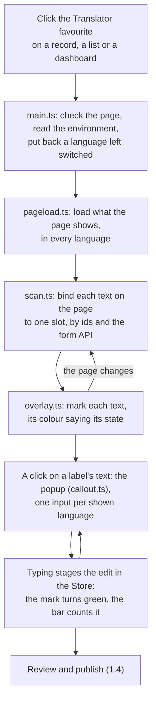

1. **Start.** Clicking the favourite runs `src/main.ts`. It checks the page, keeps one translator per tab
   (`window.__dxTranslator`), and reads the environment (`createCtx` in `src/core/context.ts`: the user, the
   organization, its base language, the provisioned languages and the user's UI language as saved on the server).
   When an earlier save or read was interrupted while the user's language was switched, it switches it back first,
   after asking when that switch is more than 10 minutes old (`src/core/langsession.ts`). Then `createApp`
   (`src/ui/app.ts`) starts translation mode (`createPageMode` in `src/inspector/mode.ts`) and its bar
   (`src/ui/bar.ts`).
2. **Load.** `src/inspector/pageload.ts` works out what the page shows and loads exactly those components into the
   Store, several reads at once, in every language, without asking. On a record: the table (its names, columns and
   choices; its relationships only when the related menu needs them) and the form first, the form's tab and section
   labels of other languages through a short switch of the user's language
   ([1.4](#14-how-a-save-and-publish-work-in-one-page), step 4); then the forms of its quick views, the tables of the
   sub-grids, the command bar, the business process flow, the app and its navigation. On a list: the table with its
   columns and choices, the view, the command bar and the navigation; on a dashboard: the dashboard and the
   navigation. What appears later (a side pane, a quick view, the view of a grid, the related menu, the forms and views
   of an open list of forms or views) is loaded when the page shows it.
3. **Map.** `src/inspector/scan.ts` finds the texts on the page and binds each one to the slot it shows. Which text is
   which comes from the ids Dynamics puts on its elements (controls, tabs, sections, navigation entries, commands,
   process stages, the items of the lists of areas, forms and views) and from the form API, with the known texts of the
   loaded slots as a fallback: the page's structure only says where a text is. A text that names nothing in the app
   (record data, messages, counts, placeholders, empty lists) gets no mark, and a text that cannot be identified stays
   unmarked rather than guessed. The page is read, never changed, with one exception: the text of a label whose staged
   edit is in the user's own language is swapped in place, and put back later (`src/inspector/preview.ts`).
4. **Mark.** `src/inspector/overlay.ts` draws, in a shadow root of its own on `<html>`, a box that hugs the text of
   each label, one box per line of text, coloured by the label's state (table below). The part of a mark that a
   Dynamics flyout, menu, tooltip or side pane covers is cut away, and so is the part under another tool's panel
   (another bookmarklet's window) while that panel is on top. `src/inspector/mode.ts` keeps the marks current as the
   user scrolls, opens tabs and moves from page to page.
5. **Click.** Only a label's text is the label: the hover ring, the pencil (none on a grey label, nor on the name that
   a selector of areas, forms or views shows) and the pointer cursor show over its marks only, and a click on them (or
   within 2 pixels of them) is caught before Dynamics sees it and opens the label's popup next to it
   (`src/ui/callout.ts`; its content comes from `src/inspector/describe.ts`): a kind word and the title, then one block
   per text that can be translated from there, each with one input per shown language, the base language first. A
   field that shows a column has three, always in this order: *Form label* (this form only, shown instead of the column
   name), *Tooltip* (everywhere) and *Column name* (everywhere: views, search and forms without a form label). A form
   label is the form's own text, often a copy of the column's name that the form designer saved when the field was
   added, and it does not follow a later change to the column's name: to change what a form shows, the user edits its
   *Form label*. The caret goes to the *Form label*, the text the page shows, in the page's language (where that one is
   not loaded, to its first input that takes typing), also while it is empty and the page shows the column's name in
   its place; the *Column name* gets it only where the form label can't be typed in (read-only, such as on a form from
   a managed solution). The popup of a list's column header puts it in the column name, also when the column's choices
   open with the popup. What opened the popup can still ask for another text or language, and then that one gets it.
   The popup is laid out, filled and focused before it shows, and shows once its place has held for two frames, fading
   in from its label's side, so it never shows in one place and then jumps to another: opened at an option of one of
   Dynamics' dropdown lists, which closes as the popup takes the focus, it waits for the field and shows there (300 ms
   at most, then wherever it is). Once shown, it stays above or below its label while it nearly fits there, so a
   scroll or a message that makes it taller does not flip it ([9.21](#921-the-popup-uicalloutts)). Right after a move
   to another page, Dynamics draws the new page's labels before the translator sees the move: a click (or F2) then
   reads the page again first and opens only a label the new page's scan finds on the same element, never one matched
   against the previous page ([9.16](#916-clicks-alt-and-f2)). The click does not do what it would do on the page
   (open a tab, run a command, open a process stage, switch to another area, form or view); the popup's own button
   does where it makes sense (**Open**, **Show tab**, **Show stage**, **Change area**, **Change form**, **Change
   view**). Beside the text, a click in a place that only holds the label (a field label's container, a section
   header) reaches the page, and a click in one that acts (a button, a link, a tab, a menu item, a column header, a
   form control, an entry of the navigation that opens a page) does nothing at all, so a near miss never runs a
   command. A click there that only opens or closes something, or picks from a list the user opened, reaches the page
   too: in the navigation, a group's header or its chevron, *Recent*, *Pinned*, the area switcher and the **☰**
   button; a selector of areas, forms or views, which opens its list; an item of that list, which it picks (below).
   With **Alt** held a click reaches the page as usual everywhere. The popup of a grey label says why it cannot be
   translated here, next to a lock, and its inputs are disabled.
6. **Stage.** Every keystroke stages the text in the Store; nothing is written to Dataverse. The mark turns green and
   the bar counts the changes, for example *3 changes*. An emptied translation is staged the same way: the publish
   removes it, or, where Dataverse can't remove one, writes its stand-in, which a line under the input names, for
   example *Becomes “Start date”: Dataverse can't remove a translation here, so French gets the English text.*
   ([1.4](#14-how-a-save-and-publish-work-in-one-page)); an emptied tooltip or other description of a table, column or
   choice is saved empty, and the line says *Saved empty: French users see no tooltip.* **Done**, Enter, Esc or a
   click outside closes the popup and keeps the text; **Undo changes** puts back what the texts were when the popup
   opened.
7. **Find.** **All labels** on the bar opens *All labels on this page*: every label of the page, those not on screen
   too, then the changes made on other pages, each group under a grey band that stays at the top while its rows
   scroll; a click on the band (or Enter or Space) collapses or expands its group, and a search opens the groups to
   show what it finds. A row's place is in its tooltip, and the search finds it. Under **Changed**, every change of
   the page is listed, also one on a tab not shown or in a hidden field. A row finds its label on the page, opening the
   tab or the flyout it is in when that changes nothing but the view, and opens its popup next to the label, or beside
   the sheet where the label is under the sheet or not on screen (`src/inspector/pagelist.ts`,
   `src/inspector/reveal.ts`). The sheet is docked at the right edge; dragged by its header it floats over the page, so
   that what it covered can be clicked, and its pin (*Dock to the right*) or a double-click on its header docks it
   again; the preferences keep which, and where, through a reload.
8. **Publish.** **Review and publish** on the bar, or Ctrl+S with the focus in the translator (on the page itself,
   Ctrl+S is Dynamics' own) ([1.4](#14-how-a-save-and-publish-work-in-one-page)).

| Mark | Meaning |
| --- | --- |
| Blue, dashed | Translated: the target language has a text, or shows one that stands for it, such as the field's column name ([9.14](#914-looks-the-colour-of-a-label-inspectorstatusts)) |
| Amber, dashed (the bar's hint calls it orange) | No text in the target language yet |
| Green, solid | Changed, not published yet |
| Red | A publish failed for this label |
| Grey, dotted | Cannot be translated here: a label of a component from a managed solution, Microsoft's own text that is already shown in every installed language, or another read-only label. Its popup says why |
| No mark | Not loaded, or not a text that names something in the app. Clicks reach the page |

**Labels from a managed solution.** Whether a label can be translated is decided per component, from that
component's own `ismanaged` (`IsManaged` in the metadata): a form or a dashboard decides for its tabs, sections,
cells, header and navigation, the app's navigation for its areas, groups and subareas, a process for its stages and
steps. So an unmanaged form on a managed table can be translated, and so can an unmanaged custom column of a managed
table; a managed column shown on an unmanaged form keeps its *Column name* and *Tooltip* read-only, while that
field's *Form label* can be translated. The reason is the same everywhere, `MANAGED` in `src/core/model.ts`
([4.4](#44-keys-and-slots)): *From a managed solution: a translation here would add an unmanaged layer on top of it.
Translate it where its solution is developed.* The popup of such a label shows it next to a lock, *All labels on this
page* says *Read-only* for it (Microsoft's own locked language-pack names stay *Built-in*), the Workbench leaves it out
unless *Include read-only labels (from managed solutions or not customizable)* is on, an import skips its rows with
*Read-only:* and the reason, the saver refuses it, and an undo skips it with the reason.

**Switching the area, the form and the view.** Three lists of the app switch the page: the app's areas (the area
switcher at the foot of the navigation), the record's forms (the form selector next to the table name in the form
header) and a grid's views (the view selector above a list). `src/inspector/lists.ts` knows their markup and switches
with them. In translation mode they work as usual: a click beside the selector's text (its chevron, its padding) opens
the list. A click on the text opens the popup of the name it shows, the current area's, form's or view's, whose
**Change area**, **Change form** or **Change view** closes the popup and opens the list. While a list is open, every
item is marked like any other label, so that the list shows what can be translated: in its state's colour, or grey
where it cannot be translated here; a personal view (the user's own, not a label of the app) and Microsoft's *Manage
and share views* get no mark. A click beside an item's text picks it, as without the translator; a click on its text
opens its popup, whose **Open** switches to that area, form or view unless it is the current one. A form is switched
through the form API, so Dynamics asks about unsaved changes itself, and only from the list of the record's own form
selector (not a dialog's or a side pane's); an area or a view by opening its list again and clicking the item as soon
as it shows, for 3 seconds at most, else a message says so, for example *Couldn't change the view: the list of views
didn't show it. Pick it from that list on the page.* When the popup of an item reached with the keyboard closes, the
focus goes to the button that opens its list.

**Translation mode on a Project record.** Each label the translator loaded is marked on its own text, its colour
saying its state: blue translated, amber not translated yet, green changed and not published, grey where it cannot be
translated here, such as *Organizations* in the navigation (the account table, from a managed solution). The bar at
the bottom, centred right of the navigation, shows the hint or the number of staged changes, then **Review and
publish**, **All labels**, **Workbench**, **⋯** and **✕** (with three languages or more, also a menu of the
languages).


**The popup of a field.** Next to the label of *Project site*, the form's own *Form label*, its *Tooltip* and its
*Column name*, in that order, each in every shown language, the base language first, its French form label being
typed; the note after each heading says where that text applies.

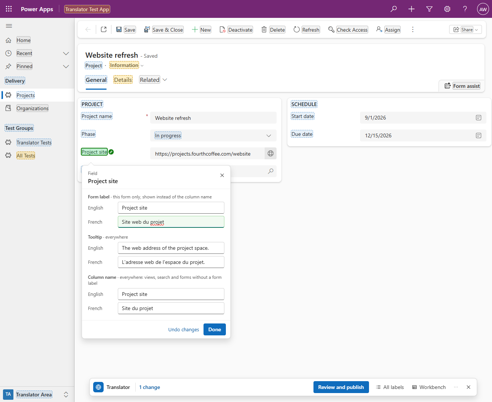

**An emptied translation.** The popup of *Start date* with its French column name emptied. Dataverse can't remove a
column's translation, so the line under the input says what the publish writes in its place, the English text: *Becomes
“Start date”: Dataverse can't remove a translation here, so French gets the English text.* The mark is green.

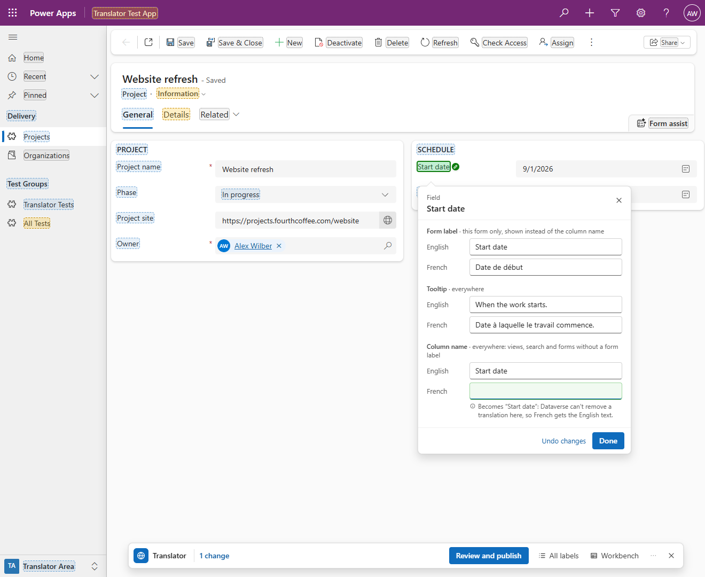

**The list of views of *Projects*.** The view selector open: the views *Active Projects* and *Inactive Projects*
marked, the personal view *My open projects* and *Manage and share views* not.

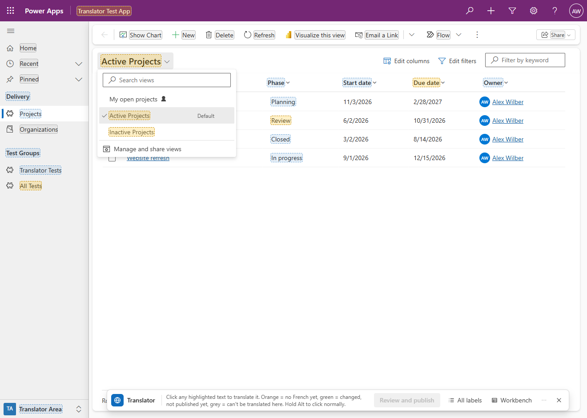

**The popup of a label from a managed solution.** A field of the account form: the reason at the top, next to a lock,
and every input locked.

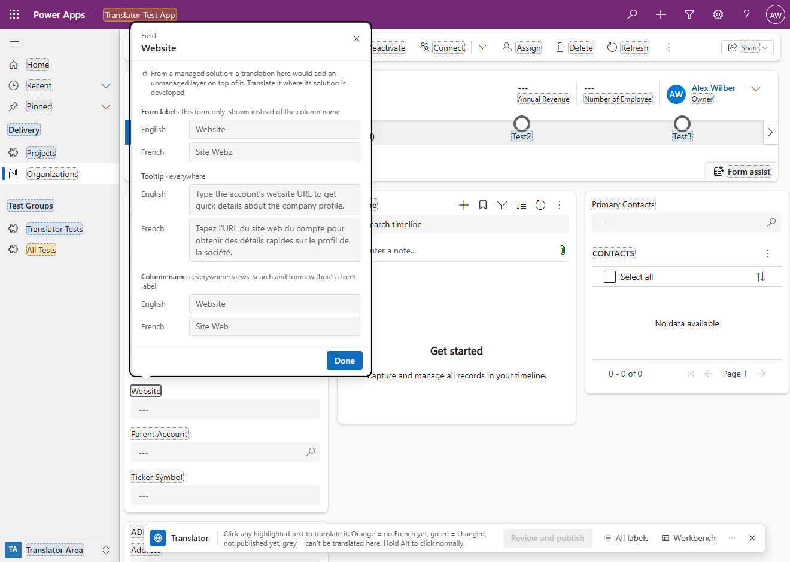

### 1.4 How a save and publish work in one page

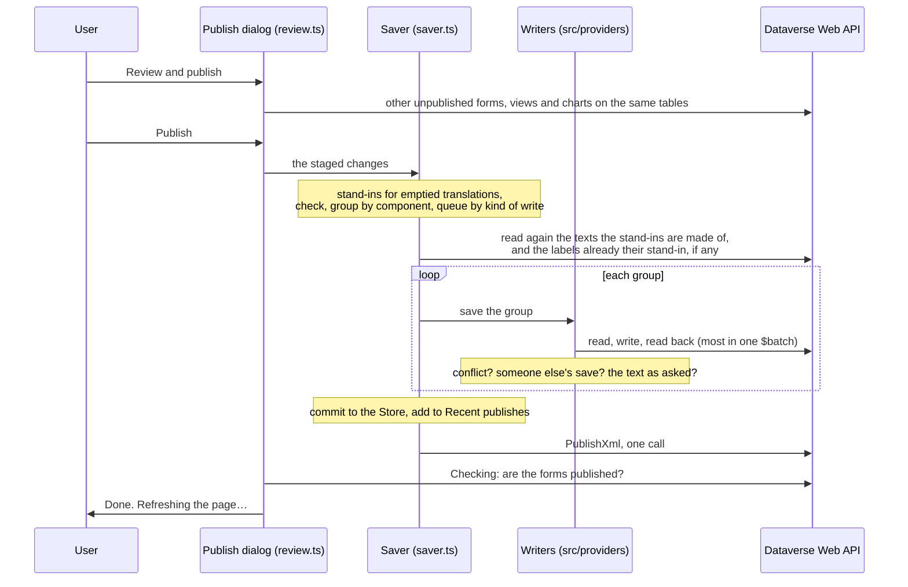

1. **Review.** **Review and publish** on the bar (or Ctrl+S with the focus in the translator, or the Workbench's
   **Save and Publish**) opens the Publish dialog, `src/ui/review.ts`, titled *Publish 3 changes* for three changes:
   one group per text (its title, what it is and where it is), one line per changed language with what it was and what
   it becomes, and **Undo** on each. A translation emptied where Dataverse can't remove one goes to its stand-in
   there, with the note *English text: Dataverse can't remove a translation* (or *The column's French name: Dataverse
   can't remove a translation*); an emptied description of a table, column or choice goes to *(empty)*, with the note
   *Saved empty: French users see no tooltip.* Changes that cannot be saved (a blank base-language text, a text that
   is too long, a read-only label, an emptied translation that has no stand-in) are red and skipped; they stay staged.
   Warnings are amber. Next to **Publish**, one sentence counts the other unpublished forms, views and charts on the
   same tables, which the publish will publish too (or says that it could not check), and a second line names
   everything the publish covers.
2. **Save.** **Publish** (or Ctrl+Enter) hands the changes to the saver, `src/core/saver.ts`. It turns each
   translation emptied where Dataverse can't remove one into its stand-in (but a metadata description, which it saves
   empty), checks every change again, reads again the texts the stand-ins are made of, and the label itself where its
   stand-in is its text already (below), groups the changes by the component they are written with, and queues each
   group by its kind of write:
   * table, column, choice and relationship labels: one write at a time, as Dataverse runs one customization
     operation at a time (LIVE-FINDINGS 4);
   * names and descriptions of records (views, charts, forms, dashboards, apps, processes, modern commands, environment
     variables, custom APIs): up to four at a time;
   * form and dashboard XML (tabs, sections, fields, navigation items): one form at a time, beside the metadata writes;
     a form's own name waits until its XML is written;
   * a group with a stand-in made of a text that another group of the same save writes (a form field label emptied
     while its column's name changes): once the groups above have ended, and that stand-in only when its text was
     saved, else it is held back (below);
   * once all of those have ended: the app's navigation and the stage and step labels of processes, one document at a
     time; then classic command bar labels, one table at a time.

   No metadata or record write runs while the user's language is switched for a form (LIVE-FINDINGS 62).
3. **Each write** ([chapter 6](#6-providers-reading-and-writing-each-kind-of-label),
   [chapter 7](#7-saving-safely)). The writer reads the label right before it writes and compares it with the text the
   edit was made on: if someone changed it since, the change becomes a **conflict**, never an overwrite. A read right
   before the write also checks again that the component does not come from a managed solution: if it does, nothing is
   written and the change fails with the reason `MANAGED` ([1.3](#13-how-translation-mode-works-in-one-page)). It
   writes only the edited languages, except where Dataverse needs every language in the write (table, column, global
   choice, status option and relationship labels): a table or column label written with one language alone also
   overwrites the base language (LIVE-FINDINGS 2), so there the other languages are sent back exactly as just read.
   Every write but the classic command bar's goes in one `$batch` behind one more read of exactly what it writes, which
   shows what the write replaced; what someone else saved in that moment is put back or reported. Then the writer
   reads the label back: a text Dataverse dropped is an error, never "saved". Two short windows remain, which
   Dataverse gives no way to close: a save someone else makes between that last read and the write can still be
   overwritten, by every writer, business process flow definitions included
   ([7.5](#75-the-read-in-the-same-batch-before-each-write)); and a status label's write has to send the status's
   default status reason (without it Dataverse could reset the default), the one read just before it, so a default
   someone else changes in that moment is set back ([6.3](#63-metadatats-tables-columns-choices-and-relationships)).
   Avoid customizing the same component in two places at once while translating.
4. **Form tab and section labels.** Dataverse reads and writes these only in the caller's UI language (LIVE-FINDINGS 8,
   9). So language L is read and written while the user's language is L: one `$batch` switches the language, does the
   work and switches it back, and the switch back runs even when a part in the middle fails (LIVE-FINDINGS 49;
   `src/core/langsession.ts`). The switch lasts as long as that one request, about a second with a form write, and
   nothing on the screen says so: the banner *Your Dynamics language is temporarily French while form labels are
   saved. It switches back automatically.* belongs to the rarer switches made with requests of their own, and to a
   language that could not be switched back, and it shows in the Workbench window only
   ([7.10](#710-switching-the-dynamics-language-for-a-moment)). Field labels need no switch: every language is in the
   form XML.
5. **Journal.** The results are committed to the Store, and the labels this run wrote go into the journal of Recent
   publishes (`src/core/history.ts`) before anything is published, so a failed publish loses nothing. A label found
   already as asked goes in only when a write of that text that this page's translator sent before may have run
   (Dataverse didn't refuse it, and no answer said it was saved), so the write found may be its own; a text someone
   else saved is not this publish's change, and its Undo leaves it alone. The journal is changed by one tab at a time
   ([1.2](#12-what-runs-where)).
6. **Publish.** One `PublishXml` call with every component the save touched (`src/core/publish.ts`), never
   `PublishAllXml`; when another customization holds the lock, the call is tried again after 5, 10, 20 and 40
   seconds. Classic command bar labels are not in it: their writer has already published the table (or the application
   ribbon) itself, before and after its import (step 2). A business process flow whose name was saved is then updated,
   so that the page shows the new name, once a read of its `ismanaged` shows that it is not from a managed solution.
   Labels that need no publish (modern commands, process labels, environment
   variables) are live as soon as they are written.
7. **Check.** The dialog checks that each form the save touched really is published: its published and unpublished
   versions must have the same `versionnumber`.
8. **Refresh.** In translation mode the dialog says *Done. Refreshing the page…*, clears the Dynamics caches that hold
   labels and reloads the page without its warm start (`src/ui/refresh.ts`,
   [chapter 11](#11-refreshing-the-page-and-switching-the-language)). Without that, Dynamics can go on showing
   the old labels for minutes (LIVE-FINDINGS 50, 82). Before the reload it asks when the record has unsaved changes,
   and also when Dynamics can't tell whether it has: *This record may have unsaved changes. Refresh anyway and lose
   them?* After the reload, the next start of the translator checks that the page shows what was published, and says
   something only when it does not, for example *2 changes aren't showing yet*, with **Refresh again**. In the
   Workbench the dialog says *Done. Published 3 changes.* and offers to refresh; a change found already on the server,
   which the translator did not write (step 5), is counted apart, for example *Done. Published 2 changes. 1 change was
   already on the server, so Undo of this publish leaves it alone.*

A problem never ends in a reload: the dialog keeps the failed rows with the reason, and offers **Try again** (the
failed rows only), **Keep mine** or **Use theirs** for a conflict, **Publish again** when the save worked but the
publish did not, and, in translation mode once something was published, **Refresh anyway**.

**The Publish dialog.** Two changes of the Project form, the French form labels of *Project site* and *Goals*, each
under its label's title, what it is and where it is, with one line per changed language from what it was to what it
becomes, and **Undo**; next to **Publish**, what else the publish will publish.

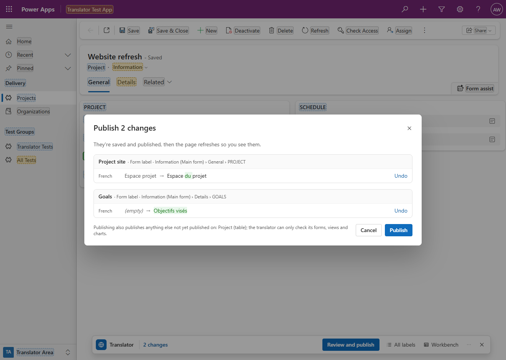

**Time.** Verified in a test environment: a column label write takes 1.4 to 2.5 seconds once Dataverse is warm (the
first about 6), a choice value 0.5 to 1 second, a form XML write 0.4 to 1.5 seconds (LIVE-FINDINGS 44), a `$batch`
with a language switch 0.25 to 0.43 seconds (LIVE-FINDINGS 49), a record label about 0.3 seconds (LIVE-FINDINGS 21),
and publishing a small table 4 to 13 seconds (LIVE-FINDINGS 48). Classic command bar labels take about 20 seconds per
table, and the dialog says so while it waits (*importing (usually 10–20 s)*). From the click on **Publish** to the
reloaded page, a field label and a tooltip took 7.0 seconds (LIVE-FINDINGS 61).

**Undo.** **Recent publishes** (in the bar's **⋯** menu) lists this user's publishes in this environment and browser
for 90 days, each with the texts that publish wrote, never one it found there already and did not write. **Undo**
first reads each label and shows what will happen to it, then writes the earlier texts back through the same saver,
with the same checks: a label someone changed since is left as it is unless the user chooses otherwise, a translation
the publish added where Dataverse can't remove one gets its stand-in, so that the page looks as before (a description
that was stored empty before the publish is saved empty again), and a label of a component from a managed solution is
skipped with the reason ([chapter 8](#8-the-publish-dialog-history-and-undo)).

**Emptying a translation.** A translation emptied in the popup, the editor card or the Workbench, or one that an undo
takes away, is removed where Dataverse can remove one: the names and descriptions of records (views, forms, charts,
dashboards, apps, processes, modern commands…), which `SetLocLabels` with an empty text deletes (LIVE-FINDINGS 33),
and the titles of related menu items and of the app's navigation, removed with their element (LIVE-FINDINGS 38).
Elsewhere a write can add or change a language but never delete one: table, column, choice and relationship labels
(LIVE-FINDINGS 31, 67; an empty text written there is even stored and shown as a blank label, LIVE-FINDINGS 32), form
and dashboard tab, section and field labels (LIVE-FINDINGS 37) and classic button labels (LIVE-FINDINGS 39); and
Dynamics keeps a process stage or step translation once it is stored (LIVE-FINDINGS 83). There the saver writes the
translation's **stand-in** instead, the text that language shows without a translation of its own, so that the page
looks as it would without one:

* a form or dashboard field label whose cell shows a column gets the column's name in that language, else the
  column's base-language name (LIVE-FINDINGS 42: a cell without a label in the user's language shows its column's
  name in that language);
* everything else gets its own base-language text.

**A metadata description is saved empty.** The description of a table, a column (the field's tooltip on forms), a
choice option, a global choice and its options, a Yes/No option, a status or a status reason is the exception: a
translation emptied there, or left only spaces, is written as `''` for that language alone, the other languages as
they are, whatever the base-language text is. Dataverse stores a blank label, and that language's users see no
tooltip or description there (LIVE-FINDINGS 32; verified in a test environment with a column's French tooltip). There
is no stand-in and no refusal (`keepsEmpty` and `savesEmpty` in `src/core/model.ts`). The loaders keep a `''` stored
there as a text of its own, **stored empty** (`storedEmpty`), apart from a missing language, which shows the
base-language text: a stored-empty description counts as translated (the marks, *All labels* and its *Not
translated* filter, the popup, the Workbench), and its empty input says *No French tooltip* (*No French description*);
a missing one stays orange, and its input says what its users see, *Shows “…”* with the English text. Names and labels
keep the stand-in, and the descriptions of views, charts and processes are removed as before.

One rule decides it everywhere, `standIn` in `src/core/model.ts`: for the saver, the popup, the editor card, the text
shown in place on the page, the Publish dialog, the Undo question and the Workbench. The texts a stand-in is made of
count as the save leaves them (a base-language text or a column name written in the same save; for an undo, the texts
it puts back), else as they are on the server. Before anything is written, the saver reads those texts again from the
server, and a stand-in made of one that changed since it was loaded is not written: *Its English text changed on the
server since it was loaded (now “…”), so nothing was written: Try again to put the new text in its place.* A stand-in
made of a text that the same save (or undo) writes in another write, such as a field label emptied while its column's
name changes, is written after that write, and only once that text is saved; else it is held back, and the edit
stays: *Its column's French name wasn't saved, so nothing was written here either: Try again to save both.* A
stand-in that is already the label's text needs no write and no publish (the popup: *Already the English text:
Dataverse can't remove a translation here, so nothing changes.*), but only while the server still holds that text:
the saver reads the label first, and a newer text there is a conflict (*Someone changed this label after you loaded
it.*), never a silent "unchanged". Where no stand-in is known (an empty base-language text, a column with no name in
that language nor in the base language), the emptied translation is refused, saying why; where it waits only for a
text that isn't loaded, the change is held back, saying what to load. An undo skips a label whose stand-in only waits
for a text to be loaded, and the publish stays undoable. What each place says:

* **The popup and the editor card:** a line under the emptied input, for example *Becomes “Start date”: Dataverse
  can't remove a translation here, so French gets the English text.*, or for a field label *… so French gets the
  column's French name.*, and no placeholder in the input; the mark turns green. Under an emptied description: *Saved
  empty: French users see no tooltip.* (*… see no description.*), and the placeholder *No French tooltip*.
* **The Publish dialog:** the row goes from the old text to the stand-in, with the note *English text: Dataverse can't
  remove a translation*; an emptied description goes to *(empty)*, with the note *Saved empty: French users see no
  tooltip.* Recent publishes shows it the same way.
* **The Undo question:** for example *1 translation this publish added gets the English text in its place: Dataverse
  can't remove it.*, each such row going from the text there now to the stand-in, with the same note; after the run,
  the row says *Undone*. Only a translation without a stand-in still says *Stays: Dataverse can't remove it*, with the
  reason. A description the publish translated where it had no translation gets its stand-in too (saved empty where
  the English one is empty as well); one stored empty before the publish is saved empty again, with the note *Saved
  empty: French users see no tooltip.*
* **The Workbench:** a cleared cell is allowed and green, and shows the stand-in in muted italics, its tooltip saying
  why; only a cell without a stand-in stays red. A cleared description cell shows a muted *(empty)*, its tooltip
  saying *Saved empty when you save: French users then see no tooltip. Was “…”.* In an Excel or CSV import, an empty
  cell still means no change.

### 1.5 Repository tour

Every folder and file group of the repository, with one line each. Paths marked *not committed* exist only on your
computer.

| Path | What it is |
| --- | --- |
| [`LICENSE`](../LICENSE) | The MIT license |
| [`README.md`](../README.md) | The documentation for people who use the translator |
| [`CHANGELOG.md`](../CHANGELOG.md) | The changes of each version ([16.5](#165-the-changelog)) |
| [`SECURITY.md`](../SECURITY.md) | How to report a vulnerability, and how the translator is built to be safe |
| [`.gitignore`](../.gitignore), [`.gitattributes`](../.gitattributes) | Which files the repository holds: only those it lists, and in `dist/` only the release builds; text files with LF line endings |
| [`package.json`](../package.json) | Name, version (the translator's version comes from here, [12.9](#129-the-version)), the scripts `build`, `check` and `test`, and the five development packages |
| [`package-lock.json`](../package-lock.json) | The exact versions of the development packages and of the packages they need. `npm ci` installs exactly these ([2.3](#23-install-the-npm-packages)) |
| [`tsconfig.json`](../tsconfig.json) | The TypeScript settings of `npm run check`: strict, ES2022, the DOM types, no output files; it covers `src/` only |
| **[`src/`](../src/)** | **The translator** ([chapter 4](#4-code-architecture) has a map) |
| [`src/main.ts`](../src/main.ts) | The translator's entry point: one translator per tab, the page check, the start |
| [`src/env.d.ts`](../src/env.d.ts) | The two constants the build writes in, `__VERSION__` and `__DEV__`, and style sheets imported as text |
| [`src/core/`](../src/core/) | What everything shares: the requests (`http.ts`, `batch.ts`), the environment (`context.ts`), the data model and the Store (`model.ts`, `store.ts`), the column a form cell shows (`column.ts`, which the stand-ins of emptied field labels use too), helpers for labels, XML, ZIP files, language codes and search (`labels.ts`, `xml.ts`, `zip.ts`, `lcid.ts`, `search.ts`), the user's language (`langsession.ts`, `uilang.ts`), and saving (`saver.ts`, `publish.ts`, `history.ts`) |
| [`src/providers/`](../src/providers/) | One reader and writer per kind of label: `metadata.ts` (tables, columns, choices, relationships), `records.ts` (names and descriptions of records), `formxml.ts` (forms and dashboards), `sitemap.ts` (the app's navigation), `bpf.ts` (process stages and steps) and `ribbon.ts` (classic command bar labels); with `layers.ts`, `repair.ts` and `writelog.ts`, the contracts in `types.ts` and the registry in `index.ts` ([chapter 6](#6-providers-reading-and-writing-each-kind-of-label)) |
| [`src/inspector/`](../src/inspector/) | Translation mode: the controller (`mode.ts`), what to load (`pageload.ts`), mapping the page (`scan.ts`, `parts.ts`), the marks (`overlay.ts`, `pill.ts`, `preview.ts`), the lists of areas, forms and views that switch the page (`lists.ts`), the popup's content (`describe.ts`), the looks of labels (`status.ts`), the column of a form cell (`column.ts`, which re-exports `src/core/column.ts`) and what a label shows in a language it has no text in (`fallback.ts`), *All labels on this page* (`pagelist.ts`, `reveal.ts`), the contracts (`types.ts`) ([chapter 9](#9-translation-mode)) |
| [`src/ui/`](../src/ui/) | The app around both views (`app.ts`), the bar (`bar.ts`), the popup (`callout.ts`), the Publish dialog and Recent publishes (`review.ts`), the refresh (`refresh.ts`), the Workbench's window (`shell.ts`), the shared widgets, the editor card, undo and redo, and the styles |
| [`src/workbench/`](../src/workbench/) | The Workbench: the view (`workbench.ts`), its options (`scope.ts`), the sheets (`sheets.ts`), the grid (`grid.ts`) and the bulk tools (`tools.ts`, with `regex.ts` for Find and replace's regular expressions) ([chapter 10](#10-the-workbench-and-files)) |
| [`src/io/`](../src/io/) | Files: `.xlsx` (`xlsx.ts`), the Easy Translator layout and the import (`workbook.ts`), CSV (`csv.ts`) |
| **[`tools/`](../tools/)** | **The build, the tests and the development tools** (Node.js) |
| [`tools/build.mjs`](../tools/build.mjs) | The build: bundles and minifies the translator and packs it into its link ([chapter 12](#12-building-and-packaging)) |
| [`tools/test.mjs`](../tools/test.mjs) | `npm test`: the unit tests, three checks of the style sheets, and a check that the built link unpacks to exactly its code ([chapter 14](#14-testing-your-changes)) |
| [`tools/serve.mjs`](../tools/serve.mjs) | The optional development server for `dist/` ([2.6](#26-the-development-loop)) |
| [`tools/e2e-suite.js`](../tools/e2e-suite.js), [`tools/e2e-page.js`](../tools/e2e-page.js), [`tools/e2e.js`](../tools/e2e.js) | The live suites. They run in a signed-in tab of a test environment, edit through the translator, check with reads of their own that exactly the intended label changed, and put everything back |
| [`tools/dev/unit.ts`](../tools/dev/unit.ts), [`tools/dev/tests/`](../tools/dev/tests/) | The unit tests: one file of tests per area, a small stand-in for the DOM (`fakedom.ts`) and the helpers each test file gets (`kit.ts`) |
| [`tools/dev/devserver.mjs`](../tools/dev/devserver.mjs) | What the development server answers |
| [`tools/dev/build-e2e.mjs`](../tools/dev/build-e2e.mjs), [`tools/dev/e2e-entry.ts`](../tools/dev/e2e-entry.ts), [`tools/dev/bridge.html`](../tools/dev/bridge.html) | For the live suites: a build of the providers and the saver without any user interface (`dist/e2e-bundle.js`), copies of the suites, and the bridge page that loads them into a Dynamics tab ([2.6](#26-the-development-loop)), all written to `dist/` |
| [`tools/dev/size.mjs`](../tools/dev/size.mjs), [`tools/dev/strs.mjs`](../tools/dev/strs.mjs), [`tools/dev/terser-try.mjs`](../tools/dev/terser-try.mjs) | Size tools: the bytes each source file adds to the minified bundle, the texts in the minified code, and terser settings compared ([12.7](#127-the-size-limit)) |
| **[`dist/`](../dist/)** | **The built files**, which [2.4](#24-build) lists. For development also what `tools/dev/build-e2e.mjs` writes there (the live suite's bundle, copies of the suites and `bridge.html`, [2.6](#26-the-development-loop)), which `.gitignore` keeps out of the repository |
| **[`docs/`](./)** | **Documentation** |
| `docs/developer-guide.md` | This guide |
| [`docs/Dynamics Translator - Technical Reference.docx`](Dynamics%20Translator%20-%20Technical%20Reference.docx) | The README as a Word document |
| [`docs/Dynamics Translator - Developer Guide.docx`](Dynamics%20Translator%20-%20Developer%20Guide.docx) | This guide as a Word document (the same content) |
| [`docs/ARCHITECTURE.md`](ARCHITECTURE.md) | The design rules: the principles, the key of every kind of slot, what each provider must do, the user interface |
| [`docs/LIVE-FINDINGS.md`](LIVE-FINDINGS.md) | The facts verified in a test environment, numbered; the code cites them as "LIVE-FINDINGS n" |
| [`docs/images/`](images/) | Screenshots used by the README and this guide |
| [`docs/gallery/`](gallery/) | The demo as GIF and MP4 |
| `node_modules/` | *Not committed.* The development packages, installed by `npm ci` |

---

## 2. Getting set up

This chapter takes you from an empty computer to a working build, your build installed in Edge, a development loop
and a test environment.

### 2.1 Tools

| Tool | Version | What it is used for |
| --- | --- | --- |
| **Node.js** | 21.2 or later; version 1.0.0 was built and tested with Node.js 22 | Runs the build, the tests and the development server. esbuild 0.25 needs Node.js 18 or later. `tools/test.mjs` compiles the unit tests for Node.js 20, but about 80 of them fail before Node.js 21, which added the global `navigator`: `src/core/lcid.ts` names languages in the language of `navigator.language`. The tests of ZIP files and of the link's loader use Node's own `Blob`, `Response`, `CompressionStream` and `DecompressionStream`, which handle `deflate-raw` from Node.js 21.2 on (20.12 on the 20 line) |
| **npm** | The one that comes with Node.js; `npm ci` needs npm 7 or later, because the lock file has `lockfileVersion` 3 | Installs the five development packages and the packages they need |
| **Git** | Any recent version | Getting the code and keeping track of your changes |
| **An editor** | Visual Studio Code is a good choice: it reads `tsconfig.json` and shows type errors as you type | Editing |
| **Microsoft Edge** | A current version; the code is compiled for Edge 110 and later | Running and testing the translator, with its developer tools (F12) |
| **A Dataverse environment for testing** | One with at least two languages, where you are System Administrator or System Customizer | Testing your changes ([2.7](#27-a-test-environment)). Never test in production |

The translator needs no library at run time, and the repository has no framework, no linter configuration and no
test framework: `tools/test.mjs` and `tools/dev/unit.ts` are a small test runner of their own. The build and the
tests call only Node.js and the npm packages, so they run on any operating system. The unit tests expect English
language names, though: Node.js takes `navigator.language` from the locale of the operating system (on Windows, the
regional format, not the display language), and where that is another language, about 75 of them fail. The commands
in this guide are written for PowerShell on Windows; the `npm` and `node` commands are the same in other shells.
[Chapter 16](#16-releasing-a-new-version) also uses a few PowerShell commands to check, copy and checksum files; for
the checksums it gives the command for macOS and Linux too.

### 2.2 Get the code

```powershell
git clone https://github.com/kevins/DynamicsTranslator.git
cd DynamicsTranslator
```

For a fork, use your own account's address instead.

### 2.3 Install the npm packages

```powershell
npm ci
```

`package.json` lists five development packages. `package-lock.json` holds their exact versions and those of the
packages they need (`lockfileVersion` 3). `npm ci` installs exactly these into `node_modules/` (it empties the folder
first) and never changes the lock file, so a build gets the same packages that built the release. Use it for every
release build ([16.2](#162-build-and-test)). `npm install` works too and keeps the locked versions while they satisfy
`package.json`, but it may rewrite `package-lock.json`: commit such a change only on purpose.

| Package | Locked version | Used by | What for |
| --- | --- | --- | --- |
| `esbuild` | 0.25.12 | `tools/build.mjs`, `tools/test.mjs`, `tools/dev/build-e2e.mjs`, `size.mjs` and `terser-try.mjs` | Bundles the TypeScript of each entry point into one script, and minifies the style sheets ([12.2](#122-bundling-with-esbuild)) |
| `terser` | 5.51.2 | `tools/build.mjs`, `tools/dev/terser-try.mjs` | Minifies the bundle a second time ([12.3](#123-minifying-with-terser)) |
| `@gfx/zopfli` | 1.0.15 | `tools/build.mjs` | Compresses the code more tightly than zlib ([12.4](#124-compressing-with-zopfli)) |
| `@xmldom/xmldom` | 0.9.12 | `tools/test.mjs` | Stands in for the browser's `DOMParser` and `XMLSerializer` in the unit tests |
| `typescript` | 5.6.3 | `npm run check`, `tools/dev/strs.mjs` | Checks the types of `src/`; `strs.mjs` uses its parser to measure the strings in the minified code |

The lock file has 42 entries: these five, the packages they need, and esbuild's program for each operating system and
processor, of which npm installs only the one for yours (17 packages in all on Windows x64). Nothing from
`node_modules/` ends up in the favourite: `src/` imports no package.

### 2.4 Build

```powershell
npm run build
```

`npm run build` runs `node tools/build.mjs`, the `build` script of `package.json`. The script finds the repository
from its own location, so `node <path>/tools/build.mjs` works from any folder too. It takes several seconds and prints
two lines, for example:

```text
translator: bundle (readable) 1064.4 KB | minified 623.8 KB | deflated 208.2 KB | bookmarklet 267,280 bytes (261.0 KB)
OK: 1,732,720 characters below the Edge limit.
```

The first line gives the size of the readable bundle, of the minified code, of that code compressed, and the length
of the link, which carries the compressed code as text. The second is how far the link stays under the build's limit
of 2,000,000 characters ([12.7](#127-the-size-limit)). Each build writes three files into `dist/`:

| File | What it is |
| --- | --- |
| `translator.debug.js` | The translator as one readable script, not minified (a little over 1 MB). It can be run in a page's console while you develop ([2.6](#26-the-development-loop)) |
| `translator.min.js` | The exact code the favourite runs, minified (about 625 KB). It can also be pasted into the browser's console |
| `translator.bookmarklet.txt` | The link: `javascript:` followed by a small loader that carries the minified code compressed and unpacks it in the browser (about 267,000 characters) |

These three files are also the files of a release, with `SHA256SUMS.txt` ([16.6](#166-tag-and-publish)).

Two options change the build, both for development only:

| Option | What it does |
| --- | --- |
| `--fast` | zopfli tries 5 times instead of 60 to compress the code. The build is a few seconds quicker, and the link comes out a few dozen characters longer |
| `--dev` | The readable bundle is built with `__DEV__` set to `true`: messages in the console, and the test handles on `window.__dxtDev` ([2.6](#26-the-development-loop)). The minified code and the link are the same as without it |

Through npm, options go after `--`: `npm run build -- --dev --fast`.

The build stops with an error when:

* esbuild cannot compile or bundle the code: a syntax error, or an import that does not lead to a file. esbuild prints
  the file and the line.
* The compressed code does not unpack to exactly the code ("Compression round-trip failed."), or the text in the link
  does not decode to exactly the compressed code ("Base-85 round-trip failed."). Neither should ever happen.
* The link reaches 2,000,000 characters, for example "FAIL: the translator bookmarklet is 2004113 characters; Edge
  needs it under 2000000." The build ends with exit code 1 after it has written its files, so `dist/` then holds the
  build that is too large ([12.7](#127-the-size-limit)).

A type error does not stop the build: esbuild removes the types without checking them. `npm run check` finds type
errors ([2.8](#28-checks-before-you-commit)).

### 2.5 Install your build in Edge

The favourite's address is the whole content of `dist/translator.bookmarklet.txt`: one line of about 267,000
characters that starts with `javascript:`.

1. Copy the whole content of `dist/translator.bookmarklet.txt`, for example with
   `Get-Content dist\translator.bookmarklet.txt -Raw | Set-Clipboard`.
2. Show the favourites bar: **Ctrl+Shift+B**.
3. Add any page to the favourites bar (**Ctrl+D**, folder *Favourites bar*).
4. Right-click the new favourite, select **Edit**, name it *Translator*, replace its URL with the link, then **Save**.

Pasting the link into the address bar does not run it: the browser removes the `javascript:` part of pasted text.

A favourite keeps the link it was made with. After each build, replace it: edit the favourite and paste the new link
(the content of `dist/translator.bookmarklet.txt`) as its URL. To see which version a favourite runs, open **⋯** on
the translator's bar (or **More** in the Workbench's title bar): the last line of the menu is
*Dynamics Translator 1.0.0*. Two builds of the same version look the same there, so after a change, look for the
change itself.

To use it, open a page of an app in your test environment, for example a record at
`https://contoso.crm.dynamics.com/main.aspx?...`, and click the favourite. Choose a record of a table of your own: on
Microsoft's own tables and forms, such as account and contact, almost every label is grey and read-only, because they
come from managed solutions ([2.7](#27-a-test-environment)). On a page that is not Dynamics it only shows an alert:
"Open a Dynamics 365 / Power Apps model-driven app (https://&lt;org&gt;.crm.dynamics.com/main.aspx…), then click the
bookmark again." Clicking the favourite while the translator runs brings the running translator forward (the bar
pulses, or the Workbench's window comes back) instead of starting a second one. When **Review and publish** in
translation mode has published everything, the page reloads, which ends the translator: click the favourite again to
go on. In the Workbench the page does not reload; the Publish dialog offers **Refresh page** instead.

**Without the favourites bar.** `dist/translator.min.js` is the code the link carries, without the loader. Paste it
into the console of the developer tools (F12, **Console**) on a page of the app and press Enter: the translator starts
as it does from the favourite. The first time, Edge may ask you to type *allow pasting*. Use this where a browser
policy blocks `javascript:` favourites.

### 2.6 The development loop

The quickest loop needs no favourite: build, then run the readable bundle in a page of the test environment.

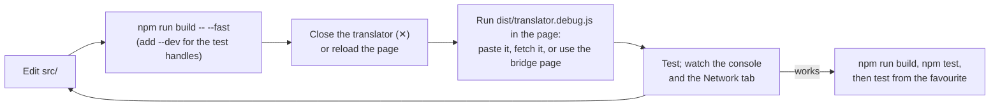

1. **Edit** the code in `src/`.
2. **Build**: `npm run build -- --fast`, with `--dev` when you want the console messages and the test handles
   (below).
3. **Close the translator** on the page (**✕** on its bar), or reload the page. On a record, a list or a dashboard,
   the **✕** of the Workbench's window (*Back to page (Alt+1)*) goes back to the page, as **Alt+1** does: the
   translator goes on running, and the **✕** of the bar that comes back closes it. On any other page, where the
   translator opens only the Workbench, that **✕** (*Close*) closes the translator (`winClose` in `src/ui/app.ts`).
   A translator that is still open would only be brought forward: `src/main.ts` starts a new one only once the
   running one was closed. Instead of closing it, you can run `window.__dxTranslator.destroy()` in the console: it
   removes the translator from the page and drops its staged changes without a question; it returns `false`, and
   removes nothing, while a save or a publish runs.
4. **Run** `dist/translator.debug.js` in the page, in one of the three ways below.
5. **Test** ([chapter 14](#14-testing-your-changes)). Errors appear in the console (F12). The translator's requests are
   in the **Network** tab: filter on `api/data/v9.2`.
6. **Build for real** when the change works: `npm run build` without `--fast`, then `npm test`, replace your favourite
   ([2.5](#25-install-your-build-in-edge)) and test once more from it: the minifiers, the loader and the size limit
   only come into play there ([chapter 12](#12-building-and-packaging)).

There are three ways to run the bundle in the page.

**Paste it.** Open `dist/translator.debug.js`, copy all of it, paste it into the console and press Enter. The names
are readable, and a `debugger;` statement you add to the source stops in the **Sources** tab.

**Fetch it from the development server.** `node tools/serve.mjs` serves the files of `dist/` at
`http://127.0.0.1:8765` (for another port: `node tools/serve.mjs 9000`) and prints the folder and the port. Then, in
the console of the Dynamics page:

```js
(0, eval)(await (await fetch('http://127.0.0.1:8765/translator.debug.js')).text())
```

The server listens on the loopback address only, serves no file outside `dist/`, and sends every file with
`Cache-Control: no-store`, so each fetch gets the latest build. It answers only requests addressed to it by the name
`127.0.0.1`, `localhost` or `[::1]` (a page whose own name was pointed at 127.0.0.1 reads nothing), and only
`GET`, `HEAD` and the browser's `OPTIONS` check. It lets only `https` pages whose host ends in `.dynamics.com`
read its answers, and to those it also sends the header Chromium asks for before a public site may reach a local
address (`Access-Control-Allow-Private-Network`). If Edge still refuses or asks about the request, use the bridge
page.

`tools/dev/devserver.mjs`, `corsOrigin`:

```js
export function corsOrigin(origin) {
  try {
    const u = new URL(origin);
    return origin && u.protocol === 'https:' && /\.dynamics\.com$/.test(u.hostname) ? origin : null;
  } catch {
    return null;
  }
}
```

`tools/dev/devserver.mjs` exports the parts `tools/serve.mjs` puts together, which `tools/dev/tests/devserver.ts`
tests on a real loopback socket: `serveDir(root)`, the request handler; `fileIn(root, url)`, the file of `root` that a
request path names, or `null` when the path leads out of it (`..` through an encoded separator, `%2f`, and `%5c` on
Windows, or into a sibling folder whose name starts the same, such as `dist-private` next to `dist`);
`localHost(host)`; and `corsOrigin(origin)` above.

| Request | Answer |
| --- | --- |
| A `Host` other than `127.0.0.1`, `localhost` or `[::1]`, with any port | 403 |
| A method other than `GET`, `HEAD` or `OPTIONS` | 405, with `Allow: GET, HEAD, OPTIONS` |
| `OPTIONS` | 204 |
| A path with a malformed escape (`/bad%`) | 400 |
| A path outside `dist/` | 403 |
| No such file | 404 |
| A file | 200, with `Content-Type` `text/javascript; charset=utf-8` for `.js`, `text/html; charset=utf-8` for `.html`, else `text/plain; charset=utf-8` |

Every answer has `Cache-Control: no-store`, `Access-Control-Allow-Methods: GET, OPTIONS` and
`Access-Control-Allow-Headers: *`, and, for a Dynamics origin only, `Access-Control-Allow-Origin` and
`Access-Control-Allow-Private-Network: true`. The server and the bridge page below accept `.dynamics.com` only, not the
other hosts `src/main.ts` accepts (`.dynamics.us`, `.microsoftdynamics.us`, `.dynamics.cn`, `.appsplatform.us`): for
an environment there, change `corsOrigin` and the check of `back` in `tools/dev/bridge.html`, or paste the bundle.

**Use the bridge page.** `dist/bridge.html`, which `tools/dev/build-e2e.mjs` copies there from
`tools/dev/bridge.html`, is a page of the development server. It fetches the files named in its address, puts their
code into `window.name` behind the prefix `dxt-dev:`, and then opens the Dynamics page given as `back`:

```text
http://127.0.0.1:8765/bridge.html?f=translator.debug.js&back=<a page of your Dynamics environment, URL-encoded>
```

`f` names files of `dist/` only (letters, digits, `.`, `_` and `-`, ending in `.js`), several separated by
commas, which are joined in that order; without `f` it loads `translator.debug.js`. `back` is required, and must be
an `https` address whose host ends in `.dynamics.com`: otherwise the page shows an error and opens nothing. Back on
the Dynamics page, run the code from the console with `(0, eval)(window.name.slice(8))`. The live suites are loaded
this way ([chapter 14](#14-testing-your-changes)).

`tools/dev/bridge.html`, the loading:

```js
try {
  let code = '';
  for (const f of files) {
    const r = await fetch(f + '?' + Date.now(), { cache: 'no-store' });
    if (!r.ok) throw new Error(`${f}: HTTP ${r.status}`);
    code += (await r.text()) + '\n;\n';
  }
  window.name = 'dxt-dev:' + code;
  s.textContent = 'Loaded ' + code.length + ' chars; returning…';
  location.href = back.href;
  // ...
```

**The test handles.** In a bundle built with `--dev`, `__DEV__` is `true`. The translator then writes messages that
start with `[translator]` to the console (each save's report with the number of requests, and the errors it catches
on the way), and once it has started, it leaves its parts on `window.__dxtDev`: the context, the Store, the language
switcher, the providers and the app's interface, with `app.dev` for translation mode, the bar, the list and
`noRefresh`, which keeps the page from reloading after a publish. [4.7](#47-the-dev-hooks-window__dxtdev) shows where
they are set and lists each member. They are removed when the translator is closed. The minified code never contains
any of this: `tools/build.mjs` always builds it with `__DEV__` set to `false`
([12.2](#122-bundling-with-esbuild)). Without `--dev`, the translator writes to the console only errors it did not
expect and the details of an XML safety check that failed ([chapter 7](#7-saving-safely)).

**The live suite's files.** `node tools/dev/build-e2e.mjs`, run from the root of the repository (its paths are
relative), builds `dist/e2e-bundle.js` from `tools/dev/e2e-entry.ts`: the providers and the saver without any user
interface, which set `window.__dxtDev` with `ready: true`. It also copies `tools/e2e-suite.js`, `tools/e2e-page.js` and
`tools/dev/bridge.html` into `dist/`. [Chapter 14](#14-testing-your-changes) explains the suites and what they need.

### 2.7 A test environment

The translator writes customizations and publishes them. Test it only in an environment where you are allowed to do
that, never in production: a publish also publishes whatever else is unpublished on the tables and other components
it publishes (the Publish dialog names them and counts the other unpublished forms, views and charts it finds,
[chapter 8](#8-the-publish-dialog-history-and-undo)).

Customize the components you test in one place at a time. A change someone saves elsewhere (another tab, the maker
portal) in the moment between the translator's last check and its write can still be overwritten, and a status
label's save sends the default status reason it read just before, so a default changed elsewhere in that moment is set
back to that one ([chapter 7](#7-saving-safely)).

It translates only components that do not come from a managed solution. A label whose component comes from one (its
own `ismanaged`, `IsManaged` in the metadata) is read-only, whatever its managed properties allow: a translation saved
there would add an unmanaged layer on top of it ([1.3](#13-how-translation-mode-works-in-one-page)). Microsoft's own
tables and forms, such as account and contact, come from managed solutions, so on them almost every label is marked
grey, and its popup says, next to a lock, *From a managed solution: a translation here would add an unmanaged layer on
top of it. Translate it where its solution is developed.* Test with components of your own, in the environment where
their unmanaged solution is developed.

You need:

1. **A Dataverse environment with at least two languages**: the base language and one more, enabled for the
   environment in the Power Platform admin center (enabling a language takes a few minutes). The translator works with
   the provisioned languages; with the base language alone there is nothing to translate into, and its **⋯** menu
   offers **Refresh page** but no *Show Dynamics in*.
2. **A role that can customize**: System Administrator or System Customizer.
3. **Components of your own, made for testing**, in an unmanaged solution with a publisher of its own and a short
   prefix, for example `contoso`, so that their names start with `contoso_` and are easy to tell apart. The set below
   reaches every kind of label. Components imported in a managed solution are read-only, as Microsoft's are.
4. **A model-driven app** that holds them, so that you can open a record, a list and a dashboard.

| Component | What to give it | What it lets you test |
| --- | --- | --- |
| A table, for example `contoso_project`, with a few columns: text, a choice, a Yes/No, a choice with several values allowed, a lookup to a second table `contoso_client` | French names for some columns, none for others | Table, column and choice labels; amber marks where a translation is missing; each value of a multi-select as a label of its own; an emptied French name: Dataverse can't remove it, so the English name is saved in its place; an emptied French column description (the field's tooltip): saved empty, so French users see no tooltip |
| Its main form, with two tabs, sections, one column placed twice, a sub-grid and a quick view of the client | French labels for some tabs and fields | Form tab and section labels, which need the language switch ([1.4](#14-how-a-save-and-publish-work-in-one-page), step 4); a field's *Form label*, *Tooltip* and *Column name*; an emptied *Form label*, saved as the column's French name (its English name where it has no French one), and where the same publish changes that name, written after the column and only once the name is saved; the other copy of a field; quick view fields |
| A second main form of the table | | The form selector in the record's header: its **Change form** opens the list of forms, where both forms are marked and the other form's **Open** switches to it ([chapter 9](#9-translation-mode)) |
| A view of the table with a column of the related table, and a personal view of the table | | Column headers, and a related column's header, such as *Name (Client)*, as two labels. The view selector above the list: its **Change view** opens the list of views, where the table's views are marked, the personal view and *Manage and share views* are not, and another view's **Open** switches to it |
| A global choice used by two columns | | A change that applies to every column that uses the choice |
| The app's navigation, with two areas, each with a group and a subarea | | Navigation titles and descriptions. The area switcher at the foot of the navigation: its **Change area** opens the list of areas, where the areas are marked and the other area's **Open** switches to it |
| A business process flow on the table, with two stages and a step | | The process name, stage names and step labels |
| A modern command on the table's command bar, and a classic button with a label of its own, if you have one | | Modern command labels (live as soon as they are saved), and classic command labels (a translation import of about 20 seconds per table) |
| A dashboard | | Dashboard names, tabs and sections |
| A table from a managed solution, such as account, in the app, with a column, a view and a business process flow of your own on it | | Read-only labels: grey marks, the popup's lock and reason, rows the Workbench leaves out unless *Include read-only labels (from managed solutions or not customizable)* is on. And the rule per component: your column, view and process can be translated, the table's names and the labels of its main form cannot (in the popup of your column on that form, its *Column name* and *Tooltip* can be translated, its *Form label* cannot) |

After a test, **Recent publishes** › **Undo** writes the earlier texts back
([chapter 8](#8-the-publish-dialog-history-and-undo)). It covers only the texts the translator sent: a text the
publish found already on the server, which the translator had not sent (someone saved the same text), is not in its
entry, and the Workbench's Publish dialog ends saying so, for example *Done. Published 2 changes. 1 change was already
on the server, so Undo of this publish leaves it alone.* A translation the publish added where there was none is
removed where Dataverse can remove one, for example from a view's or a form's name, a related menu item or a title of
the app's navigation (LIVE-FINDINGS 33, 38). Where it can't, on table, column, choice and relationship labels, on form
and dashboard tab, section and field labels, on classic command labels and on a process stage or step translation
Dynamics keeps (LIVE-FINDINGS 31, 32, 37, 39, 67, 83; [chapter 3](#3-dataverse-concepts-used-by-the-translator)), Undo
writes its stand-in instead: the text that language shows where the label has no translation of its own. That is the
label's own base-language text, or for a form or dashboard field label its column's name in that language, else the
column's base-language name (LIVE-FINDINGS 42), as the Undo leaves them. The Undo question says so before anything is
written, for example *1 translation this publish added gets the English text in its place: Dataverse can't remove
it.*, and the label's row shows the text it gets ([8.11](#811-undoing-a-publish-the-preview)). The page then looks as
it did before the test, but the label now has a translation of its own with that text, which stays as it is when the
base-language text changes later. A translation without a stand-in stays (*Stays: Dataverse can't remove it, and its
English text is empty*): one whose base-language text is empty, or whose column has no name in either language (a
table's, column's or choice's description with an empty base-language text is saved empty instead: its users saw no
text there before the publish either). A description that was stored empty before the publish is saved empty again.
Where the stand-in is unknown only because a text it is made of isn't loaded (a field's column names, or a tab's or
section's base-language text read without the language switch), Undo leaves that label, says what to load, and stays
available to try again. Where the stand-in is the column's earlier name, which the same Undo puts back, the field
label is written after the column, once that name is back; when the name isn't saved, the label is left too, saying so
(*Its column's French name wasn't saved, so nothing was written here either: Try again to save both.*). Test these
labels on components where such a translation does not matter. The live suites need components of their own;
[chapter 14](#14-testing-your-changes) says which.

### 2.8 Checks before you commit

```powershell
npm run check
npm run build
npm test
```

* `npm run check` runs `tsc --noEmit -p .`: it checks the types of `src/` and writes nothing. It must print nothing.
  The build does not check types (esbuild removes them unchecked), and `tsconfig.json` covers `src/` only: the
  tests in `tools/dev/` are compiled by esbuild without a type check.
* `npm run build` must end with its `OK: ... characters below the Edge limit.` line ([2.4](#24-build)).
* `npm test` runs the unit tests (1004 at the time of writing, ending with a line such as *1004/1004 passed*), three
  checks of the style sheets, and checks that the link unpacks to exactly `translator.min.js`, uses only safe
  characters and stays under the limit. It takes about a minute and ends with exit code 0 when everything passed.
  Run it after the build: its last checks read `dist/`.
* Test the change in your test environment from the built favourite ([chapter 14](#14-testing-your-changes)); when you
  changed a provider or the saver, run the live suite too.
* Commit the changed source and `dist/` together, so that the published link always runs the published source. Build
  the files you commit without `--dev` and without `--fast` ([16.4](#164-check-the-built-files)).
* For a release, raise the version ([chapter 16](#16-releasing-a-new-version)).

---

## 3. Dataverse concepts used by the translator

This chapter explains the parts of Dataverse and of the Dynamics 365 web client that the translator reads and writes,
and shows where each one appears in the code. It assumes you know JavaScript and the web, but not Dataverse. Many of
these parts are not documented, or behave in ways the documentation does not mention. They were checked in a test
environment, and [3.15](#315-facts-the-translator-relies-on-and-how-they-were-verified) lists each such fact, how it
was checked and the code that depends on it. The code cites these facts by their number in `docs/LIVE-FINDINGS.md`
("LIVE-FINDINGS 2"); this guide uses the same numbers.

A few words first. **Dataverse** is the database and platform behind Dynamics 365 and Power Apps model-driven apps. It
stores data in **tables** (also called entities) made of **columns** (also called attributes), and describes them with
**metadata**: the definitions of the tables, columns, choices and relationships. The **Web API** is Dataverse's REST
API at `<environment URL>/api/data/v9.2/`, based on the OData standard. The page people work in, `main.aspx`, is the
**Unified Interface**, the web client of model-driven apps, called UCI in the code; its client API is the global
object `Xrm`. A **maker** is anyone who customizes the apps. [Appendix B](#appendix-b-glossary) collects these terms.

### 3.1 Where each kind of label is stored

Dataverse has no single store for translations. Each kind of label lives in its own place, is read and written with
its own requests, and has its own rules for publishing and for removing a translation. The sections after this one
take them one at a time; this table is the map. The last column names the provider that handles the kind
([chapter 6](#6-providers-reading-and-writing-each-kind-of-label)).

| Labels | Stored in | Read with | Written with | Published with | Can a translation be removed? | Provider |
| --- | --- | --- | --- | --- | --- | --- |
| Table: name, plural name, description | The table definition ([3.4](#34-the-metadata-web-api-tables-columns-choices-and-relationships)) | `EntityDefinitions(LogicalName='…')` | A sparse `PUT` carrying every language ([3.5](#35-writing-metadata-labels-mergelabels-and-the-base-language-trap)) | `<entity>` | No; an emptied description is saved empty | `src/providers/metadata.ts` |
| Column: name, description (the field's tooltip on forms) | The column definition | `EntityDefinitions(…)` with `$expand=Attributes` | A sparse `PUT` carrying every language | `<entity>` | No; an emptied description is saved empty | `src/providers/metadata.ts` |
| Choice options, Yes/No options, status reasons: label and description | The column's option set | The column cast to its type, with `$expand=OptionSet` | `UpdateOptionValue`, only the edited languages | `<entity>` | No; an emptied description is saved empty | `src/providers/metadata.ts` |
| Status (`statecode`) options: label and description | The column's option set | The same | `UpdateStateValue`, every language | `<entity>` | No; an emptied description is saved empty | `src/providers/metadata.ts` |
| Global choice: name, description, options | The global choice definition | The columns' `OptionSet`, or `GlobalOptionSetDefinitions(<MetadataId>)`; `GlobalOptionSetDefinitions(Name='…')` before a write | A sparse `PUT` (name, description); `UpdateOptionValue` (options) | `<optionset>` | No; an emptied description is saved empty | `src/providers/metadata.ts` |
| Relationship: related menu label | The relationship definition | The table's relationships, expanded; `RelationshipDefinitions(<id>)` before a write | A `PUT` of the whole definition | `<entity>` of both tables | No | `src/providers/metadata.ts` |
| Names and descriptions of views, charts, forms, dashboards, apps and business process flows; modern command texts; environment variables; custom APIs | Localizable columns of their rows ([3.6](#36-records-with-localizable-columns-retrieveloclabels-and-setloclabels)) | `RetrieveLocLabels` | `SetLocLabels`, only the edited languages | Views, charts, forms: `<entity>`; dashboards: `<dashboard>`; apps: `<appmodule>`; the others: nothing | Yes | `src/providers/records.ts` |
| Form and dashboard tab and section labels | The form XML, one copy per user language ([3.7](#37-form-xml-and-labels-stored-per-user-language)) | `RetrieveUnpublishedMultiple` or `RetrieveUnpublished`, with the user's UI language switched to each other language | `PATCH systemforms(<id>)`, the same way | `<entity>` or `<dashboard>` | No | `src/providers/formxml.ts` |
| Form and dashboard field labels (body, header and footer cells), form navigation items | The form XML, every language inline | `RetrieveUnpublishedMultiple` or `RetrieveUnpublished` | `PATCH systemforms(<id>)` | `<entity>` or `<dashboard>` | Navigation items only | `src/providers/formxml.ts` |
| App navigation: areas, groups, subareas (title and description) | The sitemap XML ([3.8](#38-the-sitemap)) | `RetrieveUnpublishedMultiple` | `PATCH sitemaps(<id>)` | `<sitemap>` | Yes | `src/providers/sitemap.ts` |
| Business process flow stages and steps | `StepLabel` entries of the process definition ([3.9](#39-business-process-flows-xaml-clientdata-and-the-names-dynamics-keeps)) | `workflows` (`xaml`, `clientdata`); on a record page also `GetClientMetadata` | `PATCH workflows(<id>)` | Nothing | No, once Dynamics has stored one | `src/providers/bpf.ts` |
| Classic command bar (ribbon) button labels | LocLabels of the ribbon customizations ([3.10](#310-the-classic-ribbon-ribbondiffxml-loclabels-and-a-translation-import)) | `ribbondiffs` | `ImportTranslation`, naming a temporary solution | `<entity>`, or `<ribbons>` for the application ribbon, before and after the import | No | `src/providers/ribbon.ts` |

"Published with" names the element of `PublishXml` ([3.11](#311-publishing-publishxml)). "Nothing" means the new text
shows without a publish.

**Emptying a translation that can't be removed.** Where the table says "No", a language that has a text keeps one: a
write can change it, never remove it. A metadata label written as `""` shows that language's users an empty label
(LIVE-FINDINGS 32, [3.3](#33-labels-label-localizedlabels-and-userlocalizedlabel)); a form or dashboard label or a
classic button label written empty keeps its old text (LIVE-FINDINGS 37, 39), and the page goes on showing a process
stage or step name Dynamics has stored after its label is removed (LIVE-FINDINGS 83). So a translation emptied in the
translator (in the popup, the editor card or the Workbench, or by the undo of the publish that added it) is written as
its **stand-in**: the text that language shows where the label has no translation of its own, so that the page looks
as it would without one. Where Dataverse can remove the translation (a localizable column of a row, through
`SetLocLabels`; a form navigation item's title or an app navigation title, with its element; LIVE-FINDINGS 33, 38), it
is removed. `canClear` in `src/core/model.ts` tells the two apart, and `standIn` is the rule:

* a form or dashboard field label whose cell shows a column gets the column's name in that language, else the column's
  base-language name: a field without a label in the user's language shows the column's name (LIVE-FINDINGS 42).
  `columnOf` in `src/core/column.ts` tells whether a cell shows a column (a sub-grid, a quick view or a web resource
  does not); `src/inspector/column.ts` re-exports it for the page's code;
* every other label gets its own base-language text: the names of tables, columns, choices and relationships, form and
  dashboard tab and section labels, the label of a cell that shows no column, classic button labels, and a process
  stage or step translation that Dynamics keeps
  ([3.9](#39-business-process-flows-xaml-clientdata-and-the-names-dynamics-keeps)).

The descriptions of metadata components are the exception (`keepsEmpty` and `savesEmpty` in `src/core/model.ts`): the
description of a table, a column (the field's tooltip), a choice option, a global choice and its options, a Yes/No
option, a status or a status reason, emptied in a language other than the base language, is written as `''` for that
language alone, whatever the base-language text is. Dataverse stores it as a blank label, and that language's users
see no tooltip or description there (LIVE-FINDINGS 32): `standIn` gives no stand-in for it. Only an undo that takes
away a translation the publish added where that language had none (`untranslated`,
[8.12](#812-undoing-a-publish-the-run-and-its-checks)) gets one, so that its users see again what they saw before.

`src/core/model.ts`, `standIn`:

```ts
export function standIn(s: Slot, l: Lcid, base: Lcid, before: string, after: string, text: TextOf, untranslated?: boolean): StandIn | undefined {
  if (l === base || after.trim() || (before === '' && !untranslated) || canClear(s, l) || savesEmpty(s, l, base, untranslated)) return undefined;
  const got = (x: StandIn): StandIn => (bare(x.text) === bare(before) ? { ...x, same: true } : x);
  const k = columnKey(s);
  if (k) {
    const own = text(k, l);
    const b = text(k, base);
    if (own === undefined || b === undefined) return { text: '', from: 'column', why: "its column's names aren't loaded", unloaded: true };
    if (own.trim()) return got({ text: own, from: 'column' });
    return b.trim() ? got({ text: b, from: 'columnBase' }) : { text: '', from: 'columnBase', why: `its column has no ${lcidName(base)} name` };
  }
  const b = text(s.key, base);
  if (b === undefined) return { text: '', from: 'base', why: `its ${lcidName(base)} text isn't loaded`, unloaded: true };
  return b.trim() ? got({ text: b, from: 'base' }) : { text: '', from: 'base', why: `its ${lcidName(base)} text is empty` };
}
```

`columnKey` gives the key of the column's name, `attribute|<table>.<column>|DisplayName`, for a field label whose cell
shows a column, and `''` for any other label. `text` gives a label's text as it will be on the server once the run is
over: a base-language text or a column's name written in the same save counts, an undo counts the texts it puts back,
and everything else is the server's text as last read or loaded, never an edit that is not being saved (`saveText` in
`src/core/saver.ts`). A stand-in that can't be known comes back with `why`, and the change is refused with it
(`noStandIn`): *Dataverse can't remove this translation, and its English text is empty: type the text instead.* One
unknown only because a text it is made of isn't loaded (the column's names, or a tab's or section's base-language
text when its labels were loaded without a language switch) comes back with `unloaded`: the change is held back, not
refused, and the message says what to load. A stand-in that is already the text it replaces (`same`) is not written,
and nothing is published for it, as long as the server still holds that text: the saver reads the label first, and
another text found there is a conflict, as a writer would report it, never `unchanged` over someone else's newer text.

The saver applies the rule before its checks and its writers (`withStandIns`), so no writer ever receives an emptied
translation it can't remove; a metadata description saved empty reaches the metadata writer blank, and is written as
`''` ([6.3](#63-metadatats-tables-columns-choices-and-relationships)). Before writing, it reads every text a stand-in
is made of again from the server (`standInSources`), and a stand-in made of a text that changed since it was loaded is
not written ([7.2](#72-checks-before-anything-is-sent)). A stand-in made of a text the same save writes, such as a
field label emptied while its column's French name changes, is that text only once it is saved. In the same save group
as that text (the slot's `group`: one server operation), it goes in the same write and fails with it; written apart,
as a form label and a column name are, it waits until that write has ended, and is held back when the text was not
saved (an error, a conflict): *Its column's French name wasn't saved, so nothing was written here either: Try again to
save both.* (`sourceUnsaved`, [7.19](#719-emptying-a-translation-dataverse-cant-remove-the-stand-in)). An undo writes
the stand-in of a translation the publish added, measured by the earlier texts it writes back and waiting for those
the same way; one without a stand-in stays, and one whose stand-in waits for a text to be loaded is skipped, so that
the publish can be undone again ([8.12](#812-undoing-a-publish-the-run-and-its-checks)). The popup, the editor card,
the Publish and Undo dialogs and the Workbench say what a stand-in will be before it is saved
([chapter 8](#8-the-publish-dialog-history-and-undo), [chapter 9](#9-translation-mode),
[chapter 10](#10-the-workbench-and-files)). The live suite (`tools/e2e-suite.js`,
[14.9](#149-what-the-live-suite-checks-and-restores)) empties a choice option's French label, a form tab's and a form
field's, and undoes a publish that added a column's French name, and checks the text saved; for a classic button label
and a process stage it checks only what would be written, since a stage name, once stored, can't be taken back.

Whatever the store, the translator writes only labels of components that do not come from a managed solution. Each
component's own `ismanaged` decides (`IsManaged` in the metadata; for a classic ribbon label, its rows in
`ribbondiffs`), and a label of a managed one is read-only ([3.12](#312-solution-layers-and-msdyn_componentlayers)).

### 3.2 Languages, LCIDs and language packs

**LCIDs.** Dataverse names a language by a number, its **LCID** (locale identifier, a Windows convention): 1033 is
English (United States), 1036 French (France), 1031 German, 3082 Spanish. Every label is keyed by an LCID, and the code
uses LCIDs everywhere (`Lcid` in `src/core/model.ts` is a plain number). `src/core/lcid.ts` turns an LCID into a BCP 47
tag (`lcidTag`: 1036 gives `fr`) and into the language's name in the browser's own language (`lcidName`, through
`Intl.DisplayNames`).

**The base language.** Each environment has one base language, chosen when the environment is created; it can't be
changed afterwards. It is the `languagecode` of the environment's `organization` row. The base-language text of a
label is the one shown in every language that has no text of its own, so names and labels must have one: the
translator refuses a blank base-language text wherever Dataverse needs one (`baseRequired` on a slot).

**Language packs and provisioned languages.** Other languages become available when an administrator enables them
in the environment's language settings, which installs Microsoft's **language pack** for each. The enabled languages
are called **provisioned**; `RetrieveProvisionedLanguages()` lists them. A language pack brings Microsoft's own texts
in that language, of two kinds:

* The labels of standard tables, columns and choices. These are ordinary labels, held in the layers of Microsoft's
  solutions, the *System* layer for the core tables ([3.12](#312-solution-layers-and-msdyn_componentlayers)). Those
  solutions are managed, so the translator shows these labels read-only: a translation saved in the environment would
  be an unmanaged layer on top of them ([3.4](#34-the-metadata-web-api-tables-columns-choices-and-relationships)).
* Texts that no definition carries as a label: most buttons of the classic command bar (*Save*, *New*, *Delete*),
  built-in navigation items, the *Related* tab. They are named by a resource key, such as a `$Resources:` token in the
  ribbon or a `ResourceId` in a sitemap, and their texts come from the language pack, so there is nothing a maker can
  change. The translator marks them grey, and its popup says there is nothing to translate (LIVE-FINDINGS 65, 79;
  [chapter 9](#9-translation-mode)).

**The user's languages.** Each user chooses, in *Personal options*, a user interface language and a help language among
the provisioned ones, and separately a locale for dates and numbers. They are the columns `uilanguageid`,
`helplanguageid` and `localeid` of the user's `usersettings` row. The UI language decides which text of each label the
user sees: the text in that language, else the base-language text. Two exceptions were found: a form field without a
label in the user's language shows the column's name in that language, not the field's base-language label
(LIVE-FINDINGS 42), and a related menu item without a title in the user's language shows the relationship's own text
in that language (its menu label, or the related table's plural name), not the item's base-language title
(LIVE-FINDINGS 80). The first is why an emptied field label is written as the column's name
([3.1](#31-where-each-kind-of-label-is-stored)).

At start the translator reads the base language (`languagecode` of the `organization` row), the provisioned languages
(`RetrieveProvisionedLanguages()`) and the user's UI language, in `createCtx` (`src/core/context.ts`), which
[4.3](#43-the-context-srccorecontextts) shows whole. The user's language is read like this:

`src/core/context.ts`, `createCtx`, the user's language ([4.3](#43-the-context-srccorecontextts)):

```ts
// The user's language as saved, read past every cache: the client's own copy (userSettings) can be a stale boot
// answer (LIVE-FINDINGS 82, 97), and a switch is put back to this one.
http.get(`usersettingscollection(${guid(who.UserId)})?$select=uilanguageid`, { headers: { 'If-None-Match': 'null', 'x-ms-sw-skipcache': '1' } }).catch(() => null),
```

The user's language comes from the server, past the browser's cache and the client's service worker
([3.13](#313-dynamics-client-caches-and-why-a-refresh-is-needed)). The client's own copy,
`Xrm.Utility.getGlobalContext().userSettings.languageId`, is only a fallback: after a few language switches it said
French while the server and the page said English (LIVE-FINDINGS 97). The languages end up in `ctx.langs`, the base
language first, then by name.

The translator changes `uilanguageid` itself in two ways. For a moment, to read and save form tab and section labels in
another language ([3.7](#37-form-xml-and-labels-stored-per-user-language)), and for a few requests of
[3.8](#38-the-sitemap) and [3.9](#39-business-process-flows-xaml-clientdata-and-the-names-dynamics-keeps) (the stage
and step names the page shows, which come in the caller's language only; a sitemap or process label Dataverse dropped,
written once more; the update of a process after a new name): `src/core/langsession.ts` changes only `uilanguageid`
and always switches it back. And for good, when the user picks a language under **Show Dynamics in** in the **⋯** menu
([chapter 11](#11-refreshing-the-page-and-switching-the-language)): `setUiLanguage` in `src/core/uilang.ts` sets
`uilanguageid` and `helplanguageid` together, as *Personal options* does, and leaves the locale alone.

### 3.3 Labels: `Label`, `LocalizedLabels` and `UserLocalizedLabel`

In the metadata, a translatable text is a **Label** object. Its `LocalizedLabels` hold one entry per language that has
a text; its `UserLocalizedLabel` is the entry in the caller's UI language, or the base-language entry when there is
none. A column's name as the Web API returns it (some properties left out):

```json
{
  "DisplayName": {
    "LocalizedLabels": [
      { "Label": "Start date", "LanguageCode": 1033, "IsManaged": false, "MetadataId": "…" },
      { "Label": "Date de début", "LanguageCode": 1036, "IsManaged": false, "MetadataId": "…" }
    ],
    "UserLocalizedLabel": { "Label": "Start date", "LanguageCode": 1033, "IsManaged": false, "MetadataId": "…" }
  }
}
```

One read returns every provisioned language (LIVE-FINDINGS 1), so the translator never asks for one language at a
time. In the code a label is a plain object from LCID to text, `Labels` (`src/core/model.ts`), and
`src/core/labels.ts` converts between the two shapes:

`src/core/labels.ts`, `LocalizedLabel`, `Label` and `toLabels`:

```ts
export interface LocalizedLabel {
  Label: string;
  LanguageCode: number;
  [k: string]: unknown;
}
export interface Label {
  LocalizedLabels?: LocalizedLabel[];
  UserLocalizedLabel?: LocalizedLabel | null;
  [k: string]: unknown;
}

/** Label -> { lcid: text } (all languages present on the server). */
export function toLabels(label: Label | null | undefined): Labels {
  const out: Labels = {};
  for (const l of label?.LocalizedLabels || []) if (l && l.LanguageCode) out[l.LanguageCode] = l.Label ?? '';
  return out;
}
```

**A missing label and an empty label are not the same.** A language with no entry falls back to the base-language
text. A language whose entry is `""` has a label: the users of that language see an empty label (LIVE-FINDINGS 32). The
loaders therefore treat a stored `""` as missing, so that it shows as untranslated and can be filled in, except in the
description of a table, column or choice (`keepsEmpty` in `src/core/model.ts`). There an empty label is what the
translator writes on purpose when such a translation is emptied, so that its users see no tooltip or description
([1.4](#14-how-a-save-and-publish-work-in-one-page)), and the loader keeps it as a text of its own, *stored empty*,
apart from a missing language:

`src/providers/metadata.ts`, `stored` and `slot`:

```ts
/**
 * Labels as loaded. Dataverse keeps a label saved as '' (shown to that language's users as a blank label,
 * finding 32); the translator treats it as missing, so it shows as untranslated and can be filled in. A description
 * (`keep`, model.ts keepsEmpty) keeps it as a text of its own: stored empty on purpose, so that language's users see
 * none, apart from a missing language, which shows the base text (model.ts storedEmpty).
 */
function stored(label: Label | null | undefined, keep = false): Labels {
  const out = toLabels(label);
  if (!keep) for (const l of Object.keys(out)) if (out[Number(l)] === '') delete out[Number(l)];
  return out;
}
// ...
const slot = (b: Base, prop: Prop, label: Label | null | undefined, readOnly = b.readOnly): Slot => ({
  ...b,
  key: `${b.comp}|${prop}`,
  prop,
  labels: stored(label, keepsEmpty({ kind: b.kind, prop })),
  readOnly,
  baseRequired: prop !== 'Description',
  max: 0,
});
```

`src/providers/records.ts` has the same function without `keep` (an emptied record description is removed, never
stored empty), and the form, sitemap, process and ribbon loaders do the same with `presentLabels` (`src/core/xml.ts`).
The other kinds of labels use the same idea in other shapes: `RetrieveLocLabels` answers with a `Label` like the one
above ([3.6](#36-records-with-localizable-columns-retrieveloclabels-and-setloclabels)), and form XML, sitemap XML,
process definitions and ribbon LocLabels keep one element or entry per language
([3.7](#37-form-xml-and-labels-stored-per-user-language) to
[3.10](#310-the-classic-ribbon-ribbondiffxml-loclabels-and-a-translation-import)). Every provider turns them into
`Labels`.

### 3.4 The metadata Web API: tables, columns, choices and relationships

The metadata Web API gives the definitions as entity sets: `EntityDefinitions` (tables, with their columns under
`Attributes` and their relationships), `GlobalOptionSetDefinitions` (global choices) and `RelationshipDefinitions`. The
translator reads the labels of a table with a few requests (`load` in `src/providers/metadata.ts`):

| What | Request | Labels |
| --- | --- | --- |
| Table | `EntityDefinitions(LogicalName='contoso_project')?$select=LogicalName,DisplayName,DisplayCollectionName,Description,…` | `DisplayName` (*Display name* in the maker portal), `DisplayCollectionName` (*Plural name*), `Description` |
| Columns | In the same request: `$expand=Attributes($select=…)` | `DisplayName`, `Description`. On a form, a field's tooltip is its column's description (LIVE-FINDINGS 43) |
| Choice options | One request per column type: `…/Attributes/Microsoft.Dynamics.CRM.PicklistAttributeMetadata?$select=…&$expand=OptionSet(…)`, and the same with `MultiSelectPicklist`, `Boolean`, `Status` and `State` | Each option's `Label` and `Description`; for a Yes/No column, `TrueOption` and `FalseOption` |
| Global choices | Through the choice requests above: a column's `OptionSet` with `IsGlobal`, kept once per choice. A solution's global choices, or every one, with `GlobalOptionSetDefinitions(<MetadataId>)`; before a write, `GlobalOptionSetDefinitions(Name='…')` | The choice's `DisplayName` and `Description`; each option's `Label` and `Description` |
| Relationships | In the table's request: `$expand=OneToManyRelationships(…),ManyToOneRelationships(…),ManyToManyRelationships(…)` | The related menu label: `AssociatedMenuConfiguration.Label` (1:N); `Entity1AssociatedMenuConfiguration.Label` and `Entity2AssociatedMenuConfiguration.Label` (N:N) |

The type in the choice requests (`Microsoft.Dynamics.CRM.PicklistAttributeMetadata` and so on) is an OData cast: only
the typed column definitions have an `OptionSet` to expand.

**Choices.** A **choice** column (formerly an option set) has a list of options, each with a value and a label. A
**local** choice belongs to one column. A **global** choice is defined once and shared by every column that uses it.
The translator makes one set of labels per global choice, never a copy per column, and the Publish dialog warns that a
change to one of its options applies to every column that uses it. Status (`statecode`) and status reason
(`statuscode`) are choice columns too, and so is a Yes/No column (two options, values 0 and 1).

**Relationships.** A form's related menu (*Related*) lists the tables related to the record's table. The text of an
item depends on the relationship's menu configuration, its `Behavior`:

| `Behavior` | The related menu shows | In the translator |
| --- | --- | --- |
| `UseLabel` | The relationship's own menu label | Editable |
| `UseCollectionName` | The related table's plural name | Read-only: *Uses the related table's plural name*. On the page the plural name itself is marked, and editing it edits the table |
| `DoNotDisplay` | Nothing | Read-only: *Not shown in the related menu* |

A 1:N relationship's item appears on the forms of the "one" table (the referenced table). An N:N relationship has one
menu configuration per side, and they cross: the label of `Entity2AssociatedMenuConfiguration` is the one shown on the
forms of Entity1, and the other way round (LIVE-FINDINGS 63).

**Managed components and managed properties.** Every definition says in `IsManaged` whether it comes from a managed
solution ([3.12](#312-solution-layers-and-msdyn_componentlayers)). The translator never changes a label of such a
component, whatever its other properties allow: the label is read-only, with the reason `MANAGED` of
`src/core/model.ts`. Each component answers for itself. A custom column added to a managed table in this environment is
unmanaged and can be translated, while the table's own names can't; the options of a local choice are read-only when
the column or its own option set comes from a managed solution; a relationship and a global choice follow their own
`IsManaged`.

For an unmanaged component, two **managed properties** decide whether its labels may change: `IsCustomizable` (*Allow
customizations*) and, for a table's names and a column's name, `IsRenameable` (*Display name can be modified*). Both
are objects `{ Value, CanBeChanged }`. When they forbid a change the translator shows the label locked and says why, in
words the user can act on:

`src/providers/metadata.ts`, `notCustomizable`:

```ts
export function notCustomizable(x: any, noun: LockNoun, managed = !!x?.IsManaged): string {
  if (managed) return MANAGED;
  if (x?.IsCustomizable?.Value !== false) return '';
  return `This ${noun} is marked as not customizable (its “Allow customizations” managed property is off), so its labels can't be changed here.`;
}
```

`notRenameable`, for names, adds the reasons of `IsRenameable`. Some standard tables are locked for good
(`IsRenameable` with `Value` and `CanBeChanged` both false): Dataverse refuses a new name in every language, and their
names in other languages are the language pack's (LIVE-FINDINGS 99). For a standard table or column locked this way,
`notRenameable` gives that reason before the managed one: the popup says that Dynamics shows Microsoft's own text
there, and the names look built-in rather than read-only when every language has a text
([9.14](#914-looks-the-colour-of-a-label-inspectorstatusts)). The read right before each write brings `IsManaged`
again, and a component it shows as managed is refused with `MANAGED` (`guard`,
[6.3](#63-metadatats-tables-columns-choices-and-relationships)).

### 3.5 Writing metadata labels: `MergeLabels` and the base-language trap

Dataverse updates a table, column or global choice definition with a `PUT` of the definition. The header
`MSCRM.MergeLabels: true` asks it to merge the labels: a language that is not in the body keeps its text. Options are
changed with the actions `UpdateOptionValue` and `UpdateStateValue`, whose `MergeLabels` parameter does the same.

**The trap.** Merging has an exception that Microsoft does not document. A `PUT` whose label holds only the changed
language, for example only French, also writes that text into the base language (here also the UI language), even
with `MSCRM.MergeLabels: true`: in the test, the English *Name* became *Nom* (LIVE-FINDINGS 2). So every metadata `PUT`
carries **every language of the edited label**, as read right before the write, with only the edited languages
replaced:

`src/providers/metadata.ts`, `merged`:

```ts
/** The complete Label (every language now on the server) with the changed languages replaced. */
function merged(label: Label | null | undefined, cs: Change[]): Label {
  return {
    '@odata.type': T + 'Label',
    LocalizedLabels: mergeInto(label, edits(cs)).LocalizedLabels!.map((l) => ({ ...stripAnnotations(l), '@odata.type': T + 'LocalizedLabel' })),
  };
}
```

`mergeInto` (`src/core/labels.ts`) copies every language of the label as read and replaces or adds the edited ones;
`T` is `Microsoft.Dynamics.CRM.`. The trap needs an existing label: a description with no label at all, written with
French only, stores French only (LIVE-FINDINGS 34).

**Sparse bodies.** The body of a table's or column's `PUT` carries only `@odata.type`, the definition's `LogicalName`
and the edited label properties; a global choice's carries its `Name` and `IsGlobal` in place of the `LogicalName`.
Dataverse leaves every other property as it is (whole definitions compared before and after, LIVE-FINDINGS 3). A full
definition sent back would put back every property as read, and could undo another maker's change made since. All
edited properties of one table go in one `PUT`, because each `PUT` costs seconds on the server:

`src/providers/metadata.ts`, `saveEntity`:

```ts
// One PUT per table (each costs ~6 s server-side), all edited properties together.
await put(ctx, path, { '@odata.type': T + 'EntityMetadata', LogicalName: cur.LogicalName, ...props(cur, todo) });
```

`src/providers/metadata.ts`, `put`:

```ts
const put = (ctx: Ctx, url: string, body: unknown) => sent(ctx, 'PUT', url, () => request(ctx, 'PUT', url, body, { 'MSCRM.MergeLabels': 'true' }));
```

A column's `PUT` names its derived type in `@odata.type` (`StringAttributeMetadata`, `LookupAttributeMetadata` and so
on), as the read returned it. An owner or customer column reads as `LookupAttributeMetadata`, and Dataverse refuses it
as "a Lookup type" unless the body also carries the column's `AttributeType` and `AttributeTypeName`
(LIVE-FINDINGS 59):

`src/providers/metadata.ts`, `saveAttribute`:

```ts
// LookupAttributeMetadata also stands for Owner and Customer columns: without their AttributeType Dataverse
// takes the column for a plain Lookup and refuses the write (finding 59).
const kind = /LookupAttributeMetadata$/.test(type) && cur.AttributeType ? { AttributeType: cur.AttributeType, AttributeTypeName: cur.AttributeTypeName } : {};
await put(ctx, path, { '@odata.type': type, LogicalName: cur.LogicalName, ...kind, ...props(cur, todo) });
```

A global choice's name and description go in a sparse `PUT` of `GlobalOptionSetDefinitions(<MetadataId>)`, which
never touches its options (`saveGlobalSet`). A relationship is updated with a `PUT` of its whole definition as just
read, Microsoft's documented way, with the menu labels merged the same way (`saveRelationship`); every other field goes
back exactly as it was read.

**Options.** `UpdateOptionValue` merges per language without the trap, so only the edited languages are sent
(LIVE-FINDINGS 5), and a property that was not edited is left out: a description-only edit sends no `Label`, so the
base label is never written again (LIVE-FINDINGS 35).

`src/providers/metadata.ts`, `saveOption`:

```ts
// UpdateOptionValue merges per language, so only the changed languages are sent (verified, finding 5).
if (labels.length) body.Label = fromChanges(edits(labels));
if (descriptions.length) body.Description = fromChanges(edits(descriptions));
body.MergeLabels = true;
await action(ctx, 'UpdateOptionValue', body);
```

The body names the option by its table, column and value (`EntityLogicalName`, `AttributeLogicalName`, `Value`), or,
for a global choice, by the choice's name (`OptionSetName`). `UpdateStateValue`, for the options of a status column,
carries every language of each label it sends, like a `PUT`, and, when it sends a label, the state's current default
status reason (`DefaultStatusCode`), so that the label write does not reset it (LIVE-FINDINGS 36). That default is the
one read before the write, and the action, like every metadata write, takes no `If-Match`, so a default someone else
sets after that read is set back by the write. When the read in the write's own `$batch` shows theirs, the translator
puts theirs back, unless a newer one has been set since, and reports the label to check (`keepDefault`,
[6.3](#63-metadatats-tables-columns-choices-and-relationships)). One set in the instant between that read and the
write is not seen, and stays set back. Leaving the default out is no way round it: a label sent without one could
reset it.

**No way to remove a language.** A metadata label can't lose a language through the Web API. `MergeLabels: false` with
the language left out keeps it, also after publishing (LIVE-FINDINGS 31); an empty text is stored as an empty label
(LIVE-FINDINGS 32); a translation import with an empty cell removes nothing either (LIVE-FINDINGS 67). So `canClear`
(`src/core/model.ts`) is false for every metadata label, and a metadata name emptied in the translator is written as
its stand-in, the label's base-language text, which is what that language's users see where it has none
([3.1](#31-where-each-kind-of-label-is-stored)). A metadata description is the one place where the empty label is
wanted: emptied in a language other than the base language, it is written as `""` for that language, every other
language as it is, so that its users see no tooltip or description there (`savesEmpty`). The metadata writers never
send `""` for any other translation.

**Reading after a write.** Reads that check a write carry the header `Consistency: Strong`, which asks for the latest
metadata instead of a cached copy. Even so, a read can lag behind a write for seconds (LIVE-FINDINGS 66;
[3.12](#312-solution-layers-and-msdyn_componentlayers)). The app shows the new text once the table, or the global
choice, is published ([3.11](#311-publishing-publishxml)).

**No `If-Match`, one at a time.** Metadata writes take no optimistic concurrency check: nothing on the server tells a
writer that someone else changed the label after its read. [Chapter 7](#7-saving-safely) explains how the translator
makes up for it, mainly with one more read in the write's own `$batch`, right before the write
([7.5](#75-the-read-in-the-same-batch-before-each-write)). That narrows the gap without closing it: a save by someone
else that lands between the translator's last read and its write can still be overwritten. The same holds for every
kind of label, form and process definitions included, as none of the ways they are written can be made to apply only
while the label is unchanged (a form's `If-Match` catches only a publish in between,
[3.7](#37-form-xml-and-labels-stored-per-user-language)). And Dataverse runs one customization operation at a time
([3.14](#314-limits-one-customization-at-a-time-and-the-2-minute-request-limit)).

### 3.6 Records with localizable columns: `RetrieveLocLabels` and `SetLocLabels`

Some components are rows of ordinary tables: a view is a row of `savedquery`, a form a row of `systemform`, an app a
row of `appmodule`. Their names are columns of those rows. A few such columns are **localizable** (`IsLocalizable` in
the column's definition): Dataverse keeps their value per language. A `PATCH` of such a column writes only the text of
the caller's UI language (LIVE-FINDINGS 83). Two functions work on every language at once:

* `RetrieveLocLabels(EntityMoniker, AttributeName, IncludeUnpublished)` returns the column's `Label`, every language,
  unpublished changes included when asked.
* `SetLocLabels(EntityMoniker, AttributeName, Labels)` writes the languages it is given and **keeps the others**,
  without the base-language trap of [3.5](#35-writing-metadata-labels-mergelabels-and-the-base-language-trap), even
  when it carries the base language alone (LIVE-FINDINGS 21). An empty text **removes** that language
  (LIVE-FINDINGS 33).

So the translator sends only the edited languages, and a translation emptied here really is removed: its users see the
base-language text again.

`src/providers/records.ts`, `locPath`:

```ts
const locPath = (ctx: Ctx, set: string, id: string, column: string) =>
  ctx.http.fn('RetrieveLocLabels', { EntityMoniker: { '@odata.id': `${set}(${id})` }, AttributeName: column, IncludeUnpublished: true });
```

`ctx.http.fn` builds the function call with parameter aliases,
`RetrieveLocLabels(EntityMoniker=@p0,AttributeName=@p1,IncludeUnpublished=@p2)?@p0=…`. The reads of a load go in
`$batch` requests of up to 100 reads each (`batchGet` in `src/core/batch.ts`).

`src/providers/records.ts`, `setLabels` (the write):

```ts
const write: BatchPart = {
  method: 'POST',
  url: 'SetLocLabels',
  body: {
    EntityMoniker: { '@odata.type': `Microsoft.Dynamics.CRM.${r.table}`, [DEFS[kind].pk]: r.id },
    AttributeName: r.column,
    Labels: [...langs].map(([LanguageCode, Label]) => ({ Label, LanguageCode })),
  },
};
```

A scan of the `IsLocalizable` flag of every column of every table in the test environment (959 tables) found the
localizable columns (LIVE-FINDINGS 6). The translator covers these, described in `DEFS` in `src/providers/records.ts`:

| Kind | Table | Columns | Published with |
| --- | --- | --- | --- |
| View | `savedquery` | `name`, `description` | `<entity>` of its table |
| Chart | `savedqueryvisualization` | `name`, `description` | `<entity>` of its table |
| Form | `systemform`: main, quick view, quick create, card and main interactive forms (`type` 2, 6, 7, 11, 12) | `name`, `description` | `<entity>` of its table |
| Dashboard | `systemform` (`type` 0 and 10) | `name`, `description` | `<dashboard>` |
| App | `appmodule` | `name`, `description` | `<appmodule>` |
| Business process flow | `workflow` (`category` 4, `type` 1) | `name`, `description` | Nothing; after a new name the process is updated ([3.9](#39-business-process-flows-xaml-clientdata-and-the-names-dynamics-keeps)) |
| Modern command | `appaction` | `buttonlabeltext`, `buttontooltiptitle`, `buttontooltipdescription`, `buttonaccessibilitytext`, `grouptitle` | Nothing: the new text shows at once (LIVE-FINDINGS 16) |
| Environment variable | `environmentvariabledefinition` | `displayname`, `description`, `hint` | Nothing |
| Custom API | `customapi` | `displayname`, `description` | Nothing |

`src/providers/records.ts`, `DEFS` (the modern command entry):

```ts
command: {
  table: 'appaction',
  set: 'appactions',
  pk: 'appactionid',
  sel: 'appactionid,name,uniquename,location,contextvalue,_appmoduleid_value,type,iscustomizable,ismanaged',
  ent: 'contextvalue',
  props: [
    ['Label', 'buttonlabeltext', 256],
    ['ToolTipTitle', 'buttontooltiptitle', 256],
    ['ToolTipDescription', 'buttontooltipdescription', 500],
    ['Alt', 'buttonaccessibilitytext', 256],
    ['Title', 'grouptitle', 256],
  ],
},
```

Each entry of `props` is the translator's name for the property, the column, and its maximum length. A command group
(`type` 3) has only its title; a button has the other four. **Modern commands** are the buttons made in the command
designer. Editing a table's or a global command for one app makes an app-scoped copy with the same `name`, so for each
name the translator takes the narrowest scope: this app, then this table, then global (`findCommands`).

**Managed rows.** Each of these rows says in `ismanaged` whether it comes from a managed solution, and every `sel` of
`DEFS` reads it. A row from a managed solution is read-only, whatever its `iscustomizable` says:

`src/providers/records.ts`, `locked`:

```ts
// A record from a managed solution is read-only, whatever its managed properties allow: a translation would be an
// unmanaged layer on top of it (MANAGED). Managed properties only bind managed layers, so an unmanaged record stays
// editable in its own org.
const locked = (r: any) => r?.ismanaged === true;
```

Before its first write to a row, the writer reads the row's `ismanaged` again (`Consistency: Strong`) and writes
nothing when it is `true` or could not be read.

Not covered, although localizable: the parameters of custom APIs, `sitemap.sitemapname`, `webresource.description`,
the names and descriptions of solutions and publishers, and the names and descriptions of processes other than business
process flows.
`processstage.stagename` is **not** localizable: a stage's name lives in the process definition
([3.9](#39-business-process-flows-xaml-clientdata-and-the-names-dynamics-keeps)).

### 3.7 Form XML and labels stored per user language

A form is a `systemform` row, and its layout is the XML document in its `formxml` column. Dashboards are forms too
(`type` 0 and 10). The labels are elements of the document. An example, shortened, with one tab, one section, one
field and one navigation item:

```xml
<form>
  <tabs>
    <tab name="tab_summary" id="{…}">
      <labels>
        <label description="Summary" languagecode="1033" />
      </labels>
      <columns>
        <column width="100%">
          <sections>
            <section name="section_details" id="{…}">
              <labels>
                <label description="Details" languagecode="1033" />
              </labels>
              <rows>
                <row>
                  <cell id="{…}">
                    <labels>
                      <label description="Start date" languagecode="1033" />
                      <label description="Date de début" languagecode="1036" />
                    </labels>
                    <control id="contoso_startdate" classid="{…}" datafieldname="contoso_startdate" />
                  </cell>
                </row>
              </rows>
            </section>
          </sections>
        </column>
      </columns>
    </tab>
  </tabs>
  <Navigation>
    <NavBar>
      <NavBarByRelationshipItem Id="nav_contoso_project_task" RelationshipName="contoso_project_task">
        <Titles>
          <Title LCID="1033" Text="Tasks" />
          <Title LCID="1036" Text="Tâches" />
        </Titles>
      </NavBarByRelationshipItem>
    </NavBar>
  </Navigation>
</form>
```

Tabs, sections and cells keep their labels in `<labels>`, navigation items in `<Titles>`:

`src/providers/formxml.ts`, `LAB` and `NAV` (container, item, language attribute, text attribute):

```ts
const LAB: Shape = ['labels', 'label', 'languagecode', 'description'];
const NAV: Shape = ['Titles', 'Title', 'LCID', 'Text'];
```

The translator collects tabs, sections, body cells with a control, the cells of the header, the footer and the tab
headers and footers, and the navigation items (`collect`). A cell without a control (a spacer) shows no label.

**Published and unpublished.** A form has a published definition, the one the app shows, and an unpublished one, the
one makers have saved since. `GET systemforms(<id>)?$select=formxml` returns the published one, and only in the
caller's UI language. The bound function `RetrieveUnpublished()` returns the unpublished one (LIVE-FINDINGS 7), and
the collection-bound `RetrieveUnpublishedMultiple()`, filtered on the form ids, reads many forms at once. The
translator writes only over the unpublished definition: writing back a published one would throw away other makers'
unpublished work. It reads a published definition in two cases only, and never writes it back: the quick read of tab
and section labels, and a form that has no unpublished definition (`RetrieveUnpublished` answers 404); both are
described under *The published definition per language* below.

`src/providers/formxml.ts`, `unpubOne`:

```ts
/** One form's unpublished definition (+ @odata.etag); the published one has the caller's language only. */
const unpubOne = (id: string, sel: string): BatchPart => ({ method: 'GET', url: `systemforms(${id})/Microsoft.Dynamics.CRM.RetrieveUnpublished()?$select=${sel}` });
```

**Two kinds of storage in one document.** The form XML looks as if it held every language, but it does not
(LIVE-FINDINGS 8, 9):

* **Field (cell) labels** are stored inline for every language. `RetrieveUnpublished` returns all of them in any UI
  language, and a French field label written with the UI in English was kept. **Navigation item titles** are treated
  the same way: they come with every language, and a `PATCH` that left a French title out removed it
  (LIVE-FINDINGS 38). Every write is read back all the same.
* **Tab and section labels** live in a separate store, one copy per language, keyed by the element's id (the solution's
  translation export lists them as `displayname` rows). A read returns only the caller's UI language. A `PATCH` that
  carries a tab label in another language answers 204 and **drops it**. The `Accept-Language` header changes nothing.

`src/providers/formxml.ts`, `PER`:

```ts
/** Kinds stored per UI language (see above). */
const PER = new Set<Kind>(['tab', 'section', 'dtab', 'dsection']);
```

**Why the translator switches the user's language.** The only way to read or write language L's tab and section
labels is to do it while the caller's UI language is L. Changing it (a `PATCH` of `uilanguageid` on
`usersettingscollection(<user id>)`) takes effect at once, takes about 0.2 s, and leaves the labels of other languages
as they are (LIVE-FINDINGS 8). Because it is the user's real setting, the translator changes it for form labels, and to
read the stage and step names of [3.9](#39-business-process-flows-xaml-clientdata-and-the-names-dynamics-keeps), only
inside one `$batch` request that also changes it back:

`src/core/langsession.ts`, `once` (the parts of a batch that switches):

```ts
const all: BatchPart[] = [
  { method: 'GET', url: `${path}?$select=uilanguageid` },
  { method: 'PATCH', url: path, body: { uilanguageid: lcid } },
  PROBE,
  ...parts,
  { method: 'PATCH', url: path, body: { uilanguageid: orig } },
];
```

`path` is `usersettingscollection(<user id>)`. Dataverse runs the parts of a `$batch` one after the other, in order,
so the work in `parts` runs in language L. The batch is sent with the header `Prefer: odata.continue-on-error`: without
it Dataverse stops at the first part that fails, and the user would stay in L; with it, the switch back runs even when
a part in the middle fails (LIVE-FINDINGS 49). The first part reads the user's language right before the switch, which
tells whether it was changed elsewhere since the translator started. The third, `PROBE`, proves which language
Dataverse answered in, because the `UserLocalizedLabel` of a table's display name follows the caller's UI language: it
reads the display name of the `systemuser` table ([7.10](#710-switching-the-dynamics-language-for-a-moment) shows
`PROBE` and how its answer is checked).

A read whose batch the probe does not prove is sent once more, after the user's language is read again; still not
proven, it is discarded. A language whose read failed, for this or another reason, and a form a read did not bring are
read once more after the load's first pass, each read waiting for the language lock afresh (one form at a time should a
batch fail as a whole again). What still could not be read stays *Not loaded*, never shown as empty, and its slots say
why (`ref.unread`, [6.5](#65-formxmlts-form-and-dashboard-labels)). Every form XML request goes through
`src/core/langsession.ts`, also in the user's own language (`[PROBE, …parts]`, without a switch), so that no form is
ever read while the translator, in this tab or another, has the language switched. Column writes made while the user
was switched were sometimes silently dropped (LIVE-FINDINGS 62), so no metadata or record write runs during a switch.
Field labels need no switch at all: saving only field labels never changes the user's language. The other, rare
switches of [3.8](#38-the-sitemap) and [3.9](#39-business-process-flows-xaml-clientdata-and-the-names-dynamics-keeps)
(a sitemap or process label Dataverse dropped, written once more, and the update of a process after a new name) are
separate requests around their work (`run` in `src/core/langsession.ts`), under the same locks and repair marker.
[Chapter 7](#7-saving-safely) explains the locks, the repair marker and what happens when the answer to a switching
batch is lost.

**Other facts about forms.**

* **The published definition per language.** Read with the UI language switched to L, the published definition
  (about 0.1 s) carries L's tab and section labels, the same as the unpublished one when the form has no unpublished
  change (the two `versionnumber` values agree). Its cells can't be used: a cell with no label in L, nor in the base
  language, comes with the column's name as if it were its label (LIVE-FINDINGS 52). `quickOther` reads tabs and
  sections of a page's forms this way, and everything else the exact way. A form `RetrieveUnpublished` does not find
  (404) has its published definition only: `readForms` reads it in the user's language and `readOther` in each other
  one, which gives its tab and section labels in every language (only tabs and sections are ever taken from a
  definition read in another language). Its field labels and navigation items are known in the user's language only.
  In the other languages they stay *Not loaded*, and their slots carry a reason that reading again can't change
  (`ref.unreadable`):

  `src/providers/formxml.ts`, `PUB_ONLY`:

  ```ts
  /**
   * Why the cells and navigation items of a form read through its published fallback (`ref.unreadable`) are known in the
   * user's language only: reading that published definition in another language gives a cell without a label there the
   * column's name, as if it were its label (LIVE-FINDINGS 52). Reading again does not change it.
   */
  export const PUB_ONLY = "This form has no unpublished definition in Dynamics, and its published one can't show the form's own field labels in other languages.";
  ```

* **`If-Match` on forms.** A form `PATCH` is checked against the **published** row: the etag that comes with
  `RetrieveUnpublished` fails with 412 as soon as the form has an unpublished change, the etag of a plain `GET` works
  (LIVE-FINDINGS 22). And it only catches a publish in between: two `PATCH`es with the same etag both succeed, the later
  one winning (LIVE-FINDINGS 47). [Chapter 7](#7-saving-safely) explains what guards a form write instead.

  `src/providers/formxml.ts`, `readParts`:

  ```ts
  // PATCH checks If-Match against the PUBLISHED row (verified live: the RetrieveUnpublished etag fails with 412 once the
  // form has unpublished changes), so the etag comes from a plain GET read alongside. Both bring the versionnumber: they
  // differ while the form has unpublished changes. The unpublished one also says whether the form is from a managed solution.
  const readParts = (formId: string): BatchPart[] => [unpubOne(formId, 'formxml,versionnumber,ismanaged'), { method: 'GET', url: `systemforms(${formId})?$select=formid,versionnumber` }];
  ```

* **Managed forms.** A form's or dashboard's own `ismanaged` decides for every label in its XML: tabs, sections, body,
  header and footer cells, and navigation items. In one from a managed solution they are all read-only, whatever its
  `iscustomizable` says; one of this environment whose *Allow customizations* is off is read-only too, with its own
  reason (`loadFormXml`). The table does not decide: an unmanaged form of a managed table can be translated. A field
  on it whose column is managed keeps that column's name and description (its tooltip) read-only, as metadata labels
  of the column ([3.4](#34-the-metadata-web-api-tables-columns-choices-and-relationships)), while the cell's own label
  stays editable: in the field's popup, *Column name* and *Tooltip* are read-only and *Form label*, which takes the
  caret, is not. The unpublished read in `readParts` above brings `ismanaged` again, and a form it shows as managed is
  not written.
* **Fallbacks on the page.** A field without a label in the user's language shows the column's name in that language
  (LIVE-FINDINGS 42); its tooltip is the column's description (LIVE-FINDINGS 43). So a field's popup shows three texts,
  in this order: *Form label*, the cell's own, which this form shows instead of the column name, then *Tooltip* and
  *Column name*, the column's, which apply everywhere ([chapter 9](#9-translation-mode)). A cell's label is the form's
  own text: the form designer usually saves a copy of the column's name as the cell's label when the field is added,
  and that copy does not follow a later change to the column's name. So a changed *Column name* shows in views, search
  and the forms without a label of their own for the field, and what this form shows changes only with its *Form
  label*. The popup opens with the caret in *Form label*, in the language the page is shown in (else in another
  language that can be typed in), whether or not the form has a label of its own; *Column name* takes it only when the
  form label can't be typed in, as on a form from a managed solution (`focusKeys` in `src/ui/callout.ts`). A tab or
  section with no `name` is known on the page and to the client API as `{<its id>}`, in lower case (LIVE-FINDINGS 53,
  `pageName`).
* **Removing.** Field, tab and section labels can't be removed: a `PATCH` without the label, or with it empty, keeps
  it, whatever the UI language (LIVE-FINDINGS 37). So an emptied one is written as its stand-in
  ([3.1](#31-where-each-kind-of-label-is-stored)): a field label whose cell shows a column gets the column's name in
  that language, else its base-language name, as the page shows a field without a label; a tab or section label, and
  the label of a cell that shows no column, its own base-language text. A navigation item's title can be removed: a
  `PATCH` that leaves its `<Title LCID="…">` out removes it (LIVE-FINDINGS 38).
* **Publishing.** A form is published with its table (`<entity>`), a dashboard with `<dashboard>`.

### 3.8 The sitemap

An app's navigation (its areas, groups and subareas) is a row of the `sitemap` table. Its `sitemapxml` column holds the
titles and descriptions inline, for every language (LIVE-FINDINGS 13):

```xml
<SiteMap>
  <Area Id="area_projects">
    <Titles>
      <Title LCID="1033" Title="Projects" />
      <Title LCID="1036" Title="Projets" />
    </Titles>
    <Group Id="group_work">
      <Titles>
        <Title LCID="1033" Title="Work" />
        <Title LCID="1036" Title="Travail" />
      </Titles>
      <Descriptions>
        <Description LCID="1033" Description="Projects and their tasks" />
      </Descriptions>
      <SubArea Id="subarea_projects" Entity="contoso_project" />
    </Group>
  </Area>
</SiteMap>
```

**Finding an app's sitemap.** `appSitemapId` (`src/providers/sitemap.ts`) looks for the app's sitemap component
(`appmodulecomponents` with `componenttype eq 62`), else asks `RetrieveAppComponents`, else takes the sitemap whose
`sitemapnameunique` is the app's unique name.

**Reading the unpublished sitemap.** `RetrieveUnpublished` does not support sitemaps (error 0x80040800), and a plain
`GET sitemaps` lists only some of them (one of sixteen in the test environment). The collection-bound function
`RetrieveUnpublishedMultiple` lists them all, and reads one with a filter on its id (LIVE-FINDINGS 13):

`src/providers/sitemap.ts`, `UNPUB`, `un0` and `unpub`:

```ts
const UNPUB = 'sitemaps/Microsoft.Dynamics.CRM.RetrieveUnpublishedMultiple()?$select=';
// Both reads say whether the sitemap is from a managed solution (ismanaged; sitemaps have no iscustomizable column).
const un0 = '?$select=sitemapid,sitemapname,sitemapnameunique,sitemapxml,ismanaged';
/** The unpublished sitemap (one row); its versionnumber tells a read that lags from a newer save (providers/repair.ts). */
const unpub = (id: string) => `${UNPUB}sitemapid,sitemapname,sitemapnameunique,sitemapxml,versionnumber,ismanaged&$filter=sitemapid eq ${id}`;
```

As for forms, the `If-Match` etag of a `PATCH sitemaps(<id>)` comes from a plain `GET` of the row (`un0`), the
published one. Every write is read back. A language Dataverse dropped would be written once more with the user's UI
language switched to it, as form tabs need; this is a precaution, as every language was kept in the tests.

**A managed sitemap.** The sitemap's own `ismanaged` decides for all of its items. In a sitemap from a managed
solution every title and description is read-only, and an app designer's placeholder (below) can't be named either;
items that show Microsoft's own text keep that reason. The read right before each write brings `ismanaged` again, and
a sitemap it shows as managed is not written.

**Items without titles.** An item without `<Titles>` shows something else:

| The item has | It shows | In the translator |
| --- | --- | --- |
| A `ResourceId`, for example `Area_Sales` | Microsoft's text from the language pack, in every installed language | Read-only: *Microsoft's own text, already shown in every installed language. To use your own name, set a title in the app designer.* |
| A `ResourceId` starting with `SitemapDesigner.` | The app designer's placeholder for an item that was never named, such as *New Group* | Can be named here, the base language first, unless the sitemap is from a managed solution; the title is added as the item's first child (LIVE-FINDINGS 99) |
| `Entity` and nothing else (a subarea) | The table's plural name | Read-only: *Shows the table's plural name — translate the table instead*. On the page the plural name itself is marked (LIVE-FINDINGS 90) |

**Removing and publishing.** A sitemap translation is removed by removing its `<Title>` or `<Description>` element. A
sitemap is published with `<sitemaps><sitemap>{<id>}</sitemap></sitemaps>`, which `PublishXml` accepts together with
`<appmodules>` (LIVE-FINDINGS 17).

### 3.9 Business process flows: `xaml`, `clientdata` and the names Dynamics keeps

A business process flow, the bar of stages above a form, is a row of the `workflow` table, the table of every kind of
process; `category` 4 marks a business process flow, and `type` 1 its definition. Its stages and steps are defined
twice: in `xaml`, a Windows Workflow Foundation XAML document, and in `clientdata`, a JSON copy that the client reads.
Each stage and step name is a `StepLabel` entry in **both**, keyed by `LabelId` and `LanguageCode`, every language
inline (LIVE-FINDINGS 11):

```xml
<sco:Collection x:TypeArguments="mcwo:StepLabel" x:Key="StepLabels">
  <mcwo:StepLabel Description="Qualify" LabelId="…" LanguageCode="1033" />
  <mcwo:StepLabel Description="Qualifier" LabelId="…" LanguageCode="1036" />
</sco:Collection>
```

```json
{
  "stepLabels": {
    "list": [
      { "labelId": "…", "languageCode": 1033, "description": "Qualify" },
      { "labelId": "…", "languageCode": 1036, "description": "Qualifier" }
    ]
  }
}
```

A stage's `LabelId` is the id of its `processstage` row, a step's its step id. The name the bar shows comes from the
`StepLabel`, not from `processstage.stagename`, which may differ and is not localizable. The tag's prefix (`mcwo:`
here) varies between processes, and one label can appear in several collections; the writer updates every one.

**Writing.** A `PATCH workflows(<id>)` of both documents with a `StepLabel` added or changed is kept, on a draft and on
an activated process alike, without deactivating it; it takes about 9 seconds (LIVE-FINDINGS 11). The page shows the
new names after a reload, without publishing or reactivating (LIVE-FINDINGS 23). The `PATCH` refuses `If-Match`: the
update cascades to a table without optimistic concurrency (LIVE-FINDINGS 29). The translator edits the XAML as text,
replacing, inserting or removing only `StepLabel` tags: a round trip through an XML parser loses the document's `utf-16`
declaration and adds `xmlns` attributes, which has been reported to make Dynamics fail with *Error generating UiData*.
Before the `PATCH` is sent, every byte outside the edited tags must be identical.

**Managed processes.** The `workflow` row's `ismanaged` decides for the whole process: in one from a managed solution
the stages and steps (`loadBpfLabels`) are read-only, and so are its name and description
([3.6](#36-records-with-localizable-columns-retrieveloclabels-and-setloclabels)), whatever its `iscustomizable` says.
The writer reads the definition right before its `PATCH`, `ismanaged` included, and writes nothing to a process it
shows as managed.

**The names Dynamics keeps.** Once Dynamics has stored a stage or step translation, it keeps showing it even after that
language's `StepLabel` is removed from both documents, through reactivation and every client cache clear; only a new
`StepLabel` in that language replaces it (LIVE-FINDINGS 83). These kept names are in no table the Web API can query.
The page gets them from the client's metadata request for the process, and the translator makes the same request, once
for each language the definition lacks, inside a language switch for every language but the user's own, because the
answer holds the caller's UI language only (LIVE-FINDINGS 85):

`src/providers/bpf.ts`, `clientMetadataPart`:

```ts
export function clientMetadataPart(entity: string, record: string, app: string): BatchPart {
  const q = { MetadataType: 'businessprocessflow', EntityLogicalName: entity, MetadataId: record, GetDefault: false, ...(app ? { AppId: app } : {}) };
  return {
    method: 'GET',
    url: `GetClientMetadata(ClientMetadataQuery=@q)?@q=${encodeURIComponent(JSON.stringify(q))}`,
    headers: { 'x-ms-metadatareductionlevel': '5', ClientHost: 'Browser' },
  };
}
```

`MetadataId` is the id of the record on the page. `loadBpfStored` fills the languages the definition lacks with these
names (`ref.stored`), so the popup shows what users really see. A stage or step translation that is loaded, in the
definition or only kept, can't be removed (`stays` in `src/core/model.ts`): Dynamics would go on showing it. Emptied,
it is written as its stand-in, the stage's or step's base-language text
([3.1](#31-where-each-kind-of-label-is-stored)): a `StepLabel` in that language, which replaces the name Dynamics
keeps. A wrong kept name is fixed the same way, by writing the wanted text.

**The process name.** The name above the stages is the process's `name`, a localizable column
([3.6](#36-records-with-localizable-columns-retrieveloclabels-and-setloclabels)). `SetLocLabels` changes what the Web
API returns at once, but the app is served a compiled copy of the process, which keeps the old name through every
client cache clear. A `PATCH` of `name` rebuilds that copy, and, as for every localizable column, writes the text of
the caller's UI language (LIVE-FINDINGS 83). So when a save that wrote a new process name publishes, `rebuildProcess`
(`src/core/publish.ts`) then sends `PATCH workflows(<id>)` with the base-language name as just read, while the user's
UI language is the base language (`LangSession.run` switches it there for that moment when it is another): the copy is
rebuilt and no label changes. On a process from a managed solution that `PATCH` would be an unmanaged layer as well,
so `rebuildProcess` first reads the process, and updates it only when it reads as unmanaged:

`src/core/publish.ts`, `rebuildProcess`:

```ts
// Never a process from a managed solution: the PATCH would put an unmanaged layer on it. A process not read as
// unmanaged is not updated (the read's failure is the saver's "may show the old name").
const managed = (await ctx.http.get(`workflows(${wf})?$select=ismanaged`, { signal, headers: { Consistency: 'Strong' } }))?.ismanaged;
if (managed === true) throw new DvError(`The process ${title} was not updated. ${MANAGED}`, 0, 'managed');
if (managed !== false) throw new DvError(`The process ${title} was not updated: Dataverse did not say whether it is from a managed solution.`, 0, 'unread');
```

### 3.10 The classic ribbon: `RibbonDiffXml`, LocLabels and a translation import

Before modern commands, the command bar was the **ribbon**, customized with an XML document, `RibbonDiffXml`, that a
solution carries for each table and for the **application ribbon** (buttons shown for every table). A custom button's
texts are references to **LocLabels**, each holding one title per language:

```xml
<CustomActions>
  <CustomAction Id="contoso.contoso_project.Approve.CustomAction" Location="Mscrm.Form.contoso_project.MainTab.Save.Controls._children" Sequence="5">
    <CommandUIDefinition>
      <Button Id="contoso.contoso_project.Approve.Button" Command="contoso.contoso_project.Approve.Command" LabelText="$LocLabels:contoso.contoso_project.Approve.LabelText" TemplateAlias="o1" />
    </CommandUIDefinition>
  </CustomAction>
</CustomActions>
<!-- ... -->
<LocLabels>
  <LocLabel Id="contoso.contoso_project.Approve.LabelText">
    <Titles>
      <Title description="Approve" languagecode="1033" />
      <Title description="Approuver" languagecode="1036" />
    </Titles>
  </LocLabel>
</LocLabels>
```

Microsoft's own buttons (ids starting with `Mscrm.`) use `$Resources:` tokens instead: language-pack texts, already in
every installed language, which the translator marks grey (LIVE-FINDINGS 65).

**Reading.** The table `ribbondiffs` holds the pieces of every layer's ribbon customization. Rows with `difftype` 3
are LocLabels with every language, managed and unmanaged rows alike (LIVE-FINDINGS 12); rows with `difftype` 0 hold
the `CustomAction` and `Button` XML with its `$LocLabels:` tokens. Both are fast to read. The translator keeps one
label per Id: an unmanaged row's texts win over a managed row's, and a label with a managed row is a managed
solution's label, also when someone has customized it and it has an unmanaged row too (`readDiffs`). The composed
ribbon of a table (`RetrieveEntityRibbon`) took about 32 seconds and adds only Microsoft's buttons, so the page's
buttons are matched through `ribbondiffs` (LIVE-FINDINGS 30; `ribbonControls`). The ribbon in `ribbondiffs`, and in a
solution export, is the **published** one: pending ribbon work shows in no query, and `RetrieveUnpublishedMultiple` is
not supported on these tables (LIVE-FINDINGS 26). For the reads of a save, and of the current texts an undo shows,
`diffRows` still tries it first and falls back to the plain read when Dataverse answers that it is not supported.

**Writing.** No Web API call writes `RibbonDiffXml`; a solution import can. The translator uses a lighter import,
`ImportTranslation`, the action that imports a solution's translation file, the file `ExportTranslation` produces. That
file, `CrmTranslations.xml`, is an Excel 2003 XML workbook with the sheets *Information*, *Display Strings* and
*Localized Labels*, one row per label and one column per language, zipped with a `[Content_Types].xml`
(LIVE-FINDINGS 14). What was verified about it:

* A file with only some rows applies just those rows and keeps every other language (LIVE-FINDINGS 15).
* Rows apply only to components of the solution the file names, without a word about the others (LIVE-FINDINGS 27).
  Naming the *Default* solution works, but took 5 to 8 minutes and held up other makers' solution work meanwhile
  (LIVE-FINDINGS 15, 71).
* So the translator creates a **temporary solution** (`dxt_ribbon_<table>_<time>`), adds the table to it as a shell,
  without its columns, forms or views, names it in the file, and deletes it afterwards. Deleting a solution keeps its
  components (LIVE-FINDINGS 70). The application ribbon is component type 50, which refuses
  `DoNotIncludeSubcomponents: true` (LIVE-FINDINGS 75).
* A row names a LocLabel by the `ribboncustomizations` row of its layer, and only the unmanaged one is written
  (LIVE-FINDINGS 76). A managed solution's label is never written, not even through its unmanaged row: it is read-only
  ([3.12](#312-solution-layers-and-msdyn_componentlayers)).
* A row whose base-language cell is empty is skipped whole, and the import still succeeds (LIVE-FINDINGS 73), so every
  row carries the base-language text.
* An empty cell keeps the title: a classic ribbon translation can't be removed (LIVE-FINDINGS 39, 69). An emptied one
  is written as its stand-in, the label's base-language text ([3.1](#31-where-each-kind-of-label-is-stored)), never
  as an empty cell.
* The import writes the **unpublished** ribbon and keeps pending ribbon work; a cell equal to the **published** title is
  skipped, even when a pending title differs (LIVE-FINDINGS 74). The new titles reach `ribbondiffs` once the table is
  published (LIVE-FINDINGS 72). So the translator publishes the table first, then imports, then publishes again.
* Each import adds a row named *Translations* to the solution import history (`importjobs`) (LIVE-FINDINGS 70). Two
  imports of one table at once deadlock, and the second applies nothing (LIVE-FINDINGS 77).

`src/providers/ribbon.ts`, `addRoot` (the table as a shell, or the application ribbon):

```ts
await ctx.http.post('AddSolutionComponent', { ComponentId: id, ComponentType: app ? 50 : 1, SolutionUniqueName: sol.name, AddRequiredComponents: false, DoNotIncludeSubcomponents: !app }, { signal });
```

`src/providers/ribbon.ts`, `translationXml` (the rows of the *Localized Labels* sheet):

```ts
const body = o.rows.map(([id, l]) => {
  if (!l[o.base]?.trim()) throw new Error(`The label "${id}" has no ${lcidName(o.base)} text, which Dataverse requires. Nothing was saved.`);
  return row([cell('RibbonCustomization'), cell(o.layer), cell(id), ...langs.map((x) => cell(l[x] ?? ''))]);
});
```

`o.layer` is the id of the unmanaged `ribboncustomizations` row of the table, or of the application ribbon; the cells
follow, the base language first. A save of classic labels takes about 20 seconds per table
([chapter 6](#6-providers-reading-and-writing-each-kind-of-label)). The translator uses `ImportTranslation` for nothing
else: it can't remove a metadata label (LIVE-FINDINGS 67), removes a form label from the unpublished form only
(LIVE-FINDINGS 68), and is slow for anything but a small solution.

### 3.11 Publishing: `PublishXml`

Dataverse keeps many customizations in two states: **published**, what the apps show, and **unpublished**, what makers
have saved since. This is true of forms, views, charts, dashboards, sitemaps, apps, ribbons and table definitions. A
publish makes the unpublished state the published one. The action `PublishXml` publishes the components its
`ParameterXml` names:

`src/core/publish.ts`, `parameterXml`:

```ts
/** ParameterXml in schema order; '' when there is nothing to publish. */
function parameterXml(set: PublishSet, apps: boolean): string {
  const ents = [...set.entities].filter((e) => e && e !== 'none' && e !== '_app');
  const body =
    list('entities', 'entity', ents, xmlAttr) +
    (set.ribbons || set.entities.has('_app') ? '<ribbons><ribbon></ribbon></ribbons>' : '') +
    list('dashboards', 'dashboard', set.dashboards, braced) +
    list('optionsets', 'optionset', set.optionsets, xmlAttr) +
    list('sitemaps', 'sitemap', set.sitemaps, braced) +
    (apps ? list('appmodules', 'appmodule', set.appmodules, braced) : '');
  return body && `<importexportxml>${body}</importexportxml>`;
}
```

For a save of a column label and an app navigation title, for example:

```xml
<importexportxml><entities><entity>contoso_project</entity></entities><sitemaps><sitemap>{…}</sitemap></sitemaps></importexportxml>
```

| What was saved | Published with |
| --- | --- |
| Table, column, local choice and status labels; names and labels of views, charts and forms; a table's classic ribbon | `<entity>` of the table |
| Relationship menu labels | `<entity>` of both tables |
| Global choices | `<optionset>` |
| Dashboards (names and labels) | `<dashboard>` |
| App navigation | `<sitemap>` |
| App name and description | `<appmodule>` |
| The application ribbon | `<ribbons><ribbon></ribbon></ribbons>` |
| Modern commands, environment variables, custom APIs, process stages and steps | Nothing |
| Process names | Nothing; the process is updated instead ([3.9](#39-business-process-flows-xaml-clientdata-and-the-names-dynamics-keeps)) |

What to know about it:

* **A publish covers everything unpublished on that component, by anyone.** Publishing a table also publishes every
  pending change on its forms, views, charts, columns and ribbon. So the translator never calls `PublishAllXml`,
  publishes once, after every write has ended (only the classic ribbon writer publishes its table itself, before and
  after its import, [3.10](#310-the-classic-ribbon-ribbondiffxml-loclabels-and-a-translation-import)), and before
  publishing lists the unpublished forms, views and charts of the tables it will publish (`pendingWork` in
  `src/core/saver.ts`: `RetrieveUnpublishedMultiple` with `componentstate eq 1`). Unpublished table, column and ribbon
  work is not listed: for the ribbon no query shows it (LIVE-FINDINGS 26), and the translator knows none for tables and
  columns. [Chapter 8](#8-the-publish-dialog-history-and-undo) shows how the Publish dialog says this. An answer to
  that list that is not a readable list of rows is an error, never "nothing pending", and the dialog then says that it
  couldn't check those tables (`all` in `src/core/http.ts`, [5.1](#51-one-client-for-every-request-http)).
* **Cost.** Publishing a small table took 4 to 13 seconds; two tables in one call took about as long as the bigger one;
  a write sent during a publish made it take 24 seconds, and that write was published too (LIVE-FINDINGS 48).
* **Locks.** A publish refused because another customization runs is tried again after 5, 10, 20 and 40 seconds.
* **Apps.** `PublishXml` accepted `<appmodules>` (LIVE-FINDINGS 17), but the element is not in the published schema.
  When Dataverse rejects it, the translator publishes the rest without it and reports that the app was not published.

### 3.12 Solution layers and `msdyn_componentlayers`

A **solution** carries customizations from one environment to another. A **managed** solution's components belong to
it; makers who change such a component in the environment change it in an **unmanaged layer** on top, which belongs to
a special solution named *Active*. Dataverse stacks the layers of a component: Microsoft's *System* layer at the
bottom, then the managed solutions in the order they were installed, then the Active layer. For a label, the topmost
layer that has a text in a language decides that language. A translation of a managed component saved in the
environment would therefore be an unmanaged customization on top of it, deciding that language above the solution's
own text.

**Managed components are read-only.** The translator never makes such a layer. Every label whose component comes from
a managed solution is read-only, whatever the component's managed properties allow, and says why in the same words
everywhere:

`src/core/model.ts`, `MANAGED` and `isManaged`:

```ts
export const MANAGED = 'From a managed solution: a translation here would add an unmanaged layer on top of it. Translate it where its solution is developed.';

/**
 * Whether a slot's component comes from a managed solution: `ref.managed`, which every loader sets from the component's
 * own ismanaged / IsManaged (a form's or dashboard's for its tabs, sections, cells and navigation items, a sitemap's
 * for its items, a process's for its stages and steps). Such a label is never staged, saved or undone.
 */
export const isManaged = (s: Slot): boolean => s.ref?.managed === true;
```

Each label follows the flag of its own component, never the flag of the table it belongs to:

| Labels | Read-only when |
| --- | --- |
| Table names and description | The table's `IsManaged` is true |
| Column name and description | The column's `IsManaged` is true |
| Options of a local choice, Yes/No, status or status reason column | The column's or its option set's `IsManaged` is true |
| Global choice name, description and options | The global choice's `IsManaged` is true |
| Relationship menu label | The relationship's `IsManaged` is true |
| Names and descriptions of views, charts, forms, dashboards, apps and business process flows; modern command texts; environment variables; custom APIs | The row's `ismanaged` is true |
| Form and dashboard tabs, sections, cells (body, header, footer) and navigation items | The form's `ismanaged` is true |
| App navigation: areas, groups, subareas | The sitemap's `ismanaged` is true |
| Business process flow stages and steps | The process's `ismanaged` is true |
| Classic command bar labels | The LocLabel has a managed row in `ribbondiffs` |

So an unmanaged form of a managed table can be translated, and so can an unmanaged custom column of it. On such a
form, a field whose column is managed has an editable cell label (*Form label*), while the column's name and
description (*Column name*, *Tooltip*) stay read-only ([3.7](#37-form-xml-and-labels-stored-per-user-language)).

The rule holds at every step. Each loader gives such a label the reason and sets `ref.managed`. The store makes a slot
with `ref.managed` and no other reason read-only with `MANAGED`, and stages no text on it (`add` and `set` in
`src/core/store.ts`). The saver refuses it with *Read-only: …* and never hands it to a writer
([7.2](#72-checks-before-anything-is-sent)). Each writer refuses it too, and checks the component's flag again in a
read right before the write, so that a component found managed only then is not written either. A publish never names
it (`publishTargets`), an import skips its rows with *Read-only: …* ([10.15](#1015-importing-a-file)), an undo skips it
with the same words ([8.12](#812-undoing-a-publish-the-run-and-its-checks)), and the Workbench leaves such labels out
unless *Include read-only labels* is selected ([10.3](#103-setup-what-to-extract)).

**What it means in practice.** Microsoft's own tables, forms and views, such as those of *Account* and *Contact*, come
from managed solutions, so on their pages almost every label is grey; their texts in other languages are the language
packs' ([3.2](#32-languages-lcids-and-language-packs)). A managed solution's components are translated in the
environment where that solution is developed, where they are unmanaged. In a development environment the components
made there are unmanaged, so they can be translated, also when they extend a managed table.

**`msdyn_componentlayers`** is a virtual table that returns the layers of one component, read from the database. The
translator asks it for a table, a column or a global choice, by the component's `MetadataId` and its layer name
(`Entity`, `Attribute` or `OptionSet`); it answers in about 0.4 seconds (LIVE-FINDINGS 81):

`src/providers/layers.ts`, `layersPath`:

```ts
/** The request that reads the layers of the component `id` (its MetadataId) of `kind`; '' for an id that is no GUID. */
export function layersPath(kind: LayerKind, id: string): string {
  const mid = guid(id);
  if (!/^[0-9a-f]{8}-([0-9a-f]{4}-){3}[0-9a-f]{12}$/.test(mid)) return '';
  return `msdyn_componentlayers?$filter=(msdyn_componentid eq '${mid}' and msdyn_solutioncomponentname eq '${kind}')&$select=msdyn_solutionname,msdyn_order,msdyn_changes`;
}
```

Each row is one layer: `msdyn_solutionname` (`Active` for the unmanaged layer), `msdyn_order` (its place in the stack)
and `msdyn_changes`, a JSON text with an `Attributes` list of `{ Key, Value }` pairs. Among them are `modifiedon` and
one `<property> - LocalizedLabel` entry per label, whose value is itself a JSON text with the texts by LCID. Shortened:

```json
{ "Attributes": [
  { "Key": "modifiedon", "Value": "…" },
  { "Key": "DisplayName - LocalizedLabel", "Value": "{\"LocalizedLabels\":{\"1036\":{\"LocalizedLabel\":\"Date de début\", …}}}" }
] }
```

`src/providers/layers.ts`, `KEYS`:

```ts
/** The key of each label property in a layer's msdyn_changes ("<key> - LocalizedLabel"), per kind. */
const KEYS: Record<LayerKind, Partial<Record<Prop, string>>> = {
  Entity: { DisplayName: 'LocalizedName', DisplayCollectionName: 'LocalizedCollectionName', Description: 'Description' },
  Attribute: { DisplayName: 'DisplayName', Description: 'Description' },
  OptionSet: { DisplayName: 'DisplayName', Description: 'Description' },
};
```

The Active layer of a managed component lists only the languages customized there; the layer of an unmanaged
component, and each managed layer, list every language. `parseLayers` takes each language from the topmost layer that
has it.

**Why the translator reads the layers.** A metadata read can lag behind a write: in one browser, the reads right after
a write returned the text from before it for seconds, although the write had been applied (LIVE-FINDINGS 66). The
layers come from the database and do not lag. So a write of a table, column or global choice label reads them inside
its own `$batch`, right before the write, to see a text someone else saved in that moment; and after the write, when
the metadata read still shows the old text, to tell a write Dataverse applied from one it did not
([chapter 7](#7-saving-safely)). Option and relationship labels have no such entries. A user without read access to the
table, or a Dataverse version without it, goes without: `readLayers` then returns `null` and the save goes on.

**Ribbon layers.** A translation file names a LocLabel by the `ribboncustomizations` row of its layer, and only the
unmanaged row can be written (LIVE-FINDINGS 76). A label defined in a managed solution is read-only with `MANAGED`,
like every managed component's, also when it has an unmanaged row: writing that row would add to the unmanaged layer on
top of the solution's label.

### 3.13 Dynamics' client caches and why a refresh is needed

The web client keeps labels in many places, so that it boots fast (LIVE-FINDINGS 82; read from the client's own code):

| Where | What it holds |
| --- | --- |
| The service worker's CacheStorage caches `gcm_<versions>_…` | The answers to `GetClientMetadata`, the client's metadata request. Their URLs carry the metadata versions (`umv`, `mv`) and no language |
| The cache `gcm_no_version_…` | Each app's boot answer: the user context with its language, and the metadata versions that pick the label cache. It is served stale while it refreshes in the background |
| The browser's HTTP cache | The same metadata answers, with `Cache-Control: max-age=31536000` (a year). No script can clear it |
| `uci-state-hint` in localStorage, the cache `https://uci-state/` and the SharedWorker `uci-state-persistence` | A persisted copy of the app's state, from which `main.aspx` boots warm. The SharedWorker outlives a reload while another Dynamics tab is open |
| `UCI_RESOURCE_STRINGS` in localStorage | The client's UI strings, in the language it booted in, with no language in the key |
| The IndexedDB named by the environment's address | Metadata stores: user context, table and column metadata, and others |

The consequences, verified:

* After a publish, a plain reload showed the new label 1 time in 4 (LIVE-FINDINGS 50).
* After a language change made with a browser extension's switcher, which also deletes the CacheStorage caches, the
  page kept the old language's labels for about five minutes (LIVE-FINDINGS 78). After one made through the Web API,
  the client went on reporting the old language (LIVE-FINDINGS 60).
* After two language changes in a row, the page stayed in the first one's language: the second boot asked for the same
  metadata URLs, which name no language, and the browser's HTTP cache answered them (LIVE-FINDINGS 84).

So after a publish made in translation mode that went through, and after every language change made with **Show
Dynamics in**, the translator clears all of these and loads the page again without its warm boot; **Refresh page**, in
the **⋯** menu and in the dialogs after a publish or an undo, does the same (`purge` and `reloadFresh` in
`src/ui/refresh.ts`). Each of them asks first when the reload would discard staged changes, and when the record shown
has unsaved changes or Dynamics can't tell whether it has (`recordDirty` in `src/core/context.ts`,
[11.4](#114-refresh-page-step-by-step)). In order (the CacheStorage, SharedWorker and IndexedDB steps run side by
side):

* every label metadata request the service worker cached is fetched again with `cache: 'reload'`, eight at a time for
  at most 5 seconds, so that the HTTP cache holds the answers in the user's language now (`reprime`);
* the service worker gets its own purge commands (`SW_PURGE`);
* the localStorage keys of the warm boot, of cached command bars and controls, of the process bar's cache, and
  `UCI_RESOURCE_STRINGS` are removed (never a `dxt:` key of the translator's);
* every CacheStorage cache is deleted except the code caches (`KEEP_CACHES`);
* the SharedWorker `uci-state-persistence` gets `clearState`;
* the metadata stores of the IndexedDB are emptied (never offline data, never the database itself);
* sessionStorage is cleared;
* the same page is loaded with two feature flags that turn the warm boot off (`FRESH_FLAGS`).

[Chapter 11](#11-refreshing-the-page-and-switching-the-language) shows these constants, lists what each step clears and
what it never touches, and explains the reload.

With this, the page showed the new texts on the first boot every time: 6 times of 6 after a publish (LIVE-FINDINGS 50),
and after each publish, Workbench publish and undo tried through the translator (LIVE-FINDINGS 61). Cache names, keys,
worker commands and flags are internals of the client, not a documented API: each step is wrapped and raced against a
timeout, and the reload always happens. If a later version of the client ignores all of it, the worst case is a plain
reload.

**The translator's own requests** stay out of these caches: every request of `Http` is sent with `cache: 'no-store'`
and the header `x-ms-sw-skipcache: 1`, which the service worker checks first and then leaves the request alone (`req`
in `src/core/http.ts`, [chapter 5](#5-the-request-layer);
[5.8](#58-requests-that-do-not-go-through-http) lists the few requests sent another way). It matters for form XML in
particular: its answers carry the same ETag in every UI language, so a cached read could come back in the other
language.

**The client API object.** `Xrm` is not one object for the whole visit: opening another table's form in the app gives
the page a new `Xrm`, and the old one goes on describing the first page (LIVE-FINDINGS 95). So `ctx.xrm` reads the
page's current one on every use (`liveXrm` in `src/core/context.ts`), through `findXrm`: the window's own, else that of
a frame of the same site that is not hidden. A frame of another site can't be looked into, and is skipped rather than
ending the search.

### 3.14 Limits: one customization at a time and the 2-minute request limit

**One customization at a time.** Two metadata writes can't run at the same time in an environment: the second is
refused with HTTP 429 and the error 0x80071151, *Cannot start another [EntityCustomization]* (LIVE-FINDINGS 4). The
same refusal can come back from other customization work: deleting a solution right after other customization work was
refused this way and succeeded on a retry (LIVE-FINDINGS 20). Other work waits instead of failing: a write sent during
a publish made the publish slower and was published with it (LIVE-FINDINGS 48), and a translation import started
during a solution import of the same table waited for it (LIVE-FINDINGS 77). A form `PATCH` and a column `PUT` sent
together never collided (LIVE-FINDINGS 44). So the translator writes metadata one at a time, also across its tabs (the
Web Lock `dxt:meta:<organization id>`), runs form writes beside them, and treats a lock error as "not done": the write
is tried again later from a new read, and a publish, an import or a solution deletion is tried again after a wait.

`src/core/publish.ts`, `isLockError`:

```ts
export const isLockError = (e: unknown): boolean =>
  e instanceof DvError && (e.status === 429 || /Cannot start|0x80071151|CustomizationLock|another \[/i.test(`${e.message} ${e.code}`));
```

Writes in one `$batch` changeset are no way around it: three column `PUT`s in one changeset were slower than one after
another, and one bad part rolled back all of them (LIVE-FINDINGS 46). Throttling (HTTP 429 or 503 with `Retry-After`)
is the request layer's business ([chapter 5](#5-the-request-layer)).

**A 503 without `Retry-After`.** A 503 alone does not say that a write did not run: during a long translation import,
a `POST` hung about 2 minutes and failed with 503 (LIVE-FINDINGS 71), and a gateway can give up that way while
Dataverse goes on. So a write whose whole request is answered 503 without `Retry-After` is not taken as turned away:
it may have run (`mayHaveRun`), and its component is published with the rest, so that a later **Try again** finds the
text there if it landed. A read's 503 changed nothing, and a 503 for one part of a `$batch` is Dataverse's own answer
for that part: both still count as turned away ([5.7](#57-errors)).

`src/core/http.ts`, `turnedAway`:

```ts
export const turnedAway = (e: unknown): boolean =>
  e instanceof DvError &&
  (e.status === 429 || (e.status === 503 && (!e.write || e.retryAfter > 0)) || /cannot start another|0x80071151|customizationlock|another \[/i.test(`${e.message} ${e.code}`));
```

**The 2-minute limit.** Dataverse ends a Web API request it has not finished within 2 minutes. This is Microsoft's
figure; it was not measured in the test environment. The translator relies on it in one place where it matters: when
the answer to a batch that switches the user's language
([3.7](#37-form-xml-and-labels-stored-per-user-language)) is lost, through a network failure, a gateway error or a
server error, the batch may not have started yet, or may be running. Setting the language back at once could land
between the batch's switch and its work, which would then run in the wrong language; starting other work could run
inside its switch. So the translator waits until the batch can no longer run: `LOST_MS` in `src/core/langsession.ts`,
150 seconds after the batch was sent: the 2 minutes, and 30 seconds more for the time before the server starts that
clock ([7.13](#713-a-switch-whose-answer-was-lost) shows the constant).

Until then no form label is read or saved, no metadata or record label is written and no language switch starts, in
this tab or another: Web Locks and a repair marker in localStorage carry the wait across tabs and reloads. In the tab
that lost the answer, **Show Dynamics in** changes nothing and says *The translator is waiting to be sure an earlier
request finished. Try again in a minute or two.* [Chapter 7](#7-saving-safely) follows a lost answer step by step.

### 3.15 Facts the translator relies on and how they were verified

The translator depends on the facts below. Most of them are not in Microsoft's documentation. Each was checked in a
test environment with English (1033) as the base language and French (1036), on Dataverse 9.2 in October 2026, mostly
on test tables, forms, processes and apps built for the purpose and restored afterwards; findings 66 and 81 come from
environments where saves had gone wrong. If Dataverse or the web client changes one of them, the code named in the
third column is the place to look. The last column is the number of the fact in `docs/LIVE-FINDINGS.md`, which the code
cites; a dash marks a fact recorded only in the comments of the code that relies on it.

**Dataverse and the Web API**

| Fact | How it was verified | Relied on by | LIVE-FINDINGS |
| --- | --- | --- | --- |
| `RetrieveProvisionedLanguages()` lists the provisioned languages, and one metadata read returns every provisioned language in `LocalizedLabels` | Read | `createCtx`; the metadata loaders read each label once | 1 |
| A metadata `PUT` whose label holds only the changed language also writes that text into the base (UI) language, even with `MSCRM.MergeLabels: true` and typed annotations | A French-only `PUT` of a name: the English name became the French text | `merged`, `props`: every language of the edited label is sent | 2 |
| A sparse `PUT` (`@odata.type`, `LogicalName`, the edited labels with every language) leaves every other property unchanged; about 6–7 s each | Whole definitions of a table and a column compared before and after | `saveEntity`, `saveAttribute`, `saveGlobalSet` | 3 |
| Two metadata writes at once: the second is refused with HTTP 429, 0x80071151 *Cannot start another [EntityCustomization]* | Two writes sent together | Metadata writes one at a time; `isLockError` | 4 |
| `UpdateOptionValue` with one language keeps the option's description and its other languages; an empty text stores `""` | Tested on a choice option | `saveOption` sends only the edited languages | 5 |
| Localizable columns: `systemform`, `savedquery`, `savedqueryvisualization`, `appmodule` and `workflow` (`name`, `description`), five button columns of `appaction`, `environmentvariabledefinition` (`displayname`, `description`, `hint`), `customapi` and its parameters, `sitemap.sitemapname`, `webresource.description`, `solution` and `publisher`; `processstage.stagename` is not localizable | `IsLocalizable` of every column of 959 tables | `DEFS` in `src/providers/records.ts` | 6 |
| `GET systemforms(<id>)` returns the published form XML in the caller's UI language only; `RetrieveUnpublished()` returns the unpublished one | Both read and compared | `readForms`: forms are read unpublished | 7 |
| A form `PATCH` with a tab label in a language other than the UI language answers 204 and drops it; with `uilanguageid` switched first (about 0.2 s, effective at once) it is kept and the other languages stay; `Accept-Language` is ignored | Tab labels written and read back in both languages | `src/core/langsession.ts` | 8 |
| Tab and section labels live in a per-language store keyed by element id; cell labels are inline for every language (returned in any UI language; a French cell label written with the UI in English was kept) | Reads in both UI languages; the solution's translation export | `PER` in `src/providers/formxml.ts` | 9 |
| Optimistic concurrency is on for `systemform`, `sitemap`, `workflow`, `appaction`, `savedquery` and `appmodule` | Read from the tables' metadata | Form and sitemap `PATCH`es carry `If-Match` | 10 |
| Stage and step names are `StepLabel` entries in both `xaml` and `clientdata`; a `PATCH` of both keeps a new language on a draft and on an activated process (204, about 9 s); a record then shows them after a reload, without publishing or reactivating | Written on a test process, shown on a record with the UI in French, then the definition restored byte for byte | `src/providers/bpf.ts` | 11, 23 |
| `ribbondiffs` with `difftype eq 3` is readable, and `rdx` holds `<LocLabel Id><Titles><Title description languagecode/>` with every language, in managed and unmanaged rows | Read | `readDiffs` | 12 |
| `RetrieveUnpublished` is not supported for sitemaps (0x80040800); a plain `GET sitemaps` lists 1 of 16; `RetrieveUnpublishedMultiple` lists all 16; titles are inline for every language | Read | `read` and `unpub` in `src/providers/sitemap.ts` | 13 |
| A solution's translation export has the sheets *Information*, *Display Strings* and *Localized Labels* (`Entity name`, `Object ID`, `Object Column Name`, one column per LCID); it took 16 s for one small table and leaves out cell labels | Exported | `translationXml` follows its format; never used as a read path | 14 |
| A translation import of a file with only some rows (even only one non-base language column) applies just those rows and keeps every other language; validation is strict, and a failed validation applies nothing | Imported, labels read back | `src/providers/ribbon.ts` | 15 |
| `SetLocLabels` on a modern command's label takes about 0.3 s and shows at once, without publishing | Read back with `IncludeUnpublished=false` | `publishTargets`: commands are not published | 16 |
| `PublishXml` accepts `<appmodules>` together with `<sitemaps>` | Published | `parameterXml` | 17 |
| Deleting a solution right after other customization work can be refused with 429; it succeeds on a retry | Seen | The temporary ribbon solution's deletion is retried | 20 |
| `SetLocLabels` merges by language: a write of French alone, or of English alone, keeps the other language | A view name | `setLabels` sends only the edited languages | 21 |
| A form `PATCH`'s `If-Match` is compared with the published row: the etag of `RetrieveUnpublished` fails with 412 once the form has an unpublished change; the etag of a plain `GET` works | Tested | `readParts` | 22 |
| The solution export and `ribbondiffs` hold only the published ribbon; `RetrieveUnpublishedMultiple` is not supported on the ribbon tables, and no column shows pending ribbon work | An imported, unpublished tooltip change was missing from a fresh export | The ribbon writer publishes the table first, and refuses to save classic labels without publishing | 26 |
| A translation import applies rows only to components of the solution it names; naming another solution gives *Succeeded* and applies nothing | Imported | The temporary solution holding the table | 27 |
| `PATCH workflows(<id>)` with `If-Match` fails: optimistic concurrency isn't enabled for the table the update cascades to | Tested | `src/providers/bpf.ts` writes without `If-Match` | 29 |
| `RetrieveEntityRibbon` took about 32 s; `ribbondiffs` rows with `difftype` 0 hold the `CustomAction` and button XML with `$LocLabels:` tokens and read in milliseconds | Timed | `ribbonControls` | 30 |
| A metadata label can't lose a language: a sparse `PUT` with `MSCRM.MergeLabels: false` and only the base-language label kept the French label, also after publishing; `UpdateOptionValue` behaves the same | Tested on a column and an option | `canClear` is false for metadata labels: an emptied name is written as its stand-in, the base-language text (`standIn`); an emptied description is saved empty (`savesEmpty`) | 31, 67 |
| A metadata label saved as `""` is shown to that language's users as an empty label; a missing label falls back to the base language | Read with the UI in French; a column's French tooltip saved empty through the popup was stored as `""`, and French users saw no tooltip | `stored`: loaders treat `""` as missing, but in a metadata description, where it is kept as stored empty (`keepsEmpty`, `storedEmpty`); metadata writers write `""` for a description's translation emptied on purpose (`savesEmpty`) and for a blank base-language description, never for a name: an emptied name is written as its stand-in (`standIn`) | 32 |
| `SetLocLabels` with an empty text deletes that language | A view name: `RetrieveLocLabels` then returned the base language only | Record translations can be removed | 33 |
| A description without any label, written with French only, stores French only; nothing is copied into the base language | Tested | No special case for the first translation of an empty description | 34 |
| `UpdateOptionValue` without `Label` changes the description and keeps every language of the label | Tested | A description-only edit sends no `Label` | 35 |
| `UpdateStateValue` takes `Label`, `Description` and `DefaultStatusCode`; a description-only call keeps the label and the default status reason | Tested; the label round trip passes the live suite | `saveOption` for status options, `keepDefault` | 36 |
| A form field's label can't be removed: a `PATCH` without it, with it empty, or made in its own language, keeps it | Three `PATCH`es, each read back with `RetrieveUnpublished` | `canClear` is false for tab, section and field labels: an emptied one is written as its stand-in (`standIn`) | 37 |
| A form navigation item's title is removed by a `PATCH` that leaves its `<Title LCID>` out | A temporary item on a test form, the form restored byte for byte afterwards | Removing such a translation removes the element | 38 |
| A ribbon import never deletes a LocLabel title: one left out of the file, or an empty cell, is kept | Import and publish, `ribbondiffs` read back | `canClear` is false for ribbon labels: an emptied one is written as its stand-in, the base-language text (`standIn`) | 39, 69 |
| A form `PATCH` and a column `PUT` sent together never collided, while two metadata writes still do. Warm timings: column `PUT` 1.4–2.5 s (the first about 5.8 s), `UpdateOptionValue` 0.5–1 s, form `PATCH` 0.4–1.5 s | 4 runs, timed | The saver runs form writes beside metadata writes | 44 |
| A column `PUT` with every language stores exactly what was sent with the UI in English or in French; `UpdateOptionValue` with one language keeps the other in either UI language | Tested in both UI languages | Only tab and section labels need the language switch | 45 |
| Three column `PUT`s in one `$batch` changeset were slower than one after another, and one bad part rolled back all of them; a plain `$batch` with continue-on-error applies the good parts | Timed | Metadata writes are never put in a changeset | 46 |
| Two form `PATCH`es with the same etag both succeed, the later one winning; a 412 comes only after a publish in between | Tested | The read in the same batch right before the `PATCH` ([chapter 7](#7-saving-safely)) | 47 |
| `PublishXml` of a small table took 4–13 s (about 6.7 s typically); two tables in one call about as long as the bigger one; a write during a publish made it take 24 s, and was published too | Timed | One publish, after every write has ended | 48 |
| `[PATCH uilanguageid=L, GET, PATCH back]` in one `$batch` with continue-on-error returned L's labels and left the user in their language 5 times of 5 (0.25–0.43 s), also with a failing part in the middle; without continue-on-error the batch stopped at the error and left the user switched | Tested | The switching batch in `src/core/langsession.ts`; record, metadata, sitemap and process write batches behind a read are sent without continue-on-error | 49 |
| The published form XML read in a language carries only that language, cells included, and a cell with no label in it, nor in the base language, comes with the column's name; its tab and section labels matched the unpublished ones (77 of 77) | Compared with exact reads on a form of 340 cells | `quickOther` reads only tabs and sections this way, and only when the versions agree; of a form `RetrieveUnpublished` does not find, `readOther` takes only the tabs and sections, and its cells and navigation items stay *Not loaded* in the other languages (`PUB_ONLY`) | 52 |
| A sparse `PUT` of an owner column with the `@odata.type` the read returns (`LookupAttributeMetadata`) is refused (400, 0x80041a06); with `AttributeType` and `AttributeTypeName` as read it saves; both are accepted on lookup, status and multi-select columns too | Tested | `saveAttribute` | 59 |
| Column writes made during a language switch were sometimes answered 204 and dropped (2 saves of 6), and once wrote a form field label nobody sent; the same save without the switch kept everything (8 of 8) | Repeated mixed saves | No metadata or record write runs inside a switch (`quiet` in `src/core/langsession.ts`) | 62 |
| In one browser, reads after a write (with `Consistency: Strong`, past every cache) returned the object from before it for seconds, although the write had been applied; never reproduced in another browser. Cause unknown | Seen repeatedly; checked minutes later | Waits and a second write (`settle` in `src/providers/metadata.ts`), the record of this page's own writes (`MINE`), the `versionnumber` check of documents (`olderVersion`) | 66 |
| A translation import with an empty cell removes no metadata label, in every file form tried; `RetrieveLocLabels` on metadata is refused (0x80041103) | Each case with a positive control | `canClear`; no removal path for metadata: an emptied name is written as its stand-in (`standIn`), an emptied description is saved empty (`savesEmpty`) | 67 |
| A translation import's empty cell removes a form tab or section label from the unpublished form only; the published form keeps it after every publish | Tested, the labels put back afterwards | Translation imports are not used for forms | 68 |
| `AddSolutionComponent` of a column also adds its table as a shell, of a relationship also its lookup column, of a form only the form; deleting the solution keeps every component; each import adds an `importjobs` row; imports never publish | Tested | The temporary ribbon solution | 70 |
| `ImportTranslation` naming a small solution takes 6–15 s; naming *Default* took 5–7 minutes, during which other solution work waited, and a `POST` of a solution hung about 2 minutes and failed with 503 | Timed; the 503 seen during a *Default* import | The translator never names *Default*; a write answered 503 without `Retry-After` may have run (`turnedAway`, `mayHaveRun`) | 71 |
| A translation import writes classic ribbon titles: rows `RibbonCustomization`, the unmanaged `ribboncustomizationid`, the LocLabel Id, one cell per language, naming a temporary solution that holds the table shell; 6.2–9.4 s, then `PublishXml` 3.4–5.4 s; only cells that differ from the published title are written; special characters are stored exactly; nothing else of the table changed | Tested; the table's whole translation export compared before and after | `translationXml`, the ribbon writer | 72 |
| A row whose base-language cell is empty is skipped whole, and the import still succeeds | Tested | `needBase`: every row carries the base text | 73 |
| The import edits the unpublished ribbon and keeps pending work; a cell equal to the published title is skipped even when a pending title differs | Tested with pending changes of several kinds | The ribbon writer publishes the table first | 74 |
| The application ribbon (component type 50) refuses `DoNotIncludeSubcomponents: true`; with `false` it is added and its labels import the same way | Tested with a test label | `addRoot` | 75 |
| A translation export keys a ribbon label by the `ribboncustomizations` row of its layer | Export read | `layerId`: the unmanaged row; managed labels read-only | 76 |
| Two imports of one table at once: the second fails with a SQL deadlock (1205) and applies nothing; `ribboncustomizations.publishedon` and `versionnumber` don't change on imports and publishes | Tested | Imports are retried from a new read; no check relies on `publishedon` | 77 |
| `msdyn_componentlayers` returns a table's, column's or global choice's layers from the database in about 0.4 s; `msdyn_changes` lists `modifiedon` and one `<property> - LocalizedLabel` per label; the Active layer of a managed component lists only the customized languages | Read while writes from one browser were not reaching the database | `src/providers/layers.ts` | 81 |
| The app shows a compiled copy of a business process flow: a new name shows only once the process is updated (a `PATCH` of `name` rebuilds it); a `PATCH` of a localizable column writes the caller's UI language; a stored stage translation is replaced, never removed | Tested on a test process | `rebuildProcess`; `stays`: an emptied stage or step translation is written as its stand-in, the base-language text (`standIn`) | 83 |
| The stage and step names the page shows come from `GetClientMetadata` for the process (`MetadataType` `businessprocessflow`, headers `x-ms-metadatareductionlevel: 5` and `ClientHost: Browser`), in the caller's UI language only | Read inside a language switch | `clientMetadataPart`, `loadBpfStored` | 85 |
| An app designer placeholder (`ResourceId="SitemapDesigner.NewGroup"`, no `<Titles>`) shows *New Group*; `<Titles>` added as the item's first child replace it. Some standard tables are locked against renaming for good | Named and published, then the sitemap restored byte for byte | Sitemap placeholders; `notRenameable` | 99 |

**The Dynamics page**

| Fact | How it was verified | Relied on by | LIVE-FINDINGS |
| --- | --- | --- | --- |
| A column placed several times on one form can carry the same control id in every cell; the page names the copies `<id>`, `<id>1`, `<id>2` in form XML order, and the client API gives each copy's section and tab | Read on a test form | `fieldOf` in `src/inspector/scan.ts` | 41 |
| A field without a label in the user's language shows the column's name in that language; a field label's tooltip is the column's description | A field with an English label only, viewed in French after publishing | The field popup: an empty *Form label* shows the placeholder *Shows “&lt;column name&gt;”*, the column's base-language name where it has none in that language (`shows` in `src/ui/callout.ts`); its *Tooltip* edits the column's description, and saves it empty when emptied (`savesEmpty`). `standIn`: an emptied field label is written as that name, and its input then has no placeholder, as the line under it says what the label becomes | 42, 43 |
| After a publish, a plain reload showed the new label 1 time in 4; clearing the label caches, the warm-boot keys and the state worker, then one reload, showed it 6 of 6; publishes, Workbench publishes and undos through the translator each showed their texts on the first boot | Repeated reloads | `src/ui/refresh.ts` | 50, 61 |
| After a cache clear, the form API's controls stayed empty in 8 of 9 boots although the form rendered; opening the same record again rebuilt them in about 0.3 s | Repeated boots | `src/inspector/mode.ts` opens the form again once | 51 |
| A tab or section with no `name` is `{<id>}` on the page and in the form API | Read | `pageName` | 53 |
| A multi-select's values are one text node in view mode on a form, and chips with `data-value` once the pointer is over it; in a grid they are one text node joined by ", " in option order | Read with the UI in French | `src/inspector/parts.ts` | 54, 55 |
| A quick view's fields carry the quick view form's id in their element ids, and are in `Xrm.Page.ui.quickForms`, not among the form's controls | Read | Quick view labels map to the quick view form | 56 |
| A view column of a related table has `col-id="<alias>.<column>"` and a header made of the column's name followed by the lookup column's name in brackets, such as *Name (Parent Project)*; a grid's `data-lp-id` names its view | Read | Linked headers: the column's and the lookup's names separately | 57 |
| A form in a side pane renders in its own container with its own form id, while `Xrm.Page` stays the page's form | Read | Side panes are mapped from the page, never through `Xrm.Page` | 58 |
| After the language was changed through the Web API, the client kept the old language (`userSettings.languageId`, `<html lang>`) until its caches were cleared | Tested | Not handled beyond the refresh | 60 |
| Related menu items show the form XML's title, else the relationship's menu label or the related table's plural name; N:N sides are crossed, and a table related to itself gives two crossed items; built-in items without a form XML entry show language-pack text; in a language without a title the item shows the relationship's text | Read in English and French | `relatedMenu` in `src/inspector/scan.ts`, `menuItem` in `src/inspector/describe.ts` | 63, 80 |
| A stage chip and an open stage flyout name the stage by its id in their element ids; the page keeps a process's names cached; a step in the flyout has its step id in its container | Read | Stages and steps mapped by id | 64, 92 |
| Microsoft's texts on the page: classic buttons with `Mscrm.*` ids and `$Resources:` labels, built-in related items, the *Related* tab (a fixed id), a managed command with a label in every language | Read with the UI in French | The grey built-in marks; the managed command is read-only, as every managed solution's component ([3.12](#312-solution-layers-and-msdyn_componentlayers)) | 65, 79 |
| The client's label caches are named by metadata version, not by language; its boot answer is served stale; the state SharedWorker outlives a reload while another Dynamics tab is open; the service worker takes purge commands; localStorage and IndexedDB hold metadata too; feature flags in the URL turn the warm boot off | Read from the client's own code; a language change shown at once after the purge | `purge`, `reloadFresh` | 78, 82 |
| After two language changes in a row, the browser's HTTP cache (a year's `max-age`, no language in the URLs) answered the second boot with the first one's language; fetching those requests again with `cache: 'reload'` fixed it | Reproduced; four changes in a row | `reprime` | 84 |
| The header fields flyout is drawn in a portal without a dialog, menu or listbox role | Read | `PORTALS` in `src/inspector/overlay.ts` | 86 |
| `Xrm.Page.ui.navigation.items.get(<nav id>).setFocus()` opens a related view without the menu; a menu closes on a mouse-down outside it | Tested | `focusNav` in `src/inspector/mode.ts` | 87 |
| An associated view's grid root names, in its `data-lp-id`, the page's table, the view, the grid's table and the relationship; the classic read-only grid's visible header cells carry their column in `data-id` | Read | `gridTable`, `lpGrid`, `classicColumn` | 88, 91 |
| Sub-grid buttons such as *New* and *Add Existing* build their text around the table's name (`$Resources(EntityDisplayName):`) | Read | `namedBy` in `src/inspector/scan.ts` | 89 |
| Composite columns (an address) show their sub-columns' names; the timeline's title is its cell's label; *Home*, *Recent*, *Pinned*, *Form assist* and *Share* are built-in; a subarea without titles shows its table's plural name | Read in English and French | `src/inspector/scan.ts` | 90 |
| In a text box the browser's own undo also undid the translator's staged edit; Dynamics' own controls keep their own undo | Tested | `ownsKeys` in `src/ui/undo.ts` | 93 |
| Another table's form opened in the app gets its own `Xrm` object; the first one goes on describing the first page | Tested by moving between tables | `liveXrm` in `src/core/context.ts` | 95 |
| Fields far down a tab are not drawn until they come into view | Read | `revealOf`, `openComp` | 96 |
| The client's copy of the user's language can disagree with the server | Seen after language switches | `createCtx` reads the language from the server | 97 |
| The lists the page is switched with, each drawn in a portal: the area switcher `button#areaSwitcherId` opens `[data-lp-id="sitemap-area-switcher-flyout"]`, whose items carry `data-id="areaswitcherflyout-<area id>"`; the form selector `button[data-id="form-selector"]` opens `[data-id="form-selector-flyout"]`, whose items carry the form id in `data-value`; a list page's view selector `button[data-id="ViewSelector_<view id>"]` opens the list named after it with `-flyout`, whose items carry the view id in `data-value`, followed by *Manage and share views*, which is no view. Items have the role `menuitemradio`, the current one `aria-checked="true"`; their `aria-label`s are in the user's language | Read on the page in October 2026; each list opened, its items were marked, and an item was switched to by **Open** and by a click beside its text | `src/inspector/lists.ts` | — |
| An open dropdown list of a choice field closes when the focus leaves it, and its options leave the page with it | On a form in October 2026: a choice value's popup opened from an option of the open list; the list closed as the popup took the focus, and the popup showed once, under the field | `settle` in `src/ui/callout.ts`: an opening popup stays hidden while the label it opened at is gone, at most 300 ms (`WAIT_MAX`), and shows once its place has held for two frames (`STEADY`) | — |

Findings 18, 19, 24, 25 and 40 concern test tools or the ribbon writer used before translation imports; finding 28
could not be reproduced, and finding 67 replaces it; findings 94 and 98 record checks of the translator's own search
and history rather than facts about Dynamics. The code relies on none of them.

---

## 4. Code architecture

[Chapter 3](#3-dataverse-concepts-used-by-the-translator) described the Dataverse side. This chapter turns to the code:
how `src/` is laid out, what happens when the favourite is clicked, the context every part receives, the keys and slots
that name every label, the store that holds the staged changes, the contracts between the parts, and the hooks a
development build leaves on the page for tests. The chapters after it take the parts one at a time: the requests
([chapter 5](#5-the-request-layer)), the providers that read and write each kind of label
([chapter 6](#6-providers-reading-and-writing-each-kind-of-label)), the save ([chapter 7](#7-saving-safely)), the
Publish dialog ([chapter 8](#8-the-publish-dialog-history-and-undo)), translation mode
([chapter 9](#9-translation-mode)) and the Workbench ([chapter 10](#10-the-workbench-and-files)).

### 4.1 A map of `src/`

The translator is written in TypeScript, as ES modules. The build ([chapter 12](#12-building-and-packaging)) bundles
`src/main.ts` and everything it imports into one script with esbuild, minifies it, and packs it into the link of the
*Translator* favourite.

Nothing is loaded at run time: no framework, no component library, no font, and no request to any host but the
environment's own. Every package in `package.json` is a development dependency: esbuild, terser and `@gfx/zopfli` for
the build, TypeScript for the type check, and `@xmldom/xmldom`, which stands in for the browser's XML parser in the
unit tests.

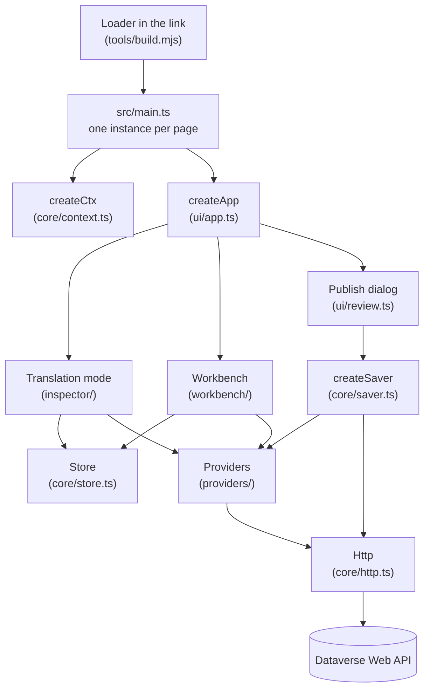

The folders:

| Folder | What it holds |
| --- | --- |
| `src/core/` | The engine without a screen: the Web API client, the context, the data model, the store, the XML and ZIP helpers, the language switch, the save, the publish and the undo journal |
| `src/providers/` | One module per family of labels: how to find them, read them and write them |
| `src/inspector/` | Translation mode: what the page shows, the marks on its labels, the content of the popups, *All labels*, the switch of area, form and view |
| `src/ui/` | The app itself: the shadow root, the Workbench window, the bar, the popup, the Publish dialog, the refresh, the shared widgets |
| `src/workbench/` | The Workbench: its options, its sheets, its grid and its bulk tools |
| `src/io/` | Excel and CSV files |

A few rules keep the folders apart. `providers/` imports nothing outside itself but `core/`. `core/` imports nothing
outside itself but the two contract files, `providers/types.ts` and `ui/types.ts`. That is why `columnOf`, which the
save's rule for an emptied form field label needs ([4.4](#44-keys-and-slots)), lives in `src/core/column.ts`, and
`src/inspector/column.ts` only re-exports it.

Every file, with the chapter that explains it:

| File | What it holds | Chapter |
| --- | --- | --- |
| `src/main.ts` | The entry point of *Translator*: one instance per page, the start-up | [4.2](#42-start-up-in-srcmaints) |
| `src/env.d.ts` | The build constants `__VERSION__` and `__DEV__`, and style sheets imported as text | [4.7](#47-the-dev-hooks-window__dxtdev) |
| `src/core/http.ts` | `Http`: the Web API client with its gates, retries and `$batch`; `DvError` and the error helpers | [5](#5-the-request-layer) |
| `src/core/batch.ts` | `batchGet`: many GETs in a few `$batch` requests, with a fallback to single requests | [5.5](#55-batch) |
| `src/core/context.ts` | `Ctx` and `createCtx`: the environment, its languages and the user; `findXrm`, `liveXrm`, `pageInfo`; `recordDirty`, whether the record shown has unsaved changes | [4.3](#43-the-context-srccorecontextts) |
| `src/core/model.ts` | `Slot`, `Kind`, `Prop`, `Change`, `ChangeResult`, `PublishSet`, the rules on emptying a translation (`canClear`, and `standIn`: what is written where Dataverse can't remove one) with their messages, and `MANAGED` and `isManaged`: a managed solution's components are read-only | [4.4](#44-keys-and-slots) |
| `src/core/column.ts` | `columnOf`: the column a form cell shows, or the field of a process step. In `core/` so that the rule of `standIn` can use it | [4.4](#44-keys-and-slots) |
| `src/core/store.ts` | `Store`: the loaded slots, the staged changes with undo and redo, the save status of each cell, what a staged change that empties a translation is saved as (`standIn`), and how recent each server text is (`tick`), so that an older read never puts its text back over a newer one | [4.5](#45-the-store-and-staged-changes) |
| `src/core/labels.ts` | Helpers for Dataverse's `Label` and `LocalizedLabel` shapes: `toLabels`, `fromChanges`, `mergeInto`, `pick`, `stripAnnotations` | [6.3](#63-metadatats-tables-columns-choices-and-relationships) |
| `src/core/xml.ts` | `parseXml`, `canon`, `assertOnlyChanged`, `upsertLabel`, `removeLabel`, `readLabels`, `xmlAttr` | [6.5](#65-formxmlts-form-and-dashboard-labels) |
| `src/core/zip.ts` | A small ZIP reader and writer on the browser's compression streams, for .xlsx files and translation files | [6.8](#68-ribbonts-classic-command-bar-labels), [10.17](#1017-zip-packages) |
| `src/core/lcid.ts` | Language codes: names, language tags, short codes, right-to-left languages | |
| `src/core/search.ts` | The one search of every search box: case, accents, apostrophes and ligatures aside | [9](#9-translation-mode), [10](#10-the-workbench-and-files) |
| `src/core/langsession.ts` | `LangSession`: switches the user's Dynamics language for a moment: inside one `$batch` for form tab and section labels, and around the update of a process after its name is saved and a few rare retries of sitemap and process labels | [7](#7-saving-safely) |
| `src/core/uilang.ts` | `setUiLanguage`: sets the user's Dynamics language for good (*Show Dynamics in*); `shownLanguage`, the language the page shows; the names of `LangSession`'s locks and repair marker | [11](#11-refreshing-the-page-and-switching-the-language) |
| `src/core/saver.ts` | `createSaver`: the stand-in of each emptied translation Dataverse can't remove (`withStandIns`, `saveText`), check, read again the texts the stand-ins are made of (and a label's own text where its stand-in is that text already), write each group through its writer (a stand-in made of a text another write of the same run writes: after it, and only once it is saved), commit to the store, journal the texts this run sent, publish; `prepare`, the same plan for the Publish dialog and the Undo question | [7](#7-saving-safely) |
| `src/core/publish.ts` | `publishXml`: one targeted `PublishXml`, never `PublishAllXml`; the update of a process whose name was saved, never one from a managed solution | [7](#7-saving-safely) |
| `src/core/history.ts` | The undo journal in local storage, per organization and user: 50 saves, 90 days at most. Changed by one tab at a time (a Web Lock per organization and user); the journal an earlier version kept for a whole organization, whatever the user, is removed unread | [8.9](#89-the-journal-historyts) |
| `src/providers/types.ts` | The contracts: `Writer`, `Loader`, `Scope`, the options, `ProvidersApi`, `check` | [6.2](#62-the-contracts-providerstypests) |
| `src/providers/index.ts` | The registry: each kind's writer, and `loadScope` over every loader | [6.1](#61-the-registry-providersindexts) |
| `src/providers/metadata.ts` | Tables, columns, choices, global choices, Yes/No columns, status and status reason, relationship menus | [6.3](#63-metadatats-tables-columns-choices-and-relationships) |
| `src/providers/layers.ts` | Reads the solution layers of a table, a column or a global choice to confirm a metadata write | [6.9](#69-beside-the-providers-layersts-repairts-and-writelogts) |
| `src/providers/writelog.ts` | The last 30 metadata writes of the page, for *Copy details* | [6.9](#69-beside-the-providers-layersts-repairts-and-writelogts) |
| `src/providers/records.ts` | Names held in localizable columns: views, charts, forms, dashboards, apps, process names, modern commands, environment variables, custom APIs | [6.4](#64-recordsts-names-in-localizable-columns) |
| `src/providers/formxml.ts` | Form and dashboard tab, section, field and navigation labels; the forms and languages a read could not bring (`formNote`, `mergeReads`) | [6.5](#65-formxmlts-form-and-dashboard-labels) |
| `src/providers/sitemap.ts` | App navigation: area, group and subarea titles and descriptions | [6.6](#66-sitemapts-areas-groups-and-subareas) |
| `src/providers/bpf.ts` | Business process flow stage and step labels | [6.7](#67-bpfts-business-process-flow-stages-and-steps) |
| `src/providers/repair.ts` | `settle`: puts back someone else's save that landed between a document writer's read and its PATCH | [6.9](#69-beside-the-providers-layersts-repairts-and-writelogts) |
| `src/providers/ribbon.ts` | Classic command bar labels, written by a translation import | [6.8](#68-ribbonts-classic-command-bar-labels) |
| `src/inspector/types.ts` | The contracts of translation mode: anchors, looks, the popup model, the bar, the page list, the lists the page is switched with (`Switch`) | [9](#9-translation-mode) |
| `src/inspector/mode.ts` | `createPageMode`: the controller of translation mode | [9](#9-translation-mode) |
| `src/inspector/pageload.ts` | Decides what the page shows and loads exactly those components | [9](#9-translation-mode) |
| `src/inspector/scan.ts` | Maps what Dynamics renders to slots: the anchors | [9](#9-translation-mode) |
| `src/inspector/lists.ts` | The three lists the page is switched with: the app's areas, the record's forms and a grid's views. The selectors of their buttons and items, the opening of a list (**Change area**, **Change form**, **Change view**) and the switch to one of its items (**Open**) | [9](#9-translation-mode) |
| `src/inspector/parts.ts` | Pure helpers for labels that share one text node, or belong to another form or table than the page's | [9](#9-translation-mode) |
| `src/inspector/overlay.ts`, `overlay.css` | The marks on the labels, the click on a label's text that opens its popup, and which clicks beside the text reach the page | [9.15](#915-the-overlay-marks-on-the-page-inspectoroverlayts), [9.16](#916-clicks-alt-and-f2) |
| `src/inspector/describe.ts` | The content of the popup for each kind of component | [9](#9-translation-mode) |
| `src/inspector/status.ts` | Looks, list groups and page helpers | [9](#9-translation-mode) |
| `src/inspector/column.ts` | The column a form cell shows: re-exports `columnOf` of `src/core/column.ts` for translation mode's code | [9](#9-translation-mode) |
| `src/inspector/fallback.ts` | What a form label shows in a language that has no text of its own | [9](#9-translation-mode) |
| `src/inspector/pill.ts` | The *N choices changed* pill after a field | [9](#9-translation-mode) |
| `src/inspector/preview.ts` | Shows the user's staged text on the page, in place (an emptied translation that can't be removed as its stand-in), and puts the page's text back | [9](#9-translation-mode) |
| `src/inspector/reveal.ts` | Finds a label for *All labels*: what to open so the page shows it | [9](#9-translation-mode) |
| `src/inspector/pagelist.ts`, `pagelist.css` | The *All labels* sheet: its groups, which collapse, and its place, docked on the right or floating where it was dragged (`prefs.list`) | [9.25](#925-all-labels-on-this-page-inspectorpagelistts) |
| `src/ui/types.ts` | `AppApi`, `View`, `Prefs`, `SaverApi`, `Prepared`, `IoApi`, `SaveReport` and the history types | [4.6](#46-contracts-and-types) |
| `src/ui/app.ts` | `createApp`: the shadow root, `AppApi`, and the two ways of working; the preferences (`readPrefs`) and the Workbench window's ✕ (`winClose`) | [4.2](#42-start-up-in-srcmaints) |
| `src/ui/shell.ts` | The Workbench window: docked, floating, maximized or minimized | [10.2](#102-the-files) |
| `src/ui/bar.ts`, `bar.css` | The translation-mode bar, and its place right of Dynamics' left navigation and left of the *All labels* sheet while that is docked | [9.24](#924-the-bar-and-the--menu-uibarts) |
| `src/ui/callout.ts`, `callout.css` | The popup next to a label: where it goes (`placeCallout`), when it shows (`settle`: once its place holds, so it never jumps), which text gets the caret (`focusKeys`) | [9.19](#919-opening-a-popup), [9.21](#921-the-popup-uicalloutts) |
| `src/ui/editor.ts` | The editor card of one component, used in both ways of working | [9.3](#93-how-the-app-runs-it-uiappts) |
| `src/ui/review.ts` | The Publish dialog and *Recent publishes* | [8](#8-the-publish-dialog-history-and-undo) |
| `src/ui/undo.ts` | Ctrl+Z and Ctrl+Y: each text box's own history, else the staged edits | [8.13](#813-ctrlz-and-ctrly-undots), [9](#9-translation-mode) |
| `src/ui/refresh.ts` | Clears the Dynamics caches that hold labels or the language, and reloads the page; asks first when the record has unsaved changes, or Dynamics can't tell (`recordDirty`) | [11](#11-refreshing-the-page-and-switching-the-language) |
| `src/ui/widgets.ts` | Toasts, dialogs, menus, popovers and tooltips | [4.6](#46-contracts-and-types) |
| `src/ui/dom.ts` | `h()`, `put()`, `icon()`, `esc()` and small helpers: text from Dataverse only through text nodes and attributes | [4.1](#41-a-map-of-src) |
| `src/ui/styles.css` | Design tokens, window chrome and shared widgets (Fluent 2), with the steps by which the Workbench's title bar folds up in a narrow window | [10.2](#102-the-files) |
| `src/workbench/types.ts` | The contracts of the Workbench | [10](#10-the-workbench-and-files) |
| `src/workbench/workbench.ts`, `workbench.css` | The Workbench view | [10](#10-the-workbench-and-files) |
| `src/workbench/scope.ts`, `setup.css` | The Workbench's options: what to extract | [10](#10-the-workbench-and-files) |
| `src/workbench/sheets.ts` | The sheets: one per kind of label, with its key columns | [10](#10-the-workbench-and-files) |
| `src/workbench/grid.ts`, `grid.css` | The grid: only the rows in view exist in the page | [10](#10-the-workbench-and-files) |
| `src/workbench/tools.ts` | The bulk tools | [10](#10-the-workbench-and-files) |
| `src/workbench/regex.ts` | Find and replace's regular expressions: the search in the background, and the check where it can't run there | [10](#10-the-workbench-and-files) |
| `src/io/workbook.ts` | Excel and CSV import and export, compatible with Easy Translator's workbook. An import reports a cell holding an Excel error, a label given two different texts and an id that matches several labels only when case is ignored, and refuses a file with two columns for one language | [10](#10-the-workbench-and-files) |
| `src/io/xlsx.ts` | A minimal .xlsx reader and writer: the cells holding an Excel error are listed apart (`Sheet.errors`), and a sheet that holds a row or a cell twice, a cell whose address names another row, or an address outside the grid or that is none, is refused as damaged | [10](#10-the-workbench-and-files) |
| `src/io/csv.ts` | CSV reading and writing, with the guard against formulas; a quoted field that never closes, or has text after its closing quote, refuses the file, naming the line | [10](#10-the-workbench-and-files) |

**Building the screens: `src/ui/dom.ts`.** The translator makes its elements with `h(tag, attributes, ...children)`.
An attribute whose value is `false`, `null` or `undefined` is left out, and `true` sets an empty one. `on` holds event
listeners, `style` an object of styles (a text is set as the attribute), `class` the class names; `value`, `checked`,
`disabled`, `hidden`, `tabIndex`, `type`, `title`, `placeholder`, `spellcheck` and `selected` are set as properties,
anything else with `setAttribute`. The children are nodes, texts and numbers (made into text nodes) and arrays of them;
`false`, `null` and `undefined` are skipped. So a label from Dataverse always becomes a text node or an attribute's
value, never markup ([12.6](#126-decompressionstream-eval-and-the-pages-script-policy)). `put(el, ...children)`
replaces an element's children the same way; both add them with `append(parent, children)`. The other helpers:
`icon(name, size)`, an SVG icon drawn with strokes in a 20 × 20 box from the paths of `P` (16 pixels unless `size` says
otherwise), hidden from screen readers; `rafThrottle(fn)`, which runs `fn` at most once per animation frame, with the
last arguments; `debounce(fn, ms)`, with `cancel()`; `plural(n, one, many)`, *3 labels*, with the number in the
browser's format; and `esc`, which escapes text for an HTML string and which no code imports at present. The note of
`src/ui/refresh.ts` makes its few elements with `createElement` and `textContent` instead.

### 4.2 Start-up in `src/main.ts`

When the favourite is clicked, the loader in its link unpacks the code and runs it
([chapter 12](#12-building-and-packaging)). The code first decides whether a translator may start on this page, and
whether one is there already. The running instance is the object `window.__dxTranslator`; its `key` is the page's
host.

`src/main.ts`, `STUCK_MS` and `replaces`:

```ts
/** A start still running after this long is treated as stuck, and the next click starts over. */
const STUCK_MS = 30000;

/** What a click does while an instance exists. Returns true when a fresh instance should start. */
function replaces(prev: Instance, key: string): boolean {
  if (prev.starting) {
    // Never while it may still switch the user's Dynamics language back: finishing late, that would
    // change the language under a newer instance's save that switched it on purpose (form labels).
    if (prev.recovering) {
      alert('The translator is still starting: it is switching your Dynamics language back after an interrupted save. Wait a moment. If nothing happens, reload the page and click the bookmark again.');
      return false;
    }
    if (Date.now() - (prev.since || 0) < STUCK_MS) {
      alert('The translator is still starting. Wait a moment.');
      return false;
    }
    // Stuck: take over. Should that start finish after all, it sees it is no longer current and stops.
    return true;
  }
  if (prev.key === key && prev.show) {
    try {
      if (prev.show() !== false) return false;
      // Already torn down: start a fresh one.
    } catch {
      // A broken instance: tear it down and start a fresh one.
    }
  }
  let gone = true;
  try {
    gone = prev.destroy ? prev.destroy() : true;
  } catch {
    // It failed while tearing down; nothing more can be done for it.
  }
  if (!gone) alert('The translator is still saving. Wait until it has finished, then click the bookmark again.');
  return gone;
}
```

**One instance per page.** A click on the favourite while an instance is on the page does this:

| On the page | What happens |
| --- | --- |
| Nothing | A new instance starts |
| An instance still starting that is setting back a Dynamics language an interrupted read or save left switched (`recovering`) | An alert asks to wait, and nothing else happens: a second start could switch the language under the first one |
| An instance that started less than 30 seconds ago (`STUCK_MS`) and is still starting | An alert asks to wait |
| An instance that has been starting for 30 seconds or more | It is taken as stuck, and a new instance starts. Should the old start finish after all, `current()` is false for it and it stops |
| A running instance | `show()`: the bar of translation mode pulses, or the Workbench window comes back from its pill. No second instance, no new code |
| An instance that was closed (`show()` returns `false`) or that throws | `destroy()`, then a new instance. While a save runs, `destroy()` refuses and the alert says "The translator is still saving. Wait until it has finished, then click the bookmark again." |

`src/main.ts`, the start:

```ts
void (async () => {
  const key = location.host;
  const prev = window.__dxTranslator;
  if (prev) {
    if (!replaces(prev, key)) return;
    if (window.__dxTranslator === prev) delete window.__dxTranslator;
  }
  const xrm = findXrm();
  if (!xrm && !/\.(dynamics\.com|dynamics\.us|microsoftdynamics\.us|dynamics\.cn|appsplatform\.us)$/i.test(location.hostname)) {
    return alert('Open a Dynamics 365 / Power Apps model-driven app (https://<org>.crm.dynamics.com/main.aspx…), then click the bookmark again.');
  }
  const self: Instance = { key, starting: true, since: Date.now() };
  window.__dxTranslator = self;
  const current = () => window.__dxTranslator === self;
```

**Where it may run.** The page must have the client API (`Xrm`, found by `findXrm`,
[4.3](#43-the-context-srccorecontextts)), or a host name under one of the Dynamics domains. Anywhere else an alert
says what to open, and nothing else happens. A page under a Dynamics domain without the client API still starts;
`createApp` then decides from the page's address what it can offer ([4.3](#43-the-context-srccorecontextts)).

**The placeholder.** `self` holds the place while the instance starts, so that a double click starts one instance
only. `current()` tells a start whether it is still the instance on the page: one that was taken over stops at its next
check and leaves the page, and the user's language, to the newer one.

`src/main.ts`, the start (continued):

```ts
try {
  const ctx = await createCtx();
  // A newer click took over while this start was stuck: leave the page, and the user's language, to
  // that instance (it runs its own recovery).
  if (!current()) return;
  self.recovering = true;
  // A switch left long ago is undone only if the user says so: they may have chosen that language since.
  const restored = await LangSession.recover(ctx, undefined, (m, now) =>
    confirm(
      `Your Dynamics language is ${lcidName(now)}. A translator save that was interrupted earlier had switched it from ${lcidName(m.lcid)}.\n\nSwitch it back to ${lcidName(m.lcid)}? Cancel keeps ${lcidName(now)}.`,
    ),
  ).catch(() => 0);
  self.recovering = false;
  if (!current()) return;
  const store = new Store();
  // The app shows a banner while the UI language is temporarily switched; it exists only after createApp.
  let onLang: (lcid: number | null) => void = () => {};
  const lang = new LangSession(ctx, (lcid) => onLang(lcid));
  const deps = {
    providers,
    saver: () => createSaver(ctx, store, lang, providers.writerFor),
    // ...
    io: createIo(ctx),
    views: { page: createPageMode, workbench: createWorkbench },
  };
  const app = await createApp(ctx, store, lang, deps, {
    // ...
  });
  onLang = app.onLang;
  self.show = app.show;
  self.destroy = app.destroy;
  self.starting = false;
  if (restored) app.api.toast('Your Dynamics language was restored after an interrupted save.', 'info');
  if (devWin) devWin.__dxtDev = devInfo = { ctx, store, lang, providers, app: app.api };
} catch (e) {
  if (!current()) return; // superseded by a newer click; that instance reports its own problems
  delete window.__dxTranslator;
  alert('The translator could not start: ' + ((e as Error)?.message || e));
}
```

1. **`createCtx`** reads the environment, its languages and the user ([4.3](#43-the-context-srccorecontextts)). If it
   fails, for example because the session has expired, the alert says "The translator could not start: " and the
   reason, and the placeholder is removed.
2. **`LangSession.recover`.** Form tab and section labels are read and written while the user's Dynamics language is
   switched for a moment ([chapter 7](#7-saving-safely)). Before a switch, the translator leaves a marker in local
   storage; a read or a save that was interrupted (a tab closed, a crash) leaves the marker behind. `recover` reads it,
   and while the user is still in the language that switch went to, sets the language back. When the marker is older
   than 10 minutes (`MARKER_AGE` in `src/core/langsession.ts`), the user may have chosen that language since, so it
   asks first with the `confirm` above. A marker whose request may still be running is left alone. While this runs,
   `recovering` is true, and a second click only gets an alert.
3. **The store and the language switch.** One `Store` ([4.5](#45-the-store-and-staged-changes)) and one `LangSession`
   for the page; while it has the user's language switched, `onLang` lets the app show a banner that says so. `deps`
   hands `createApp` the providers ([chapter 6](#6-providers-reading-and-writing-each-kind-of-label)), a factory for the
   saver, the Excel and CSV functions, and the two views.
4. **`createApp`** (`src/ui/app.ts`) builds the app and shows it (below). `self` then gets the app's `show` and
   `destroy`, and is no longer `starting`.
5. A language set back in step 2 is said in a toast: *Your Dynamics language was restored after an interrupted save.*
6. In a development build, the page gets `window.__dxtDev` ([4.7](#47-the-dev-hooks-window__dxtdev)).

**What `createApp` does.** It creates a `dxt-translator` element on `<html>`, not on `<body>`, which Dynamics
re-renders, with an open shadow root: the page's styles cannot reach into it. The element stops key, clipboard,
pointer, mouse, touch and focus events from reaching the page, so typing in the translator does not trigger Dynamics'
own shortcuts (Ctrl+S saves the record) and a click in a popup does not close a Dynamics flyout. It reads the
preferences (`dxt:prefs:<organization id>` in local storage, [4.6](#46-contracts-and-types)), then shows translation
mode on a record, list or dashboard page ([chapter 9](#9-translation-mode)) and the Workbench anywhere else
([chapter 10](#10-the-workbench-and-files)). `translatesOn(pageType)` tells the two apart, from the page's type
(`entityrecord`, `entitylist` or `dashboard`, [4.3](#43-the-context-srccorecontextts)).

**The Workbench window's ✕.** When the translator was started on a page with labels to translate, the Workbench is
opened from translation mode, and its ✕ goes back there, as Alt+1 does: its name and tooltip say *Back to page
(Alt+1)*, and it carries `aria-keyshortcuts="Alt+1"`. The title bar has no other button that goes back to the page.
The bar's ✕ is then the one that closes the translator. Started where there is no page to translate, the Workbench is
all there is, and its ✕ (*Close*) closes the translator; Alt+1 there only says *Open a record, a list or a dashboard
to translate on the page.*

`src/ui/app.ts`, `translatesOn` and `winClose`:

```ts
/** Translation mode needs a page with labels (pageInfo's type): a record, a list or a dashboard. Elsewhere only the Workbench. */
export const translatesOn = (pageType: string): boolean => pageType === 'entityrecord' || pageType === 'entitylist' || pageType === 'dashboard';

/**
 * The Workbench window's ✕ on a page of `pageType`. Where there is a page to go back to (translatesOn) it goes back to
 * it, as Alt+1 does: its name says so, with the shortcut as Undo's and Redo's do, "Back to page (Alt+1)" (the bar's ✕
 * closes the translator); a Workbench opened where there is no page to translate closes the translator.
 */
export function winClose(pageType: string, to: { page: () => void; close: () => void }): HTMLButtonElement {
  const back = translatesOn(pageType);
  const b = ibtn('close', back ? 'Back to page (Alt+1)' : 'Close', () => (back ? to.page() : to.close()), 'subtle', 20);
  if (back) b.setAttribute('aria-keyshortcuts', 'Alt+1');
  return b;
}
```

`createApp` gives it `show('page')` and `requestClose()`. `requestClose`, which the bar's ✕ calls too, runs one close
flow at a time: while a save runs it only says *Publishing is in progress. The translator can close when it finishes.*;
with staged changes it asks first (*Close the translator?*, [9.3](#93-how-the-app-runs-it-uiappts)); then it calls
`destroy()`.

**Closing.** `destroy()` refuses while a save runs (`store.busy`) and returns `false`. Otherwise it stops the loads,
removes every mark, listener, observer and window the views added, takes the element off the page, makes sure the
user's Dynamics language is back (`lang.restore()`), and tells `main.ts`, which forgets the instance and the dev handle.
The next click on the favourite then starts a fresh instance.

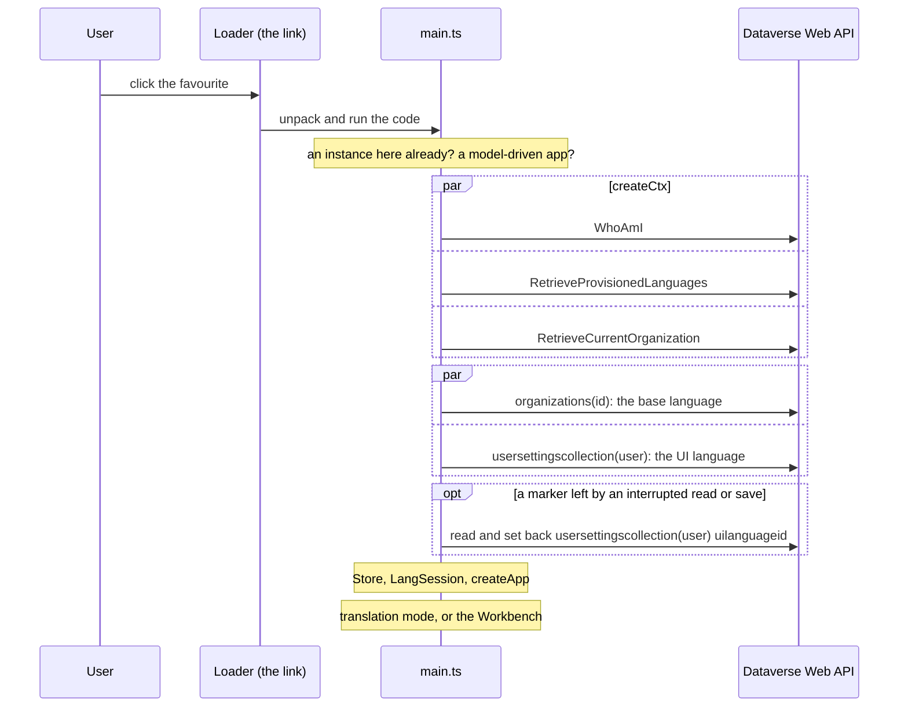

### 4.3 The context: `src/core/context.ts`

Every part of the translator receives the same object, `ctx`, of type `Ctx`. It is built once, by `createCtx`, and
holds what the code needs to know about the environment and the user.

`src/core/context.ts`, `createCtx`:

```ts
export async function createCtx(): Promise<Ctx> {
  const xrm = findXrm();
  const now = liveXrm(xrm);
  const gc = xrm?.Utility?.getGlobalContext?.();
  const origin = (gc?.getClientUrl?.() || location.origin).replace(/\/+$/, '');
  const version = String(gc?.getVersion?.() || '9.2');
  const m = /^(\d+)\.(\d+)/.exec(version);
  const http = new Http(origin, m && Number(m[1]) === 9 && Number(m[2]) < 2 ? `${m[1]}.${m[2]}` : '9.2');

  const [who, provisioned, cur] = await Promise.all([
    http.get('WhoAmI()'),
    http.get('RetrieveProvisionedLanguages()'),
    http.get("RetrieveCurrentOrganization(AccessType=Microsoft.Dynamics.CRM.EndpointAccessType'Default')").catch(() => null),
  ]);
  const [orgRow, ui] = await Promise.all([
    http.get(`organizations(${guid(who.OrganizationId)})?$select=languagecode,name`).catch(() => null),
    // The user's language as saved, read past every cache: the client's own copy (userSettings) can be a stale boot
    // answer (LIVE-FINDINGS 82, 97), and a switch is put back to this one.
    http.get(`usersettingscollection(${guid(who.UserId)})?$select=uilanguageid`, { headers: { 'If-None-Match': 'null', 'x-ms-sw-skipcache': '1' } }).catch(() => null),
  ]);
  const base: Lcid = Number(orgRow?.languagecode || gc?.organizationSettings?.languageId || 1033);
  const user: Lcid = Number(ui?.uilanguageid) || Number(gc?.userSettings?.languageId || base);
  const codes: number[] = (provisioned?.RetrieveProvisionedLanguages || [base]).map(Number);
  if (!codes.includes(base)) codes.unshift(base);
  const langs: Language[] = codes
    .map((lcid) => ({ lcid, name: lcidName(lcid), isBase: lcid === base }))
    .sort((a, b) => (a.isBase ? -1 : b.isBase ? 1 : a.name.localeCompare(b.name)));
```

Five requests, in two rounds of parallel requests. `WhoAmI` and `RetrieveProvisionedLanguages` must succeed: without
them the start fails. The other three may fail; the context then falls back on what the page's client API or the host
name says (the table below).

| Field | Holds | Comes from |
| --- | --- | --- |
| `http` | The Web API client ([chapter 5](#5-the-request-layer)) | `new Http(origin, version)`: Web API version 9.2, or 9.0 or 9.1 when the client reports that version |
| `xrm` | The page's `Xrm` now, or `null` on a page without the client API | A getter: `liveXrm` reads it again on every use (below) |
| `origin` | The environment's address, for example `https://contoso.crm.dynamics.com` | The client's `getClientUrl()`, else the page's origin |
| `org` | The organization's short name, for example `contoso` | `Detail.UrlName` of `RetrieveCurrentOrganization`, else the first part of the host name |
| `orgId` | The organization's id, lower case | `WhoAmI` |
| `envType` | *Production*, *Sandbox*, *Trial*, *Preview*, *Developer*, *Default* or *Teams*; another type as Dataverse names it; `''` when unknown | `Detail.OrganizationType`: `Customer` is *Production*, `CustomerTest` *Sandbox*, `CustomerFreeTest` *Trial*, `CustomerPreview` *Preview* |
| `userId` | The signed-in user's id | `WhoAmI` |
| `base` | The organization's base language, for example 1033 | `organizations(<id>)?$select=languagecode`, else the client's `organizationSettings.languageId`, else 1033 |
| `user` | The user's Dynamics language when the translator started, as saved on the server | `usersettingscollection(<user>)?$select=uilanguageid`, else the client's `userSettings.languageId`, else `base` |
| `langs` | The provisioned languages, base language first, then by name | `RetrieveProvisionedLanguages`, with the base language added when it is missing |
| `version` | The client's version | The client's `getVersion()`, else `'9.2'` |

**Why the user's language is read from the server.** The client's own copy, `userSettings.languageId`, can come from a
stale answer that Dynamics cached when the page booted: verified in a test environment, it said French while the
server and the page said English (LIVE-FINDINGS 97). `user` is the language a temporary switch puts back, until the
user's language is changed for good (with *Show Dynamics in*, or outside the translator; [chapter 7](#7-saving-safely)),
so it is read from `usersettingscollection` with two headers that keep every cache from answering
([5.4](#54-consistency-and-cache-headers)).

**Why `xrm` is read on every use.** Dynamics gives another table's form an `Xrm` object of its own when the user moves
there without a reload (verified in a test environment, LIVE-FINDINGS 95). The object found at start-up would go on
describing the first page.

**Frames.** `findXrm` takes the window's own `Xrm` when it has the client API, else that of the first frame that has
it and is not hidden by its style, else whatever `Xrm` the window has, or `null`. A frame of another site (an embedded
page, a web resource served from elsewhere) can't be looked into: reading its `Xrm` throws, and `findXrm` skips that
frame and goes on with the next one.

`src/core/context.ts`, `findXrm` and `liveXrm`:

```ts
/**
 * Finds the Xrm object on this window or a same-origin frame (classic web client). A frame of another site (an
 * embedded page, a web resource elsewhere) can't be looked into: it is skipped, never the end of the search.
 */
export function findXrm(): any {
  const w = window as any;
  if (w.Xrm?.Utility?.getGlobalContext) return w.Xrm;
  let frames: HTMLIFrameElement[] = [];
  try {
    frames = Array.from(document.querySelectorAll('iframe'));
  } catch {
    frames = [];
  }
  for (const f of frames)
    try {
      const x = (f.contentWindow as any)?.Xrm;
      if (x?.Utility?.getGlobalContext && f.style.visibility !== 'hidden') return x;
    } catch {
      /* a frame of another site */
    }
  return w.Xrm || null;
}

// ...

/**
 * Reads the page's Xrm now, else the last one it saw: while UCI swaps it during a navigation there may briefly be none,
 * and the first page's would make that page look shown again.
 */
export function liveXrm(first: any): () => any {
  let seen = first;
  return () => (seen = findXrm() ?? seen);
}
```

**Unsaved changes on the record: `recordDirty`.** A reload throws away what the user typed into the record and has
not saved, so **Refresh page** asks first ([11.4](#114-refresh-page-step-by-step)). `recordDirty(xrm)` answers `true` or
`false` from `Xrm.Page.data.getIsDirty()`, else from the record's own `getIsDirty()` (`Xrm.Page.data.entity`). It is
`false` where there is no record: no client API, a page context of another page type, a page without form data or
whose form data has no record (a list, a dashboard). It is `null` when there is a record but Dynamics can't tell: the
call throws, answers neither yes nor no, or neither function exists. **Refresh page** asks on `true` and on `null`
alike: *This record has unsaved changes. Refresh anyway and lose them?*, or *This record may have unsaved changes.
Refresh anyway and lose them?*

`src/core/context.ts`, `recordDirty`:

```ts
export function recordDirty(xrm: any): boolean | null {
  let type = '';
  try {
    type = String(xrm?.Utility?.getPageContext?.()?.input?.pageType || '').toLowerCase();
  } catch {
    type = '';
  }
  if (type && type !== 'entityrecord') return false;
  try {
    const d = xrm?.Page?.data;
    if (!d) return false;
    const v = typeof d.getIsDirty === 'function' ? d.getIsDirty() : typeof d.entity?.getIsDirty === 'function' ? d.entity.getIsDirty() : d.entity ? null : false;
    return typeof v === 'boolean' ? v : null;
  } catch {
    return null;
  }
}
```

**The page shown now: `pageInfo`.** The same file reads what the page shows, from the client API's page context
(`Xrm.Utility.getPageContext().input`) and, where that has nothing, from the page's address. The address is anyone's
link, so every id comes back in lower case without braces, or `''` when it is not a GUID, and the table name `''` when it
is not a logical name ([5.1](#51-one-client-for-every-request-http)).

| Field | Comes from |
| --- | --- |
| `type` | `pageType`, else `pagetype` in the address: `entityrecord`, `entitylist`, `dashboard`, `apps`, or `other` for anything else |
| `entity` | `entityName`, else `etn` |
| `recordId` | `entityId`, else `id` on a record page |
| `formId` | The form selector's current form, else `formId`, else `formid` |
| `viewId`, `viewType` | `viewId`, else `viewid`; `userquery` for a personal view (`viewType` `userquery` or 4230), `savedquery` for any other, `''` without one |
| `dashboardId` | `dashboardId`, else `id` on a dashboard page |
| `appId` | `appid` in the address |

`createApp` uses `type` to choose between translation mode and the Workbench ([4.2](#42-start-up-in-srcmaints)), and
translation mode uses the rest to know what to load ([chapter 9](#9-translation-mode)).

### 4.4 Keys and slots

Every translatable text is one **slot**: the display name of a column, the label of a form tab, the title of a sitemap
area, the label of a classic command button. Every part of the translator speaks of labels through slots: the
providers make them, the store holds them, the views show them, the saver writes their changes. They are defined in
`src/core/model.ts`, and the keys they carry are canonical: every module builds and reads them exactly the same way.

`src/core/model.ts`, `Slot`:

```ts
export interface Slot {
  /** Globally unique, stable across reloads: `${kind}|${component id}|${prop}`. */
  key: string;
  kind: Kind;
  prop: Prop;
  /** Logical name of the table the component belongs to ('' when none, e.g. global choices, sitemap). */
  entity: string;
  /** Identity of the component; slots with the same `comp` are edited together in one card. */
  comp: string;
  /**
   * Save group; changes with the same group are written in a single server operation
   * (one metadata PUT, one form XML update, one sitemap update...).
   */
  group: string;
  /** Component name in the user's language. */
  title: string;
  /** Breadcrumb from the outermost container, e.g. ["Account", "Account main form", "Summary"]. */
  path: string[];
  /** Secondary identifier shown in grey, e.g. the logical or schema name. */
  sub: string;
  /** Server values when loaded. */
  labels: Labels;
  /** Empty when editable, otherwise the reason it is read-only. */
  readOnly: string;
  /** True when the base language label must not be blank (most metadata labels). */
  baseRequired: boolean;
  /** Maximum length accepted by Dataverse; 0 when unknown. */
  max: number;
  /** Sort order inside the component type (document order on forms, option order in choices...). */
  order: number;
  /** Provider-private locator (ids, XML node ids, attribute types...). */
  ref: any;
}
```

**Three names for three jobs.**

* `comp` names the **component**, and starts with its kind: `attribute|account.name`. All the texts of one component
  share it: a column's display name and its description are two slots with one `comp`, shown together in one popup or
  editor card.
* `key` names the **slot**: the component and the property, `${comp}|${prop}`, for example
  `attribute|account.name|DisplayName`. A pending change is a `key` and a language; the store, the history and the
  files all use it.
* `group` names the **server write**. Changes with the same group go to their writer together, as one job. For most
  kinds that is one write: one PUT for the edited labels of a table, of a column, of a relationship or of a global
  choice, one `UpdateOptionValue` or `UpdateStateValue` for an option, one form update for the labels of a form (one per
  language when tab or section labels in a language other than the user's own changed: those are written in their own
  language, [6.5](#65-formxmlts-form-and-dashboard-labels)), one sitemap update, one process update, one translation
  import for a table's classic command labels. The records writer instead writes the record's columns one after another,
  one `SetLocLabels` each ([6.4](#64-recordsts-names-in-localizable-columns)).

| Kind | `comp` | Properties | `group` |
| --- | --- | --- | --- |
| `entity` | `entity\|<table>` | `DisplayName`, `DisplayCollectionName`, `Description` | = comp |
| `attribute` | `attribute\|<table>.<column>` | `DisplayName`, `Description` | = comp |
| `option` (a local choice or multi-select choice) | `option\|<table>.<column>\|<value>` | `Label`, `Description` | = comp |
| `status` (status reason) | `status\|<table>.statuscode\|<value>` | `Label`, `Description` | = comp |
| `state` (status) | `state\|<table>.statecode\|<value>` | `Label`, `Description` | = comp |
| `boolean` (a local Yes/No) | `boolean\|<table>.<column>\|<0 or 1>` | `Label`, `Description` | = comp |
| `globaloptionset` | `globaloptionset\|<name>` | `DisplayName`, `Description` | = comp |
| `globaloption` (also a global Yes/No, values 0 and 1) | `globaloption\|<name>\|<value>` | `Label`, `Description` | = comp |
| `relationship`, one-to-many | `relationship\|<schema name>` | `Label` | `relationship\|<schema name>` |
| `relationship`, many-to-many | `relationship\|<schema name>\|1` and `\|2`, one per side | `Label` | `relationship\|<schema name>` |
| `view`, `chart`, `form`, `dashboard`, `app`, `bpf` | `<kind>\|<record id>` | `Name`, `Description` | = comp |
| `command` (a modern command) | `command\|<appactionid>` | `Label`, `ToolTipTitle`, `ToolTipDescription`, `Alt`; a group: `Title` | = comp |
| `envvar` | `envvar\|<environmentvariabledefinitionid>` | `DisplayName`, `Description`, `Hint` | = comp |
| `customapi` | `customapi\|<customapiid>` | `DisplayName`, `Description` | = comp |
| `tab`, `section`, `field`, `navitem` | `<kind>\|<form id>\|<element id>` | `Label` | `formxml\|<form id>` |
| `dtab`, `dsection`, `dfield` (on a dashboard) | `<kind>\|<dashboard id>\|<element id>` | `Label` | `formxml\|<dashboard id>` |
| `area`, `group`, `subarea` | `<kind>\|<sitemap id>\|<Id>` | `Title`, `Description` | `sitemap\|<sitemap id>` |
| `stage`, `step` | `<kind>\|<workflow id>\|<label id>` | `Label` | `bpfxaml\|<workflow id>` |
| `ribbon` (a classic command label) | `ribbon\|<table, or _app>\|<LocLabel Id>` | `Label` | `ribbon\|<table, or _app>` |

Record, form, sitemap and process ids, the ids of form tabs, sections and cells, and those of process stages and steps
are lower case without braces (`guid()` in `src/core/http.ts`, `normId()` in `src/core/xml.ts`); table and column
names are logical names. A form element's id is its `id` attribute (a tab, a section, a cell), or a navigation item's
`Id`. A navigation item's, a sitemap item's and a LocLabel's `Id` are kept as the XML writes them. A sitemap item that
has no `Id`, or the same `Id` as an item before it, gets `|#<n>` added to its `comp` and is read-only: the writer finds
items by `Id` ([6.6](#66-sitemapts-areas-groups-and-subareas)). The application ribbon's labels use `_app` in place of
a table ([6.8](#68-ribbonts-classic-command-bar-labels)).

**The other fields.**

| Field | Holds |
| --- | --- |
| `title` | The component's name in the user's language, else in the base language, else (except for form and dashboard labels) in any language it has, else a name or id, for example *Account Name* |
| `path` | Where it is, from the outside in, for example the table, *Information (Main form)*, the tab and the section |
| `sub` | A second name shown in grey: a logical or schema name, a view's type, a form element's control id |
| `labels` | The text in each language exactly as the server held it when it was loaded. A language without a label has no key; a label stored as `''` has none either, except in a metadata description, where it is kept (stored empty, below) |
| `readOnly` | `''` when the slot can be edited, otherwise why not, in words the user can act on: `MANAGED` for a label of a component from a managed solution (below). The popup, the editor card, *All labels* and the Workbench show it, the Publish dialog says only *Read-only* |
| `baseRequired` | `true` when the base-language text may not be blank: metadata names and labels (not descriptions), every text of a record, sitemap titles, process stage and step labels, classic command labels. `false` for form labels |
| `max` | The most characters Dataverse accepts, when known: a form name 100, a view name 200, a view's or form's description 2,000, a command label 256, a process stage 100 |
| `order` | The natural order within the component's kind: document order on a form, option order in a choice |
| `ref` | What the provider needs to find the label again (below) |

**Labels as loaded.** `labels` never holds a staged change: that lives in the store
([4.5](#45-the-store-and-staged-changes)), so the text the user started from is always at hand for the conflict check
and for undo. Only the server's text goes into it: the store's `commit` writes a text just saved, `resolve` the
server's text of a resolved conflict, and `seen` a server text the saver read again before writing a stand-in (below).
A load that started before one of these and answers after it does not put its older text back
([4.5](#45-the-store-and-staged-changes)). A label stored as `''` is treated as missing (it is not a translation:
Dataverse shows it to that language's users as a blank label, LIVE-FINDINGS 32), so it shows as untranslated and can be
filled in. A metadata description is the exception (`keepsEmpty`): there `''` is kept in `labels`, a translation
**stored empty** on purpose (`storedEmpty`), so that language's users see no tooltip or description; a language with
no key there is missing, and its users see the base-language text.

**Partial slots.** A form's tab and section labels are read one language at a time
([6.5](#65-formxmlts-form-and-dashboard-labels)). Until every language is read, their slots carry
`ref.partial = true`, and the meaning of `labels` changes: a language present with `''` was read and has no label; a
language absent was not read, and shows as *Not loaded*. It cannot be edited until it is loaded, so nobody overwrites
a label they have not seen. A language whose read failed is read once more; when it still could not be read,
`ref.unread` holds why, by language. The Workbench gives that reason in the cell's tooltip, and `formNote` gathers the
forms and languages for its message bar and its **Read again** ([10.4](#104-extracting-and-what-the-workbook-holds),
[10.8](#108-how-a-cell-looks)).

A form that `RetrieveUnpublished` does not find is read from its published definition. Its tab and section labels
are read in each language like any other form's, but its cells and navigation items are known in the user's language
only: in another language, that definition gives a cell without a label of its own its column's name, as if it were
its label (LIVE-FINDINGS 52). Those slots are partial whatever is read again, and `ref.unreadable` holds why,
`PUB_ONLY`: "This form has no unpublished definition in Dynamics, and its published one can't show the form's own field
labels in other languages."

**`ref`, by kind.** Other modules rely on these shapes: translation mode to match labels on the page, the Workbench and
the files to fill their key columns.

| Kind | `ref` |
| --- | --- |
| `entity` | `{ entity, metadataId, managed, custom }` |
| `attribute` | `{ entity, attribute, metadataId, odataType, managed, custom }`, `odataType` for example `Microsoft.Dynamics.CRM.StringAttributeMetadata` |
| `option`, `status`, `state`, `boolean` | `{ entity, attribute, value, attributeMetadataId, optionMetadataId, cast, managed }`, `cast` one of `Picklist`, `MultiSelectPicklist`, `Boolean`, `Status`, `State` |
| `globaloptionset` | `{ name, metadataId, boolean, usedBy, managed }`, `usedBy` the `table.column` names that use it |
| `globaloption` | `{ name, value, optionMetadataId, setId, usedBy, boolean, managed }` |
| `relationship` | `{ schemaName, metadataId, type, side, entity1, entity2, intersect, referenced, referencing, menu, managed }`, `type` `OneToMany` or `ManyToMany`, `menu` what the related menu shows: `label`, `plural` or `none` |
| `view`, `chart`, `form`, `dashboard`, `app`, `bpf`, `command`, `envvar`, `customapi` | `{ id, table, entitySet, column, entity, type, managed, app }`, `table` the record's table (`savedquery`), `column` the label's column (`name`), `type` a view's query type, a form's type or a command's location |
| `tab`, `section`, `field`, `navitem` and the dashboard kinds | `{ formId, elId, formType, area, tag, tabName, sectionName, controlId, datafield, classid, quickForms, relationship, managed }`, `area` one of `body`, `header`, `footer`, `nav`; on a slot not known in every language also `partial`, and `unread` or `unreadable` where the load knows why (above) |
| `area`, `group`, `subarea` | `{ sitemapId, id, entity, areaId, groupId, managed, plural, resource, unnamed, placeholder }` |
| `stage`, `step` | `{ workflowId, labelId, attribute, stageId, primary, managed }`, plus `stored` and `unread` once the names Dynamics keeps were read ([6.7](#67-bpfts-business-process-flow-stages-and-steps)) |
| `ribbon` | `{ entity, locLabelId, managed }`, `entity` `_app` for the application ribbon |

**Components from a managed solution.** The translator never makes an unmanaged customization on top of a component
that comes from a managed solution: every label of such a component is read-only, whatever its managed properties
allow, and is translated in the environment where its solution is developed. In a development environment, the
unmanaged components made there can be translated. Each loader sets `ref.managed` from the component's own `ismanaged`
or `IsManaged`, and gives its slots the reason `MANAGED`.

`src/core/model.ts`, `MANAGED` and `isManaged`:

```ts
/**
 * Why a label of a component that comes from a managed solution is read-only, whatever its managed properties allow:
 * any change to it here would be an unmanaged customization layered on top of the solution's component, which this
 * tool never makes: such texts are translated in the environment where the solution is developed. Every loader, writer,
 * the saver and the store give these same words.
 */
export const MANAGED = 'From a managed solution: a translation here would add an unmanaged layer on top of it. Translate it where its solution is developed.';

/**
 * Whether a slot's component comes from a managed solution: `ref.managed`, which every loader sets from the component's
 * own ismanaged / IsManaged (a form's or dashboard's for its tabs, sections, cells and navigation items, a sitemap's
 * for its items, a process's for its stages and steps). Such a label is never staged, saved or undone.
 */
export const isManaged = (s: Slot): boolean => s.ref?.managed === true;
```

| Kind | Whose `ismanaged` or `IsManaged` sets `ref.managed` |
| --- | --- |
| `entity`, `attribute`, `relationship` | The table's, the column's, the relationship's |
| `option`, `status`, `state`, `boolean` | The column's or its own choice's: either one from a managed solution makes the options read-only |
| `globaloptionset`, `globaloption` | The global choice's |
| `view`, `chart`, `form`, `dashboard`, `app`, `bpf`, `command`, `envvar`, `customapi` | The record's |
| `tab`, `section`, `field`, `navitem` and the dashboard kinds | The form's or the dashboard's, for every label in it: tabs, sections, cells, header and navigation |
| `area`, `group`, `subarea` | The sitemap's: the app navigation's |
| `stage`, `step` | The process's |
| `ribbon` | Any managed row of the label's `Id`: an unmanaged row that wins for its texts still has that solution under it |

Each component decides for itself. An unmanaged form of a managed table can be translated, and so can an unmanaged
custom column of a managed table. A managed column shown on an unmanaged form keeps its name and its description (the
tooltip) read-only, while the form's own label of that cell can be translated. Microsoft's own tables and forms
(*account*, *contact*…) come from managed solutions, so on their pages almost every label is read-only.

Two kinds of Microsoft text keep a reason of their own instead of `MANAGED`, so that they still look built-in once
every language has its text ([9.13](#913-microsofts-built-in-text-and-read-only-labels)): the names of a system table
or column whose renaming Microsoft locks for good, and an item of an app's navigation that shows Microsoft's own text.
A label with `MANAGED` looks read-only (*Read-only* in *All labels*), never built-in, even with a text in every
language.

Every part that could write such a label checks again, in case one before it let it through:

* `store.add` gives `MANAGED` to a slot of a managed component that its loader left editable, and `store.set` stages
  nothing on it ([4.5](#45-the-store-and-staged-changes)). The popup's *Also change the other copies of this field on
  this form* skips it too (`writeAlso` in `src/ui/callout.ts`).
* The saver's check refuses its change with *Read-only:* and the reason, and the save skips it without calling a
  writer; `publishTargets` leaves it out ([7.2](#72-checks-before-anything-is-sent)). The undo of a past save goes
  through the same check, so a component from a managed solution is skipped there with the reason
  ([8.12](#812-undoing-a-publish-the-run-and-its-checks)).
* Every writer refuses it as loaded (`isManaged`), and refuses the write when its read right before the write shows the
  component from a managed solution: `error`, with `MANAGED` ([7.4](#74-what-every-writer-does)). The update of a
  process after its name is saved reads the process's `ismanaged` first, and updates none that is managed or whose read
  does not say ([7.17](#717-updating-a-process-after-its-name-is-saved)).
* An import skips its rows with *Read-only:* and the reason, and the Workbench leaves such rows out unless *Include
  read-only labels (from managed solutions or not customizable)* is on ([10.3](#103-setup-what-to-extract),
  [10.15](#1015-importing-a-file)).

**Changes and results.** What the user changed, and what a save made of it:

`src/core/model.ts`, `Change`, `Outcome` and `ChangeResult`:

```ts
export interface Change {
  slot: Slot;
  lcid: Lcid;
  /**
   * Value the user started from: the server text the edit was made on (the store's remembered base, Store.before),
   * not whatever a reload brought since. The writers compare it with a fresh read and report a conflict when they differ.
   */
  before: string;
  /** Value to write. */
  after: string;
  /**
   * Set when `after` stands in for an emptied translation Dataverse can't remove (standIn, applied by the saver before
   * its checks and the writers): where that text comes from, and the blank text the staged edit held (`typed`), so the
   * store drops that edit once the stand-in is saved.
   */
  standIn?: { from: StandInFrom; typed: string };
  /**
   * An Undo that puts back no translation at all (the publish added this one where there was none: its journal item has
   * `before` '' without `empty`, core/saver.ts undoChange). Emptied where it would be saved empty (savesEmpty), it gets
   * its stand-in instead, as any translation Dataverse can't remove: that language's users see again what they saw. One
   * whose stand-in is an empty base text is saved empty after all (core/saver.ts withStandIns drops the mark): they saw
   * no text there, which '' gives them.
   */
  untranslated?: true;
  /**
   * The edit was made where its language had no label at all (`before` '' for none), on a label that keeps a '' stored
   * there apart from none (keepsEmpty, Store.changes): a '' found there at save is someone else's text (a description
   * they saved empty since), a conflict like any other (providers/metadata.ts compare).
   */
  beforeMissing?: true;
}

export type Outcome = 'saved' | 'unchanged' | 'conflict' | 'error' | 'skipped';
export interface ChangeResult {
  change: Change;
  outcome: Outcome;
  /** For conflicts: the value now on the server. */
  server?: string;
  message?: string;
  /**
   * Found already as asked ('unchanged', a text other than the one the edit was made on), and nothing says this saver ever
   * sent it (core/saver.ts: no earlier attempt whose answer was lost): someone else's text. Not journaled as this
   * publish's change, so its Undo never puts back what this run didn't write.
   */
  found?: true;
}
```

| Outcome | Means |
| --- | --- |
| `saved` | Written, and read back as asked |
| `unchanged` | The server held exactly that text already; nothing was written. Also an emptied translation whose stand-in is its text already, once a read right before shows the server still holds it (below). With `found`, the text was there although the edit was made on another one, and nothing says this translator sent it (no earlier try of it whose answer was lost): someone else saved it, so the journal leaves it out and the Undo of this publish never puts back a text it did not write ([8.9](#89-the-journal-historyts)) |
| `conflict` | The server holds another text than the one the user started from; `server` holds it. The user chooses which to keep ([chapter 8](#8-the-publish-dialog-history-and-undo)). Also an emptied translation whose stand-in is its text already, when the read right before finds another text there |
| `error` | Not written, refused, or written but not confirmed; `message` says which. A writer that finds the component from a managed solution, as loaded or in its read right before the write, refuses it with `MANAGED`. An emptied translation without a stand-in is refused (`noStandIn`), and one whose stand-in is made of a text that changed on the server since it was loaded, or could not be read again, is not written (`sourceMoved`, `sourceUnread`) |
| `skipped` | Not attempted: the slot is read-only (one from a managed solution included, in a save or in the undo of a past save), the save was stopped before it, the undo of a past save found the component not loaded, or the stand-in of an emptied translation waits for a text to be loaded (`StandIn.unloaded`, below). Also a write stopped while it ran; `message` then says to reload and check. And a stand-in made of a text the same run writes in another write, held back when that write did not save it (`sourceUnsaved`) or did not give the text the stand-in was measured by (`sourceMoved`, below) |

**What must be published.** Each writer adds what its writes need to one `PublishSet` per save; the saver publishes it
in one call once every write has finished ([chapter 7](#7-saving-safely)).

`src/core/model.ts`, `PublishSet`:

```ts
export class PublishSet {
  entities = new Set<string>();
  optionsets = new Set<string>();
  sitemaps = new Set<string>();
  dashboards = new Set<string>();
  appmodules = new Set<string>();
  ribbons = false;
  /**
   * Business process flows whose name was written (workflow id → its name, shown while it is updated). Not published:
   * Dataverse serves the app a compiled copy of a process that only an update of the process itself rebuilds
   * (LIVE-FINDINGS 83), so the saver updates each one after the publish (publish.ts rebuildProcess). `empty` leaves
   * them out: it says whether PublishXml has anything to do.
   */
  processes = new Map<string, string>();
  get empty(): boolean {
    return !this.entities.size && !this.optionsets.size && !this.sitemaps.size && !this.dashboards.size && !this.appmodules.size && !this.ribbons;
  }
}
```

**The rules on blank texts.** A blank text for a non-base language (only spaces count as blank) means "no translation
of its own here". Where Dataverse can remove a translation, the save removes it, and that language shows the base text
again. Where it can't, the save writes the label's **stand-in** in its place: the text that language shows where the
label has no translation of its own, so the page looks as it would without one. A metadata description is the
exception: there the save writes `''` for that language, and its users see no tooltip or description (**saved
empty**). The rules sit in `model.ts`, so that the saver, the store, the popup, the editor card, the page preview, the
Publish dialog, the Undo question, the Workbench and every writer apply the same ones:

| Name | What it says |
| --- | --- |
| `canClear(slot, lcid?)` | Whether a non-base translation can be removed. Not for the kinds in `NO_CLEAR`: every metadata kind (Dataverse merges these labels per language, and a blank text is stored as a blank label, LIVE-FINDINGS 31, 32; a translation import with an empty cell removes none either, 67), form and dashboard tab, section and field labels (a form update keeps them, LIVE-FINDINGS 37), and classic command labels (an import keeps them, LIVE-FINDINGS 39). With `lcid`, also not for a stage or step translation that is loaded (`stays`). Where it is false, an emptied translation is written as its stand-in, but a metadata description's, which is saved empty (`savesEmpty`) |
| `stays(slot, lcid)` | A loaded stage or step translation: once Dynamics has stored one, removing its label leaves it showing (LIVE-FINDINGS 83). It can be replaced, not removed: emptied, it gets its stand-in |
| `keeps(slot, lcid)` | A stage or step text that the process definition does not hold but Dynamics shows from its own store (`ref.stored`) |
| `keepsEmpty(slot)` | A metadata component's description (`prop` `Description` of a table, column, choice option, global choice and its options, Yes/No option, status or status reason; a relationship has none): its loaders keep a stored `''` as a text of its own, and an emptied translation of it is saved empty. Names, form and dashboard labels and classic command labels are not, nor is a record's description (a view's, a chart's, a process's), which is removed |
| `savesEmpty(slot, lcid, base, untranslated?)` | Whether emptying the `lcid` translation saves it empty: `keepsEmpty`, in a language other than the base language, and not for an undo that puts back no translation at all (`untranslated`, `Change.untranslated`), which gets its stand-in |
| `storedEmpty(slot, lcid, base)` | A translation stored empty on the server (`savesEmpty`, and `labels[lcid]` is `''`): that language's users see no tooltip or description there, on purpose. It counts as translated; a missing one counts as missing. `Store.emptyOnPurpose` counts a pending edit that empties one too ([4.5](#45-the-store-and-staged-changes)) |
| `noneText(slot, lang)`, `savedEmptyText(slot, lang)`, `savesEmptyText(slot, lang)` | The placeholder of a translation saved or stored empty, "No French tooltip" ("No French description" for anything but a column); the line under an emptied input and the Publish dialog's note, "Saved empty: French users see no tooltip."; and the Workbench's tooltip of a cell not saved yet, "Saved empty when you save: French users then see no tooltip." |
| `standIn(slot, lcid, base, before, after, text, untranslated?)` | What an emptied translation that can't be removed is written as: a `StandIn` (below), or `undefined` where the rule does not apply |
| `standInSources(slot, lcid, base, from)` | The texts a stand-in is made of, as `key` and `lcid`: the label's own base-language text, or its column's name in that language, and for one from the column's base-language name, that one too. The saver reads them again before it writes the stand-in, and writes one made of a text the same run writes in another write only after that write, once the text is saved |
| `notLoaded(slot, lcid)` | Whether a language of a slot was not read (`ref.partial`): its text is unknown, not empty. `src/ui/editor.ts` re-exports it |
| `namesFirst(slot)` | The title of an app designer's placeholder in the sitemap: it gets its base-language text before any other |
| `baseNameFirst(base)` | Why a title in another language alone is refused there: "Name it in English too: languages without a name of their own show the English one." |
| `standInSays`, `standInText` | What saving an emptied translation does, in the line under its input in the popup and the editor card: "Becomes “Start date”: Dataverse can't remove a translation here, so French gets the English text." (`standInText` is the part after the colon, which the Workbench's tooltip uses too); where that is its text already, "Already the English text: Dataverse can't remove a translation here, so nothing changes." A form field label gets *the column's French name* (or *the column's English name*) in place of *the English text* |
| `standInTag`, `standInWhat` | The same in a few words, the note of a row of the Publish and Undo dialogs: "English text: Dataverse can't remove a translation", "The column's French name: Dataverse can't remove a translation" |
| `standInsSaid(xs, base)` | Several stand-ins, for a count of them in the Undo question and the Workbench's paste and bulk tools: what they get, "the English text or the column's French name", and why, "Dataverse can't remove them" |
| `noStandIn(slot, lcid, x, undo?)` | Why an emptied translation without a stand-in is refused (the saver's error, the popup's, the editor card's and the Workbench's): "Dataverse can't remove this translation, and its English text is empty: type the text instead." One unknown only because a text isn't loaded says what loads it: "Dataverse can't remove this translation, and its column's names aren't loaded: load its table's columns to put the column's name in its place, or type the text." With `undo`, worded for the undo of the save that added it: "…, so the French text this save added stays. Change it in the editor if needed.", or "… here: load its table's columns, then undo again." |
| `sourceMoved(slot, src, now)`, `sourceUnsaved(slot, src)`, `sourceUnread(slot, src, why)` | Why a stand-in was not written: "Its English text changed on the server since it was loaded (now “…”), so nothing was written: Try again to put the new text in its place."; "Its column's French name wasn't saved, so nothing was written here either: Try again to save both.", for a stand-in made of a text the same save or undo writes in another write that did not save it; or "Its English text couldn't be read to check it before writing (…), so nothing was written. Try again." (*Its column's French name* for a column's name, *Its English text* for the label's own) |
| `CANT_CLEAR_TEXT`, `cantClearText(slot, lcid)` | The writers' last guard, which a save never reaches (the saver writes the stand-in, or refuses the change with `noStandIn`; a metadata description's emptied translation, saved empty, passes it): "Dataverse can't remove a translation from this component. Type the text instead, or undo this edit.", or in the process writer, for a stage, "Dynamics keeps a stage's translation once it is stored: type the text you want instead." (*a step's* for a step) |
| `refusedBlank(result, base)` | An error for a blank text that Dataverse refuses every time, so trying again cannot help: an emptied translation that can't be removed and has no stand-in, or a required base-language text left blank. One whose stand-in only waits for a text to be loaded is not one: the saver skips it. Nor is one saved empty (`savesEmpty`): Dataverse takes it, so an error there is worth trying again |

(Language names in messages, *English* here, are the language's name in the browser's own language, from `lcidName`.
For a stage or step translation that Dynamics keeps, the messages give the reason as *Dynamics keeps a stage's
translation*, or *a step's*, in place of *Dataverse can't remove …*.)

`src/core/model.ts`, `canClear`:

```ts
export const canClear = (s: Slot, l?: Lcid): boolean => !NO_CLEAR.has(s.kind) && !stays(s, l);
const NO_CLEAR = new Set<Kind>(['entity', 'attribute', 'relationship', 'option', 'globaloptionset', 'globaloption', 'boolean', 'state', 'status', 'tab', 'section', 'dtab', 'dsection', 'field', 'dfield', 'ribbon']);
```

The other kinds can lose a translation: a record label through `SetLocLabels` with an empty text
(LIVE-FINDINGS 33), a form navigation item's title by removing its element (LIVE-FINDINGS 38), and a sitemap title or
description the same way.

**Saved empty.** Of the metadata kinds, the descriptions are written empty instead of getting a stand-in: Dataverse
stores the `''` as a blank label, and that language's users see no tooltip or description (LIVE-FINDINGS 32). That
holds whatever the base-language text is, and for only spaces too, typed over a translation or where there was none.
A `''` stored there is kept as a text of its own (`storedEmpty`), apart from a missing language, which shows the base
text:

`src/core/model.ts`, `keepsEmpty`, `savesEmpty` and `storedEmpty`:

```ts
/** Table metadata, whose labels Dataverse stores per language, a '' as a blank label (LIVE-FINDINGS 31, 32). */
const METADATA = new Set<Kind>(['entity', 'attribute', 'relationship', 'option', 'globaloptionset', 'globaloption', 'boolean', 'state', 'status']);
// ...
export const keepsEmpty = (s: Pick<Slot, 'kind' | 'prop'>): boolean => s.prop === 'Description' && METADATA.has(s.kind);
// ...
export const savesEmpty = (s: Pick<Slot, 'kind' | 'prop'>, l: Lcid, base: Lcid, untranslated?: boolean): boolean => l !== base && !untranslated && keepsEmpty(s);
// ...
export const storedEmpty = (s: Slot, l: Lcid, base: Lcid): boolean => savesEmpty(s, l, base) && s.labels[l] === '';
```

Only an undo that puts back no translation at all (`untranslated`: the publish gave such a description its first
text, [8.12](#812-undoing-a-publish-the-run-and-its-checks)) is not saved empty: it gets its stand-in, so that its
users see the base-language text again, as before the publish.

**The stand-in.** `standIn` takes a non-base translation that was on the server (`before` is not `''`), is emptied,
can't be removed (`canClear` is false) and is not saved empty (`savesEmpty` is false). Its stand-in is what that
language shows without a translation of its own:

| The emptied translation | Its stand-in | `from` |
| --- | --- | --- |
| The label of a form or dashboard cell (`field`, `dfield`) that shows a column (`columnOf` in `src/core/column.ts`, [6.5](#65-formxmlts-form-and-dashboard-labels)) | The column's display name in that language; when that is blank, the column's display name in the base language. A cell without a label in the user's language shows its column's name in that language (LIVE-FINDINGS 42) | `'column'`, `'columnBase'` |
| Any other: a table, column, choice or relationship name, a tab or section label, a cell that shows no column, a classic command label, a stage or step translation Dynamics keeps | The label's own base-language text | `'base'` |

Its last argument, `text` (a `TextOf`), gives each text a stand-in may be made of, or `undefined` while that label, or
that language of it, is not loaded. The saver passes the texts as the run leaves them on the server (`saveText`): the
changes the run writes first (a base-language text or a column's name saved in the same publish; for the undo of a
past save, the earlier texts it writes back), else the server's text as last read or loaded, never a staged edit the
run does not write. A stand-in made of a change the run writes in another write is written only once that change is
saved (below). `store.standIn` passes the texts as staged, for what the popup, the editor card, the page preview
and the Workbench show while the user types ([4.5](#45-the-store-and-staged-changes)).

| `standIn` returns | When | What the save does |
| --- | --- | --- |
| `undefined` | The rule does not apply: the base language (its own rules), a translation that can be removed, a metadata description (`savesEmpty`), a text that is not blank, or no translation to empty (`before` `''`: only spaces typed there are refused, `onlySpaces` in `src/core/saver.ts`; but for an undo that puts back no translation, `untranslated`, where `''` is a description the publish stored empty) | Saves the change as it is: a blank translation that can be removed is removed, and a metadata description's is saved empty |
| `{ text, from }` | The stand-in is known | Writes `text` in its place |
| `{ text, from, same: true }` | The stand-in is the text the translation holds already (only spaces count as no text) | Reads the label's text first. While the server still holds that text, writes nothing and publishes nothing for it: `unchanged`. Another text there is a `conflict`, as a writer would find it, never an `unchanged` over someone else's newer text. A read that failed leaves it to its writer, which reads it again |
| `{ text: '', from, why }` | It is not known: *its English text is empty*, *its column has no English name* | Refuses the change with `noStandIn`: `error` |
| `{ text: '', from, why, unloaded: true }` | It is not known only because a text it is made of is not loaded: *its column's names aren't loaded*, or *its English text isn't loaded* (a tab or section label read without a language switch) | Holds the change back with `noStandIn`, which says what to load: `skipped`. The undo of a past save skips that label, and the publish stays undoable |

`src/core/model.ts`, `standIn` and `columnKey`:

```ts
export function standIn(s: Slot, l: Lcid, base: Lcid, before: string, after: string, text: TextOf, untranslated?: boolean): StandIn | undefined {
  if (l === base || after.trim() || (before === '' && !untranslated) || canClear(s, l) || savesEmpty(s, l, base, untranslated)) return undefined;
  const got = (x: StandIn): StandIn => (bare(x.text) === bare(before) ? { ...x, same: true } : x);
  const k = columnKey(s);
  if (k) {
    const own = text(k, l);
    const b = text(k, base);
    if (own === undefined || b === undefined) return { text: '', from: 'column', why: "its column's names aren't loaded", unloaded: true };
    if (own.trim()) return got({ text: own, from: 'column' });
    return b.trim() ? got({ text: b, from: 'columnBase' }) : { text: '', from: 'columnBase', why: `its column has no ${lcidName(base)} name` };
  }
  const b = text(s.key, base);
  if (b === undefined) return { text: '', from: 'base', why: `its ${lcidName(base)} text isn't loaded`, unloaded: true };
  return b.trim() ? got({ text: b, from: 'base' }) : { text: '', from: 'base', why: `its ${lcidName(base)} text is empty` };
}

/** The column's DisplayName slot whose name a form or dashboard cell's label stands in for (standIn); '' for any other label. */
const columnKey = (s: Slot): string => {
  const c = (s.kind === 'field' || s.kind === 'dfield') && s.prop === 'Label' ? columnOf(s) : null;
  return c ? `attribute|${c.entity}.${c.attr}|DisplayName` : '';
};
```

`bare` (in the same file) treats a text of only spaces as no text, as the writers compare texts. A process step has a
column too (`columnOf`), but `columnKey` takes only form and dashboard cells: a step's stand-in is its own
base-language text.

**The stand-in in a save.** The saver applies the rule before its checks and its writers, so no writer ever receives
such a translation blank ([7.1](#71-the-path-of-a-save), [7.2](#72-checks-before-anything-is-sent)):

1. **`withStandIns`** puts the stand-in in each such change's `after` and marks the change with `Change.standIn`:
   `from`, and `typed`, the blank text the staged edit held. The results, the store and the journal then carry the text
   written. A metadata description saved empty is passed on blank; so is an undo back to no translation of one
   (`untranslated`) whose stand-in, its base-language text, is empty: its users saw no text there before the publish.
2. **`measure`.** Which changes a run writes decides the texts its stand-ins are measured by, and the checks decide
   which changes it writes (one without a stand-in is refused), so the saver works both out again until they agree, in
   four rounds at most: a change refused in one round is not written, which can change a text another stand-in is
   made of, such as the name of a column that a form label stands in for.
3. **The texts read again.** Before anything is written, every text a stand-in is made of (`standInSources`) is read
   again with its writer's read (`current`), and in the same reads the label's own text where the stand-in is that
   text already (`same`). A text that changed on the server since it was loaded would make the stand-in the old one:
   that change fails with `sourceMoved`, and the store takes the new text (`store.seen`), so **Try again** measures
   that. A text that could not be read fails it with `sourceUnread`.
4. **A stand-in that is the text already** (`same`) needs no write and no publish while the server still holds that
   text: `unchanged`. When the read finds another text there, the change is a `conflict`, as a writer would find it
   (`check` of `src/providers/types.ts`), never an `unchanged` over someone else's newer text. When the label's text
   could not be read, the change goes to its writer, which reads it again.
5. **A stand-in made of a text the same run writes.** A form label emptied in the same publish as a new name for its
   column stands in for that new name (`saveText`). Written by the same job (one writer, one `group`), the two are in
   one write and succeed or fail together. Written by another job (`apart`: the form's labels and the column's name
   are two writers), the job that holds the stand-in waits until the metadata, record and form jobs without such a
   stand-in have ended, the column's name among them. The stand-in is then written only when that text came back
   `saved` or `unchanged` and gives the text it was measured by (`ready`). Otherwise it is held back, `skipped` with
   `sourceUnsaved` (or `sourceMoved`), while the rest of its job is written; **Try again** writes both. A `same`
   stand-in made of such a text is decided once that text has its result (`decide`). The undo of a past save does the
   same with the earlier texts it writes back.

`src/core/saver.ts`, `run`, `apart` and `ready`:

```ts
const apart = (c: Change) =>
  (deps.get(c) ?? []).filter((src) => {
    const x = byId.get(src.id)!;
    return writerFor(x.slot.kind) !== writerFor(c.slot.kind) || x.slot.group !== c.slot.group;
  });
/**
 * Why a stand-in made of texts this run writes can't be written now (undefined: it can): one of them (`list`) wasn't
 * saved, or the texts saved don't give the text it was measured as (measured again by them, as model.ts standIn does).
 */
const ready = (c: Change, list: ReadonlyArray<{ key: string; lcid: Lcid; id: string }>): string | undefined => {
  for (const src of list) {
    const r = outcomes.get(src.id);
    if (r?.outcome !== 'saved' && r?.outcome !== 'unchanged') return sourceUnsaved(c.slot, src);
  }
  const confirmed = (k: string, l: Lcid): string | undefined => {
    const r = list.some((src) => src.id === `${k}#${l}`) ? outcomes.get(`${k}#${l}`) : undefined;
    return r ? stored(r.change.after) : text(k, l);
  };
  const x = standIn(c.slot, c.lcid, base, c.before, c.standIn!.typed, confirmed, c.untranslated);
  if (x?.text && bare(x.text) === bare(c.after)) return undefined;
  const src = list[0];
  return sourceMoved(c.slot, src, confirmed(src.key, src.lcid) ?? '');
};
```

`prepare(changes, o)` gives the changes as a run of them writes them (`written`), with their issues and the texts the
stand-ins were measured by; `validate` returns its issues. The Publish dialog and the Undo question show what `prepare`
gives, so what they show is what the run writes ([8.2](#82-the-plan-what-publish-writes-and-what-it-skips),
[8.11](#811-undoing-a-publish-the-preview)). The undo of a past save writes each translation the save added that
Dataverse can't remove as its stand-in too, measured by the earlier texts it writes back
([8.12](#812-undoing-a-publish-the-run-and-its-checks)).

Verified in a test environment with the live suite ([14.6](#146-the-live-suite)): clearing the French text of a view, a
form, a command and an app navigation title removed it; clearing a choice option's and a tab's French label wrote the
English text; clearing a field's French label wrote the column's French name; and the undo of a save that had added a
view's French name and a column's French name removed the first and wrote the English name in place of the second,
and marked the save undone with nothing kept. By hand, a French tooltip added to a column and then undone came back as
the English tooltip in French.

`model.ts` also holds `MANAGED` and `isManaged` (above), `KIND_NAMES` and `PROP_NAMES`, the names the screens use for
each kind and property (*Choice option*, *Plural name*), and `slotKey(kind, id, prop)`.

### 4.5 The store and staged changes

`src/core/store.ts` holds the state of the translator: every loaded slot, every staged change, and the outcome of the
last save of each cell. A **cell** is one slot in one language. Views subscribe with `store.on(fn)` and draw again what
changed. Nothing in the store is ever sent to Dataverse by the store itself: only the saver writes, and it reads the
changes from here.

`src/core/store.ts`, `Store`:

```ts
export class Store {
  readonly slots = new Map<string, Slot>();
  /** Pending edits: slot key -> lcid -> new text. */
  readonly edits = new Map<string, Map<Lcid, string>>();
  readonly status = new Map<string, CellStatus>();
  busy = false;
  // ...
  private bases = new Map<string, string | null>();
  /**
   * How recent each server text is, on the store's clock (tick()): the tick of the load each slot came from (`loadedAt`,
   * by key), and of a text a cell got since (`cellAt`, `key#lcid`: a save's result, a text read again, a conflict
   * resolved). A load answered after a newer text came in (it started before) never puts its older text back (add()).
   */
  private clock = 0;
  private loadedAt = new Map<string, number>();
  private cellAt = new Map<string, number>();
  private undoStack: Op[][] = [];
  private redoStack: Op[][] = [];
  private batch: Op[] | null = null;
  private subs = new Set<(e: StoreEvent) => void>();
```

| Member | Holds |
| --- | --- |
| `slots` | Every loaded slot, by `key` |
| `edits` | The staged changes: `key`, then language, then the new text |
| `status` | The outcome of the last save of each cell (`key#lcid`), with its message and, for a conflict, the server's text |
| `bases` | For each staged change, the server text the user was looking at when they made it; `null` where that language had no label at all, on a metadata description, which keeps a stored `''` apart from none (`keepsEmpty`, `baseOf`) |
| `clock`, `loadedAt`, `cellAt` | How recent each server text is: the store's clock (`tick()`), the tick of the load each slot came from, and the tick at which a cell got a text since: a save's result, a text the saver read again, a resolved conflict (below) |
| `busy` | True while a save, an undo or a publish runs. The saver and the Publish dialog set it (`setBusy`); `destroy()` refuses while it is true |

**The base of an edit.** A staged change is measured against the text it was made on, not against whatever a later
load brings. Suppose a user stages a French label, and the page loads that label again while someone else has changed
it meanwhile: the slot now shows their text, but the edit keeps its base, so the save sees a difference between the
base and the server's text and reports a conflict instead of writing over theirs. The base is set when the edit is made,
kept while the cell is typed in again, and moved to a new server text only by a save of that cell or by **Keep mine**.
The server's text is compared by the writer's read right before its write: a save someone else makes after that read,
in the moment before the write, can still be written over ([7.5](#75-the-read-in-the-same-batch-before-each-write)).

`src/core/store.ts`, `set`:

```ts
set(key: string, lcid: Lcid, text: string, base?: string): void {
  const slot = this.slots.get(key);
  // Nothing is staged on a read-only label, nor on one from a managed solution that slipped through as editable.
  if (!slot || slot.readOnly || isManaged(slot)) return;
  const prev = this.edits.get(key)?.get(lcid);
  const server = slot.labels[lcid] ?? '';
  const next = text === server ? undefined : text;
  if (prev === next) return;
  const k = cell(key, lcid);
  const b = prev === undefined ? this.baseOf(key, lcid, base) : this.bases.has(k) ? (this.bases.get(k) as string | null) : server;
  this.apply({ key, lcid, from: prev, to: next, fromBase: prev === undefined ? undefined : b, toBase: next === undefined ? undefined : b });
}
```

* A read-only slot cannot be edited at all, nor one from a managed solution (`isManaged`) whose `readOnly` is empty
  ([4.4](#44-keys-and-slots)).
* Setting a cell back to the server's text removes the edit.
* `base` lets a caller say which server text the edit was made on, for example when the popup's **Undo changes** puts an
  earlier edit back, or when a reload replaced the slot while a Workbench cell was being edited.
* On a metadata description (`keepsEmpty`), `baseOf` tells a language with no label at all from one stored empty: the
  base of an edit made where there was no label is `null`. `changes` gives it as `before` `''` with
  `Change.beforeMissing`, so a `''` someone else stored there since is a conflict at save for an edit with text,
  never written over unseen (a blank one, saved empty, finds it already as asked), and `moved` reports it as a change
  under the edit.

`src/core/store.ts`, `changes`:

```ts
/**
 * Every pending change, in slot order. `before` is the edit's base, not the server value a reload may have brought since;
 * one made where its language had no label at all on a label that keeps a '' apart from none says so (beforeMissing).
 */
changes(filter?: (s: Slot) => boolean): Change[] {
  const out: Change[] = [];
  for (const [key, e] of this.edits) {
    const slot = this.slots.get(key);
    if (!slot || (filter && !filter(slot))) continue;
    for (const [lcid, after] of e) {
      const b = this.bases.get(cell(key, lcid));
      out.push({ slot, lcid, before: b === null ? '' : (b ?? slot.labels[lcid] ?? ''), after, ...(b === null ? { beforeMissing: true as const } : {}) });
    }
  }
  return out;
}
```

**An older read never wins.** Loads run while the user works: translation mode's page loader, the Workbench's extract
and its **Read again**, the editor card's read of a form's labels in every language. One may start before a save and
answer after it, or after a newer load. Each takes a tick of the store's clock as it starts (`store.tick()`) and gives
it to `add` with what it read (`since`). The store knows the tick each slot was loaded at (`loadedAt`) and the tick at
which a cell got a text since (`cellAt`: `commit` for a saved text, `seen` for a text the saver read again, `resolve`
for a resolved conflict). When `add` refreshes a slot, a language whose text is newer than `since` keeps that text, so
a late answer never puts back the text a save just replaced, nor drops, as saved, an edit typed over the newer text
because it matches the older one. A language the slot had not loaded (`notLoaded`) takes what the read brings. An
`add` without `since` counts as read now.

`src/core/store.ts`, `add`:

```ts
add(slots: Slot[], since?: number): void {
  const t = since ?? this.tick();
  for (let s of slots) {
    // A label from a managed solution is read-only, with the same reason everywhere, whatever its loader said (they say
    // so already): every view then shows it read-only and nothing stages it.
    if (!s.readOnly && isManaged(s)) s.readOnly = MANAGED;
    const old = this.slots.get(s.key);
    if (old) {
      let newer: Labels | null = null;
      for (const l of new Set([...Object.keys(old.labels), ...Object.keys(s.labels)].map(Number))) {
        const at = this.age(s.key, l);
        if (at <= t || notLoaded(old, l)) continue;
        newer ??= { ...s.labels };
        if (l in old.labels) newer[l] = old.labels[l];
        else delete newer[l];
        this.cellAt.set(cell(s.key, l), at);
      }
      if (newer) s = { ...s, labels: newer };
    }
    this.loadedAt.set(s.key, t);
    this.slots.set(s.key, s);
    const e = this.edits.get(s.key);
    if (e)
      for (const [l, v] of e)
        if ((s.labels[l] ?? '') === v) {
          e.delete(l);
          this.bases.delete(cell(s.key, l));
        }
    if (e && !e.size) this.edits.delete(s.key);
  }
  this.emit({ type: 'slots' });
}
```

**The methods.**

| Method | What it does |
| --- | --- |
| `add(slots, since?)` | Adds or refreshes slots. A slot from a managed solution that its loader left editable gets `MANAGED` as its `readOnly`. A refreshed slot keeps its staged changes, each still measured against its base; a change that now equals the server's text is dropped. `since` is the tick the load started at: a language whose text the store got after it keeps that text (above) |
| `tick()` | A tick of the store's clock, which a load takes as it starts and gives to `add` |
| `get(key)`, `original(key, lcid)`, `value(key, lcid)` | The slot; its server text in a language; the text shown (the staged one, else the server's) |
| `isEdited(key, lcid?)`, `before(key, lcid)`, `moved(key, lcid)` | Whether a cell (or a slot) has a staged change; the change's base; whether the server text changed under the change since it was made (also a description stored empty since where the change was made on no label at all) |
| `cellStatus(key, lcid)` | The outcome of the cell's last save, or `undefined`: a `CellStatus` with `outcome`, `message` and `server`, the server's text (for a conflict the text found there, for a saved cell the text saved). The editor card, translation mode's looks, the Workbench's grid and the Publish dialog draw a cell's state from it |
| `text(key, lcid, server?)` | A label's text as a stand-in reads it (`TextOf`, [4.4](#44-keys-and-slots)): the text shown, or with `server` the server's; `undefined` while the slot, or that language of it, is not loaded (`notLoaded`) |
| `standIn(key, lcid, base)` | What the staged change of a cell is saved as when it empties a translation Dataverse can't remove: its stand-in, or why it has none (`standIn` of `model.ts`, measured against the server's text, with the texts as staged). `undefined` for any other cell, a read-only one and a metadata description included. The popup, the editor card, the page preview and the Workbench's grid show it |
| `emptyOnPurpose(key, lcid, base)` | Whether a metadata description's translation is empty on purpose (`savesEmpty`): stored empty and not changed (`storedEmpty`), or blank in a staged change, which saving stores empty. It counts as translated: the page's marks, *All labels*, the popup, the editor card and the Workbench's cells and *Rows* filters never call it missing |
| `seen(key, lcid, text)` | A server text read since the slot was loaded: the saver's read of a text a stand-in is made of ([4.4](#44-keys-and-slots)). The slot takes it, as a reload of that language would, and it counts as newer than any load still running; a staged change keeps its base, so saving it is a conflict, and one that now equals the new text is dropped |
| `set(key, lcid, text, base?)` | Stages a change (above) |
| `revert(key, lcid?)` | Drops the change of one cell, or of every language of the slot |
| `group(fn)` | Runs several `set` calls as one undo step and one event |
| `undo()`, `redo()`, `canUndo()`, `canRedo()` | Undo and redo of staged changes. Changes to one cell less than 1.2 seconds apart are one step; at most 500 steps are kept |
| `changes(filter?)`, `pendingCount()` | The staged changes as `Change` objects (above); how many there are |
| `commit(results)` | Applies a save's results (below), then clears the undo and redo steps: a saved change is undone through the history, not here |
| `resolve(key, lcid, keepMine)` | A conflict resolved: **Use theirs** (**Use server value** in the Workbench's grid) drops the change, **Keep mine** moves its base to their text so the next save writes over it |
| `setBusy(busy, label?)` | Sets `busy` and says so to the views |
| `remove(pred)` | Removes the slots that match, except those with staged changes |

**After a save: `commit`.** The saver hands the store every result ([chapter 7](#7-saving-safely)):

| Outcome | What the store does |
| --- | --- |
| `saved`, `unchanged` | The text becomes the slot's server text (`''` for a blank one: the translation was removed, or for a metadata description stored empty, which the slot keeps as `''`; for a stand-in, the stand-in written), newer than any load still running. The staged change is dropped while the cell still holds that text, or, for a stand-in, the blank text it was written for (`Change.standIn.typed`); a text typed into the cell while the save ran stays staged, now measured against the text just saved. The cell shows as saved, or as edited when such a text is staged |
| `conflict` | The change stays, and the cell shows the server's text next to it. Also when there is no staged change (the undo of a past save), so the user sees what is on the server |
| `error`, `skipped` | The change stays, and the cell shows the message while it still holds the text that failed (for a stand-in, the blank text) |

**Events.** `on(fn)` returns a function that unsubscribes. An error in one subscriber is logged and does not stop the
others.

| Event | Sent when |
| --- | --- |
| `slots` | Slots were added, refreshed or removed |
| `edit` (`key`, `lcid`) | One cell changed: an edit, the undo or redo of a one-cell step, a resolved conflict |
| `edits` | Many cells changed at once, or through `group`: a bulk tool, an import, a revert, the undo or redo of a group, a commit |
| `status` | A save status changed |
| `busy` (`busy`, `label`) | A save, an undo or a publish started or ended |

The store keeps nothing in the browser: staged changes are lost when the page reloads. While changes are staged or a
save runs, `createApp` adds a `beforeunload` listener, so the browser asks before the page is left or reloaded.

### 4.6 Contracts and types

The parts of the translator meet through a few TypeScript interfaces, each in a file of its own, so that a module can
be changed without reading the others.

| File | Contracts | Between |
| --- | --- | --- |
| `src/core/model.ts` | `Slot`, `Kind`, `Prop`, `Labels`, `Language`, `Change`, `Outcome`, `ChangeResult`, `PublishSet`; `StandIn`, `StandInFrom` and `TextOf`, for the stand-in of an emptied translation | Everything ([4.4](#44-keys-and-slots)) |
| `src/core/context.ts` | `Ctx`, `PageInfo` | Everything ([4.3](#43-the-context-srccorecontextts)) |
| `src/providers/types.ts` | `Writer`, `Lane`, `SaveOptions`, `ReadOptions`, `ServerTexts`, `Loader`, `LoadOptions`, `Scope`, `ProvidersApi`, `TableInfo`, `SolutionInfo`, `FormRef`, `CommandInfo`, `RibbonControl`, `ProcessPage` | The providers, the saver and the views ([6.2](#62-the-contracts-providerstypests)) |
| `src/ui/types.ts` | `AppApi`, `Prefs`, `View`, `AppDeps`, `SaverApi`, `PrepareOptions`, `Prepared`, `SaveReport`, `SaveRunOptions`, `Issue`, `PendingWork`, `HistoryEntry`, `HistoryItem`, `IoApi`, `ParsedImport`, `ImportResult` | The app, its views, the saver and the files |
| `src/inspector/types.ts` | `Anchor`, `Switch`, `Look`, `PageMode`, `CalloutModel`, `BarApi`, `PageListApi` and others | The parts of translation mode ([chapter 9](#9-translation-mode)) |
| `src/workbench/types.ts` | `SheetDef`, `KeyCol`, `WbState`, `GridApi`, `SetupApi` and others | The parts of the Workbench ([chapter 10](#10-the-workbench-and-files)) |
| `src/env.d.ts` | `__VERSION__`, `__DEV__`, and `*.css` modules as text | The build ([chapter 12](#12-building-and-packaging)) |

**`AppApi`** is what the views see of the app. It carries the context, the store, the `LangSession`, the preferences
(with `savePrefs`), the shadow root and the app's layer in it (`root`, `layer`), the providers, the saver and the file
functions, and the app's services: `toast`, `confirm`, `modal`, `load` (a scope into the store, with progress), `edit`
(the editor card of a component), `review` (the Publish dialog), `refreshPage`, `showDynamicsIn`, `show` and `view`
(the way of working), `langMenu`, `status`, `adoptStyles` and `askLangSwitch`.

**`load(scope, o)`** is how a view loads labels into the store. It calls `providers.loadScope` with the page's
`LangSession` when the environment has more than one language (form tab and section labels in other languages are read
with the temporary switch), adds the slots with `store.add` as of the tick it took when it started (`since`: a save
that lands while it reads keeps its text, [4.5](#45-the-store-and-staged-changes)), keeping the stage and step names
Dynamics keeps that an earlier read found (`mergeStored`, [6.7](#67-bpfts-business-process-flow-stages-and-steps)),
and returns the number of slots. While it runs, *Loading…*, then the loader's latest message, with *· 3 of 12* when
the loader counts, is the work shown in the app's footer, with **Stop**, and in the minimized pill. The load also ends
when `o.signal` aborts and when the translator closes. Then the footer's status line says *Loaded 120 labels* (or
*Nothing to translate in that selection.*) for 8 seconds. A progress message that starts with *Loaded with problems*
(`loadScope` keeps what the other loaders read when one fails) becomes a warning toast, unless the caller shows the
progress itself (`o.onProgress`). A failure or a stop returns 0 and says *Couldn't load everything: …* or *Loading
stopped.*, through `o.onError` when the caller gives one, else in a toast. The Workbench, the only caller at present,
passes all three options, hides that footer and shows the progress in its own message bar
([10.4](#104-extracting-and-what-the-workbook-holds)); its **Read again** calls `providers.loadFormXml` itself, for
only the forms and languages that could not be read, and merges what it reads with the slots in the store
(`mergeReads`), as of the tick it took when it started, too. Translation mode's page loader calls the providers itself
too ([9.6](#96-what-the-page-loader-reads-inspectorpageloadts)).

**`Prefs`** are the user's choices, kept per organization in local storage: the languages shown (`shown`), the language
being translated into (`target`), whether logical names are shown (`showNames`), the bar's place (`bar`: where it
was dragged, as fractions of the room it moves in, which lies right of Dynamics' left navigation when the window is
wide enough, [9.24](#924-the-bar-and-the--menu-uibarts)) and the *All labels* sheet's place (`list`: `float` while it
floats where it was dragged instead of being docked on the right, and `x` and `y`, that place as fractions of the room
around it, kept while it is docked again; [9.25](#925-all-labels-on-this-page-inspectorpagelistts)). `Prefs` also has
`dock`, which is still stored but no longer used: the Workbench window keeps its own place and size, under
`dxt:win:<organization id>` (`src/ui/shell.ts`).

`loadPrefs` in `src/ui/app.ts` reads the stored key at every start (blocked storage gives the defaults), and
`readPrefs(ctx, json)`, which the unit tests call directly, repairs what no longer fits the environment: the target is
the stored one while the environment has that language, else the user's Dynamics language when it is not the base
language, else the first other language (the base language when it is the only one); `shown` keeps only the
environment's languages, always with the base language and the target, and is every language when nothing was stored;
`bar` and `list` are kept when they are objects (`src/inspector/pagelist.ts` checks the values of `list`: only `float`
`true` floats the sheet, a place that is not a number counts as 0, and one outside 0 to 1 is brought back into it);
keys that `Prefs` no longer has (earlier versions stored a few more)
are left out, and gone from storage at the next save. `savePrefs(p)` merges `p` into `app.prefs`, puts the base
language and the target back into `shown` when `p`
sets `shown` or `target`, writes the key (when the storage is blocked, the choice lasts only until the translator
closes), sends `dxt-prefs` with the fields it was given, and redraws the language button.

**Events on the host.** Besides the calls of `AppApi`, the app tells the views about a few changes with DOM events on
its host element (`app.root.host`):

| Event | Sent when | Listened to by |
| --- | --- | --- |
| `dxt-prefs` | `savePrefs` changed the preferences; `detail` holds the fields it was given | The bar, translation mode's controller, the popup, the editor card, the Workbench and its *Export options* screen |
| `dxt-lang` | The page's `LangSession` switched the user's language for a moment (`detail.lcid`, during `run`), could not switch it back (`detail.lcid` again), or has it back (`detail.lcid` `null`); also when the running translator is shown again while its language is switched. The quick switches inside one `$batch` (form tab and section labels) send nothing | Nothing in `src/` at present |
| `dxt-close` | The translator closes (`destroy`) | Nothing in `src/` at present |

Two more go to the Workbench's own element: `dxt-save` when Ctrl+S is pressed in the window outside that element (in
the title bar, say) with no dialog open, and `dxt-search` for Ctrl+F there, so that the Workbench's **Save and
Publish** and *Filter rows* answer them as they answer the keys pressed inside it.

**Views.** A view of the window is a `View` (`src/ui/types.ts`): its element `el`; `activate()`, called when it is
shown; `deactivate()`, when it is hidden; `destroy()`; `edit(comp, lcid)`, which opens a component in the view and
returns `false` to let the app open *Edit translations* instead; and `footer`. With `footer: false`, as the Workbench
has it, the app hides its footer: the pending count, **Undo**, **Redo**, **Review and publish**, and the status line
with **Stop** that `load` and `status` write to. Translation mode is not a `View`: it has no window, and its controller
is a `PageMode`, made by `createPageMode` (`CreatePageMode` in `src/inspector/types.ts`,
[chapter 9](#9-translation-mode)).

**Strict TypeScript.** `tsconfig.json` turns on `strict`, `noImplicitOverride`, `noFallthroughCasesInSwitch` and
`noUnusedLocals`, targets ES2022 and emits nothing: esbuild does the bundling. `npm run check` runs the type check
(`tsc --noEmit -p .`). `ref` is typed `any` on purpose: each provider owns the shape of its own `ref`, and the tables of
[4.4](#44-keys-and-slots) are the contract the other modules rely on.

**Shared widgets: `src/ui/widgets.ts`.** Every view builds its menus, dialogs, tooltips and toasts with these
functions, so that Esc, the focus and closing work the same everywhere. They render into the app's layer, the `.app`
element in the shadow root (`shell.layer`), which `createApp` registers with `setLayer`, and build every text with DOM
nodes.

* **One stack of layers.** A menu, a popover, a dialog, the popup and the *All labels* sheet register with
  `pushLayer(el, close)`, which returns the function that takes them off again. Esc in the translator calls
  `closeTop()`, which closes the topmost one that is shown. `modalOpen()` is true while a dialog is open: `app.edit`
  and `app.review` then open nothing, and outside text boxes Ctrl+Z and Ctrl+Y do nothing. `closeAll()` closes every
  layer and the tooltip; `teardownLayer()`, run when the translator closes, also removes the toasts with their timers,
  and drops any toast raised after it.
* **`modal(title, build, o)`** opens a dialog and resolves with the value given to `close` when it closes.
  `build(close, dialog)` returns its content (usually a `.dlg-body` and a `.dlg-actions`). An element with `data-af`
  gets the first focus, else the dialog itself; Tab stays inside the dialog, and the focus goes back where it was when
  the dialog closes. `o.canClose` can refuse Esc, the scrim and **Close** (the Publish dialog does while it runs);
  `o.wide` makes the dialog wide. A click on the scrim closes it, but not in its first 0.3 seconds, nor the second click
  of a double click: the scrim appears under the pointer, and the dialog the double click opened would close at once. A
  `build` that throws rejects the promise.
* **`confirm(o)`**: a dialog with `o.title`, `o.body` and two buttons, `o.ok` and `o.cancel` (**Cancel** when it is not
  given), which resolves `true` for `o.ok`. With `o.danger`, `o.ok` is red and the other button has the focus.
* **`menu(anchor, items, o)`**: a menu under its button, moved through with the arrow keys, Home and End; Tab closes it.
  An item is `'-'` (a separator), `{ head }` (a heading) or `{ label, hint, icon, checked, radio, disabled, danger,
  keep, run }`; an item with `keep` toggles its check mark and leaves the menu open (*Show languages*, **Show logical
  names**). `popover(anchor, content, o)` is the same box with any content: a second click on its button, a click
  outside or Esc closes it, and the focus, when it was inside, goes back to the button. `place` puts both next to their
  anchor, above it when they don't fit below and there is more room above, and inside the layer.
* **`tooltip(el, text)`**: a tooltip after 0.45 seconds on hover, or on a focus from the keyboard; `text` may be a
  function, read each time (`''` shows nothing).
* **`toast(message, kind, action)`**: `info`, `ok`, `warn` or `error`, with an optional action button; at most four at
  once, each for 5, 8 or 10 seconds ([A.4](#a4-timings-and-limits)), paused while the pointer is on it.
* **`errMsg(e)`** turns anything thrown into words for the user:

  `src/ui/widgets.ts`, `errMsg`:

  ```ts
  /** A user-facing message for any thrown value. */
  export function errMsg(e: unknown): string {
    if (isAbort(e)) return 'Stopped.';
    const m = (e instanceof Error ? e.message : typeof e === 'string' ? e : '') || 'Something went wrong.';
    if (/0x80071151|Cannot start another/i.test(m)) return 'Dataverse is busy with another customization. Your edits are still pending; try again in a minute.';
    if (/Failed to fetch|NetworkError/i.test(m)) return 'Could not reach Dataverse. Check your connection; your edits are still pending.';
    return m;
  }
  ```

The small building blocks are there too: `btn`, `link`, `ibtn` (an icon button whose `aria-label` is also its
tooltip), `note`, `badge`, `spinner`, `pill` (a filter pill), `skeleton` (placeholder rows while something loads),
`emptyState`, `bar` (a progress bar) and `kindIcon` (the icon of a kind, from `KI`).

### 4.7 The dev hooks: `window.__dxtDev`

A development build leaves one object on the page, `window.__dxtDev`, for the live tests and for poking at the
translator from the browser console. The published favourite never has it.

**When it exists.** The build defines `__DEV__` as a constant. `node tools/build.mjs --dev` (or
`npm run build -- --dev`) sets it to `true` in the readable bundle, `dist/translator.debug.js`; the minified file and the
favourite's link are always built with `false`, whatever the arguments ([chapter 12](#12-building-and-packaging)), so
the code behind it never runs there. [Chapter 14](#14-testing-your-changes) shows how to run a debug bundle in a
signed-in tab.

`src/main.ts`, the dev handle:

```ts
// Dev builds expose internals for the in-page end-to-end tests (tools/e2e.js); cleared on close.
const devWin = __DEV__ ? (window as unknown as { __dxtDev?: unknown }) : null;
```

At the end of the start-up ([4.2](#42-start-up-in-srcmaints)), `main.ts` sets it to
`{ ctx, store, lang, providers, app: app.api }`, and removes it again when the instance closes, so that a closed
translator is not kept in memory.

| Member | What it is |
| --- | --- |
| `ctx` | The context ([4.3](#43-the-context-srccorecontextts)): `http` (with its counters `ctx.http.stats`), `origin`, `org`, `orgId`, `envType`, `userId`, `base`, `user`, `langs`, `version`, and `xrm`, read live |
| `store` | The store ([4.5](#45-the-store-and-staged-changes)): `slots`, `edits`, `status`, `changes()`, `pendingCount()`, `value(key, lcid)`, `original(key, lcid)`, `cellStatus(key, lcid)`, `standIn(key, lcid, base)` |
| `lang` | The page's `LangSession`, the language switcher |
| `providers` | The registry, `ProvidersApi` ([6.1](#61-the-registry-providersindexts)): every loader and lookup, and `writerFor(kind)` |
| `app` | The `AppApi` ([4.6](#46-contracts-and-types)), with `app.saver`, `app.io` and `app.prefs`; in a dev build also `app.dev` (below) |

`src/ui/app.ts`, `app.dev`:

```ts
if (__DEV__) (api as unknown as { dev: unknown }).dev = { mode: () => mode, bar: () => bar, list: () => list?.api ?? null, noRefresh: false };
```

`app.dev.mode()` is translation mode's controller, which in a dev build also has `dev` of its own
(`anchors`, `index`, `loader`, `overlay`); `app.dev.bar()` and `app.dev.list()` are the bar and the *All labels* sheet.
`app.dev.noRefresh = true` keeps the page from reloading after a successful publish, so a test can go on.

**A second dev bundle.** `node tools/dev/build-e2e.mjs` builds `dist/e2e-bundle.js` from `tools/dev/e2e-entry.ts`: the
context, the store, a `LangSession` and the saver without any screen. It sets a `window.__dxtDev` of another shape,
`{ ctx, store, lang, providers, app: { saver }, ready: true }`, where `providers` holds every export of the six provider
modules, not the registry. The live suite (`tools/e2e-suite.js`) works with either bundle.

**From the console.** In a tab where a dev build of the full app is open:

```js
const d = window.__dxtDev
d.ctx.org                    // "contoso"
d.ctx.langs.map((l) => l.lcid)   // [1033, 1036]
d.store.pendingCount()       // changes staged now
d.store.changes().map((c) => `${c.slot.key} ${c.lcid}: ${c.after}`)
const o = { signal: new AbortController().signal, progress: () => {} }
const slots = await d.providers.loadTables(d.ctx, ['contoso_project'], new Set(['entity', 'attribute']), o)
slots.map((s) => `${s.key}: ${s.labels[1036] ?? '(none)'}`)
d.ctx.http.stats             // { requests, failures, ms } since the start
```

**What the hooks do not change.** Every request made through them goes through the same `Http`, with the same sign-in
and the same rules. A save made through `app.saver` goes through the same rules and the same writers as a save from
the Publish dialog ([chapter 7](#7-saving-safely)): a change the rules refuse is not sent, an emptied translation
Dataverse can't remove is written as its stand-in (a metadata description's is saved empty), every writer reads before
it writes, and nothing from a managed solution is ever written ([4.4](#44-keys-and-slots)). But it shows no warning,
skips the dialog's check for unpublished forms, views and charts, and asks no question: use it only on components made
for testing.

---

## 5. The request layer

Nearly every request the translator sends to Dataverse goes through one object, `ctx.http`, an instance of `Http` from
`src/core/http.ts`; the few that do not are listed in [5.8](#58-requests-that-do-not-go-through-http). It is the lowest
part of the engine: the context, the providers, the language switch, the saver and the publish all build on it. This
chapter explains how it sends a request, how many it sends at once, what it does when Dataverse is busy or unreachable,
which headers keep every cache from answering, how `$batch` is used, how Stop ends the work in progress, and how errors
are reported.

### 5.1 One client for every request: `Http`

`createCtx` makes the client once, for the environment's Web API, for example
`https://contoso.crm.dynamics.com/api/data/v9.2/` ([4.3](#43-the-context-srccorecontextts)). Every request is a
same-origin `fetch` signed in by the browser's own session cookie (`credentials: 'same-origin'`): the translator never
sees, asks for or stores a token or a password, and it sends nothing to any other host.

`src/core/http.ts`, `Http`:

```ts
export class Http {
  readonly api: string;
  readonly reads = new Gate(8);
  readonly writes = new Gate(4);
  readonly stats: HttpStats = { requests: 0, failures: 0, ms: 0 };

  constructor(
    readonly origin: string,
    version = '9.2',
  ) {
    this.api = `${origin.replace(/\/+$/, '')}/api/data/v${version}/`;
  }

  get<T = any>(path: string, o: RequestOptions = {}): Promise<T> {
    return this.req<T>('GET', path, o);
  }
  post<T = any>(path: string, body?: unknown, o: RequestOptions = {}): Promise<T> {
    return this.req<T>('POST', path, { ...o, body });
  }
  patch<T = any>(path: string, body: unknown, o: RequestOptions = {}): Promise<T> {
    return this.req<T>('PATCH', path, { ...o, body });
  }
  put<T = any>(path: string, body: unknown, o: RequestOptions = {}): Promise<T> {
    return this.req<T>('PUT', path, { ...o, body });
  }
  del<T = any>(path: string, o: RequestOptions = {}): Promise<T> {
    return this.req<T>('DELETE', path, o);
  }

  /**
   * Follows @odata.nextLink and returns every row. Throws when an answer isn't a collection (its `value` an array; a
   * nextLink, if any, an address of this site not followed before): one that can't be read never reads as no rows (a
   * publish's check for pending work would say there is none).
   */
  async all<T = any>(path: string, o: RequestOptions = {}): Promise<T[]> {
    const out: T[] = [];
    const seen = new Set<string>([this.url(path)]);
    let next = path;
    while (next) {
      const url = next;
      const page: unknown = await this.get(url, o);
      const rows = isRecord(page) ? page.value : undefined;
      const link = isRecord(page) ? page['@odata.nextLink'] : undefined;
      next = link == null ? '' : this.nextLink(link, seen);
      if (!Array.isArray(rows) || (link != null && !next))
        throw new DvError('Dataverse sent an answer that could not be read (not a list of rows).', 0, 'unreadable', this.url(url));
      out.push(...(rows as T[]));
    }
    return out;
  }

  /** The address a nextLink names when it is one of this site's, not followed before (`seen` keeps them); '' otherwise. */
  private nextLink(link: unknown, seen: Set<string>): string {
    if (typeof link !== 'string' || !link) return '';
    const url = this.url(link);
    let site = false;
    try {
      site = new URL(url).origin === new URL(this.api).origin;
    } catch {
      site = false;
    }
    if (!site || seen.has(url)) return '';
    seen.add(url);
    return url;
  }

  /** The address of a path: relative to the Web API root, or absolute. */
  private url(path: string): string {
    return /^https?:/i.test(path) ? path : this.api + path;
  }
```

| Method | Used for |
| --- | --- |
| `get`, `post`, `patch`, `put`, `del` | One request. A path is relative to the Web API root, or an absolute address (`url`) |
| `all(path)` | Every row of a collection, page by page through `@odata.nextLink`; an answer that is not a list of rows is an error (below) |
| `batch(parts, options)` | Several requests in one `$batch` ([5.5](#55-batch)) |
| `req(method, path, options)` | What the others call: the gates, the headers, the retries, the errors |
| `fn(name, params, bound?)` | The address of a function call with parameter aliases (below) |

**Options of a request.**

| Option | Effect |
| --- | --- |
| `headers` | Headers added to the request (or replacing the defaults) |
| `body`, `raw` | A body sent as JSON, or a body sent as it is (a `$batch`) |
| `signal` | An `AbortSignal` that ends the request and the waits between its attempts ([5.6](#56-stop)) |
| `annotations`, `maxPageSize` | `Prefer: odata.include-annotations="..."` and `Prefer: odata.maxpagesize=...`. No caller uses them at present: Dataverse's default page of 5,000 rows is kept |
| `withHeaders` | The answer as `{ data, headers, status }` |
| `text` | The answer as text, not parsed: a multipart `$batch` answer |
| `idempotent` | A request other than a GET that is safe to send twice, such as a `$batch` of reads: it gets the read gate and the read retries |
| `once` | Never sent again, not even when Dataverse turned it away unrun ([5.3](#53-retries-and-throttling)) |
| `onSend` | Called right before each attempt goes out |
| `parts` | A `$batch` sent without continue-on-error: an error answer that still holds the parts' answers is returned, not thrown ([5.5](#55-batch)) |

**Every row, or an error: `all`.** `all` returns the rows of a collection only when every page it reads is one: an
object whose `value` is an array, and whose `@odata.nextLink`, when it has one, is an address of the same site that
`all` has not followed before (`nextLink`). A page without `value`, a `value` that is not an array, a next link that is
empty, not a string or names another site, and a next link already followed, which would go round in a loop, all throw a
`DvError` with status 0 and code `unreadable`: *Dataverse sent an answer that could not be read (not a list of rows).*
Such an answer never reads as a collection without rows, from which a caller would conclude that there is nothing.
The publish's check for work already pending on forms, views and charts, for example, would say there is none; it
fails instead, and the Publish dialog says that it couldn't check ([7.16](#716-what-else-a-publish-publishes)).

**Function addresses.** Dataverse functions take their parameters in the address. `fn` writes them as parameter
aliases, so that any value, a JSON object included, is quoted and encoded correctly:

```ts
ctx.http.fn('RetrieveLocLabels', { EntityMoniker: { '@odata.id': `savedqueries(${id})` }, AttributeName: 'name', IncludeUnpublished: true })
// RetrieveLocLabels(EntityMoniker=@p0,AttributeName=@p1,IncludeUnpublished=@p2)?@p0=%7B%22%40odata.id%22%3A%22savedqueries(<id>)%22%7D&@p1='name'&@p2=true
```

A string becomes an OData string literal with its quotes doubled; an enum value already written as
`Microsoft.Dynamics.CRM.<Type>'<value>'` is kept as it is; numbers and booleans are written as they are; anything else is
written as JSON.

**Ids and names in addresses.** An id or a table name that comes from the page's address, an imported file or stored
settings could hold anything, and `q()` (which doubles the quotes of an OData string literal) alone would let `%27`, `#`
or `?` change what a request asks for. So such values are checked before they go into an address, with two helpers of
`src/core/http.ts`: `isGuid` (a GUID as `guid()` returns it: lower case, without braces) and `isLogicalName` (lower-case
letters, digits and underscores, at most 128 characters). `pageInfo` drops an id or a table name that fails them
([4.3](#43-the-context-srccorecontextts)); `loadScope` and the metadata loader skip such a table name, the way they skip a
table the environment does not have, and the workbook import skips such a row (*Not a table's logical name: "..."*);
the record, form, sitemap and process loaders refuse or skip such an id (`records.ts`, `formxml.ts` and, for the page's
record, `bpf.ts` with a copy of the same GUID test of their own). In a `$batch`, `buildBatch` also refuses control
characters ([5.5](#55-batch)).

**The counters.** `stats` counts every attempt sent (`requests`), every failure (`failures`) and the time spent waiting
for answers (`ms`). A dev build logs them after each save.

### 5.2 Concurrency: the read and write gates

`Http` limits how many requests are in flight at once with two counting semaphores: eight reads (`reads`) and four other
requests (`writes`).

`src/core/http.ts`, `Gate`:

```ts
/** Counting semaphore. */
class Gate {
  private q: Array<() => void> = [];
  private n = 0;
  constructor(public max: number) {}
  async run<T>(fn: () => Promise<T>): Promise<T> {
    if (this.n >= this.max) await new Promise<void>((r) => this.q.push(r));
    this.n++;
    try {
      return await fn();
    } finally {
      this.n--;
      this.q.shift()?.();
    }
  }
}
```

* A GET, or a request marked `idempotent`, takes a read slot; anything else takes a write slot.
* A request keeps its slot for all its attempts, including the waits between them ([5.3](#53-retries-and-throttling)):
  while one request waits out a throttling pause, it still counts against the eight or the four.
* `batchGet` sends its `$batch` requests through the read gate too ([5.5](#55-batch)).

**Why eight and four.** Reads are many and small: the labels of a form, the names of a hundred views. Eight at once fill
the page quickly while staying far from Dataverse's limits per user. Writes are rarer, and the saver orders them itself:
metadata writes one at a time, because Dataverse refuses a second customization while one runs (verified in a test
environment: `0x80071151 Cannot start another [EntityCustomization]`, HTTP 429, LIVE-FINDINGS 4), and record writes four
at a time ([chapter 7](#7-saving-safely)). The write gate is a cap on top of that.

### 5.3 Retries and throttling

Whether a failed request is sent again depends on what it is. A read can be sent twice without harm. A write cannot,
unless Dataverse said it did not run it.

`src/core/http.ts`, `Http.req` (the answer):

```ts
} catch (e) {
  this.stats.ms += performance.now() - t0;
  if (isAbort(e) || o.signal?.aborted) throw abortError();
  this.stats.failures++;
  // A failed write may or may not have reached the server, so only reads are retried.
  if (read && attempt < 3) {
    await sleep(400 * 2 ** attempt, o.signal);
    continue;
  }
  throw new DvError(`Could not reach Dataverse (${(e as Error).message || 'network error'}).`, 0, 'network', url);
}
this.stats.ms += performance.now() - t0;
if (res.ok) {
  const text = res.status === 204 ? '' : await res.text();
  const data = o.text ? text : text ? JSON.parse(text) : {};
  if (o.withHeaders) return { data, headers: res.headers, status: res.status } as T;
  return data as T;
}
this.stats.failures++;
// A $batch stopped at a failed part may be answered with an error status as a whole, its body still the answers
// of the parts up to that one: those are what the caller reads (Http.batch `stop`), never one error for all.
if (o.parts && o.text && o.withHeaders && /^multipart\/mixed/i.test(res.headers.get('Content-Type') || '')) return { data: await res.text(), headers: res.headers, status: res.status } as T;
const retryAfter = Number(res.headers.get('Retry-After'));
const throttled = res.status === 429 || (res.status === 503 && retryAfter > 0);
if (((throttled && !o.once) || (read && (res.status === 502 || res.status === 504))) && attempt < 5) {
  await sleep(Math.min(30, retryAfter > 0 ? retryAfter : 2 ** attempt) * 1000, o.signal);
  continue;
}
throw await toError(res, url, !read, retryAfter > 0 ? retryAfter : 0);
```

**The policy.**

| What happened | A read (GET, or `idempotent`) | A write | A write sent `once` |
| --- | --- | --- | --- |
| No answer at all (a dropped connection, a VPN interruption) | Sent again after 0.4, 0.8 and 1.6 seconds, four sends in all; then an error with status 0 | Not sent again: it may have reached the server | Not sent again |
| 429, or 503 with a `Retry-After` header (throttled) | Sent again after `Retry-After` seconds (at most 30), or after 1, 2, 4, 8 and 16 seconds without the header; six sends in all | The same: Dataverse refused it before running it | Not sent again: the error goes to the caller at once |
| 502, 504 (a gateway error) | Sent again, as for a throttled answer | Not sent again | Not sent again |
| 503 without `Retry-After`, 500, any other error status | Not sent again | Not sent again | Not sent again |
| Success | The JSON answer; `{}` for an empty one (204) | The same | The same |

**Throttling.** When a user goes over Dataverse's service protection limits, it answers 429 with `Retry-After`, the
number of seconds to wait. `Http` waits that long, at most 30 seconds, and sends the request again. The limits are counted
per user, so only the user running the translator is slowed down.

**Writes sent `once`.** Every label write the providers make is built from a read made just before it: every language of
a metadata label as read, a whole form or sitemap as read, a translation file with the base text as read. Sent again
seconds or minutes later, it would carry that old read, and could put back what someone else saved in between. So those
writes go with `once`, and `Http` never sends them twice. The writer recognizes an answer that says Dataverse turned the
write away unrun (`turnedAway`, [5.7](#57-errors)), waits, reads again and builds a new write from the new read
([chapter 6](#6-providers-reading-and-writing-each-kind-of-label), [chapter 7](#7-saving-safely)).

**The read before a write also says where the component comes from.** The translator never writes a component from a
managed solution: any change to it would be an unmanaged layer on top of it. So the read a writer makes right before
writing also asks whether the component is managed: `IsManaged` for a table, column, choice or relationship,
`ismanaged` for a form, sitemap or process, and for a classic command label whether a managed row defines it. The
records writer and the update of a process whose name was saved
([7.17](#717-updating-a-process-after-its-name-is-saved)) read `ismanaged` on its own, with `Consistency: Strong`,
before their first write. A component that reads as managed is not written, whatever its slot said when it was loaded:
the writer reports its changes with the reason `MANAGED` of `src/core/model.ts`, *From a managed solution: a
translation here would add an unmanaged layer on top of it. Translate it where its solution is developed.*
([7.4](#74-what-every-writer-does)), and the process update is not sent (code `managed`, [5.7](#57-errors)).

**The reads before a stand-in is written.** A translation emptied where Dataverse can't remove one (LIVE-FINDINGS 31,
37, 39), but for a metadata description, which is saved empty, is written as its stand-in, the text that language
shows without a translation of its own: the label's base-language text, or for a form or dashboard field label that
shows a column, that column's name in that language, else in the base language (LIVE-FINDINGS 42,
[chapter 7](#7-saving-safely)). A stand-in made of an old text would put that old text on the page. So before a run
writes anything, the saver reads every text its stand-ins are made of again (`sources` in `src/core/saver.ts`, the
texts that `standInSources` of `src/core/model.ts` names), with each writer's `read`: the read its save makes right
before writing, which writes nothing, the same one `current` makes for the Undo question
([8.11](#811-undoing-a-publish-the-preview)). A metadata label, a column's name among them, is read with `Consistency:
Strong` ([5.4](#54-consistency-and-cache-headers)); a form label's base-language text is read through `LangSession`,
with a language switch when the base language is not the user's own
([7.10](#710-switching-the-dynamics-language-for-a-moment)). These are reads, sent again as any read is. A text that
changed on the server since it was loaded fails its change, and the store takes the new text, so that **Try again**
builds the stand-in from it: *Its English text changed on the server since it was loaded (now “...”), so nothing was
written: Try again to put the new text in its place.* A text that could not be read fails its change too, with the
error's message: *Its column's French name couldn't be read to check it before writing (...), so nothing was written.
Try again.*

In the same reads, the saver reads the label's own text when its stand-in is the text the label held when it was loaded
(`same` in `run`): such a label needs no write only while the server still holds that text. Another text there is a
conflict, as a writer would find it (*Someone changed this label after you loaded it.*), never the outcome `unchanged`
over someone else's newer text; a label whose text could not be read goes to its writer, which reads it again. A stand-in
made of a text that the same run writes in another write (a form label emptied while its column's name changes) waits
for that write: the jobs that hold one are written after the metadata, records and form jobs have ended, and a
stand-in whose text was not saved is held back, never written: *Its column's French name wasn't saved, so nothing was
written here either: Try again to save both.* ([7.19](#719-emptying-a-translation-dataverse-cant-remove-the-stand-in)).

**What `Http` does not retry.** A 500 or a 503 without `Retry-After` comes back to the caller at once, and so does a
write's network failure or gateway error (502, 504). After a network failure, a 5xx other than 503, or a 503 without
`Retry-After` that answers a write as a whole, whether the write ran is unknown (`mayHaveRun`, [5.7](#57-errors)): the
writer then reports the change as not confirmed and still publishes its component, so that a later **Try again** finds
the text there. A 503 alone says nothing of what ran: a gateway can give up on a request with it while Dataverse goes on
running it (a `POST` that hung for about two minutes and then failed with 503, LIVE-FINDINGS 71). A 503 with
`Retry-After` is throttling, and counts as turned away unrun (`turnedAway`), like a 429; so does the 503 of a read,
which changed nothing, and that of one part inside a `$batch`, which is Dataverse's own answer for that part.

**Reads made again above `Http`: the form loader.** `Http` sends a read again only when no answer came or Dataverse was
busy. A batch that switches the user's language is never sent twice ([5.5](#55-batch)), and a part of a batch that
failed fails on its own, inside an answer that succeeded. So the form loader, `loadFormXml` in `formxml.ts`, reads once
more itself ([6.5](#65-formxmlts-form-and-dashboard-labels)). After the first pass, every language whose read failed (a
wait for the language lock, a lost or failed batch, a switch not proven) and every form a read did not bring are read
again, each read waiting for the language lock afresh. When that read fails as a whole again, the forms are read one at
a time; that stops after three failures in a row, because the cause is then not one form, and the forms left keep that
error. A form that cannot be read even in the user's own language is left out and reported (*Loaded with problems.
The labels of the form “...” could not be read: ...*), and the load fails only when no form could be read. Whatever
is still missing stays *Not loaded*, with its reason on the slot (`ref.unread`), and the Workbench offers a **Read
again** that reads only those forms, in only those languages ([chapter 10](#10-the-workbench-and-files)).

**An answer that is not JSON.** A success answer is parsed with `JSON.parse`; a body that is not JSON (a sign-in page)
makes it throw, and that error reaches the caller as it is. So does the `TypeError` of a success answer whose body
breaks off while it is read. Neither is sent again. A success answer that is JSON but not a list of rows, where `all`
reads a collection, is an error too, never an empty list ([5.1](#51-one-client-for-every-request-http)).

### 5.4 Consistency and cache headers

A label read right before a write, or right after it to check it, must be the label as Dataverse holds it now. Three
layers of cache stand between the translator and the database, and the requests are built so that none of them answers.

`src/core/http.ts`, `Http.req` (the request):

```ts
const headers: Record<string, string> = {
  Accept: 'application/json',
  'OData-MaxVersion': '4.0',
  'OData-Version': '4.0',
  'x-ms-sw-skipcache': '1',
  ...(prefer.length ? { Prefer: prefer.join(',') } : {}),
  ...(o.raw === undefined && o.body !== undefined ? { 'Content-Type': 'application/json; charset=utf-8' } : {}),
  ...o.headers,
};
// ...
  res = await fetch(url, {
    method,
    headers,
    credentials: 'same-origin',
    cache: 'no-store',
    body: o.raw !== undefined ? o.raw : o.body !== undefined ? JSON.stringify(o.body) : undefined,
    signal: o.signal,
  });
```

| Header or option | Sent on | Why |
| --- | --- | --- |
| `cache: 'no-store'` | Every request of `Http`, and the `$batch` requests of `batchGet` | The browser's HTTP cache never answers, and keeps nothing. This one matters for correctness: an answer that depends on the UI language, such as a form's definition, carries the same ETag in every UI language, so a cached answer revalidated with 304 could hand back the body of another language |
| `x-ms-sw-skipcache: 1` | Every request of `Http` | Dynamics' service worker checks this header first and then leaves the request alone (LIVE-FINDINGS 66). Without it, the worker's own caches could answer some reads: it keeps answers for `usersettingscollection` and `organizations` on the v9.0 addresses |
| `Consistency: Strong` | The metadata writers' reads (`STRONG` in `metadata.ts`; their `read` too, for the Undo question and for the texts a stand-in is made of, [5.3](#53-retries-and-throttling)), the records writer's reads (the record's `ismanaged` among them), the language probe of `LangSession`, the reads of the process update in `publish.ts` (its `ismanaged`, then its name before, in and after the batch), the reads of the user's language after **Show Dynamics in** (`FRESH` in `uilang.ts`) | Asks Dataverse for the metadata as it holds it now, not for a copy from its metadata cache |
| `If-None-Match: null` | `STRONG`, `FRESH`, the reads of the user's language, and the probe with which `LangSession.run` checks its switch | Keeps any ETag match from producing a cached answer |
| `Accept`, `OData-MaxVersion`, `OData-Version` | Every request | The Web API's own format and version |
| `Content-Type: application/json; charset=utf-8` | Every request with a JSON body | |

Even with all of these, a read right after a metadata write can still show the text from before it for some seconds:
seen in a customer's environment, in one Edge profile, with none of the page's caches involved, and never reproduced in
the test environment (LIVE-FINDINGS 66). The metadata writers therefore read again for a while before they call a
write lost, and confirm a write from the solution layers, which the database answers itself
([6.3](#63-metadatats-tables-columns-choices-and-relationships), [chapter 7](#7-saving-safely)).

### 5.5 `$batch`

A `$batch` request carries several requests in one: a `multipart/mixed` body with one part per request, and an answer
with one part per answer. Dataverse runs the parts of a batch one after another, in the order given. The translator
uses it for two different jobs.

**Many small reads: `batchGet`.** Loading the names of a hundred views and forms means a `RetrieveLocLabels` call per
record and per column: hundreds of small GETs. `batchGet`, in `src/core/batch.ts`, packs them into a few requests of up
to 100 parts each. The records loader ([6.4](#64-recordsts-names-in-localizable-columns)) and the loading of every
global choice ([6.3](#63-metadatats-tables-columns-choices-and-relationships)) use it. In translation mode the records
loader also reads, the first time they are needed, the names of the forms and views that an open list of the form
selector or of a view selector shows ([chapter 9](#9-translation-mode)).

`src/core/batch.ts`, `batchGet` and `chunk`:

```ts
const NL = '\r\n';
const again = (r?: BatchResult) => !r || [0, 429, 502, 503, 504].includes(r.status);

/** GETs `paths` (relative to the Web API root, or absolute) and returns one result per path, in input order. */
export async function batchGet<T = any>(
  http: Http,
  paths: string[],
  signal?: AbortSignal,
  onProgress?: (done: number, total: number) => void,
): Promise<Array<BatchResult<T>>> {
  const size = Math.min(100, Math.max(10, Math.ceil(paths.length / http.reads.max)));
  const jobs: Array<Promise<Array<BatchResult<T>>>> = [];
  let done = 0;
  for (let i = 0; i < paths.length; i += size) {
    const part = paths.slice(i, i + size);
    jobs.push(chunk<T>(http, part, signal).then((r) => (onProgress?.((done += part.length), paths.length), r)));
  }
  return (await Promise.all(jobs)).flat();
}

async function chunk<T>(http: Http, paths: string[], signal?: AbortSignal): Promise<Array<BatchResult<T>>> {
  let res: Array<BatchResult<T>> = [];
  if (paths.length > 1) {
    try {
      res = await send<T>(http, paths, signal);
    } catch (e) {
      if (isAbort(e) || signal?.aborted) throw abortError();
      // An expired session would fail every single request the same way.
      if (e instanceof DvError && e.status === 401) return paths.map(() => ({ ok: false, status: 401, error: 'Your Dynamics session has expired. Reload the page and sign in again.' }));
      if (__DEV__) console.warn('[translator] $batch failed; sending the requests one by one', e);
    }
  }
  return Promise.all(paths.map((p, i) => (again(res[i]) ? one<T>(http, p, signal) : res[i])));
}
```

1. **The size** of each batch spreads the work over the eight read slots: 10 parts at least, 100 at most.
2. **Each batch** is sent with `Prefer: odata.continue-on-error`, so that a part that fails does not stop the parts after
   it, and through the read gate.
3. **A part that failed in a way worth trying again** (no answer, an unreadable answer, 429, 502, 503, 504) is sent
   again on its own through `Http.get`, which has the retries of [5.3](#53-retries-and-throttling). So is every part of a
   batch that failed as a whole, except after a 401: an expired session would fail every request the same way.
4. **The results** come back in the order of the paths, one per path, each with `ok`, `status`, and `data` or `error`.

**Writes checked by the reads around them: `Http.batch`.** A label write must be checked against what it replaces
([chapter 7](#7-saving-safely)). Dataverse runs a batch's parts in order, so a batch `[read, write, read]` shows exactly
what the write found and what it left; only a save that lands between the parts of the batch itself can escape it, and
the write then replaces that save. Dataverse offers no atomic way to close that moment, so it is an accepted limit
([7.5](#75-the-read-in-the-same-batch-before-each-write)). `Http.batch` sends such batches, and those of `LangSession`,
the language switches of its holds among them.

`src/core/http.ts`, `Http.batch`:

```ts
async batch(parts: BatchPart[], o: { signal?: AbortSignal; idempotent?: boolean; once?: boolean; stop?: boolean; onSend?: () => void } = {}): Promise<PartResult[]> {
  const b = `batch_${crypto.randomUUID()}`;
  const r = await this.req<{ data: string; headers: Headers }>('POST', '$batch', {
    raw: buildBatch(this.api, b, parts),
    text: true,
    withHeaders: true,
    signal: o.signal,
    idempotent: o.idempotent,
    once: o.once,
    onSend: o.onSend,
    parts: o.stop,
    headers: { 'Content-Type': `multipart/mixed; boundary=${b}`, ...(o.stop ? {} : { Prefer: CONTINUE }) },
  });
  const out = parseBatch(r.data, r.headers.get('Content-Type') || '').slice(0, parts.length);
  while (out.length < parts.length) out.push({ ok: false, status: 0, data: null, error: 'Dataverse sent no answer for this part of the request.', headers: {} });
  return out;
}
```

**Continue-on-error, or `stop`.** By default a batch carries `Prefer: odata.continue-on-error`: every part runs, whatever
happens to the ones before it. `LangSession` needs that: its batch ends with the part that switches the user's language
back, which must run even when a part before it fails. Verified in a test environment: without continue-on-error, the
batch stopped at the failing part and left the user in the other language (LIVE-FINDINGS 49). A write checked by a read
needs the opposite: when the read before the write fails, the write must not run, because nobody would know what it
replaced. Those batches are sent with `stop: true`, without the header, and Dataverse stops at the first part that
fails; the parts after it come back with status 0. With `stop`, an error status for the whole batch whose body still
holds the parts' answers is read part by part (`parts`), so the caller learns which part failed and whether the ones
before it ran.

| Batch | Sent by | Parts | Continue-on-error | `once` |
| --- | --- | --- | --- | --- |
| A record label write | `records.ts` | `RetrieveLocLabels`, `SetLocLabels`, `RetrieveLocLabels` | No (`stop`) | Yes |
| A metadata write | `metadata.ts` | The component (`Consistency: Strong`), its solution layers (tables, columns, global choices), the PUT or the action | No (`stop`) | Yes |
| A sitemap write | `sitemap.ts` | The unpublished sitemap, the PATCH, the unpublished sitemap | No (`stop`) | Yes |
| A process definition write | `bpf.ts` | The definition, the PATCH, the definition | No (`stop`) | Yes |
| The update of a process whose name was saved | `publish.ts` | The name's labels, the PATCH, the name's labels | No (`stop`) | Yes |
| Form reads and writes, in the user's own language | `LangSession`, for `formxml.ts` and the stage-name reads of `bpf.ts` | The language probe, then the parts | Yes | Writes only |
| Form reads and writes, in another language | `LangSession` | Read the language, switch to L, the language probe, the parts, switch back | Yes | Writes only |

**No changesets.** A changeset would make the parts one transaction. Verified in a test environment, three column writes
in one changeset were slower than one after another, and one bad part rolled back all of them (LIVE-FINDINGS 46). Every
part of the translator's batches runs on its own.

`src/core/http.ts`, `CTL` and `buildBatch`:

```ts
/**
 * Control characters (CR and LF above all). fetch() drops or encodes them in a URL, but a $batch part's request line and
 * headers go into the body exactly as written, where a line break would start another header or end the part's head.
 */
const CTL = /[\x00-\x1f\x7f]/;

/**
 * The multipart/mixed body of a $batch (no changesets: each part runs on its own, in order). Throws, sending nothing,
 * when a part's URL or a header holds a control character: such a part would not say what it seems to.
 */
export function buildBatch(api: string, boundary: string, parts: BatchPart[]): string {
  const abs = (u: string) => (/^https?:/i.test(u) ? u : api + u);
  for (const p of parts)
    if (CTL.test(p.url) || Object.entries(p.headers || {}).some(([k, v]) => CTL.test(k) || CTL.test(String(v))))
      // 400, as a refusal: nothing was sent, so nothing may have run (mayHaveRun) and no answer is waited for.
      throw new DvError('A request was not sent: it holds a control character where none can be.', 400, 'batch-part');
  return (
    parts
      .map((p) => {
        const head = [
          `${p.method} ${abs(p.url)} HTTP/1.1`,
          'Accept: application/json',
          ...(p.body !== undefined ? ['Content-Type: application/json'] : []),
          ...Object.entries(p.headers || {}).map(([k, v]) => `${k}: ${v}`),
        ];
        return `--${boundary}${NL}Content-Type: application/http${NL}Content-Transfer-Encoding: binary${NL}${NL}${head.join(NL)}${NL}${NL}${p.body !== undefined ? asciiJson(p.body) : ''}`;
      })
      .join(NL) + `${NL}--${boundary}--${NL}`
  );
}
```

* Lines end with CRLF, as the multipart format requires.
* **No control characters in a part's head.** A part's request line and headers go into the body exactly as written,
  where a line break would start another header or end the part's head. A part whose address or a header holds a control
  character is refused before anything is sent: *A request was not sent: it holds a control character where none can
  be.* (status 400, code `batch-part`, so that nothing counts as possibly run).
* A part's headers come from `BatchPart.headers`: `Consistency: Strong` on a read, `If-Match` on a form or sitemap PATCH,
  `MSCRM.MergeLabels: true` on a metadata PUT.
* **Bodies are pure ASCII** (`asciiJson`): a part has no character set of its own, so every character beyond ASCII is
  written as a JSON escape (`\u00e9` for *é*), which Dataverse's JSON reader turns back into exactly the typed text.
* `parseBatch` splits the answer at its boundary and reads each part's status, headers and JSON. A part whose body is not
  JSON comes back as failed with status 0 (*Dataverse sent an unreadable answer.*), and `Http.batch` adds a missing part
  as failed with status 0 (*Dataverse sent no answer for this part of the request.*). An answer without a boundary is
  an error (*Dataverse sent an unexpected answer to a batch request.*).

**Batches and the gates.** `Http.batch` is a POST, so it takes a write slot unless the caller marks it `idempotent`.
`LangSession` marks a batch of reads in the user's own language `idempotent`, so it is sent again after a network
failure like any read. A batch that switches the language is never marked so: it may still be running on the server,
and a second one would overlap its switch. An error answer to a batch as a whole is likewise a write's answer
(`DvError.write`) unless the batch is marked `idempotent`, so a 503 without `Retry-After` to a write batch counts as
possibly run ([5.7](#57-errors)).

### 5.6 Stop

Long work can be stopped: a load in the Workbench (**Extract translations**, the labels an import names, a **Read
again** of form labels) or a save in the Publish dialog with its **Stop**, and every load still running, on the page
or in the Workbench, when the translator closes. The caller hands an `AbortSignal` down through the options
(`o.signal`), and `Http` honours it.

`src/core/http.ts`, `pause`, `abortError` and `isAbort`:

```ts
/** Waits `ms`; rejects with an AbortError when `signal` aborts first (its listener goes when the wait ends). */
export const pause = (ms: number, signal?: AbortSignal) =>
  new Promise<void>((resolve, reject) => {
    if (signal?.aborted) return reject(abortError());
    const stop = () => (clearTimeout(t), reject(abortError()));
    const t = setTimeout(() => (signal?.removeEventListener('abort', stop), resolve()), ms);
    signal?.addEventListener('abort', stop, { once: true });
  });
const sleep = pause;
// ...
export const abortError = () => new DOMException('The operation was cancelled.', 'AbortError');
export const isAbort = (e: unknown) => e instanceof DOMException && e.name === 'AbortError';
```

Where a request is when the signal aborts, and what ends it:

| The request is ... | What ends it |
| --- | --- |
| Waiting for a slot of its gate | Nothing yet; once it has the slot, the check at the top of its attempt throws an `AbortError`, and nothing is sent |
| Waiting before an attempt (a retry, a throttling pause) | `pause` rejects at once with an `AbortError` |
| In flight | `fetch` is aborted, and `Http` throws an `AbortError` |
| Answered | The answer is returned; the caller looks at the signal at its next step |

**Label writes are never aborted.** A write that has been sent may run on the server whether or not the page waits for
its answer, and its outcome must be known. So the writers send their label writes without a signal: the records,
metadata, sitemap and process batches, the form batches that write (`LangSession` sends a batch with writes without the
signal), and the translation import. Stop is looked at before a write is sent and during the waits between attempts; a
write already sent always gets its outcome reported. A batch or a PATCH that switches or sets the user's language is
never aborted either, and neither is a `PublishXml` call. The only writes sent with the signal write no label: the
classic command bar writer's temporary solution and the table, or the application ribbon, it adds to it (`ribbon.ts`).

**How callers report it.** An `AbortError` is recognized with `isAbort`, or by its name in `loadScope`. The saver and
the writers turn it into the outcome `skipped`, with a message such as *Cancelled before saving.*, for the changes that
were not sent. Stopped during its reads before a stand-in is written ([5.3](#53-retries-and-throttling)), a save
sends no label write at all, and every change it would have sent is skipped so. `loadScope` throws it again once every
loader has ended, so a stopped load returns no slots ([6.1](#61-the-registry-providersindexts)). The form loader
passes it on, from its reads made once more too ([5.3](#53-retries-and-throttling)), never counting it as a failed
read; the Workbench's **Read again**, which calls `loadFormXml` itself, then keeps nothing new and says *Stopped.
Nothing new was read.*

### 5.7 Errors

`Http` throws one kind of error for anything Dataverse or the network did, except a success answer that is not JSON
or whose body breaks off while it is read ([5.3](#53-retries-and-throttling)): `DvError`.

`src/core/http.ts`, `DvError`:

```ts
export class DvError extends Error {
  constructor(
    message: string,
    readonly status: number,
    readonly code = '',
    readonly url = '',
    /** The answer's x-ms-service-request-id ('' when none): what Microsoft support asks for. */
    readonly requestId = '',
    /**
     * The answer to a write as a whole (Http.req: not a GET, not a $batch of reads), never a part's answer inside a $batch:
     * whether a 503 says the write did not run depends on it (turnedAway).
     */
    readonly write = false,
    /** The seconds the answer's Retry-After asked to wait (0 when it named none). */
    readonly retryAfter = 0,
  ) {
    super(message);
    this.name = 'DvError';
  }
}
```

`src/core/http.ts`, `toError`:

```ts
async function toError(res: Response, url: string, write: boolean, retryAfter: number): Promise<DvError> {
  let msg = '';
  let code = '';
  try {
    const t = await res.text();
    try {
      const j = JSON.parse(t);
      msg = j?.error?.message || '';
      code = j?.error?.code || '';
    } catch {
      msg = t.slice(0, 300);
    }
  } catch {
    /* body unreadable */
  }
  if (res.status === 401) msg = 'Your Dynamics session has expired. Reload the page and sign in again.';
  if (res.status === 403 && !msg) msg = 'You do not have permission to do this.';
  return new DvError(msg || `Dataverse returned HTTP ${res.status}.`, res.status, code, url, res.headers.get('x-ms-service-request-id') || '', write, retryAfter);
}
```

* The message is Dataverse's own (`error.message`), else the start of the body, else *Dataverse returned HTTP n.*
* A 401 always says *Your Dynamics session has expired. Reload the page and sign in again.*, whatever the body holds.
* A 403 without a message says *You do not have permission to do this.*
* `code` is Dataverse's error code, for example `0x80071151`; `requestId` the answer's `x-ms-service-request-id`,
  which the Publish dialog's **Copy details** includes for a metadata write
  ([6.9](#69-beside-the-providers-layersts-repairts-and-writelogts)).
* `write` and `retryAfter` describe an error answer to a request as a whole, as `Http.req` passes them to `toError`:
  `write` when the request was not a read (not a GET, not `idempotent`), `retryAfter` the seconds its `Retry-After`
  header named (0 without one). `turnedAway` reads them for a 503 (below). Every other `DvError`, one made from a
  `$batch` part among them, has `write` false and `retryAfter` 0.
* `partError(r)` makes the same kind of error from a failed `$batch` part. The form loader keeps the message of such
  an error, per form and language, as the reason it could not read that form (`ref.unread`): a Workbench cell that
  shows *Not loaded* gives it in its tooltip ([5.3](#53-retries-and-throttling)).

**Status and code.**

| `status` | `code` | Thrown by | Means |
| --- | --- | --- | --- |
| 0 | `network` | `Http.req` | No answer reached the page, after the retries of a read |
| 0 | `unreadable` | `Http.all` | A success answer that is not a list of rows, or whose next link is empty, of another site or already followed ([5.1](#51-one-client-for-every-request-http)) |
| 0 | `batch` | `parseBatch` | A `$batch` answer without a boundary |
| 400 | `batch-part` | `buildBatch` | A part's address or a header holds a control character: nothing was sent |
| 0 | `langswitch` | `formxml.ts`, `LangSession` | Dynamics did not prove it answered in the language a form batch needed, or did not show the switch of `LangSession.run` in time |
| 0 | `langread`, `langrestore` | `LangSession` | The user's language could not be read, or not set back |
| The read's status | `unrun` | `metadata.ts`, `publish.ts` | The read in a metadata write's batch, or in the batch of a process update, failed, so Dataverse stopped before the write: nothing was written |
| 0 | `table-name` | `metadata.ts` | Dataverse answered the read of a table with another table |
| 0 | `behind`, `noname` | `publish.ts` | The process update was not sent: Dataverse does not show the process's new base-language name yet, or the process has no base-language name to send |
| 0 | `managed`, `unread` | `publish.ts` | The process update was not sent: the process is from a managed solution (*The process ... was not updated.* and the words of `MANAGED`), or the read of its `ismanaged` right before did not say that it is not |
| The answer's status | Dataverse's code | `toError`, `partError` | Dataverse's answer |

**What a failure says about a write.** Two helpers sort errors for the writers:

`src/core/http.ts`, `turnedAway` and `mayHaveRun`:

```ts
/**
 * Dataverse turned the request away without running it: throttled (429, 503) or another customization holds the
 * org-wide lock (0x80071151, finding 4). A write that got this is safe to try again, from a fresh read. A write answered
 * 503 as a whole without Retry-After is not turned away: a 503 alone says nothing of what ran (a gateway gives up with
 * it while Dataverse goes on: a POST that hung ~2 min, LIVE-FINDINGS 71), so it may have run (mayHaveRun). A read's 503
 * changed nothing, and a part's is Dataverse's own answer for that part: both still are.
 */
export const turnedAway = (e: unknown): boolean =>
  e instanceof DvError &&
  (e.status === 429 || (e.status === 503 && (!e.write || e.retryAfter > 0)) || /cannot start another|0x80071151|customizationlock|another \[/i.test(`${e.message} ${e.code}`));

/**
 * A write that failed may still have run: its answer was lost (network failure, gateway or server error, a 503 that
 * named no Retry-After, an unreadable answer). Its component is then published with the rest, so a write that landed
 * shows once a later attempt finds it already there ('unchanged').
 */
export const mayHaveRun = (e: unknown): boolean => !isAbort(e) && (!(e instanceof DvError) || ((e.status === 0 || e.status >= 500) && !turnedAway(e)));
```

| The error | `turnedAway` | `mayHaveRun` | What the writer does |
| --- | --- | --- | --- |
| 429; a 503 with `Retry-After`; a read's 503 or a `$batch` part's; the customization lock (`0x80071151`, *Cannot start another*) | Yes | No | Waits, reads again and builds a new write ([chapter 6](#6-providers-reading-and-writing-each-kind-of-label)) |
| No answer, a 5xx other than 503, a 503 without `Retry-After` to a write as a whole, an unreadable answer | No | Yes | Reports the change as not confirmed, and still adds its component to the publish set: if the write landed, a later **Try again** finds the text already there and publishes it |
| A 4xx other than 429 | No | No | Reports the error: nothing was written |
| An `AbortError` | No | No | Reports the change as cancelled |

The writers turn errors into results, one per change, with a message the user can act on. An error a writer throws
instead (an unexpected failure) makes the saver mark every change of that group as an error, worded by the saver's
`friendly()` ([chapter 7](#7-saving-safely)).

### 5.8 Requests that do not go through `Http`

A few requests use `fetch` directly, each for a reason of its own:

| Where | Request | Why not `Http` |
| --- | --- | --- |
| `src/core/batch.ts`, `send` | The `$batch` of `batchGet` | It needs its own answer handling (failed parts sent again one by one). It still takes a slot of `Http`'s read gate, counts in `Http`'s `stats`, and is sent with `cache: 'no-store'`, but without `x-ms-sw-skipcache` |
| `src/core/langsession.ts`, `restoreOnUnload` | A PATCH that sets the user's language back, with `keepalive: true` | The page is going away while `LangSession.run` has the language switched (a sitemap or process retry, or the update of a process whose name was saved): `keepalive` lets the request finish after the page is gone. Should it not, the marker repairs the language at the next start ([4.2](#42-start-up-in-srcmaints)) |
| `src/ui/refresh.ts`, `reprime` | The page's own requests for labels, sent again with `cache: 'reload'` and `x-ms-sw-skipcache` | The refresh puts the server's current answers in the browser's HTTP cache before the page reloads ([chapter 11](#11-refreshing-the-page-and-switching-the-language)) |

---

## 6. Providers: reading and writing each kind of label

A **provider** is the module that knows one family of labels: where Dataverse keeps them, how to find the ones a page
or a scope needs, how to read them in every language, and how to write a change safely. There are six: `metadata.ts`,
`records.ts`, `formxml.ts`, `sitemap.ts`, `bpf.ts` and `ribbon.ts`, all in `src/providers/`. This chapter takes them
one at a time: what each reads, how it builds a write, how a change to an XML document is kept to the label it changes
and checked before it is sent, and what each refuses and why. None of them ever writes a label whose component comes
from a managed solution: how each one finds and refuses those is in [6.2](#62-the-contracts-providerstypests) and in
its own section. Nor is any of them handed a translation emptied where Dataverse can't remove one: the saver writes
its stand-in instead, the text that language shows without a translation of its own
([6.2](#62-the-contracts-providerstypests)). The one blank translation of a label Dataverse can't remove that a
writer gets is a metadata description's, which the metadata writer saves empty
([6.3](#63-metadatats-tables-columns-choices-and-relationships)). The parts every writer shares (the check against
someone else's save in the same moment, the waits for reads that lag, the publish and the undo) are in
[chapter 7](#7-saving-safely).

### 6.1 The registry: `providers/index.ts`

The registry puts the six providers together into one object, `providers`, of type `ProvidersApi`. The rest of the
translator calls the providers through it. Besides the contracts of `types.ts` and their `changeId`, it imports only two
helpers directly: `mergeStored` from `bpf.ts` ([6.7](#67-bpfts-business-process-flow-stages-and-steps)) and the write
log of `writelog.ts` ([6.9](#69-beside-the-providers-layersts-repairts-and-writelogts)).

`src/providers/index.ts`:

```ts
// Provider registry: assembles every provider into the ProvidersApi the UI uses.

import { isLogicalName } from '../core/http';
import type { Kind, Slot } from '../core/model';
import { appSitemapId, loadSitemap, loadSitemapsScope, sitemapWriter } from './sitemap';
import { bpfWriter, loadBpfLabels, loadBpfScope, loadBpfStored } from './bpf';
import { formXmlWriter, loadFormXml, loadFormsScope } from './formxml';
import { listTables, loadMetadataScope, loadTables, metadataWriters, solutionTables } from './metadata';
import { findCommands, getForm, listSolutions, loadRecords, loadRecordsScope, recordsWriter, viewQuery } from './records';
import { loadRibbonLabels, loadRibbonScope, ribbonControls, ribbonWriter } from './ribbon';
import type { Loader, ProvidersApi, Writer } from './types';

const writers = new Map<Kind, Writer>();
for (const w of [...metadataWriters, recordsWriter, formXmlWriter, sitemapWriter, bpfWriter, ribbonWriter]) for (const k of w.kinds) writers.set(k, w);

const loaders: Loader[] = [loadMetadataScope, loadRecordsScope, loadFormsScope, loadSitemapsScope, loadBpfScope, loadRibbonScope];

export const providers: ProvidersApi = {
  async loadScope(ctx, scope, o) {
    // The scope may come from an imported file or stored settings: only logical names go on to the loaders' URLs.
    scope = { ...scope, entities: scope.entities.filter(isLogicalName) };
    const out: Slot[] = [];
    // Loaders are independent; run them together and keep partial results when one fails.
    const settled = await Promise.allSettled(loaders.map((l) => l(ctx, scope, o)));
    const errors: string[] = [];
    for (const s of settled) {
      if (s.status === 'fulfilled') out.push(...s.value);
      else if ((s.reason as Error)?.name !== 'AbortError') errors.push((s.reason as Error)?.message || String(s.reason));
    }
    if (o.signal.aborted) throw new DOMException('The operation was cancelled.', 'AbortError');
    if (errors.length && !out.length) throw new Error(errors[0]);
    if (errors.length) o.progress(`Loaded with problems: ${errors[0]}`);
    return out;
  },
  writerFor: (k) => writers.get(k),
  listTables,
  listSolutions,
  solutionTables,
  loadTables,
  loadRecords,
  findCommands,
  loadFormXml,
  getForm,
  viewQuery,
  appSitemapId,
  loadSitemap,
  loadBpf: loadBpfLabels,
  loadBpfStored,
  loadRibbonLabels,
  ribbonControls,
};
```

**Writers by kind.** Every writer lists the kinds it writes; `writerFor(kind)` gives the saver the writer of a change
([chapter 7](#7-saving-safely)).

**Loading a scope.** The Workbench asks for a **scope**: tables, kinds of label, perhaps a solution
([6.2](#62-the-contracts-providerstypests)). A scope can come from an imported file or from stored settings, so
`loadScope` first keeps only the table names that are logical names ([5.1](#51-one-client-for-every-request-http)).
It then hands the scope to every loader at once; each loader takes what concerns it and returns its slots. A loader
that fails does not lose the others' slots: the progress line says *Loaded with problems:* and the first error. Only
when a loader failed and no loader returned a slot does the load fail, with the first error. A stopped load throws an
`AbortError` once every loader has ended.

**Partial failures inside a loader.** Some loaders go on when one of their own reads fails, and say so through
`o.progress` instead of failing: the metadata loader when global choices could not be read (*Loaded with problems. 2
of 40 global choices could not be read: …*, or, when none of them could be read but the tables' labels were, *Loaded
with problems. The other global choices could not be read: …*), the records loader when the records of a kind could
not be listed (*Loaded with problems. Views: …*), the process loader (*2 business process flows could not be loaded:
…*), the sitemap loader (*Some sitemaps could not be loaded: …*) and the form loader when a form could not be read in
the user's own language, even when tried again (*Loaded with problems. The labels of the form “…” could not be read:
…*, or *The labels of 3 forms …* for several). Such a failure fails the loader only when nothing else could be read.
The Workbench keeps a message that starts with *Loaded with problems* or holds *could not be loaded* for its result
line instead of showing it as progress ([10.4](#104-extracting-and-what-the-workbook-holds)); `AppApi.load` recognizes
only the first ([4.6](#46-contracts-and-types)). A form read in the user's language but not in another one is no such
message: its tab and section labels stay *Not loaded*, with the reason on their slots (`ref.unread`), and the
Workbench's result line says how many forms and which languages, with **Read again**
([6.5](#65-formxmlts-form-and-dashboard-labels)).

**Loading a page.** Translation mode does not load a scope: it loads exactly what the page shows, with the targeted
functions below (`src/inspector/pageload.ts`, [chapter 9](#9-translation-mode)).

| Member | In | Called by |
| --- | --- | --- |
| `loadScope` | `index.ts` | `AppApi.load`: the Workbench, and the import of a file |
| `writerFor` | `index.ts` | The saver |
| `listTables`, `solutionTables` | `metadata.ts` | The Workbench's options |
| `listSolutions` | `records.ts` | The Workbench's options |
| `loadTables` | `metadata.ts` | Translation mode (a table and its columns and choices, its relationships, the names of other tables); the Workbench (relationships and table names for its sheets) |
| `loadRecords` | `records.ts` | Translation mode: the names of the page's form, views, dashboard, app, process and modern commands, and of the forms and views an open form selector or view selector lists |
| `findCommands` | `records.ts` | Translation mode: the modern commands behind the buttons of the command bar |
| `loadFormXml` | `formxml.ts` | Translation mode (the page's form, a quick view's form, a form in a side pane); the editor card; the Workbench's **Read again** |
| `getForm` | `records.ts` | The live suite |
| `viewQuery` | `records.ts` | Translation mode: the query of a list, for the columns of related tables |
| `appSitemapId`, `loadSitemap` | `sitemap.ts` | Translation mode: the app's navigation |
| `loadBpf`, `loadBpfStored` | `bpf.ts` | Translation mode: the business process flow of a record |
| `loadRibbonLabels`, `ribbonControls` | `ribbon.ts` | Translation mode: the classic buttons of the command bar |

**The providers at a glance.**

| Kinds | Module | Read from | Written with | Then published |
| --- | --- | --- | --- | --- |
| `entity`, `attribute`, `option`, `status`, `state`, `boolean`, `globaloptionset`, `globaloption`, `relationship` | `metadata.ts` | The metadata definitions: `EntityDefinitions`, `GlobalOptionSetDefinitions`, `RelationshipDefinitions` | A PUT with every language of the edited labels (sparse, or a relationship's whole definition); `UpdateOptionValue`; `UpdateStateValue` | The table, or the global choice; both tables of a relationship |
| `view`, `chart`, `form`, `dashboard`, `app`, `bpf`, `command`, `envvar`, `customapi` | `records.ts` | `RetrieveLocLabels` of each localizable column | `SetLocLabels` with only the edited languages | The table of a view, chart or form; the dashboard; the app. A process name: the process is updated after the publish. Commands, environment variables and custom APIs: nothing |
| `tab`, `section`, `field`, `navitem`, `dtab`, `dsection`, `dfield` | `formxml.ts` | The unpublished form definition (the published one for a form that has none), tab and section labels one language at a time | A PATCH of the form definition, tab and section labels in their own language | The form's table, or the dashboard |
| `area`, `group`, `subarea` | `sitemap.ts` | The unpublished sitemap | A PATCH of the sitemap | The sitemap |
| `stage`, `step` | `bpf.ts` | The process definition (`xaml` and `clientdata`); the names Dynamics keeps (`GetClientMetadata`) | A PATCH of the process definition | Nothing: the change is live |
| `ribbon` | `ribbon.ts` | `ribbondiffs` | A translation import (`ImportTranslation`) naming a temporary solution | The writer publishes the table's (or the application) ribbon itself |

### 6.2 The contracts: `providers/types.ts`

`src/providers/types.ts` holds the contracts between the providers, the saver and the views. A new provider implements
these; it is then listed in the registry ([6.1](#61-the-registry-providersindexts)), and its kinds of label are added to
`Kind` in `src/core/model.ts`. The compiler then names every table keyed by `Kind` that needs them too: `KIND_NAMES` in
`src/core/model.ts`, the names and icons of `src/inspector/describe.ts` and the page groups of `src/inspector/status.ts`.

`src/providers/types.ts`, `Writer`:

```ts
export interface Writer {
  kinds: Kind[];
  lane: Lane;
  /**
   * The server text of these changes now (one `slot.group`), read as save() reads it right before writing and
   * writing nothing: what Recent publishes › Undo shows before it undoes anything. Rejects when the read fails.
   */
  read?(ctx: Ctx, changes: Change[], o: ReadOptions): Promise<ServerTexts>;
  /**
   * Saves changes that all share one `slot.group` (one server object). A writer must:
   *  1. read the CURRENT server state right before writing (never reuse what was loaded earlier);
   *  2. for each change, compare the server value with `change.before`. If it differs and is not
   *     already `change.after`, and the change id is not in `force`, return outcome 'conflict'
   *     with `server` set, and do not write that language;
   *  3. write only the languages that changed, never re-sending other languages;
   *  4. verify by reading back, and report 'error' for anything that did not stick;
   *  5. add what needs publishing to `o.publish`: after a write, also one that may have run although it failed,
   *     and for a change found 'unchanged' that may not be published yet (an earlier write whose answer was lost);
   *  6. never resend a write built from a read: one Dataverse turned away unrun is tried again from a new read;
   *  7. add to `o.ran` each change a write was sent for that ran or may have run, before throwing too.
   * Throwing is allowed for unexpected failures; the saver then marks every change of the group as 'error'.
   */
  save(ctx: Ctx, changes: Change[], o: SaveOptions): Promise<ChangeResult[]>;
}
```

**The seven rules of `save`** are what make a save safe, and every writer below follows them in its own way:

1. **A fresh read.** What was loaded minutes ago is never written back. The writer reads the label again right before
   writing.
2. **A conflict, never an overwrite.** When the server holds another text than the one the user started from
   (`change.before`), the change is a `conflict`, and that language is not written. *Keep mine* in the Publish dialog
   moves the change's base to their text ([4.5](#45-the-store-and-staged-changes)), so the next save writes over it.
   What no writer can rule out is a save another maker makes between the writer's last read and its write, inside the
   same request (for a process definition, also while its PATCH runs; for classic command labels, unpublished work
   saved after the writer's first publish, [6.8](#68-ribbonts-classic-command-bar-labels)): Dataverse gives no atomic
   way to make a label write depend on the text it replaces, so that save can still be overwritten
   ([7.5](#75-the-read-in-the-same-batch-before-each-write)). It is an accepted limit: avoid customizing the same
   component in two places at once while translating.
3. **Only the changed languages.** A write never sends another language as the user loaded it. Where Dataverse needs
   every language in the write (a metadata PUT), they come from the fresh read, not from the load.
4. **A read back.** Dataverse sometimes answers 204 and keeps nothing; only what reads back as asked is `saved`.
5. **What needs publishing**, also after a write that may have run although its answer was lost, so a later *Try again*
   that finds the text already there publishes it.
6. **Never resent.** A write built from a read is sent once ([5.3](#53-retries-and-throttling)). One that Dataverse
   turned away unrun (throttled with 429 or 503, or held off by the customization lock) is built again from a new
   read. A 503 that answers a whole write request without a `Retry-After` does not count as turned away: it says
   nothing of what ran, so that write may have run (`turnedAway` and `mayHaveRun` in `src/core/http.ts`).
7. **What was sent.** The writer adds to `o.ran` the change id of each change it sent a write for that Dataverse
   answered (whatever the read after it shows) or whose answer was lost, and does so before it throws, too. Never a
   change whose write was not sent (a read before it failed, a check refused it, **Stop**), nor one Dataverse turned
   away unrun or refused (a 4xx). The saver needs it to tell the translator's own earlier write from someone else's
   text (below).

`src/providers/types.ts`, `SaveOptions.ran`:

```ts
/**
 * The changes a write of this save may have saved, by change id: writers add each one a write was sent for that
 * Dataverse did not refuse, answered (2xx, whatever the read after it shows) or with its answer lost (core/http.ts
 * mayHaveRun: no answer, a gateway or server error, a 503 without Retry-After, a batch part with no answer). Never one
 * not sent (a read before it failed, a check refused it, Stop) nor one turned away unrun or refused (4xx): a later save
 * that finds such a change already as asked has found someone else's text, never this write (core/saver.ts `tried`).
 */
ran?: Set<string>;
```

Each writer adds them where its write's outcome is known to be "sent and not refused":

| Writer | Where it adds to `o.ran` |
| --- | --- |
| Metadata | The changes its write carried (a PUT, or an option's action), once Dataverse answered it or its answer was lost; not one a read in the write's batch stopped before it was sent (`flowOnce`) |
| Records | The changes of a `SetLocLabels` that ran or may have (`sent.ran`) |
| Form or dashboard | The changes of the PATCH, once it was answered, or the batch's or the PATCH part's answer was lost (`writePass`) |
| Sitemap | The changes of the PATCH, once it was answered, or its answer was lost (`write`) |
| Process stages and steps | The changes of the PATCH, once it was answered, or its answer was lost (`pass`), before the error is worded |
| Classic command bar | The changes of the translation import, once the import ran or may have run (`ribbonWriter.save`) |

`src/providers/types.ts`, `check`:

```ts
/** Helper for writers: classify one change against the current server value. */
export function check(c: Change, server: string, force: Set<string>): ChangeResult | null {
  if (server === c.after) return { change: c, outcome: 'unchanged' };
  if (server !== c.before && !force.has(changeId(c))) return { change: c, outcome: 'conflict', server, message: 'Someone changed this label after you loaded it.' };
  return null; // ok to write
}
```

`check` is rule 2 in three lines: already as asked is `unchanged`; changed by someone else is a `conflict`; anything
else is written. `changeId(c)` is `${slot.key}#${lcid}`. Every writer wraps it in a `compare` of its own that treats a
missing label, `''` and only spaces alike, so a label stored as spaces is no conflict for a user who saw no text.

The saver adds one distinction a writer can't make. A change its writer finds already as asked (`unchanged`), although
the edit was made on another text, may be an earlier write of this page whose answer was lost, or someone else's text.
Only an earlier attempt that failed or was stopped after its writer put the change in `o.ran` (rule 7) can have
written it. Without one, it is someone else's: the saver marks the result `found` (`ChangeResult.found` in
`src/core/model.ts`), and the journal behind *Recent publishes* leaves it out, so that the publish's Undo never puts
back a text it didn't write ([7.1](#71-the-path-of-a-save), [chapter 8](#8-the-publish-dialog-history-and-undo)).

**`read`.** Besides `save`, every writer has `read`: the same fresh read its save makes, writing nothing. *Recent
publishes* uses it to show what is on the server now before it undoes a publish
([chapter 8](#8-the-publish-dialog-history-and-undo)), and the saver to read again, before a save or an undo writes
anything, the texts its stand-ins are made of and the label of a stand-in that needs no write (below). Both go
through the saver's `current`, which hands each writer the changes of one `slot.group` at a time. `read` returns each
change's text by change id, or an `Error` for a change whose label could not be read or is gone.

**An emptied translation Dataverse can't remove: its stand-in.** Where `canClear` is false
([4.4](#44-keys-and-slots)), no write can take one language of a label away: a table, column, global choice or
relationship label, the label of a choice option (status, status reason and Yes/No options included), a form or
dashboard tab, section or field label, a classic command label (LIVE-FINDINGS 31, 32, 37, 39, 67), and a process stage
or step translation once loaded, which Dynamics keeps (`stays`, LIVE-FINDINGS 83). A translation emptied there, or
left only spaces, never reaches a writer blank: before its checks, the saver puts its **stand-in** in its
place, the text that language shows where the label has no translation of its own, so the page looks as it would
without one (`standIn` in `src/core/model.ts`; the checks are in [7.2](#72-checks-before-anything-is-sent)). The
exception is a metadata component's description, a column's tooltip among them (`keepsEmpty`): emptied, it reaches the
metadata writer blank and is saved empty, `''` for that language alone, so that its users see none
([6.3](#63-metadatats-tables-columns-choices-and-relationships)).

| The label | Its stand-in |
| --- | --- |
| A form or dashboard field label whose cell shows a column (`columnOf`, [6.5](#65-formxmlts-form-and-dashboard-labels)) | The column's name in that language, else the column's base-language name: a cell without a label in the user's language shows its column's name in that language (LIVE-FINDINGS 42) |
| Any other of the labels above | Its own base-language text |

The texts a stand-in is made of are taken as the run leaves them: a base-language text or a column's name written in
the same save counts (for an undo, the earlier texts it writes back), else the server's. Such a text is the stand-in's
only once it is saved, so a stand-in made of a text the run writes to another component waits for that write (below).
The change then goes to its writer as an ordinary text, marked with `Change.standIn`: where the text comes from, and
the blank text the edit held, so that the store drops that edit once the stand-in is saved. An undo back to no
translation of a description (`Change.untranslated`) gets its stand-in too, unless that base-language text is empty:
then the mark is dropped and the description is saved empty, as its users saw no text there before the publish.

`src/core/saver.ts`, `withStandIns`:

```ts
export function withStandIns(changes: readonly Change[], base: Lcid, text: TextOf): Change[] {
  return changes.map((c) => {
    if (c.standIn || c.slot.readOnly || isManaged(c.slot)) return c;
    const x = standIn(c.slot, c.lcid, base, c.before, c.after, text, c.untranslated);
    if (x?.text) return { ...c, after: x.text, standIn: { from: x.from, typed: c.after } };
    if (x && c.untranslated && !x.unloaded && keepsEmpty(c.slot)) {
      const { untranslated: _, ...none } = c;
      return none;
    }
    return c;
  });
}
```

* **The texts are read again first.** Before anything is written, the saver reads every text a stand-in is made of
  again, through the writers' `read`. A stand-in made of a text that changed on the server since it was loaded would be
  the old one, so it is not written: *Its English text changed on the server since it was loaded (now “…”), so nothing
  was written: Try again to put the new text in its place.* (*Its column's French name …* for a field). The store takes
  the new text, so **Try again** writes that one.
* **Made of a text another write saves.** A form or dashboard field label emptied while the column name it stands in
  for changes in the same save gets that new name, which the metadata writer writes. The field label's job then waits
  until the metadata, records and other form jobs have ended, and its stand-in is written only when that name was
  saved (`saved`, or found already as asked); otherwise it is held back (`skipped`, `sourceUnsaved` in
  `src/core/model.ts`): *Its column's French name wasn't saved, so nothing was written here either: Try again to save
  both.* An undo waits the same way for the earlier texts it writes back.
* **Already there.** A stand-in that is the translation it replaces already needs no write, but only while the server
  still holds that text: the saver reads the label's own text in the same reads. Still there, the change is
  `unchanged`, and nothing is written or published for it. Another text there is a `conflict` (*Someone changed this
  label after you loaded it.*), as its writer would find it, never a quiet *unchanged* over someone else's newer text.
  One whose read failed goes to its writer, which reads it again. One made of a text another write saves (above) is
  decided once that write has ended: `unchanged` when the text was saved, else held back the same way.
* **No stand-in.** One that isn't known is refused by the saver, saying why: *Dataverse can't remove this translation,
  and its English text is empty: type the text instead.*, or *…, and its column has no English name: type the text
  instead.* One unknown only because a text isn't loaded (a field's column names, a tab's or section's base-language
  text read without a language switch) is held back (`skipped`), saying what to load: *Dataverse can't remove this
  translation, and its column's names aren't loaded: load its table's columns to put the column's name in its place,
  or type the text.*
* **The writers' guard.** Each writer still refuses an emptied translation it can't remove: `CANT_CLEAR_TEXT`, or
  `cantClearText` for a stage or step (the *What it refuses* tables below). The saver never sends one, so these are
  only their last guard; the metadata writer lets a description's through, as `''` (`savesEmpty`).

Verified in a test environment with the live save suite: a French choice label and a French tab label emptied this
way read back as their English text, a French field label as its column's French name, and the undo of a publish that
added a column's French name writes the English name there.

**`lane`: the writer's queue.** `Lane` is `'metadata' | 'records' | 'xml' | 'doc' | 'ribbon'`. The saver runs each
queue its own way ([chapter 7](#7-saving-safely)):

| `lane` | Writers | How the saver runs them |
| --- | --- | --- |
| `metadata` | The five metadata writers | One write at a time; table, column, global choice and relationship writes first, then the option writes. Never while the translator has the user's language switched |
| `records` | The records writer | Four groups at a time, also never while the language is switched. A form's or dashboard's name waits until that form's labels are written, so one `systemform` row never gets two writes at once |
| `xml` | The form writer | One form at a time, beside the metadata writes |
| `doc` | The sitemap and process writers | One at a time, once the three queues above have ended |
| `ribbon` | The classic command writer | Last, one table at a time |

A job with a stand-in made of a text another job writes (a field label of its column's new name, above) is kept apart
(`after` in `run`): it runs, in its own queue, once the metadata, records and form jobs have ended, and a stand-in in it
whose text wasn't saved is taken out of it and held back, while the rest of the job is written.

**`SaveOptions`.** What the saver hands `save`:

| Option | Holds |
| --- | --- |
| `signal` | Stop ([5.6](#56-stop)) |
| `publish` | The save's `PublishSet`: the writer adds what must be published ([4.4](#44-keys-and-slots)) |
| `progress(message)` | The progress line, for example *Saving Project › Information (Main form)* |
| `force` | Change ids to write even though the server's text changed. No screen sets it at present: *Keep mine* moves the change's base instead ([4.5](#45-the-store-and-staged-changes)) |
| `ran` | The change ids a write of this save may have saved: the writer adds each change it sent a write for that Dataverse answered or whose answer was lost (rule 7 above). One set per run, which the saver reads once the writer's `save` has returned or thrown ([7.1](#71-the-path-of-a-save)) |
| `lang` | The page's `LangSession`, for the writers that need the user's language switched |
| `allowPublish` | `false` when the caller saves without publishing. The Publish dialog always publishes; the classic command writer refuses everything without it ([6.8](#68-ribbonts-classic-command-bar-labels)) |

**Loading: `Loader`, `Scope`, `LoadOptions`.** A loader is `(ctx, scope, o) => Promise<Slot[]>`.

| `Scope` field | Holds |
| --- | --- |
| `entities` | Table logical names |
| `kinds` | The kinds of label wanted |
| `solutionId` | Narrows dashboards, apps, sitemaps, process names, commands, environment variables and custom APIs to the components of that solution; adds the global choices and the business process flows (stages and steps) in the solution to those of the scope's tables |
| `includeReadOnly` | Also the read-only labels (from a managed solution, not customizable, or with nothing to translate here), shown read-only. Off by default: the Workbench sets it with *Include read-only labels (from managed solutions or not customizable)*. The import of a file always sets it, so that a row for a read-only label is skipped with its reason instead of *No matching component in this environment* |
| `allGlobals` | Every global choice of the environment, not only those the tables use (the Workbench's *Global OptionSets*); ignored with a solution |

`LoadOptions` carry the `signal`, a `progress(message, done?, total?)` callback, and `lang` when the loader may switch the
user's language to read form tab and section labels, or the stage and step names Dynamics keeps
([6.7](#67-bpfts-business-process-flow-stages-and-steps)), in other languages.

**Labels from a managed solution are read-only.** The translator never creates an unmanaged layer. A label whose
component comes from a managed solution is read-only, whatever its managed properties (`IsCustomizable`,
`IsRenameable`) allow: a translation saved here would be an unmanaged customization on top of the solution's
component, so it is translated in the environment where that solution is developed. Every loader sets `ref.managed`
from the component's own `ismanaged` (`IsManaged` in the metadata) and gives the same reason, `MANAGED`. Only a text
of Microsoft's own keeps its own reason: a name whose renaming Microsoft locks
([6.3](#63-metadatats-tables-columns-choices-and-relationships)) and a navigation item that shows the language packs'
text ([6.6](#66-sitemapts-areas-groups-and-subareas)).

`src/core/model.ts`, `MANAGED` and `isManaged`:

```ts
/**
 * Why a label of a component that comes from a managed solution is read-only, whatever its managed properties allow:
 * any change to it here would be an unmanaged customization layered on top of the solution's component, which this
 * tool never makes: such texts are translated in the environment where the solution is developed. Every loader, writer,
 * the saver and the store give these same words.
 */
export const MANAGED = 'From a managed solution: a translation here would add an unmanaged layer on top of it. Translate it where its solution is developed.';

/**
 * Whether a slot's component comes from a managed solution: `ref.managed`, which every loader sets from the component's
 * own ismanaged / IsManaged (a form's or dashboard's for its tabs, sections, cells and navigation items, a sitemap's
 * for its items, a process's for its stages and steps). Such a label is never staged, saved or undone.
 */
export const isManaged = (s: Slot): boolean => s.ref?.managed === true;
```

* **Each component decides for its own labels.** The form or dashboard decides for its tabs, sections, cells, header,
  footer and navigation items; the sitemap for its items; the process for its stage and step names; a local choice's
  column and the choice itself for its options (either one from a managed solution makes them read-only). So an
  unmanaged form of a managed table is editable, and so is an unmanaged custom column of a managed table. A cell of an
  unmanaged form that shows a managed column stays editable: only the column's own name and description are read-only.
* **Microsoft's own tables and forms** (account, contact…) come from managed solutions, so almost every label on them
  is read-only. In a development environment, one's own unmanaged components are translatable.
* **Where it is enforced.** `Store.add` gives the reason to a managed slot that came without one, and `Store.set`
  stages nothing on it ([4.5](#45-the-store-and-staged-changes)). The import of a file skips its rows with *Read-only:*
  and the reason. The saver refuses it ([7.2](#72-checks-before-anything-is-sent)) and never hands it to a writer.
  Each writer refuses it again from `ref.managed` (all but the classic command writer before any request), and once
  more from what its own read right before the write shows (`ismanaged` or `IsManaged`), so a component that became
  managed after the load, or a slot that slipped through as editable, is never written.
* **What is loaded.** The Workbench's loaders leave these labels out unless read-only labels are asked for
  (`includeReadOnly`); translation mode always loads them and shows them grey
  ([9.13](#913-microsofts-built-in-text-and-read-only-labels)).

### 6.3 `metadata.ts`: tables, columns, choices and relationships

The labels of the data model: a table's name, plural name and description; a column's name and description; the label
and description of each option of a choice, a status, a status reason or a Yes/No column, local or global; a global
choice's name and description; and the label of a relationship in the related menu. Dataverse keeps them in its metadata,
each as a `Label` with one `LocalizedLabel` per language, and every read returns every language of the environment
(LIVE-FINDINGS 1).

**Reading a table: `load`.** For each table, in parallel: one GET of the table's definition, and one GET per type of
choice column.

* The definition: `EntityDefinitions(LogicalName='<table>')` with its name, plural name, description, managed
  properties and `IsManaged`, and, as asked, `$expand` of its columns (`Attributes`) and its relationships
  (`OneToManyRelationships`, `ManyToOneRelationships`, `ManyToManyRelationships`), each with its own `IsManaged`.
* The choices: `.../Attributes/Microsoft.Dynamics.CRM.<Type>AttributeMetadata` for each type asked (`Picklist` and
  `MultiSelectPicklist` for choices, `Boolean`, `Status`, `State`), with its `OptionSet` expanded (its own `IsManaged`
  included): every option with its label and description in every language.
* A table that does not exist in this environment (404, for example a table named in an imported file) is skipped, and
  so is a name that is not a logical name; any other failure fails the load with
  *Could not read the table "&lt;table&gt;".*

A label stored as `''` is loaded as missing ([3.3](#33-labels-label-localizedlabels-and-userlocalizedlabel)), except
in a description (`stored`, with `keepsEmpty`): there it is kept as a translation **stored empty**, which the
translator writes on purpose when such a translation is emptied (below), apart from a language with no label at all.

**Which columns are listed** (`keepAttr`). Never the columns that show no label of their own: children of another column
(`AttributeOf`), internal types (`CalendarRules`, `ManagedProperty`, `EntityName`) and virtual helpers (except file,
image and multi-select columns, which are virtual but real). Unless read-only labels are asked for, also not the
technical columns: big integers and unique identifiers, `yomi` columns, logical columns not valid on forms, `_base`
copies of currency columns, the `_state` and `_date` helpers of rollup columns, and columns with no name in any language.

**Global choices** become `globaloption` and `globaloptionset` slots once per choice, never a copy per column that uses
it; `ref.usedBy` lists the columns. Which global choices are loaded: those the loaded tables use; with a solution, also
those in the solution (`solutioncomponents` of type 9); and with no solution and either no table or *Global OptionSets*
asked (`allGlobals`), every global choice of the environment, read through `batchGet` ([5.5](#55-batch)).

**Relationships.** A one-to-many relationship has one label in the related menu, a many-to-many relationship one per
side. Only a menu whose `Behavior` is `UseLabel` shows its own label, so only that one can be edited; the others are
read-only with *Not shown in the related menu*, or *Uses the related table's plural name*. A relationship from a
managed solution is read-only with the `MANAGED` reason whatever its menu shows.

**Read-only reasons.** A component from a managed solution, or one locked by its managed properties, is read-only, with
a reason that says why and what to do (`notCustomizable`, `notRenameable`). They are checked in this order:

| The component | Reason |
| --- | --- |
| Its names only: renaming locked for good (`IsRenameable` false, `CanBeChanged` false) on a Microsoft one that is customizable, also where it is managed | "Microsoft locks renaming of this table: its names can't be changed, in any language. Dynamics shows Microsoft's own text for them (the language pack)." |
| From a managed solution (`IsManaged`), whatever its managed properties allow | "From a managed solution: a translation here would add an unmanaged layer on top of it. Translate it where its solution is developed." (`MANAGED`) |
| Not customizable (`IsCustomizable` false), unmanaged | "This table is marked as not customizable (its “Allow customizations” managed property is off), so its labels can't be changed here." |
| Its names only: renaming locked for good, a custom one | "The solution this table comes from locks renaming it: its names can't be changed, in any language." |
| Its names only: renaming turned off (`CanBeChanged` true) | "Renaming is turned off for this column (its “Display name can be modified” managed property). Turn it on in the column's managed properties to translate it here." |

The other messages name the component: *table*, *column*, *choice column*, *relationship* or *global choice*.
Renaming applies to a table's name and plural name and a column's name; descriptions, options and the rest follow
`IsManaged` and `IsCustomizable` only. The options of a local choice are read-only when the column or the choice itself
comes from a managed solution. The Microsoft lock keeps its own reason on a managed table or column: its names are
Microsoft's own text in every installed language, which translation mode shows as *Built-in*, not *Read-only*
([9.13](#913-microsofts-built-in-text-and-read-only-labels)); its description and the rest have the `MANAGED` reason.
Verified in a test environment: Dataverse refuses a new name for a locked table in every language (LIVE-FINDINGS 99).
Unless read-only labels are asked for, the load leaves out every read-only label; translation mode always asks for
them (`loadTables`). The writer checks `IsManaged` and the same properties again in its read right before writing
(`guard`; for an option, the column's and its choice's), so a property changed since the load is still honoured, and a
component from a managed solution is never written, even where its slot slipped through as editable.

**How a write is built.** One write per group: every edited label of a table in one PUT, both sides of a many-to-many
relationship in one PUT, an option's label and description in one action.

| Kind | Read right before the write (`Consistency: Strong`) | The write | Published |
| --- | --- | --- | --- |
| `entity` | `EntityDefinitions(LogicalName='<table>')`, its labels and `IsRenameable`, `IsCustomizable`, `IsManaged` | `PUT EntityDefinitions(LogicalName='<table>')`: `@odata.type`, `LogicalName` and each edited label with every language | The table |
| `attribute` | `.../Attributes(LogicalName='<column>')`, its labels, managed properties, `IsManaged`, `AttributeType`, `AttributeTypeName` | `PUT .../Attributes(LogicalName='<column>')`: the type the read returned, `LogicalName`, and each edited label with every language | The table |
| `globaloptionset` | `GlobalOptionSetDefinitions(Name='<name>')`, its labels and `IsCustomizable`, `IsManaged` | `PUT GlobalOptionSetDefinitions(<id>)`: `@odata.type`, `Name`, `IsGlobal: true` and each edited label with every language | The global choice |
| `option`, `status`, `boolean`, `globaloption` | The column's typed definition (`IsCustomizable`, `IsManaged`) with its `OptionSet`, or `GlobalOptionSetDefinitions(Name='<name>')` | `POST UpdateOptionValue` with only the edited languages, `MergeLabels: true` | The table, or the global choice |
| `state` | The `statecode` column with its `OptionSet` | `POST UpdateStateValue` with every language of each edited label, with a label the default status reason as read, `MergeLabels: true` | The table |
| `relationship` | `RelationshipDefinitions(<id>)/Microsoft.Dynamics.CRM.<OneToMany or ManyToMany>RelationshipMetadata` | `PUT RelationshipDefinitions(<id>)`: the whole definition as read, with the edited menu labels | Every table it names |

**The base-language trap.** Verified in a test environment: a PUT whose label holds only the changed language, French
for example, also writes that French text into the base language, even with `MSCRM.MergeLabels: true`
(LIVE-FINDINGS 2). So a metadata PUT sends **every language of each edited label as just read**, with only the edited
languages replaced. With that, a sparse PUT (the type, the logical name and the edited labels only) leaves every other
property as it is (LIVE-FINDINGS 3), and cannot put back another maker's unpublished change to anything else, as a PUT of
the whole definition could.

`src/providers/metadata.ts`, `merged` and `props`:

```ts
/** The complete Label (every language now on the server) with the changed languages replaced. */
function merged(label: Label | null | undefined, cs: Change[]): Label {
  return {
    '@odata.type': T + 'Label',
    LocalizedLabels: mergeInto(label, edits(cs)).LocalizedLabels!.map((l) => ({ ...stripAnnotations(l), '@odata.type': T + 'LocalizedLabel' })),
  };
}

/** Edited Label properties of a sparse PUT body. */
function props(cur: any, todo: Change[]): Record<string, Label> {
  const out: Record<string, Label> = {};
  for (const c of todo) out[c.slot.prop] ??= merged(cur[c.slot.prop], todo.filter((x) => x.slot.prop === c.slot.prop));
  return out;
}
```

`src/providers/metadata.ts`, `saveEntity` and `saveAttribute`:

```ts
function saveEntity(ctx: Ctx, changes: Change[], o: SaveOptions): Promise<ChangeResult[]> {
  const e: string = changes[0].slot.ref.entity;
  const path = entityPath(e);
  const { url, label } = entitySource(changes);
  return flow(ctx, changes, o, url, label, guard('table'), () => o.publish.entities.add(e), async (cur, todo) => {
    // One PUT per table (each costs ~6 s server-side), all edited properties together.
    await put(ctx, path, { '@odata.type': T + 'EntityMetadata', LogicalName: cur.LogicalName, ...props(cur, todo) });
  }, 'labels', keep((x, p) => x[p], ['DisplayName', 'DisplayCollectionName', 'Description']), 'Entity');
}

function saveAttribute(ctx: Ctx, changes: Change[], o: SaveOptions): Promise<ChangeResult[]> {
  const { entity: e, attribute: a, odataType } = changes[0].slot.ref;
  const path = attrPath(e, a);
  const { url, label } = attributeSource(changes);
  return flow(ctx, changes, o, url, label, guard('column'), () => o.publish.entities.add(e), async (cur, todo) => {
    // The derived type is required; OptionSet / GlobalOptionSet are never sent (options have their own actions).
    const type = String(cur['@odata.type'] || odataType || T + 'AttributeMetadata').replace('#', '');
    // LookupAttributeMetadata also stands for Owner and Customer columns: without their AttributeType Dataverse
    // takes the column for a plain Lookup and refuses the write (finding 59).
    const kind = /LookupAttributeMetadata$/.test(type) && cur.AttributeType ? { AttributeType: cur.AttributeType, AttributeTypeName: cur.AttributeTypeName } : {};
    await put(ctx, path, { '@odata.type': type, LogicalName: cur.LogicalName, ...kind, ...props(cur, todo) });
  }, 'labels', keep((x, p) => x[p], ['DisplayName', 'Description']), 'Attribute');
}
```

* `put` sends the PUT with the header `MSCRM.MergeLabels: true`.
* An *Owner* or *Customer* column reads back as `LookupAttributeMetadata`; sent with that type alone, Dataverse
  refuses the write as "a Lookup type" (verified in a test environment, LIVE-FINDINGS 59), so its `AttributeType` and
  `AttributeTypeName` go along as read.
* A column's options are never in the PUT: they have their own actions.
* `keep(...)` is the check after the write: the labels the write did not edit must read back exactly as before.

**Options: only the changed languages.** `UpdateOptionValue` merges by language, so it sends only the edited languages
(verified, LIVE-FINDINGS 5). `Label` and `Description` are both optional, and an action without one leaves it exactly as
it is in every language (LIVE-FINDINGS 35), so a description-only edit sends no label at all. `UpdateStateValue` carries
every language of each label it sends, like a PUT, and with a label the state's current default status reason, which a
label sent without it could reset; a description-only call sends neither, and keeps the label and the default status
reason (LIVE-FINDINGS 36). That default is the one the writer's read right before the write showed. One someone else
set after that read shows in the read in the write's batch: the write has just set it back, so the writer puts theirs
back (unless a later read shows yet another default, or the read may only lag behind this page's own write) and says
so with the change, asking to check it (`keepDefault`). One set between the read in the batch and the write itself
can't be seen: the write sets the default back to the one read. Like the window of rule 2
([6.2](#62-the-contracts-providerstypests)), this is an accepted limit.

`src/providers/metadata.ts`, `saveOption` (the body):

```ts
const body: Record<string, unknown> = global ? { OptionSetName: r.name } : { EntityLogicalName: r.entity, AttributeLogicalName: r.attribute };
body.Value = r.value;
// ...
if (state) {
  // ...
  if (labels.length) body.Label = complete(op.Label, labels);
  if (descriptions.length) body.Description = complete(op.Description, descriptions);
  // ...
  if (labels.length && op.DefaultStatus != null) body.DefaultStatusCode = op.DefaultStatus;
  body.MergeLabels = true;
  // ...
} else {
  // UpdateOptionValue merges per language, so only the changed languages are sent (verified, finding 5).
  if (labels.length) body.Label = fromChanges(edits(labels));
  if (descriptions.length) body.Description = fromChanges(edits(descriptions));
  body.MergeLabels = true;
  await action(ctx, 'UpdateOptionValue', body);
}
```

**A relationship: the whole definition.** A relationship is updated the way Microsoft documents it: the definition as
just read goes back whole (behaviour, order, cascade rules and every menu field), with only the edited menu labels
changed, each carrying all its languages. The check after the write compares the menu settings and the cascade rules,
and the other side's label of a many-to-many relationship.

**The write in a batch behind its reads.** Metadata takes no `If-Match`, so nothing on the server stops a write from
replacing a text someone else saved after the writer's read. Each write therefore goes in one `$batch`
([5.5](#55-batch)), right behind a read of the component and, for a table, a column or a global choice, of its solution
layers:

`src/providers/metadata.ts`, `request` (the start):

```ts
const pr = PROBE.get(ctx);
if (!pr) return method === 'PUT' ? ctx.http.put(url, body, { headers, once: true, withHeaders: true }) : ctx.http.post(url, body, { once: true, withHeaders: true });
let skip = false;
for (let flaky = 0; ; ) {
  const db = !skip && pr.db && pr.kind && !NO_DB.get(ctx)?.has(pr.kind) ? pr.db : '';
  const parts: BatchPart[] = [{ method: 'GET', url: pr.url, headers: STRONG }, ...(db ? [{ method: 'GET', url: db } as BatchPart] : []), { method, url, body, headers }];
  const res = await ctx.http.batch(parts, { once: true, stop: true });
```

The batch is sent `once` and with `stop` ([5.5](#55-batch)): a read that fails stops the batch before the write. When
the read of the component failed, the error carries the code `unrun` (nothing was written). Layers this user cannot read
(400, 403, 404) are left out of this and later batches, and the batch is sent again at once without them; layers that
failed otherwise are asked again after 1 and 2 seconds, then left out of that write. What those reads show, compared
with the writer's own read, tells whether someone saved in between; [chapter 7](#7-saving-safely) explains what is then
written back or said. A save that lands after the read in the batch and before the write itself is the one no read
shows: the write can replace it (rule 2 of [6.2](#62-the-contracts-providerstypests)).

**The pipeline: `flow`.** Every metadata writer runs the same steps:

1. **Refusals** that need no request (below), a component loaded from a managed solution first: those changes get
   their error, and the rest of the group goes on.
2. **One save at a time.** `alone()` takes the Web Lock `dxt:meta:<organization id>`, so that two tabs of the same
   browser never interleave their metadata saves on one organization.
3. **A fresh read** of the component, with `Consistency: Strong` and `If-None-Match: null`.
4. **For each change**, `IsManaged` and the managed properties as read (`guard`) and the conflict check (`compare`;
   for a description saved empty, below).
5. **The write**, built from that read, in its batch.
6. **Turned away unrun** (the customization lock, throttling, or a read in the batch that failed on the server's side):
   the writer waits 2, 4, 8, then 16 seconds and starts again from step 3, never sending the old write again.
7. **A read back** with `Consistency: Strong`, and `verify`: each edited language reads as written, no other language of
   the same label moved, and nothing else of the component moved (`keep`). A description saved empty counts as saved
   only once the read shows a `''` stored in its language: no label at all there still reads as before the write
   (`unset`).
8. **A text that still reads as before** is read again after 1, 2, 4 and 8 seconds, checked in the solution layers (a
   table, a column or a global choice), and written once more at most before it is reported as accepted but not
   confirmed: reads after a metadata write can lag (LIVE-FINDINGS 66), and a write can also really be dropped.
   [Chapter 7](#7-saving-safely) explains these waits, the record of the page's own writes that tells a lagging read from
   someone else's change, and the solution layers.

**A description saved empty.** The description of a table, a column (its tooltip on forms), a choice option, a status
or status reason, a Yes/No option, a global choice or one of its options is the one metadata label written blank in a
language other than the base language (`keepsEmpty`, `savesEmpty` in `src/core/model.ts`): emptied, or left only
spaces, it is sent as `''` for that language, with every other language as it is, whatever the base-language text is.
Dataverse stores a blank label, and that language's users see no tooltip or description there (LIVE-FINDINGS 32;
verified in a test environment: a column's French tooltip emptied in the popup read back as `""`, and was then put
back). Any other blank translation is refused here, the saver having written its stand-in instead:

`src/providers/metadata.ts`, `refusal`:

```ts
function refusal(ctx: Ctx, c: Change): string {
  // Loaded from a managed solution: never an unmanaged layer on it (the read before the write checks again, guard()).
  if (isManaged(c.slot)) return MANAGED;
  if (c.after.trim()) return '';
  // A description's translation emptied is saved empty, '' with every other language as it is (model.ts savesEmpty);
  // any other is the saver's to write as its stand-in, so one blank here is refused.
  if (c.lcid !== ctx.base) return savesEmpty(c.slot, c.lcid, ctx.base, c.untranslated) ? '' : CANT_CLEAR_TEXT;
  // A blank base-language description is a real value ('' is stored, finding 34); names and labels are not.
  return c.slot.baseRequired ? `The ${lcidName(ctx.base)} text can't be blank: it is the base language.` : '';
}
```

Three things follow from a `''` that means something:

* **The conflict check** (`compare`) tells a language with no label at all from one stored empty. Saving a description
  empty where its language has no label is written, not taken as already done: until `''` is stored there, its users
  see the base-language text. And an edit with text, made where the language had no label (`Change.beforeMissing`,
  [4.5](#45-the-store-and-staged-changes)), that finds a description stored empty there is a conflict, *Someone
  changed this label after you loaded it.*, shown as *(empty)*: someone saved it empty since. A blank one (only
  spaces, which is saved empty) finds it already as asked.
* **The read back** (`verify`, `settle`) counts a description saved empty as written only where the read shows a `''`
  stored in its language. A read that still shows no label there is a write not seen yet, waited for and written again
  like any other, and in the end reported, never called saved, for example *Dataverse did not keep this change: there
  is still no French text. Reload and try again.*
* **Undo** puts the earlier text back. Where the publish gave a description its first text, the undo writes its
  stand-in, the base-language text, as for a name ([8.12](#812-undoing-a-publish-the-run-and-its-checks)); one stored
  empty before the publish is saved empty again.

`src/providers/metadata.ts`, `compare`:

```ts
function compare(c: Change, server: string | undefined, force: Set<string>, empty = false): ChangeResult | null {
  if (c.beforeMissing && server === '' && c.after.trim() && !force.has(idOf(c))) return { change: c, outcome: 'conflict', server: '', message: 'Someone changed this label after you loaded it.' };
  const r = check({ ...c, before: blank(c.before), after: blank(c.after) }, blank(server), force);
  if (r?.outcome === 'unchanged' && !c.after.trim() && ((server ?? '') !== '' || (empty && server === undefined))) return null;
  return r && { ...r, change: c, ...(r.outcome === 'conflict' ? { server: server ?? '' } : {}) };
}
```

`empty` is `savesEmpty` for the change: a `null` result means "write it".

**What it refuses, and why.**

| Refused | Message | Why |
| --- | --- | --- |
| A label of a component from a managed solution, as loaded or as read right before the write | "From a managed solution: a translation here would add an unmanaged layer on top of it. Translate it where its solution is developed." | A write would add an unmanaged layer on top of the solution's component. Refused before any request when the load showed it (`refusal`), else from the read right before the write (`guard`) |
| An emptied name or label (the saver never sends one) | "Dataverse can't remove a translation from this component. Type the text instead, or undo this edit." (`CANT_CLEAR_TEXT`) | No Web API write removes one language of a metadata label, and `''` is stored as a blank label that the language's users see (LIVE-FINDINGS 31, 32). Only the writer's last guard: the saver writes the label's base-language text in its place, its stand-in ([6.2](#62-the-contracts-providerstypests)). An emptied description is not refused: it is saved empty (below) |
| A blank base-language name or label | "The English text can't be blank: it is the base language." | Every other language falls back to it. A blank base-language description is allowed: it is written as `''` |
| A component its managed properties lock | The other reasons above | Dataverse would refuse the write |
| An option that no longer exists | "This choice option no longer exists. Reload to see the current options." | The read before the write does not find it |
| The description of a status, where `UpdateStateValue` has no `Description` parameter | "This Dataverse version can't translate the description of a Status option, only its label. Undo this edit." | Nothing was written; the label edits are sent again on their own |
| A write whose read is still behind this page's own last write of the label | "Not saved: Dataverse doesn't show your last change to this column yet, and saving now could undo it. Try again in a minute." | The write would send the old text of the other languages back ([chapter 7](#7-saving-safely)) |

**Lookups for the Workbench.** `listTables` lists every table that is not an intersect table, with its names and
managed properties, sorted by name in the user's language. `solutionTables` gives the tables of a solution: its
`solutioncomponents` of type 1, matched to the tables by `MetadataId`.

### 6.4 `records.ts`: names in localizable columns

Some labels are not metadata but columns of a record, marked *localizable*: Dataverse keeps one text per language for
them. A view's name is the `name` column of its `savedquery` row; a modern command's label is the `buttonlabeltext`
column of its `appaction` row. One provider handles them all, driven by one table of definitions, `DEFS`.

| Kind | Table (entity set) | Properties: column (most characters) | Listed |
| --- | --- | --- | --- |
| `view` | `savedquery` (`savedqueries`) | Name: `name` (200); Description: `description` (2,000) | All query types but those that never show in the app (16, 2048, 8192, 65536, 131072) |
| `chart` | `savedqueryvisualization` | `name` (200), `description` (2,000) | All |
| `form` | `systemform` | `name` (100), `description` (2,000) | Types 2, 6, 7, 11, 12 (main, quick view, quick create, card, main interactive) |
| `dashboard` | `systemform` | `name` (100), `description` (2,000) | Types 0 and 10 |
| `app` | `appmodule` | `name` (100), `description` (2,000) | All |
| `bpf` | `workflow` | `name` (100), `description` | Business process flows (`category eq 4 and type eq 1`) |
| `command` | `appaction` | A button: Label `buttonlabeltext` (256), ToolTipTitle `buttontooltiptitle` (256), ToolTipDescription `buttontooltipdescription` (500), Alt `buttonaccessibilitytext` (256). A group: Title `grouptitle` (256) | All |
| `envvar` | `environmentvariabledefinition` | DisplayName `displayname` (100), Description `description` (2,000), Hint `hint` (2,000) | All |
| `customapi` | `customapi` | DisplayName `displayname` (100), Description `description` (300) | All |

Each entry of `DEFS` (type `Def`) names the table, its entity set, its key column, the columns read when listing, the
column that holds the related table's logical name, a filter for listing where one is needed, and its properties with
their column and maximum length; [3.6](#36-records-with-localizable-columns-retrieveloclabels-and-setloclabels)
shows the entry of the modern commands.

**Reading.** Every language of a column comes from one function call, `RetrieveLocLabels`, with
`IncludeUnpublished=true` so that an unpublished name is read too. A load needs one call per record and per column, so
`build` sends them all through `batchGet` ([5.5](#55-batch)). A column whose labels could not be read is read-only, with
*Could not read its translations:* and the reason; when nothing at all could be read (an expired session, missing
permissions), the load fails. A record from a managed solution (its `ismanaged`) is read-only with the `MANAGED` reason
([6.2](#62-the-contracts-providerstypests)), whatever its managed properties allow: a view, chart, form, dashboard,
app, process, modern command, environment variable or custom API. An unmanaged record stays editable in its own
environment, whatever its managed properties say: they bind only managed layers. The base-language text is always
required: every other language falls back to it.

**What is loaded.**

* **By id** (`loadRecords`): translation mode knows the ids of the page's form, views, dashboard, app and process, of
  the other forms and views an open form selector or view selector lists (asked for by the scanner as it marks the
  list's items, [9.6](#96-what-the-page-loader-reads-inspectorpageloadts)), and of the modern commands `findCommands`
  finds (below).
* **By scope** (`loadRecordsScope`): views, charts and forms of the scope's tables. Dashboards, apps, process names,
  commands, environment variables and custom APIs belong to solutions: with a solution in the scope, those whose id is
  among its `solutioncomponents`; without one, all of them, except that process names and commands follow the scope's
  tables when tables are chosen. Records from a managed solution are left out unless read-only labels are asked for.
  One kind that fails (a missing table, no read permission) does not hide the others.
* **Modern commands by name** (`findCommands`): a button on the page names its command (the `appaction`'s `name`). Editing
  a table's or the global command in the designer makes a copy for the app with the same name, so for each name the
  narrowest one wins: this app's, then this table's, then the global one.
* **A view's query** (`viewQuery`): the FetchXML of a system or personal view, which names a related table's columns by
  their alias (LIVE-FINDINGS 57).
* **Solutions** (`listSolutions`): every visible solution but *Default* and *Active*, unmanaged first, for the Workbench.

**Writing: `SetLocLabels`, only the edited languages.** Verified in a test environment: `SetLocLabels` merges by
language, so a call that sends only French keeps English (LIVE-FINDINGS 21), and a call with an empty French text removes
the French label (LIVE-FINDINGS 33). So a write sends exactly the edited languages, and an emptied translation is sent as
`''`, which removes it: the language's users see the base text again.

`src/providers/records.ts`, `setLabels`:

```ts
/**
 * SetLocLabels of `langs` (language → text, '' removes it) in one $batch between two reads of the label. Dataverse runs
 * the parts in order, so the first read shows the label exactly as the write found it and the last one as it left it.
 * Sent `once`, and without continue-on-error: a first read that fails stops the batch before the write.
 */
async function setLabels(ctx: Ctx, kind: RecKind, r: Ref, langs: Map<number, string>): Promise<Sent> {
  const read: BatchPart = { method: 'GET', url: locPath(ctx, r.entitySet, r.id, r.column), headers: { Consistency: 'Strong' } };
  const write: BatchPart = {
    method: 'POST',
    url: 'SetLocLabels',
    body: {
      EntityMoniker: { '@odata.type': `Microsoft.Dynamics.CRM.${r.table}`, [DEFS[kind].pk]: r.id },
      AttributeName: r.column,
      Labels: [...langs].map(([LanguageCode, Label]) => ({ Label, LanguageCode })),
    },
  };
  let res: PartResult[];
  try {
    res = await ctx.http.batch([read, write, read], { once: true, stop: true });
  } catch (e) {
    return { ran: mayHaveRun(e) ? 'maybe' : false, error: e, before: null, after: null };
  }
  const [p, w, b] = res;
  const labels = (x: PartResult): Labels | null => (x.ok ? toLabels(x.data?.Label) : null);
  if (w.ok) return { ran: true, before: labels(p), after: labels(b) };
  // A first read Dataverse answered with an error stopped the batch there (no answer for the write).
  if (!w.status && !p.ok && p.status) return { ran: false, error: partError(p), unread: true, before: null, after: null };
  const e = partError(w);
  return { ran: mayHaveRun(e) ? 'maybe' : false, error: e, before: labels(p), after: null };
}
```

For each slot of the group, one column at a time (they are writes to the same record):

1. A read-only slot is `skipped` with its reason; a slot of a record from a managed solution that came as editable is
   an error with the `MANAGED` reason; a blank base-language text is an error.
2. Before the record's first write, one read of its `ismanaged` (`Consistency: Strong`): a record from a managed
   solution is not written (`MANAGED`), and neither is one whose read failed (*Could not read the current text:*).
3. A fresh read of the column's labels (`RetrieveLocLabels`, `Consistency: Strong`), and the conflict check of each
   change.
4. The batch above: the label as the write found it, the write, the label as the write left it.
5. `checked` compares the three reads: each edited language must read as asked, and every other language as before. A
   text someone else saved between the writer's read and the write is put back and the change becomes a conflict
   ([chapter 7](#7-saving-safely)).
6. A write Dataverse turned away unrun is built again from a new read after 2, 4 and 8 seconds; a first read that failed
   stops the batch (*Could not read the current text right before saving, so nothing was saved:*).

**Publishing.** A view's, chart's or form's name needs its table published; a dashboard's name the dashboard; an app's
the app. A modern command's text is live as soon as `SetLocLabels` returns (verified, LIVE-FINDINGS 16): nothing is
published for it, nor for environment variables and custom APIs. A process's name shows on the page only once the
process is updated, because Dataverse serves the app a compiled copy of it (LIVE-FINDINGS 83): the writer lists the
process in `PublishSet.processes`, and the saver updates it after the publish
([7.17](#717-updating-a-process-after-its-name-is-saved)). That update reads the process's `ismanaged` first: a process
from a managed solution, or one not read as unmanaged, is never updated, since the update would be an unmanaged layer
on it.

**What it refuses.** A read-only slot (`skipped`, with its reason). A record from a managed solution, as loaded or as
read right before its first write, with the `MANAGED` reason: "From a managed solution: a translation here would add an
unmanaged layer on top of it. Translate it where its solution is developed." A blank base-language text: "The English
text can't be blank: it is the base language." An emptied translation in another language is not refused: it is
removed.

### 6.5 `formxml.ts`: form and dashboard labels

The labels inside a form: tab and section names, the label of each field (a cell), in the body, the header, the footer
and the tab headers and footers, and the titles of the navigation items. Dashboards have the same tabs, sections and
cells (`dtab`, `dsection`, `dfield`). All of them live in the form's definition, an XML document in the `formxml` column
of its `systemform` row.

**Two storage models in one document.** Verified in a test environment (LIVE-FINDINGS 7, 8, 9):

* **Tab and section labels** live in a store kept per language. A read returns them in the caller's UI language only,
  and a write keeps only the caller's UI language: a French tab label written while the user's language is English is
  answered 204 and silently dropped. Language L is therefore read and written while the user's Dynamics language is L,
  switched for a moment by `LangSession` ([chapter 7](#7-saving-safely)).
* **Field labels** are stored in the document for every language: one read in any language returns them all, and one
  write keeps them all. Navigation item titles are written the same way, as `<Titles>` in the document, and every write
  of them is read back.

`collect` finds the elements in document order:

| Kind | Element | Label |
| --- | --- | --- |
| `tab`, `dtab` | `form/tabs/tab` | `<labels><label description="..." languagecode="1036"/></labels>` |
| `section`, `dsection` | `tab//sections/section` | The same |
| `field`, `dfield` | A `cell` of a `row` that holds a `control` and is not a spacer (`userspacer="true"`): in the body, the header, the footer, a tab header or a tab footer | The same |
| `navitem` | `form/Navigation/NavBar/*` with an `Id` and `Titles` (not on dashboards) | `<Titles><Title LCID="1036" Text="..."/></Titles>` |

**Reading.** Every request for form XML goes through `LangSession`, also in the user's own language: each batch carries a
probe, ahead of the reads, that proves which language Dataverse answered in, and an answer not proven to be in the
wanted language is not used (*Dynamics did not answer in French, so its form labels were not used. Try again.*). A
language is never shown as empty, or written, without having been read. `loadFormXml` reads in four steps:

1. **The user's language:** the unpublished definitions,
   `systemforms/Microsoft.Dynamics.CRM.RetrieveUnpublishedMultiple()`, 40 forms per request; a form the bulk call did
   not return is read on its own with `RetrieveUnpublished`, ten forms to a batch, each beside its published
   definition. The published definition carries only the caller's language, cells included, so it is used only for a
   form that `RetrieveUnpublished` does not find (404); a form found neither way is gone and simply left out. A form
   whose own read failed, or every form when a batch failed as a whole, is read once more (`again`, below). A form that
   still could not be read, or whose definition does not parse, is left out, and the progress line says so: *Loaded
   with problems. The labels of the form “Information” could not be read:* and the reason (for several forms, *The
   labels of 3 forms could not be read:* and the first reason). The load fails only when not one form could be read.
2. **Each other language,** for the tab and section labels only, and only for the forms with a tab or section label the
   caller keeps (`kinds`: the Workbench's loader passes the scope's kinds, so an extraction without tabs and sections
   switches no language). The progress line says *Reading form labels in French*. A form read through its published
   definition is read the same way in that language: its tabs and sections come in it. For the others, when no more
   than 10 forms (`QUICK_MAX`) need that language, a form whose published `versionnumber` equals the unpublished one (no
   unpublished change) is read published in that language, about 0.1 second a form against about 1.1 seconds for
   `RetrieveUnpublished` on a large form. Only tabs and sections are taken from a published definition read in another
   language: verified in a test environment, a published cell with no label in the reading language and none in the
   base language comes with the column's display name instead, which would look like a translation (LIVE-FINDINGS 52).
   Every other form is read unpublished in that language.
3. **Once more:** after the first pass, every language whose read failed (a wait for the language lock, a lost or
   failed batch, a switch not proven) and every form a read did not bring are read once more, and the progress line
   says *Reading form labels in French again*. Each read waits for the language lock afresh. When a batch fails as a
   whole again, its forms are read one at a time, so that one form Dataverse can't answer for no longer keeps the others
   out; that stops after three forms in a row failed, and the forms left keep that error.
4. **Partial slots:** a slot not known in every language of the environment gets `ref.partial`
   ([4.4](#44-keys-and-slots)), and a language read without a label there gets `''`: it is missing, not *Not loaded*.
   A tab or section slot is partial while a language was not read for its form; where that language's read failed,
   `ref.unread` holds the reason, per language (a language the load was not asked to read has none). The cells and
   navigation items of a form read through its published definition are known in the user's language only, whatever
   else is read: they are partial with `ref.unreadable`, the fixed reason `PUB_ONLY`, which reading again does not
   change. Every label of such a form is also read-only, with `NO_UNPUB` (after `MANAGED` and the not customizable
   reason): the writer starts from `RetrieveUnpublished`, which does not find the form, and a published definition is
   never written back.

`src/providers/formxml.ts`, the reasons a form could not be read:

```ts
// Why a form could not be read in a language (`ref.unread`). The message bar gathers them for many forms and
// languages (workbench.ts unreadLine), so they name neither the form nor the language.
/** A form a read in some language was not in an answer that came back. */
const NOT_RETURNED = 'Dynamics did not return the form in that language.';
const UNREADABLE = 'The form definition returned by Dataverse could not be read.';
/**
 * Why the cells and navigation items of a form read through its published fallback (`ref.unreadable`) are known in the
 * user's language only: reading that published definition in another language gives a cell without a label there the
 * column's name, as if it were its label (LIVE-FINDINGS 52). Reading again does not change it.
 */
export const PUB_ONLY = "This form has no unpublished definition in Dynamics, and its published one can't show the form's own field labels in other languages.";
/**
 * Why every label of a form read through its published fallback is read-only: a translation is only ever written over
 * a form's unpublished definition (writing a published one back could lose other makers' work), and Dynamics returns
 * none for this one, so a save could only fail.
 */
export const NO_UNPUB = "Dynamics returns no unpublished definition of this form, and translations are only written over that definition, so this form's labels can't be changed here.";
```

Any other reason is the failed read's own error, *Dynamics did not answer in French, so its form labels were not used.
Try again.* for example.

`src/providers/formxml.ts`, `again`:

```ts
/**
 * Forms read once more after a failed read, `read` waiting for the language lock afresh: all together, then, should
 * that fail as a whole too, one form at a time, so one form Dataverse can't answer for no longer keeps the others
 * out. One at a time stops after three forms in a row failed: the cause is then not one form, and the rest would fail
 * the same way (they keep that error). What still could not be read is in `bad`.
 */
async function again(ids: string[], read: (ids: string[]) => Promise<Read>): Promise<Read> {
  const out: Read = { rows: new Map(), bad: new Map() };
  if (!ids.length) return out;
  try {
    putRead(out, await read(ids));
    return out;
  } catch (e) {
    if (isAbort(e)) throw e;
    if (ids.length === 1) return out.bad.set(ids[0], asError(e)), out;
  }
  let row = 0;
  let last: Error | undefined;
  for (const id of ids) {
    if (row >= 3 && last) {
      out.bad.set(id, last);
      continue;
    }
    try {
      putRead(out, await read([id]));
      row = 0;
    } catch (e) {
      if (isAbort(e)) throw e;
      out.bad.set(id, (last = asError(e)));
      row++;
    }
  }
  return out;
}
```

* `read` is `readForms` in the user's language, and `readOther` (the published, quick or exact read above) in another.
  A `Read` holds the forms read (`rows`) and the forms whose own read failed, with why (`bad`); `putRead` adds one to
  another, a form read taking it out of `bad`.
* Stop (an `AbortError`) is never caught as a failed read: it ends the load at once.

**Reading again: `formNote` and `mergeReads`.** `formNote(slots)` gathers what the loads could not read: the forms, the
languages and each reason once, from the `ref.unread` of partial slots. A language read since (by a save, or a read
again) is left out, and `ref.unreadable` never counts. The Workbench words it in its message bar after **Extract
translations** or an import, with **Read again** ([10.4](#104-extracting-and-what-the-workbook-holds)), which calls
`loadFormXml` with only those forms and those languages (the user's own is always read first). `mergeReads` then puts
the fresh slots together with those in the store: a language read before keeps the text read then, so reading some
languages never makes the others *Not loaded* again, and a slot known in every language is complete again (`partial`,
`unread` and `unreadable` removed). In translation mode, the `PUB_ONLY` labels do not make a form's load count as
failed: the page loader says *Could not load the form labels in every language.* only for other partial labels
([9.6](#96-what-the-page-loader-reads-inspectorpageloadts)), since reading again could not complete these. The writer's
`read` ([6.2](#62-the-contracts-providerstypests)) loads the form the same way; for a language it could not read, it
gives that language's `ref.unread` reason, else `ref.unreadable`, else *The French text could not be read.*

**Read-only forms.** The form or dashboard decides for all of its labels: its tabs, sections, cells, header, footer
and navigation items. One from a managed solution (`ismanaged`) is read-only with the `MANAGED` reason
([6.2](#62-the-contracts-providerstypests)), whatever its managed properties allow. One of this environment whose
`iscustomizable` is off is read-only with *This form is marked as not customizable (its “Allow customizations” managed
property is off), so its labels can't be changed here.* (*dashboard* for a dashboard). One that `RetrieveUnpublished`
does not find, read through its published definition, is read-only with `NO_UNPUB`: there is nothing a write could
start from. So an unmanaged form of a managed table is editable, and a cell of it that shows a managed column too: only
that column's own name and description are read-only ([6.3](#63-metadatats-tables-columns-choices-and-relationships)).
The Workbench's loader (`loadFormsScope`) leaves these read-only forms out unless read-only labels are asked for.

**Writing: one pass per language.** `save` sorts a form's changes into passes. The user's own language goes first and
carries every field and navigation change, in every language, with that language's tab and section changes. Each other
language with tab or section changes gets a pass of its own, with the user's Dynamics language switched to it. One
`LangSession` hold covers the whole form, so no other language-sensitive work runs between its passes, and each pass reads
what the one before wrote. Before any read or language switch, `save` refuses the changes loaded from a managed form
or dashboard (`MANAGED`) and, as its last guard, an emptied tab, section or field translation (below), which the saver
never sends: it writes its stand-in.

**An emptied tab, section or field translation: its stand-in.** A form update keeps these labels whatever it sends
(LIVE-FINDINGS 37), so the saver writes in place of an emptied one what that language shows without it
([6.2](#62-the-contracts-providerstypests)). A tab, a section, and a cell that shows no column (a sub-grid, a quick
view, a web resource) get their own base-language text. A cell that shows a column gets the column's name in that
language, else the column's base-language name: verified in a test environment, a cell without a label in the user's
language shows its column's name in that language, not the cell's base-language label (LIVE-FINDINGS 42). The name is
read from the column's own `DisplayName` slot, so it is known only when that slot is loaded; translation mode loads the
page's table with its columns (`loadTables`, [6.1](#61-the-registry-providersindexts)).

`src/core/model.ts`, `columnKey`:

```ts
/** The column's DisplayName slot whose name a form or dashboard cell's label stands in for (standIn); '' for any other label. */
const columnKey = (s: Slot): string => {
  const c = (s.kind === 'field' || s.kind === 'dfield') && s.prop === 'Label' ? columnOf(s) : null;
  return c ? `attribute|${c.entity}.${c.attr}|DisplayName` : '';
};
```

`src/core/column.ts`, `columnCell` and `columnOf`:

```ts
/**
 * Whether a form cell shows a column (its control is the column's own: `<column>`, a copy `<column><n>`, or
 * `header_` / `footer_` + those). A quick view control is bound to its lookup column too (datafieldname =
 * the lookup) under a name of its own: it shows a quick view form, not that column's label or tooltip.
 */
function columnCell(r: any): boolean {
  const df = String(r.datafield || '').toLowerCase();
  const id = String(r.controlId || '')
    .toLowerCase()
    .replace(/^(header_|footer_)/, '');
  return !!df && (!id || id === df || (id.startsWith(df) && /^\d+$/.test(id.slice(df.length))));
}

/**
 * The column whose tooltip (Description) and name (DisplayName) belong with a label: the datafield of a form
 * cell, the field of a business process step. Null for sub-grids, quick views, web resources and other cells
 * that don't show a column.
 */
export function columnOf(s: Slot): { entity: string; attr: string } | null {
  const r = s.ref || {};
  const attr = s.kind === 'field' || s.kind === 'dfield' ? (columnCell(r) ? r.datafield : '') : s.kind === 'step' ? r.attribute : '';
  return attr && s.entity ? { entity: s.entity, attr: String(attr).toLowerCase() } : null;
}
```

* `columnOf` lives in `src/core/` so that the save rules use it without importing the inspector;
  `src/inspector/column.ts` re-exports it for the page's and the editor card's code.
* A business process step also has a column (`columnOf`), but `columnKey` takes only form and dashboard cells: a
  step's stand-in is its own base-language text ([6.7](#67-bpfts-business-process-flow-stages-and-steps)).
* A cell without a table (`s.entity` empty) has no column here either, and gets its base-language text.
* A tab's or section's base-language text that was not read (a partial slot, above) leaves its stand-in unknown: the
  change is held back with *Dataverse can't remove this translation, and its English text isn't loaded: load its labels
  in all languages to put that text in its place, or type the text.* A cell whose column's names are not loaded is held
  back the same way, with *load its table's columns*.

`src/providers/formxml.ts`, `readParts`, `etagOf` and `writeParts`:

```ts
// PATCH checks If-Match against the PUBLISHED row (verified live: the RetrieveUnpublished etag fails with 412 once the
// form has unpublished changes), so the etag comes from a plain GET read alongside. Both bring the versionnumber: they
// differ while the form has unpublished changes. The unpublished one also says whether the form is from a managed solution.
const readParts = (formId: string): BatchPart[] => [unpubOne(formId, 'formxml,versionnumber,ismanaged'), { method: 'GET', url: `systemforms(${formId})?$select=formid,versionnumber` }];
const etagOf = (pub: PartResult): string => (pub.ok && pub.data?.['@odata.etag']) || '*';
/** The whole form right before the PATCH (the probe: a $batch runs its parts in order), the PATCH, the form right after. */
const writeParts = (formId: string, xml: string, etag: string): BatchPart[] => [
  unpubOne(formId, 'formxml,versionnumber'),
  { method: 'PATCH', url: `systemforms(${formId})`, headers: { 'If-Match': etag }, body: { formxml: xml } },
  unpubOne(formId, 'formxml'),
];
```

A pass (`writePass`), in its language:

1. **Read**: one batch with the unpublished definition, with its `ismanaged`, and the published row's etag. A form
   this read shows from a managed solution is not written: every change of the pass is an error with the `MANAGED`
   reason.
2. **Check** each change against the label just read (`compare`).
3. **Edit** a fresh parse of the document, label by label, and prove that nothing else changed (below).
4. **Write**: one batch with the whole unpublished form right before the PATCH (the probe), the PATCH with
   `If-Match: <published etag>`, and the form right after it.
5. **Verify**: each change must read back as asked; Dataverse answers 204 even when it drops a label.

**Why the probe.** `If-Match` on a form is checked against the **published** row (verified, LIVE-FINDINGS 22), so it
only catches a publish in between: two PATCHes with the same etag both pass (LIVE-FINDINGS 47). The real guard is the
fresh read right before the write. The probe, read in the same batch right before the PATCH, shows a save someone else
made between that read and the write; their form is then written back with only this save's labels on it
(`providers/repair.ts`, [6.9](#69-beside-the-providers-layersts-repairts-and-writelogts), [chapter 7](#7-saving-safely)).
A save that lands between the probe and the PATCH, inside the same batch, is the one the probe can't show: the PATCH
can replace it (rule 2 of [6.2](#62-the-contracts-providerstypests)).

**The surgical edit.** The document is never rebuilt: the writer parses the XML it just read, changes the label elements
of the edited label/language pairs and nothing else, and serializes it.

`src/providers/formxml.ts`, `formOps` (`build`):

```ts
build(base, todo) {
  const doc = parseXml(base.xml, 'form definition');
  const now = index(doc, formId, dash);
  for (const c of todo) {
    const it = now.get(c.slot.comp);
    if (!it) throw new Error(GONE);
    const [container, item, lcidAttr, textAttr] = shape(it);
    if (clears(ctx, c)) removeLabel(it.el, { container, item, lcidAttr, lcid: c.lcid });
    else upsertLabel(doc, it.el, { container, item, lcidAttr, textAttr, lcid: c.lcid, text: c.after });
  }
  const was = pairs(idx(base), todo);
  const is = pairs(now, todo);
  assertOnlyChanged(base.doc, doc, (el) => was(el) || is(el));
  return serializeXml(doc);
},
```

* `upsertLabel` (in `src/core/xml.ts`) changes the text of the language's label element, or adds one to the container
  (and the container as the element's first child when there is none). Other languages are never touched.
* `removeLabel` removes every entry of that language (a duplicate left behind would keep the translation alive); here it
  is used only for a navigation item's title, the one form label that can be removed (LIVE-FINDINGS 38).
* `pairs` matches exactly the label entries of the edited label/language pairs, and a label container of theirs that
  holds nothing else.

**The check: `assertOnlyChanged`.** Before anything is sent, the edited document is compared with the document as read,
with exactly the edited entries left out of both.

`src/core/xml.ts`, `canon` and `assertOnlyChanged`:

```ts
/**
 * Canonical text of a document for comparison: attributes sorted, whitespace-only text dropped,
 * elements for which `skip` returns true left out, and containers left empty (no attributes, no
 * children) by that removal left out as well.
 */
export function canon(node: Element, skip: (el: Element) => boolean): string {
  let out = '';
  const walk = (el: Element): string => {
    if (skip(el)) return '';
    let inner = '';
    let hadChildren = false;
    for (const c of Array.from(el.childNodes)) {
      if (c.nodeType === 1) {
        hadChildren = true;
        inner += walk(c as Element);
      } else if (c.nodeType === 3 || c.nodeType === 4) {
        const t = (c.nodeValue || '').trim();
        if (t) inner += t.replace(/[<&]/g, (m) => (m === '<' ? '&lt;' : '&amp;'));
      }
    }
    const attrs = Array.from(el.attributes)
      .map((a) => `${a.name}="${a.value}"`)
      .sort()
      .join(' ');
    if (hadChildren && !inner && !attrs) return '';
    return `<${el.tagName}${attrs ? ' ' + attrs : ''}>${inner}</${el.tagName}>`;
  };
  out = walk(node);
  return out;
}

/** Throws when `after` differs from `before` anywhere outside elements matched by `skip`. */
export function assertOnlyChanged(before: Document, after: Document, skip: (el: Element) => boolean): void {
  const a = canon(before.documentElement, skip);
  const b = canon(after.documentElement, skip);
  if (a !== b) {
    let i = 0;
    while (i < a.length && a[i] === b[i]) i++;
    console.warn('[translator] safety check diff near:', a.slice(Math.max(0, i - 120), i + 120), '\n---\n', b.slice(Math.max(0, i - 120), i + 120));
    throw new Error('Safety check failed: the change would have modified more than the translated labels, so nothing was saved.');
  }
}
```

* Attribute order and whitespace between elements are not differences: the serializer may write them otherwise.
* Every other label counts, the same language on another element included: an edit that touched the wrong element fails.
* A container that the edit created, or emptied, compares equal to its absence.
* On a failure the save stops before anything is sent, with "Safety check failed: the change would have modified more than
  the translated labels, so nothing was saved.", and the console shows the two documents around the first difference.

**After the write.**

| Answer | What happens |
| --- | --- |
| 412 (the form was published in between) | The pass runs once more from a new read; a second 412 makes the changes conflicts: "The form was changed by someone else while saving. Check it, then save again." |
| Turned away unrun (throttled, the customization lock) | The pass runs again from a new read after 2, 4 and 8 seconds |
| No answer (it may have run) | "Sent to Dataverse, but the result could not be checked. Reload to confirm it.", and the form is still published |
| A probe that is not the form just read | Someone else's save: put back by `settle` ([6.9](#69-beside-the-providers-layersts-repairts-and-writelogts)) |
| A read-back without the label as asked | "Dataverse did not keep this label. Reload the form to see what is saved." |

**Publishing.** A form's labels need its table published; a dashboard's, the dashboard. A label found already as asked
is published too while the form's unpublished `versionnumber` differs from the published one: it may be an earlier write
whose answer was lost.

**What it refuses.**

| Refused | Message | Why |
| --- | --- | --- |
| A label of a form or dashboard from a managed solution, as loaded or as read right before the write | "From a managed solution: a translation here would add an unmanaged layer on top of it. Translate it where its solution is developed." | The write would add an unmanaged layer on top of the solution's form. Refused before any read or language switch when the load showed it, else by the pass's read |
| An emptied tab, section or field translation (the saver never sends one) | "Dataverse can't remove a translation from this component. Type the text instead, or undo this edit." (`CANT_CLEAR_TEXT`) | A form update keeps these labels whatever it sends (LIVE-FINDINGS 37). Only the writer's last guard, before any language switch; the form's other changes still save. The saver writes the stand-in instead (above) |
| A label no longer on the form | "This label is no longer on the form. Reload to see the current form." | |
| A form that no longer exists | "This form no longer exists." | |
| A label of a form that has no unpublished definition (read through its published one, `_pub`) | Refused before the write: the label is read-only with `NO_UNPUB`, "Dynamics returns no unpublished definition of this form, and translations are only written over that definition, so this form's labels can't be changed here." | The loader marks every label of such a form read-only (after a managed form's `MANAGED` and a not customizable form's reason), because the pass reads the form with `RetrieveUnpublished` (`readParts`), which does not find it, and a published definition is never written back |
| An answer not proven to be in the pass's language | "Dynamics did not answer in French, so nothing was saved in that language. Try again." | A tab label read in another language would be compared with, and written as, the wrong one |
| A conflict in a language that was never loaded | "The current label in this language was not loaded. Check the value now on the server, then save again." | |
| A form the user may not change (403) | "You do not have permission to change this form. Translating needs the System Customizer or System Administrator role." | |

### 6.6 `sitemap.ts`: areas, groups and subareas

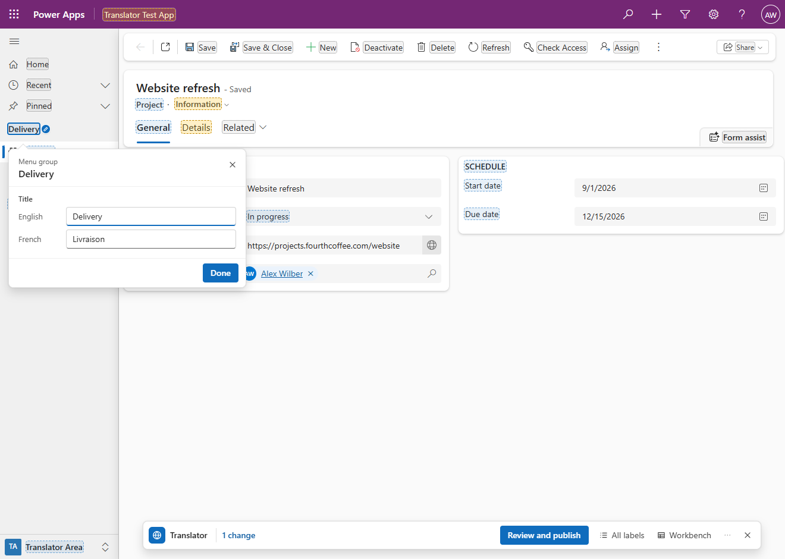

**A group of the app's navigation.** The popup of the *Delivery* group, with its title in each language. The items of
the app's navigation are a sitemap's areas, groups and subareas; their titles and descriptions are stored in the
sitemap's XML for every language.

An app's navigation is its sitemap: an XML document (`sitemapxml`) of areas, groups and subareas. Each item has
`<Titles><Title LCID="..." Title="..."/></Titles>` and
`<Descriptions><Description LCID="..." Description="..."/></Descriptions>`, with every language in the document
(verified in a test environment, LIVE-FINDINGS 13). The slots of one sitemap form one group: one PATCH writes them
all.

**Reading.** `RetrieveUnpublished` is not supported for sitemaps;
`sitemaps/Microsoft.Dynamics.CRM.RetrieveUnpublishedMultiple()` filtered on the sitemap's id is (LIVE-FINDINGS 13).
`read` sends it with a plain `GET sitemaps(<id>)` beside it, for the published row's etag that a PATCH's `If-Match` is
checked against. Both bring `ismanaged`; a sitemap has no `iscustomizable` column. A loader may fall back on the
published sitemap when the unpublished one cannot be read; a writer never does, because writing the published sitemap
back would discard other makers' unpublished work.

**What each item shows.** An item without `<Titles>` shows something else, and `toSlots` says so:

| The item | It shows | In the translator |
| --- | --- | --- |
| Any item of a sitemap from a managed solution (`ismanaged`) | Its titles, or what the rows below say | Read-only, whatever the rows below say, with the `MANAGED` reason ([6.2](#62-the-contracts-providerstypests)): "From a managed solution: a translation here would add an unmanaged layer on top of it. Translate it where its solution is developed." An app designer's placeholder there can't be named either. Only a text of Microsoft's own keeps its reason |
| Has `<Titles>` | Its titles | Editable |
| No titles, `ResourceId="SitemapDesigner.*"`: the app designer's placeholder for an item never named | *New Group* or its translation | Its title is editable, base language first (`namesFirst`); its description is read-only until it has a title: "Name this item first: its description can be translated here once it has a title." |
| No titles, any other `ResourceId` | Microsoft's own text from the language packs | Read-only: "Microsoft's own text, already shown in every installed language. To use your own name, set a title in the app designer." |
| No titles, a legacy `Title` attribute | That single-language title | Read-only: "Uses a single-language title attribute; set the title in the app designer first, then translate it here" |
| A subarea with no titles, an `Entity`, no `ResourceId` and no legacy title | The table's plural name | Read-only: "Shows the table's plural name — translate the table instead" (`ref.plural`: translation mode marks the table's plural name there) |
| An item without an `Id`, or with the `Id` of an item of the same kind before it | | Read-only: "This item has no unique Id in the sitemap, so it cannot be edited safely" |

The placeholder case was verified in a test environment (LIVE-FINDINGS 99).

**Finding an app's sitemap: `appSitemapId`.** The app's sitemap component (`appmodulecomponents` of type 62), else
`RetrieveAppComponents`, else the sitemap whose unique name is the app's. The Workbench's loader finds the sitemaps of the
apps in its solution, or of every app, and the sitemaps added to the solution directly. Unless read-only labels are
asked for, it leaves out the items there is nothing to translate in: every item of a sitemap from a managed solution,
Microsoft's own texts, and the descriptions of the app designer's placeholders that have no title yet.

**The surgical edit.** As for forms: a fresh parse of the sitemap just read, the edited entries only, then
`assertOnlyChanged` with exactly those entries skipped.

`src/providers/sitemap.ts`, `edit`:

```ts
function edit(doc: Document, el: Element, prop: Prop, lcid: Lcid, text: string): void {
  const box = BOX[prop]!;
  if (text.trim()) {
    // Titles must be the first child; Descriptions go before child groups, subareas and privileges.
    const before = prop === 'Title' ? undefined : (Array.from(el.children).find((x) => /^(Group|SubArea|Privilege)$/.test(x.tagName)) ?? null);
    return upsertLabel(doc, el, { container: box, item: prop, lcidAttr: 'LCID', textAttr: prop, lcid, text, insertBefore: before });
  }
  // Clearing a language removes its entry, so the item falls back to the base-language text. A container
  // left empty goes too, as if the language had never been added.
  removeLabel(el, { container: box, item: prop, lcidAttr: 'LCID', lcid });
  const b = kid(el, box);
  if (b && !b.children.length) el.removeChild(b);
}
```

An emptied translation removes the language's element, and an emptied container goes too: the item then shows the
base-language text in that language.

**The write.**

`src/providers/sitemap.ts`, `post`:

```ts
/**
 * One write batch: the unpublished sitemap right before the PATCH (the probe: a $batch runs its parts in order), the
 * PATCH, the sitemap right after it. Sent `once` and without continue-on-error, so a probe Dataverse answered with an
 * error stops it before the PATCH (Unsent). Throws the PATCH's error.
 */
async function post(ctx: Ctx, id: string, xml: string, etag: string): Promise<Sent<MapDoc>> {
  const get: BatchPart = { method: 'GET', url: unpub(id) };
  // If-Match: * when there is no etag still stops a PATCH from creating a sitemap that was deleted meanwhile.
  const write: BatchPart = { method: 'PATCH', url: `sitemaps(${id})`, headers: { 'If-Match': etag || '*' }, body: { sitemapxml: xml } };
  const [now, pr, back] = await ctx.http.batch([get, write, get], { once: true, stop: true });
  if (!pr.ok) throw !pr.status && !now.ok && now.status ? new Unsent(partError(now)) : partError(pr);
  const row = (r: PartResult) => (r.ok ? mapOf(r.data?.value?.[0]?.sitemapxml, etag, r.data?.value?.[0]?.versionnumber) : null);
  return { probe: row(now), back: row(back) };
}
```

1. A change loaded from a managed sitemap is refused before anything is read, with the `MANAGED` reason.
2. A fresh read. A sitemap it shows from a managed solution is not written, and none of its items is named: every
   change is an error with the `MANAGED` reason. Then the conflict check of each change.
3. The edit and its check (`built`).
4. The batch above. Turned away unrun, or stopped at a probe that failed (nothing was written): the pass again from a
   new read after 2, 4 and 8 seconds. A probe still failing then: "The latest (unpublished) version of this sitemap could
   not be read right before saving, so nothing was saved (...)".
5. A 412 (published in between): once more from a new read, then a conflict: "Someone else saved this sitemap at the
   same time."
6. A probe that is not the sitemap just read: someone else's save, put back by `settle`
   ([6.9](#69-beside-the-providers-layersts-repairts-and-writelogts)).
7. The read-back: each change as asked; a removed translation must be gone, not merely blank.
8. A language Dataverse did not keep (or did not remove) is written once more with the user's Dynamics language switched
   to it (`o.lang.run`), the way form tab labels need. Sitemap titles are stored in the document for every language
   (LIVE-FINDINGS 13); this is a guard should Dataverse ever drop one.

**Publishing.** The sitemap, after any PATCH that went through or may have, and for a change found already as asked:
whether `GET sitemaps(<id>)` returns the published sitemap is not verified, so a text already there may be one that was
never published.

**What it refuses.**

| Refused | Message | Why |
| --- | --- | --- |
| An item of a sitemap from a managed solution, as loaded or as read right before the write, a placeholder's name included | "From a managed solution: a translation here would add an unmanaged layer on top of it. Translate it where its solution is developed." | The write would add an unmanaged layer on top of the solution's sitemap |
| A blank base-language title | "The English title can't be blank: it is the base language." | Every language without a title of its own shows it |
| A title in another language for an item that has no title in any language, without a base-language title in the same save | "Name it in English too: languages without a name of their own show the English one." | The other languages would show a text nobody chose |
| An item no longer in the sitemap | "This item is no longer in the sitemap. Reload to see the current sitemap." | The writer finds items by kind and `Id` |
| A sitemap that no longer exists | "This sitemap no longer exists. Reload to see the current app." | |

### 6.7 `bpf.ts`: business process flow stages and steps

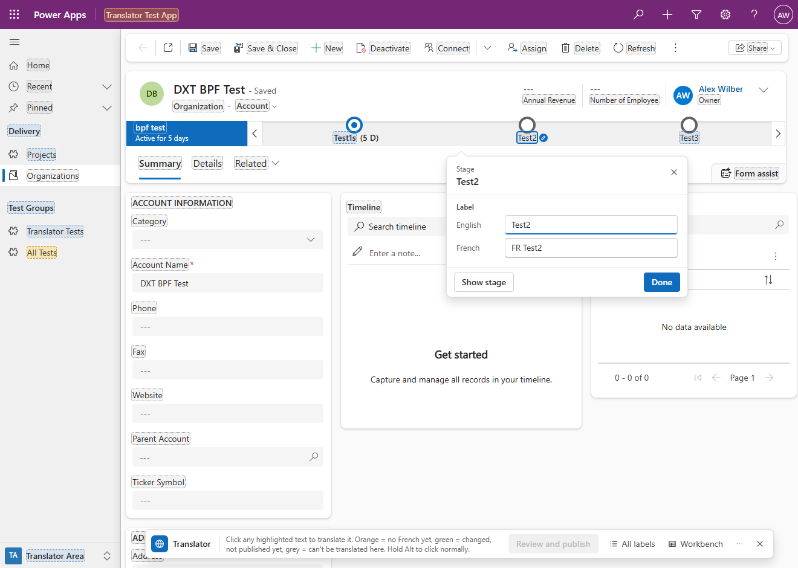

**A process stage.** The popup of a stage of the record's business process flow: its name in each language, and **Show
stage**, which opens the stage's flyout with its steps. Stage and step names are stored in the process definition.

A business process flow's stage and step names are not records: they are `StepLabel` entries in the process definition,
in **both** the `xaml` column and the `clientdata` column of its `workflow` row, keyed by label id and language. Every
language is stored there (LIVE-FINDINGS 11), and a label written there shows on the page without publishing or
reactivating the process (LIVE-FINDINGS 23). For example, in the xaml:

```xml
<mcwo:StepLabel Description="Qualify" LabelId="<stage id>" LanguageCode="1033" />
```

and in the clientdata, on each stage and step, `stepLabels: { list: [ { labelId, languageCode, description } ] }`. A
stage's label id is its stage id; a step's is its step id. The same label can appear in several collections; every one
is updated. The process's name and description are record labels, handled by `records.ts`
([6.4](#64-recordsts-names-in-localizable-columns)).

**Reading: `loadBpfLabels`.** One GET of `workflows(<id>)` with `name`, `primaryentity`, `ismanaged`, `iscustomizable`,
`xaml`, `clientdata` and `versionnumber`.

* `scan` finds every `StepLabel` tag in the xaml with a regular expression, grouping tags separated only by whitespace
  into one collection. If it finds fewer tags than are there (a tag written in another way), it refuses the process:
  "This process stores its labels in a format the translator does not recognize." A tag it could not see could be
  duplicated by an insert.
* `walk` goes through the clientdata for the stages and steps in order, and the column each step shows. Without usable
  clientdata, the xaml's stage and step ids classify the labels.
* A label's text per language is the clientdata's, with gaps filled from the xaml.
* A process from a managed solution (`ismanaged`) has every stage and step name read-only with the `MANAGED` reason
  ([6.2](#62-the-contracts-providerstypests)), whatever its managed properties allow; an unmanaged one is editable.
  The Workbench's loader (`loadBpfScope`) leaves the processes from a managed solution out unless read-only labels are
  asked for.
* The base language is required. A stage name is limited to 100 characters (stage names become
  `processstage.stagename`, 100 characters), a step label to 500 (the limit of a translation file).

**The names Dynamics keeps: `loadBpfStored`.** Verified in a test environment, once Dynamics has stored a stage or step
translation, the page keeps showing it even after its `StepLabel` is removed from the definition, until a `StepLabel` in
that language replaces it (LIVE-FINDINGS 83). Those names are in no table the Web API can query; the page gets them from
`GetClientMetadata` for the record it shows, in the caller's language only (LIVE-FINDINGS 85). On a record page,
`loadBpfStored` sends that same request through `LangSession`, once per language the definition lacks, and fills those
languages in, listing them in `ref.stored`. They show as real translations, and a save of one is measured against them.
A language whose answer failed is listed in `ref.unread`, and read again at the next page load. `ref.unread` holds what
this read missed and nothing else: the slots the page passes in carry an earlier read's names, and its misses with them
(`mergeStored`), so a read that misses nothing clears them. In the Workbench there is no record to ask for, so a later
load of the definition alone keeps the names read before (`mergeStored`). A stage or step translation once loaded, in
the definition or kept, can be replaced but not removed (`stays`): emptied, it is written as the stage's or step's
base-language text, its stand-in ([6.2](#62-the-contracts-providerstypests)): a `StepLabel` in that language, which
replaces what Dynamics kept.

`src/providers/bpf.ts`, `loadBpfStored` (its end):

```ts
const out = withStored(ctx, slots, read);
// What this read missed, and only that: slots carrying an earlier read's names (mergeStored) bring its misses along.
return {
  slots: out.map((s) => {
    const { unread: _, ...ref } = s.ref || {};
    return { ...s, ref: missed.length ? { ...ref, unread: missed } : ref };
  }),
  missed,
};
```

**Why no XML parser.** The xaml is never parsed into a DOM and written back. A DOM round trip loses its `utf-16`
declaration and adds `xmlns` attributes, and such a definition was reported to fail with *Error generating UiData*;
browsers also reject XAML's `clr-namespace:` namespace addresses. The writer edits the xaml as a string, and only the
bytes of the `StepLabel` tags it adds, changes or removes.

**The edit.**

* **xaml (`splice`):** in every collection holding the label, change the `Description` of the tag with the label id and
  the language; or, when there is none, insert a new tag right after the collection's last tag, with the same namespace
  prefix and the text escaped with `xmlAttr`; or, for a removal, delete the tag. Only tag bytes are inserted or deleted,
  never the whitespace around them: whitespace between the items of a collection means nothing to XAML.
* **clientdata (`edit`):** the same change in every `stepLabels.list` that holds the label, a new entry copied from a
  sibling so it has the shape Dataverse writes, and the JSON written again with Dataverse's `\/` escaping kept.

**The check: `sanity`.** No DOM can check the xaml, so the check compares the documents byte for byte outside the edited
tags, and counts the tags:

`src/providers/bpf.ts`, `sanity`:

```ts
/**
 * Proves only the edited languages changed: byte-identical xaml outside StepLabel tags (whitespace
 * included, since splice() never touches it), every other StepLabel tag byte-identical, exactly as many
 * tags as were meant to be added or removed, every edited label in the wanted state in both documents,
 * and the same clientdata once the edited languages' entries are left out.
 */
function sanity(d: Doc, next: Spliced, cdText: string | null, todo: Change[], rm: Set<Change>): void {
  const mine = pairsOf(todo);
  let ok = false;
  try {
    const after = parse({ xaml: next.xaml, clientdata: cdText });
    // No DOM parse here: browsers reject XAML's `clr-namespace:…, Version=…` namespace URIs (verified live),
    // and restOf already proves every byte outside the edited StepLabel tags is unchanged.
    ok =
      restOf(d.xaml, mine) === restOf(next.xaml, mine) &&
      cdOf(d.cdText, mine) === cdOf(cdText, mine) &&
      tagCount(next.xaml) === tagCount(d.xaml) + next.added - next.removed &&
      todo.every((c) => settled(after, c, rm.has(c)));
  } catch {
    /* a document that no longer parses fails the check */
  }
  if (!ok) throw new Error(UNSAFE);
}
```

A failure stops the save before anything is sent, with the same message as for forms: "Safety check failed: the change
would have modified more than the translated labels, so nothing was saved."

**The write.**

`src/providers/bpf.ts`, `post`:

```ts
/**
 * One write batch: the definition right before the PATCH (the probe: a $batch runs its parts in order), the PATCH, the
 * definition right after it. The clientdata is sent when it differs from the one `fresh` read. Sent `once` and without
 * continue-on-error, so a probe Dataverse answered with an error stops it before the PATCH (Unsent). No If-Match:
 * verified live, a BPF update cascades into WorkflowDependency rows, which reject IfVersionMatches ("Optimistic
 * concurrency isn't enabled for entity type WorkflowDependency", LIVE-FINDINGS 29). Throws the PATCH's error.
 */
async function post(ctx: Ctx, id: string, b: Built, fresh: Doc): Promise<Sent<Doc>> {
  const get: BatchPart = { method: 'GET', url: `workflows(${id})?$select=${SELECT}` };
  const body = b.cdText === fresh.cdText ? { xaml: b.xaml } : { xaml: b.xaml, clientdata: b.cdText };
  const [p, pr, back] = await ctx.http.batch([get, { method: 'PATCH', url: `workflows(${id})`, body }, get], { once: true, stop: true });
  if (!pr.ok) throw !pr.status && !p.ok && p.status ? new Unsent(partError(p)) : partError(pr);
  return { probe: docOf(p), back: docOf(back) };
}
```

1. A change of a process loaded as one from a managed solution is refused before anything is read, with the
   `MANAGED` reason. Then a fresh read of the definition: one it shows from a managed solution is not written, every
   change an error with the `MANAGED` reason. Then the conflict check of each change, against the definition's text, or
   the kept name where the definition has none.
2. The edit and `sanity`.
3. The batch above, with no `If-Match`: the process PATCH refuses it (LIVE-FINDINGS 29), so the probe is the only guard.
   A PATCH takes about 9 seconds on the server; a save someone else makes after the probe and while the PATCH runs
   cannot be seen, and can be overwritten (rule 2 of [6.2](#62-the-contracts-providerstypests)).
4. Turned away unrun, or stopped at a probe that failed: again from a new read after 2, 4 and 8 seconds.
5. A probe that is not the definition just read: someone else's save, put back by `settle`
   ([6.9](#69-beside-the-providers-layersts-repairts-and-writelogts)).
6. The read-back: every change in its wanted state in both columns. A language Dataverse did not keep is written once more
   with the user's Dynamics language switched to it, as a guard: verified in a test environment, every language is kept
   whatever the UI language.

A process definition is not published: nothing is added to the publish set.

**What it refuses.**

| Refused | Message | Why |
| --- | --- | --- |
| A stage or step of a process from a managed solution, as loaded or as read right before the write | "From a managed solution: a translation here would add an unmanaged layer on top of it. Translate it where its solution is developed." | The write would add an unmanaged layer on top of the solution's process |
| An emptied stage or step translation that is loaded, in the definition or kept (the saver never sends one) | "Dynamics keeps a stage's translation once it is stored: type the text you want instead." (*step's* for a step; `cantClearText`) | Removing its `StepLabel` would leave the page showing it (LIVE-FINDINGS 83). It can be replaced, not removed: the saver writes the stage's or step's base-language text in its place, its stand-in ([6.2](#62-the-contracts-providerstypests)), so this is only the writer's last guard |
| A blank base-language label | "The English label can't be blank: it is the base language." | |
| A label no longer in the definition | "This label is no longer in the process definition. Reload and try again." | |
| A definition whose clientdata cannot be read | "The process definition returned by Dataverse could not be read." | The writer never writes back what it cannot parse |
| A definition in a format the scan does not recognize | "This process stores its labels in a format the translator does not recognize." | |
| A change Dataverse refuses on an activated process (`0x80045002`) | "Dataverse does not allow changes to this activated process. Deactivate it in the process designer, save again, then activate it." | |

### 6.8 `ribbon.ts`: classic command bar labels

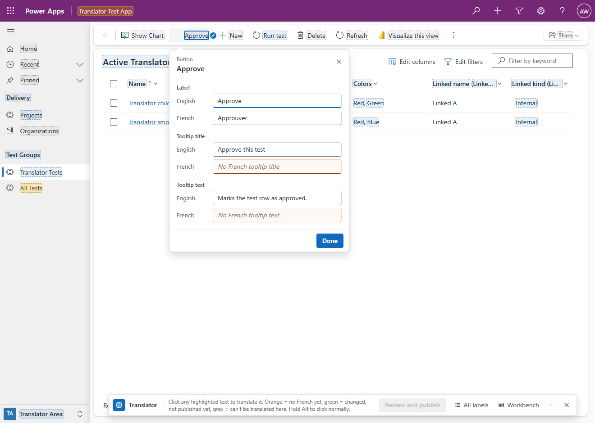

**A command bar button.** The popup of a classic button of the command bar: its label, tooltip title and tooltip text
in each language, the two tooltip texts not yet translated into French. A classic button's texts are `LocLabel` titles
of the table's ribbon; a modern command's are columns of its `appaction` row
([6.4](#64-recordsts-names-in-localizable-columns)).

The classic command bar is defined by ribbon XML. A button's texts are tokens such as `$LocLabels:<Id>`, and each
`LocLabel` holds its titles in every language:
`<LocLabel Id="..."><Titles><Title description="..." languagecode="1036"/></Titles></LocLabel>`. Microsoft's own buttons
use `$Resources:` tokens instead, texts from the language packs that cannot be translated here (LIVE-FINDINGS 65).

**Reading: `ribbondiffs`.** Rows of `difftype` 3 hold one `LocLabel` each, with every language, for every solution
layer (LIVE-FINDINGS 12). `readDiffs` reads them for up to 25 tables per request (`entity eq null` for the application
ribbon, shown as *All tables*), and keeps one per `LocLabel` Id: an unmanaged row wins over a managed one for the
texts, and a deleted row (`componentstate` 2 or 3) is skipped. A label that a managed solution defines (a managed row
of its Id, also where an unmanaged row of it wins for the texts: someone customized it, and the solution is still
under it) is read-only with the `MANAGED` reason ([6.2](#62-the-contracts-providerstypests)). The Workbench's loader
leaves read-only labels out unless they are asked for. Right before a write, the writer first asks with
`RetrieveUnpublishedMultiple`, which would also return rows an import has staged but not published. Only an answer
that says the call is not supported (400, 404, 405, 501) makes it read the published rows, from then on for the page's
life; verified in a test environment, the call is not supported for ribbon rows (LIVE-FINDINGS 26). A throttled or
failed call is an error, never a quiet fallback.

**Which button shows which label: `ribbonControls`.** The `CustomAction` rows of `ribbondiffs` (`difftype` 0) hold every
custom or customized button of every layer, with its label tokens, and load in milliseconds. A button of the application
ribbon names its table `{!EntityLogicalName}`, which is replaced with the page's table; a table's own definition wins
over an application-wide one with the same id. The result is kept per table for the page's life. The composed ribbon
(`RetrieveEntityRibbon`) is not used: it took about 32 seconds in a test environment and adds only Microsoft's own
buttons (LIVE-FINDINGS 30, 65).

**Why a translation import.** Dataverse has no request that writes ribbon XML. A translation import
(`ImportTranslation`) does write `LocLabel` titles, and changes nothing else of the ribbon, pending work included
(verified in a test environment, LIVE-FINDINGS 72, 74). It takes about 20 seconds per table, and the Publish dialog
says so before the save: *Classic command labels are saved through a translation import (about 20 seconds per
table).*

**The steps of a save.**

`src/providers/ribbon.ts`, `ribbonWriter.save` (the start):

```ts
const work = async (): Promise<ChangeResult[]> => {
  say('checking the current labels');
  todo = classify(ctx, todo, await latestDiffs(ctx, e, o.signal), o.force, out);
  // What an earlier save of this scope owes (OWED) needs a publish and an import, even with nothing else to write.
  if (!todo.length && !(OWED.has(e) && o.allowPublish)) return out;
  // Verified live: ribbondiffs show only the PUBLISHED ribbon, and an import writes over a pending title of
  // the same language (LIVE-FINDINGS 26, 74). So the table's ribbon is published first, and the conflict
  // check below sees what anyone has pending; without permission to publish, nothing is saved.
  if (!o.allowPublish)
    return [...out, ...todo.map((c) => fail(c, 'Classic command labels can only be saved with publishing turned on: Dataverse shows only the published command bar, so saving without publishing could overwrite unpublished command bar changes.'))];
  say('publishing pending command bar changes');
  await publishScope(ctx, e, o.signal);
  say('creating a temporary solution');
  const layer = await layerId(ctx, e, o.signal);
  const sol = (st.sol = await createSolution(ctx, e, todo, o.signal));
  await addRoot(ctx, e, layer, sol, o.signal);
```

1. **Read and sort** the changes (`classify`): refusals (below) and the conflict check. A label that a managed solution
   defines, as this read shows or as it was loaded, is never written, even one that has an unmanaged row already.
2. **Publish the table's ribbon first** (`PublishXml` of the table, or of the application ribbon). `ribbondiffs` show only
   the published ribbon (LIVE-FINDINGS 26), so pending titles would be invisible to the conflict check; once published,
   everyone's pending work is visible, and the check sees it. Command bar work someone saves unpublished after this
   publish, or while a title is put back (step 7), is not: an import can write over it (LIVE-FINDINGS 26, 74), the
   accepted limit of rule 2 ([6.2](#62-the-contracts-providerstypests)).
3. **The layer's row** (`layerId`): the scope's one unmanaged `ribboncustomizations` row. A translation file names a label
   by the row of its layer (LIVE-FINDINGS 76), and only the unmanaged layer is written, never for a label that a managed
   solution defines.
4. **A temporary solution** (`createSolution`): `dxt_ribbon_<table>_<time in base 36>`, named *Translator temporary
   ribbon translation (safe to delete)*, with the publisher whose prefix starts the `LocLabel` Ids, else the default
   publisher, else another publisher that is not Microsoft's. An import applies its rows only to components of the
   solution it names (LIVE-FINDINGS 27), and naming *Default* blocks other makers' solution work for minutes
   (LIVE-FINDINGS 71).
5. **The table, as a shell** (`addRoot`): `AddSolutionComponent` of the table (type 1) with
   `DoNotIncludeSubcomponents: true`, or of the application ribbon (type 50) with `false`, which that type requires
   (LIVE-FINDINGS 75).
6. **For each try, at most three:** read again, sort again, refuse the labels that would have no base-language text, build
   the translation file and import it. An import Dataverse was too busy to run (another import of the same table, a
   deadlock, LIVE-FINDINGS 77; the customization lock) is built again from a new read after 5, then 10 seconds.
7. **Read again right after the import**, before publishing: a title of the file that someone else published in the
   meantime was written over by the import. It is put back by a second import once this save is published (`putBack`,
   at most three), and a change of theirs in an edited language becomes a conflict ([chapter 7](#7-saving-safely)).
8. **Publish**, then **verify** in `ribbondiffs`: each edited language exactly as written, the other languages as read
   right after the import.
9. **Clean up**, whatever happened: delete the temporary solution (only the container: the table and its ribbon stay),
   trying again after 2, 4, 8 and 16 seconds while Dataverse is busy (LIVE-FINDINGS 20); a solution that could not be
   deleted, or whose import may still be running, is named in the results as safe to delete. The temporary solutions this
   user left more than an hour ago are deleted too; another maker's never.

**What a failed publish leaves owed.** A title of the file that someone else published while the import ran is put
back once this save is published (step 7). When that publish fails, or a put-back import can't put a title back, their
text stays written over in the unpublished command bar, and only a publish lets an import write it again. The writer
keeps such cells per table (`_app` for the application ribbon) in `OWED`, which the unit tests reach as `RIBBON_OWED`;
so is a cell that the read after a put-back still shows with this save's text over theirs (a put-back import whose
answer was lost). The next save of a classic label of that table (**Try again**, for example) needs publishing
allowed. It publishes first, then puts those cells back before the read its own import is built from, even when its
own changes turn out to be already as asked. A cell it can't put back either stays owed, and every change of that
label fails with *Someone else's “…” (the French text of this label) that an earlier save put back is still to be
restored: it could not be put back this time either. Try again.* (a conflict keeps its outcome, and a cancelled change
stays skipped with that sentence after its own). A cell whose label a managed solution defines, as read right before a
put-back import, is never written back, and is not owed either: no later save may write it. For a cell an earlier
save owed, every change of that label then says *Someone else's “…” (the French text of this label) that an earlier
save put back can't be restored here: it now comes from a managed solution, and a write would add an unmanaged layer on
top of it.* `OWED` lives in memory only: a reload, or a new start of the translator, forgets it.

**The translation file.** A file of the shape `ExportTranslation` produces, stripped to the rows being written:

`src/providers/ribbon.ts`, `translationXml`:

```ts
export function translationXml(o: { orgId: string; base: Lcid; solution: string; layer: string; rows: Array<[string, Labels]>; when: Date }): string {
  const langs = [o.base, ...[...new Set(o.rows.flatMap(([, l]) => Object.keys(l).map(Number)))].filter((l) => l !== o.base).sort((a, b) => a - b)];
  const cell = (v: string, type = 'String') => `<Cell><Data ss:Type="${type}">${xmlAttr(v)}</Data></Cell>`;
  const row = (cells: string[]) => `<Row>${cells.join('')}</Row>`;
  const heads = (...names: string[]) => row([...names.map((n) => cell(n)), ...langs.map((l) => cell(String(l), 'Number'))]);
  const info = [
    ['Organization ID:', o.orgId],
    ['Exported on:', o.when.toISOString().slice(0, 19), 'DateTime'],
    ['Base language name:', lcidName(o.base)],
    ['Base language ID:', String(o.base), 'Number'],
    ['Solution Name:', o.solution],
  ].map(([k, v, t]) => row([cell(k), cell(v, t)]));
  const body = o.rows.map(([id, l]) => {
    if (!l[o.base]?.trim()) throw new Error(`The label "${id}" has no ${lcidName(o.base)} text, which Dataverse requires. Nothing was saved.`);
    return row([cell('RibbonCustomization'), cell(o.layer), cell(id), ...langs.map((x) => cell(l[x] ?? ''))]);
  });
  const sheet = (name: string, rows: string[]) => `<Worksheet ss:Name="${name}" ss:Id="${name}"><Table>${rows.join('')}</Table></Worksheet>`;
  return (
    '<?xml version="1.0" encoding="utf-8"?><Workbook xmlns="urn:schemas-microsoft-com:office:spreadsheet" xmlns:ss="urn:schemas-microsoft-com:office:spreadsheet">' +
    sheet('Information', info) +
    sheet('Display Strings', [heads('Entity name', 'Display String Key')]) +
    sheet('Localized Labels', [heads('Entity name', 'Object ID', 'Object Column Name'), ...body]) +
    '</Workbook>'
  );
}
```

* **The Information sheet** names the organization id, an *Exported on* date of type `DateTime`, the base language and
  the solution. The import validates it strictly: the sheet needs its `ss:Id` and the *Exported on* cell its `DateTime`
  type (LIVE-FINDINGS 15), and a wrong organization id is refused at once, with nothing applied (LIVE-FINDINGS 72).
* **One row per edited `LocLabel`:** `RibbonCustomization`, the layer's row id, the `LocLabel` Id, then one cell per
  language.
* **The base cell is always filled,** with the edited base text or the one just read: a row with an empty base cell is
  skipped whole, without an error (LIVE-FINDINGS 73).
* **A language the row does not edit has an empty cell,** which keeps its title (LIVE-FINDINGS 69). A text equal to the
  published title changes nothing.
* **Texts are escaped** with `xmlAttr`, so line breaks and tabs become character references.
* The file is zipped with a `[Content_Types].xml` (`src/core/zip.ts`), sent in base 64 as `TranslationFile`, with a new
  `ImportJobId`; `importjobs(<job id>)` then says whether it *Succeeded* or *Failed*.

**The check.** No document is edited here: the file carries the edited `LocLabel` rows and nothing else. What the
import did is checked by reading `ribbondiffs` right after it and after the publish, as above.

**What it refuses.**

| Refused | Message | Why |
| --- | --- | --- |
| A label that a managed solution defines (a managed row of its Id), as loaded or as read right before the import, also one with an unmanaged row already | "From a managed solution: a translation here would add an unmanaged layer on top of it. Translate it where its solution is developed." | Writing it would put an unmanaged layer over that solution's ribbon that no import can remove (LIVE-FINDINGS 76) |
| An emptied translation (the saver never sends one) | "Dataverse can't remove a translation from this component. Type the text instead, or undo this edit." (`CANT_CLEAR_TEXT`) | An import keeps a title it does not carry or carries empty (LIVE-FINDINGS 39, 69). Only the writer's last guard, before any import: the saver writes the label's base-language text in its place, its stand-in ([6.2](#62-the-contracts-providerstypests)) |
| A blank base-language label | "The English label can't be blank: it is the base language." | |
| A label with no base-language text, in the save or on the server | "This label has no English text, which Dataverse needs to save a translation of it. Add the English text too." | The import would skip its row without saying so (LIVE-FINDINGS 73) |
| Control characters in the text | "The text contains control characters that a command label cannot store. Remove them and save again." | |
| Every change, when the save does not publish | "Classic command labels can only be saved with publishing turned on: ..." | Pending ribbon work would be invisible to the check (LIVE-FINDINGS 26) |
| A label no longer on the server | "This label no longer exists on the server. Reload and try again." | |

**A dry run.** `RIBBON_DRY_RUN.on = true` runs every step up to the import, keeps the file it would have imported in
`RIBBON_DRY_RUN.last`, and reports the changes as skipped: *Dry run: stopped before the import. Nothing was changed.*
The unit tests use it. Note that the steps before the import (the publish, the temporary solution) still run.

### 6.9 Beside the providers: `layers.ts`, `repair.ts` and `writelog.ts`

Three modules help the writers. [Chapter 7](#7-saving-safely) explains how they fit into a save; this is what each one is.

**`layers.ts`: the solution layers of a metadata component.** A table's, a column's or a global choice's layers come
from Dataverse's virtual table `msdyn_componentlayers`, which the database answers itself, with no metadata cache in
front of it (about 0.4 seconds; LIVE-FINDINGS 81):

```
GET msdyn_componentlayers?$filter=(msdyn_componentid eq '<MetadataId>' and msdyn_solutioncomponentname eq '<Entity, Attribute or OptionSet>')
    &$select=msdyn_solutionname,msdyn_order,msdyn_changes
```

`parseLayers` takes each label's text per language from the topmost layer that has that language: the *Active*
(unmanaged) layer first, then by `msdyn_order`, highest first. The metadata writers use it to confirm a write that a
lagging read does not show yet, and to see what someone else saved in the same moment. Relationship menu labels and
option labels have no such entries, and are never checked this way. A user who cannot read the table (400, 403, 404)
simply saves without this check.

**`repair.ts`: someone else's save in the middle of a document write.** The form, sitemap and process writers write a
whole document. Each write batch is `[probe, PATCH, read back]`, and the probe shows exactly the document the PATCH
replaced. When that is not the document the edit was built on, someone saved in between, and the PATCH erased their
change. `settle` then builds the edited label/language pairs again on their document and writes that from a new read,
which must still show this save's own PATCH; a pair they changed too keeps their text and comes back as a conflict. Each
writer describes its documents to `settle` through `DocOps`: how to read one, build an edit on it, send it, and compare
two reads. [Chapter 7](#7-saving-safely) follows it step by step.

**`writelog.ts`: the write log.** The page keeps its last 30 metadata writes in memory: what each write sent, Dataverse's
status and `x-ms-service-request-id`, what the read right after it and the solution layers showed, and the outcome. A
failed row in the Publish dialog has *Copy details*, which copies those of its component as plain text, for support
([chapter 8](#8-the-publish-dialog-history-and-undo)).

---

## 7. Saving safely

Saving is where the translator changes the environment. This chapter follows one save from the staged edits to the
report: the checks before anything is sent, the order in which the writes go out, how each write is read right before
it in the same request, how a save someone else made at that moment is found and put back, the outcomes, the solution
layers that confirm a metadata write, the short switches of the user's Dynamics language that form labels need, the
publish, the log kept for support, and what is written when a translation Dataverse can't remove is emptied.
[Chapter 8](#8-the-publish-dialog-history-and-undo) covers the dialog that starts a save and shows its result;
[chapter 6](#6-providers-reading-and-writing-each-kind-of-label) covers the requests of each writer.

What a save changes, in Dataverse terms:

* **The labels that were edited**, and nothing else of their components: metadata labels (tables, columns, choices,
  relationships), localizable columns of records (view, chart, form, dashboard, app and process names, command
  buttons, environment variables, custom APIs), form and dashboard definitions, sitemaps, process definitions, and
  classic command bar labels through a translation import ([chapter
  6](#6-providers-reading-and-writing-each-kind-of-label)). Never a label of a component from a managed solution: a
  translation there would be an unmanaged customization on top of it, so such labels are read-only from the load to
  the write ([7.2](#72-checks-before-anything-is-sent)).
* **The user's own Dynamics language, for a moment.** Form tab and section labels are read and written only in the
  caller's UI language, so the translator switches `uilanguageid` to that language and back inside one request
  ([7.10](#710-switching-the-dynamics-language-for-a-moment)).
* **One publish** of the components the writes touched, never of the whole environment
  ([7.15](#715-publishing-publishts)), and an update of each business process flow whose name was written
  ([7.17](#717-updating-a-process-after-its-name-is-saved)).

The rules every part of this chapter keeps:

* Nothing is written from a read made earlier than right before the write. A text loaded minutes ago is only what the
  edit is measured against, and a text that could not be loaded is never taken for an empty one: no edit starts there
  ([7.4](#74-what-every-writer-does)).
* Nothing is written to a component from a managed solution. The store, the saver and each writer refuse it, and each
  writer looks again at whether the component is managed in its read right before the write
  ([7.4](#74-what-every-writer-does)).
* A label someone else changed is never knowingly overwritten. A change made before the writer's read is a conflict
  for the user to settle; one made at the moment of the write is put back, or said where it cannot be
  ([7.5](#75-the-read-in-the-same-batch-before-each-write)).
* Only the languages that were edited are written, where Dataverse allows that. A metadata PUT has to carry every
  language of the label (verified in a test environment, LIVE-FINDINGS 2: a PUT with only the changed language also
  overwrites the base language), which is why the read right before it matters most.
* A translation Dataverse can't remove is never written blank. Emptied, it is written as its **stand-in**, the text
  that language shows without a translation of its own, so the page looks as it would without one; one whose stand-in
  isn't known is refused, and one made of a text the same save writes is written only once that text is saved
  ([7.19](#719-emptying-a-translation-dataverse-cant-remove-the-stand-in)). The one exception is a metadata
  description, which is saved empty on purpose, so that its users see no tooltip or description.
* *Saved* is said only when a read after the write shows the text as asked. Anything less is said as it is
  ([7.8](#78-outcomes-and-why-saved-is-never-said-unconfirmed)).
* A write that has been sent is never aborted. **Stop** takes effect before the next write.

The whole flow, with the function that does each step:

```
Publish in the Publish dialog (ui/review.ts), or Undo in Recent publishes
  -> saver.save(changes, { publish: true, ... }) or saver.undo(entry, ...): start(), one at a time -> run()
       0. measure(): an emptied translation Dataverse can't remove becomes its stand-in (withStandIns; a metadata
          description stays blank, saved empty), and check() runs on the changes as they will be written: errors
          block a change (read-only and managed ones are skipped), warnings are shown
       1. sources(): every text a stand-in is made of is read again, and the label's own text where the stand-in
          is already the text it replaces; one job per writer and save group
       2. the writes: three groups of jobs side by side, then the jobs whose stand-in is made of a text another
          job wrote, then sitemaps and processes, then classic command labels
            -> writer.save(): fresh read -> conflict check -> one $batch [read, write (, read)] -> check
          finally: restore() makes sure the user's Dynamics language is back
       3. store.commit(results), then addHistory(): the journal entry behind Recent publishes, with the texts
          this run sent
       4. publishXml(): one PublishXml for every component the writes touched
       5. rebuildProcess(): each business process flow whose name was written
  <- SaveReport: one result per change, the counts, the publish outcome, warnings
```

### 7.1 The path of a save

`createSaver(ctx, store, lang, writerFor)` in `src/core/saver.ts` builds the saver the rest of the app uses. It is
created once when the translator starts (`deps.saver` in `src/main.ts`, called by `createApp`), with the page's store,
the page's language session and the writer of each kind of label (`providers.writerFor`).

| Function | What it does |
| --- | --- |
| `validate(changes, o)` | The checks of [7.2](#72-checks-before-anything-is-sent), without writing anything, each for the change given, on the changes as a save of them (with `o.undo`, an undo) writes them. The Publish dialog uses them to plan ([8.2](#82-the-plan-what-publish-writes-and-what-it-skips)). |
| `prepare(changes, o)` | The changes as a save (or an undo) of them writes them, an emptied translation Dataverse can't remove as its stand-in (`written`), their issues (`issues`) and the texts the stand-ins are measured by (`text`), worked out as `run` works them out ([7.19](#719-emptying-a-translation-dataverse-cant-remove-the-stand-in)). The Publish dialog and the Undo question show what it gives. |
| `publishTargets(changes)` | The components a save of these changes would publish ([7.15](#715-publishing-publishts)). |
| `pendingWork(changes, signal)` | The unpublished forms, views and charts a publish would also publish ([7.16](#716-what-else-a-publish-publishes)). |
| `save(changes, o)` | Saves and, with `o.publish`, publishes. |
| `history()` | The journal of past publishes ([8.9](#89-the-journal-historyts)). |
| `current(changes, signal)` | The text of each change on the server now, read as each writer reads right before writing, writing nothing (the Undo preview, [8.11](#811-undoing-a-publish-the-preview)). |
| `undo(entry, o)` | Writes the earlier texts of a past save back, through the same path and checks, so a label of a component from a managed solution is skipped with its reason, and a translation the save added that Dataverse can't remove gets its stand-in; a description stored empty before the save is saved empty again (`undoChange`, [7.19](#719-emptying-a-translation-dataverse-cant-remove-the-stand-in), [8.12](#812-undoing-a-publish-the-run-and-its-checks)). |

**One at a time.** A save and an undo share the language session and Dataverse's customization lock, so only one
runs at a time in a page:

`src/core/saver.ts`, `start`:

```ts
/** One save or undo at a time: they share the language session and the customization lock. */
async function start(changes: Change[], o: SaveRunOptions, purpose: Purpose): Promise<SaveReport> {
  if (running) throw new Error('A save is already running. Wait for it to finish.');
  running = true;
  store.setBusy(true, purpose === 'undo' ? 'Undoing a save' : 'Saving');
  try {
    return await run(changes, o, purpose);
  } finally {
    running = false;
    store.setBusy(false);
  }
}
```

`store.setBusy` tells every view: the Workbench footer and the pill of the minimized window show the progress
(*Saving 2 of 5…*, or *Undoing 2 of 5…* for an undo, the count the Publish dialog and Recent publishes pass on),
Ctrl+Z and Ctrl+Y do nothing to the staged edits ([8.13](#813-ctrlz-and-ctrly-undots)), the Workbench's **Extract
translations** and its **Read again** of form labels not loaded are refused until it ends (*Wait for the save to
finish, then extract translations.*, *... then read the form labels again.*), and the page's *Leave site?*
prompt is on for the length of the save (`beforeUnload` in `src/ui/app.ts`, which is on whenever a save runs or
changes are staged).

**The steps of `run`.** The comments in the code number them the same way:

0. **Stand-ins.** `measure` turns each translation emptied where Dataverse can't remove one into its stand-in (but a
   metadata description's, which is saved empty), and runs `check` ([7.2](#72-checks-before-anything-is-sent)) on the
   changes as they will be written ([7.19](#719-emptying-a-translation-dataverse-cant-remove-the-stand-in)). From then
   on the results, the store and the journal carry the text written.
1. **Check and group.** `check` has found the changes that must not be sent. A read-only change, one of a component
   from a managed solution included, gets the outcome `skipped` with *Read-only: &lt;the reason&gt;* and is never sent
   to a writer; so does an emptied translation whose stand-in waits for a text that is not loaded, with the reason and
   what to load. Any other blocked change gets `error` with every error message. Then `sources` reads again every
   text a stand-in is made of, and the label's own text where the stand-in is the text it replaces already: a
   stand-in made of a text that changed on the server since it was loaded, or that could not be read, gets `error`;
   one that is the text it replaces already gets `unchanged` without a write while the server still holds that text,
   and `conflict` when it holds another ([7.19](#719-emptying-a-translation-dataverse-cant-remove-the-stand-in)). A
   change no writer handles gets `error` with *Saving this kind of label is not supported yet.* Every other change
   goes into one job per writer and save group (`slot.group`: one server object, such as one form or one column).
2. **Write.** The jobs run in the order of [7.3](#73-groups-order-and-what-runs-at-the-same-time). A job that fails
   never stops the others. A job holding a stand-in made of a text another job writes (a form label emptied while its
   column's name changes) waits until the metadata, records and form jobs without such a stand-in have ended
   (sitemaps, processes and classic command labels come after it), and such a stand-in is written only once that text
   is saved; otherwise it is held back (`skipped`). When every job has ended, `restore` makes sure the user's Dynamics
   language is back ([7.12](#712-putting-the-users-language-back)).
3. **Commit and journal.** The results go into the store in the order of the changes, then into the journal, before
   anything is published, so a slow or failed publish loses nothing. The journal gets only the texts this run wrote
   (below).
4. **Publish.** One `PublishXml` call for everything the writes touched ([7.15](#715-publishing-publishts)).
5. **Update processes.** Each business process flow whose name was written is updated once
   ([7.17](#717-updating-a-process-after-its-name-is-saved)).

The start of step 3 in the code:

`src/core/saver.ts`, `run`, after the writes:

```ts
// 3. Commit and journal before publishing, so a slow or failed publish loses nothing.
const order = new Map(changes.map((c, i) => [c, i]));
results.sort((a, b) => (order.get(a.change) ?? 0) - (order.get(b.change) ?? 0));
if (results.length) store.commit(results);
const saved = results.filter((r) => r.outcome === 'saved');
// Labels that need no publish (commands, process labels, environment variables...) are live as soon
// as they are written, so a save that touched only those counts as published.
const live = pset.empty;
// A label a save finds already as asked, which was not that text when it was edited, is journaled too when a write of
// that text by this saver may have run (its answer lost or not confirmed, then Try again, `tried`): that write,
// published by this run. One it never sent, or sent only to have it refused, is someone else's text (`found`): left
// out, so Undo of this publish never puts back what this run didn't write. The report still counts it as already as
// asked ('unchanged').
const mine = results.filter((r) => r.outcome === 'saved' || (purpose === 'save' && r.outcome === 'unchanged' && !r.found && r.change.before !== stored(r.change.after)));
```

**Only the texts this run wrote.** A label a save finds already as asked, with a text other than the one the edit was
made on, is one of two things: this translator's own earlier write whose answer was lost (reported as not confirmed,
then **Try again**, [7.8](#78-outcomes-and-why-saved-is-never-said-unconfirmed)), or a text someone else saved. Only
the first is this publish's change. Each run hands its writers a set, `ran` (`SaveOptions.ran`,
[6.2](#62-the-contracts-providerstypests)), into which each writer puts the changes it sent a write for that Dataverse
didn't refuse: answered, or with its answer lost. The saver remembers, for as long as the translator runs, the text of
each such change whose result did not say it was saved (`tried`, by change id: an error, or a stop once the write
began), until a later run settles it:

`src/core/saver.ts`, `tried`:

```ts
/**
 * The texts a write of this saver may have saved although its run didn't say they were (an error, or a stop once the
 * write began), by change id, until a later run settles them: only where the writer says a write was sent for it that
 * Dataverse did not refuse (SaveOptions.ran: answered, or its answer lost). A later run that finds one already as asked
 * may be finding that write (reported as not confirmed, then Try again): it is journaled as that run's. One this saver
 * never sent, or sent only to have it refused (a read before the write failed, a 403, a check), and finds already as
 * asked is someone else's text (ChangeResult.found): never journaled as this run's, so its Undo never puts theirs back.
 */
const tried = new Map<string, string>();
```

`runJob` marks a label found already as asked that no write of this saver may have put there, and keeps `tried`:

`src/core/saver.ts`, `run`, `runJob`:

```ts
if (sending) {
  // Already as asked, a text other than the one the edit was made on, and no write of this saver may have put it there: not this run's.
  const asked = stored(c.after);
  if (x.outcome === 'unchanged' && c.before !== asked && tried.get(id) !== asked) x = { ...x, found: true };
  // A failure adds its text only when a write of it was sent and may have run; one refused, unread or never sent
  // adds nothing, and keeps what an earlier run's write may have saved (its answer is still unknown).
  if (x.outcome !== 'error' && x.outcome !== 'skipped') tried.delete(id);
  else if (ran.has(id)) tried.set(id, asked);
}
```

* **A result that settles the change** (`saved`, `unchanged`, `conflict`) clears its entry.
* **A failure whose write may have run** (in `ran`) records the text it sent.
* **A failure whose write was never sent or was refused** (a read before the write failed, a 403, a 429 every time,
  a check of the writer, **Stop** before the write) records nothing, and leaves alone an entry an earlier run made:
  that earlier write's answer is still unknown.

So a **Try again** that finds the text already there journals it only after an attempt whose write may have landed.
After an attempt that was refused, turned away or never sent, and no earlier one whose write may have run, the text
found there is someone else's (marked `found`): the publish's Undo never reverts another maker's save.

A result marked `found` still counts as already as asked (`unchanged`), in the report and for the publish
([7.15](#715-publishing-publishts)), but it is not journaled, so Undo of this publish never puts back a text it did
not write. The Publish dialog says such rows apart:
*Done. Published 2 changes. 1 change was already on the server, so Undo of this publish leaves it alone.*
([8.7](#87-after-the-run-done-or-the-problems)). Tests of `tools/dev/tests/savepath.ts` cover both cases, and those
of the writers' test files (`metarace.ts`, `records.ts`, `docwrites.ts`, `ribbon.ts`) what each writer puts in `ran`.

The journal entry names each label as the Publish dialog showed it (`SaveRunOptions.describe`), so Recent publishes can
show the same rows later. `run` waits for `addHistory`, which, like every change of the journal (`markPublished` after
the publish, `markUndone` after an undo), reads and writes it under a Web Lock named after its key,
`dxt:history:<organization id>:<user id>`: two tabs of the same user never write back a list read before the other's
write ([8.9](#89-the-journal-historyts); `tools/dev/tests/journal.ts` covers two tabs changing it at the same moment,
with and without Web Locks). When it cannot be stored, the report carries the warning *This save could not
be added to Recent publishes (it is very large, or the browser's storage is full or blocked), so it can't be undone
from the translator.*

**The report.** `run` returns a `SaveReport` (`src/ui/types.ts`):

| Field | Holds |
| --- | --- |
| `results` | One `ChangeResult` per change, in the order of the changes: the outcome, a message, for a conflict the text on the server ([7.8](#78-outcomes-and-why-saved-is-never-said-unconfirmed)), and `found` on a label found already as asked that no write of this translator may have put there (above). |
| `saved`, `unchanged`, `conflicts`, `errors`, `skipped` | The number of each outcome. |
| `published` | The publish succeeded, or nothing the writes touched needs one and at least one label was saved or found already as asked. |
| `publishError` | Why the publish failed; the translations are saved all the same ([7.15](#715-publishing-publishts)). |
| `warning` | Something the user must act on: the Dynamics language could not be put back, the journal could not store the save, or a process update found something to check. |
| `notice` | Saved, but the page may show the old process name for now. |
| `ms`, `historyId` | How long the save took; the id of its journal entry. |

### 7.2 Checks before anything is sent

`check(changes, purpose, text)` looks at each change as it would be written: a translation emptied where Dataverse
can't remove one comes to it as its stand-in, and `text` gives the texts that stand-in was measured by
([7.19](#719-emptying-a-translation-dataverse-cant-remove-the-stand-in)). An **error** blocks the change: it is never
sent, and the rest of its group is saved normally. A **warning** is shown on the change's row in the Publish dialog,
and the change is saved all the same. A **general** warning describes how labels of that kind are saved, in the same
words for all of them, so the dialog shows it once. A change with an error gets only its errors: its warnings would
describe a write that cannot happen.

The checks never propose a translation: the translator has no machine translation and no translation memory. A
translation worded like the base text gets no warning, because many labels read the same in both languages. The one
text a save writes that nobody typed is a stand-in, the text that language shows anyway.

In this table English is the base language and French the language edited, as in the examples of the guide.

| Check | Level | Text |
| --- | --- | --- |
| The slot is read-only, or its component is from a managed solution | Error (the change is `skipped`) | *Read-only: &lt;the reason&gt;*; for a managed component *Read-only: From a managed solution: a translation here would add an unmanaged layer on top of it. Translate it where its solution is developed.* |
| The base-language text is blank where it is required | Error | *The English label can't be blank: it is the base language.* |
| The base-language text is blank where it is not required (a description), and had text | Warning | *Clears the English text.* |
| A translation is emptied where Dataverse can't remove one (metadata names and labels, form and dashboard tab, section and field labels, classic command labels, a process stage or step translation Dynamics keeps; LIVE-FINDINGS 31, 32, 37, 39, 83), and it has no stand-in ([7.19](#719-emptying-a-translation-dataverse-cant-remove-the-stand-in)) | Error | *Dataverse can't remove this translation, and its English text is empty: type the text instead.* (for a field label whose cell shows a column: *..., and its column has no English name: ...*). For a process stage or step translation: *Dynamics keeps a stage's translation once it is stored, and its English text is empty: type the text instead.* (*a step's* for a step). In an undo: *Dataverse can't remove this translation, and its English text is empty, so the French text this save added stays. Change it in the editor if needed.* |
| The same, where the stand-in is unknown only because a text it is made of is not loaded | Error (the change is `skipped`: held back, not refused for good) | *Dataverse can't remove this translation, and its column's names aren't loaded: load its table's columns to put the column's name in its place, or type the text.*; for a label whose English text was not read (a tab or section label loaded without a language switch): *..., and its English text isn't loaded: load its labels in all languages to put that text in its place, or type the text.* In an undo: *Dataverse can't remove this translation, and its column's names aren't loaded here: load its table's columns, then undo again.* |
| A translation is emptied where it can be removed | Warning | *Removes the French translation; French users will see the English text.* (or *... will see no text, as the English text is empty too.*) |
| Only spaces where there is no translation yet, and none could be removed | Error | *Only spaces: French users would see a blank label instead of the English text. Type the text, or undo this edit.* Dataverse would store the spaces and show a blank label (LIVE-FINDINGS 32). Not for a metadata description: there the blank label is what saving empty means (below) |
| Only spaces where there is no translation yet, and one could be removed | Warning | *Only spaces: there is no French translation to remove, so nothing changes for French users.* |
| An app navigation area, group or item that has never had a name gets one in another language first | Error | *Name it in English too: languages without a name of their own show the English one.* |
| Longer than the label's maximum | Error | *Too long: 120 characters (the limit is 100).* |
| Starts or ends with a space | Warning | *Starts or ends with a space.* |
| Two spaces in a row | Warning | *Contains two spaces in a row.* |
| Placeholders such as `{0}` differ in number from the base text | Warning | *Placeholders like {0} don't match: 1 here, 2 in the English text.* |
| An option of a global choice | Warning | *Global choice: this changes all 3 columns that use it.* (or *... every column that uses it.*) |
| A form or dashboard tab or section label in a language other than the user's | General | *Saving French tab and section labels briefly switches your Dynamics language to French.* |
| A classic command label | General | *Classic command labels are saved through a translation import (about 20 seconds per table).* |

A translation emptied where Dataverse can't remove one but that has a stand-in is in no row of this table: it is
checked as the text it is written as, like any other text. Nor is a metadata description emptied, or left only spaces,
in a language other than the base language (`savesEmpty`): it is saved empty, with no error and no warning of its own,
since the Publish dialog's row says so (*(empty)*, with the note *Saved empty: French users see no tooltip.*). A global
choice value's description still gets the *Global choice: …* warning of the table above.

The base-language text a translation is compared with is the one the change would leave: a base-language change in
the same save, else a staged base-language edit, else the loaded text. Only spaces count as no text everywhere. A
stand-in is measured another way: by the texts as the run leaves them on the server, never by a staged edit the run
does not write ([7.19](#719-emptying-a-translation-dataverse-cant-remove-the-stand-in)).

The writers keep a last guard of their own: the metadata, form, classic command bar and process writers refuse a
translation emptied where Dataverse can't remove one, with `CANT_CLEAR_TEXT` (*Dataverse can't remove a translation
from this component. Type the text instead, or undo this edit.*), or `cantClearText` in the process writer (*Dynamics
keeps a stage's translation once it is stored: type the text you want instead.*). The saver never sends them one: it
sends the stand-in, or refuses the change itself. So a caller that does not go through the saver still cannot store a
blank that Dataverse would keep, but for a metadata description's translation, which the metadata writer saves empty
([6.3](#63-metadatats-tables-columns-choices-and-relationships)).

**Components from a managed solution.** A translation of a managed component would be an unmanaged customization
layered on top of it, which the translator never makes. Every loader sets `ref.managed` from the component's own
`ismanaged` (`IsManaged` in metadata), and such a label is read-only with one reason, whatever the component's managed
properties allow:

`src/core/model.ts`, `MANAGED` and `isManaged`:

```ts
/**
 * Why a label of a component that comes from a managed solution is read-only, whatever its managed properties allow:
 * any change to it here would be an unmanaged customization layered on top of the solution's component, which this
 * tool never makes: such texts are translated in the environment where the solution is developed. Every loader, writer,
 * the saver and the store give these same words.
 */
export const MANAGED = 'From a managed solution: a translation here would add an unmanaged layer on top of it. Translate it where its solution is developed.';

/**
 * Whether a slot's component comes from a managed solution: `ref.managed`, which every loader sets from the component's
 * own ismanaged / IsManaged (a form's or dashboard's for its tabs, sections, cells and navigation items, a sitemap's
 * for its items, a process's for its stages and steps). Such a label is never staged, saved or undone.
 */
export const isManaged = (s: Slot): boolean => s.ref?.managed === true;
```

`Store.add` gives a managed slot that reason when its loader left it editable, and `Store.set` stages nothing on it.
The saver checks it once more, so a slot that slipped through as editable is still never sent:

`src/core/saver.ts`, `check`:

```ts
// A component from a managed solution is read-only even where its slot slipped through as editable: saving it
// would put an unmanaged layer on it.
const ro = s.readOnly || (isManaged(s) ? MANAGED : '');
if (ro) {
  out.push({ change: c, level: 'error', message: `Read-only: ${ro}` });
  continue;
}
```

It is decided per component. An unmanaged form on a managed table can be translated, and so can an unmanaged custom
column of a managed table; a managed column shown on an unmanaged form keeps its own name and description (the
tooltip) read-only, while the form's label of that cell can be edited. The options of a column's own choice (choice,
Yes/No, status and status reason) are read-only when the column or that choice is managed; those of a global choice
when the global choice is. Microsoft's own tables and forms (`account`, `contact`…) come from managed solutions, so on
them almost every label is read-only: such texts are translated in the environment where their solution is developed,
and in a development environment the components of its own unmanaged solutions can be translated.

### 7.3 Groups, order and what runs at the same time

Every writer declares which kinds it saves and how its jobs are run (its `lane` in `src/providers/types.ts`). A job is
one writer and one save group; it is one server object, written in one operation where Dataverse allows that.

| Writer | Kinds | How its jobs run |
| --- | --- | --- |
| Metadata (`src/providers/metadata.ts`) | Tables, columns, choice options, status and status reason options, Yes/No options, global choices and their options, relationships | One at a time. The jobs of tables, columns, global choices and relationships first, then those of options, written with the actions `UpdateOptionValue` and `UpdateStateValue`. |
| Records (`src/providers/records.ts`) | View, chart, form, dashboard, app and process names and descriptions, command buttons, environment variables, custom APIs | Four at a time. A form's or a dashboard's own name and description wait until that form's definition is written, when the same save writes it. |
| Form XML (`src/providers/formxml.ts`) | Form and dashboard tabs, sections, fields and navigation items | One form at a time, beside the two groups above. |
| Sitemap (`src/providers/sitemap.ts`) and process (`src/providers/bpf.ts`) | App navigation areas, groups and items; process stages and steps | After the three groups above have ended, one at a time. |
| Classic command bar (`src/providers/ribbon.ts`) | Classic command labels | Last, one at a time. |

**Why in this order.**

* Two metadata writes at once fail: Dataverse runs one customization operation at a time, and the second gets 429
  *Cannot start another [EntityCustomization]* (verified in a test environment, LIVE-FINDINGS 4). The metadata jobs
  therefore run strictly one after another, and across the tabs of the same browser too: each metadata save holds the
  Web Lock `dxt:meta:<organization id>` (`alone` in `src/providers/metadata.ts`).
* A form definition PATCH and a column PUT sent at the same time never collided, and the form work hides behind the
  PUT (LIVE-FINDINGS 44). The form jobs therefore run beside the metadata jobs.
* A column PUT sent while another request had switched the user's language was answered 204 and silently not kept,
  again on every retry, while the same save without the switch kept everything (LIVE-FINDINGS 62). So every metadata
  and records job runs under `LangSession.quiet` ([7.11](#711-the-language-lock-and-the-switch-window)): never while a
  language switch of the translator is open, in this tab or another, and no switch starts while one runs.
* A write during a `PublishXml` made the publish of a small table take 24 seconds instead of about 7, and the change
  made meanwhile was published too (LIVE-FINDINGS 48). The publish therefore starts only once every job has ended
  (`Promise.allSettled`, so a job that failed cannot let the publish start while others still write).
* The sitemap and process writers can retry a label while the user's language is switched to it (`LangSession.run`),
  and the classic command writer publishes its table itself and imports a translation file, which takes about 20
  seconds a table. None of them was measured beside the others, so they run alone, at the end. Before them, and before
  each of them, the saver waits out a language switch whose answer was lost
  ([7.13](#713-a-switch-whose-answer-was-lost)).
* A stand-in made of a text another job of the same save writes (a form label emptied while its column's name
  changes) is that text only once it is saved. The job holding it (`after` in `run`) therefore waits until every job
  of the three groups has ended, and the jobs that wait run as a second round of the same groups, in the same way,
  before the sitemaps and processes. A sitemap, process or classic command job that waits runs after the others of
  its kind ([7.19](#719-emptying-a-translation-dataverse-cant-remove-the-stand-in)).

The wrapper that puts a job under `quiet`:

`src/core/saver.ts`, `schedule`:

```ts
const calm: Run = (j) => {
  // A lock the browser refused never stops the write (the in-tab locks still hold); it never runs twice.
  let ran = false;
  return lang.quiet(() => ((ran = true), run(j))).catch(() => (ran ? undefined : run(j)));
};
```

**A job's results.** `runJob` sends the job's changes to the writer's `save` and makes sure every change gets a result,
whatever happens:

`src/core/saver.ts`, `run`, `runJob`:

```ts
const runJob = async ([w, cs]: Job): Promise<void> => {
  const got = new Map<string, ChangeResult>();
  let err: unknown = null;
  const sending = !signal.aborted;
  if (sending)
    try {
      for (const r of await w.save(ctx, cs, so)) got.set(changeId(r.change), r);
    } catch (e) {
      err = e;
    }
  for (const c of cs) {
    const id = changeId(c);
    const r = got.get(id);
    let x: Omit<ChangeResult, 'change'>;
    if (r) x = r;
    else if (err && !isAbort(err)) x = { outcome: 'error', message: friendly(err) };
    else if (err) x = { outcome: 'skipped', message: 'Cancelled while saving. Reload to see whether this label was saved.' };
    else if (signal.aborted) x = { outcome: 'skipped', message: CANCELLED };
    else x = { outcome: 'error', message: 'The save did not confirm this label. Reload to check it.' };
    if (sending) {
      // ...
    }
    finish({ ...x, change: c });
  }
  // ...
};
```

The lines left out inside `if (sending)` mark a label found already as asked that no write of this translator may have
put there (`found`), and keep the texts of the writes that may have run (`tried`, from the writers' `ran`,
[7.1](#71-the-path-of-a-save)).

A writer that throws marks every change of its group with `friendly(e)`, the plain-English form of the error:

| Error | Message |
| --- | --- |
| Network failure | *Could not reach Dataverse. Check your connection; your edits are still pending.* |
| 401 | *Your Dynamics session has expired. Sign in again in another tab, then save again; your edits are kept here.* |
| 403 | *You do not have permission to change this (...). Translating needs the System Customizer or System Administrator role.* |
| 412 | *Someone else changed this component while it was being saved. Reload it and try again.* |
| The customization lock | *Dataverse is busy with another customization. Your edits are still pending; try Save again in a minute.* |
| Anything else | Dataverse's own message, or *Unexpected problem: ...* for a fault in the code |

### 7.4 What every writer does

The contract between the saver and the writers is written on the `Writer` interface in `src/providers/types.ts`: the
comment on its `save` lists seven rules, which [6.2](#62-the-contracts-providerstypests) shows and explains one by one
(a fresh read, a conflict and never an overwrite, only the changed languages, a read back, what needs publishing, never
resent, what was sent).

Rule 3 is kept as far as each Dataverse call allows: `SetLocLabels` and `UpdateOptionValue` take only the edited
languages, a form or sitemap write changes only the edited label elements of the document, and a metadata PUT (and
`UpdateStateValue`) carries every language of each edited label as just read (LIVE-FINDINGS 2), which is why rules 1
and 6 and the read in the same request ([7.5](#75-the-read-in-the-same-batch-before-each-write)) matter there most.

**Never a component from a managed solution.** Each writer refuses a change whose slot is managed (`isManaged`,
[7.2](#72-checks-before-anything-is-sent)) before it writes anything, with `MANAGED` as the message. The saver never
sends it one; the writer's own check is there for a caller that does not go through the saver. A slot says what the
component was when it was loaded, so each writer also looks in the read it makes right before the write, and writes
nothing to a component that reads as managed now (outcome `error`, with the same message):

| Writer | What its read before the write looks at |
| --- | --- |
| Metadata | `IsManaged` of the table, column, relationship or global choice, and for an option of a column's own choice also its `OptionSet.IsManaged` (`guard` in `src/providers/metadata.ts`) |
| Records | The record's `ismanaged`, read once with strong consistency before its first write; when that read fails, nothing is written (`fromManaged` in `src/providers/records.ts`) |
| Form or dashboard | The unpublished form's `ismanaged`, read with its XML (`readParts`, checked in `writePass`, `src/providers/formxml.ts`) |
| Sitemap | The sitemap's `ismanaged`, in both of its reads (`write` in `src/providers/sitemap.ts`); a managed sitemap's placeholder is never named either |
| Process stages and steps | The process's `ismanaged`, read with its definition (`pass` in `src/providers/bpf.ts`) |
| Classic command bar | Whether a managed `ribbondiffs` row defines the label, also where an unmanaged row of it wins for the texts (`readDiffs` and `classify` in `src/providers/ribbon.ts`); someone else's text is never written back over such a label either (`putBack`) |
| Process name update | The process's `ismanaged`, before anything else ([7.17](#717-updating-a-process-after-its-name-is-saved)) |

**The comparison.** Each writer classifies a change against the text it has just read with the shared helper `check`
in `src/providers/types.ts` ([6.2](#62-the-contracts-providerstypests) shows it), or a version of it in which a missing
label, an empty one and one of only spaces all mean "no text": the text already as asked is `unchanged`, a text that
is not `change.before` is a `conflict` (unless the change id is in `force`), and anything else is written.

`change.before` is not the text on the server when the save starts. It is the text the user was looking at when they
made the edit: the store keeps it as the edit's base (`Store.bases` in `src/core/store.ts`) and keeps it when the
page reloads the label, so a reload that brings someone else's newer text under a staged edit makes the save stop at a
conflict instead of overwriting it. The Publish dialog says so on the row beforehand: *Changed on the server since you
edited it* ([8.3](#83-the-rows-title-what-where)).

`force` is part of the contract, but no dialog of the translator passes it. **Keep mine** moves the edit's base to the
text the user has just seen instead (`Store.resolve`), so the next save writes over that text only, and a text changed
again since is a conflict again.

**A text that was not loaded.** A form's tab and section labels in another language are known only once a read in that
language has worked, and the cells and navigation items of a form read through its published definition only in the
user's language ([6.5](#65-formxmlts-form-and-dashboard-labels)). Such a text is *Not loaded* (`notLoaded` in
`src/core/model.ts`, which `src/ui/editor.ts` re-exports): unknown, not empty. The popup, the editor, the Workbench's
grid and bulk tools, and an import start no edit there, so no save is built on a text nobody has seen, and no
stand-in is made of one ([7.19](#719-emptying-a-translation-dataverse-cant-remove-the-stand-in)). Nor is such a
text copied: Fill Down (Ctrl+D) skips a cell whose source cell is not loaded and says so (*... whose source cell is not
loaded (its text is unknown, not empty)*, [chapter 10](#10-the-workbench-and-files)), as an empty text copied there
would empty a translation. A change that
reaches the form writer all the same has an empty `change.before`: when the read right before the write finds a
label, it is a conflict ([7.7](#77-conflicts)). The form writer's `read`, which `current` uses for the Undo preview
([8.11](#811-undoing-a-publish-the-preview)), reads the form with the same loader, and for a language that read could
not bring it gives no text but the reason put on the label: why that language could not be read (`ref.unread`),
`PUB_ONLY` for a form read through its published definition, else *The French text could not be read.*

**Turned away, not run.** When Dataverse answers that it did not run a request (`turnedAway` in `src/core/http.ts`:
429; 503 with a `Retry-After`, or 503 to a read or to one part of a `$batch`; or the customization lock `0x80071151`),
the writer waits (2, 4 and 8 seconds in most writers; the metadata writer also 16) and starts again from a new read.
The request itself is never sent again: every write is sent with `once`, so the request layer does not resend it either
([chapter 5](#5-the-request-layer)). A write built from a read minutes old could put back languages someone saved
meanwhile. A write answered 503 as a whole without a `Retry-After` is not taken as turned away: a gateway can give up
with a 503 while Dataverse goes on (a request that hung about 2 minutes, then failed with 503, LIVE-FINDINGS 71), so
such a write may have run and is treated as one whose answer was lost
([7.8](#78-outcomes-and-why-saved-is-never-said-unconfirmed)).

`src/core/http.ts`, `turnedAway`:

```ts
export const turnedAway = (e: unknown): boolean =>
  e instanceof DvError &&
  (e.status === 429 || (e.status === 503 && (!e.write || e.retryAfter > 0)) || /cannot start another|0x80071151|customizationlock|another \[/i.test(`${e.message} ${e.code}`));
```

`DvError.write` is set on the error of a request that is not a read (not a GET, not a `$batch` of reads), never on the
answer of one part inside a `$batch`, and `DvError.retryAfter` holds the seconds the answer's `Retry-After` named.

### 7.5 The read in the same `$batch` before each write

Rule 1 leaves a gap: between the writer's read and its write, someone else can save the same label. The write then
replaces their text, and the read after the write shows only the translator's text, as if nothing had happened.
Dataverse's optimistic concurrency does not close that gap for labels:

* Metadata and `SetLocLabels` take no `If-Match`.
* A form or sitemap PATCH with `If-Match` is compared with the **published** row (verified on forms in a test
  environment, LIVE-FINDINGS 22 and 47): two PATCHes with the same etag both succeed, and only a publish in between
  gives 412.
* The process PATCH refuses `If-Match` altogether, because the update cascades into rows that have no optimistic
  concurrency (LIVE-FINDINGS 29).

So every write goes in one `$batch` behind a read of what it writes (all but the classic command writer's translation
import). Dataverse runs the parts of a `$batch` one after another, in the order given, so the read shows exactly what
the write found. The batch is sent without `Prefer: odata.continue-on-error` (the `stop` option of `Http.batch`):
without it Dataverse stops at the first failing part (LIVE-FINDINGS 49), so a read that fails stops the batch before
the write. The form writer's batches are the exception: they go through the language session, which sends every batch
with continue-on-error so that a switch back always runs ([7.10](#710-switching-the-dynamics-language-for-a-moment)).
Their PATCH runs even when the read before it fails, and the save is then never called saved
([7.6](#76-probe-and-repair-settle)). Every write batch is also sent `once`.

The records writer is the simplest example. Its `setLabels`, which [6.4](#64-recordsts-names-in-localizable-columns)
shows whole, sends the read, the write and the read again in one batch:

`src/providers/records.ts`, `setLabels`, the batch:

```ts
res = await ctx.http.batch([read, write, read], { once: true, stop: true });
```

The write batches of the writers:

| Writer | The parts of the batch, in order | Where |
| --- | --- | --- |
| Records | `RetrieveLocLabels` of the column (strong consistency), `SetLocLabels` with the edited languages, the same read | `setLabels`, `src/providers/records.ts` |
| Metadata | The component (strong consistency); for a table, a column or a global choice also its solution layers ([7.9](#79-solution-layers-as-a-witness-layersts)); the PUT or the option action. The component is read again after the batch. | `request`, `src/providers/metadata.ts` |
| Form or dashboard | The unpublished form (`RetrieveUnpublished`), the PATCH of `formxml` with `If-Match` set to the published etag, the unpublished form again. For tab and section labels of another language, all of it inside the batch that switches the language ([7.10](#710-switching-the-dynamics-language-for-a-moment)). | `writeParts`, `src/providers/formxml.ts` |
| Sitemap | The unpublished sitemap, the PATCH of `sitemapxml` with `If-Match` (or `*`, which still stops a PATCH from creating a sitemap deleted meanwhile), the same read | `post`, `src/providers/sitemap.ts` |
| Process stages and steps | The process definition (xaml and clientdata), the PATCH without `If-Match`, the same read | `post`, `src/providers/bpf.ts` |
| Process name update | `RetrieveLocLabels` of the name, the PATCH of the name, the same read | `rebuildProcess`, `src/core/publish.ts` |

**What the first read shows.** When it is the text (or the document) the writer read before building its write,
nothing came in between, and the read after the write decides: saved, or why not. When it shows something else,
someone saved in between and the write has just replaced their change. The writer then puts their change back:

* the records writer writes their text back in each language they changed and the write replaced, and reports the
  change as a conflict: *Someone else saved this text at the same moment. Theirs was put back: choose which one to
  keep.* A language the write did not send that it dropped, or filled with one of its own texts, is put back too; one
  that moved to another text is said (`checked` and `repair` in `src/providers/records.ts`);
* the form, sitemap and process writers rebuild their edits on the other person's document and write that
  ([7.6](#76-probe-and-repair-settle));
* the metadata writer puts back what the solution layers in its batch show someone saved, because they come from the
  database itself; what only the metadata read shows is said, never written back, because that read can lag behind
  ([7.9](#79-solution-layers-as-a-witness-layersts), and `race` in `src/providers/metadata.ts`).

**The limit.** No read can show a save that lands between the read and the write inside the same batch. The gap is
now the time Dataverse takes to go from one part of a batch to the next, instead of the time the translator takes
between two requests, but it is not closed: Dataverse offers no way to make the check and the write one step. A save
someone else makes in that gap can still be overwritten, and the read after the write then shows only the
translator's text, so nothing is said. That is so for every writer, process definitions included, where the gap also
covers the time the PATCH runs on the server, about 9 seconds
([6.7](#67-bpfts-business-process-flow-stages-and-steps)).

A status label has a second form of the same gap. `UpdateStateValue` with a label also sends the state's default
status reason as the writer read it before its batch, because a label sent without it could reset the default
(`saveOption` in `src/providers/metadata.ts`, [6.3](#63-metadatats-tables-columns-choices-and-relationships)). A
default someone else set before the batch shows in its first read and is put back (`keepDefault`), with a message to
check it; one set in the gap inside the batch is replaced by the default read before, unseen.

Both are accepted limits, not fixed. The way to stay clear of them is not to customize the same component in two places
at once while translating it.

### 7.6 Probe and repair: `settle()`

The form, sitemap and process writers replace a whole document with each PATCH. `settle` in
`src/providers/repair.ts` is the part they share for the case where the first read of the write batch (the **probe**)
is not the document the edit was built on. Each writer describes its document with a `DocOps` object:

| Member | What it gives |
| --- | --- |
| `noun`, `publish` | The word in the messages (*form*, *sitemap*, *process*) and whether **Try again** also publishes it (forms and sitemaps). |
| `gone`, `dropped(c)` | The message for a label no longer in the document; the one for a label Dataverse did not keep (or did not remove). |
| `read()` | A fresh read of the document. Never cancelled: a repair always finishes. |
| `build(base, todo)` | The edits of `todo` applied to `base`, only those label and language pairs; the writer's check that nothing else changed runs here. |
| `send(body, fresh)` | One write batch [probe, PATCH, read back], with the etag of `fresh` where there is one. |
| `same`, `older`, `alike` | Two reads show the same document; `a` was read from an older version than `b` (a lower `versionnumber`); `a` and `b` are the same outside the pairs of `todo`. |
| `state`, `text`, `holds` | A pair's entries, for comparing; a pair's text, for a conflict; the document holds the change as asked. |

The start of `settle`:

`src/providers/repair.ts`, `settle`:

```ts
export async function settle<D, B>(ops: DocOps<D, B>, base: D, todo: Change[], sent: Sent<D>): Promise<ChangeResult[] | null> {
  if (sent.probe && ops.same(sent.probe, base)) return null;
  const w = raceText(ops.noun, ops.publish);
  const err = (change: Change, message: string): ChangeResult => ({ change, outcome: 'error', message });
  const read = () => ops.read().catch(() => null);
  // A probe older than the read lags behind it: it shows no save of anyone's, and written back it would undo saves.
  const probe = sent.probe && !ops.older(sent.probe, base) ? sent.probe : null;
  if (!probe) {
    // What the PATCH replaced is unknown: saved at most when right after it the document is exactly the read with the edit.
    const v = sent.back ?? (await read());
    const as = !!v && ops.alike(v, base, todo);
    return todo.map((c) => err(c, !v ? w.unchecked : as ? (ops.holds(v, c) ? w.unseen : ops.dropped(c)) : ops.holds(v, c) ? w.raced : w.lost));
  }
  // ...
```

Step by step:

1. **The probe is the document the edit was built on.** `settle` returns `null`, and the writer checks the read-back
   as usual: each label that holds its new text is `saved`, any other is an error (Dataverse answers 204 even when it
   drops a label).
2. **The probe could not be read, or is older than the writer's read.** A probe with a lower `versionnumber` lags
   behind the read (reads that lag, LIVE-FINDINGS 66) and shows nobody's save; written back, it would undo saves. What
   the PATCH replaced is then unknown, and nothing is called saved: at best *Saved, but the form right before the save
   could not be read, so a save someone else made at the same moment can't be ruled out.*
3. **The probe shows someone else's save.** The PATCH replaced it. Each pair is looked at in the probe:
   * the label is gone from their document: the change fails with the writer's *gone* message (a label they removed
     stays removed);
   * they changed the same pair: it keeps their text and becomes a conflict, never "ours wins";
   * every other pair is written again, on their document.
4. **The repair write.** Before it, the document is read again. Only when that read is still the translator's own
   PATCH is anything written: a document someone saved after it gets nothing more. The repair is built on their
   document (the probe) with the remaining pairs, and sent with the same kind of batch. A repair turned away unrun, one
   whose probe failed, or one answered 412 (published meanwhile) is built again from a new read after 2, 4 and 8
   seconds.
5. **Again?** When the repair's own probe shows yet another save, that one is what the next repair puts back. At most
   three repair writes follow the first PATCH (`ROUNDS`).
6. **The end.** Only a read showing their document back, with the edits on it, gives `saved`, and only when every
   probe on the way could be read and was current.

`src/providers/repair.ts`, `settle`, the results:

```ts
const finish = (now: D | null, done: boolean): ChangeResult[] =>
  todo.map((c): ChangeResult => {
    if (gone.has(c)) return err(c, ops.gone);
    if (clash.has(c)) return now && !ops.holds(now, c) ? { change: c, outcome: 'conflict', server: ops.text(now, c), message: done ? RACE_THEIRS : w.clash } : err(c, w.raced);
    if (!now) return err(c, w.unchecked);
    if (!ops.holds(now, c)) return err(c, done ? ops.dropped(c) : w.lost);
    return !done || sure === 'no' ? err(c, w.raced) : sure === 'unseen' ? err(c, w.unseen) : { change: c, outcome: 'saved' };
  });
```

The messages, built for each kind of document:

`src/providers/repair.ts`, `raceText`:

```ts
export function raceText(noun: string, publish: boolean) {
  const check = `Check the ${noun}, then Try again${publish ? ' to publish it' : ''}.`;
  return {
    raced: `Saved, but someone else saved this ${noun} at the same moment, and this save may have replaced their change. ${check}`,
    unseen: `Saved, but the ${noun} right before the save could not be read, so a save someone else made at the same moment can't be ruled out. ${check}`,
    lost: `Someone else saved this ${noun} at the same moment, and this label is not in it now. Check the ${noun}, then save again.`,
    clash: `Someone else saved this label at the same moment. Check the ${noun}.`,
    unchecked: 'Sent to Dataverse, but the result could not be checked. Reload to confirm it.',
  };
}
```

A pair that both changed, with their text back on the server, gets the conflict message
`RACE_THEIRS`: *Someone else saved this label at the same moment. Theirs was put back: choose which one to keep.*

**Tests.** `tools/dev/tests/docrace.ts` runs these cases against the form, sitemap and process writers: the sitemap and
process writers on the real `Http` over a fake Dataverse whose `$batch` runs its parts in order and stops at a failed
one when sent without continue-on-error, the form writer on a fake `LangSession` hold.

### 7.7 Conflicts

A **conflict** means: the text on the server is neither the one the user started from nor the one they want. The
translator never decides which one wins. It comes from three places:

| Found by | Message | Server text shown |
| --- | --- | --- |
| The writer's read right before the write (also a metadata description someone saved empty since an edit with text was made where its language had no label, [6.3](#63-metadatats-tables-columns-choices-and-relationships)); for a stand-in that is the text it replaces already, the saver's read before any write ([7.19](#719-emptying-a-translation-dataverse-cant-remove-the-stand-in)) | *Someone changed this label after you loaded it.*; for a form label whose language was not loaded ([7.4](#74-what-every-writer-does)): *The current label in this language was not loaded. Check the value now on the server, then save again.* | What the read shows |
| The read in the write's batch: someone saved at that moment, theirs was put back | *Someone else saved this text at the same moment. Theirs was put back: choose which one to keep.* (records and metadata), *Someone else saved this label at the same moment. Theirs was put back: choose which one to keep.* (forms, sitemaps, processes) | Their text |
| A form or sitemap published by someone else between the read and the PATCH (412), again after one new try; the process writer treats a 412 the same way | *The form was changed by someone else while saving. Check it, then save again.* (forms), *Someone else saved this sitemap at the same time.* (sitemaps), *Someone else saved this process at the same time. Reload and try again.* (processes) | What the writer read (for a sitemap or a process, a read made after the second 412) |

A metadata conflict is read again after 1 and 2 seconds before it is reported when the record of this page's own
writes cannot be kept in the browser's storage: the read may lag behind one of those writes
([7.8](#78-outcomes-and-why-saved-is-never-said-unconfirmed)).

`store.commit` keeps the staged edit of a conflict and records the server text next to it. The Publish dialog then
shows the server text with **Keep mine** and **Use theirs** ([8.7](#87-after-the-run-done-or-the-problems)):

* **Keep mine** moves the edit's base to the server text (`Store.resolve(key, lcid, true)`). The next save writes the
  edit over that text, and over nothing else: a text changed again since is a conflict again.
* **Use theirs** takes the server text and drops the edit.

### 7.8 Outcomes, and why "saved" is never said unconfirmed

Every change ends with one of five outcomes (`Outcome` in `src/core/model.ts`):

| Outcome | Means | What `Store.commit` does |
| --- | --- | --- |
| `saved` | A read after the write shows the text as asked, nothing else of the label moved, and no save by someone else at that moment could have been replaced | The text becomes the server text; the edit is dropped while the cell still holds it (for a stand-in, the blank text it was written for); the cell is marked saved |
| `unchanged` | The server already holds the text (marked `found` when no write of this translator may have put it there, [7.1](#71-the-path-of-a-save)); or a stand-in is the text it replaces already, a read right before the writes shows that text still on the server, and nothing was sent ([7.19](#719-emptying-a-translation-dataverse-cant-remove-the-stand-in)) | The same as `saved` |
| `conflict` | Someone else's text is on the server ([7.7](#77-conflicts)) | The edit stays; the server text is shown next to it |
| `error` | Not written (a component that reads as managed right before the write included, [7.4](#74-what-every-writer-does); an emptied translation with no stand-in; a stand-in made of a text that changed on the server since it was loaded, or could not be read again), or written but not confirmed; the message says which | The edit stays, with the message, while the cell still holds the text that failed |
| `skipped` | Not tried: read-only (a component from a managed solution included, in a save or an undo), an emptied translation whose stand-in waits for a text that is not loaded, a stand-in made of a text the same run writes in another write, when that text was not saved as the stand-in was measured, cancelled before the write, or in an undo a component that is not loaded; or cancelled while a write may have run (*Cancelled while saving...*, below) | The edit stays |

Text typed into a cell while the save ran stays staged, measured against the text just saved. After every commit the
store's own undo history is cleared: its steps were recorded against the old server texts, and the undo of a save
goes through Recent publishes ([8.11](#811-undoing-a-publish-the-preview)).

**A late answer never undoes a commit.** A load that started before the save and answers after it (a page read, a
Workbench extract or **Read again**, the editor's read of the other languages) brings the texts from before the save.
The store keeps a clock for that: each load takes a tick when it starts (`Store.tick`) and passes it to `Store.add`
(`since`), and a text the commit sets (`saved` or `unchanged`), a text read again (`Store.seen`) and a conflict
settled (`Store.resolve`) mark the cell with a newer tick. `add` keeps, language by language, a text newer than the
load's start: the older answer never puts its text back, nor drops as saved an edit typed over the newer text because
it matches the older one ([4.5](#45-the-store-and-staged-changes); tests in `tools/dev/tests/store.ts`).

**Saved means confirmed.** A write can fail in ways that say nothing about whether it ran: the network drops after the
request left, a gateway answers 502, the server answers 500, or the write is answered 503 without a `Retry-After`
([7.4](#74-what-every-writer-does)). `mayHaveRun` in `src/core/http.ts` names those. The translator then reports an
error that says what is known, and adds the component to the publish set anyway, so that a write that did land is
published with the rest. A later **Try again** finds the text already there (`unchanged`): that is the write that
landed. The writer said it sent that write (`SaveOptions.ran`), and the saver remembers its text (`tried`), so it
journals such a change as this run's, and publishes it (step 3 in [7.1](#71-the-path-of-a-save)); a text found there
that no write of its own may have put there (none was sent, or Dataverse refused it) is someone else's, and is not
journaled.

The messages that mean "written, but not confirmed":

| Message | Where |
| --- | --- |
| *Sent to Dataverse, but the result could not be checked. Reload to confirm it.* | Forms, when the answer was lost or the read after could not be made; sitemaps and processes, when the read after could not be made (the sitemap writer's own check says *Reload the sitemap to confirm it.*) |
| *Saved, but it could not be verified: ... Reload to check it.* | Records and metadata, when the read after the write failed |
| *Saved, but the text right before the save could not be read, so a save someone else made at the same moment can't be ruled out. Reload to check it.* | Records, when the read in the write's batch failed after the write ran |
| *Saved, but someone else saved this form at the same moment, and this save may have replaced their change. Check the form, then Try again to publish it.* | Forms, sitemaps and processes ([7.6](#76-probe-and-repair-settle)) |
| *... Dataverse accepted the change but doesn't show it yet: try again in a minute.* | Metadata, after the waits and a second write |
| *Stopped before Dataverse confirmed it. Dataverse accepted the change: Try again publishes it once Dataverse shows it.* | Metadata, when **Stop** was pressed while the writer waited for a confirmation |
| *Dataverse answered OK but didn't apply this change: its records still show “...”. Try again; if it keeps happening, copy the details for support.* | Metadata, when the solution layers still hold the old text at the end ([7.9](#79-solution-layers-as-a-witness-layersts)) |
| *The save did not confirm this label. Reload to check it.* | The saver, for a change the writer returned no result for |
| *Cancelled while saving. Reload to see whether this label was saved.* | The saver and the sitemap writer, when **Stop** came while a write could have run |

They are all outcome `error` or `skipped`: the edit stays staged and **Try again** is offered.

**Reads that lag behind a write.** In one user's browser, the strong-consistency read right after a metadata write
returned the text from before it for many seconds, although Dataverse had applied the write (seen live, never
reproduced in a test environment, LIVE-FINDINGS 66; the cause is not known). The metadata writer therefore never takes
one read as the answer:

* With the solution layers (tables, columns, global choices), it asks them right after the write: a text they show is
  saved at once ([7.9](#79-solution-layers-as-a-witness-layersts)).
* When they do not show it, or for a component without layers, it reads the component again after 1, 2, 4 and 8
  seconds (*Waiting for Dataverse to confirm &lt;component&gt;…* in the dialog's step), then writes the change a
  second time from a new read (a write can also really be dropped, LIVE-FINDINGS 62), and waits the same way again.
* It keeps a record of this page's own writes for 60 seconds, in memory and in the browser's storage
  (`dxt:mine:<organization id>`), so that a read that still shows a text from before one of them is recognized as
  lagging. Nothing is written from such a read, because a PUT sends the other languages back as read and would undo
  that write: after waiting up to 15 seconds the change fails with *Not saved: Dataverse doesn't show your last change
  to this column yet, and saving now could undo it. Try again in a minute.* (for a column; the message names the kind
  of component).

[Chapter 6](#6-providers-reading-and-writing-each-kind-of-label) describes these steps of the metadata writer in
detail.

**Stop.** **Stop** in the Publish dialog aborts the save's signal. Every writer looks at the signal before a write,
never during one: a write batch is sent without the signal, so once it has left, the write and its check always
finish and their outcome is reported. A change not yet tried gets `skipped` with *Cancelled before saving*.

### 7.9 Solution layers as a witness: `layers.ts`

Dataverse keeps the layers of a component in the virtual table `msdyn_componentlayers`, answered from the database
itself, with no metadata cache in front of it. For a table, a column or a choice, a layer's `msdyn_changes` lists each
label it sets, per language. So the layers can tell a write Dataverse applied (while a metadata read still shows the old
text) from one it did not apply (verified live, LIVE-FINDINGS 81: about 0.4 seconds a read).

`layersPath` builds the read of a component's layers, by its `MetadataId` and the solution component name Dataverse
files the component under (`msdyn_solutioncomponentname`): `Entity`, `Attribute` or `OptionSet`. Each label property
has its own key in `msdyn_changes`, followed by ` - LocalizedLabel` (`KEYS`).
[3.12](#312-solution-layers-and-msdyn_componentlayers) shows both.

`parseLayers` sorts the layers with the Active (unmanaged) layer first, then by `msdyn_order`, highest first. The text
of a language is the one the topmost layer that has that language holds: the Active layer of a managed component lists
only the languages customized there. A property that one layer holds in another shape is left out (unknown), so a
lower layer never stands in for it. The result also gives the Active layer's `modifiedon`.

`readLayers` never throws: no rights to the table, a version without it, an unexpected shape, or a failed or cancelled
read all give `null`, and the save goes on without the layers. A layers read in a write batch that Dataverse refuses
with 400, 403 or 404 (no rights to the table, or a version without it) is remembered for the page (`NO_DB` in
`src/providers/metadata.ts`, per kind of component), and the write batches leave that read out from then on.

**Where the metadata writer uses them.**

* **In the write's batch** ([7.5](#75-the-read-in-the-same-batch-before-each-write)): what someone else saved after
  the writer's read, in a language the PUT sends back as read, is written back from the layers, and theirs in the
  edited language makes the change a conflict. When the layers fail for a moment (429, a server error), they are asked
  again after 1 and 2 seconds first: they are the witness that cannot lag.
* **After the write**, while the metadata read still shows the old text: a text the layers show is saved at once; at
  the end, a text they still show as before gives *Dataverse answered OK but didn't apply this change*.
* **In the write log** ([7.18](#718-the-write-log-writelogts)): each layer check of a change, with the Active layer's
  `modifiedon`.

Option labels and relationship menu labels have no such keys (nor layers of their own), so they are never checked this
way.

### 7.10 Switching the Dynamics language for a moment

Dataverse returns and stores form and dashboard tab and section labels only in the caller's UI language (verified in a
test environment, LIVE-FINDINGS 8 and 9: a PATCH with a tab label in another language is answered 204 and the label is
dropped; `Accept-Language` is ignored). So the French labels of a tab are read and written while the user's UI language
is French. `LangSession` in `src/core/langsession.ts` does that safely. Only `uilanguageid` changes, never the locale or
the help language.

**One `$batch` for the switch, the work and the switch back.** The language is switched inside the request that needs
it, and switched back by the same request: `LangSession.once` builds the batch from the five parts that
[3.7](#37-form-xml-and-labels-stored-per-user-language) shows, and the table below explains.

`path` is `usersettingscollection(<user id>)`. The batch is sent with `Prefer: odata.continue-on-error` (every `$batch`
the request layer sends carries it unless a caller asks for `stop`), so Dataverse runs the switch back even when a
part in the middle fails. Without it the batch stopped at the failing part and left the user switched (verified in a
test environment, LIVE-FINDINGS 49: 0.25 to 0.43 seconds a batch, about 1 second with a form write). The switch back
also runs when the network drops after the request left, or the tab closes: it is on the server by then.

| Part | Why |
| --- | --- |
| `GET uilanguageid` | The user's language right before the switch, taken under the lock: when it is not the one the translator thinks, the user changed it elsewhere, and that is the one to put back ([7.12](#712-putting-the-users-language-back)). |
| `PATCH uilanguageid = L` | The switch. It takes effect at once. |
| `PROBE` | Proves that Dataverse answers the work in `L` (below). |
| The work | The reads or the write of the form. |
| `PATCH uilanguageid = <original>` | The switch back. |

**The probe.** The display name of the `systemuser` table follows the caller's UI language, so reading it right after
the switch proves which language the rest of the batch ran in:

`src/core/langsession.ts`, `PROBE`:

```ts
/**
 * Proves which language Dataverse answers in: systemuser's UserLocalizedLabel follows the caller's UI language
 * (the same probe the previous switcher confirmed every switch with).
 */
export const PROBE: BatchPart = { method: 'GET', url: "EntityDefinitions(LogicalName='systemuser')?$select=DisplayName", headers: { Consistency: 'Strong' } };
```

`probeSays` accepts the answer when `UserLocalizedLabel.LanguageCode` is the language asked, or the base language when
that table's name has no label in the language asked. Callers throw away reads that are not proven: the form writer
then fails with *Dynamics did not answer in French, so nothing was saved in that language. Try again.* A batch of
reads that is not proven is tried once more after the user's language has been read again. A form load then still
without a usable answer in a language reads that language once more after the other languages, each batch waiting for
the language lock again; what it still cannot read stays *Not loaded*, with the reason on its labels
([6.5](#65-formxmlts-form-and-dashboard-labels)), and no save is built on it ([7.4](#74-what-every-writer-does)). In
the user's own language nothing is switched, but the batch still starts with the probe.

**Writes inside a switch.** A batch with a write is sent without the save's signal and never sent twice: once sent,
the write and its check always finish. A batch that switches is never aborted either: an aborted `fetch` says nothing
about whether, or when, the server runs it. The signal is looked at before the batch is sent and after it is answered.

**The older way: `run()`.** `LangSession.run(lcid, fn)` switches with a separate PATCH, confirms the switch by reading
the probe (up to eight times), runs `fn`, and switches back. It is used where a whole operation needs one language: the
process name update ([7.17](#717-updating-a-process-after-its-name-is-saved)), and the rare second try of a sitemap or
process label that Dataverse did not keep, made while the UI language is that label's language. While `run()` keeps
the user switched, a page that goes away sends the switch back with `fetch(..., { keepalive: true })` on `pagehide`
(not on `beforeunload`, which also comes before a *Leave site?* prompt the user may answer by staying).

**While `run()` keeps the user switched,** or the language could not be switched back, the translator shows a banner:
*Your Dynamics language is temporarily French while form labels are saved. It switches back automatically.* (*read*
instead of *saved* while no save runs). The switches inside one batch show none: the same request switches back.

**Where the banner shows.** The banner is a line of the translator's window, above its footer (`lban` in
`src/ui/app.ts`, which `onLang` fills and hides), so it is seen only while the Workbench window is shown. In
translation mode the window is hidden, and nothing on the page says that the language is switched. `onLang` also sends
`dxt-lang` on the app's host ([4.6](#46-contracts-and-types)), which nothing in `src/` listens to at present. Its
*saved* or *read* is chosen when the banner is put up, from `store.busy`, and does not change while it stays.

### 7.11 The language lock and the switch window

A switch must never overlap another switch, a read made in the user's own language, or a metadata or records write
(LIVE-FINDINGS 62). Two locks keep them apart, each an in-tab lock plus a Web Lock of the browser, so the other tabs of
the same browser profile keep to them too:

| Lock | Name | Held by | Mode |
| --- | --- | --- | --- |
| The language lock | `dxt:lang:<organization id>:<user id>` | `hold()`: every operation that depends on the UI language (the switching batches, and the reads and writes of form definitions in the user's own language, which get tab and section labels in whatever language is current) | Exclusive, one operation at a time |
| The switch window | `dxt:langwin:<organization id>:<user id>` | A switching batch, from before it is sent until its switch back is known to have run (`window(f)` across several batches, `run()` across its whole operation, `adoptLanguage` across its change, [7.14](#714-changing-the-language-for-good-uilangts)); `quiet()` | Exclusive, except for `quiet()`, which takes it shared |

The names of both locks, and that of the repair marker ([7.12](#712-putting-the-users-language-back)), come from
`src/core/uilang.ts`:

`src/core/uilang.ts`, `markerKey`, `langLock` and `windowLock`:

```ts
export const markerKey = (org: string, user: string): string => `dxt:langrestore:${org}:${user}`;
/**
 * The Web Lock a translator holds for every operation that depends on the UI language, its switches and the
 * check after them included (core/langsession.ts `hold`).
 */
export const langLock = (org: string, user: string): string => `dxt:lang:${org}:${user}`;
/** The Web Lock a translator holds exclusively while it has the user switched for a moment (core/langsession.ts). */
export const windowLock = (org: string, user: string): string => `dxt:langwin:${org}:${user}`;
```

**`hold(fn, signal)`** queues `fn` behind the operations before it, takes the language lock, and before `fn` starts,
repairs a language an earlier failure left switched (nothing runs when that fails). Inside, `fn` gets `batch(lcid,
parts)`, which sends one batch in that language ([7.10](#710-switching-the-dynamics-language-for-a-moment)), and
`window(f)`, which keeps the switch window across several batches, so that no `quiet()` job runs between a read and the
write built from it. After `fn`, a language its batches switched is checked and put back before the lock goes to the
next operation. A signal that aborts before `fn` starts frees the caller at once, and `fn` never runs. The form writer
holds the lock for a whole form, every language of it, so each pass reads what the one before it wrote. A form load
holds it for each of its batches on its own, its second reads included
([7.10](#710-switching-the-dynamics-language-for-a-moment)).

**`quiet(fn, signal)`** runs `fn` while no switch of the translator is open: it takes the switch window shared, so
many `quiet()` jobs run at once, beside holds whose batches do not switch, and no switch starts until they end. The
saver runs every metadata and records write this way ([7.3](#73-groups-order-and-what-runs-at-the-same-time)). When the
language could not be switched back (the banner is up), `fn` still runs: nothing of the translator is switching any
more.

**When the browser refuses a Web Lock** (not a cancel), only the in-tab locks are kept rather than every language
operation failing. Web Locks are per browser profile: the same user in another browser or on another computer is not
coordinated.

### 7.12 Putting the user's language back

**Whose language.** The language every switch goes back to (`orig`) is the user's own: the one the page started in,
read from the server when the translator starts (the client's copy can be stale, verified in a test environment,
LIVE-FINDINGS 97). The leading `GET` of each switching batch keeps it current: when it shows another language, and
nothing of the translator was left switched before it, the user changed the language elsewhere, and that is the one
put back from then on.

**The repair marker.** Before a switch is sent, `LangSession` writes a marker in the browser's local storage under
`dxt:langrestore:<organization id>:<user id>`: the user's own language (`lcid`), the one switched to (`to`), when (`at`),
and, while a request of that switch is sent and not answered, until when it may still run (`until`,
[7.13](#713-a-switch-whose-answer-was-lost)). The marker goes only once the language is confirmed back.

**A marker is checked before it is trusted** (`readMarker` in `src/core/langsession.ts`). Any script of the site can
write local storage, and a clock can be set back. A marker that names a language this environment doesn't have, as the
user's language or as the one switched to, counts as no marker: nothing is ever switched to it. An `until` later than
`LOST_MS` and one minute more after the marker's own time, or after now, is left out, so a marker no switch could have
written never holds anything back longer than a lost request could still run. A test of `tools/dev/tests/lang.ts`
covers both.

**The check after a switch.** `settle()` (in `LangSession`, not the one of [7.6](#76-probe-and-repair-settle)) reads
the language again, past every cache, and sets it back until it is the user's, up to four reads with three PATCHes in
between; after a failed request it waits 0.4, 0.8 and 1.2 seconds. When the language is back, the marker goes and the
banner goes. When it is not:

* the banner stays, and every next `hold()` tries again before it runs anything;
* a save adds to its report *Your Dynamics language could not be switched back (...). Restart the translator to
  repair it, or change it in Personalization settings.* The Publish dialog shows it in red and never refreshes the
  page then ([8.7](#87-after-the-run-done-or-the-problems)).

The saver does its part in `run`, after every job has ended:

`src/core/saver.ts`, `run`, `restore`:

```ts
const restore = () =>
  lang
    .restore(signal)
    .catch((e) => (isAbort(e) ? Promise.reject(e) : lang.restore(signal)))
    .catch((e) => {
      if (isAbort(e)) return; // stopped while a switch in doubt may still run: the session goes on waiting for it
      stuck = true;
      const w = `Your Dynamics language could not be switched back (${friendly(e)}). Restart the translator to repair it, or change it in Personalization settings.`;
      warnings.push(w);
      tell(w);
    });
```

**At the next start.** A marker left by a translator that could not finish (the tab closed in the middle of a switch,
the browser crashed) is handled by `LangSession.recover`, which `src/main.ts` calls before the translator opens. What
it does depends on the language Dataverse has now:

`src/core/langsession.ts`, `markerSays`:

```ts
export function markerSays(m: Marker, now: Lcid, at = Date.now()): 'clear' | 'repair' | 'ask' | 'wait' {
  if (m.until !== undefined && at < m.until) return 'wait';
  if (now === m.lcid || (m.to !== undefined && now !== m.to)) return 'clear';
  return at - m.at < MARKER_AGE ? 'repair' : 'ask';
}
```

| Answer | When | What happens |
| --- | --- | --- |
| `wait` | A request of that switch may still run on the server | Nothing is repaired yet: the new language session waits it out before anything else ([7.13](#713-a-switch-whose-answer-was-lost)) |
| `clear` | The user is in their own language, or in a third one (the switch finished on the server and the language was changed since) | The marker goes |
| `repair` | The user is still in the language switched to, and the switch is less than 10 minutes old (`MARKER_AGE`) | The language is set back, read again, and the marker goes |
| `ask` | The same, but older | The browser asks: *Your Dynamics language is French. A translator save that was interrupted earlier had switched it from English. Switch it back to English? Cancel keeps French.* The user may have chosen that language since. |

After a repair the translator says *Your Dynamics language was restored after an interrupted save.* When the language
cannot be confirmed back, the marker stays and the next start tries again.

**When the translator closes,** `destroy` calls `lang.restore()` once more, so nothing is left switched.

### 7.13 A switch whose answer was lost

A switching batch that was sent and whose answer never came (a network failure, a gateway or server error) is in
**doubt**: Dataverse may not have started it yet, or be running it now. Two easy reactions would both be wrong:

* Setting the language back at once could land between the batch's switch and its work, which would then run in the
  wrong language.
* Releasing the locks could let other work run inside its switch, which is how a column write was silently dropped in
  a test environment (LIVE-FINDINGS 62).

So the translator waits until the batch is known to have ended, or can no longer run. An answer that comes back as a
whole (a 4xx, turned away, an unreadable batch answer) means the batch has ended, run or not, and is checked as usual.

`src/core/langsession.ts`, `LOST_MS` and `WAITING`:

```ts
/**
 * How long after it was sent a request whose answer was lost may still run on the server. Dataverse ends a request it
 * has not finished within 2 minutes (its request timeout, the limit long Web API calls run into), so one sent at t has
 * run, or never will, by t + 2 min; 30 s more covers the time before the server starts that clock (gateway,
 * connection). Microsoft's limit, not measured live.
 */
export const LOST_MS = 150_000;

/** What a save says while a request whose answer was lost may still run (doubtful). */
export const WAITING = 'Waiting to be sure an earlier request finished before saving more…';
```

While a switch is in doubt (`doubtful`):

* Everything that depends on the language waits: new holds, new switch windows, `quiet()` jobs and new batches. The
  locks stay held by whoever holds them, so the other tabs wait too.
* The language is read about every 1.5 seconds. The switch seen, then the user's language twice, is the batch's switch
  back, its last part: the wait ends. Never seen, it ends 150 seconds after the batch was sent (`until`). The language
  is then checked as after any batch, unless it was changed to a third language elsewhere meanwhile, which is kept as
  the user's.
* The marker carries `until`, written before the batch is sent and again each time the request layer really sends it,
  so a translator started again after a reload, in this tab or another, waits the same switch out (`calm`).
* The saver shows *Waiting to be sure an earlier request finished before saving more…* in the running step. **Stop**
  ends the wait for that save; the language session goes on waiting.
* The app is told too. `LangSession.onWait(fn)` calls `fn(true)` when a switch comes into doubt (at once when one
  already is) and `fn(false)` when the wait ends, and returns the function that stops the calls. The saver writes
  `WAITING` into its running step through it. `createApp`, unless the banner of a switch is up, shows *Waiting to be
  sure an earlier request finished before reading or saving more form labels…* in the banner line of the Workbench
  window and, while no save runs, in a toast; closing the translator stops the calls.
* **Show Dynamics in** is refused: *The translator is waiting to be sure an earlier request finished. Try again in a
  minute or two.*

**Tests.** `tools/dev/tests/langdoubt.ts` covers the doubt on a fake clock, and `tools/dev/tests/lang.ts` the locks,
the marker and the checks, across two "tabs" that share one stand-in for Web Locks, and a form load's second read of a
language whose first read failed, after a new wait for the language lock.

### 7.14 Changing the language for good: `uilang.ts`

The temporary switches always go back. **Show Dynamics in &lt;language&gt;**, in the translator's ⋯ menu and in the
Workbench, changes the user's language for good ([chapter 11](#11-refreshing-the-page-and-switching-the-language)),
with `setUiLanguage` in `src/core/uilang.ts`.

`setUiLanguage(api, userId, lcid)` sets the UI and the help language, as Personal options does, and leaves the locale
(dates and numbers) alone. A server that refuses the help language (400) gets the UI language alone. Then it reads the
language back up to five times, 0.25, 0.5, 0.75 and 1 second apart, with `Consistency: Strong`, `If-None-Match: null`
and `x-ms-sw-skipcache`, past every cache. It throws the PATCH's error when the change failed, and `NotConfirmed` when
the reads never showed it.

The change must not land in the middle of a temporary switch, or the switch back would undo it, and the translator
must stop putting the old language back. `LangSession.adoptLanguage(lcid, set)` sees to both. It runs `set` under the
language lock and the exclusive switch window ([7.11](#711-the-language-lock-and-the-switch-window)), after an earlier
switch is confirmed back, so no switch of the translator is open, in this tab or another, while the language changes.
Then the new language becomes the session's own, and the repair marker goes, so nothing (this session, or `recover` at
the next start) puts the old language back. Nothing changes when `set` throws.

**Show Dynamics in** is refused while a save runs (*Publishing is in progress. Switch the language once it has
finished.*), while a switch is in doubt, and while the language is switched for a moment (*Your Dynamics language is
switched for a moment while form labels are read or saved. Try again in a few seconds.*). Otherwise it asks the
refresh's questions, says *Switching Dynamics to French…*, changes the language, and refreshes the page in it
([8.8](#88-refreshing-the-page-refreshts)): UCI keeps showing the old language for minutes otherwise (LIVE-FINDINGS 78).
A change that was sent but never read back (`NotConfirmed`) counts as made, and the page is refreshed all the same: it
then shows whatever language Dataverse has.

### 7.15 Publishing: `publish.ts`

**Never `PublishAllXml`.** Publishing everything would publish every maker's unpublished work in the environment. The
saver collects what its writes touched in a `PublishSet` and publishes those components with one `PublishXml` call.

What each kind adds (`publishTargets` in `src/core/publish.ts`, which the writers follow too):

| Kinds | Published |
| --- | --- |
| Tables, columns, choices of a column, relationships (both tables), views, charts, form names, form tabs, sections, fields and navigation items | The table (`<entities>`) |
| Global choices and their options | The global choice (`<optionsets>`) |
| Dashboards, and their tabs, sections and components | The dashboard (`<dashboards>`) |
| Apps | The app (`<appmodules>`) |
| App navigation areas, groups and items | The sitemap (`<sitemaps>`) |
| Classic command labels | Their table, or for the application ribbon `<ribbons>` |
| Command buttons, process stages and steps, environment variables, custom APIs | Nothing: they are live as soon as they are written (verified in a test environment for command labels, LIVE-FINDINGS 16) |
| A business process flow's name | Nothing: the process is updated instead ([7.17](#717-updating-a-process-after-its-name-is-saved)) |

A read-only change, one of a component from a managed solution included, adds nothing: it is never saved, so it is
never published.

`parameterXml` writes the call's parameter, in the order the schema has it;
[3.11](#311-publishing-publishxml) shows it, with an example of what it writes.

`PublishXml` accepts `<appmodules>` together with `<sitemaps>` (LIVE-FINDINGS 17).

**`publishXml(ctx, set, signal, onRetry)`.**

* **The customization lock.** Dataverse runs one customization operation at a time; another one fails with
  `0x80071151` *Cannot start another [X]* or a message about another import running (`isLockError`: a 429, or those
  words, never a bare *another*, so an unrelated error is not taken for a busy server). The publish waits 5, 10, 20 and
  40 seconds and tries again, saying *Dataverse is busy with another customization. Publishing again in 10 seconds…*.
* **Apps.** A server that rejects the `<appmodules>` element (400 or 500, not the lock) is asked once more without it,
  with *Apps could not be published with the rest; publishing the other components.* When the rest was published, the
  call still throws `PartialPublishError`: *Everything except the app was published (Dataverse answered: ...). Publish
  the app in Power Apps to show its new labels.* So an app is never reported as published when it was not.
* **Never sent again** after a network failure or a gateway timeout: the publish may still be running on the server.
* **Stop** is looked at before each attempt and during the waits; an attempt already sent is not aborted, so the
  caller learns whether it really finished.

**In the saver** (step 4 in [7.1](#71-the-path-of-a-save)), the publish runs when the save asked for one, at least one
change is `saved` or `unchanged`, and the set is not empty. Every save the translator starts asks for one: the Publish
dialog and Undo both pass `publish: true`. A label already as asked counts, because it may be an earlier write whose
answer was lost, never published; a stand-in that was the text it replaces already adds nothing to the set, because
no writer was given it ([7.19](#719-emptying-a-translation-dataverse-cant-remove-the-stand-in)). After a successful
publish the journal entry is marked published. A failed publish never undoes the save; the report's `publishError`
says what happened:

| Failure | `publishError` |
| --- | --- |
| Stopped | *Publishing was cancelled. Your translations are saved and will show after the next publish.* |
| Everything but the app | *Your translations are saved. Everything except the app was published ...* |
| Still the customization lock | *Dataverse is busy with another customization, so nothing was published. Your translations are saved; publish again in a few minutes.* |
| Anything else | *Your translations are saved, but publishing failed: ...* |

**Classic command labels publish first.** The classic command bar can be read only as published (`ribbondiffs`), no
query reveals pending ribbon work, and an import writes over a pending title in a language it writes (LIVE-FINDINGS 26
and 74). So the classic command writer publishes the table (or the application ribbon) before it reads the labels it
imports over: pending ribbon work goes live first, and the conflict check sees it instead of the import replacing it
unseen. That writer also refuses to save without publishing (`SaveOptions.allowPublish`).

### 7.16 What else a publish publishes

`PublishXml` publishes everything unpublished on each component it names, by anyone. Publishing the Project table to
show a translated column name also publishes a form another maker rearranged and did not publish. The translator says
so before it publishes, in two sentences next to **Publish** ([8.4](#84-publish-and-the-sentences-next-to-it)).

**The check: `pendingWork`.** While the user reads the list, before anything is written, the saver's `pendingWork` asks
Dataverse for the unpublished forms, views and charts of the tables the publish will name, 20 tables per request:

`src/core/saver.ts`, `pendingWork`:

```ts
const sources = [
  ['form', 'systemforms', 'formid', 'objecttypecode'],
  ['view', 'savedqueries', 'savedqueryid', 'returnedtypecode'],
  ['chart', 'savedqueryvisualizations', 'savedqueryvisualizationid', 'primaryentitytypecode'],
] as const;
const jobs: Promise<void>[] = [];
for (let i = 0; i < ents.length; i += 20) {
  const part = ents.slice(i, i + 20);
  for (const [kind, set, id, col] of sources) {
    const filter = part.map((e) => `${col} eq '${q(e)}'`).join(' or ');
    const url = `${set}/Microsoft.Dynamics.CRM.RetrieveUnpublishedMultiple()?$select=${id},name,${col}&$filter=componentstate eq 1 and (${filter})`;
    // ...
  }
}
```

The components being translated are listed too, marked `mine`: work already pending on them is kept by the writers
(they write the unpublished definition) and goes live with the translation. A failed read rejects: "none found" never
stands for "not checked". An answer that is not a list of rows counts as a failed read too: `Http.all` throws
*Dataverse sent an answer that could not be read (not a list of rows).* rather than read it as no rows
([5.1](#51-one-client-for-every-request-http)).

**The first sentence: `othersNote`** in `src/ui/review.ts` turns the answer into one sentence, or into the sentence
for a check that failed or did not answer within 15 seconds (`CHECK_MS`; a request has no time limit of its own):

* *Publishing Project also publishes 2 other unpublished changes on it.*
* *Couldn't check Project for other unpublished changes: publishing it also publishes any there are.*

After a save, the forms, views and charts it edited are unpublished because of it; Recent publishes leaves those out
(`saved`), because whether they hold more than that save cannot be told.

**The second sentence: `scopeText`** names the whole scope of the publish, with what cannot be checked, from the moment
the dialog opens. The check reads only forms, views and charts; a table's columns, choices, relationships and classic
command bar, an app's navigation, dashboards, apps, global choices and the command bar of every table have no
unpublished read. For example:

*Publishing also publishes anything else not yet published on: Project (table), Contoso Sales (navigation); the
translator can only check a table's forms, views and charts.*

It names every table, app navigation, dashboard, app and global choice, marked *(table)*, *(navigation)*,
*(dashboard)*, *(app)* or *(choice)*, and *the command bar of every table* for the application ribbon. More than four
are cut to three and *N more*. Without a table it ends *the translator can't check it* (or *those*). With classic
command labels it adds *Project is published first, before its classic command labels are saved.*

**Not covered.** A draft saved between the check and the publish is published without being announced. Pending
metadata and classic ribbon work, global choices, and drafts on a sitemap, an app or a dashboard cannot be checked;
the scope sentence names the components they may be on.

### 7.17 Updating a process after its name is saved

A business process flow's name is a localizable column of the `workflow` table, written with `SetLocLabels` by the
records writer. That changes what the Web API returns at once, but the app is served a compiled copy of the process,
which keeps the old name through every client cache clear; a PATCH of the process's `name` rebuilds it (verified in a
test environment, LIVE-FINDINGS 83). A PATCH of a localizable column writes the label of the caller's UI language, so
it must be sent while the UI language is the base language, with the base-language name as it is now.

`rebuildProcess(ctx, lang, id, title, signal, olds)` in `src/core/publish.ts` does that, once for each process whose
name the save wrote (`PublishSet.processes`), after the publish. The records writer never writes the name of a process
from a managed solution ([7.4](#74-what-every-writer-does)), so none is in that list; `rebuildProcess` checks again all
the same, because the PATCH would be an unmanaged layer on it:

1. **Managed or not.** First the process's `ismanaged` is read, with strong consistency. A process from a managed
   solution is not updated: `rebuildProcess` rejects with *The process &lt;name&gt; was not updated.* followed by the
   `MANAGED` text ([7.2](#72-checks-before-anything-is-sent)). A read that does not say `false` is not taken as
   unmanaged: it rejects too (*... Dataverse did not say whether it is from a managed solution.*), and a read that
   fails rejects with its error. These messages reach only the console of a bundle built with `--dev`; the report
   carries the notice below.

   `src/core/publish.ts`, `rebuildProcess`:

   ```ts
   // Never a process from a managed solution: the PATCH would put an unmanaged layer on it. A process not read as
   // unmanaged is not updated (the read's failure is the saver's "may show the old name").
   const managed = (await ctx.http.get(`workflows(${wf})?$select=ismanaged`, { signal, headers: { Consistency: 'Strong' } }))?.ismanaged;
   if (managed === true) throw new DvError(`The process ${title} was not updated. ${MANAGED}`, 0, 'managed');
   if (managed !== false) throw new DvError(`The process ${title} was not updated: Dataverse did not say whether it is from a managed solution.`, 0, 'unread');
   ```

2. **A read that lags.** `olds` are the base-language names this save's own write replaced. While a read of the name
   still shows one of them, it lags behind that write (LIVE-FINDINGS 66): it is read again after 1, 2, 4 and 8 seconds,
   and nothing is sent while it still does, because the PATCH would put the old name back.
3. **The window.** Inside `LangSession.run(base)` (no switch when the user is in the base language), the name is read,
   and one `$batch` is sent: the name, the PATCH of `name` with the base-language name just read, the name again. It is
   sent once, without continue-on-error, so a first read that fails stops it before the PATCH.
4. **Someone else's name.** A base-language name someone else saved after that read shows in the batch's first read,
   and the PATCH replaced it. Theirs is put back the same way, in the same window, and only over this update's own
   name: a name saved after the PATCH is newer and stays. The put-back is sent again (after 2 and 4 seconds) only while
   Dataverse turns it away or its first read fails on the server's side. The warning says what happened, for example
   *Updating the process Contoso Onboarding replaced its English name “A”, which someone else saved at that moment, with
   “B”; theirs is back. Check it.*
5. **Another language moved.** When the read after the PATCH shows another language's name changed from both reads
   before it, the warning says *Updating the process ... also changed its French name in Dataverse. Check it and save it
   again.*

The update is never sent again. A failure, the refusal of step 1 included, never undoes the save: the saver catches it
and the report gets the notice *Saved; the page may show the old process name until the process is updated.* Because
`run()` needs the exclusive switch window, the update runs after every write and outside every `quiet()` job; a job
holding the window shared would keep it from starting.

### 7.18 The write log: `writelog.ts`

When a metadata write fails in a way that needs Microsoft's support, the support engineer asks for what was sent and
what Dataverse answered. `src/providers/writelog.ts` keeps that, in memory only, for the last 30 metadata writes of
the page (`MAX`):

| Kept for each write (`WriteAttempt`) | |
| --- | --- |
| `at`, `group`, `title` | When, the save group, and the component (for example *Budget (column)*) |
| `calls` | Each request: method and URL, *HTTP 204* or the failure, and the answer's `x-ms-service-request-id` |
| `items` | For each change: what (*DisplayName, French (1036)*), the text before, the text written, the text the read after showed, each layer check ([7.9](#79-solution-layers-as-a-witness-layersts)) and the final outcome |

`logged` in `src/providers/metadata.ts` starts an entry for each write it builds, with `logWrite`, which keeps it (the
oldest beyond `MAX` goes) and returns it to be filled in as the save goes on: its requests, the read right after it,
each layer check and the outcome. Only the metadata writers write to the log. `writesOf(group)` gives the kept writes
of a save group, oldest first, and `writeDetails(group, head)` their text after the lines of `head` (`''` when there
are none).

The Publish dialog shows **Copy details** on a failed metadata row that has kept writes
([8.7](#87-after-the-run-done-or-the-problems)). It copies plain text: the environment's address, the component, the
change, the message the row shows, then each kept write of that component, oldest first, with times in UTC:

```
Dynamics Translator: metadata write details
Org: https://contoso.crm.dynamics.com
Component: <title> · <what> (<save group>)
Change: French "<before>" -> "<after>"
Reported: <the row's message>
Writes of this component kept by this page: 1 (times in UTC)

1. <time>  <title> (column)
   PUT <url> -> HTTP 204, x-ms-service-request-id <id>
   DisplayName, French (1036): before "<text>", wrote "<text>", read back "<text>"
     layers <time>: "<text>" (Active layer modifiedon <time>)
     outcome: <outcome>: <message>
```

Texts are written with JSON quoting, so quotes, apostrophes and spaces show exactly and an empty text is visible. The
log holds labels and ids of the environment, nothing else: no sign-in data, no headers but the request id.

The link is shown on a row whose outcome is an error while `writesOf(group)` finds kept writes of its save group;
`copyDetails` in `src/ui/review.ts` passes the lines *Org*, *Component*, *Change* and *Reported* as `head`. The link
then reads *Copied*, or *Couldn't copy*, for 2 seconds; without the Clipboard API (no permission, an older Edge) it
copies through a selected text box hidden next to it. The log is a variable of the running code: a reload empties it,
and so does a new start of the translator.

### 7.19 Emptying a translation Dataverse can't remove: the stand-in

Emptying a translation asks for its language to show what it would show without one. Where Dataverse can remove a
translation (`canClear` in `src/core/model.ts`), the writer removes it: `SetLocLabels` with `''` deletes one language
of a localizable column, such as a view, chart, form, dashboard or app name (LIVE-FINDINGS 33), and a form's related
menu item or an app navigation title loses that language with its element (LIVE-FINDINGS 38). Elsewhere a write can
add or change a language but never delete one:

| Labels | What keeps their translations (LIVE-FINDINGS) |
| --- | --- |
| Metadata names: tables, columns, choices and their options, relationships | No Web API call deletes one language of them, nor does a translation import, and `''` is stored and shown as a blank label (31, 32, 67) |
| Form and dashboard tab, section and field labels | A form update keeps them whatever it sends (37; dashboards are assumed to do the same) |
| Classic command labels | A solution or translation import adds and changes titles, but never deletes one (39) |
| A process stage or step translation, once stored | Dynamics goes on showing it after its label is removed from the definition (83; `stays`) |

There the save writes the translation's **stand-in** instead: the text that language shows where the label has no
translation of its own, so the page looks as it would without one. One function, `standIn` in `src/core/model.ts`, is
the rule for the saver, the popup, the editor card, the page preview, the Publish and Undo dialogs and the Workbench:

| The label | Its stand-in (`from`) |
| --- | --- |
| A form or dashboard field label whose cell shows a column | The column's name in that language (`'column'`), else the column's base-language name (`'columnBase'`): a cell without a label in the user's language shows its column's name in that language (LIVE-FINDINGS 42, seen on a form) |
| Anything else, a process stage or step translation included | The label's own base-language text (`'base'`) |

**A metadata description: saved empty.** The descriptions of metadata components follow another rule (`keepsEmpty`
and `savesEmpty` in `src/core/model.ts`, [4.4](#44-keys-and-slots)): the description of a table, a column (the field's
tooltip on forms), a choice option, a global choice and its options, a Yes/No option, a status or a status reason.
Emptied in a language other than the base language, or left only spaces, over a translation or where there was none,
such a description is **saved empty**: written as `''` for that language alone, whatever the base-language text is.
Dataverse keeps it as a blank label, and that language's users see no tooltip or description there (LIVE-FINDINGS 32,
the very behaviour that rules out an empty label for a name). `standIn` gives `undefined` for it, and `check` lets it
through with no error and no warning of its own (a global choice value's description still gets the *Global choice:
this changes all 3 columns that use it.* warning):

`src/core/saver.ts`, `check`:

```ts
} else if (blank && savesEmpty(s, lcid, base, c.untranslated)) {
  // A metadata description emptied (or only spaces, a translation or not): saved empty, so that language's users
  // see none (model.ts savesEmpty). Nothing to refuse or warn about: the Publish dialog's row says so quietly.
} else if (blank && (c.before !== '' || c.untranslated)) {
```

The metadata writer sends it as `''`, with every other language as it is, and checks that a read back shows a `''`
stored there ([6.3](#63-metadatats-tables-columns-choices-and-relationships)). The loaders keep such a `''` as a text
of its own (`storedEmpty`), so a description stored empty counts as translated, unlike a missing one, whose users see
the base-language text. Names and labels keep the stand-in, as do form and dashboard labels and classic command
labels, and a record's description (a view's, a chart's, a process's) is removed as before. What each view says:

| Where | Text |
| --- | --- |
| The popup and the editor card: the line under the emptied input (`savedEmptyText`) | *Saved empty: French users see no tooltip.* (*… see no description.* for anything but a column). In the popup, only spaces typed where there is no French text are trimmed when it closes, and nothing is saved |
| The placeholder of an empty input (`noneText`, `placeholderOf` in `src/ui/callout.ts`) | *No French tooltip* (*No French description*) where its users see none: stored empty, emptied here, or with no base-language text either. A missing one says what they see: *Shows “Type the name.”*, the English text |
| A row of the Publish dialog (`emptyNote` and `missingSide` in `src/ui/review.ts`) | The old text → *(empty)*, with the note *Saved empty: French users see no tooltip.* Where the language had no translation at all, the old side reads *Shows “…”* with the English text (or *(no translation)* where that is empty too), never *(empty) → (empty)* |
| A row of Recent publishes (`savedEmptyText` in `openHistory`'s `details`) | The old text → *(empty)*, with the same note. Where the language had no translation at all, the old side reads *(no translation)* |
| A Workbench cell (`emptyTip` in `src/workbench/grid.ts`) | A muted *(empty)*, green while not saved, with the tooltip *Saved empty when you save: French users then see no tooltip. Was “…”.*; just saved, *(empty)* with the check mark and *Saved and verified on the server.*; loaded stored empty, *(empty)* with the tooltip *Saved empty: French users see no tooltip.* |

`src/core/model.ts`, `standIn`:

```ts
export function standIn(s: Slot, l: Lcid, base: Lcid, before: string, after: string, text: TextOf, untranslated?: boolean): StandIn | undefined {
  if (l === base || after.trim() || (before === '' && !untranslated) || canClear(s, l) || savesEmpty(s, l, base, untranslated)) return undefined;
  const got = (x: StandIn): StandIn => (bare(x.text) === bare(before) ? { ...x, same: true } : x);
  const k = columnKey(s);
  if (k) {
    const own = text(k, l);
    const b = text(k, base);
    if (own === undefined || b === undefined) return { text: '', from: 'column', why: "its column's names aren't loaded", unloaded: true };
    if (own.trim()) return got({ text: own, from: 'column' });
    return b.trim() ? got({ text: b, from: 'columnBase' }) : { text: '', from: 'columnBase', why: `its column has no ${lcidName(base)} name` };
  }
  const b = text(s.key, base);
  if (b === undefined) return { text: '', from: 'base', why: `its ${lcidName(base)} text isn't loaded`, unloaded: true };
  return b.trim() ? got({ text: b, from: 'base' }) : { text: '', from: 'base', why: `its ${lcidName(base)} text is empty` };
}
```

The rule applies to a translation in a language other than the base one, left blank (only spaces count as no text),
that had a text on the server (`before`), that Dataverse can't remove and that is not saved empty (`savesEmpty`).
Anywhere else `standIn` gives `undefined` and nothing changes: the base language keeps its own rules, a translation
Dataverse can remove is removed, a metadata description is saved empty, and only spaces where there was no translation
are refused as before (`onlySpaces`, [7.2](#72-checks-before-anything-is-sent)). An undo that puts back no
translation at all (`untranslated`, below) gets a stand-in also where `before` is `''`.
What it gives (`StandIn`):

| Member | Holds |
| --- | --- |
| `text` | The text written in its place; `''` when it is not known |
| `from` | Where it comes from: `'base'`, `'column'` or `'columnBase'` (`StandInFrom`) |
| `why` | Why it is not known, as the end of a sentence: *its English text is empty*, *its column has no English name*, *its column's names aren't loaded*, *its English text isn't loaded* |
| `unloaded` | It is unknown only because a text it is made of is not loaded: loading that text gives it |
| `same` | It is the text it replaces already: writing it changes nothing |

**The column of a cell.** `columnOf` in `src/core/column.ts` names the column a form cell shows: the cell's
`datafield` when its control is the column's own (`<column>`, a copy `<column><n>`, or `header_` or `footer_` followed
by those). A sub-grid, a quick view (bound to its lookup column under a name of its own), a web resource and the other
cells show none. It moved there from `src/inspector/column.ts`, which re-exports it, so that the save rules of
`src/core/` use it without importing the inspector. `columnKey` in `model.ts` turns it into the key of the column's
name, `attribute|<table>.<column>|DisplayName`, for a cell's `Label` only.

**The texts it is measured by.** `text` (`TextOf`) gives a label's text in a language, `''` for none, and `undefined`
while that label, or that language of it, is not loaded. The saver measures a stand-in by the texts as the run leaves
them on the server, because the stand-in is what the page shows once the run is over: the texts the run writes first,
else the server's as last read or as loaded, never a staged edit the run does not write.

`src/core/saver.ts`, `saveText`:

```ts
export const saveText = (store: Pick<Store, 'text'>, sent: readonly Change[], now?: ServerTexts): TextOf => {
  const next = new Map(sent.map((c) => [changeId(c), c.after] as const));
  return (k, l) => {
    const id = `${k}#${l}`;
    const read = now?.get(id);
    const loaded = store.text(k, l, true);
    return next.get(id) ?? (typeof read === 'string' && loaded !== undefined ? read : loaded);
  };
};
```

`now` holds texts read since the labels were loaded, by change id: the Undo question passes those it has just read
([8.11](#811-undoing-a-publish-the-preview)); a run passes none. `Store.text(key, lcid, true)` is the server text as
loaded, `undefined` while it is not loaded. For example, a save that empties the French name of a column and changes
its English name writes the new English name in French. When the English change is not written (left out of the
publish for an open conflict, moved on the server since it was edited, or refused by the checks), it writes the
English name on the server.

**Which changes a run writes: `measure`.** A change counts as written when no check refuses it and it is forced,
chosen anyway in an undo (`anyway`), or made on the server text as loaded (or as read: `now`). One whose server text
moved since it was made writes nothing: its writer finds a conflict. The checks depend on the stand-ins (a change
without one is refused, so its text is not written either), so `measure` works them out again until they hold, a
round for each step at most: a base-language text, then a column's name, then a field label made of it.

`src/core/saver.ts`, `measure`:

```ts
function measure(staged: readonly Change[], purpose: Purpose, o: PrepareOptions = {}): { changes: Change[]; issues: Issue[]; text: TextOf; sent: Change[] } {
  const serverOf = (c: Change): string => {
    const read = o.now?.get(changeId(c));
    return typeof read === 'string' ? read : store.original(c.slot.key, c.lcid);
  };
  const writes = (c: Change): boolean => !!o.force?.has(changeId(c)) || !!o.anyway?.has(changeId(c)) || bare(c.before) === bare(serverOf(c));
  let sent = staged.filter(writes);
  for (let round = 0; ; round++) {
    const text = saveText(store, sent, o.now);
    const changes = withStandIns(staged, base, text);
    const issues = check(changes, purpose, text);
    const at = new Map(changes.map((c, i) => [c, i] as const));
    const bad = new Set(issues.filter((i) => i.level === 'error').map((i) => at.get(i.change)));
    const next = staged.filter((c, i) => writes(c) && !bad.has(i));
    if (round >= 3 || (next.length === sent.length && next.every((c, i) => c === sent[i]))) return { changes, issues, text, sent };
    sent = next;
  }
}
```

`withStandIns` gives each change as it is written. A change whose stand-in is known becomes a new `Change` with the
stand-in as `after` and `standIn: { from, typed }`, `typed` being the blank text the staged edit held. No writer ever
sees it blank:

`src/core/saver.ts`, `withStandIns`:

```ts
export function withStandIns(changes: readonly Change[], base: Lcid, text: TextOf): Change[] {
  return changes.map((c) => {
    if (c.standIn || c.slot.readOnly || isManaged(c.slot)) return c;
    const x = standIn(c.slot, c.lcid, base, c.before, c.after, text, c.untranslated);
    if (x?.text) return { ...c, after: x.text, standIn: { from: x.from, typed: c.after } };
    if (x && c.untranslated && !x.unloaded && keepsEmpty(c.slot)) {
      const { untranslated: _, ...none } = c;
      return none;
    }
    return c;
  });
}
```

**No stand-in.** A change whose stand-in is not known stays blank, and `check` refuses it with `noStandIn`, whose
messages [7.2](#72-checks-before-anything-is-sent) lists. When the stand-in is unknown only because a text is not
loaded, and nothing else refuses the change, the issue carries `unloaded`, and `run` gives the change `skipped`
instead of `error`: it is held back, and a later run writes it once that text is loaded.

`src/core/model.ts`, `noStandIn`:

```ts
export const noStandIn = (s: Slot, l: Lcid, x: Pick<StandIn, 'why' | 'unloaded' | 'from'> | undefined, undo = false): string => {
  const lead = stays(s, l) ? `Dynamics keeps a ${s.kind}'s translation once it is stored` : "Dataverse can't remove this translation";
  const and = x?.why ? `, and ${x.why}` : '';
  if (x?.unloaded)
    return undo
      ? `${lead}${and} here: ${loadWhat(x.from)}, then undo again.`
      : `${lead}${and}: ${loadWhat(x.from)} to put ${x.from === 'base' ? 'that text' : "the column's name"} in its place, or type the text.`;
  return undo ? `${lead}${and}, so the ${lcidName(l)} text this save added stays. Change it in the editor if needed.` : `${lead}${and}: type the text instead.`;
};
```

`loadWhat` says *load its table's columns* for a column's names, and *load its labels in all languages* for a
base-language text not read (a tab or section label loaded without a language switch).

**The dialogs show what the run writes.** `SaverApi.prepare(changes, o)` hands `measure`'s result to the views:
`written`, the changes as written; `issues`, each named by the change it was given; and `text`. `validate(changes, o)`
is its `issues`. `PrepareOptions` takes `undo` (the messages worded for an undo), `force`, `anyway` and `now`. The
Publish dialog shows each change it sends as written (`asWritten` in `src/ui/review.ts`,
[8.2](#82-the-plan-what-publish-writes-and-what-it-skips)), and the Undo question measures the publish's labels with
`{ undo: true, now }` ([8.11](#811-undoing-a-publish-the-preview)). The popup, the editor card, the page preview and
the Workbench apply the same rule to a staged cell (`Store.standIn(key, lcid, base)`, or `standIn` with the store's
texts in the Workbench), measured against its server text, with the texts as staged, pending edits included.

**Read again before anything is written: `sources`.** A stand-in is a copy of other texts, and a copy of a text
someone changed since it was loaded would write the old text. So `run`, before it makes any job, reads every text a
stand-in is made of again (`standInSources`), with the writers' own reads (`current`):

| `from` | The texts it is made of |
| --- | --- |
| `'base'` | The label's base-language text |
| `'column'` | The column's name in that language |
| `'columnBase'` | The column's name in that language (empty, which a later text would change) and in the base language |

Each text is compared with the one the run measured it by: for a text the run itself writes, the server text that
change was made on, else the text as loaded. In the same reads `sources` reads the label's own text of each stand-in
that is the text it replaces already (`same`, below). Nothing has been written yet.

`src/core/saver.ts`, `sources`, the comparison:

```ts
const got = (id: string) => now.get(id) ?? new Error('Dataverse did not return this label.');
for (const [c, list] of of)
  for (const src of list) {
    const t = got(src.id);
    if (t instanceof Error) stale.set(c, sourceUnread(c.slot, src, t.message || 'It was not read'));
    else if (bare(t) !== bare(src.was)) {
      store.seen(src.key, src.lcid, t);
      stale.set(c, sourceMoved(c.slot, src, t));
    } else continue;
    break;
  }
for (const c of same) own.set(c, got(changeId(c)));
```

A text that moved fails the change with `error`, and the store takes the new text (`Store.seen`), so **Try again**
measures that: *Its English text changed on the server since it was loaded (now “...”), so nothing was written: Try
again to put the new text in its place.* (*Its column's French name ...* for a field label; *now empty* for an empty
text). One that could not be read fails too: *Its English text couldn't be read to check it before writing (...), so
nothing was written. Try again.* When **Stop** comes during these reads, the changes go to their jobs, which skip them
as cancelled.

**Already in place.** A stand-in that is the text it replaces already (`same`) needs no write and no publish, but only
while the server still holds that text: someone else may have saved another one there since it was loaded, and an
*unchanged* would then hide it. So its own text, read by `sources`, is compared as a writer compares it (`check` in
`src/providers/types.ts`, [6.2](#62-the-contracts-providerstypests)):

* the text is still there: `run` reports the change `unchanged` at once. Nothing is written, published or journaled
  for it, and the store drops the staged edit;
* another text is there: a `conflict`, *Someone changed this label after you loaded it.*, with that text, and nothing
  is written. **Keep mine** ([7.7](#77-conflicts)) makes the next save write the stand-in over it;
* the read failed: the change goes to its writer, which reads it again right before writing.

`src/core/saver.ts`, `run`, the changes sorted before the jobs are made:

```ts
for (const c of changes) {
  const w = writerFor(c.slot.kind);
  const msg = blocked.get(c);
  const read = same.has(c) ? now.get(c) : undefined;
  const r = typeof read === 'string' ? compare(c, read, o.force ?? new Set()) : null;
  // Read-only (a managed solution's component included): skipped with the reason, never sent to a writer.
  if (c.slot.readOnly || isManaged(c.slot) || held.has(c)) finish({ change: c, outcome: 'skipped', message: msg });
  else if (msg) finish({ change: c, outcome: 'error', message: msg });
  else if (stale.has(c)) finish({ change: c, outcome: 'error', message: stale.get(c) });
  else if (r?.outcome === 'unchanged' && deps.has(c)) wait.push(c);
  else if (r) finish(r);
  else if (!w) finish({ change: c, outcome: 'error', message: 'Saving this kind of label is not supported yet.' });
  // ...
}
```

`compare` is the shared `check` of the writers, imported under another name. The popup says *Already the English
text: Dataverse can't remove a translation here, so nothing changes.* A stand-in already in place that is made of a
text the same run writes waits for that text (`wait`, below).

**Made of a text the same run writes.** A stand-in can be made of a text the same save, or undo, writes: a form label
emptied while its column's French name changes stands in for the new name, and an undo that puts a column's name back
and empties a form label the publish added writes that label as the name put back. Such a stand-in is that text only
once it is saved. `run` lists, for each stand-in, the texts it is made of that the run writes (`deps`):

* **In the same job** (the label's own base-language text, written with it): the text goes in the same write as the
  stand-in, one request that fails as a whole, and a text someone changed since was found by `sources`.
* **In another job** (`apart`: another writer, or another save group, such as the column's name for a form label):
  the stand-in's job waits for every job of the first round, and runs in a second round of the same groups (`after`,
  [7.3](#73-groups-order-and-what-runs-at-the-same-time)). Before it is written, `gate` takes out each stand-in whose
  text was not saved, and `ready` measures each again by the texts saved: one that is no longer the text it was
  measured as is held back too. The rest of the job is written.

`src/core/saver.ts`, `run`, `gate`:

```ts
const gate: Run = ([w, cs]) => {
  if (!signal.aborted)
    for (const c of [...cs]) {
      const list = apart(c);
      const why = list.length ? ready(c, list) : undefined;
      if (!why) continue;
      cs.splice(cs.indexOf(c), 1);
      finish({ change: c, outcome: 'skipped', message: why });
    }
  return cs.length ? runJob([w, cs]) : Promise.resolve();
};
```

A change held back is `skipped`, and its edit stays, so the label never gets a text the server doesn't have. Its
message is `sourceUnsaved` in `src/core/model.ts`, *Its column's French name wasn't saved, so nothing was written here
either: Try again to save both.* (*Its English text ...* for a base-language text), or `sourceMoved` with the text
saved. **Try again** writes both. A stand-in made of such a text that is in place already (`same`, still on the server)
needs no write but waits the same way (`wait`, `decide`): once every text it is made of has its result, it is
`unchanged` when they were saved, and held back with the same message when not.

**After the write.** The results, the store and the journal carry the text written. `Store.commit` makes the stand-in
the server text, and drops the staged edit while the cell still holds the blank text it stood in for:

`src/core/store.ts`, `commit`:

```ts
// The cell still holds the text this change was made from: the text written, or the blank one a stand-in replaced.
const held = cur !== undefined && (cur === after || cur === r.change.standIn?.typed);
```

The journal entry records the stand-in as the text written (`after`), so undoing that publish writes back the
translation it replaced.

**Undo.** `undo` builds one change per label of the entry, from the text the publish wrote back to the earlier text
(`undoChange`). A translation the publish added has no earlier text, so its change empties it. Where Dataverse can't
remove it, it gets its stand-in, measured by the texts as the undo leaves them: the earlier texts it writes back, else
the server's. One made of a text the undo writes back in another write (a form label the publish added, whose column's
name the undo puts back) is written only once that text is back, as above. The page then looks as it did before the
publish, and the label counts as undone. Only a translation without a stand-in stays: `refusedBlank`, counted in the
entry's `kept`. One whose stand-in waits for a text to be loaded, or for a text of the undo that was not written back,
is `skipped`, so the publish stays undoable and **Try again** is offered
([8.12](#812-undoing-a-publish-the-run-and-its-checks)).

A metadata description is told apart by its journal item ([8.9](#89-the-journal-historyts)). Where the publish gave it
its first text (`before` `''` without `empty`), the undo puts back no translation at all: the change is marked
`untranslated`, is not saved empty, and gets its stand-in, so that its users see the base-language text again, as
before the publish; where that text is empty too, `withStandIns` drops the mark and the description is saved empty,
which is what they saw. Where it was stored empty before the publish (`empty`), the undo saves it empty again. Entries
journaled before stored-empty texts were kept apart have no `empty`, and count as no translation.

`src/core/saver.ts`, `undoChange`:

```ts
export const undoChange = (slot: Slot, it: HistoryItem): Change => ({
  slot,
  lcid: it.lcid,
  before: bare(it.after),
  after: it.before,
  ...(it.before === '' && !it.empty && keepsEmpty(slot) ? { untranslated: true as const } : {}),
});
```

`src/core/saver.ts`, `undo`:

```ts
const kept = (entry.kept ?? 0) + rep.results.filter((r) => refusedBlank(r, ctx.base)).length;
if (!missing.length && rep.results.every((r) => r.outcome === 'saved' || r.outcome === 'unchanged' || refusedBlank(r, ctx.base))) await markUndone(ctx, entry.id, kept);
```

`src/core/model.ts`, `refusedBlank`:

```ts
export const refusedBlank = ({ outcome, change: c }: ChangeResult, base: Lcid): boolean =>
  outcome === 'error' && !c.after.trim() && (c.lcid === base ? c.slot.baseRequired : !canClear(c.slot, c.lcid) && !savesEmpty(c.slot, c.lcid, base, c.untranslated));
```

`refusedBlank` looks at the change as written. A stand-in has a text, so one that failed (a text it is made of moved,
say) is never counted as kept: **Try again** tries it again. Nor is a description saved empty: Dataverse takes `''`
there, so an error is worth trying again.

**Where it is said.** The words come from `model.ts`, so every view says the same:

| Where | Function | Text |
| --- | --- | --- |
| Under the emptied input of the popup and the editor card ([chapter 9](#9-translation-mode)) | `standInSays` | *Becomes “Start date”: Dataverse can't remove a translation here, so French gets the English text.* (*... gets the column's French name.* for a field label; *Dynamics keeps a stage's translation, so French gets the English text.* for a stage); *Already the English text: Dataverse can't remove a translation here, so nothing changes.* |
| A row of the Publish dialog or the Undo question ([chapter 8](#8-the-publish-dialog-history-and-undo)) | `standInTag` | Before → stand-in, with the note *English text: Dataverse can't remove a translation* (or *The column's French name: ...*); *Already the English text: nothing changes* for one already in place |
| The sentence of the Undo question | `standInsSaid` | *1 translation this publish added gets the English text in its place: Dataverse can't remove it.* |
| A Workbench cell ([chapter 10](#10-the-workbench-and-files)) | `standInTip` in `src/workbench/grid.ts` | The stand-in, muted and in italics, with the tooltip *Becomes “Start date” when you save: Dataverse can't remove a translation here, so French gets the English text. Was “Date de début”.* |
| A change without a stand-in, in the popup, the editor card, the Workbench and the Publish dialog | `noStandIn` | The messages of [7.2](#72-checks-before-anything-is-sent) |


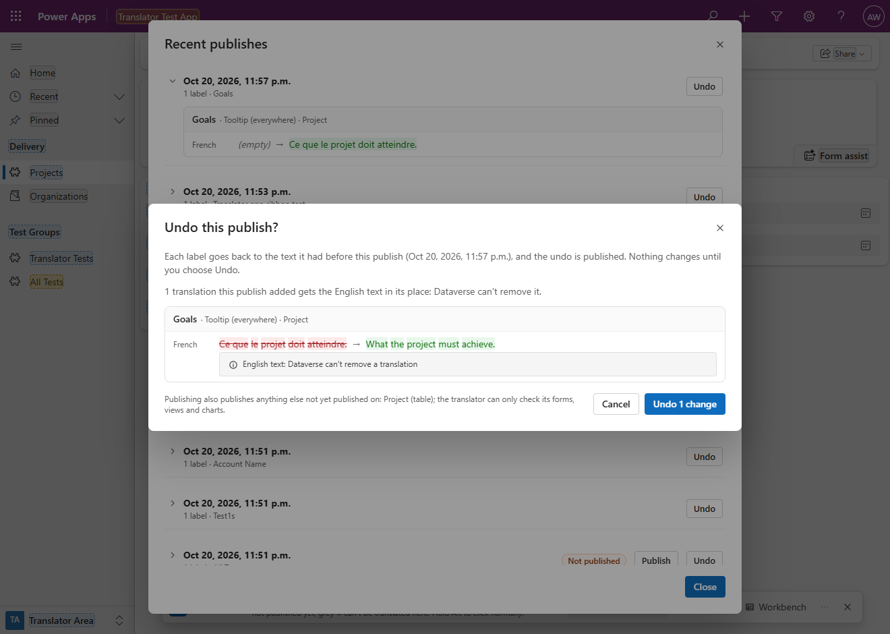

**Tests.** `tools/dev/unit.ts` tests `standIn` itself, and `tools/dev/tests/emptydesc.ts` the descriptions saved
empty: the rule, the saver and the journal, Undo, the metadata writers against a fake Dataverse (only `''` for that
language, every other one as it is), the loader, the store, the looks, the popup's and the editor card's words, and
the Workbench's cells and filters. `tools/dev/tests/savepath.ts` tests the saver: the stand-ins
written, a change without one refused or held back, a stand-in never made of a staged text the save does not write, a
text that moved since it was loaded never written, a stand-in already in place (read first: someone else's newer text
there is a conflict, also in an undo), a form label standing in for its column's name changed in the same publish
(written after the column, held back when the column's save fails or is in conflict, also in an undo), and the undo.
`tools/dev/tests/store.ts` tests `Store.text`, `Store.standIn` and the commit, and `tools/dev/tests/recent.ts` the
Undo question and its run. The live suite (`tools/e2e-suite.js`) empties a choice label and a tab label (the English
text is written) and a field label (its column's French name when the column's names are loaded, refused otherwise),
and undoes a save that added a view name and a column name: the view's is removed, the column's gets the English text,
and the publish is marked undone with nothing kept. It checks a stage and a classic command label without saving them
(`validate` and `Store.standIn`): a stage translation once stored can't be taken back, and an import takes about 20
seconds. In a test environment, a French tooltip added to a column and then undone came back as the English tooltip in
French.

---

## 8. The Publish dialog, history and undo

This chapter covers the parts of the window around a save: the Publish dialog that plans a save, runs it and shows its
result; the refresh of the page that follows; the journal of past publishes; Recent publishes, which lists them; and
Undo, which shows what it will do before it writes anything. The save itself is [chapter 7](#7-saving-safely).

```
Review and publish, Ctrl+S, Save and Publish in the Workbench, Publish on closing, or the editor card's ⋯ menu
  -> openReview(app): the Publish dialog (src/ui/review.ts)
       render(): planPublish (what is written, what is skipped), the rows, othersNote and scopeText
  -> Publish -> run(): saver.save(..., { publish: true }), republish() and check() (are the forms published?)
  -> settle(): Done (in translation mode then app.refreshPage(), src/ui/refresh.ts), or fail(): the problems
Recent publishes (the ⋯ menu) -> openHistory(app)
  -> a publish: its rows (entryGroups), Publish (publishEntry) or Undo (undoEntry)
       Undo -> ask(): the preview, read from the server -> run(): saver.undo(...) -> results()
```

### 8.1 Opening the Publish dialog

The same dialog opens from five places:

* **Review and publish** on the bar in translation mode (*Publish* when the bar is narrow), or the number of changes
  on the bar;
* Ctrl+S with the focus in the translator, in translation mode and in the Workbench, where it runs **Save and
  Publish** (on the page outside the translator, Ctrl+S is left to Dynamics);
* **Save and Publish** in the Workbench, which commits the cell being edited first and, when the dialog closes,
  writes a result line in its message bar ([chapter 10](#10-the-workbench-and-files));
* **Publish** in *Close the translator?*, asked when the translator is closed with staged changes;
* **Review and publish this component** in the ⋯ menu of the full editor card (the *Edit translations* dialog), which
  passes a `filter` for that component's changes.

`openReview(app, filter)` opens nothing when a save is already running (*A save is already running. Wait for it to
finish.*) or nothing is staged (*Nothing to publish yet*). The dialog lists every staged change, or those matching
`filter`. It cannot be closed while a run is going on: its close button is disabled and Escape does nothing.

`openReview` resolves when the dialog closes, with the report of the last save it ran. In translation mode the page may
be reloading by then.

### 8.2 The plan: what Publish writes and what it skips

Each time the list is drawn, `planPublish` splits the staged changes with the saver's checks
([7.2](#72-checks-before-anything-is-sent)). The checks measure only the changes **Publish** can write (an open
conflict never is one), and each change it writes is shown as the save writes it (`written`):

`src/ui/review.ts`, `planPublish`:

```ts
export function planPublish(app: AppApi, changes: Change[]): Plan {
  const open = (c: Change) => app.store.cellStatus(c.slot.key, c.lcid)?.outcome !== 'conflict';
  let issues: Issue[] = [];
  try {
    issues = app.saver.validate(changes.filter(open));
  } catch {
    issues = []; // the saver validates again and reports them as failed rows
  }
  const errs = new Map<string, string>();
  for (const i of issues) if (i.level === 'error' && !errs.has(changeId(i.change))) errs.set(changeId(i.change), i.message);
  const blocked = new Map<string, string>();
  for (const c of changes) {
    const id = changeId(c);
    if (!open(c)) blocked.set(id, '');
    else if (c.slot.readOnly || errs.has(id)) blocked.set(id, shortWhy(c, errs.get(id) || '', app.ctx.base));
  }
  const warns = new Map<string, string[]>();
  const notes = new Set<string>();
  for (const i of issues) {
    const id = changeId(i.change);
    if (i.level !== 'warn' || blocked.has(id)) continue;
    if (i.general) notes.add(i.message);
    else warns.set(id, [...(warns.get(id) ?? []), i.message]);
  }
  const send = changes.filter((c) => !blocked.has(changeId(c)));
  return { send, blocked, warns, notes: [...notes], written: asWritten(app, send) };
}
```

| Part of the plan | Holds | Shown as |
| --- | --- | --- |
| `send` | The changes **Publish** writes | Plain rows |
| `written` | Each change of `send` as the save writes it (`asWritten`): an emptied translation Dataverse can't remove as its stand-in | The row's text after, with a quiet note (below) |
| `blocked` | A change with an error, a read-only one, and an open conflict (waiting for **Keep mine** or **Use theirs**). They are skipped and stay staged. | A red row with a short reason: *Read-only*, *Can't be empty* (a required base-language text left blank, or only spaces where there is no translation), *Too long (max 100)*, or the saver's message, such as why an emptied translation has no stand-in |
| `warns` | The saver's warnings for a change that is written (a translation worded like the English text gets none: many labels read the same in both languages) | Amber lines on its row; the change is published all the same |
| `notes` | The general warnings, on how labels like it are saved: the switch of the Dynamics language for tab and section labels of another language, the translation import of classic command labels | Once, under the subtitle |

**Publish** is disabled when nothing can be written; **Cancel** then has the focus.

**Emptied translations Dataverse can't remove.** A translation can be emptied anywhere. Where Dataverse can remove it
(`canClear`: a view, form, chart, dashboard or app name through `SetLocLabels`, a related menu item or an app
navigation title removed with its element, and so on; LIVE-FINDINGS 33 and 38), the save removes it. Where it can't
(a table, column, choice or relationship name, a form or dashboard tab, section or field label, a classic command
label, a process stage or step translation Dynamics keeps; LIVE-FINDINGS 31, 32, 37, 39, 67 and 83), the save writes
its **stand-in**, the text that language shows without a translation of its own, so the page looks the
same: for a form or dashboard field label whose cell shows a column, the column's name in that language, else the
column's base-language name (LIVE-FINDINGS 42); for anything else, the label's own base-language text.
[Chapter 7](#7-saving-safely) has the rule (`standIn` in `src/core/model.ts`, the column of a cell from `columnOf` in
`src/core/column.ts`) and how the saver applies it. The dialog shows what the save will write, worked out by the
saver's own `prepare`, as the run does, from the texts the save leaves on the server: a base-language text or a column
name written in the same save, else the server's, never a staged text that is not published with it:

`src/ui/review.ts`, `asWritten`:

```ts
export function asWritten(app: AppApi, cs: readonly Change[]): Map<string, Change> {
  let written: Change[] = [...cs];
  try {
    written = app.saver.prepare([...cs]).written;
  } catch {
    /* shown as staged; the saver says what it does with them */
  }
  return new Map(written.map((c) => [changeId(c), c] as const));
}
```

The row's text after is then the stand-in (*Nom* → *Account Name*), and a quiet note under it says where it comes from
(`standInNote`, with `standInTag` of `src/core/model.ts`):

| The stand-in | The note |
| --- | --- |
| The label's own English text | *English text: Dataverse can't remove a translation* |
| A field label's column name in French, or in English when the column has no French name | *The column's French name: Dataverse can't remove a translation* (*The column's English name: …*) |
| A process stage's or step's English text | *English text: Dynamics keeps a stage's translation* (*a step's* for a step) |
| The server text already | *Already the English text: nothing changes*. The save reads the label's text on the server first: while it is still that text, nothing is written or published for it, and the staged edit is dropped. Another text there (someone saved since it was loaded) is a conflict with their text, never a silent "unchanged" ([7.7](#77-conflicts)); **Keep mine** then writes the stand-in over it. A read that fails leaves the label to its writer, which reads it again. |

A stand-in that isn't known blocks its change with the saver's reason: *Dataverse can't remove this translation, and
its English text is empty: type the text instead.* (*… and its column has no English name: …* for a field label). One
unknown only because a text it is made of isn't loaded is held back, skipped and left staged, never refused for good:
*Dataverse can't remove this translation, and its column's names aren't loaded: load its table's columns to put the
column's name in its place, or type the text.* (*… its English text isn't loaded: load its labels in all languages to
put that text in its place, …* for a tab or section label read without a language switch).

A stand-in made of a text the same save writes in another write, such as a field label emptied while its column gets a
new French name, is that text only once it is saved. The saver writes such a label once the write of that text has
ended, and only when that text was saved; otherwise the label is held back and stays staged
([8.7](#87-after-the-run-done-or-the-problems)). [7.19](#719-emptying-a-translation-dataverse-cant-remove-the-stand-in)
has the rule.

**Descriptions saved empty.** An emptied description of a table, column or choice (`savesEmpty`) has no stand-in: the
save writes it empty, so that its users see no tooltip or description. Its row goes from the old text to *(empty)*,
with no error and no warning of its own (a global choice value's description still gets the *Global choice: this
changes all 3 columns that use it.* warning). The quiet note `emptyNote` says what saving does, in the popup's words:

`src/ui/review.ts`, `emptyNote`:

```ts
const emptyNote = (app: AppApi, c: Pick<Change, 'slot' | 'lcid' | 'after' | 'untranslated'> | undefined): HTMLElement | null =>
  c && !c.after.trim() && savesEmpty(c.slot, c.lcid, app.ctx.base, c.untranslated) ? rowNote('note', savedEmptyText(c.slot, langName(app, c.lcid))) : null;
```

*Saved empty: French users see no tooltip.* (*… see no description.* for anything but a column). Where the language
had no label at all before (`Change.beforeMissing`), an old side of *(empty)* would read *(empty) → (empty)*, as if
nothing changed: it reads instead what that language's users see there until then, *Shows “…”* with the English text,
or *(no translation)* where that is empty too (`missingSide`, `ChangeRow.blankBefore`).

**Read-only rows.** Nothing stages a read-only label (`Store.set`). A label whose component comes from a managed
solution is read-only whatever its customizable flag: its loader says so, and `Store.add` makes sure, with one reason
everywhere:

`src/core/model.ts`, `MANAGED`:

```ts
export const MANAGED = 'From a managed solution: a translation here would add an unmanaged layer on top of it. Translate it where its solution is developed.';
```

A *Read-only* row is therefore normally a change staged before a reload found its label read-only. The saver refuses
it all the same (*Read-only: &lt;reason&gt;*, [7.2](#72-checks-before-anything-is-sent)) and `publishTargets` adds
nothing for it: no label of a managed solution's component is ever written, so the dialog has no note about managed
components.

**The Publish dialog.** Changes of labels of the Project form, each label under its header (title · what · where,
such as *Project site · Form label · Information (Main form) › General › PROJECT*), one row per language with the word
difference and **Undo**, the general notes under the subtitle when there are some, and next to **Publish** the scope
of the publish (the sentence about other unpublished changes goes above it when there are some).


### 8.3 The rows: title, what, where

The rows of the dialog are drawn by one function, `changeGroup`, from plain data (`ChangeGroup`: a title, what, where,
and rows of language, before, after, tone, last column and notes). Recent publishes and Undo use the same function, so a
label looks the same in all three places.

**The header** of a group is *title · what · where*:

* **Title.** The label's own name as the popup shows it (`titleOf`). A form cell without a label of its own in the
  user's language shows its column's name, never its control's technical name (verified in a test environment,
  LIVE-FINDINGS 42).
* **What** (`whatOf`): *Form label*, *Tab*, *Section*, *Choice*, *Button*, *View name*, *Table name*, *Plural name*,
  *Column name (everywhere)*, *Tooltip (everywhere)*, *Menu item*, *Stage*, *Step*, and so on. A form cell's own label
  is a *Form label*, the field popup's name for it. *(everywhere)* is the field popup's word too: a column's tooltip
  shows on every form, and its name in views, search and on every form without a form label; a form label shows on its
  form instead of the column's name.
* **Where** (`whereOf`): where the label is, in the names people see. A form label's form, tab and section
  (*Information (Main form) › General › PROJECT*), a navigation item's app, area and group, a process step's process
  and stage, a choice's table and column, a global choice option's choice, and the table of a column, view, chart,
  form, process, command or relationship. Nothing for a label that is a place of its own, such as a table or an app.

**Groups.** Changes are grouped per label (one header per slot), groups with a problem first, then in the order they
were staged. The same edit of every copy of a field on one form (the popup's *Also change the 2 other copies of this
field on this form*) is merged into one group whose where says *Information (Main form) · 3 places (General,
Details)*, with one **Undo** for all copies (`mergeCopies`). Only clean groups merge: a copy with a problem, a
conflict, a server text changed since it was edited (`Store.moved`) or another text keeps its own row. At most 300
groups are drawn (`CAP`); the rest are counted, *and 12 more changes. They're published too.*

**A row** is one language: the language's name, a word difference of the text before and after (removed words struck
in red on the left, added words in green on the right; an empty side reads *(empty)*, or `blankBefore` where the row
gives one; an emptied translation Dataverse can't remove shows its stand-in as the text after), and **Undo**, which
drops that staged edit and keeps the focus on the row that takes its place. Under the texts:

* the reason a blocked change is skipped (red);
* for a stand-in, the quiet note that says where it comes from, and for a description saved empty, *Saved empty:
  French users see no tooltip.* ([8.2](#82-the-plan-what-publish-writes-and-what-it-skips));
* the saver's warnings (amber);
* for an open conflict, *Someone changed this on the server after you loaded it:* with the server text, **Keep mine**
  and **Use theirs** ([7.7](#77-conflicts));
* for an edit whose server text a reload changed since it was made (`Store.moved`), *Changed on the server since you
  edited it*: publishing it stops at a conflict, never overwrites.

The subtitle says what happens: *They're saved and published, then the page refreshes so you see them.* in translation
mode, *They're saved and published.* in the Workbench.

### 8.4 Publish, and the sentences next to it

Next to **Publish** are the two sentences of [7.16](#716-what-else-a-publish-publishes). The scope sentence
(`scopeText`) is there from the start. The check of others' work (`othersNote`) starts when the list is drawn, while the
user reads it, and its sentence appears when it answers, or not at all when there is nothing to say.

**Publish never outruns the check.** A click on **Publish** (or Ctrl+Enter) before the check has answered shows
*Checking for other unpublished changes…* and goes on by itself only when there is nothing to say. Otherwise the
sentence is shown, and the next click publishes: the user has read what else goes live.

A double-click publishes once: the second click of a double-click is ignored.

### 8.5 The steps of a run

**Publish** replaces the list with the steps of the run, in the same dialog. The title becomes *Publishing 3 changes*.

| Step | Shown | Detail on its line |
| --- | --- | --- |
| *Saving 3 changes* | Always | The counter (*2 of 3*) and what is being written now: *Project site*, *waiting for Dataverse to confirm Project site* |
| *Publishing Project and Contoso Sales* | When something is published or a process updated | *Dataverse is busy, trying again in 10 s*, *trying again without the apps*, *Updating the process &lt;name&gt;* |
| *Checking* | Always | Are the forms really published ([8.6](#86-the-checking-step-are-the-forms-published)) |
| *Refreshing the page* | In translation mode | |

The saver's progress messages are shortened for the step's line by `progressNote`: *Saving Project site (column)*
becomes *Project site*, a wait is written in lower case, a retry is shortened. The whole message is the line's
tooltip. A step that starts, and a wait or a retry, are announced to screen readers through one polite live region;
each item is not.

The saver says exactly *Publishing…* once every write is done, committed and journaled, when something is to be
published or a process updated; the dialog then marks *Saving* done and *Publishing* running. A save whose changes
did not all go through ends *Saving* with *1 of 3 needs attention* (not "not saved": a row may say that Dataverse
accepted the change but does not show it yet).

**Stop.** Below the steps, *Stop takes effect before the next write.* and **Stop**. It sits where the button that
started the run was, so it never takes the focus, and it ignores clicks during its first 0.6 seconds and the second
click of a double-click: a confident double-click on **Publish** must not cancel the publish it started. Once pressed it
reads *Stopping…*. What Stop does to the writes is in [7.8](#78-outcomes-and-why-saved-is-never-said-unconfirmed).

### 8.6 The Checking step: are the forms published?

For forms, the translator does not rely on the answer of `PublishXml` alone. It can check them: a form whose
unpublished `versionnumber` differs from its published one still has unpublished changes (the two are equal once a
publish has run).

`src/ui/review.ts`, `unpublishedForms`, `differs`:

```ts
const differs = async (id: string) => {
  const [pub, un] = await Promise.all([
    app.ctx.http.get(`systemforms(${id})?$select=versionnumber`, { signal }),
    app.ctx.http.get(`systemforms(${id})/Microsoft.Dynamics.CRM.RetrieveUnpublished()?$select=versionnumber`, { signal }),
  ]);
  if (pub?.versionnumber == null || un?.versionnumber == null) throw new Error('No version number.');
  return String(pub.versionnumber) !== String(un.versionnumber);
};
```

Each form of the saved form labels is asked, then once more after 1 second when the numbers still differ. A form whose
read fails, or shows no number, is **unread**: it is never taken for published.

* Forms still unpublished: *Information (Main form) still has unpublished changes.*, the *Publishing* step turns red.
* Forms that could not be read: *Couldn't check whether Information (Main form) is published. Publish again to publish
  it and check again.*

Either way the saved form changes are kept as "saved, not published" with their journal entries, which are marked not
published (`markPublished(..., false)`), so **Publish again** in the dialog, or **Publish** in Recent publishes once
the dialog is closed, can publish and check them. The check covers forms only; other components rely on the writers'
read-back and on the answer of `PublishXml`.

### 8.7 After the run: Done, or the problems

**Done.** When every change went through, the publish worked, the forms were checked and nothing needs reading:

* in translation mode, the title becomes *Published*, the dialog says *Done. Refreshing the page…*, and the page is
  refreshed ([8.8](#88-refreshing-the-page-refreshts)). The translator, and the dialog with it, is gone with the reload.
  When the refresh does not happen (the user answered **Not now** to one of its questions), the dialog shows the
  Workbench's Done;
* in the Workbench, *Done. Published 3 changes.* (or *Done. Nothing needed publishing.*) with **Refresh page** (when
  something was published) and **Close**.

A change the save found already on the server, as a text no write of this translator may have put there (someone else
saved the same text first; `found` on its result, [8.9](#89-the-journal-historyts)), is not this publish's change, and
Done counts it apart: *Done. Published 1 change. 1 change was already on the server, so Undo of this publish leaves it
alone.*, or, when every change was found so, *Done. 1 change was already on the server: nothing was written.*

`src/ui/review.ts`, `openReview`, `settle`:

```ts
// Rows found already on the server that this translator never wrote are said apart: not published by it, nor undone with it.
const f = Math.min(S.found, S.saved.length);
const n = S.saved.length - f;
const already = f ? `${plural(f, 'change')} ${f === 1 ? 'was' : 'were'} already on the server` : '';
const said = n
  ? `Done. Published ${plural(n, 'change')}.${already ? ` ${already}, so Undo of this publish leaves ${f === 1 ? 'it' : 'them'} alone.` : ''}`
  : already
    ? `Done. ${already}: nothing was written.`
    : 'Done. Nothing needed publishing.';
```

**Problems.** Anything else keeps the dialog open, and the page is never refreshed on its own after a problem:

| Situation | Title |
| --- | --- |
| Some changes failed, are in conflict, or were skipped | *Some changes weren't published* |
| Everything saved, the publish failed or a form is still unpublished | *Saved, but not published* |
| Everything published, but a form could not be checked | *Published, but not checked* |
| Only a warning or a notice (the language could not be switched back, a process could not be updated) | *Published* |

Above the rows, the notes: *Saved, but publishing failed: &lt;reason&gt;* (amber; a form still unpublished is one
such reason), the forms the check could not read (amber), the save's warning (red) and its notice (amber). The rows are
the failed changes with the saver's message, open conflicts with **Keep mine** and **Use theirs**, and the skipped ones
with their reason. Each writer reads whether the component is from a managed solution in its read right before the
write: a component loaded as this environment's that this read finds in a managed solution fails with the words of
`MANAGED` (*From a managed solution: …*), and nothing is written to it ([7.4](#74-what-every-writer-does)). A failed
metadata row with kept writes has **Copy details** ([7.18](#718-the-write-log-writelogts)). A conflict resolved with
**Keep mine** says *Yours is kept. Try again publishes it.*

Each row shows the text **Try again** would write: an emptied translation Dataverse can't remove as its stand-in, with
its note, worked out for the changes **Try again** sends alone (`asWritten(app, retry)`). A save that empties a
column's French name and a field label of that column gives the field label the column's English name (*The column's
English name: …*); when only the field label failed, its row then says *The column's French name: …*, the same text,
which the column's French name now is. Before writing a stand-in, the saver reads again every text it is made of
([chapter 7](#7-saving-safely)); one changed on the server since it was loaded fails its change, and the store takes
the new text, so **Try again** writes that:

* *Its English text changed on the server since it was loaded (now “Account name”), so nothing was written: Try again
  to put the new text in its place.* (*Its column's French name changed …* for a field label);
* *Its English text couldn't be read to check it before writing (&lt;reason&gt;), so nothing was written. Try again.*

A stand-in made of a text the same save writes in another write
([8.2](#82-the-plan-what-publish-writes-and-what-it-skips)) is held back when that write failed or met a conflict:
nothing is written for it, and its change is skipped and stays staged, with *Its column's French name wasn't saved, so
nothing was written here either: Try again to save both.* **Try again** writes it after the text it is made of (a
conflict there is resolved first, [7.7](#77-conflicts)).

The buttons:

| Button | When | What it does |
| --- | --- | --- |
| **Try again** | Something can be written again | Saves the changes that failed, were stopped or were held back, and the conflicts resolved with **Keep mine**, as staged now. A blank Dataverse refuses every time (`refusedBlank`: a required base-language text left blank, or an emptied translation Dataverse can't remove that has no stand-in), an open conflict and an edit undone since are left out (`retryable`). It also publishes what an earlier run of the dialog saved but could not publish. |
| **Publish again** | Saved, not published, and nothing to try again | Publishes what was saved, then checks the forms again |
| **Refresh anyway** | In translation mode, when something was published | Refreshes the page in spite of the problems |
| **Close** | Always | |

`src/ui/review.ts`, `retryable`:

```ts
export function retryable(app: AppApi, results: readonly ChangeResult[]): Change[] {
  const ids = new Set<string>();
  for (const r of results) if (r.outcome === 'conflict' || ((r.outcome === 'error' || r.outcome === 'skipped') && !refusedBlank(r, app.ctx.base))) ids.add(changeId(r.change));
  return app.store.changes().filter((c) => ids.has(changeId(c)) && app.store.cellStatus(c.slot.key, c.lcid)?.outcome !== 'conflict');
}
```

**Use theirs on the last problem** ends the dialog with Done, but without refreshing the page on its own: the user has
just made a choice. **Refresh page** is offered when something was published.

**Closing with saves not published.** The translations are saved; only the publish is missing. The translator says
*Your translations are saved, but not published yet. Publish them from Recent publishes.* (or, when the forms could not
be checked, *Your translations are saved, but whether they're published couldn't be checked. Publish them again from
Recent publishes.*) with **Recent publishes** as the message's action. Nothing is ever stranded.

### 8.8 Refreshing the page: `refresh.ts`

After a publish, a plain reload is not enough to show the new labels: Dynamics boots from copies of the labels and of
the user's language that its service worker, a shared worker, the browser's storage and the browser's HTTP cache keep
across reloads. In a test environment, one plain reload after `PublishXml` showed the new label once in four; clearing
those copies and reloading showed them every time (LIVE-FINDINGS 50, 78, 82 and 84). `src/ui/refresh.ts` does that
clearing (the **purge**) and the reload.

The translator refreshes the page after a successful publish in translation mode, from **Refresh page** in the ⋯ menu
and in the dialogs, and after **Show Dynamics in** ([7.14](#714-changing-the-language-for-good-uilangts))
([chapter 11](#11-refreshing-the-page-and-switching-the-language)).

**`refreshPage`**, in order:

1. With staged changes: *Refresh the page?* *You have 2 unpublished changes. Refreshing the page discards them.*
   **Refresh anyway** or **Not now**.
2. With unsaved changes on the record (`recordDirty` in `src/core/context.ts`: `Xrm.Page.data.getIsDirty()`, else the
   record's `entity.getIsDirty()`): *This record has unsaved changes. Refresh anyway and lose them?* On a record whose
   state can't be told (the call fails, or answers neither yes nor no): *This record may have unsaved changes. Refresh
   anyway and lose them?* A page without a record, such as a list or a dashboard, asks nothing. **Not now** says
   *Refresh the page later to see your changes.* ([11.4](#114-refresh-page-step-by-step))
3. `prepare`, when given (the language change of **Show Dynamics in**). When it fails, its message is shown and nothing
   is reloaded.
4. The translator is torn down, which removes its *Leave site?* guard. During a save it cannot be, and the refresh says
   *Saving is in progress. Refresh the page once it has finished.*
5. *Refreshing the page…* at the top of the page.
6. The user's language is put back if a page load had it switched (waiting at most 3 seconds).
7. What was published since this start of the translator is stored under `dxt:verify:<organization id>`, for the check
   after the reload.
8. The purge, then the reload.

**The purge** (`purge`) clears those copies: it fetches the label requests the service worker cached again, so that
the browser's HTTP cache holds the current answers; sends the service worker its own purge commands; removes the local
storage keys of the warm boot, of cached command bars and controls, of the UI strings and of the process bar's cache
(never a `dxt:` key); deletes every CacheStorage cache except the code caches; asks the state worker to clear its
state; empties the metadata stores of the environment's IndexedDB database; and clears session storage. Every step is
wrapped on its own, and the slow ones are raced against a time limit; one that fails or hangs never stops the others,
and the reload always happens. If a future version of Dynamics ignores all of it, the worst case is a plain reload.
[11.5](#115-what-is-cleared-and-what-never-is) lists each step with what it clears and what it never touches, and
shows the constants that name them (`KEEP_CACHES`, `dropKey`, `SW_PURGE`, `metaStore`, `FRESH_FLAGS`).

**The reload** (`reloadFresh`) loads the same page again; on `main.aspx` with two feature flags that make the page boot
from the server instead of a persisted state (LIVE-FINDINGS 82). [11.6](#116-the-reload) explains it, and what
happens when the user stays on the page.

**After the reload.** Once translation mode has loaded the page, the new start reads `dxt:verify:<organization id>`
(ignored when older than an hour) and checks the published texts: what the page renders decides for the labels on it,
the freshly loaded server text for the rest. A page that shows them all says nothing: the page itself shows the
changes. Otherwise a message says how many it does not show yet, *1 change isn't showing yet* or *3 changes aren't
showing yet*, with **Refresh again**:

`src/ui/refresh.ts`, `notShowing`:

```ts
export const notShowing = (missing: number): string => (missing > 0 ? `${plural(missing, 'change')} ${missing === 1 ? "isn't" : "aren't"} showing yet` : '');
```

In a test environment, from the click on **Publish** to the reload took about 7 to 8 seconds for a form label and a
tooltip, and the page showed both on the first boot (LIVE-FINDINGS 50 and 61).

The entry is a `VerifyEntry` (`src/ui/refresh.ts`): `at`, and one `VerifyItem` per label and language (`comp`, `kind`,
`key`, `lcid` and `text`, the text now on the server, `''` for a translation removed). `publishedSince` in
`src/ui/app.ts` takes them from the journal: the published entries since this start of the translator, the newest text
of each label and language. **Refresh again** stores only the texts that were not showing. With nothing to check, the
refresh removes the key instead. `readVerify` drops an entry an hour old or older (`VERIFY_MAX_AGE`) or dated more than
a minute ahead (a clock set back), and every item whose `key` or `text` is not a string or whose `lcid` is not a
number: the key holds what any script of the site may have written. `verifyAfterLoad` removes the key once the page's
loads are in, or at once when nothing in it can be checked, so each publish is checked once; when local storage
refuses the removal, the next start checks it again, until it is an hour old. `tools/dev/tests/savepath.ts` covers
`readVerify` and `notShowing`.

### 8.9 The journal: `history.ts`

Every save that wrote something adds an entry to the journal, before it publishes ([7.1](#71-the-path-of-a-save)); an
undo is a save too. Recent publishes lists the entries, and Undo needs them: an entry holds the exact text each label
had before the save and the text it wrote.

| Field | Holds |
| --- | --- |
| `id`, `at` | A unique id, and when the save ran |
| `items` | One per label and language the run sent (below): its key, component, kind, language, the title and place the Publish dialog showed (`title`, `where`), `before` and `after` (the text written: for an emptied translation Dataverse can't remove, its stand-in), and `empty` where `before` is a metadata description stored empty, not no translation (`wasEmpty` in `run`): Undo then saves it empty again rather than giving it its stand-in |
| `published` | Published, or nothing needed a publish |
| `undoneAt` | When it was undone |
| `kept` | How many translations it added stayed when it was undone, because Dataverse can't remove them and they had no stand-in, or because they named a sitemap item ([8.12](#812-undoing-a-publish-the-run-and-its-checks)). A translation the undo wrote as its stand-in is undone, not kept. |

**Only what the run wrote.** An entry holds the labels the run wrote (`saved`). A label it found already as asked
(`unchanged`), which was another text when it was edited, is journaled only when a write of that text by this
translator may have run without hearing back: a write Dataverse didn't refuse, whose answer was lost or didn't
confirm it, reported as not confirmed, then sent again with **Try again**. The writers say which changes they sent
such a write for (`SaveOptions.ran`, [6.2](#62-the-contracts-providerstypests)), and the saver keeps their texts in
`tried` until a later run settles them ([7.1](#71-the-path-of-a-save)). A text no write of its own may have put there
is someone else's, also when an earlier attempt failed before its write was sent, or had it refused or turned away:
its result is marked `found`, and the entry leaves it out, so Undo of this publish never puts back what the publish
didn't write. The report still counts it as already as asked, and a save that found only such texts adds no entry.
Each job marks its results:

`src/core/saver.ts`, `run`, `runJob`:

```ts
if (sending) {
  // Already as asked, a text other than the one the edit was made on, and no write of this saver may have put it there: not this run's.
  const asked = stored(c.after);
  if (x.outcome === 'unchanged' && c.before !== asked && tried.get(id) !== asked) x = { ...x, found: true };
  // A failure adds its text only when a write of it was sent and may have run; one refused, unread or never sent
  // adds nothing, and keeps what an earlier run's write may have saved (its answer is still unknown).
  if (x.outcome !== 'error' && x.outcome !== 'skipped') tried.delete(id);
  else if (ran.has(id)) tried.set(id, asked);
}
```

and step 3 journals what is the run's own:

`src/core/saver.ts`, `run`:

```ts
// A label a save finds already as asked, which was not that text when it was edited, is journaled too when a write of
// that text by this saver may have run (its answer lost or not confirmed, then Try again, `tried`): that write,
// published by this run. One it never sent, or sent only to have it refused, is someone else's text (`found`): left
// out, so Undo of this publish never puts back what this run didn't write. The report still counts it as already as
// asked ('unchanged').
const mine = results.filter((r) => r.outcome === 'saved' || (purpose === 'save' && r.outcome === 'unchanged' && !r.found && r.change.before !== stored(r.change.after)));
```

**Where and for how long.** The journal lives in the page's local storage, which Dynamics itself also uses, so it stays
small, and every access survives storage that is blocked or full:

`src/core/history.ts`, `KEY`, `SHARED`, `MAX`, `BUDGET`, `CEILING` and `MAX_AGE`:

```ts
const KEY = (ctx: Ctx) => `dxt:history:${ctx.orgId}:${ctx.userId}`;
/** The journal before it was kept per user: one for every account of the browser profile. */
const SHARED = (ctx: Ctx) => `dxt:history:${ctx.orgId}`;
const MAX = 50;
const BUDGET = 400_000;
/** Hard ceiling for a single huge save (bulk import), so the journal can never crowd out Dynamics. */
const CEILING = 1_500_000;
/** Saves older than this leave the journal, and the storage: Undo is for mistakes noticed soon. */
const MAX_AGE = 90 * 86_400_000;
```

| Limit | Value | What happens |
| --- | --- | --- |
| Saves | 50 | The oldest leave first |
| Size | About 400,000 characters | The oldest saves leave until it fits. A label costs about 190 characters for a column and 320 for a form cell, so the journal holds roughly 1,200 to 2,000 labels. |
| One large save | Up to 1,500,000 characters | The newest save is kept even when it alone passes the size. One too large for this ceiling, or for the browser's quota, is kept without its places (`where`), about 270 characters a form cell: Undo needs its texts, not where they showed. |
| Age | 90 days | Older saves leave the journal, and the storage, the next time it is read |

**Per environment and account.** The key holds the organization id and the user id, so another account signed in to
the same browser profile does not list or undo the saves. Anyone who reads the browser's storage directly (the
developer tools) still can. The journal of earlier versions, kept per environment only (`dxt:history:<organization
id>`), is removed without being read (`dropShared`, each time the journal is read): nothing tells whose saves it
holds, so they are never given to whoever opens the translator next, who would see their texts and be offered their
Undo. Those saves can no longer be undone from the translator.

The journal cannot live in session storage: the publish reloads the page, and the purge clears session storage.

**Two tabs, one journal.** The tabs of one user share the journal, and local storage has no locking of its own. Every
change of the journal (a save added, one marked published or undone, the expired saves removed) goes through `change`,
which reads the journal, edits it and writes it back alone among the browser's tabs, under a Web Lock named like the
journal's key, by environment and user. A tab therefore never writes back a list it read before another tab's write,
which would drop that tab's save. A tab's own changes run in the order they were asked for, because a lock is granted
in the order requested. Without Web Locks, or when the browser refuses the lock, the change is made at once; either way
the journal is read again right before it is written, and a list that changed since (another tab wrote in between) is
edited again from the new one, up to three times:

`src/core/history.ts`, `change`:

```ts
function change(ctx: Ctx, edit: (list: HistoryEntry[]) => HistoryEntry[] | null): Promise<boolean> {
  const raw = (): string | null | undefined => {
    try {
      return localStorage.getItem(KEY(ctx));
    } catch {
      return undefined; // storage blocked
    }
  };
  const job = (): boolean => {
    for (let i = 0; ; i++) {
      const was = raw();
      if (was === undefined) return false;
      const all = parse(was);
      const list = unexpired(all);
      const next = edit(list) ?? (list.length < all.length ? list : null);
      if (!next) return true;
      if (i < 3 && raw() !== was) continue;
      return write(ctx, next);
    }
  };
  const locks = (globalThis as { navigator?: { locks?: Locks } }).navigator?.locks;
  if (typeof locks?.request !== 'function') return Promise.resolve(job());
  let ran = false;
  try {
    return locks.request(KEY(ctx), () => ((ran = true), job())).then(
      (x) => x === true,
      () => (ran ? false : job()),
    );
  } catch {
    return Promise.resolve(job());
  }
}
```

One key under a lock, rather than a key per save, keeps the journal one read, its size and order one decision, and
needs no listing of the storage's keys, which Dynamics' own keys would crowd. `readHistory` leaves the expired saves out
of what it returns and removes them through `change`, never by writing back the list it read.

**Changes after the save.** `addHistory(ctx, entry)`, `markPublished` and `markUndone` go through `change`, and resolve
once it is made; the saver waits for them, so a save's report names its entry (`historyId`) only once the entry is
stored, and the entry is marked published by `markPublished` after the publish. `markPublished(ctx, ids, on)` marks
entries published after a later publish (**Publish again**, **Publish** in Recent publishes), or not published when the
forms check found their forms still unpublished or could not read them. `markUndone(ctx, id, kept)` marks an entry
undone.

### 8.10 Recent publishes

**Recent publishes** in the ⋯ menu (on the bar in translation mode, and **More** on the translator's window) opens
`openHistory`: this user's publishes in this environment and this browser, newest first.

Each publish is one line: its time, the number of labels and up to three titles (*3 labels · Project site, Project
name, Active Projects*), a badge, and its buttons:

| Part | When |
| --- | --- |
| *Not published* (amber badge) and **Publish** | The save's publish failed, or its forms stayed unpublished or could not be checked |
| *Undone* badge | It was undone. *Undone · 2 kept* when some translations stayed (one Dataverse can't remove that had no stand-in, or a name given to a sitemap item); the tooltip says why. |
| **Undo** | Always, disabled once undone. A publish that only named sitemap items has no **Undo**; a line under it says why ([8.12](#812-undoing-a-publish-the-run-and-its-checks)). |

The time and the titles are a button that opens the publish in place, built the first time it opens (a bulk import's
publish can hold thousands of labels): the labels as the Publish dialog showed them, each language's text before and
after (for an emptied translation Dataverse can't remove, the stand-in written; for a description saved empty,
*(empty)* with the note *Saved empty: French users see no tooltip.*, and *(no translation)* as the text before where
it had none), and *Undone &lt;time&gt;.* for an undone publish (`entryGroups`). An entry journaled before places were
kept, or kept without them for its size, shows each label's title and what only. A label the save found already on the
server, as a text no write of this translator may have put there, is not listed in the publish, and its **Undo**
leaves it alone ([8.9](#89-the-journal-historyts)).

**Recent publishes.** The publishes of this user in this environment, newest first; the newest, with changes of
labels of the Project form, is open and shows its labels in the Publish dialog's rows.

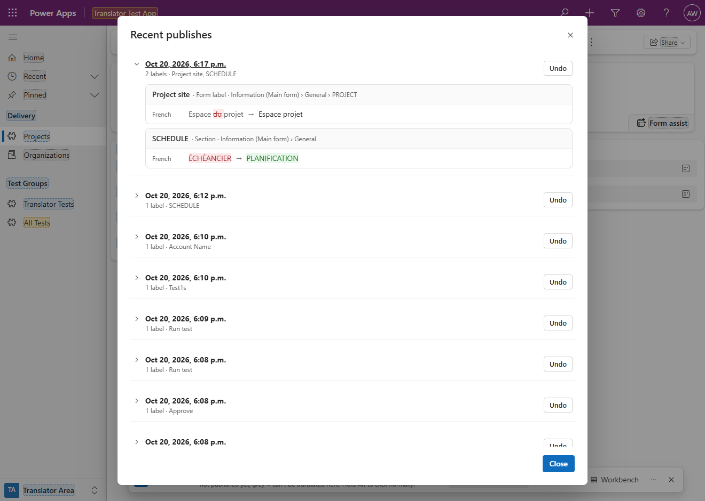

With no publish yet, the dialog says *No publishes yet* and *What you publish with the translator in this environment
is listed here, so you can see it and undo it.*

**Publish** (`publishEntry`) publishes a past save that was not published. Its labels must be loaded, because the
components to publish come from them: otherwise *Some of these labels aren't loaded here. Open the page they are on
(or load them in the Workbench), then publish again.* It checks others' work first
([7.16](#716-what-else-a-publish-publishes)). With something to say it asks *Publish this save?* (*This publishes the
3 labels saved &lt;time&gt;.*, the sentence and the scope); with nothing to say it publishes at once, because the
save's own dialog showed the scope before. Then the *Publishing* and *Checking* steps, as in the Publish dialog, and
*Published* (*Done. Refresh the page to see the changes.*, with **Refresh page**), *Not published yet* or *Published,
but not checked* (with **Try again**). A process whose name was saved is updated by the save that wrote it, never
here.

### 8.11 Undoing a publish: the preview

**Undo** never writes at once. It first shows what it will do to each label, from the text each label has on the
server now (`undoEntry`, then `ask`).

**Reading the current text.** The question opens with *Reading the current text…* and asks the saver's `current`
([7.1](#71-the-path-of-a-save)): each writer reads its labels as its save reads them right before writing, and writes
nothing. Form tab and section labels of another language are read through the usual language switch. A metadata read
still behind this page's own last write of the label is read again for up to 15 seconds, as the save waits.

**What Undo will do to each label** (`undoRows`), from that text and the saver's own checks. Taking a translation
away is emptying it, so a translation the publish added where Dataverse can't remove one goes to its stand-in
([8.2](#82-the-plan-what-publish-writes-and-what-it-skips)): the page then looks as it did before the publish. The
rows are measured as the undo measures them, by the saver's `prepare` as an undo, with the texts just read standing
for the server's: each stand-in is made of the texts as the undo leaves them, the earlier texts it writes back, else
the server's:

`src/ui/review.ts`, `undoRows`:

```ts
const loaded = given.filter((c): c is Change => !!c);
let prep: Prepared = { written: loaded, issues: [], text: (k, l) => app.store.text(k, l, true) };
try {
  prep = app.saver.prepare(loaded, { undo: true, now });
} catch {
  /* the undo reports what its checks refuse */
}
```

So the undo of a publish that renamed a column in English and gave it its first French name gives French the earlier
English name, which it writes back, never the one the publish wrote; were the English name changed since and left as
it is, French would get that one, the text the server keeps.

| State | Means | The row |
| --- | --- | --- |
| `undo` | The server still holds the text the publish wrote | Plain: current text → earlier text. A translation Dataverse can't remove: current text → its stand-in, with the quiet note *English text: Dataverse can't remove a translation* (or the column's name, as in the Publish dialog). A description stored empty before the publish (`UndoRow.empty`): current text → *(empty)*, with the note *Saved empty: French users see no tooltip.* |
| `same` | Already as before, or already its stand-in. Not a description the publish saved empty where it had no translation: that row is `undo`, its users having seen the base-language text, which the undo puts in its place | Muted, *Already as before* (with the stand-in, *Already the English text: nothing changes* too) |
| `changed` | Someone changed it since the publish | Amber, *Changed since this publish: not undone unless you choose Undo anyway*, and an **Undo anyway** tick box, not ticked |
| `stays` | A translation the publish added where Dataverse can't remove one and that has no stand-in, or a base-language text that can't be blank | Muted, *Stays: Dataverse can't remove it, and its English text is empty* (or *… and its column has no English name*; *Stays: the English text can't be blank*) |
| `named` | It gave a sitemap item its first name | Muted, *Stays: naming a group can't be undone*; never read, never written |
| `refused` | Another check refuses it: the label is read-only, such as a label of a component from a managed solution (in a publish made before such labels were read-only). Refused whatever the server holds. | The check's message in red, such as *Read-only: From a managed solution: a translation here would add an unmanaged layer on top of it. Translate it where its solution is developed.* |
| `unloaded` | Its component is not loaded in the translator, or its stand-in is made of texts that aren't (a field label's column names, a tab's or section's English text read without a language switch) and it isn't back already | *Not loaded here: open the page it's on, or load it in the Workbench, to undo it*; for a stand-in, what to load: *Its column's names aren't loaded here: load its table's columns, then undo again* (or *Its English text isn't loaded here: load its labels in all languages, then undo again*) |
| `unread` | Its text could not be read | *Couldn't read its current text (...). The undo checks it again before writing* |

The labels that ask for a choice come first, as the Publish dialog lists its problems first. A line above the list
counts the states: *1 label changed since this publish is left as it is unless you choose Undo anyway. 1 translation
this publish added gets the English text in its place: Dataverse can't remove it. 2 labels are already as before.*
The stand-ins are counted in the rows' words (`standInsSaid` of `src/core/model.ts`): *get the English text or the
column's French name in their place*, and *Dynamics keeps a stage's translation* for a stage. A label waiting for the
texts of its stand-in is counted apart: *1 label can't be undone until the texts put in its place are loaded.* The
sentences of [7.16](#716-what-else-a-publish-publishes) sit next to the button, because the undo is published too: for a
save never published, its own forms, views and charts are left out of the first sentence.

**The button.** The question's subtitle says *Each label goes back to the text it had before this publish
(&lt;time&gt;), and the undo is published. Nothing changes until you choose Undo.* The button counts what will be
written, a stand-in included:

`src/ui/review.ts`, `undoCount`:

```ts
export const undoCount = (rows: readonly UndoRow[], chosen: ReadonlySet<string>): number =>
  rows.filter((r) => r.state === 'undo' || r.state === 'unread' || (r.state === 'changed' && chosen.has(itemId(r.it)))).length;
```

It reads **Undo 2 changes**. When nothing is to be written and every label is already as before or stays, it reads
**Mark as undone**: it writes no label, but runs and publishes like any undo, because a label found already as asked may
be an earlier write not yet published. A label waiting for the texts of its stand-in is neither, so it never lets a
publish be marked undone. It is enabled once the check of others' work has answered. **Cancel** has the
focus and leaves everything as it was.

**Undo this publish?** The undo of a publish of labels of the Project form: each label with its text on the server
now and the text it goes back to (a label changed since the publish would come first, in amber, with **Undo
anyway**); the count on the button.

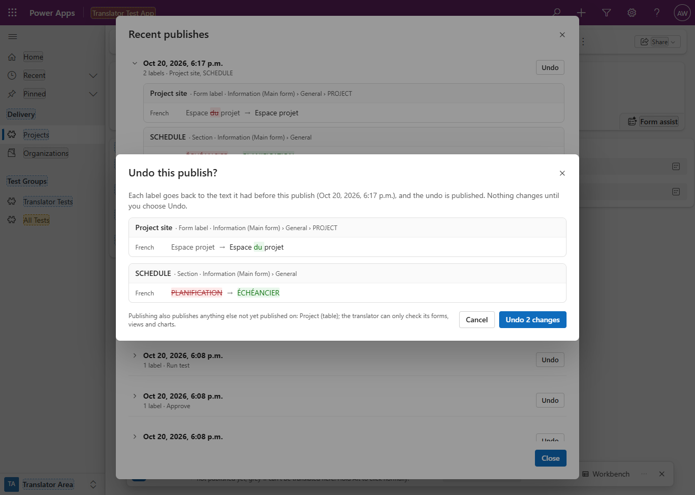

**A translation Dataverse can't remove.** The undo of a publish that gave the Goals column its first French tooltip
(*Goals · Tooltip (everywhere) · Project*): the row goes from the French text to the English tooltip, with the quiet
note *English text: Dataverse can't remove a translation*, and the line above the list says *1 translation this
publish added gets the English text in its place: Dataverse can't remove it.*


### 8.12 Undoing a publish: the run and its checks

**What is written.** `saver.undo(entry, o)` turns each journal item into a change back to the earlier text. The text the
publish wrote is what the server should hold now, so it is the change's `before`, the baseline of the conflict check
([7.4](#74-what-every-writer-does)):

`src/core/saver.ts`, `undo`:

```ts
for (const it of entry.items) {
  const slot = store.get(it.key);
  // The value written by the save is what the server should hold now: it is the conflict baseline (undoChange).
  if (slot) changes.push(undoChange(slot, it));
  else
    missing.push({
      change: undoChange(stub(it), it),
      outcome: 'skipped',
      message: "This component isn't loaded in the translator. Open its page or load it in the Workbench, then undo again.",
    });
}
```

`undoChange` measures the change against the text the publish wrote as `bare` gives it (entries recorded before it was
applied may hold the typed spaces of a removal), and marks a metadata description that had no translation before the
publish (`untranslated`, [7.19](#719-emptying-a-translation-dataverse-cant-remove-the-stand-in)).

The undo then runs through the same path as any save ([chapter 7](#7-saving-safely)), so every check of a save applies:

* A label is written only where the server still holds the text the publish wrote. A label someone changed since is a
  conflict and is left as it is, unless the user ticked **Undo anyway**. A ticked label is measured against the text
  the preview has just read, in place of the one the publish wrote:

  `src/ui/review.ts`, `undoEntry`, `rebase`:

  ```ts
  const rebase = (it: HistoryItem): HistoryItem => {
    const t = now.get(itemId(it));
    return ok.anyway.has(itemId(it)) && t !== undefined ? { ...it, after: t } : it;
  };
  ```

  So a text changed again after that read is still a conflict, never overwritten. The run also gets the ticked labels
  (`anyway` in its options), so the stand-ins count their earlier texts as written. The check has the limit of every
  save: a save someone else makes in the moment between the writer's last read and its write can still be overwritten
  ([7.5](#75-the-read-in-the-same-batch-before-each-write)).
* **A translation the publish added where Dataverse can't remove one is written as its stand-in**
  ([8.2](#82-the-plan-what-publish-writes-and-what-it-skips)), so the page looks as it did before the publish. The
  saver works it out in `run()` before the checks, from the texts as the undo leaves them: the earlier texts it writes
  back, else the server's (a label changed since and not ticked is left as it is, so its text on the server counts).
  Before writing, it reads again each text a stand-in is made of: one changed since it was loaded fails the label with
  *Its English text changed on the server since it was loaded (now “Account name”), so nothing was written: Try again
  to put the new text in its place.*, and **Try again** writes the new text. A label that is its stand-in already is
  read first, as in a save ([8.2](#82-the-plan-what-publish-writes-and-what-it-skips)): nothing is written while the
  server still holds that text, and another text there is a conflict. The journal of the undo holds the stand-in as the
  text written, so **Redo** puts the translation back.
* **A metadata description** goes back as it was before the publish. One the publish gave its first text, or saved
  empty where it had none, gets its stand-in, the English text, so that its users see what they saw before (where the
  English one is empty too, it is saved empty: they saw no text there); one stored empty before the publish (`empty`
  in its journal item) is saved empty again, its row saying *Saved empty: French users see no tooltip.*
* A translation the publish added where Dataverse can't remove one and that has no stand-in (its English text is
  empty, or a field label's column has no name in French or English) is refused by the checks
  ([7.2](#72-checks-before-anything-is-sent)) with *Dataverse can't remove this translation, and its English text is
  empty, so the French text this save added stays. Change it in the editor if needed.*, and nothing is written for it;
  it is counted as kept.
* One whose stand-in is made of texts that aren't loaded (a field label's column names) is held back: skipped with
  *Dataverse can't remove this translation, and its column's names aren't loaded here: load its table's columns, then
  undo again.*, not counted as kept, so the publish stays undoable, and **Try again** writes it once they are loaded.
* One whose stand-in is made of a text the undo writes back in another write (a field label the publish gave its first
  French text, whose stand-in is the column's earlier French name, which the undo puts back) is written once that write
  has ended, and only when the text is back. When it isn't (the column's write failed or met a conflict), nothing is
  written for the label: it is skipped with *Its column's French name wasn't saved, so nothing was written here either:
  Try again to save both.*, not counted as kept, so the publish stays undoable.
* **A label of a managed solution's component is never undone.** A publish made before such labels were read-only can
  hold one. Its slot is read-only with the reason `MANAGED`, so the checks refuse it (*Read-only: From a managed
  solution: …*), the run skips it without sending it to a writer, and nothing is written for it; the other labels of
  the publish are undone. It is not counted as kept, so the publish is not marked undone: **Undo** stays available,
  and skips it again.
* **Names given to sitemap items stay.** A publish that gave an app designer's unnamed group or item its first name, in
  the base language, together with names in other languages (`namings`): Undo never writes those labels. The item
  cannot go back to having no name, and taking the other languages away alone would leave them on the base name, which
  they never showed. They count as kept, and Recent publishes and the preview say *Naming a group can't be undone:
  Dynamics needs a name once it has one. Rename it here if needed.*
* The undo is published like any save ([7.15](#715-publishing-publishts)), and it is journaled as a publish of its own.

**The run.** The dialog shows *Undoing the publish*, a progress bar, the steps *Undoing 3 labels* and *Publishing*, a
mark for each label that turns into its outcome as it finishes, and **Stop**.

**The result.** The title is *Publish undone*, *Undone with problems*, *Undo stopped* or *Undo failed*. A count says
what happened (*2 labels undone, 1 label changed since, left as it was.*), and each label shows its outcome in the rows
the preview showed:

| Outcome | The row |
| --- | --- |
| Written | *Undone*; a translation written as its stand-in shows the stand-in as the text after, with its quiet note (*English text: Dataverse can't remove a translation*); a description saved empty again, *(empty)* with *Saved empty: French users see no tooltip.* |
| Already as before, or already its stand-in | *Already as before* (and the stand-in's note) |
| Conflict | *Changed since this publish, so it was left as it is*, with **Fix**, which closes the dialog and opens the label in the editor |
| A translation Dataverse can't remove that has no stand-in, or a base-language text that can't be blank | *Stays: Dataverse can't remove it, and its English text is empty* (or *Stays: the English text can't be blank*) |
| Any other error, a stand-in whose text changed on the server included | The saver's message, with **Fix** |
| Skipped: stopped before it was written, not loaded here, held back until the texts of its stand-in are loaded or until a text of its stand-in that the undo writes back is saved, or read-only (a managed solution's component included) | The saver's message, muted, such as *Cancelled before saving*, *Dataverse can't remove this translation, and its column's names aren't loaded here: load its table's columns, then undo again.*, *Its column's French name wasn't saved, so nothing was written here either: Try again to save both.* or *Read-only: From a managed solution: …* |
| No result (the undo failed before it reached the label) | *Not undone yet* |

The notes above the rows: the error when the undo failed, *Stopped. The labels written before stopping are back to
their earlier text; 1 label not undone yet.*, the publish error, *The previous text is live again. Refresh the page to
see it.*, and the save's warning or notice. The buttons:

* **Try again** undoes only the labels that are not back yet, those held back for the texts of their stand-in
  included. The translations Dataverse can't remove that have no stand-in are carried in `kept`, so the publish is
  still marked undone once the rest are back.
* **Redo**, when the undo wrote something, undoes the undo: the undo is a publish of its own in the journal, and
  **Redo** runs **Undo** on it, with the same preview.
* **Refresh page**, when the undo wrote something and was published.

**When a publish counts as undone.** `saver.undo` marks the journal entry undone (`markUndone`) once every label is back
at its earlier text or its stand-in (written now, or already there) or is one of the refusals no retry can change (a
translation Dataverse can't remove that has no stand-in, `refusedBlank`). Otherwise **Undo** stays available, to try
again:

`src/core/saver.ts`, `undo`:

```ts
const rep = await start(changes, o, 'undo');
for (const r of missing) safe(() => o.onResult?.(r));
rep.results.push(...missing);
rep.skipped += missing.length;
const kept = (entry.kept ?? 0) + rep.results.filter((r) => refusedBlank(r, ctx.base)).length;
if (!missing.length && rep.results.every((r) => r.outcome === 'saved' || r.outcome === 'unchanged' || refusedBlank(r, ctx.base))) await markUndone(ctx, entry.id, kept);
return rep;
```

A result carries the change as written, so a stand-in is never blank and never `refusedBlank`; a label held back for
the texts of its stand-in is `skipped`, so it is not one either:

`src/core/model.ts`, `refusedBlank`:

```ts
export const refusedBlank = ({ outcome, change: c }: ChangeResult, base: Lcid): boolean =>
  outcome === 'error' && !c.after.trim() && (c.lcid === base ? c.slot.baseRequired : !canClear(c.slot, c.lcid) && !savesEmpty(c.slot, c.lcid, base, c.untranslated));
```

**Tests.** `tools/dev/tests/recent.ts` covers Recent publishes and the preview, on the same rig as
`tools/dev/tests/savepath.ts` (the real saver and journal, and a writer like the real ones on an in-memory server),
among them the undo of a publish that changed a managed solution's label: refused with the reason in the preview,
skipped by the run, the other label undone, the publish still undoable. Others cover the stand-ins: the preview says
which translation goes to its English text and which one stays, and the run writes only the labels to undo, a stand-in
among them; a label whose column's names aren't loaded waits for them (never *Mark as undone*, the publish still
undoable) and **Try again** writes the column's name once they are; a label undone anyway counts its earlier English
text. In `tools/dev/tests/savepath.ts`, the Publish dialog shows the stand-in and its note, and one already the server
text writes and publishes nothing; an undo measures each stand-in by the texts it leaves, and one made of a text
changed since it was loaded is never written. There too: a field label emptied while its column gets a new French name
is written after the column, held back when the column's save fails or meets a conflict, and written by **Try again**;
an undo holds back the same way, and the publish stays undoable; a stand-in that is the text it replaces is read first,
and someone else's newer text there is a conflict, in a save and in an undo; a label someone else saved as asked
before the publish is never journaled, and the Workbench's Done counts it apart. `tools/dev/tests/recent.ts` and
`tools/dev/tests/emptydesc.ts` cover the descriptions: a publish that saved one empty shows it in Recent publishes as
*(empty)* with its note (*(no translation)* before it where it had none), and its undo puts the English text in its
place, or saves it empty again where it was stored empty before. `tools/dev/tests/journal.ts` covers
the journal, among it the old shared journal removed unread, and two tabs changing the journal at the same moment, with
Web Locks and without. In a test environment,
a view name was published, opened in Recent publishes, undone through the preview, and the server held the earlier
name again (LIVE-FINDINGS 98). In the same kind of environment, the live save suite emptied a choice's French label and
a tab label (the English text written), a field label (its column's French name written), and a view, form, command
and app menu title (removed), and undid a journal entry of a publish that had added a French view name and a French
column name: the view's was removed, the column got its English name in its place, and the entry was marked undone
with nothing kept. A French tooltip added to a column by a publish and undone by hand came back as the English tooltip
in French.

### 8.13 Ctrl+Z and Ctrl+Y: `undo.ts`

Undoing a publish is one kind of undo; `src/ui/undo.ts` handles the other, the keys. It replaces the browser's own undo
everywhere in the translator, because Chromium keeps one undo stack for the whole page: Ctrl+Z in a box of the
translator undid the page's last edit wherever it was, a box a re-render had replaced or a field of Dynamics, and moved
the focus there. In a test environment, before `undo.ts`, Ctrl+Z in a popup's input took back what was typed and the
staged edit was gone (LIVE-FINDINGS 93).

A text box of the translator has a history of its own (`TextUndo`, at most 100 steps); anywhere else in the
translator and on the page in translation mode, outside a control that keeps the keys, the keys undo and redo the
staged edits (`Store.undo`, `Store.redo`). In a dialog they act only on its text boxes, and in the Workbench's cell
editor, with nothing typed in it yet, they run the workbook's own undo ([chapter 10](#10-the-workbench-and-files)).
[9.23](#923-undo-and-redo-in-translation-mode) has the full table of where each key acts, and which controls keep
their own undo.

The keys do nothing to the staged edits while a save runs. The context menu's **Undo** acts on the focused box too; its
**Redo** stays greyed, because these keys never feed the browser's own stack. Letters of scripts without Latin letters
are recognized by the key's place (`undoKey`).

**Text changed by the code.** A box's history records what the user does in it: each `input` event, measured from the
`beforeinput` before it, with a run of typing or of deleting at the caret joining the step before it (`kindOf`, from
the event's `inputType`). A change the code makes as an edit goes through `insertText(box, text, inputType)`, which
replaces the selection, sends the `input` event and is recorded as the user's edit of that `inputType` would be (the
grid's cleaned-up paste, Alt+Enter in its cell editor), or through `resetUndo(box, from)`, which gives the box a new
history (the grid's one cell editor, opened on another cell; the first Ctrl+Z brings back `from`, the text that typing
replaced, selected). Any other change of a box's `value` by the code is not a step: the next Ctrl+Z first goes back to
the text of the box's last step, from before that change. `whenEmpty(box, fn)` says what the keys do while nothing was
typed in the box yet. A box that a render replaces keeps its history only inside an element with `data-us`, by its
`data-k` ([9.21](#921-the-popup-uicalloutts)).

After a save the store's own history is cleared ([7.8](#78-outcomes-and-why-saved-is-never-said-unconfirmed)): from
then on, what was published is undone from Recent publishes.

---

## 9. Translation mode

Translation mode is the translator's way of working on a record, a list or a dashboard: no window, a slim bar at the
bottom of the page, right of the app's navigation, a mark on every label that can be translated, and a small popup
next to a label when its text is clicked. This chapter describes the code behind it: `src/inspector/` (reading what
the page shows, finding the labels on it, marking them, switching the area, the form and the view, the *All labels on
this page* sheet, finding a label again), `src/ui/callout.ts` (the popup), `src/ui/bar.ts` (the bar) and the part of
`src/ui/app.ts` that runs them. What happens after **Review and publish** is
in [chapter 8](#8-the-publish-dialog-history-and-undo); the Workbench, the other way of working, is in [chapter
10](#10-the-workbench-and-files).

Translation mode never saves a label. Typing in a popup stages an edit in the store (`src/core/store.ts`, [chapter
4](#4-code-architecture)), and only the Publish dialog writes. Everything it shows is read through the providers
([chapter 6](#6-providers-reading-and-writing-each-kind-of-label)) and the request layer ([chapter
5](#5-the-request-layer)), like any other view. The one change it makes in Dataverse while it reads is the short
switch of the user's Dynamics language that reading form tab and section labels, and the stage and step names Dynamics
keeps for a process, in other languages needs ([chapter 6](#6-providers-reading-and-writing-each-kind-of-label)). It
never suggests a translation either: there is no machine translation and no translation memory, and what the user
types is what is published.

### 9.1 Translation mode in one page

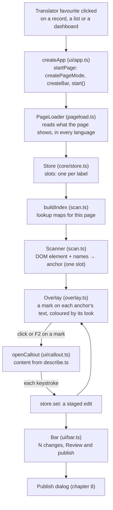

1. **Start.** The *Translator* favourite starts the app (`createApp` in `src/ui/app.ts`). On a record, a list or a
   dashboard it shows the page view: `startPage` creates the controller (`createPageMode` in `src/inspector/mode.ts`)
   and the bar, and starts the controller ([9.3](#93-how-the-app-runs-it-uiappts)).
2. **Load.** The page loader (`PageLoader` in `src/inspector/pageload.ts`) reads what the page shows. On a record page
   the form, in every language, and its table come first; then the tables of its sub-grids, its business process flow,
   the app and its navigation, and the command bar. Every label it reads goes into the store as a slot
   ([9.6](#96-what-the-page-loader-reads-inspectorpageloadts)).
3. **Index and scan.** From the store, `buildIndex` makes lookup maps for this page. The scanner (`Scanner` in
   `src/inspector/scan.ts`) walks the page's elements with a list of rules and binds each label it recognises to
   exactly one slot: an **anchor** ([9.7](#97-anchors-a-label-on-the-page) to
   [9.13](#913-microsofts-built-in-text-and-read-only-labels)).
4. **Mark.** The overlay (`src/inspector/overlay.ts`) draws a tinted box around the text of each anchor, in its own
   layer over the page. Its colour, the **look**, says whether the label is translated, missing, changed, failed or
   can't be translated here ([9.14](#914-looks-the-colour-of-a-label-inspectorstatusts) and
   [9.15](#915-the-overlay-marks-on-the-page-inspectoroverlayts)).
5. **Click.** The overlay takes a click on the text of a marked label (the page never sees it) and the controller
   opens the popup next to the label, with its texts in each language. Beside the text, a click reaches the page, or
   does nothing where the label's zone acts (a button, a tab, a link, a menu item), unless all it does there is open
   or close part of the navigation, open the list of areas, forms or views, or pick from that list
   ([9.16](#916-clicks-alt-and-f2) to [9.21](#921-the-popup-uicalloutts)).
6. **Type.** Each keystroke is staged in the store. The mark turns green, the bar counts the change, and in the user's
   own language the page shows the new text in place, or for an emptied translation what that language will show
   without it ([9.18](#918-staged-text-shown-in-place-inspectorpreviewts)). An emptied translation is removed where
   Dataverse can remove it, and elsewhere replaced by its stand-in, the text that language shows without one
   ([9.3](#93-how-the-app-runs-it-uiappts)); an emptied description of a table, column or choice is saved empty.
7. **Publish.** **Review and publish** on the bar opens the Publish dialog, which saves, publishes and refreshes the
   page ([chapter 8](#8-the-publish-dialog-history-and-undo)).

**Where it runs.** On the pages `pageInfo` (`src/core/context.ts`) calls `entityrecord`, `entitylist` and `dashboard`
(`translatesOn` in `src/ui/app.ts`).
Anywhere else in the app only the Workbench opens, and asking for the page view says *Open a record, a list or a
dashboard to translate on the page.*

**What it changes on the page.** Nothing that Dynamics owns, with two exceptions that are undone when translation mode
stops: in the user's own language, the text of a label with a staged edit is swapped in place
([9.18](#918-staged-text-shown-in-place-inspectorpreviewts)), and while the pointer is on a label's text (or its
pencil badge), a style sheet adopted by the document gives the page the pointer cursor. Everything else is drawn in
the translator's own hosts. Finding a label from the list, and the popup's **Open**, **Show tab**, **Show stage**,
**Change area**, **Change form** and **Change view**, change what the page shows (a tab, a flyout, a related view, the
list of areas, forms or views, another area, form, view or page) through Dynamics' own APIs or a click like the
user's, never a record's data ([9.12](#912-the-navigation-the-command-bar-processes-and-views),
[9.22](#922-open-change-area-form-or-view-show-tab-and-show-stage),
[9.26](#926-finding-a-label-from-the-list-inspectorrevealts)).

**Labels from managed solutions.** Translation mode never creates an unmanaged layer: a label whose component comes
from a managed solution is read-only, whatever its managed properties allow, and is marked grey, with the reason in
its popup ([9.13](#913-microsofts-built-in-text-and-read-only-labels)). Microsoft's own forms and tables (account,
contact and the like) come from managed solutions, so on their pages almost every label is grey. Such labels are
translated in the environment where their solution is developed; in a development environment, the components of
your own unmanaged solutions are translatable.

**Marks on a form.** A *Project* record with the translator on. Each translatable label is marked on its own text:
blue dashed where it is translated, amber dashed where the target language has no text yet, green where a change is
staged, grey dotted where it can't be translated here. The bar sits at the bottom of the page, centred in the room
right of the app's navigation.


### 9.2 The files

| File | What it holds |
| --- | --- |
| `src/inspector/types.ts` | The contracts between the parts: `Anchor`, `Switch`, `ListKind`, `Part`, `Role`, `Look`, `Pill`, `OverlayApi`, `PageMode`, `PageItem`, `CalloutModel`, `Block`, `CalloutHost`, `BarApi`, `PageListApi` |
| `src/inspector/mode.ts` | The controller, `createPageMode`: keeps the index and the anchors current, paints, opens one popup at a time and runs its secondary button (`runAction`, `listActs`), points a popup opened from a list row at its label or beside the sheet (`rowAnchor`), finds labels for the list and the Publish dialog, remembers where each change was made |
| `src/inspector/pageload.ts` | `PageLoader`: what the page shows and the loads that read it; `formOf` |
| `src/inspector/scan.ts` | `buildIndex` (the page index), the `Scanner` and its `RULES` (element → anchor); also `domShown`, `pageShows` and `checkShown`, the check after a refresh |
| `src/inspector/parts.ts` | Pure helpers: multi-select values, linked-table headers, the tables a grid's query reads, the form and grid ids the DOM carries, built-in commands named after their table |
| `src/inspector/column.ts` | `columnOf`: the column a form cell or a process step shows, re-exported from `src/core/column.ts` |
| `src/inspector/fallback.ts` | What a label shows in a language it has no text in: a form cell its column's name, a related menu item its relationship's text |
| `src/inspector/status.ts` | Looks (`look`, `readOnlyLook`, `standsIn`), the list's groups, the page's title in words |
| `src/inspector/lists.ts` | The three lists the page is switched with (the app's areas, the record's forms, a grid's views): the selectors of their buttons, lists and items (`OPENER`, `LIST`, `ITEM`), what a label keeps to switch (`selectorSwitch`, `itemSwitch`), and what **Change area**, **Change form**, **Change view** and an item's **Open** do (`openList`, `switchTo`, `focusOpener`) ([9.12](#912-the-navigation-the-command-bar-processes-and-views), [9.22](#922-open-change-area-form-or-view-show-tab-and-show-stage)) |
| `src/inspector/overlay.ts`, `overlay.css` | The marks, the pencil badge, the pills' drawing, the interception of clicks on labels' text, and what a click beside the text does (`effect`) |
| `src/inspector/pill.ts` | The "N choices changed" pills after a form field |
| `src/inspector/preview.ts` | Staged text in the user's language shown in place |
| `src/inspector/describe.ts` | The popup's content for each kind of label |
| `src/inspector/reveal.ts` | What to open so the page shows a label; where a change was made and how to go back there |
| `src/inspector/pagelist.ts`, `pagelist.css` | The *All labels on this page* sheet: its groups, which collapse by their band, and its place, docked on the right or floating where its header dragged it |
| `src/ui/callout.ts`, `callout.css` | The popup |
| `src/ui/bar.ts`, `bar.css` | The bar, its place right of Dynamics' navigation, and its ⋯ menu |
| `src/ui/undo.ts` | Ctrl+Z and Ctrl+Y, shared with the Workbench ([9.23](#923-undo-and-redo-in-translation-mode)) |
| `src/ui/app.ts` | Starts translation mode, switches to the Workbench and back (the window's ✕ too, `winClose`), `edit`, closing the translator |
| `src/ui/editor.ts` | The editor card of one component (*Edit translations*), and helpers the popup, the looks and the Workbench use, among them what an emptied translation becomes (`becomesText`) ([9.3](#93-how-the-app-runs-it-uiappts)) |

`column.ts` and `fallback.ts` are kept apart from `status.ts` so that the editor card (`src/ui/editor.ts`), which
`status.ts` imports, can use them without an import cycle. `columnOf` itself lives in `src/core/column.ts`, pure, on
the slot alone, because the save rules use it too: a form field label emptied where Dataverse can't remove its
translation is written as its column's name (`standIn` in `src/core/model.ts`, [chapter 7](#7-saving-safely)), and
`core` never imports the inspector. `status.ts`, `describe.ts`, `parts.ts`, `column.ts`, `fallback.ts` and most of
`reveal.ts` are pure functions over the store, the context and the preferences, or over strings: the unit tests call
them directly ([9.29](#929-tests-for-translation-mode)).

### 9.3 How the app runs it: `ui/app.ts`

**The host.** `createApp` puts one custom element, `dxt-translator`, on `<html>` (not in `<body>`: Dynamics re-renders
the body, which could remove it), with `position:fixed`, `inset:0`, `z-index:2147483646` and `pointer-events:none`,
and an open shadow root that holds the bar, the popups, the list sheet, the dialogs and the Workbench window. The host
stops `keydown`, `keyup`, `keypress`, `copy`, `cut`, `paste`, `pointerdown`, `pointerup`, `mousedown`, `mouseup`,
`click`, `touchstart`, `touchend`, `focusin` and `focusout` from leaving it. Typing in a popup must not reach
Dynamics' global shortcuts (Ctrl+S saves the record), and a click in a popup must not reach Dynamics' light dismiss: a
click in a popup opened from a process stage's flyout closed the flyout, and the popup jumped as its label went away.
The translator's own outside-click checks listen in the capture phase, before the host stops anything.

**Starting the page view.** The first time the page view is shown, `startPage` creates the controller and the bar.

`src/ui/app.ts`, `startPage`:

```ts
/** Starts translation mode the first time the page view is shown. */
function startPage(): void {
  if (mode) return;
  const m = (mode = deps.views.page(api));
  bar = createBar(api, m, {
    exit: () => void requestClose(),
    list: toggleList,
    workbench: () => show('workbench'),
    publish: () => void review(),
    history: () => recentPublishes(),
  });
  L.append(bar.el);
  // The bar moves (dragged, snapped to the top, resized): toasts follow.
  barWatch = new MutationObserver(rafThrottle(placeToasts));
  barWatch.observe(bar.el, { attributes: true, subtree: true, attributeFilter: ['style', 'hidden'] });
  m.start();
  void verifyAfterLoad(m).catch((e) => {
    if (__DEV__) console.error('[translator] verify', e);
  });
}
```

`deps.views.page` is `createPageMode`, given by `src/main.ts`. The bar's hooks are the app's: ✕ asks to close the
translator, **All labels** opens or closes the sheet (`toggleList`; it opens where it was left, docked on the right or
floating where it was dragged, which the preferences keep as `list`,
[9.25](#925-all-labels-on-this-page-inspectorpagelistts)), **Workbench** shows the Workbench, **Review and publish**
opens the Publish dialog and **Recent publishes** the history ([chapter 8](#8-the-publish-dialog-history-and-undo)).

**Workbench and back.** `show('workbench')` closes the list sheet, pauses the controller (`mode.pause(true)`: the
marks are hidden, clicks reach the page, a popup closes, what was typed stays staged) and hides the bar, then shows
the window. `show('page')` hides the window and resumes them; the controller repaints, because the Workbench may have
staged or published changes meanwhile. Alt+1 and Alt+2 switch between the two while the focus is in the translator,
and the Workbench window's ✕ goes back to the page as Alt+1 does (below): the title bar has no other button for it.

**The window's ✕.** When the translator was started on a record, a list or a dashboard, the ✕ of the Workbench
window's title bar goes back to the page, as Alt+1 does: its name and tooltip say *Back to page (Alt+1)*, it
carries `aria-keyshortcuts="Alt+1"`, and the translator stays open with its staged changes; the bar's ✕ is the one
that closes it. Started elsewhere in the app, there is no page to go back to, the Workbench is all there is, and its
✕ (*Close*) asks to close the translator (`requestClose`, below); Alt+1 there says *Open a record, a list or a
dashboard to translate on the page.* `translatesOn` is the same test as the one that decides whether the page view
can start at all, on the same `pageType`, read once when `createApp` starts.

`src/ui/app.ts`, `translatesOn` and `winClose`:

```ts
/** Translation mode needs a page with labels (pageInfo's type): a record, a list or a dashboard. Elsewhere only the Workbench. */
export const translatesOn = (pageType: string): boolean => pageType === 'entityrecord' || pageType === 'entitylist' || pageType === 'dashboard';

/**
 * The Workbench window's ✕ on a page of `pageType`. Where there is a page to go back to (translatesOn) it goes back to
 * it, as Alt+1 does: its name says so, with the shortcut as Undo's and Redo's do, "Back to page (Alt+1)" (the bar's ✕
 * closes the translator); a Workbench opened where there is no page to translate closes the translator.
 */
export function winClose(pageType: string, to: { page: () => void; close: () => void }): HTMLButtonElement {
  const back = translatesOn(pageType);
  const b = ibtn('close', back ? 'Back to page (Alt+1)' : 'Close', () => (back ? to.page() : to.close()), 'subtle', 20);
  if (back) b.setAttribute('aria-keyshortcuts', 'Alt+1');
  return b;
}
```

The title bar passes `show('page')` and `requestClose` as `page` and `close`.

**`edit(comp, l)`.** Every part of the app that wants a label edited calls `api.edit`: the Publish dialog's **Fix**,
the list sheet (once its own find, `mode.open(comp, { from })`, returned `false`), the controller's own fallback. In
translation mode it asks the controller first.

`src/ui/app.ts`, `edit`:

```ts
function edit(comp: string, l?: Lcid): void {
  // A dialog (e.g. a running publish) is in front: an edit started now would be lost by the save.
  if (modalOpen()) return;
  try {
    if (cur === 'page' && mode?.open(comp, { lcid: l })) return;
    if (cur === 'workbench' && workbench?.edit?.(comp, l)) return;
  } catch (e) {
    if (__DEV__) console.error('[translator]', e);
  }
  fullEditor(comp, l);
}
```

`mode.open` returns `false` when the label is not on this page and was not changed on a page in translation mode
([9.27](#927-changes-made-on-other-pages)); the full editor card then opens in a dialog (*Edit translations*), with
every text of the component in every shown language.

**The editor card: `src/ui/editor.ts`.** `fullEditor` opens it in the *Edit translations* dialog (a wide `modal`)
whenever `edit` can't open the component in place: in translation mode a label that is not on this page and was not
changed on a page in translation mode, or one whose popup can't be built; in the Workbench a component that is not
loaded. `createEditor(app, comp, { focusLcid, onClose })` returns `{ el, focus(lcid), destroy() }`. `focus` puts the
caret at the end of the input of that language (without one, of `focusLcid`, else of the language the page is shown
in), or of the first input that can be edited when that one can't be. A component without a loaded slot shows *Not
loaded* (*This component is not in the loaded data. Load it again to edit it.*).

* **The header**: the kind's icon (`kindIcon`) and name (`KIND_NAMES`), the title, the path, the logical name while
  **Show logical names** is on, **⋯** (*More actions*) and **✕**. **⋯** holds **Review and publish this component**,
  which closes the dialog and opens the Publish dialog for this component's changes only, and **Revert all changes**,
  one undo step; both are greyed out while nothing of the component is staged. Under the header, each reason why one
  of its texts is read-only shows once, with a lock.
* **One block per property** (`compSlots`: the component's slots in the order of `PROP_NAMES`), with one row per
  language of `shownLangs`: the base language first, then the target and the other shown languages by name (the
  order of `ctx.langs`). A row holds the language chip (`langChip`: the short code, the full name where there is
  room; the base language dark, the target in the brand colour), the input (a text area for `Description`,
  `ToolTipDescription` and `Hint`, growing up to 220 px), a dot for its state (*Edited, not saved yet*, *Saved*,
  *Missing in this language*, *Changed on the server since you loaded it*) and **Revert**. The input of a read-only
  text, and of a language not loaded, is disabled.
* **An empty input** shows *Not loaded*, *Required* (the base language of a slot that needs it), *Can't be removed —
  type the text instead* (an emptied translation that has no stand-in, below), nothing where saving writes a stand-in
  (the line under the input says what), or what users of that language see now: *Shows “…”* (for a form field label
  the column's name in that language, else the column's base-language name; the relationship's text for a related
  menu item, `fallbackOf`; else the base text), or *No French description* for a long text. A metadata description
  (`keepsEmpty`) says *No French tooltip* (*No French description*, `noneText`) only where its users see none: stored
  empty, emptied in the card, or with no base text either; a missing one says *Shows “…”* with the base text.
* **Under the input**, the first that applies: the message of a failed save; for an emptied translation, why it is
  refused when it has no stand-in (`noStandIn`, for example *Dataverse can't remove this translation, and its English
  text is empty: type the text instead.*), what saving writes in its place where Dataverse can't remove it
  (`becomesText`, for example *Becomes “Start date”: Dataverse can't remove a translation here, so French gets the
  English text.*), that it is saved empty for a metadata description (`savedEmptyText`, *Saved empty: French users see
  no tooltip.*), or *Will be removed when you save.* (`WILL_REMOVE`); a problem that blocks the save, from
  `app.saver.validate` (errors only, never warnings). From 80% of the slot's `max` a counter shows *n / max*, red past
  it. A conflict shows *Someone changed this on the server after you loaded it:*, the server's text, **Keep mine** and
  **Use theirs**.
* **A language not loaded** (`notLoaded`: a form tab or section label read without it; also a cell or navigation item
  of a form that has no unpublished definition, known in the user's language only, `PUB_ONLY` in
  [chapter 6](#6-providers-reading-and-writing-each-kind-of-label)) says *Not loaded for this language.* with **Load
  all languages**, which reads that form again in every language (`providers.loadFormXml` with the page's
  `LangSession`), as of the moment it starts (`store.tick()`): a text the store gets while it reads (a save, another
  load) is newer and stays ([4.5](#45-the-store-and-staged-changes)).

Every keystroke stages the text (`store.set`). The card follows the store without rebuilding an input while it is
typed in: an `edit` event updates the rows of its key (and the rows whose *Shows “…”* comes from it), `edits` and
`status` every row, and `slots` rebuilds the card only when the component's slots changed; a `dxt-prefs` event with
`shown`, `target` or `showNames` rebuilds it, keeping the caret. Its root carries `data-us`, so a rebuilt input keeps
its undo history, and an input opened on a staged text answers Ctrl+Z with the server text (`whenEmpty`,
[8.13](#813-ctrlz-and-ctrly-undots)).

**An emptied translation.** A translation that is on the server can be emptied in the card like any other text
(`isRemoval`, below). Where Dataverse can remove it (`canClear` in `src/core/model.ts`: a name stored on a record,
such as a view's, form's, chart's, dashboard's or app's, through `SetLocLabels`; a related menu item's or an app
navigation item's title, removed with its element; verified in a test environment, LIVE-FINDINGS 33 and 38), saving
removes it: *Will be removed when you save.* Where it can't (a table's, column's, choice's or relationship's names, a
form or dashboard tab, section or field label, a classic button label, a process stage or step translation, which
Dynamics keeps once stored; verified in a test environment, LIVE-FINDINGS 31, 32, 37, 39, 67 and 83), saving writes
its **stand-in**, the text that language shows without a translation of its own, so the page looks the same: a form or
dashboard field label whose cell shows a column gets the column's name in that language, else the column's
base-language name (verified in a test environment, LIVE-FINDINGS 42); anything else gets its own base-language text.
The rule is `standIn` in `src/core/model.ts`, which the saver applies before its checks and its writers
([chapter 7](#7-saving-safely)); the card asks the store for it (`store.standIn(key, lcid, base)`, measured with the
texts as they are staged), and the line under the input says what the label becomes. A stand-in that isn't known (an
empty base text, the column's names not loaded) leaves the cell red, with the reason and, where loading a text gives
it, what to load: *Dataverse can't remove this translation, and its column's names aren't loaded: load its table's
columns to put the column's name in its place, or type the text.* A stand-in that is the server text already says
*Already the English text: Dataverse can't remove a translation here, so nothing changes.* The dot's tooltip says the
same as the line.

A metadata description (`keepsEmpty`: a table's, a column's, a choice option's, a status's…) has no stand-in: emptied,
or left only spaces, it is saved empty (`savesEmpty`), so that its users see no tooltip or description there, and the
line under the input says *Saved empty: French users see no tooltip.* (`empty` below, `Store.emptyOnPurpose`). One
stored empty is translated: its input is not amber (`miss`), and its placeholder says *No French tooltip*.

`src/ui/editor.ts`, `updateCell` in `createEditor` (two parts):

```ts
// Emptying a translation that exists on the server asks to remove it; where Dataverse can't, saving writes its
// stand-in (model.ts standIn), and only one without a stand-in is refused. A metadata description's is saved empty
// (model.ts savesEmpty), also only spaces where there is none: said in the stand-in's place.
const empty = edited && !ro && !nl && !isBase && store.emptyOnPurpose(s.key, l, base) ? savedEmptyText(s, langName(app, l)) : '';
const removing = edited && !ro && !nl && isRemoval(base, l, store.original(s.key, l), v);
const x = removing && !empty ? store.standIn(s.key, l, base) : undefined;
const stuck = !!x && !x.text;
const stand = empty || (x?.text ? becomesText(s, l, base, x) : '');
// ...
const say: { level: 'error' | 'warn' | 'note'; text: string } | null =
  cs?.outcome === 'error' && cs.message ? { level: 'error', text: cs.message }
  : stuck ? { level: 'error', text: noStandIn(s, l, x) }
  : stand ? { level: 'note', text: stand }
  : removing ? { level: 'note', text: WILL_REMOVE }
  : issue ? { level: issue.level, text: issue.message }
  : null;
```

What the card says is measured on the texts as they are staged; the saver checks the server again. For a stand-in that
is the server text already, it writes nothing only while the server still holds that text: it reads the label's text
first, and another text there (someone else's, newer) is a conflict, as a writer would find it, never a silent
*unchanged*. A stand-in made of a text the same save writes in another write (a form field label emptied while its
column's name in that language changes: `standInSources`) is written after that text, and only once it is saved;
otherwise it is held back and the edit stays: *Its column's French name wasn't saved, so nothing was written here
either: Try again to save both.* (`sourceUnsaved`). An undo writes its stand-ins the same way ([chapter
7](#7-saving-safely)).

Other modules use its helpers: `notLoaded` (which it re-exports from `src/core/model.ts`, where the stand-in rule reads
it too; the popup and its content, the looks, the controller, the app, the grid, the sheets and the bulk tools),
`langName`, `compSlots` (the app and the Workbench), `shownLangs` (the popup's content), `becomesText` (the popup's
line under an emptied input, `becomes` in `src/ui/callout.ts`), and `isRemoval` with `WILL_REMOVE`, which the grid
uses as `REMOVED`. `becomesText` is `standInSays` in `src/core/model.ts`, whose words the Workbench's tooltips share
(`standInTip` in `src/workbench/grid.ts`), so that every view says the same about an emptied translation.

`src/ui/editor.ts`, `isRemoval`:

```ts
export const isRemoval = (base: Lcid, lcid: Lcid, before: string, after: string): boolean => lcid !== base && !after.trim() && before !== '';
```

**Keys in the translator.** On the app's layer: Esc closes the topmost layer (a menu, a dialog, the popup, the list
sheet); Ctrl+S opens the Publish dialog, never the browser's *Save page as*; Ctrl+Z and Ctrl+Y are taken by `bindUndo`
([9.23](#923-undo-and-redo-in-translation-mode)). These keys work while the focus is in the translator. With the focus
on the page, Ctrl+S is Dynamics' own (it saves the record).

**Closing.** ✕ on the bar calls `requestClose`, as does the Workbench window's ✕ where there is no page to go back to
(above). While a save runs it says *Publishing is in progress. The translator can close when it finishes.* With
staged changes it asks *Close the translator?* (*You have 3 unpublished changes.*) with **Publish**, **Discard** and
**Keep editing**. `destroy` then removes everything: it aborts the loads, closes the list, stops the controller
(`mode.destroy()`: the overlay's host, its listeners and its style sheet go, the swapped texts are put back), removes
the bar and the host, and puts the user's language back. While changes are staged or a save runs, leaving the page
shows the browser's *Leave site?* prompt (`beforeunload`).

**After a refresh.** A publish in translation mode ends with a refresh of the page, which starts nothing by itself:
the user clicks the favourite again. The refresh stores what was published (`dxt:verify:<org id>` in local storage,
[chapter 8](#8-the-publish-dialog-history-and-undo)), and the next start checks it in `verifyAfterLoad`. It waits 1.5
seconds, then until the page's loads are in (at most 60 seconds), and splits the published texts with `checkShown`
(`src/inspector/scan.ts`). What the page renders decides for the texts it can show: field labels, their tooltips (the
`title` *"&lt;label&gt; - &lt;description&gt;"* of the label's parent, verified in a test environment, LIVE-FINDINGS 43) and the
tab and section titles of this form, in the user's language, read from the DOM by `domShown` and `pageShows`. The
freshly loaded server text decides for the rest. Only what is not showing yet is said, in one warning toast, *2 changes
aren't showing yet*, with **Refresh again**, which refreshes the page once more and checks those texts after it
(`notShowing` in `src/ui/refresh.ts`). A page that shows every published text says nothing: the page itself shows
the changes.

**Toasts.** In translation mode `placeToasts` puts toasts at the right, 12 px above the bar; when the bar was moved to
the upper half of the page, at the bottom right. A `MutationObserver` on the bar moves them when the bar moves.

**Development builds.** In a build made with `node tools/build.mjs --dev` (`dist/translator.debug.js`), `api.dev`
holds `mode()`, `bar()`, `list()` and `noRefresh`, and the controller has `mode.dev` with `anchors()`, `index()`, the
loader and the overlay. The live suites, `tools/e2e-suite.js` and `tools/e2e-page.js`, drive translation mode through
them ([chapter 14](#14-testing-your-changes)). Release builds have neither (`__DEV__` is `false`).

### 9.4 The controller: `inspector/mode.ts`

`createPageMode(app)` returns the `PageMode` the app and the bar use. It owns the page loader, the scanner, the
overlay and the preview, and keeps the state of translation mode in a few variables:

| Variable | Holds |
| --- | --- |
| `on`, `paused`, `destroyed` | Started; paused while the Workbench is open; torn down |
| `x` | The page index (`PageIndex`, [9.8](#98-the-page-index-buildindex)), rebuilt by `refresh` |
| `cur` | The open popup (`Cur`, [9.19](#919-opening-a-popup)), or `null` |
| `looks`, `choiceNotes`, `itemsCache` | Caches cleared by `repaint`: each component's look, each column's pending choices, the list's items |
| `staged` | Slot key → where its staged change was made (`Staged`: the page and the place on it), kept in memory only ([9.27](#927-changes-made-on-other-pages)) |
| `trip`, `waitT`, `waitId` | A find gone to another page, and a find waiting on this one ([9.26](#926-finding-a-label-from-the-list-inspectorrevealts)) |
| `waking`, `coldChecked` | The form API being rebuilt after a cold boot, and the pages already checked for one ([9.5](#95-following-the-page)) |

**The API.**

| Member | Does |
| --- | --- |
| `start()` | Starts the overlay, listens to `dxt-prefs`, starts a one-second tick, reads the page and scans it |
| `stop()`, `destroy()` | Stops finds, closes the popup, stops the overlay and puts swapped texts back; `destroy` also aborts the loader |
| `pause(on)` | The Workbench window is open: marks hidden, no interception, no popup. Resuming repaints |
| `open(comp, { from, focus, lcid })` | Finds a component's label and opens its popup; `false` when there is nowhere to find it ([9.26](#926-finding-a-label-from-the-list-inspectorrevealts)) |
| `close()`, `cancelFind()` | Closes the popup; stops a find that is still waiting |
| `items()`, `counts()` | The list's rows and its counts ([9.25](#925-all-labels-on-this-page-inspectorpagelistts)) |
| `loading()`, `notes()` | Loads running (or a cold form being rebuilt); failed loads, each with **Try again** |
| `title()` | The page in words, for example *Project · Contoso project form* (`pageTitle` in `status.ts`) |
| `flash(comp)` | Emphasises a component's marks (a list row under the pointer) |
| `on(fn)` | Tells the bar and the list about `'items'`, `'page'`, `'alt'` and `'loading'` |

**The overlay's hooks.** The controller hands the overlay what it needs to draw and what to do on a click.

`src/inspector/mode.ts`, the overlay hooks in `createPageMode`:

```ts
const hooks: OverlayHooks = {
  look: anchorLook,
  pills: () =>
    fieldPills(scanner.list, {
      column: (a) => choiceColumn(store.get(a.key)),
      note: choicesOf,
      fields: fieldsAround,
      readOnly: (a) => !!store.get(a.key)?.readOnly,
    }),
  open: onLabel,
  mutated,
  ours: () => [app.root.host],
  alt: () => emit('alt'),
};
```

**Store events.** The controller listens to the store. A `slots` event (labels loaded or replaced) rebuilds the index
60 ms later (`refreshSoon`), which repaints. An `edit` event applies the preview to that component's anchors, other
events (`edits`, `status`) apply it to every anchor, and both repaint at once. `repaint` clears the caches, asks the
overlay to read every look again (`overlay.paint()`) and tells the bar and the list 40 ms later (`emitSoon`). The same
listener records where a new staged change was made (`notePlaces`, [9.27](#927-changes-made-on-other-pages)).

**Looks.** `anchorLook(a)` is `'builtin'` for Microsoft's built-in text
([9.13](#913-microsofts-built-in-text-and-read-only-labels)). An anchor that shows another slot than its component's
main one (a table's plural name on a navigation entry) gets the look of that slot (`slotLook`); any other anchor gets
its component's look (`look` in `status.ts`, cached per component until the next repaint,
[9.14](#914-looks-the-colour-of-a-label-inspectorstatusts)).

**Items and counts.** `items()` lists every component of the page: those the index says belong to it (`x.universe`:
shown now or not, such as fields on other tabs), those the scanner has anchored since the page opened (`scanner.seen`)
and those anchored now. Rendered ones come first, in page order; the others follow by breadcrumb. Changes staged on
other pages come last ([9.27](#927-changes-made-on-other-pages)). `counts()` returns the number of staged cells
(`store.pendingCount()`, a label in one language counting once) at once, and the list's numbers (all, missing) only
when they are read: the bar asks after every keystroke, and going through every staged change (a bulk fill in the
Workbench) each time would be slow.

**Notes.** `notes()` turns the loader's failed loads into one note per message, each with **Try again**
(`loader.retry()`). The bar and the list show them ([9.24](#924-the-bar-and-the--menu-uibarts)).

### 9.5 Following the page

Dynamics is a single-page application: going to another record, switching forms, opening a tab or a flyout changes the
DOM without loading a page. The controller follows it in three ways.

**Mutations.** The overlay's `MutationObserver` (on `document.body` and on the open shadow roots of the header strip,
`uci-header-control-list`) collects what changed and reports it 90 ms after the first change, through `mutated(roots,
removed)`. The controller rescans only those subtrees (`scanner.update`), gives the overlay the new anchors when the
set changed, and applies the preview to the anchors found (Dynamics may have re-rendered a label whose text was
swapped). When `location.href` changed, a full check of the page follows 350 ms later (`navSoon`).

**The tick.** A one-second interval calls `syncPrefs` (the target language or the languages shown changed: repaint and
refresh the popup) and `navigate`. Form switches and process changes do not always change the URL.

**`navigate`.** `loader.sync()` builds the page's signature from `pageInfo`: its type, table, record, form, view and
dashboard. When the signature is the same, the controller checks two things: whether the user switched the record's
process (the previous process's name, stages and steps leave the list: `scanner.forget(ofProcess(was))`), and whether
the form needs waking (below). When the signature changed, the page is another one: the swapped texts are put back,
the scanner forgets everything, the marks go, a find waiting on the previous page stops (a find gone to this page goes
on, [9.27](#927-changes-made-on-other-pages)), and the index is rebuilt for the new page (`refresh(true)`).

**`refresh`.** Rebuilds the index from the store (`buildIndex`), scans the whole page (`scanner.full`), gives the
overlay the anchors, applies the preview, passes what the scanner asked for to the loader (`want`), keeps the open
popup on its label (`reanchor`, [9.19](#919-opening-a-popup)) and repaints. When the page or its title changed it
tells the bar and the list (`'page'`).

**A click right after a navigation.** UCI draws the next page's labels before the controller sees the navigation:
`navSoon` waits 350 ms after the URL changed, and a form switch that keeps the URL waits for the tick. A label scanned
meanwhile was matched against the previous page's index, where a column of the same name on the previous table could
stand for it. So a click or F2 on a label reads the page first: `onLabel` calls `navigate`, as `open` does for a label
asked for by the list or the Publish dialog. When the page changed, the label is the one the new page's scan found on
the same element, with the same role and the same part of its text (`sameLabel`); where that scan marks nothing,
nothing opens. On a list page, a grid whose `data-lp-id` names another table than the index's is not mapped meanwhile
(`gridTable`, [9.11](#911-grids-choice-values-and-texts-that-hold-several-labels)).

`src/inspector/mode.ts`, `sameLabel`, and `onLabel` in `createPageMode`:

```ts
/**
 * The label `a` clicked (scanned on the page before) as a new scan of the page found it: the same element and role (and
 * part of its text, for one that shows several), whatever page's index it was matched against now. Null when the new
 * scan doesn't mark it.
 */
export function sameLabel(a: Anchor, list: readonly Anchor[]): Anchor | null {
  return list.find((b) => b.el === a.el && b.role === a.role && b.part?.start === a.part?.start && b.part?.end === a.part?.end) ?? null;
}
// ...
/**
 * A click (or F2) on a label on the page. The page is read first, as open() does: UCI draws the next page's labels before
 * the page tracker sees the navigation (navSoon, the tick), and a label scanned meanwhile was matched against the
 * previous page's index (its table's column of the same name). After a page change the label is the one the new page's
 * scan found on the same element; none there: nothing opens.
 */
function onLabel(clicked: Anchor): void {
  if (!on || paused) return;
  const a = navigate() ? sameLabel(clicked, scanner.list) : clicked;
  if (!a) return;
  const st = cur && !cur.closed ? cur : null;
  clickLabel(a, st, {
    move: (b) => st && moveTo(st, b),
    open: (b) => present(b.comp, b, {}),
  });
}
```

`navigate` returns `true` when the page changed. While a cold form is being opened again (`waking`, below) it returns
`false` and changes nothing.

**A form being replaced.** UCI swaps the form (the form selector, a record of another table) up to a second before the
page tracker notices. Until the index is rebuilt, the new form's controls, tabs and sections would be matched by name
against the old form's cells, and an edit would go to the wrong form. At the start of every scan, `formMoved(x)`
compares the form API's table and current form with the index's; while they differ, the index is `stale` and nothing
form-scoped is mapped. When the index turns stale, every element anchored so far is scanned again, and the old form's
labels lose their anchors until the index is rebuilt.

**Cold boots.** After the translator's own cache purge and reload ([chapter
8](#8-the-publish-dialog-history-and-undo)), the form renders, but `Xrm.Page.ui` often has no controls, and sometimes
no tabs, for good. Labels then can't be tied to their form cells through the form API. Opening the same record again
rebuilds it in about 0.3 seconds. `coldForm` reads the state and `coldStep` decides.

`src/inspector/mode.ts`, `coldStep`:

```ts
export function coldStep(f: ColdForm): 'none' | 'reopen' | 'skip' {
  if (!f.rendered || (f.controls !== 0 && f.tabs !== 0)) return 'none';
  return f.dirty === false && f.entity && f.id ? 'reopen' : 'skip';
}
```

`wake` checks each record page once, as soon as the form shows labels, and never under an open popup. On `'reopen'` it
sets `waking` (the bar says *Loading translations…*, and nothing is scanned) and runs `wakeForm`: it waits up to 500
ms for a form still being built to fill its API on its own; then, if the record is still not dirty and the page is
still the same record and form, it calls `Xrm.Navigation.openForm` for that record and form and polls every 100 ms, at
most 3 seconds, until the form API has controls and tabs. On `'skip'` (unsaved changes, or a new record) the page is
scanned from the DOM alone, and `fieldOf` refuses what it can't place ([9.10](#910-which-form-a-label-belongs-to)).

**`Xrm` is read live.** `ctx.xrm` is a getter that reads the page's `Xrm` on every use: after an in-app navigation to
another table's form, `window.Xrm` is a new object, and the old one still answers for the previous page (verified in a
test environment, LIVE-FINDINGS 95). It is the window's own, else that of a same-origin frame (`findXrm` in
`src/core/context.ts`); a frame of another site, which can't be looked into, is skipped, never the end of the search.

### 9.6 What the page loader reads: `inspector/pageload.ts`

The loader decides what the page shows and loads exactly those components into the store, several loads at a time, so
the page fills in progressively. Everything the page shows is loaded up front: nothing waits for a click.

**The page.** `sync()` reads `pageInfo` and, on a record page, the form shown (`formOf`: the form selector's current
item; a user with a single form has no current item and sees that one, whatever the URL names). It keeps a `Page`:
`info`, `sig` (the signature), `entity`, `formId` (a record's form, or a dashboard's id), `viewId` (empty for a
personal view, which is the user's own and not translatable) and `bpfId` (the record's active process).

**`start()`.** Starts every load the page needs that has not run yet:

1. On a record page, the form (`x:<form id>`: every label of the form in every language, through `loadFormXml`; tab
   and section labels of other languages through the automatic language switch, without a prompt; then the form's
   name, and the forms of its quick views, which render with it) and the page's table (`t:<table>`: the table's names,
   its columns with their descriptions, and its choices, through `loadTables`). These two go first. Every GET shares
   one first-in-first-out gate in the request layer, so whatever is queued first is read first, and the other loads
   wait for these two (`later()`, which awaits `head`). Waiting for the whole form read also keeps the other reads out
   of its language switch, where a read that names things in the caller's language would get the other language.
2. On a dashboard, the dashboard (`x:<dashboard id>`).
3. The tables of the record form's sub-grids (`subgrids()`, from the form API's grid controls), or on a list page the
   list's table: column headers and choice values in grids need their columns and choices.
4. The view's name on a list page, the process's name (`r:bpf:<id>`), and its stages and steps (`b:<id>`). On a
   record, the stage and step names Dynamics keeps for languages the process definition has none in are then read
   through the language switch (`loadBpfStored`; verified in a test environment, LIVE-FINDINGS 83 and 85), and the
   stages and steps go into the store once, with those names (below).
5. The app: its id (`getCurrentAppProperties`), its name, and its site map (`sm:<app id>`).

A record page with two languages then costs, by the comment at the top of `pageload.ts`, 8 reads at once, then the
form's other language and a read-back of the user's language; the form and the table are complete after about 0.6 s on
a small form and about 3 s on a form of 340 cells, and the 30 to 40 reads in all are done about a second after the
form.

**On demand.** What the scanner sees on the page but the store lacks goes into `scanner.want`; the controller passes
it to `loader.request(items)`. Each item is asked for once; a failed one again only after **Try again**.

`src/inspector/pageload.ts`, the request prefixes:

```ts
/** Prefix of a table request in Scanner.want / request() ('#' is never part of a table's logical name). */
export const WANT_TABLE = '#table|';
/** A form the page shows besides its own, in a side pane: every label, every language (WANT_FORM + form id). */
export const WANT_FORM = '#form|';
/** A quick view's form: its field labels (WANT_QUICK + form id). */
export const WANT_QUICK = '#quick|';
/** The query of a grid's view, for its linked-table columns and the table it reads (WANT_VIEW + view id). */
export const WANT_VIEW = '#view|';
/** A view a view selector shows besides the list page's own, for its name (WANT_VIEW_NAME + view id). */
export const WANT_VIEW_NAME = '#viewname|';
/** A form the form selector's list shows besides the page's own, for its name (WANT_FORM_NAME + form id). */
export const WANT_FORM_NAME = '#formname|';
/** A table's relationships, for the related menu of its form (WANT_RELATED + table). */
export const WANT_RELATED = '#related|';
/**
 * A table's names only (display and plural name): a navigation entry shows its plural name, a built-in command's text can
 * hold either (WANT_NAMES + table).
 */
export const WANT_NAMES = '#names|';
```

An item without a prefix is a command bar button, `<table>|<control id>`. Buttons are collected for 150 ms and read
together (`flushCommands`): modern commands (an app action, whose button id is `Label!<32 hex>`) through
`findCommands` and their command records; classic buttons per table through `ribbonControls` (the table's composed
ribbon, which maps a control to its `$LocLabels:` id) and `loadRibbonLabels`, plus the application ribbon's labels
(`rb:_app`), which apply to every table.

**The loads and their keys.**

| Key | Load | List group |
| --- | --- | --- |
| `x:<id>` | The page's form or dashboard, every language | Form |
| `t:<table>`, `g:<table>` | The page's table; a grid's table (columns, descriptions, choices) | Table and views, Choices |
| `r:<kind>:<id>` | A record's name: form, dashboard, view, app, process | Table and views, Navigation, Process |
| `b:<process id>` | A process's stages and steps, and the names Dynamics keeps for them | Process |
| `app` | The app's id | none |
| `sm:<app id>` | The app's site map | Navigation |
| `o:<form id>`, `q:<form id>` | A side pane's form (every label, every language); a quick view's form (its cells) | Form |
| `rel:<table>` | A table's relationships, and the plural names of the tables they list (the related menu) | Navigation |
| `n:<tables>` | The display and plural names of tables shown by name (site map entries, built-in commands) | Navigation, Command bar |
| `v:<view id>` | A grid view's query: the table it reads and its linked tables | none |
| `r:view:<ids>`, `r:form:<ids>` | The names of views in view selectors and lists of views; the names of forms in the list of forms (`recordNames`, one read for those asked together) | Table and views |
| `m:<names>`, `rb:<table>` | Modern commands; a table's classic buttons | Command bar |
| `rb:_app` | The application ribbon's labels | none |

`run(key, groups, what, fn, items, quiet)` runs one load once while the translator runs. While it runs, its groups
count as busy (`loader.busy`; while it holds any group, the controller's `loading()` is true, which the list shows as
skeleton rows and the bar as *Loading translations…*). Its slots go into the store through `mergeStored` and
`mergeUsedBy` (a global choice keeps the union of the columns that use it, across table loads). A failure is
remembered as a message in `loader.errors` (*Could not load the form labels. …*), unless the load is `quiet`: a side
pane's form, a quick view, a view's query and the related menu are loads the page can do without, and their labels
just stay unmarked. A load that got only part of what it needs throws `Incomplete` with what it got: those slots are
kept, and the load counts as failed, so **Try again** reads it again. A form read in only some languages is such a load
(*Could not load the form labels in every language.*), except where no read can complete it: the cells and navigation
items of a form that has no unpublished definition are known in the user's language only (`ref.unreadable`,
`PUB_ONLY`, [chapter 6](#6-providers-reading-and-writing-each-kind-of-label)). They stay not loaded in the other
languages (no mark while one of them is the target), and they alone never make the load fail, since **Try again**
couldn't help. `retry()` clears the failures and runs `start()` again.

**An older read never wins.** A load's slots go into the store as read when the load started: `run` takes a tick of
the store's clock first (`store.tick()`) and gives it to `store.add`, and to `fn` for slots a load would add itself
before it ends (none does at present: the process load adds its stages and steps once, at its end, below). A text the
store got after that tick (a save's, the Workbench's, a load's that started later) is newer: the older read never puts
its text back, nor drops an edit typed over the newer text as saved because it matches the older one
([4.5](#45-the-store-and-staged-changes)).

`src/inspector/pageload.ts`, in `run`:

```ts
// As this load starts: a text the store gets meanwhile (the Workbench's extract, a save) is newer than what it reads,
// which never replaces it, nor drops an edit typed over it (Store.add).
const since = this.app.store.tick();
// ...
store.add(mergeStored(ctx, mergeUsedBy(slots, get), get), since);
```

**A process's stages and steps, once.** On a record, `process` adds the stages and steps to the store once, together
with the names Dynamics keeps for them (LIVE-FINDINGS 83, 85): the definition's slots, carrying what an earlier read
found (`mergeStored`), go to `loadBpfStored` first, and the load returns them filled in. Added before that read, a
stage whose French name only Dynamics keeps would be marked as not translated (amber) for a moment, then turn blue.
Verified in a test environment in October 2026: on a record with a process, the stage marks show once, already blue,
about 2 seconds after the page opens. A language the read missed makes the load fail (`Incomplete`, *Could not load
the process's stage and step names in French.*): the slots read are kept, and **Try again** reads both again.

`src/inspector/pageload.ts`, `process`:

```ts
const slots = await pv.loadBpf(ctx, id, this.o());
if (!record || !slots.length) return slots;
// Added once, with the names Dynamics keeps (LIVE-FINDINGS 83, 85): added before that read, a stage whose French name
// is only kept there was marked as not translated, then turned blue a moment later.
const r = await pv.loadBpfStored(ctx, mergeStored(ctx, slots, (k) => store.get(k)), { entity, record, app: this.appId || this.page?.info.appId || '' }, this.o(true));
if (r.missed.length) throw new Incomplete(r.slots, `Could not load the process's stage and step names in ${r.missed.map(lcidName).join(', ')}.`);
return r.slots;
```

**What is never read.** A table's relationships, except for the related menu (`rel:`): nothing else in translation
mode shows their labels, and their three expansions (hundreds of relationships on a system table) would slow down the
page table's read, which the popups wait for.

### 9.7 Anchors: a label on the page

The scanner's one product is the **anchor**: a label found on the page, bound to the one slot whose text it shows. The
DOM only says *where* a label is; *which* label it is comes from names (control, tab, section, site map and command
ids) and form API values joined with the loaded slots, with a match against the known label texts as the fallback.

`src/inspector/types.ts`, `Anchor` (doc comments shortened):

```ts
export interface Anchor {
  /** Element showing the label: the mark is drawn around its text. */
  el: Element;
  comp: string;
  kind: Kind;
  /** Key of the slot whose text is shown (e.g. a table's plural name on a sitemap entry). */
  key: string;
  /** Larger element that belongs to this label (field container, section…). Never drawn and never a click zone. */
  hit?: Element;
  /**
   * The element that holds the label for clicks and hover (default `el`): a pointer is on the label only on its text;
   * beside the text, a click in the zone reaches the page, or does nothing where the zone acts (a button, a tab, a
   * link…). Never contains inputs, except the closed choice and Yes/No controls of a value anchor, whose whole control
   * is the zone.
   */
  zone?: Element;
  role: Role;
  /** The label's own text node: the mark hugs its line boxes (falls back to a Range over `el`'s contents). */
  text?: Text;
  // ...
  orig?: string;
  /**
   * Only these characters of `text` are the label: a text node that shows several labels (the values of a
   * multi-select, the two names of a linked-table column header). Its anchors share `el` and `zone`; a click in the
   * zone goes to the part under the pointer, none between or past them.
   */
  part?: Part;
  /** Slot key to focus in the popup (e.g. the option a grid cell shows). */
  focus?: string;
  /**
   * The button that opens one of the lists the page is switched with (the areas, the record's forms, a grid's views:
   * lists.ts), or an item of such a list: what its popup's Change… or Open needs, captured when the label is found.
   */
  sw?: Switch;
}
```

| Field | Meaning |
| --- | --- |
| `el` | The element that shows the label |
| `comp`, `kind`, `key` | The component, its kind, and the slot the anchor shows (`<comp>\|<prop>`, [chapter 4](#4-code-architecture)). One component can have several anchors: a field placed twice, a choice value in every row of a list |
| `hit` | A larger element that belongs to the label: a field's container, a section. The pills use it as the field ([9.17](#917-changed-choices-the-pill)). Never drawn, never clicked |
| `zone` | The element that holds the label for clicks and hover (default `el`). In it, the pointer is on the label only on its text (its marks, with 2 px of slack); beside the text, a click reaches the page, or does nothing where the zone acts ([9.16](#916-clicks-alt-and-f2)). It never holds an input, except for the closed choice and Yes/No controls of a value, whose whole control is the zone |
| `role` | What a click on it means (below) |
| `text` | The label's own text node: the mark hugs its line boxes |
| `orig` | What `text` showed when the label was found, never a staged text the preview swapped in |
| `part` | Only these characters of `text` are the label (`{ start, end, text }`): a text node that shows several labels |
| `focus` | The slot to focus in the popup, for example the option a grid cell shows |
| `sw` | On the button that opens the list of areas, forms or views, or on an item of that list: what the popup's **Change …** or **Open** needs, captured when the label is found (`Switch`, [9.12](#912-the-navigation-the-command-bar-processes-and-views)) |

`src/inspector/types.ts`, `Role` and `Look`:

```ts
/** What clicking a label does in translation mode. */
export type Role = 'label' | 'tab' | 'nav' | 'command' | 'stage' | 'header' | 'value' | 'option';

/**
 * How a label is marked on the page: a tinted box around its text only.
 * ok = translated, missing = empty in the target language, edited = staged change (not published yet),
 * error = a publish attempt failed for it, builtin = Microsoft's built-in text (a language pack's, already in every
 * installed language: grey, its popup says so), ro = can't be translated here (grey and dotted like builtin, its popup
 * gives the reason), na = not loaded / unknown (no mark).
 */
export type Look = 'ok' | 'missing' | 'edited' | 'error' | 'builtin' | 'ro' | 'na';
```

A click on the text of any marked label opens its popup and does nothing else. The role says what the label is,
decides the popup's secondary button with `sw` ([9.22](#922-open-change-area-form-or-view-show-tab-and-show-stage)),
and whether a click beside the text is let through (below):

| Role | Given to | The popup's secondary button |
| --- | --- | --- |
| `label` | Field labels, section headings, control titles (sub-grid, quick view, timeline, web resource), header fields, the form, view, dashboard, app and table names, a process name, a stage flyout's title | None, except **Change form** on the form selector and **Change view** on a view selector's button, which open their lists |
| `tab` | A tab of the tab bar, a tab in *More tabs* | **Show tab**, unless it is the tab shown |
| `nav` | Site map entries, group headings and the area switcher, the items of the open list of areas, forms or views, related menu items, the tab of a related view, the Related tab | **Open**, except for a group heading, the tab of the related view shown, and a label in a menu or flyout without a nav id. **Change area** on the area switcher, which opens the list of areas. On an item of the list of areas, forms or views whose id is known, **Open** unless it is the current one (a form only in the list of the page form's own selector) ([9.12](#912-the-navigation-the-command-bar-processes-and-views)) |
| `command` | Command bar buttons, *Form assist* and *Share*, the buttons of a stage flyout | None: the command never runs |
| `stage` | A process stage's chip | **Show stage**, for a stage with steps |
| `header` | A grid's column header | None: Alt+click sorts as usual |
| `value` | A choice value in a grid cell, in a closed choice or Yes/No control, a multi-select's value or chip | None: the control never opens or toggles |
| `option` | An option of an open dropdown list | None: the option is never selected |

**Beside the text.** Only the label's text takes the click: the pointer cursor, the hover ring and the pencil follow
its marks, not its zone. A click beside the text, still in the zone, goes to the page where the zone is passive (a
field label's container, a section heading). Where the zone acts, the click is swallowed and nothing opens, so a near
miss never runs a command. A zone acts when its label has the role `tab`, `nav`, `command`, `stage`, `header` or
`option` (`ACTIVE` in `overlay.ts`), when it holds a form control, or when something that acts lies anywhere on the
event's path (`acts`): a button, a link, a tab, a menu item, an option, a tree item, a column header, a form control,
or a `<label>` bound to a checkbox, a switch or a select. Two kinds of click are harmless and reach the page all the
same, whatever the zone (`effect` and `harmless` in `overlay.ts`): one where all that acts only opens or closes part
of the app's navigation (`'toggle'`: something with `aria-expanded` there, such as a group's header, *Recent*,
*Pinned* or the ☰ button, and the area switcher) or opens one of the lists the page is switched with (the area
switcher, the form selector, a view selector's button); and one that picks an item of such a list (`'pick'`). So
beside a group's title the group opens or closes, beside a selector's name (its chevron) its list opens, and beside an
item's text in that list the item is picked. A near miss on a site map entry that navigates, or on an item of any
other menu, is still swallowed. Alt+click works as usual everywhere. A label whose text has no mark yet keeps its
whole zone, in a zone of one label only. The rules in full are in [9.16](#916-clicks-alt-and-f2).

**Parts.** Some text nodes show several labels: the values of a multi-select (*Red, Blue*), the two names of a column
from a related table in a view (*Name (Primary contact)*), a built-in command built around its table's name (*New
Project*). Each label is a `part` of the text node, with its own mark; the anchors share `el` and `zone`, and a click
in the zone goes to the part whose mark is under the pointer (`pickPart` in `overlay.ts`). Between two parts or past
them it goes to none: nothing guesses the nearest one, and the click is the zone's, as beside any label's text.

### 9.8 The page index: `buildIndex`

`buildIndex(store, loader, xrm)` turns the store into lookup maps for the page shown. It is cheap enough to run on
every `slots` event and on every page change, so it is never updated in place: `refresh` builds a new one.

| Field | Holds |
| --- | --- |
| `comps`, `main` | Every component's slots, and its main slot: the first of `Label`, `DisplayName`, `Name`, `Title`, `DisplayCollectionName` it has (`rank`) |
| `universe` | The components that belong to the page, shown now or not: the page's table, form or dashboard, view, app and process; the page form's fields, tabs, sections and related menu items; the active process's stages and steps; the app's site map items (or, for an entry that shows its table's plural name, that table once its names are loaded); the columns and choices of the form's fields |
| `names` | `t:<tab>`, `s:<section>`, `n:<nav item>`, `st:<stage id>`, `sp:<step id>`, `p:<step column>` and `p:<column>\|<stage id>`, `ar:`/`gr:`/`sa:<site map item Id>` (lower case) → the slot; the first slot with a name keeps it |
| `fields`, `cells` | The page form's cells by control id and by column, in form order (a field placed twice can share one control id) |
| `forms` | Every loaded form's cells, tabs and sections by form id: the page's own, side panes' and quick views' forms |
| `text` | Normalized label texts (every language) → slot, for stages, sections, areas, groups, subareas and the page's table: elements without a usable id. A text two components share is dropped: it says nothing about which one is shown |
| `opts` | `<table>.<column>` → its choice slots in option order, for every loaded table (global choices through the columns that use them) |
| `related` | The related menu's items that come from the page table's relationships rather than the form XML: nav id → the slot whose text the item shows ([9.12](#912-the-navigation-the-command-bar-processes-and-views)) |
| `unnamed`, `resources`, `navTexts` | Site map items the page names by a resource instead of an Id, and every title of the app's site map ([9.12](#912-the-navigation-the-command-bar-processes-and-views)) |
| `form`, `view`, `app`, `bpf` | The main slots of the page's form or dashboard, view, app and process |
| `cmd`, `ribbon`, `queries`, `viewTables`, `gaveUp` | The loader's maps: modern command names, classic ribbon controls per table, grid views' linked tables and read tables, the requests that failed |
| `formReady` | The page form's own labels are loaded: only then may a control without a cell stand for its column |
| `formApi` | A record page whose form API is live (`Xrm.Page` has controls, for the page's table) |
| `record`, `formId`, `entity`, `list`, `user`, `base` | The page: record or list, its form and table, the user's and the base language |
| `stale` | Set by the scanner at the start of every scan: the form API shows another form ([9.5](#95-following-the-page)) |

### 9.9 The scanner and its rules

The `Scanner` keeps the page's anchors up to date. `full(x)` scans the whole document with a new index; `update(roots,
removed)` rescans only the subtrees that changed. Both look at the elements that match one of the rules' selectors,
also inside the open shadow roots of the header strip (`uci-header-control-list`).

`resolve(el)` tries the rules in order: the first rule whose selector matches and that returns anchors wins. Anchors
equal to the previous ones are kept as they were (the same objects), so the overlay and the open popup keep theirs. An
element whose rules return nothing loses its anchors. `list` gives every anchor in page order (the parts of one text
in text order) and `of(comp)` a component's anchors. `seen` keeps every component anchored since the page opened, so a
label that scrolls away or sits on another tab stays in the list.

**The rules.** `RULES` in `src/inspector/scan.ts`, in their order:

| Selector | Maps |
| --- | --- |
| `[data-id$="-FieldSectionItemContainer"]` | A form field: its cell's label (the page form's, a quick view's, a side pane's), a process step in its stage's flyout, or a composite column's sub-field. The zone is the label element |
| `[data-id^="header_"]` | A header field shown without a field container (a collapsed header) |
| `uci-header-control-list-item[data-name^="header_"]` | A field of the header strip next to the record title (in the strip's shadow root); the zone is its `[slot="label"]` |
| `[data-control-name]` | The title of a sub-grid, a quick view or a web resource: its cell's label, never a field or grid header inside it |
| `[id^="action_bar_header_title"]` | A control's title in its own action bar (the timeline's *Timeline*) |
| `li[data-id^="tablist-"]`, `[role="menuitem"][data-id^="tablist-"]` | A tab, or a tab in *More tabs*; the Related tab; the tab of a related view |
| `section[data-id]` | A section's own heading |
| `[data-id^="form-tab-relatedEntity-"]` | An item of the related menu |
| `li[id*="processHeaderStage"]` | A process stage's chip |
| `[id$="processHeaderNameLabel"]` | The process's name above its stages |
| `label[id^="MscrmControls.Containers.ProcessStageControl-"]` | An open stage flyout's title, and its buttons |
| `button[data-id*="\|"]`, `[role="menuitem"][data-id*="\|"]` | A command bar button with a ribbon id: modern, classic or built-in |
| *Form assist* and *Share* (`FORM_BUTTONS`) | Microsoft's buttons next to the record form's tabs and command bar |
| `button[role="menuitem"]` | A button Dynamics adds to a command bar without a ribbon id |
| `[data-id^="sitemap-entity-"]` | A site map entry, Home, Recent and Pinned |
| `[data-id*="sitemap-sitemapAreaGroup"]` | A site map group heading |
| `#areaSwitcherId` | The area the area switcher shows, by its text; the button opens the list of areas (`opens`) |
| `[role="menuitemradio"]` in an open list (`ITEM` in `LIST`, `lists.ts`) | An item of the list of areas, forms or views: an area by the Id its `data-id` names, else by its text; a form or a view by the id its `data-value` names, only where its text is that form's or view's name |
| `[data-id="appBreadCrumb"]` | The app's name |
| `[role="columnheader"][col-id]`, `[role="columnheader"][data-item-key]` | A grid's column header |
| `[class*="wj-header"][data-id]` | A column header of the classic read-only grid |
| `[id*="viewselector" i]`, `[data-id*="viewselector" i]` | A view's name in a view selector, never an element that holds a list of views; a view selector's button opens that list (`opens`) |
| `[data-id="form-selector"]` | The form's name; the button opens the list of forms (`opens`) |
| `[id*="Dashboard_Selector"]` | The dashboard's name |
| `[data-id="entity_name_span"]`, `[data-id*="form-header"]` | The table's name in the form header |
| `[role="listbox"] [role="option"]` | An option of an open dropdown list |
| `[role="gridcell"][col-id]` and the like | A choice value in a grid row |
| `VALUE`: `[data-id$=".fieldControl-option-set-select"]` and the like | The value a closed choice, status reason or Yes/No control shows |
| `MULTI`: a multi-select control | Each value of a multi-select |

**Text.** A rule finds the label's text node by walking the text under its element (`find`, `shown`): the first text
that is one of the slot's texts in any language, normalized (spaces collapsed, lower case). Only a handful of nodes
are looked at (a cap per rule, from 4 to 40), so a large container costs little. Grids render a header's or a value's
text twice, a visible copy and a hidden one; the rules prefer the rendered copy. The text read is always the page's
own: `textOf` gives the text a node had before the preview swapped it
([9.18](#918-staged-text-shown-in-place-inspectorpreviewts)).

**What the scanner asks for.** A rule that sees something the store lacks adds it to `scanner.want` and returns no
anchor: a grid's table (`#table|`), a side pane's or quick view's form (`#form|`, `#quick|`), a view's query
(`#view|`) or name (`#viewname|`), the name of a form in the list of forms (`#formname|`), a table's relationships
(`#related|`) or names (`#names|`), a command bar button (`<table>|<control>`). The label is anchored once that load
is in, on the scan that follows. A label is never marked grey while its real slot loads.

### 9.10 Which form a label belongs to

A record page can show labels of several forms at once: the page's own form, a quick view's form inside it, a form or
a list in a side pane (`Xrm.App.sidePanes`), a quick create pane, a dialog. A field of another form mapped onto the
page form's cell of the same name would edit the wrong form. The scanner therefore decides first which form an element
belongs to, and maps it through that form only (verified in a test environment, LIVE-FINDINGS 56 and 58).

**Left alone.** `away(el, ctl)` is true in the quick create pane and in any dialog (`[role="dialog"]`,
`[role="alertdialog"]`): main form dialogs, lookups. A header field (`header_…`) in a dialog still counts as the page
form's when the dialog is one of the page form's flyouts (the header's, a process stage's) or holds no form of its own
(tabs, a form selector, a record title, fields outside the header).

**Not the page form.** `foreign(x, el, ctl)` is true while the index is stale, for an element away or in a side pane
(`[data-id^="pane-container-"]`), and for a control the page's live form API doesn't know. `wrongForm` refuses a field
container whose element id names another form than the page's (`id-<form id>-<n>-<control>-…`, read by `formIdOf` in
`parts.ts`), whatever the reason it was not recognised as a dialog or a pane.

**`formAt(sc, el, ctl)`** names the form a control is on:

* **A quick view's field** (`data-id="<quick view>.<control>-…"`): the form its container's id names, accepted only
  when the host form's quick view control lists that form (`ref.quickForms`, from `<QuickFormIds>` in the form XML).
  The host form is named by the quick view's `data-lp-id`. On the page form, its controls are placed through
  `Xrm.Page.ui.quickForms.get(<quick view>)`; the quick view isn't in `Xrm.Page.ui.controls`.
* **In a side pane:** the pane's form, which every field container of its form root names. It has no form API of its
  own: `Xrm.Page` is the page's form, and returned the page's controls for a pane field of the same name. A form not
  yet loaded is asked for (`#form|`) and its labels are anchored once it is in.
* **Anywhere else:** the page's own form, with `Xrm.Page` as its form API.

**The exact cell.** A column can be placed on a form more than once. The copies can share one control id in the form
XML; at run time UCI names them `<id>`, `<id>1`, `<id>2` in form XML order, and the form API gives each copy's section
and tab (verified in a test environment, LIVE-FINDINGS 41). `fieldOf` and `fieldIn` use the form API first: the
column, the section and the tab of the control identify its cell exactly. Without a form API (a side pane's form, a
cold boot), the control's name picks the copy, and the cell must also be where the page shows the control (`placeOf`:
the `section` and `[role="tabpanel"]` around it). When the form API knows the column but the form XML can't place the
control without doubt (a copy without a cell, a move not published yet), the answer is "unknown", never a guess: the
field gets no mark.

**A column standing in.** `ctlSlot` gives a page form control's label slot: a process step for a `header_process_`
control (the step of the stage shown), else the cell, else the column (`attribute|<table>.<column>`). The column
stands in only once the page form's labels are loaded (`formReady`) and the form has no cell for that column: before
that, or for a column the form places, an edit of the column's name would not change the label the user is looking at.

**What a field label can show.** A cell without a label in the user's language shows its column's display name in that
language (verified in a test environment, LIVE-FINDINGS 42). `fieldTexts` therefore accepts the cell's own texts and
its column's. A label hidden on the form renders an empty label element: nothing on the page shows it, so it gets no
anchor (the list still has the field).

**Other parts of a form.**

* **Header fields** in the header strip (the strip's open shadow root), in a collapsed header and in the header's
  flyout map to the page form's header cells, or to a side pane form's.
* **A composite column's sub-field** (an address's street and city, a full name's first and last name) is no form
  cell. Dynamics names its control `<composite control>_compositionLinkControl_<column>` and labels it with that
  column's display name on every form (verified in a test environment, LIVE-FINDINGS 90). It maps to
  `attribute|<table>.<column>` `DisplayName`, only when its label shows one of that column's texts and, where a form
  API knows the control, binds it to that very column. The scanner remembers the composite control's cell
  (`scanner.parts`), which is where the sub-field shows: finding it from the list opens that cell's tab.
* **A control's title in its own action bar** (`action_bar_header_title<control id>`, the timeline's *Timeline*) maps
  to the only cell of its form with that control id that shows no column, where its text is one of the cell's labels
  or the cell has no label in the user's language. The form API doesn't know the timeline.
* **Tabs and sections** map by their names (`t:<tab>`, `s:<section>`) on the form the element is on, the page's or a
  side pane's; a section without a name in the index matches its heading's text (page form only, never inside a quick
  view or a control). A section's own heading only: a hidden section label often reads like the sub-grid it holds, and
  that title is the sub-grid's.

### 9.11 Grids, choice values and texts that hold several labels

**A grid's table.** A column header or a choice value in a grid is a column of the table the grid shows.
`Scanner.gridTable(el)` finds it:

* a list page's main grid: the page's table, unless neither table its `data-lp-id` names is the page's: that is the
  next list's grid, drawn before the controller saw the navigation ([9.5](#95-following-the-page)), and it stays
  unknown until the index follows;
* a sub-grid of the page form: the form API's control for it (`getControl(<name>).getEntityName()`);
* an **associated grid** (the view a related menu item opens on the record form, verified in a test environment,
  LIVE-FINDINGS 88): the related table its `data-lp-id` names, once the grid's own view is known to read that table
  (`relatedTable`; the view's query is asked for with `#view|`);
* a **side pane's grid**: the table its view's query reads; the table its `data-lp-id` names only without a view id,
  or once that read failed;
* a sub-grid inside a quick view, and a dashboard's lists: unknown, so nothing in them is mapped.

The answer is kept per grid element only while its `data-lp-id` stays the same: a re-render can reuse the element for
another related view, which shows another table.

`src/inspector/parts.ts`, `lpGrid`:

```ts
export function lpGrid(lp: string | null | undefined): LpGrid | null {
  const seg = String(lp || '').split('|');
  if (seg.length < 3 || !/Grid(Control)?$/i.test(seg[0])) return null;
  const parent = lower(seg[2]);
  if (!/^[a-z0-9_]+$/.test(parent)) return null;
  const view = lower(seg[3] || '').replace(/[{}]/g, '');
  // Part 4 is the grid's own table (an associated grid's related table, LIVE-FINDINGS 88); part 2 the page's or form's.
  const own = lower(seg[4] || '');
  return { control: seg[1], table: /^[a-z0-9_]+$/.test(own) ? own : parent, view: GUID.test(view) ? view : '', parent };
}
```

A grid root's `data-lp-id` reads `Microsoft.PowerApps.PowerAppsOneGrid|<control>|<page or form table>|<view id>|<grid
table>|<relationship>`; the classic read-only grid's starts with `MscrmControls.Grid.GridControl` and has the same
parts.

**Column headers.** A Power Apps grid header is `[role="columnheader"]` with the column in `col-id`. `colKey` reads it
(a lookup's `_<column>_value` is `<column>`) and leaves out the grid's own columns (the selection column
`__row_status`, the navigation column `PlaceHolder`). The anchor is `attribute|<table>.<column>`, role `header`; the
whole header cell is the zone. A click on the header's text opens the popup, a click beside it in the cell does
nothing (a header sorts, so its zone acts), and Alt+click sorts as usual. A Power Apps grid's header is its `col-id`'s
column whatever text a cache still shows.

**The classic read-only grid** (`MscrmControls.Grid.GridControl`, a Wijmo grid; the Connections associated view,
verified in a test environment, LIVE-FINDINGS 91) shows its headers as `div.wj-cell.wj-header` cells without `col-id`,
the column in their `data-id`. Their `[role="columnheader"]` twins are an invisible copy that names no column and are
never anchored. `classicColumn` takes the column only when the cell's `data-id`, its element id and its single header
button (`Grid<grid id>_headerButton<column>`) name the same one; the selection column has no header button. Because
the column comes from element ids rather than the grid's column key, a classic header is mapped only where its text is
what that column shows in the user's language (its name there, else the base one).

**Columns of a related table.** A view column from a linked table is `col-id="<alias>.<column>"`, and its header reads
*&lt;column name&gt; (&lt;lookup name&gt;)* in one text node (verified in a test environment, LIVE-FINDINGS 57). The
alias is resolved through the grid's query (`gridLinks`): a page sub-grid's `getFetchXml()`, else the query of the
view the grid names in its `data-lp-id`, read once (`#view|`, `queryLinks` in `parts.ts`). `linkedHeader` splits the
text into two parts: the related column's name and the lookup's name in the closing brackets. A split whose texts are
the known names wins (a name can hold brackets itself); without one, the last *(…)* splits them and only the column's
part is anchored.

**Choice values in grid rows.** Only choice columns are looked at: a cell whose column has no choices in `opts`, and
whose column is not a choice, Yes/No, status or status reason column (`odataType`), is record data and is never
anchored. `optionByText` names the option a value shows: a unique match in the user's language (else the base one)
wins, else a unique match in any language; two options with that text give none. A multi-select's cell shows its
values as one text, *Red, Blue* (verified in a test environment, LIVE-FINDINGS 55): `splitValues` cuts it where every
piece is an option label, joined by `, ` or `; `, and only when exactly one such split exists (a label can hold a
comma itself). Each value is a part with role `value` and the option as its `focus`.

**Closed choice controls on a form.** An option set (a button or a native `select`), a status reason, a Yes/No toggle
or checkbox (`VALUE`) shows its value. `formValue` takes the option from the form API's value and checks it against
the text shown: when the text names another option, the control and its value disagree, and nothing is anchored. The
whole control is the zone: a click on the value's text opens the popup, a click elsewhere on the control does nothing
(the zone is or holds a form control, so it acts), and the control never opens or toggles (Alt+click does). A native
`select`'s selected option has no box of its own: the overlay measures its text in the select's font
([9.15](#915-the-overlay-marks-on-the-page-inspectoroverlayts)).

**Multi-select controls** (verified in a test environment, LIVE-FINDINGS 54) show their values in view mode as one
text node, and hidden chips (`li[data-value]`) that appear when the pointer is over the control. Each chip is anchored
to its option by its `data-value`, and the view-mode text is cut into one part per chip (`valueParts`). The whole chip
is the zone, its ✕ included: a click on the value's text opens the popup, and a click elsewhere on the chip does
nothing (the ✕ is a button in the zone, so it acts), so a click never removes a value. Without chips, the text is
split among the values the form API has.

**Open dropdown lists.** An option of an open list (`[role="listbox"] [role="option"]`) maps to the column of the
control that opened it (found through `aria-controls`, `aria-owns` or the focused element), role `option`. A
multi-select's list carries each option's value (`input[value]`), which decides. A click on the option's text opens
the popup, a click beside it does nothing; the option is never selected. Dynamics closes the list as the popup takes
the focus, and the option's label leaves with it: the popup, still unseen, waits for the controller to point it at
the field and shows once, there, never first at the option (at most 300 ms, [9.21](#921-the-popup-uicalloutts)).

**Column headers in a list.** The *Active Projects* list with its column headers marked, and the popup of its *Phase*
header: the column's name and its tooltip in each language, and, as *Phase* is a choice column, its choices.

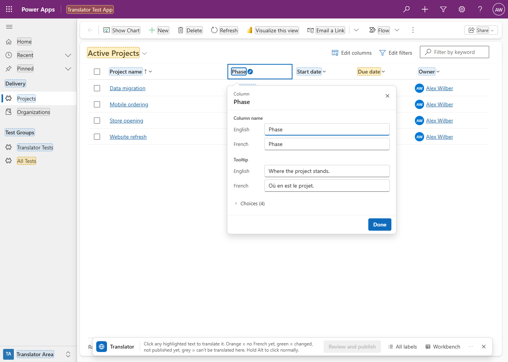

### 9.12 The navigation, the command bar, processes and views

**Site map entries** (`[data-id^="sitemap-entity-<Id>"]`) map by their Id to the subarea (`sa:<Id>`), role `nav`.

* A subarea without titles of its own that opens a table shows the table's plural name (`ref.plural`, set by the site
  map provider). Its anchor is `entity|<table>|DisplayCollectionName`, but only where the entry shows one of that
  name's texts; the table's names are read on demand (`#names|`), and the entry has no mark while they load. Once that
  read failed, or where the entry shows another text, the entry stays on its own subarea slot, which is read-only
  (grey), never the table's. Where the table comes from a managed solution (most of Microsoft's tables), its plural
  name is read-only, and the entry is grey.
* *Home*, *Recent* and *Pinned* at the top of the navigation (`sitemap-entity-Home_<guid>` and the like, not inside
  another entry) are Microsoft's built-in text ([9.13](#913-microsofts-built-in-text-and-read-only-labels)). What
  *Recent* and *Pinned* list under them are record and view names, never marked, and a click on one of them reaches
  the page: the entries a tree item lists under it are not its zone's (`nested` in `overlay.ts`). Beside the text of
  *Recent* or *Pinned*, which only open or close their list, a click reaches the page too.
* An entry not found by its Id matches its text among the subareas' titles.
* Beside the text of an entry that navigates, a click is swallowed: a near miss never goes to another page.

**Group headings** (`[data-id*="sitemap-sitemapAreaGroup"]`) map by their Id (`gr:<Id>`), else by text. Beside a
heading's title (its chevron, the rest of its header), a click reaches the page and opens or closes the group: all
that acts there only expands or collapses (`effect` in `overlay.ts`, [9.16](#916-clicks-alt-and-f2)). A group the
app designer never named shows a placeholder (*New Group*), and the page names its heading by the placeholder's
resource (`sitemap-sitemapAreaGroup-NewGroup`) rather than an Id (verified in a test environment, LIVE-FINDINGS 99).
Such a heading maps to the one item of that resource without titles (`unnamedItem`, `x.unnamed`), only after the Id
and the text found nothing, and only when exactly one group of the app's site map has that resource and no titles,
every other group with that resource has a title in the user's language, and the heading's single text is no title of
any site map item (`navTexts`). Otherwise it gets no mark: two groups never named both read *New Group*. The same
fallback applies to an entry. A data-id name that is one item's Id and another item's resource (`another`) maps to the
Id's item only where the entry shows one of its texts. **Areas**: the area switcher's button is found by its text
only, so a placeholder area has no mark there and is named from the list or the Workbench; an item of the open list of
areas is found by the Id its `data-id` names (`ar:<Id>`), whatever text it shows, else by its text (below). In a site
map from a managed solution every item is read-only, a placeholder included, so naming one there is refused; only
Microsoft's own items keep their own reason ([9.13](#913-microsofts-built-in-text-and-read-only-labels)).

**The app's name** in the header (`[data-id="appBreadCrumb"]`) maps to the app's `Name`.

**The navigation.** The popup of the *Delivery* group heading in the app's navigation: the group's title in each
language. A group heading has no **Open**. Under it are *Projects* and *Organizations*: *Organizations*, the plural
name of the account table, which comes from a managed solution, is grey.


**The related menu.** Each item is `data-id="form-tab-relatedEntity-<nav id>"` (verified in a test environment,
LIVE-FINDINGS 63). `relatedItem` maps it, role `nav`:

1. An item the form XML lists (`n:<nav id>`): its own titles. Where it has none in the user's language it shows its
   relationship's text (verified in a test environment, LIVE-FINDINGS 80), so that text counts as its own, and the
   table's relationships are asked for (`#related|`).
2. A built-in item the form XML doesn't list (`nav<Name>`: Background Processes, Audit History): Microsoft's text,
   only once the form's own entries are known, because a form can list (and rename) one. `navActivities` and
   `navSPDocuments` are not built-in: they show the plural name of the table they list.
3. Any other item comes from the page table's relationships (`x.related`, built by `relatedMenu`): `nav_<schema name>`
   for a 1:N relationship shown on the referenced table's form, `navActivities` and `navSPDocuments`. An N:N
   relationship's Entity1 menu shows on Entity2's form and the other way round; one to the same table gives two
   crossed items, `nav_<schema name>1` and `…2`. The item shows its relationship's menu label (`ref.menu === 'label'`)
   or the listed table's plural name (`'plural'`), and is mapped only when its text is that text.

The view a related menu item opens shows as a tab of its own (`li[role="tab"]#tablist-<nav id>`, and in *More tabs*).
It maps exactly like the item, as one label with it, only once the page form's tabs are known to have none of that
name (a nav id starts with *nav*, or the form XML lists it as a nav item), and never in a side pane. The record form's
**Related** tab, which opens the related menu, shows language-pack text: it is built-in, with role `nav`.

**The command bar.** A button's `data-id` is `<table>|…|<control id>` (a `-Large`, `-Medium` or `-Small` size suffix
is left out).

* **Modern commands** (an app action; its control id is `Label!<32 hex>`, `isModern`) map through the loader's `cmd`
  map to the command record's slots: label, tooltip title, tooltip text. A command from a managed solution is
  read-only (grey).
* **Classic buttons** map through the table's composed ribbon (`x.ribbon`, read by `ribbonControls`): the control's
  label is a `$LocLabels:<id>` token, and the slot is `ribbon|<table>|<id>`, else `ribbon|_app|<id>` (a label of the
  application ribbon, shown on every table). Until the table's controls are read, the button has no mark. A label that
  a managed solution defines is read-only (grey), also where an unmanaged row of it wins for its texts.
* **Microsoft's own buttons** show language-pack text: a classic `Mscrm.*` button without a `$LocLabels:` id, a label
  that is a `$Resources:` token, and a button at the top of a command bar whose plain id no customization of its table
  defines. A button Dynamics adds to a command bar without a ribbon id (*Show Chart*, verified in a test environment,
  LIVE-FINDINGS 89) is built-in too, never an item of a flyout (those can list records: reports, templates, flows) and
  never a view selector.
* **Built-in commands named after their table.** UCI builds some of Microsoft's command labels around the table's
  name: a sub-grid's *New* and *Add Existing*, and *Export* (*New Project*, *Add Existing Project*, *Export Projects*;
  labels `$Resources(EntityDisplayName):` and `$Resources(EntityPluralDisplayName):`, LIVE-FINDINGS 89). `command`
  finds the table from the command id (`Mscrm.SubGrid|Form|HomepageGrid.<table>.…`), the button's `data-id` and the
  bar's `data-lp-id` (`commandbar-<bar>:<table>`); when they name different tables the button is grey. `namePart`
  finds the table's display or plural name, as shown in the user's language, as a whole word in the button's text (the
  longest wins), and that part is anchored to the table's slot, role `command`. The rest of the text is the language
  pack's and stays unmarked, and a click on it does nothing: the command never runs. On a table from a managed
  solution (most of Microsoft's) the part is grey, since the table's names are read-only. The table's names are read
  on demand (`#names|`): until then such a button has no mark; it is grey once that read failed, or where its text
  shows neither name. Any other built-in command is grey at once, even where a word of its text is its table's name
  (*Resolve Case* on cases, *Email a Link* on emails).

**A command bar button.** A classic command bar button's popup: its label, tooltip title and tooltip text in each
language, its tooltip texts without French yet. A classic button's blocks say where else their label shows.


**Business process flows.** A stage chip maps by the stage id in its element id, not by the name it shows: UCI keeps
a process's names cached, and matching chips by their text found nothing (verified in a test environment,
LIVE-FINDINGS 64). Only a chip without a stage id in its element id is matched by its text.

`src/inspector/scan.ts`, the stage chip's rule in `RULES`:

```ts
// A stage chip: the stage its id names (`…processHeaderStage_<stage id>`), whatever name the page still shows (UCI keeps
// a process's names cached, LIVE-FINDINGS 64), never a stage of another process; by its name only without an id. The
// whole chip takes the click.
[
  'li[id*="processHeaderStage"]',
  (el, sc) => {
    const x = sc.x!;
    if (foreign(x, el)) return null;
    const id = /processHeaderStage_([\da-f]{8}-[\da-f]{4}-[\da-f]{4}-[\da-f]{4}-[\da-f]{12})/i.exec(el.id)?.[1];
    if (!id) return inMap(sc, el, x.text.stage, { role: 'stage', zone: el });
    const s = byName(x, 'st:' + id);
    if (!s) return null;
    const nm = el.querySelector('[id*="processHeaderStageName"]') || el;
    const t = shown(sc, nm, x.labels(s), 6);
    return A(x, t ? t[0] : nm, s, { role: 'stage', hit: el, zone: el, text: t?.[1] });
  },
],
```

The whole chip is the zone, but only the stage's name takes the click: elsewhere on the chip a click does nothing (a
stage chip acts), and Alt+click opens the stage's flyout as usual.

* Only the record's active process is in the index (`st:` and `sp:` names are set for `bpfId`'s stages and steps).
* A process from a managed solution is read-only, its name, stages and steps included: they are grey.
* A step in the open stage flyout is a field container `fieldSectionItem_<n>_<step id>-FieldSectionItemContainer`: it
  maps by the step id (`sp:<step id>`), its label element as the zone.
* A `header_process_<column>` control maps to the step of that column in the stage shown (`ctlSlot`).
* The process's name above the stages (`…processHeaderNameLabel`, no id of its own) maps to the active process's
  `Name` (`x.bpf`), whatever name it shows, and never while the form API names another process (`getActiveProcess()`):
  a process just switched to is never mapped onto the previous one's name.
* An open stage flyout's title (`label#MscrmControls.Containers.ProcessStageControl-flyoutStageName`) maps to the
  stage the flyout's id names (verified in a test environment, LIVE-FINDINGS 92), role `label`: its flyout is open, so
  its popup has no **Show stage**. The flyout's buttons are built-in; its status (*Active for 3 days*) and its close
  button get no mark.

**A stage's popup.** A business process flow stage's popup: the stage's name in each language, and **Show stage**,
which opens its flyout.


**Views, forms, dashboards and the table.**

* A list page's own view selector shows the page's view (`x.view`; a personal view has none). Any other view selector
  (an associated grid's, a sub-grid's, a side pane list's, an item of a list of views) names its view by its element
  ids (`ViewSelector_<view id>`, `ViewSelector_<n>_<view id>_<guid>_text`, its own or its two nearest ancestors') and
  by the grid it heads (the nearest ancestor holding exactly one grid `data-lp-id`); `selectorView` requires the two
  to agree when both are known. An item of a list of views is named by the ids inside the list only; an item of the
  open list of a view selector's button goes first to the `ITEM` rule, which names it by its `data-value` (below). An
  element that holds a list of views is never anchored: the first text in it that reads like a view could be any
  item's. The view's record is read on demand (`#viewname|`), and the text must be that view's name. A personal view
  (a `userquery`) is the user's own data: no mark.
* The form selector shows the form's name, and the dashboard selector the dashboard's (`x.form`), only where the text
  is that name.
* The table's name in the form header (`entity_name_span`, `form-header`) matches the page table's texts, never inside
  header fields, the record title or buttons; in a side pane, the table of the pane's form.

**The lists the page is switched with: `inspector/lists.ts`.** Three lists switch the page: the app's areas (the area
switcher at the foot of the navigation), the record's forms (the form selector next to the table's name in the form
header) and a grid's views (the view selector above a list). Their buttons only open the list, and picking from the
list is what the user opened it for, so translation mode lets both happen, and marks every item of an open list like
any other label: the list shows what can be translated. The markup they rely on was read in a test environment and is
noted at the top of `lists.ts`:

| List | Its button (`OPENER`) | The open list (`LIST`) and its items (`ITEM`: `[role="menuitemradio"]`) |
| --- | --- | --- |
| Areas | `#areaSwitcherId` | A portal under `body`, `[data-lp-id="sitemap-area-switcher-flyout"]`; an item is `li[data-id="areaswitcherflyout-<area id>"]` |
| Forms | `[data-id="form-selector"]` | A Fluent v9 portal, `[data-id="form-selector-flyout"]`; an item is `div[data-value="<form id>"]` |
| Views | `button[data-id^="ViewSelector_"][aria-haspopup]` | A Fluent v8 portal, `[data-id="ViewSelector_<current view id>-flyout"]` (its button's `data-id` and `-flyout`); an item is `button[data-value="<view id>"]`, followed by Microsoft's own *Manage and share views* (a `menuitem`, no view) |

The current item has `aria-checked="true"`. The `aria-label`s are in the user's language and never read.

* **The selector's own label**: the area the switcher shows (by its text), the page's form, the view a view selector
  shows. `opens` in `scan.ts` makes the button the label's zone (the form selector's button is its element already)
  and keeps a `Switch` without an id in `anchor.sw` (`selectorSwitch`). Its popup offers **Change area**, **Change
  form** or **Change view**. Its mark has no pencil: the pencil would lie over the chevron, which opens the list, and
  take its click; the hover ring still says the name can be clicked.
* **An item of an open list**, role `nav`, the item its zone: an area by the Id its `data-id` names, else by its text
  (an item without an id, from an earlier build, gets no **Open**); a form or a view by the id its `data-value` names,
  only where its text is that form's or view's name. A name not loaded yet is asked for (`#formname|`, `#viewname|`)
  and read with the others asked together (`r:form:<ids>`, `r:view:<ids>`). A personal view is no `savedquery`: its
  read finds nothing, it is not asked for again, and it has no mark; nor has *Manage and share views*. A name that is
  read-only (from a managed solution) is grey, as anywhere.
* **What switching needs** is captured while the list is open (`itemSwitch`), since by the time the popup's **Open** is
  pressed the list has closed and its items are gone: the button that had the list open, a selector that finds that
  button again, and one that finds the item again. A form switches only from the list the page form's own selector
  opened (that button is not `foreign`, [9.10](#910-which-form-a-label-belongs-to)): **Open** goes through the page's
  form API, and the list of a dialog's or a side pane's form selector is another form's, so its items keep their marks
  without **Open**.

`src/inspector/types.ts`, `ListKind` and `Switch`:

```ts
/** The lists the page is switched with (lists.ts): the app's areas, the record's forms, a grid's views. */
export type ListKind = 'area' | 'form' | 'view';

/**
 * A selector's own label (`id` ''), or an item of the list it opens. Open is pressed once that list has closed, its items
 * gone with it: what switching needs is kept here, never read from the item's element then.
 */
export interface Switch {
  list: ListKind;
  /** An item's area, form or view id, as its element names it; '' on the button that opens the list. */
  id: string;
  /** The button that opens the list: the selector's own, or (an item's) the one that had its list open; null when unknown. */
  opener: Element | null;
  /** Selectors that find that button and the item again once Dynamics rendered them anew ('' where none is needed). */
  find: string;
  item: string;
}
```

**Clicks.** Beside a selector's name (its chevron, its padding), a click reaches the page and opens the list; beside an
item's text, a click reaches the page and picks the item (`effect` in `overlay.ts`: `'toggle'` and `'pick'`,
[9.16](#916-clicks-alt-and-f2)). Only in these three lists: beside the text of a site map entry or of an item of any
other menu, a click is still swallowed. On the text, a click opens the popup, as on any label.

**The popup's secondary button.** `listAction` in `describe.ts` gives a label with `sw` its action in place of its
kind's ([9.20](#920-what-the-popup-shows-inspectordescribets)): **Change area**, **Change form** or **Change view** on
a selector's own label, which opens its list, and **Open** on an item other than the current one
(`aria-checked="true"`), which switches to it. What they do, the toasts when a switch fails and where the focus goes
afterwards are in [9.22](#922-open-change-area-form-or-view-show-tab-and-show-stage).

**The list of views.** The *Projects* list with its view selector open: the views *Active Projects* and *Inactive
Projects* are marked; the personal view *My open projects* and *Manage and share views* are not.


**The list of forms.** A *Project* record with its form selector open: the forms *Information* and *Project overview*
are marked.

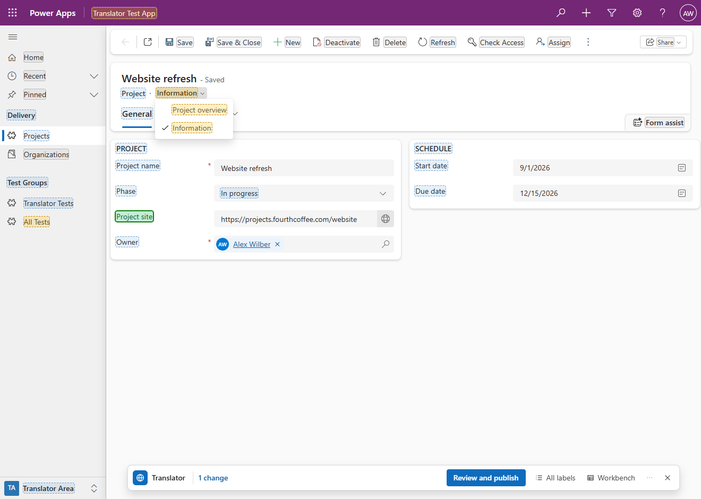

### 9.13 Microsoft's built-in text and read-only labels

**Built-in text.** Some labels on the page show Microsoft's own text from a language pack, already shown in every
installed language: there is nothing to translate. Each is recognised by a fixed id, never by elimination, and gets an
anchor whose component is `builtin|<what>`, without a slot (`builtin` in `scan.ts`). Its look is `'builtin'`: a grey
dotted mark, and a popup that says why ([9.20](#920-what-the-popup-shows-inspectordescribets)).

| Label | Recognised by | Component |
| --- | --- | --- |
| A related menu item the form XML doesn't list, and the tab of the view it opened | `nav<Name>` (not `navActivities`, `navSPDocuments`), once the form's entries are loaded | `builtin\|nav\|<nav id>` |
| The record form's Related tab | Its `data-lp-id`, id or fixed tab name (verified in a test environment, LIVE-FINDINGS 79) | `builtin\|tab\|related` |
| Home, Recent, Pinned | `sitemap-entity-(Home\|Recent\|Pinned)_<guid>`, not inside another entry | `builtin\|nav\|home` and the like |
| Microsoft's classic buttons | `Mscrm.*` without `$LocLabels:`, a `$Resources:` label, a plain id no ribbondiff of its table defines | `builtin\|command\|<control id>` |
| A button added without a ribbon id | `button[role="menuitem"]` on a command bar, without a `<table>\|…` data-id | `builtin\|command\|<its id>` |
| *Form assist*, *Share* | `button[data-id="FormFillBar_Show_Button"]` (or that id, on earlier builds), `button#collaborationShareButton_<n>` | `builtin\|command\|FormFillBar_Show_Button`, `builtin\|command\|collaborationShareButton` |
| The open stage flyout's buttons | Their label's id: `…-Next Stage`, `…-Previous Stage`, `…-Set Active`, `…-Close`, `…-Finish` | `builtin\|stage\|<name>` |

None of these is marked before what decides it is known: a related menu item before the form XML is loaded, a classic
button before its table's customized buttons are read. Every render of *Share* is one label. An icon without text gets
no mark.

**Read-only labels.** A slot can be loaded but read-only: `slot.readOnly` holds the reason, in words, set by the
provider that read it ([chapter 6](#6-providers-reading-and-writing-each-kind-of-label)). Translation mode loads
read-only slots too (`loadTables` and `loadSitemap` keep them, as do the form, record and process reads), so the page
can say why a label can't be translated there.

**Labels from a managed solution.** The translator never creates an unmanaged layer. A label whose component comes
from a managed solution is read-only, whatever its customizable flag and its other managed properties allow: any
change to it here would be an unmanaged customization on top of the solution's component. Every loader keeps the
component's own `ismanaged` (`IsManaged` for metadata) as `ref.managed`, and every part of the translator gives the
same reason.

`src/core/model.ts`, `MANAGED` and `isManaged`:

```ts
/**
 * Why a label of a component that comes from a managed solution is read-only, whatever its managed properties allow:
 * any change to it here would be an unmanaged customization layered on top of the solution's component, which this
 * tool never makes: such texts are translated in the environment where the solution is developed. Every loader, writer,
 * the saver and the store give these same words.
 */
export const MANAGED = 'From a managed solution: a translation here would add an unmanaged layer on top of it. Translate it where its solution is developed.';

/**
 * Whether a slot's component comes from a managed solution: `ref.managed`, which every loader sets from the component's
 * own ismanaged / IsManaged (a form's or dashboard's for its tabs, sections, cells and navigation items, a sitemap's
 * for its items, a process's for its stages and steps). Such a label is never staged, saved or undone.
 */
export const isManaged = (s: Slot): boolean => s.ref?.managed === true;
```

Each component's own flag decides:

| Labels | Read-only when this comes from a managed solution |
| --- | --- |
| A table's names and description, a column's name and description, a relationship's menu label, a global choice and its options | The table, the column, the relationship, the global choice (names whose renaming Microsoft locks keep their own reason, below) |
| The options of a local choice, Yes/No, status or status reason column | The column or its own choice |
| A form's or dashboard's tabs, sections, cells, header fields and navigation items | The form or dashboard |
| The name of a form, dashboard, view, chart, app or process, a modern command's texts, an environment variable's, a custom API's | That record |
| A process's stages and steps | The process |
| The areas, groups and subareas of an app's navigation | The site map (Microsoft's own items keep their own reason, below) |
| A classic command label | A managed row of the ribbon customizations (`ribbondiffs`) that defines its `LocLabel` Id, even where an unmanaged row of it wins for its texts |

So, per component: an unmanaged form on a managed table is editable, and so is an unmanaged custom column on a
managed table; a managed column shown on an unmanaged form keeps its *Column name* and *Tooltip* blocks read-only in
the field's popup, while its *Form label* block, the form's own cell label, stays editable and takes the caret, as in
any field's popup. On a form from a managed solution it is the other way round: the *Form label* is read-only, and an
unmanaged column's *Column name* takes the caret, unless what opened the popup asked for another text
([9.21](#921-the-popup-uicalloutts)). `Store.add` gives the reason `MANAGED` to a managed slot that a loader left
editable, and `store.set` stages nothing on it; the saver refuses it, each writer checks `ismanaged` again in its read
right before writing, and an undo of a publish skips it with the reason ([chapter
6](#6-providers-reading-and-writing-each-kind-of-label), [chapter 8](#8-the-publish-dialog-history-and-undo)).

Microsoft's own forms and tables (account, contact and the like) come from managed solutions, so on their pages almost
every label is grey ([9.1](#91-translation-mode-in-one-page)).

**Other reasons.** Examples:

* a site map item that shows Microsoft's own label (a `ResourceId` and no titles), in any site map: *Microsoft's own
  text, already shown in every installed language. To use your own name, set a title in the app designer.*
* a table or column whose renaming Microsoft locks, such as the system table Category (verified in a test environment,
  LIVE-FINDINGS 99), managed or not: *Microsoft locks renaming of this table: its names can't be changed, in any
  language. Dynamics shows Microsoft's own text for them (the language pack).*
* an unmanaged table or column whose renaming is turned off in its managed properties: *Renaming is turned off for
  this column (its “Display name can be modified” managed property). Turn it on in the column's managed properties to
  translate it here.*
* an unmanaged table, column, relationship, global choice, form or dashboard marked as not customizable: *This table
  is marked as not customizable (its “Allow customizations” managed property is off), so its labels can't be changed
  here.*
* an item of an unmanaged site map without a unique Id: *This item has no unique Id in the sitemap, so it cannot be
  edited safely*.

A read-only label is grey dotted like built-in text (`readOnlyLook`,
[9.14](#914-looks-the-colour-of-a-label-inspectorstatusts)). Its popup shows its texts in disabled inputs, and the
reason on one muted line with a lock: once at the top when none of its texts can be edited, else at the top of each
read-only block.

**A label from a managed solution.** The popup of a field on the account form, which comes from a managed solution:
every input is locked, and the reason shows once at the top, with a lock.


**What gets no mark.** A mark goes only on text that names something in the app: a field, a column header, a tab, a
section, a related item, a control's title, a navigation entry, a command, the view, form, table, app, process, stage
or step name, or a choice value. The rules have no selector for anything else, so messages and notifications, statuses
(*- Saved*), counts and paging (*1 - 50 of 120*), placeholders and search boxes, empty states, record data (the record
title, values, the owner, avatars, what *Recent* and *Pinned* list, a personal view's name), the product name and a
control's own affordances (*Select all*, sort and filter menus, *Manage and share views* in the list of views) are
never marked. Text that the scanner can't identify stays unmarked; it is
never called built-in by elimination. A label that is not loaded has no mark either, and never a passing grey one.

### 9.14 Looks: the colour of a label (`inspector/status.ts`)

A label's **look** decides its mark, the colour of its row in the list and the counts. `look(app, comp)` gives a
component's look, in priority order.

`src/inspector/status.ts`, `look`:

```ts
export const look: LookFn = (app, comp) => {
  const { store, ctx, prefs } = app;
  const own = slotsOf(store, comp);
  let m: Slot | undefined;
  for (const s of own) if (!m || rank(s) < rank(m)) m = s;
  if (!m) return 'na';
  const all = [...own];
  for (const k of relatedKeys(store, m)) all.push(store.get(k)!);

  // The store keeps a failed cell's status while it still holds the text that failed (Store.commit).
  if (store.status.size)
    for (const s of all)
      for (const { lcid } of ctx.langs) {
        const o = store.cellStatus(s.key, lcid)?.outcome;
        if (o === 'error' || o === 'conflict') return 'error';
      }
  for (const s of all) if (store.isEdited(s.key)) return 'edited';

  const t = prefs.target;
  const base = ctx.base;
  if (m.readOnly) {
    // Without a text of its own in the target language, a form cell shows its column's name there (LIVE-FINDINGS 42),
    // a related menu item its relationship's text (LIVE-FINDINGS 80): when that text can be edited (its popup offers
    // it), the label looks as that text does.
    const fb = !notLoaded(m, t) && !store.value(m.key, t).trim() ? fallbackOf((k) => store.get(k), m) : undefined;
    if (fb && !fb.readOnly) return notLoaded(fb, t) ? 'na' : t === base || store.value(fb.key, t).trim() ? 'ok' : 'missing';
    return readOnlyLook(app, m);
  }
  if (notLoaded(m, t)) return 'na';
  // An item with no name yet (an app designer's placeholder) has nothing translated, the base language included.
  if (namesFirst(m) && !store.value(m.key, base).trim() && !store.value(m.key, t).trim()) return 'missing';
  // A description stored empty on purpose (model.ts storedEmpty: its users see none) is translated, never missing.
  if (t === base || store.value(m.key, t).trim() || store.emptyOnPurpose(m.key, t, base)) return 'ok';
  // A base text that was not read (tab labels loaded in the user's language only) is unknown, not empty.
  const bv = notLoaded(m, base) ? null : store.value(m.key, base);
  // A form cell without a label in the target language shows the column's name in it (LIVE-FINDINGS 42), a related
  // menu item its relationship's text (LIVE-FINDINGS 80): when the label's wording is that text's, it is its
  // translation already, not a gap.
  return bv !== null && (!bv.trim() || standsIn(store, m, t, base)) ? 'ok' : 'missing';
};
```

In words:

1. **`error`**: the last publish attempt failed for one of the component's texts (a save error or a conflict). The
   store keeps a failed cell's status while the cell still holds the text that failed. The texts edited from the same
   popup count too (`relatedKeys`: a field's tooltip and column name, a related menu item's relationship text).
2. **`edited`**: one of those texts has a staged change.
3. A **read-only** main slot (a label from a managed solution among them): grey (`readOnlyLook`), except a label that
   has no text in the target language and shows one there that can be edited (a form cell its column's name, a related
   menu item its relationship's text, through `fallbackOf`): it looks as that text does. So a cell of a managed form
   without a target text, on an unmanaged custom column, is marked as that column's name is.
4. **`na`**: the target language was not loaded for this label (`notLoaded`: a slot marked `ref.partial` without that
   language). No mark at all.
5. An app designer's placeholder in the site map ([9.12](#912-the-navigation-the-command-bar-processes-and-views))
   with no name yet is **`missing`**, in every language, the base one included.
6. **`ok`**: there is a target-language text, or the target is the base language, or the target text is a metadata
   description stored empty on purpose, or emptied in a staged change that saves it so (`Store.emptyOnPurpose`): its
   users see no tooltip or description, as chosen.
7. **`missing`**: the target text isn't there. Two exceptions make it `ok`: a base text that was read and is empty,
   and a label whose base text is worded like the text that shows in its place (`standsIn`): a form cell worded like
   its column shows the column's name in the target language, which is its translation already. (This is a look only;
   the stand-in the saver writes for an emptied translation is another matter,
   [9.3](#93-how-the-app-runs-it-uiappts).) A base text that was not read (tab labels read in the user's language only)
   is unknown, not empty: the label is `missing`.

`readOnlyLook` is `'ro'` for a label from a managed solution (its reason is `MANAGED`), even where every installed
language has a text. Any other read-only slot is `'builtin'` when it has a text in every installed language
(Microsoft's own texts, such as the names of a system table Microsoft locks), and `'ro'` otherwise.

`src/inspector/status.ts`, `readOnlyLook`:

```ts
export function readOnlyLook(app: Pick<AppApi, 'store' | 'ctx'>, s: Slot): Look {
  // Read-only because it comes from a managed solution (no unmanaged layer): "read-only", never "built-in", even with
  // every language there; Microsoft's own locked names (their own reason) stay built-in.
  if (s.readOnly === MANAGED) return 'ro';
  return app.ctx.langs.every(({ lcid }) => !notLoaded(s, lcid) && !!app.store.value(s.key, lcid).trim()) ? 'builtin' : 'ro';
}
```

Both are drawn the same, grey and dotted; the list shows *Read-only* or *Built-in*. Built-in text recognised by its id
([9.13](#913-microsofts-built-in-text-and-read-only-labels)) is `'builtin'` without a slot (`anchorLook` in
`mode.ts`).

`slotLook(app, s)` in `mode.ts` does the same for one slot that is not its component's main label (a table's plural
name on a navigation entry), from that slot's own texts only and without the read-only fallback, the placeholder rule
and `standsIn`: the component's look describes its main label, this one what the user sees. A description stored empty
on purpose is `ok` there too.
`isPending(look)` (edited or error) is what the list counts as changed, and `lookText` says a look in words for
tooltips and screen readers (*Not translated into French yet*, *Changed, not published yet*, *Couldn't be published*,
*Built-in, already translated*, *Read-only*, *Not loaded*, *Translated*).

### 9.15 The overlay: marks on the page (`inspector/overlay.ts`)

The overlay draws the marks and takes the clicks on their text. It lives in its own shadow root, on a `div` appended
to `<html>` when translation mode starts and removed when it stops, outside React's trees, with `all:initial`,
`position:fixed`, `inset:0`, `pointer-events:none` and `contain:strict`. Its `z-index` is 2147483645: above every
Dynamics layer, just below the translator's own host (2147483646), so the bar, the popups, the list and the menus stay
on top of every mark. The marks are hidden from screen readers (`aria-hidden="true"` on the wrapper).

**One element per label.** `sync(anchors)` keeps one record per anchor: a `div.g` that carries the look and state
classes, with one `<i>` per line of text (the marks, at most `MAX_LINES`, 6) and, when needed, a `<b class="pn">` (the
pencil badge). Records of anchors that are still there are kept; the others are removed. It also builds the zones map
(zone element → its labels: one per zone, except the parts of one text). `paint()` reads every record's look again
(`hooks.look`), the pills (`hooks.pills`), and asks for a frame.

**Frames: every read, then every write.** Positions are updated in animation frames that do every layout read before
any write, skip labels outside the viewport and write only what moved, so hundreds of labels stay smooth.
`invalidate(n)` asks for the next `n` frames. Frames are asked for on scroll (in the capture phase: UCI scrolls inner
containers, and `scroll` does not bubble), on resize, at the end of a transition or an animation, when an image loads,
on a scroll or resize of the visual viewport, ten frames after each pointer up and each batch of mutations (things
move after clicks: tabs, flyouts, sections), and once a second, because layout also changes without an event the
overlay sees.

In one frame (`frame`):

1. **The scene** (`scene`): the open popups of the page, the topmost modal, and what floats over the page (below).
2. **Each label** (`zoneBox`): its zone's rect. A zone outside the viewport is skipped at once (nothing else is read);
   a zone hidden by CSS, outside the open modal, or clipped away by its containers has no box.
3. **Its text** (`textBoxes`), for a label that isn't inert: the client rects of its text node through a `Range` (only
   its part's characters for a part), merged per line by `marks()`.
4. **What covers it** (`covers`), cut away as a CSS `clip-path` per mark (`maskOf`).
5. **The pills** (`pillAt`, [9.17](#917-changed-choices-the-pill)); the label under the pointer, found again on this
   frame's marks (`under`: a scroll or a layout change moves text under a pointer that doesn't move, and no pointer
   event says so); and where each hovered or active label's pencil can go (`pens`).
6. **The write phase**: the pointer cursor (`setCursor`), then for each label (`draw`) its classes, then each mark's
   `transform`, `width`, `height` and `clip-path`, through `place`, which writes only when the box or the mask
   changed.
7. **Followers** (`onFrame`): the open popup repositions itself next to its label, and keeps its side (below or
   above) while it nearly fits there ([9.21](#921-the-popup-uicalloutts)).

**A mark hugs the text.** A mark is never the box of an element, only the line boxes of the label's own text.
`marks(rects, clip, dpr, max, hard)`:

* merges the client rects of the text per line (rects whose middles are within half a line of each other), top first;
* drops a line cut off at the top or the bottom by the clipping containers (4 px of slack for ascenders and
  descenders), and cuts the others sideways (an ellipsis, a grid scrolled sideways);
* pads each line 2 px left and right and 1 px above and below;
* keeps it inside the scrolling containers (`hard`): a line partly scrolled out of them gets no mark, so no mark lies
  over a sticky header, a footer or a scroll bar, unless that area is barely taller than the line (a tight wrapper
  that happens to scroll);
* snaps it to device pixels, and lets two lines that touch share the gap between them instead of overlapping.

The text node is the anchor's own (`a.text`). The Power Apps grid renders every header and value twice, once hidden:
when the anchor's node doesn't show, the overlay looks in the zone for another node with the same text, and remembers
it (`rec.tx`). Without a text node (the header title, the table name and other large elements), it takes the first
text with letters or digits inside `el` and never draws past `el`. A closed native `<select>` shows its selected
option's text, which has no box of its own: `selectBoxes` measures that text in the select's font with a canvas, one
line high, at the start of its content box.

A label whose zone shows but whose text doesn't (a collapsed site map's icon, an icon-only button) gets no mark and
takes no clicks: only highlighted text is taken over (`rec.vis`, `dead`).

**Popups of the page.** Marks lie under the page's popups: the part of a mark, its ring included (4 px, `RING`), that
a Dynamics flyout, dropdown, callout, menu, tooltip or side pane covers is cut away, and a mark they leave no piece of
at least 4 px wide and high (`MIN_SHOW`) is not drawn at all.

* **By role**: `LAYERS` finds `[aria-modal="true"]`, `[role="dialog"]`, `[role="alertdialog"]`, `[role="menu"]`,
  `[role="listbox"]`, `.ms-Callout-main`, `.ms-Panel-main`, `.fui-PopoverSurface` and side panes
  (`[data-id^="pane-container-"]`). A popup counts as on top of the page when a hit test at its centre finds it
  (`onTop`).
* **By paint**: `PORTALS` are the roots whose content floats over the page whatever its role:
  `#__fluentPortalMountNode` (which holds the header fields flyout, which has no dialog or menu role: verified in a
  test environment, LIVE-FINDINGS 86), `.ms-Layer` and `[data-portal-node]`. In each, `floats` takes the outermost
  elements on screen that paint a background or a shadow. Wrappers without a box, transparent and hidden ones, and
  those at least 90% of the window both ways are looked through; a painted element that wide or high one way only is
  looked into first and counts itself when nothing in it paints. The search is breadth first, 8 levels deep, newest
  root first, each root with its own share of the visits (at least 16, 128 a frame in all), so a large newer portal
  never hides an older one's flyout. Paint decides, not a hit test: a tooltip that takes no pointer events still lies
  over the page, and a transparent wrapper that takes them doesn't.
* **Other tools' panels**: `panels` takes the children of `<html>` and `<body>` that hold none of the labels, are no
  portal root and are not the translator's own (its hosts are `dxt-*` elements, and the overlay's own layer), such as
  another bookmarklet's window. `floats` looks into them too (and into shadow roots, where a bookmarklet often draws
  its panel), with two differences from a portal: the outermost painted element that is not 90% of the window both
  ways counts as a whole (a side panel as high as the window, the gaps between its cards included), a frame or an
  image counts as painted, and it counts only where a hit test at its centre finds it on top of the page. A panel that
  lies under the page, or takes no pointer events, leaves the marks as they are. They are read every frame.
* **Labels inside popups** keep their marks. A label inside a popup, a portal or the modal is under another popup only
  where a hit test where they meet finds that one: a dropdown opened from the header flyout lies over the flyout's
  labels, a painted backdrop under them doesn't. These hit tests are limited to 48 a frame.
* **A modal**: while one is open, labels show only in it and in what lies over it. What a portal paints counts only
  where a hit test at its centre finds it over the modal: a flyout left open behind a modal shows nothing.

What covers a label is decided on its text's boxes, not its zone: a wide heading can reach under a side pane while its
text doesn't.

**Colours.** The look and the state are classes on `div.g`, and the CSS turns them into custom properties.

`src/inspector/overlay.css`, the label rules:

```css
/* One label: --c = state colour (hover border, badge), --f = fill, --b / --s = border colour / style, --r = flash ring. */
.g{display:contents;--c:#0f6cbd;--f:rgba(15,108,189,.1);--b:rgba(15,108,189,.55);--s:dashed;--r:rgba(15,108,189,.3)}
.g.is-missing{--c:#c48a00;--f:rgba(255,185,0,.22);--b:#c48a00;--r:rgba(196,138,0,.3)}
/* Changed, not published yet: green like the workbook's changed cells, solid and a little thicker, so it stands out from
   the blue of translated labels at a glance. */
.g.is-edited{--c:#107c10;--f:rgba(34,197,94,.28);--b:#107c10;--s:solid;--r:rgba(16,124,16,.3)}
/* Couldn't be published: red and double (its border and an outline, below), so it never differs from a green edited mark
   by hue alone. */
.g.is-error{--c:#c4314b;--f:rgba(196,49,75,.14);--b:#c4314b;--s:solid;--r:rgba(196,49,75,.3)}
/* Text that can't be translated here, Microsoft's built-in text or a read-only label: grey and dotted, no pencil
   (nothing to edit; the popup says why). */
.g.is-builtin,.g.is-ro{--c:#616161;--f:rgba(97,97,97,.08);--b:#8a8a8a;--s:dotted;--r:rgba(97,97,97,.25)}
```

| Look | Mark | Colour |
| --- | --- | --- |
| `ok` | 1 px dashed border, light fill | Blue, `#0f6cbd` |
| `missing` | 1 px dashed border, light fill | Amber, `#c48a00` (the bar's hint says *orange*) |
| `edited` | 1 px solid border and a 1 px outline right against it: a thicker solid line | Green, `#107c10` |
| `error` | 1 px solid border and an outline 1 px away: a double line | Red, `#c4314b` |
| `builtin`, `ro` | 1 px dotted border, faint fill, no pencil | Grey, `#8a8a8a` |
| `na` | Nothing | |

Every mark has 4 px corners and a faint white ring (`box-shadow`), which keeps it visible on the dark form header.
Edited and failed marks differ from the others by their line, not by hue alone.

**States.**

| Class | When | Look |
| --- | --- | --- |
| `is-hv` | The pointer is on the label's text or on its pencil badge (not with Alt held) | 2 px border in the state colour, and the pencil badge |
| `is-act` | Its popup is open: only the label the popup points at (`active(comp, a)`; the value *Active* in every row of a list is one component, and only the clicked cell is emphasised) | As hover |
| `is-fl` | Its row in the list is under the pointer or focused (`flash`) | 2 px border and a 3 px ring, with a short animation |
| `is-pl` | It was found from the list (`pulse`) | Three rings of 0.6 s each (`PULSE_MS`, 1,800 ms) |

The **pencil badge** is a 14 px circle in the state colour with a white pencil, centred on the last line just after
its end (after the label's pill, when it has one), or over the line's end when there is no room on the right
(`badgeBox`). Like a pill, it is never drawn over a popup that doesn't hold the label: a cut circle would read as a
glitch. Grey marks have none, and neither has a selector's own label (the area switcher, the form selector, a view
selector's button: `sw` without an id, [9.12](#912-the-navigation-the-command-bar-processes-and-views)): its pencil
would lie over the chevron, which opens the list, and take its click. The pencil is part of the hover, like the text:
the pointer can go from the text onto it and click it, and the label stays hovered while the pointer rests on it. A
pencil takes no events, so it is found by its position in the last frame (`penHit`), and it follows its text when
that moves.

**Alt.** While Alt is held, the marks fade to 25% opacity and the pencil, the pills and the pill's tooltip are hidden:
the page works as usual ([9.16](#916-clicks-alt-and-f2)).

**Reduced motion and high contrast.** With *Reduce motion* set (`prefers-reduced-motion:reduce`), the flash has no
animation and a pulse is a still ring. In Windows high contrast (`forced-colors:active`), the marks are drawn in
`Highlight` (`LinkText` for missing and failed), without fills, and the pulse does not animate.

**The rest of the API.** `rectOf(a)` gives an anchor's visible zone rect from the last frame (a part: the box around
its own marks), or measures it at once when the frame hasn't (an anchor synced since, or resumed); the popup and the
finds use it. `quiet(fn)` runs DOM changes of the translator's own (the preview's) without the mutation observer
reporting them. `pause(on)` hides everything and stops intercepting, while the Workbench window is open.

### 9.16 Clicks, Alt and F2

**Only gestures that start on a label's text are taken, and those beside the text of a label that acts.** The overlay
listens on `window`, in the capture phase, to `pointerdown`, `mousedown`, `pointerup`, `mouseup`, `click` and
`dblclick` (`INTERCEPT`). Wheel, scroll and keys pass. For each trusted event, `here` says what the pointer is on: a
label, `false` (beside the text of a label that acts) or `null` (the page). `decide` then says whether the event is
swallowed and which label opens.

**On the text only.** A label's zone (`zone ?? el`: a field label's container, a section header, a tab, a button) is
where the overlay looks for the label, but the pointer is on the label only on its drawn marks: its text's line boxes,
each padded 2 × 1 px, and 2 px of slack around them (`onText`, `SLOP`). Beside the text, in the same zone, the pointer
is not on the label. `pointed(path, pt)` walks the zones that hold the event target, innermost first.

`src/inspector/overlay.ts`, `pointed`:

```ts
private pointed(path: EventTarget[], pt: { x: number; y: number } | null): Anchor | null | false {
  let missed = false;
  let block = false;
  /** What the click does there (effect), once it is beside a text. */
  let act: Effect | undefined;
  for (const n of path) {
    if (n === document.body || n === document.documentElement || n === document) break;
    const as = this.zones.get(n as Element)?.filter((a) => !this.dead(a));
    if (!as?.length) continue;
    const z = n as Element;
    if (passes(path, z)) return null;
    if (nested(path, z)) continue;
    const marked = as.filter((a) => this.recs.get(a)?.boxes.length);
    if (marked.length) {
      this.zoned = true;
      const a = pt && pickPart(marked, (b) => this.recs.get(b)?.boxes ?? [], pt);
      if (a) return a;
    } else if (!missed && as.length === 1) return as[0];
    // Missed: beside its text. Or no mark to tell: between parts none of which is marked nothing says which one is
    // meant, and past a label whose text was missed a zone without marks would only be a guess. Either way the zone
    // still blocks when it acts.
    missed = true;
    // A zone that holds a form control is that control (a closed choice or Yes/No control, a chip with its ✕: labels
    // never hold one), so its own padding acts too. Neither counts where all that acts only opens or closes part of
    // the navigation (a group's title in its header, the area switcher), opens a list to pick from (the form or view
    // selector) or picks from one (an area, a form, a view): that happens as usual.
    act ??= effect(path);
    block ||= !harmless(act) && (as.some((b) => ACTIVE.has(b.role)) || !!z.querySelector(CONTROLS));
  }
  return missed && (block || act === 'acts') ? false : null;
}
```

* **On a label's text**: that label. In a zone that holds several parts of one text (the values of a multi-select, a
  linked header's two names), the part whose marks hold the point (`pickPart`); between the parts or past them, none:
  nothing guesses the nearest one.
* **A label without a mark in this frame** (not measured yet, or its text partly scrolled out of its container) keeps
  its whole zone, so that it stays reachable; only a zone of one label does, and only before a text was missed further
  in. Once marked, only its text counts.
* **Beside the text**, the zones further out are looked at too: an outer label's text at the point wins (a label inside
  another).
* **Beside the text, nothing found: `null`**, the page's click, where nothing acts: beside a field label's text in its
  container, beside a section header's text.
* **Beside the text, nothing found: `false`** where something acts: a zone passed through is a label whose whole zone
  acts (a tab, a navigation item, a command, a process stage chip, a sorting column header, an option: `ACTIVE`), a
  zone holds a form control (`CONTROLS`: a closed choice or Yes/No control, a chip with its ✕), or something that acts
  lies anywhere from the event target up (`acts`): a link, a button, an `input` that isn't a text box (a checkbox, a
  radio button), a `select`, a `summary`, or an element whose role is button, link, tab, menu item, option, tree item,
  column header, checkbox, radio, switch or combobox (`ACTS`), and a `<label>` whose control is one of those, never a
  text box (the browser would click that control). The gesture is swallowed and nothing opens: a near miss beside
  *Delete* never deletes, and one beside a column header's text never sorts.
* **Beside the text, where the click only opens, closes or picks: `null`**, the page's click, even in a zone that acts.
  What a click does there is decided once per event, from its target up (`effect`, below): when all that acts there
  only opens or closes part of the app's navigation, opens one of the lists the page is switched with, or picks an
  item of such a list, it is harmless (`harmless`): the zone doesn't block, and the page gets the click as it would
  without the translator.

`src/inspector/overlay.ts`, `effect`:

```ts
export function effect(path: ArrayLike<EventTarget>): Effect {
  const el = (n: unknown): n is Element => !!n && typeof (n as Element).matches === 'function';
  // The outermost element of the navigation on the path: only what lies in it can be a toggle.
  let top = path.length - 1;
  for (; top >= 0; top--) if (el(path[top]) && (path[top] as Element).matches(SITEMAP)) break;
  // The innermost list to pick from on the path (-1: none): only its items pick.
  let list = -1;
  for (let i = 0; i < path.length && list < 0; i++) if (el(path[i]) && (path[i] as Element).matches(LIST)) list = i;
  let toggle = false;
  let pick = false;
  for (let i = 0; i < path.length; i++) {
    const n = path[i];
    if (!el(n)) continue;
    if ((i <= top && n.matches(TOGGLE) && !n.matches(LINK) && !n.matches(NAVIGATION)) || n.matches(OPENER)) {
      toggle = true;
      continue;
    }
    if (i < list && n.matches(ITEM)) {
      pick = true;
      continue;
    }
    if (n.matches(ACTS)) {
      if (toggle && n.matches(TREEITEM)) continue;
      return 'acts';
    }
    const c = n.tagName === 'LABEL' ? (n as HTMLLabelElement).control : null;
    if (c && c.matches(ACTS) && !typing(c)) return 'acts';
  }
  return pick ? 'pick' : toggle ? 'toggle' : '';
}
```

| `effect` | When | Beside a label's text |
| --- | --- | --- |
| `'toggle'` | Inside the app's navigation (`SITEMAP`: `[data-id="navbar-container"]`, its tree, its `sitemap-…` entries and the area switcher), an element that only opens or closes something (`TOGGLE`: one with `aria-expanded`, such as a group's header and its chevron, Recent, Pinned and the ☰ button, and `#areaSwitcherId`), never a link and never the navigation itself; anywhere, a button that opens one of the lists the page is switched with (`OPENER` in `lists.ts`: the area switcher, the form selector, a view selector) | The page's: the group opens or closes, the list opens |
| `'pick'` | An item (`ITEM`, `[role="menuitemradio"]`) of such a list, open (`LIST`: the areas, the forms, a view selector's views) | The page's: the item is picked, which is what the user opened the list for |
| `'acts'` | Anything else that acts (`ACTS`, a `<label>` for such a control). A tree entry around a toggle is the entry that toggle opens and doesn't count; a site map entry that opens a page lies in its group's list, under no toggle, and still acts | Swallowed, nothing opens |
| `''` | Nothing acts | The page's, unless the zone itself acts (`ACTIVE`, `CONTROLS`) |

So in the navigation a click beside a group's title opens or closes the group, and one beside the area switcher's text
opens the list of areas; beside the text of the form selector or of a view selector (its chevron, its padding) the
list opens; in an open list of areas, forms or views, a click beside an item's text switches to it
([9.22](#922-open-change-area-form-or-view-show-tab-and-show-stage)). A near miss on a site map entry that opens a
page, or on an item of a command's menu, is still swallowed.

Alt+click is the page's everywhere, on the text and beside it (**Alt**, below).

`src/inspector/overlay.ts`, `decide`:

```ts
export function decide(s: Gesture, type: string, here: Anchor | null | false, detail: number): { swallow: boolean; open: Anchor | null } {
  if ((type === 'click' || type === 'dblclick') && detail === 0) return { swallow: false, open: null }; // keyboard or screen reader activation
  if (type === 'pointerdown') s.end = undefined;
  const a = type === 'pointerdown' ? (s.g = here) : type === 'dblclick' && s.end !== undefined ? s.end : s.g !== undefined ? s.g : here;
  if (type === 'click') {
    s.end = a;
    s.g = undefined;
  } else if (type === 'dblclick') s.end = undefined;
  if (a === null) return { swallow: false, open: null };
  // Released elsewhere or beside the text, or the second click of a double-click: nothing more opens.
  if (type !== 'click' || !here || (detail > 1 && here === s.last)) return { swallow: true, open: null };
  s.last = here;
  return { swallow: true, open: here };
}
```

* A whole gesture belongs either to the translator or to the page, decided at `pointerdown`, so Dynamics never sees
  half of one: a drag that starts on a label's text and ends elsewhere stays the translator's, and the other way round.
  A `dblclick` goes with the clicks it follows (`end`: who owned the gesture the last click ended), never with its own
  position, which would hand the page a lone double click a little off the text.
* A swallowed event gets `preventDefault()` and `stopImmediatePropagation()`: Dynamics' handlers never run. The popup
  opens on the `click`, not on the second click of a double click, never for a gesture that started beside the text
  (`false`), and not when the button was released outside the label's zone.
* A press on the text released a few pixels beside it, still inside the zone of that label (a hand, a finger or a pen
  that moved a little), opens the label: the text decides at the press, the zone at the release (`here`).
* `here` looks only at the primary button, never with Alt, never inside the translator's own hosts. Inside a label's
  zone, a text box (`input` of a text type, `textarea`, editable content) and a grid column's resize handle keep
  working (`passes`). A checkbox, a switch or a select never get a click: such a zone acts, so a click beside the
  text there is swallowed, and one on the text opens the popup.
* Inside a zone, another entry of a tree, and the list of entries a tree entry holds under it (Recent and Pinned list
  their records inside their own entry), are not the zone's (`nested`): a record listed there that has no mark of its
  own gets its clicks.
* Keyboard and screen reader activation (a `click` with `detail` 0: Enter or Space on a focused tab or button) reaches
  the page. So do synthetic clicks (`isTrusted` false), which is how the popup's own **Open**, **Show tab**, **Show
  stage** and **Change area**, **Change form** or **Change view** click the page
  ([9.22](#922-open-change-area-form-or-view-show-tab-and-show-stage)).
* Touch events of a gesture the translator took over (on a label's text, or beside the text of a label that acts) are
  stopped too (`touchstart`, `touchend`), never cancelled: scrolling keeps working.
* A label that is not loaded, not painted yet, or whose text didn't show in the last frame is left alone: no hover, no
  pointer cursor, and its clicks reach the page (`inert`, `dead`).

**Hover.** `pointerover` finds what the pointer is on (`hovered`): a pill on the page stands for the label it follows
([9.17](#917-changed-choices-the-pill)); else what `pointed` says; where that is no label, a pencil badge the last
frame drew stands for its label (`penHit`). Only a label's text gets the hover look (the stronger border and the
pencil after the text) and the pointer cursor, never the rest of its zone, even where a click beside the text is
swallowed. The pencil is part of its label: the hover holds while the pointer goes from the text onto it, and a click
on it opens the label; past it, the hover goes. A selector's own label (the area switcher, the form selector, a view
selector) gets the hover border but no pencil (`penAt`): the pencil would lie over the chevron that opens the list,
and take its click. The cursor is a style sheet adopted by the document that holds `*{cursor:pointer!important}` while
a label is hovered, emptied when none is (and removed when translation mode stops). Going onto the text or off it
inside one element fires no `pointerover`, so pointer moves are listened to while they matter: Alt is held, the
pointer is in a zone whose text is marked or on a pencil (`zoned`), or pills are drawn. Every frame also finds the
label under a still pointer again from its last path and position (`under`): text that moves under it (a scroll, a
layout change) takes or loses the hover, and the cursor is written with the marks.

**Alt.** Holding Alt lets the page work as usual: the next click on a label, or beside its text, reaches Dynamics
(Alt+click on a tab opens it, on a column header sorts, on a choice control opens it). The overlay follows Alt from
`keydown` and `keyup` and from the `altKey` of mouse events, and lets it go when the window loses the focus, when the
tab is hidden, and on a pointer move without Alt (its release went to a frame or the browser). Alt pressed inside the
translator (Alt+Down in a popup) does not count.

**F2.** F2 (*rename*) on a focused element translates its label: a tab, a button or a navigation item reached with
Tab. The keyboard has no position, so there the whole zone counts: the label is the zone in the focused element's path
(in a zone of several parts of one text, the first: `zoneIn`), else the one label inside the focused element
(`within`: none when it holds labels of several components). F2 in a text box, with Alt, Ctrl or ⌘ held down, or
inside the translator does nothing.

**What the controller does with a click.** The overlay calls `hooks.open(a)`, which is `onLabel` in `mode.ts`
([9.19](#919-opening-a-popup)), for a click and for F2 alike. `onLabel` reads the page first (`navigate`): right after
a navigation, the label is the one the new page's scan found on the same element, and without one nothing opens
([9.5](#95-following-the-page)). A click on a label's text never needs a confirmation: there is no *save or cancel
first*.

### 9.17 Changed choices: the pill

A choice edited in a popup turns its own mark green only where the page shows that very choice: a value, an open
dropdown list. A field showing another value, or none, would say nothing about it. So a form field whose column has a
staged (or failed) choice gets a small **pill** after its value, else after its label: *1 choice changed*, *3 choices
changed*, or *3 choices not published* when one of them failed to publish.

`src/inspector/pill.ts`, `pillText` and `pillTitle`:

```ts
/** The pill: "1 choice changed", "3 choices changed"; "3 choices not published" when one of them failed to publish. */
export const pillText = (c: ChoiceNote): string => `${choices(c.n)} ${c.failed ? 'not published' : 'changed'}`;

/** The pill's tooltip. */
export const pillTitle = (c: ChoiceNote): string =>
  c.failed === c.n
    ? `${choices(c.n)} of this field couldn't be published`
    : `${choices(c.n)} of this field changed, not published yet${c.failed ? `; ${c.failed} couldn't be published` : ''}`;
```

**Which fields.** `fieldPills(anchors, hooks)` groups the anchors by field: a form cell's label (main form, header,
quick view) or a process step's label, with its container (`hit`) as the field; and each choice value, by the field
container around it (`fieldsAround`: the form cell, the header strip's item, across the strip's shadow root). A value
whose label is hidden on the form makes a field of its own. Grid cells, column headers and dropdown lists get none:
their values carry their own marks. A field whose label is read-only gets none. A field placed twice gets one pill per
copy. The count comes from `choiceNote` over the column's choices as its popup lists them (`choiceSet`: its own
options, else the global choice's), counted once per store change (`choicesOf` in `mode.ts`). A choice counts when its
label or its description (the Workbench edits that one) is staged or failed.

**Where it goes** (`pillAt` in `overlay.ts`): after the text of the first of its labels that shows and has room for it
(the field's values, the last one first, then its label), centred on that line, 4 px after the mark. After a label, it
goes past the required *\** or recommended *+* the form draws right after the text, and stays inside the label's own
column: never over the field's control, even an empty one. It stays inside its field and the scrolling containers
around it, never over another label's mark, and never under an open popup of the page. Where its text doesn't fit, it
shows its count alone (*2*). Where neither fits, it isn't drawn. None while Alt is held.

**It takes no events.** Like the marks, a pill has `pointer-events:none`, so the page under it keeps its hover and the
wheel. The overlay finds the pointer on it by position (`pillHit`): pointing at it shows its tooltip (drawn by the
overlay, `.ptip`, above it or below it at the top of the window), and a click on it is a click on the label it
follows. That label's popup then opens its *Choices* list by itself ([9.21](#921-the-popup-uicalloutts)).

The pill is green like an edited mark (`#107c10`), red (`#c4314b`) when one of its choices failed to publish, 16 px
high, in 11 px semibold type.

### 9.18 Staged text shown in place: `inspector/preview.ts`

In the user's own Dynamics language, the page shows a staged text where the label is, as it will look once published.
`Preview.apply(anchors)` does it by changing the `nodeValue` of the text nodes that show the label, nothing else: no
element is added, moved or removed.

* Only the user's language (`ctx.user`), and only while some staged edit is in it, or a swapped text is still to be
  put back.
* For each anchor with a slot, connected and not a part (a text that shows several labels is left as it is), the text
  nodes under `el` whose text is one the label shows: its text in the user's language; where it has none there, the
  text Dynamics shows in its place (`fallbackOf`: for a form cell its column's name in that language, else the
  column's base-language name, LIVE-FINDINGS 42; for a related menu item its relationship's text, LIVE-FINDINGS 80);
  or its base text.
* The new text is the staged value in the user's language; for a translation emptied where Dataverse can't remove it,
  the stand-in the save writes in its place (`store.standIn`, [9.21](#921-the-popup-uicalloutts)), so the page shows
  what the popup's line under the input names; else the text shown in its place (the column's name in that language,
  then its base-language name, or the relationship's text); else the base text. The node's surrounding spaces are
  kept. A translation emptied where Dataverse removes it shows the text shown in its place or the base text, as
  Dynamics would.
* The original text is kept per node (`orig`), with the text written (`mine`), so everything can be put back.
  `restore()` puts back each node that still shows the preview's text; a node Dynamics re-rendered since is left
  alone.
* The changes run through `overlay.quiet`, so the mutation observer doesn't report them as page changes.
* `textOf(node)` gives the text a node had before the preview swapped it. The scanner reads texts through it, so a
  swapped text never changes which label a node is.

The controller applies the preview on each `edit` event to the edited component's anchors, on the store's other
changes (several edits at once, a publish's results) to every anchor, after every scan to the anchors found, and
restores everything on a page change and when translation mode stops. **Undo changes** in the popup, Ctrl+Z or **Undo**
on the edit's row in the Publish dialog puts the original text back; once the edit is published, the page keeps
showing the published text.

### 9.19 Opening a popup

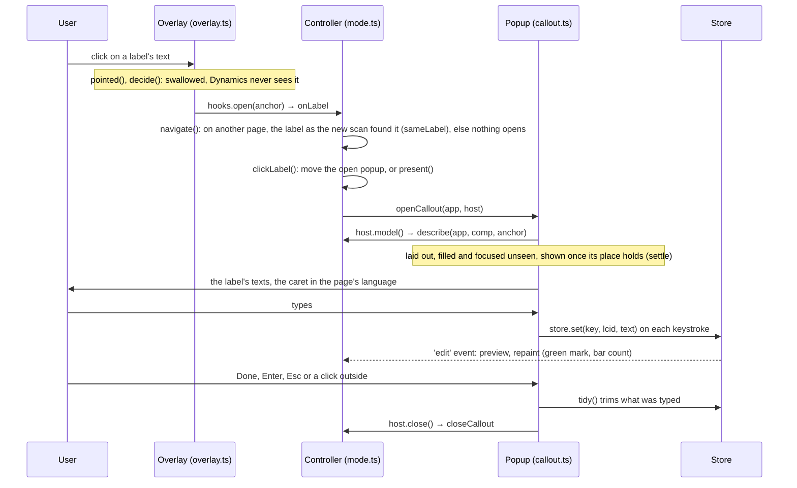

**The page is read first.** Dynamics draws the next page's labels before the page tracker sees the navigation
(`navSoon` and the tick, [9.5](#95-following-the-page)), and a label scanned in between was matched against the
previous page's index: on a list, a header of the next table could be taken for the previous table's column of the
same name. So a click on a label's text (or F2) reaches `onLabel`, which first follows the page, as `open` does
([9.26](#926-finding-a-label-from-the-list-inspectorrevealts)). When `navigate()` finds another page, it starts over
with that page's index and a new scan, and the label is the one the new scan found on the same element, in the same
role and the same part of its text (`sameLabel`); where the new scan has no such label, nothing opens. On a
page that didn't change, the clicked label opens as it is. The scanner also gives no table to a list's grid that names
another table than the index's (the next page's), so none of its headers is taken for a column of the previous table
([9.11](#911-grids-choice-values-and-texts-that-hold-several-labels)).

`src/inspector/mode.ts`, `sameLabel`, and `onLabel` in `createPageMode`:

```ts
export function sameLabel(a: Anchor, list: readonly Anchor[]): Anchor | null {
  return list.find((b) => b.el === a.el && b.role === a.role && b.part?.start === a.part?.start && b.part?.end === a.part?.end) ?? null;
}
```

```ts
function onLabel(clicked: Anchor): void {
  if (!on || paused) return;
  const a = navigate() ? sameLabel(clicked, scanner.list) : clicked;
  if (!a) return;
  const st = cur && !cur.closed ? cur : null;
  clickLabel(a, st, {
    move: (b) => st && moveTo(st, b),
    open: (b) => present(b.comp, b, {}),
  });
}
```

**One popup at a time.** `onLabel` then asks `clickLabel` what to do.

`src/inspector/mode.ts`, `clickLabel`:

```ts
export function clickLabel(a: Anchor, now: OpenNow | null, fx: ClickFx): void {
  if (now && now.comp === a.comp && (now.a ? now.a.key === a.key && now.a.role === a.role : a.key === now.want)) fx.move(a);
  else fx.open(a);
}
```

When the open popup is already about this text (the same slot in the same role: a copy of a tab in *More tabs*, the
same value in another grid row), it moves to the clicked label and keeps what is typed in it (`moveTo`). Otherwise the
open popup closes, its typed text staying staged, and a new one opens (`present`). Nothing typed ever blocks a click.

**`present(comp, a, o, near)`** opens the popup. It records the open popup in `cur`:

| Field of `Cur` | Holds |
| --- | --- |
| `comp`, `want` | The component, and the slot it was opened for (the one asked for, else the clicked label's, else the component's main slot) |
| `a` | The label it points at; `null` while docked |
| `near` | While `a` is null, a label shown near it that only places the popup: another text of the component, the field that shows the column, the column's header in a list (`nearOf`) |
| `was`, `at`, `menu` | The last label it pointed at, where that label was last seen, and whether it was in a menu or flyout |
| `row` | The list row it was opened from |
| `by` | The list sheet's box while the popup points at its row (`rowAnchor`, below): the popup opens beside the sheet |
| `action`, `subject` | The secondary action, as last described, and the label it was described for |
| `spot` | Where on the page its label was when it opened: what a change typed in it remembers ([9.27](#927-changes-made-on-other-pages)) |
| `keys` | The texts its content edits (`modelKeys`: its blocks, the other copies of a field, its choices) |

The popup talks to the controller through a `CalloutHost`: `model()` builds the content with `describe` for the label
it points at (or the last one, once that went away with its menu, so the content and the action stay), `rect()` gives
where to place it (`rectFor`), `beside()` the list sheet's box while that place is a row of the sheet (`by`, read
right after `rect()`), `focusLcid` and `focusKey` say which input takes the caret, `action()` runs the
secondary button, `close()` is called by Done, ✕, Esc, Enter and a click outside, and `refocus()` puts the focus on
the button of the list an item's popup came from, once that item has left with its list
([9.22](#922-open-change-area-form-or-view-show-tab-and-show-stage)). The overlay then gives only the clicked label
the active look (`overlay.active(comp, a)`), and the popup repositions itself on every overlay frame
(`overlay.onFrame`).

When the popup can't be built for a component (`openCallout` throws), the controller opens the app's editor card
instead (`fallback`, which calls `app.edit` while `bypass` makes `mode.open` refuse that component).

**Where it points: `rectFor`.** The label's rect while the overlay shows it and the list sheet doesn't cover it; else
the list row it was opened from, with the sheet's box in `by`, so the popup opens beside the sheet; else a label near
it (`near`); else, when its label left with the menu or flyout that showed it (it closed as the popup took the focus
or a click), where that label was last seen (`restRect`), so the popup stays put rather than jumping to the bar; else
nothing, and the popup docks above the bar. An option of Dynamics' open dropdown list leaves with that list, which
closes as the popup takes the focus: the popup, still hidden while it opens, waits until the next scan points it at
the field (`reanchor`, below, and `nearOf`) and shows there once, never first at the option
([9.21](#921-the-popup-uicalloutts)).

`src/inspector/mode.ts`, `rowAnchor`:

```ts
export function rowAnchor(r: DOMRect | null, row: Element, W: number): { at: DOMRect; by: DOMRect | null } | null {
  const s = row.closest('.pgl')?.getBoundingClientRect() ?? null;
  const covered = !r || (s ? r.right > s.left && r.left < s.right && r.bottom > s.top && r.top < s.bottom : r.right > W);
  return covered ? { at: row.getBoundingClientRect(), by: s } : null;
}
```

The row is used when the label isn't shown (`r` null) or the sheet covers it: the label's rect overlaps the sheet's
box, wherever the sheet is, docked on the right or floating where it was dragged
([9.25](#925-all-labels-on-this-page-inspectorpagelistts)). A label the floating sheet doesn't cover gets the popup
pointing at it, which is what dragging the sheet away from it is for. A row outside a sheet counts the label as
covered only when it reaches past the window's right edge (`innerWidth`).

**Following the label: `reanchor`.** After each scan, the open popup looks for its label again (`again`): the same
element, else a copy showing the same slot in the same role, else one showing the same slot, the copy nearest to where
the label was winning. A docked popup moves next to its label as soon as that is shown (a lazily drawn field, another
tab, the same form on another record), and its content is described again. A label that went away without a page
change leaves the popup open, where the label was or docked: closing it would drop the user's place. After a page
change, a popup whose component doesn't belong to the new page closes; what was typed in it stays staged for Publish.

### 9.20 What the popup shows: `inspector/describe.ts`

`describe(app, comp, a)` builds the popup's content, a `CalloutModel`, from the store, the context and the
preferences. It reads the anchor's element only to tell which classic button was clicked, whether a tab is the one
shown, whether a label is in a menu or flyout, which related menu item it is (its nav id), whether an item of a
selector's list is the current one (`aria-checked`) and what text the page shows; it never changes it. Whether a
stage's flyout is already open is checked only when **Show stage** is pressed.

| Field | Holds |
| --- | --- |
| `kind`, `icon` | One muted word (`KIND_LABEL`: *Field*, *Tab*, *Section*, *Column*, *Choice*, *Button*, *Menu item*, *Menu area*, *Menu group*, *Stage*, *Step*, *Process*, *Table*, *View*…), and an icon |
| `title` | The label's text as the page shows it: the clicked slot's text in the user's language, else the base language, else its title |
| `blocks` | One block per editable text: its slot key, its heading (*Form label*, *Tooltip*, *Column name*, *Label*, *Name*, *Plural name*, *Title*…), whether it is multi-line, a muted note on where a change applies, and for a field the other copies (`also`) |
| `choices` | The options of a choice, Yes/No or status column, in option order: whether the list starts open, which option to focus, and for a global choice how many columns share it |
| `readOnly` | Why nothing can be edited, when every text is read-only (the main slot's reason, without its final full stop) |
| `note` | One plain line above the texts to translate, or instead of them (Microsoft's built-in text) |
| `action` | The secondary button: **Open**, **Show stage**, **Show tab**, **Change area**, **Change form** or **Change view** |
| `loading` | The component's slots aren't loaded yet |

**Per kind.**

| Clicked | Kind word | Blocks | Choices | Action |
| --- | --- | --- | --- | --- |
| A field (a form cell that shows a column) | *Field* | *Form label* (*this form only, shown instead of the column name*; on a quick view form, *this quick view (on every form that shows it), instead of the column name*), *Tooltip* (*everywhere*), *Column name* (*everywhere: views, search and forms without a form label*), always in this order | The column's | |
| A sub-grid, quick view, timeline or other control | *Sub-grid*, *Quick view*, *Timeline* (by its `classid`), else *Component* | *Label* | | |
| A tab, a section | *Tab*, *Section* | *Label* | | **Show tab** for a tab not shown |
| A related menu item of the form XML | *Menu item* | *Label* (*this form only*), and *Menu label* (*every form without its own title*) or *Table plural name* (*everywhere*); *Label* alone, without a note, where `navSource` finds no such text (a built-in item, a relationship the menu doesn't show, one not loaded yet) | | **Open** |
| A related menu item from a relationship | *Menu item* | *Label* | | **Open** |
| A choice value | *Choice* | None: its label is its row in *Choices* | Every option of its column, open, the clicked one focused | |
| A global choice (from the list) | *Choice* | *Name* | Its options, closed | |
| A column header | *Column* | *Column name*, *Tooltip* | The column's | |
| A table name | *Table* | *Name*, *Plural name* | | |
| A navigation entry showing a table's plural name | *Menu item* | *Plural name* | | **Open** |
| A built-in command named after its table | *Button* | *Name*, *Plural name*, with a note | | |
| A view, chart, form, dashboard, app or process name | *View*, *Chart*, *Form*… | *Name* | | |
| A site map group or entry | *Menu group*, *Menu item* | *Title* | | **Open** (not for a group) |
| The area switcher, the form selector, a view selector (the label on the button that opens its list) | *Menu area*, *Form*, *View* | *Title*, *Name* | | **Change area**, **Change form**, **Change view** |
| An area, a form or a view in its selector's open list | *Menu area*, *Form*, *View* | *Title*, *Name* | | **Open**, unless it is the current one |
| A process stage | *Stage* | *Label* | | **Show stage**, for a stage with steps |
| A process step | *Step* | *Label*, *Tooltip* (the column's description) | The column's | |
| A modern command | *Button* (*Button group* without a label) | *Label*, *Tooltip title*, *Tooltip text* | | |
| A classic button | *Button* | *Label*, *Tooltip title*, *Tooltip text* | | |
| An environment variable, a custom API | *Environment variable*, *Custom API* | *Name*, *Description*, *Hint* | | |
| Microsoft's built-in text | *Built-in* | None, with a note | | **Open** for a navigation item |

Descriptions, tooltip texts and hints are multi-line (`LONG`). The clicked text's block comes first (`clickedFirst`):
the popup edits exactly what was clicked. The one exception is a column's form cell, whose blocks keep their order
whichever text was clicked (*Form label*, *Tooltip*, *Column name*); its popup puts the caret in the *Form label*,
and in the *Column name* only where the form's label can't be typed in (`focusKeys`,
[9.21](#921-the-popup-uicalloutts)). A text of the component that its kind doesn't list (an
anchor showing another of its slots) gets a block of its own. Two blocks never edit one text (a classic button whose
tooltip uses its label's LocLabel).

**A field.** The title is what the page shows: the column's name where the cell has no label in the user's language
(`cellTitle`). The blocks are the form's own label for the cell, the column's tooltip and the column's name, in that
order. A form label is the text one form shows in place of the column's name, which shows everywhere else
(LIVE-FINDINGS 42): the notes say so, in one clause each after the heading, and an empty *Form label* input has as its
placeholder the column's name the form shows instead in that language (else the column's base-language name), *Shows
“&lt;column name&gt;”*. It is the form's own text, not a link to the column's name: the form designer usually saves a
copy of the column's name as the cell's label when the field is added, and that copy does not follow a later change to
the column's name. So editing the *Column name* changes views, search and the forms without a label of their own for
the field, and what a form shows changes with its *Form label*, the block that takes the caret. A French form label
emptied in the popup has no placeholder: Dataverse can't remove a cell's label, so the save writes that column's name
in its place, and the line under the input says so ([9.21](#921-the-popup-uicalloutts)).

`src/inspector/describe.ts`, `FIELD_NOTES`:

```ts
export const FIELD_NOTES = {
  // The form's own label: shown on this form in place of the column's name (LIVE-FINDINGS 42).
  label: 'this form only, shown instead of the column name',
  // A quick view form's cell label shows on every main form that embeds that quick view.
  quickView: 'this quick view (on every form that shows it), instead of the column name',
  tooltip: 'everywhere',
  column: 'everywhere: views, search and forms without a form label',
};
```

The tooltip people see on a field is the column's description (verified in a test environment, LIVE-FINDINGS 43), so
the *Tooltip* block edits `attribute|<table>.<column>|Description`. When the column is on the form more than once,
`duplicates` finds the other copies: cells of the same form that show the same column with the same base-language
wording, not read-only, not from a managed solution (`isManaged`) and loaded. A copy worded differently (the same
column placed as *Client* and as *Billing client*) is a different label and is never changed from here. The
*Form label* block then offers *Also change the other copy of this field on this form* (or *the 2 other copies*),
ticked when every copy shows the same text as this cell in every shown language. The Publish dialog shows the same
edit of every copy as one entry ([chapter 8](#8-the-publish-dialog-history-and-undo)).

Each block is read-only or not on its own: the *Form label* is the form's, the *Tooltip* and the *Column name* the
column's, and each comes from its own solution. On an unmanaged form, the cell of a column from a managed solution has
a *Form label* that takes typing, while its *Tooltip* and *Column name* are locked, each with the managed reason under
its heading ([9.21](#921-the-popup-uicalloutts)). On a form from a managed solution the *Form label* is read-only, like
every label of that form; the *Tooltip* and *Column name* of an unmanaged custom column placed on it still take typing,
and the *Column name* takes the caret.

**A field's popup.** The popup of *Project site* on a *Project* record: its form label, its tooltip and its column's
name, each in every shown language, each heading saying where a change applies, its French form label being typed.


**A related menu item.** An item the form XML lists shows, besides its *Label*, the text it shows in a language it has
no title in (verified in a test environment, LIVE-FINDINGS 80): its relationship's menu label, or the plural name of
the table it lists, so that text can be fixed where it comes from. Without a title in the user's language, the popup's
title is what the page shows by it (`a.orig`, never a staged text), which is also that language's placeholder.

**A classic button.** A LocLabel can be used by several buttons, and by tooltips: one save changes it everywhere. Each
block of a classic button says where else its LocLabel shows (`sharedNote`): *also on 2 other buttons*, *on 3 buttons*
(opened from the list), or *every table's command bar* for a label of the application ribbon. The tooltip title and
text are found through the loader's composed ribbon controls (`useRibbonControls`, `ribbonTips`); without the control,
by the naming *&lt;button&gt;.LabelText* → *&lt;button&gt;.ToolTipTitle*, only when those exist.

**A site map item without a name.** An item the app designer never named (`ref.placeholder`) has no title in any
language. Its popup's title is the page's own text (the placeholder), its *Title* block shows that text as the
placeholder of the user's language's input, and one line explains:

> This group has no name of its own: Dynamics shows the app designer's placeholder. Name it in each language; other
> languages will show the English name until you translate them.

(`unnamedNote`; *menu item* for an entry, and the base language's name in place of *English*.) That is only in an
unmanaged site map: in one from a managed solution the item's *Title* is read-only with the managed reason, the popup
shows that reason instead of the line, and nothing names the item (that would add an unmanaged layer to the site map).

**Built-in text and table names in commands.** The popup of Microsoft's built-in text has the kind *Built-in*, the
text as the page shows it as its title, no inputs, and one line (`BUILTIN_NOTE`): *Built-in Microsoft text. It's
already translated into every language installed in this environment, so there's nothing to translate here.* A
built-in command named after its table has the button's text as its title, the table's *Name* and *Plural name* (the
one shown focused) and one line.

`src/inspector/describe.ts`, `TABLE_COMMAND_WHY` and `TABLE_COMMAND_NOTE`:

```ts
/** Why the popup of a built-in command whose text holds its table's name (scan.ts command) shows that table's names. */
export const TABLE_COMMAND_WHY = "Microsoft builds this button's text from the table's name: its other words are already translated.";
/** What that popup says where the table's names can be translated here. */
export const TABLE_COMMAND_NOTE = `${TABLE_COMMAND_WHY} Translate the table's name here; the button follows, as does every other place that shows it.`;
```

The line is `TABLE_COMMAND_NOTE` when one of the two names can be translated here, else `TABLE_COMMAND_WHY` alone:
nothing tells the user to translate names that are read-only. That is the usual case, since most such buttons are on
Microsoft's own tables (account, contact…), which come from managed solutions; the popup then shows the managed
reason with its lock.

**The secondary action.** `describe` offers it only where pressing it does something. The labels of the three lists
the page is switched with (the areas, the record's forms, a grid's views) get theirs from `listAction`, in place of
their kind's; `actionFor` then keeps only an action that can work.

`src/inspector/describe.ts`, `listAction` and `actionFor`:

```ts
/** The action of a selector's own label (lists.ts): its list. */
const CHANGE: Record<ListKind, Action> = { area: 'Change area', form: 'Change form', view: 'Change view' };

/**
 * The action a label of the lists the page is switched with gets (lists.ts), in place of its kind's: on a selector's
 * own button, Change area / form / view (its list); on an item of its list, Open, unless it is the current one
 * (aria-checked) or its id is unknown. Never for the same name shown elsewhere (no `sw`): undefined, the kind's stays.
 */
export function listAction(a: Anchor): Action | null | undefined {
  const sw = a.sw;
  if (!sw) return undefined;
  if (!sw.id) return CHANGE[sw.list];
  return attrOf(a.zone ?? a.el, 'aria-checked') === 'true' ? null : 'Open';
}

/**
 * The secondary action of the clicked label, only where pressing it does something (mode.ts runAction): a tab gets
 * Show tab unless it is the one shown. Open is dropped for the tab of a related view that is shown, and for a label in
 * a menu or flyout, which closes as soon as the popup is used, unless it opens a related view (the navigation API
 * needs no element) or switches to an item of a selector's list (its area, form or view, captured with it: lists.ts).
 */
export function actionFor(action: Action | undefined, a: Anchor): Action | undefined {
  const shown = attrOf(a.el, 'aria-selected') === 'true';
  if (a.role === 'tab') return shown ? undefined : 'Show tab';
  if (action !== 'Open' || a.sw?.id) return action;
  const id = navIdOf(a.el);
  return (id && shown) || (!id && inTransient(a.zone ?? a.el)) ? undefined : action;
}
```

The label on a selector's button (an anchor whose `sw` has no id) gets **Change area**, **Change form** or **Change
view**, which opens its list; an item of an open list gets **Open**, which switches to it, except the current one
(`aria-checked="true"`), which gets none. The scanner sets `sw` only on those labels
([9.12](#912-the-navigation-the-command-bar-processes-and-views)); the same name shown anywhere else keeps its kind's
action. A tab gets **Show tab** unless it is the one shown. **Open** is dropped for the tab of a related view that is
shown, and for a label in a menu or flyout (`TRANSIENT`: `[role="menu"]`, `[role="menuitem"]`,
`[role="menuitemradio"]`, `[role="dialog"]`, the header fields flyout, the area switcher flyout), which closes as soon
as the popup is used, unless it is a related menu item, which opens by its nav id without an element, or an item of a
selector's list, whose switch was kept with its anchor when it was found. A popup opened from the list, without a
label on the page, has no secondary action.

### 9.21 The popup: `ui/callout.ts`

`openCallout(app, host)` draws the popup in the app's layer: a Fluent callout with a beak, 400 px wide (440 px with a
*Choices* list), at `z-index` 18 in the layer, above the bar (11) and the list sheet (3 docked, 12 floating), below
dialogs and menus. It never writes to Dataverse and never touches the page's DOM.

**Its parts**, top to bottom:

* the header: the kind word, the title (two lines at most; *Untitled* when there is none) and ✕ (*Close*);
* the body, which scrolls inside the popup: *Loading…* while the component's slots load, the read-only reason (a lock
  and one muted line), the note, the blocks, the *Choices* disclosure, or *Nothing to translate here.*;
* the footer: the secondary button on the left, then **Undo changes** (a link, shown only while something was changed
  in this popup) and **Done**.

The popup is a `role="dialog"` with `aria-modal="false"`, labelled by its kind and its title; a live region says
*Changes undone.*, the problem of the input that has the focus or the line saying what its emptied text becomes
(below), and the line shown when the secondary button could do nothing
([9.22](#922-open-change-area-form-or-view-show-tab-and-show-stage)).

**One row per language.** Each block has its heading (and its note, muted, after a ·), then one row per shown
language: the language's name in a 72 px column, and a plain input. The languages are the base language first, then
the target, then the other shown languages in the environment's order.

`src/ui/callout.ts`, `rowLangs`:

```ts
export function rowLangs(all: readonly Lcid[], base: Lcid, target: Lcid, shown: readonly Lcid[]): Lcid[] {
  const out = [base];
  if (target !== base) out.push(target);
  for (const l of all) if (l !== base && l !== target && shown.includes(l)) out.push(l);
  return out;
}
```

An input is a `textarea` for a multi-line text (it grows from one to four lines, 92 px at most) and an `input`
otherwise. It carries `lang` and `dir` (right to left for Arabic and Hebrew), spell checking, `aria-label` (*Label,
French*) and a message under it. It is disabled for a read-only slot and for a language that wasn't loaded
(placeholder *Not loaded yet*). Each keystroke calls `store.set`: the edit is staged at once, and typing a text back
to what the server has removes the edit.

**Read-only texts.** When every text of the popup is read-only, its reason is one muted line with a lock at the top
of the body (`model.readOnly`, the main slot's reason without its final full stop), and every input is disabled.
When only some are, each read-only block has its own lock line under its heading, and the others take typing. Every
label of a component that comes from a managed solution is read-only, whatever its managed properties allow: the
translator never adds an unmanaged layer on top of a managed component. The loaders give such a label the reason
below (a few keep a reason of their own, such as a name Microsoft locks); the store gives it to any slot whose
`ref.managed` is set and that came without a reason (`store.add`), and `store.set` stages nothing on such a slot.

`src/core/model.ts`, `MANAGED`:

```ts
export const MANAGED = 'From a managed solution: a translation here would add an unmanaged layer on top of it. Translate it where its solution is developed.';
```

Microsoft's own forms and tables (account, contact…) come from managed solutions, so on them almost every popup shows
this line: their texts are translated in the environment where their solution is developed. In a development
environment, its own unmanaged components take typing, an unmanaged form of a managed table and an unmanaged custom
column of one among them.

**The popup of a managed label.** The popup of a field on the account form, which comes from a managed solution: the
reason at the top with its lock, and every input locked.


**Placeholders.** An empty input says what users of that language see there now (`placeholderOf`).

`src/ui/callout.ts`, `placeholderOf`:

```ts
export function placeholderOf(store: Store, s: Slot, l: Lcid, base: Lcid, heading: string, lang: string, page = ''): string {
  if (l !== base && !s.readOnly && store.standIn(s.key, l, base)?.text) return '';
  if (l !== base && keepsEmpty(s)) {
    const v = store.emptyOnPurpose(s.key, l, base) ? '' : shows(store, s, l, base);
    return v ? `Shows “${v}”` : noneText(s, lang);
  }
  if (/tooltip|description|hint/i.test(heading)) return `No ${lang} ${heading.trim().toLowerCase()}`;
  const v = page.trim() || shows(store, s, l, base);
  return v ? `Shows “${v}”` : '';
}
```

A metadata description (`keepsEmpty`: a column's tooltip, a table's or a choice option's description…) says *No
French tooltip* (*No French description*, `noneText`) only where its users see none: stored empty, emptied here and
saved so (`Store.emptyOnPurpose`), or with no base text either. A missing one, never translated, shows its users the
base text, and says so: *Shows “Type the name.”*. Any other tooltip, description or hint (a record's, a command's, an
environment variable's) says *No French &lt;heading&gt;* by its heading (*No French description*, *No French tooltip
text*), whatever its users see there; for a label, `shows` gives what that language's users see where it is empty: a
form cell its column's name in that language, else the column's base-language name (LIVE-FINDINGS 42), a related menu
item its relationship's text (LIVE-FINDINGS 80), a process stage or step the name Dynamics keeps (LIVE-FINDINGS 83),
anything else the base text. A built-in related menu item a form renames shows language-pack text that the store
can't know, so in the user's language the page's own text stands in (`pageText`: set for a related menu item without a
title in that language, and for a site map item without a name). A translation emptied where the save writes a
stand-in in its place has no placeholder: what the page shows now may not be what it becomes (a stage name Dynamics
keeps), and the line under the input says what it becomes (below).

**Colours of an input.** Amber (`is-miss`) where the translation is missing by the same rule as the marks
(`isMissing`: the base text is there, the translation isn't, and no text shown in its place that is worded like the
base text covers it: a form cell's column name, a related menu item's relationship text; never a description stored
empty on purpose, `Store.emptyOnPurpose`); green (`is-edit`) where it is changed and not published, an emptied
translation that gets a stand-in or is saved empty included; red (`is-err`) with a message
where the save would refuse it (`problem`):

| Message | When |
| --- | --- |
| *Read-only* | The slot is read-only (a managed solution's label among them) |
| *Can't be empty* | A required base text emptied, or only spaces typed for a translation that doesn't exist yet, of a label whose translations Dataverse can't remove (the spaces would be stored and show blank) |
| *Dataverse can't remove this translation, and its English text is empty: type the text instead.* | A translation emptied where Dataverse can't remove it, with nothing known to stand in for it (`noStandIn`): its base text is empty, or for a form cell, *its column has no English name*. For a process stage or step translation, *Dynamics keeps a stage's translation once it is stored, and …* |
| *Dataverse can't remove this translation, and its column's names aren't loaded: load its table's columns to put the column's name in its place, or type the text.* | The same, where the stand-in is unknown only because a text it is made of isn't loaded: a form cell's column names, or a tab's or section's base text, unknown while its labels are loaded without a language switch (*…, and its English text isn't loaded: load its labels in all languages to put that text in its place, or type the text.*). The save holds it back (skipped), never refuses it for good |
| *Name it in English too* | A name typed in another language for a site map item that has no name in the base language yet |
| *Too long (max 50)* | Longer than the slot's maximum, with a counter (*57 / 50*) |

A problem never blocks typing or closing: the edit stays staged, and the Publish dialog shows it in red and skips it,
leaving it staged ([chapter 8](#8-the-publish-dialog-history-and-undo)).

**Emptying a translation.** A translation emptied in the popup (or left with only spaces) is staged like any other
edit. Where Dataverse can remove it (`canClear` in `src/core/model.ts`: a view's, form's, chart's, dashboard's or
app's name, a modern command's texts and the other texts of records, through `SetLocLabels`; a related menu item's or
a site map item's title, removed with its element: LIVE-FINDINGS 33, 38), the publish removes it, and the placeholder
says what that language shows then. Where it can't (a table's, column's, choice's or relationship's names, a form's or
dashboard's tab, section and field labels, a classic button's texts: LIVE-FINDINGS 31, 32, 37, 39, 67; a process stage
or step translation, which Dynamics keeps once stored: LIVE-FINDINGS 83), the save writes its **stand-in** instead:
the text that language shows where the label has no translation of its own, so the page looks as it would without one
(`standIn` in `src/core/model.ts`). A form or dashboard cell that shows a column gets the column's name in that
language, else the column's base-language name (LIVE-FINDINGS 42); anything else gets its own base-language text. A
metadata description is saved empty instead, so that its users see no tooltip or description (`savesEmpty`,
[7.19](#719-emptying-a-translation-dataverse-cant-remove-the-stand-in)). The save measures a stand-in by the texts as
the publish leaves them (a base text or a column's name written in the same publish counts), and reads every text it
is made of again from the server before writing it ([chapter 7](#7-saving-safely)). A stand-in made of a text the same
publish writes in another write (a form label emptied while its column's name changes) is written only once that text
is saved; when it isn't (it failed, or met a conflict), the stand-in is held back, still staged, and its row says so
(`sourceUnsaved`: *Its column's French name wasn't saved, so nothing was written here either: Try again to save
both.*). The Undo of a publish does the same. The popup measures it by the texts as they are staged, through the
store.

`src/core/store.ts`, `standIn`:

```ts
standIn(key: string, lcid: Lcid, base: Lcid): StandIn | undefined {
  const s = this.slots.get(key);
  if (!s || !this.isEdited(key, lcid) || s.readOnly || isManaged(s)) return undefined;
  return standIn(s, lcid, base, this.original(key, lcid), this.value(key, lcid), (k, l) => this.text(k, l));
}
```

`store.text(key, lcid)` is a label's text with its staged edit, `undefined` while the label, or that language of it,
isn't loaded (`notLoaded`). Under the emptied input, `becomes` writes what the save writes, in one muted line with an
info icon (`.co-m.is-note`), in place of the placeholder; for a description saved empty, *Saved empty: French users
see no tooltip.* (`savedEmptyText`), with the placeholder *No French tooltip*, and only where there was a text to
empty: spaces typed where there is no French text are trimmed when the popup closes (`tidy`), so nothing is saved and
the line says nothing. `problem` refuses only an emptied translation without a stand-in.

`src/ui/callout.ts`, `problem` and `becomes`:

```ts
export function problem(store: Store, s: Slot, l: Lcid, base: Lcid): string {
  if (!store.isEdited(s.key, l)) return '';
  if (s.readOnly) return 'Read-only';
  const v = store.value(s.key, l);
  if (!v.trim() && (l === base ? s.baseRequired : !canClear(s, l) && !savesEmpty(s, l, base))) {
    const x = l === base ? undefined : store.standIn(s.key, l, base);
    if (!x) return "Can't be empty";
    if (!x.text) return noStandIn(s, l, x);
  }
  if (v.trim() && l !== base && namesFirst(s) && !store.value(s.key, base).trim()) return `Name it in ${lcidName(base)} too`;
  return s.max > 0 && v.length > s.max ? `Too long (max ${s.max})` : '';
}

/**
 * What a staged emptied translation Dataverse can't remove is saved as, in the line under its input (model.ts
 * standIn, the saver's rule): "Becomes “Project site”: Dataverse can't remove a translation here, so French gets the
 * English text."; a metadata description's, saved empty (model.ts savesEmpty): "Saved empty: French users see no
 * tooltip." (`lang`: the language's name as the popup names it). '' for any other text, and for one without a stand-in
 * (problem() refuses that).
 */
export function becomes(store: Store, s: Slot, l: Lcid, base: Lcid, lang = lcidName(l)): string {
  if (l === base || s.readOnly) return '';
  // Only where there is a text to empty: spaces typed where there is none are trimmed away when the popup closes (tidy),
  // so nothing would be saved.
  if (store.isEdited(s.key, l) && store.emptyOnPurpose(s.key, l, base)) return store.original(s.key, l).trim() ? savedEmptyText(s, lang) : '';
  const x = store.standIn(s.key, l, base);
  return x?.text ? becomesText(s, l, base, x) : '';
}
```

`becomesText` (`src/ui/editor.ts`, the editor card's line too) is `standInSays` in `src/core/model.ts`:

| Case | Line under the input |
| --- | --- |
| A text standing in, from the label's base text | *Becomes “Start date”: Dataverse can't remove a translation here, so French gets the English text.* |
| A form cell's label (*Project name*), from its column's name | *Becomes “Nom du projet”: Dataverse can't remove a translation here, so French gets the column's French name.* (*the column's English name* where the column has no French name) |
| A process stage or step | *Becomes “Qualify”: Dynamics keeps a stage's translation, so French gets the English text.* |
| The stand-in is the server text already (`same`) | *Already the English text: Dataverse can't remove a translation here, so nothing changes.* The save reads the label's text again first: while the server still holds that text, it writes nothing and publishes nothing for it; another text there (someone changed it since it was loaded) is a conflict, never *unchanged* |
| A metadata description emptied (no stand-in: `savedEmptyText`) | *Saved empty: French users see no tooltip.* (*… see no description.* for anything but a column's) |

The input is green, and the label's mark and its row in *All labels* look changed, as for any staged change; on the
page, the preview shows the stand-in in the user's language
([9.18](#918-staged-text-shown-in-place-inspectorpreviewts)).
The Publish dialog shows the row as the text before → the stand-in, with the quiet note *English text: Dataverse can't
remove a translation* (`standInTag`; *The column's French name: …* for a form cell), and the Undo of a publish that
added such a translation writes its stand-in too ([chapter 8](#8-the-publish-dialog-history-and-undo)). A description
saved empty shows as the text before → *(empty)*, with the note *Saved empty: French users see no tooltip.*

**An emptied translation.** The popup of *Start date* on a *Project* record, its French column name emptied: the input
green, without a placeholder, and the line under it saying it becomes the English text.


**Copies of a field.** With *Also change the other copy of this field on this form* ticked, typing writes the same
text into the copies, in one store step (`writeAlso`, never a read-only or not-loaded copy, nor one of a form from a
managed solution). Ticking it copies the
texts changed in this popup so far; unticking puts the copies back as they were when the popup opened.

**Choices.** A choice column's options are in a disclosure, *Choices (5)*, closed unless the popup was opened from a
choice value, the option asked for is one of them, or one of them has a change that isn't published (the page shows no
other sign of it). That default is decided once; the user's own choice stays after that. Its header adds *· 1 changed*
(green) or *· 2 not published* (red) while choices are pending. Open, it starts with *Shared by 3 columns* for a global
choice that more than one column uses. The list has one compact row per option, with two inputs side by side: the base
language and the target (one input with a single language). The option clicked on the page (`focusKey`) is highlighted
and takes the caret.

**A choice column's popup.** The popup of *Phase* with its choices, *Planning*, *In progress*, *Review* and
*Closed*: each option in the base and the target language, side by side.

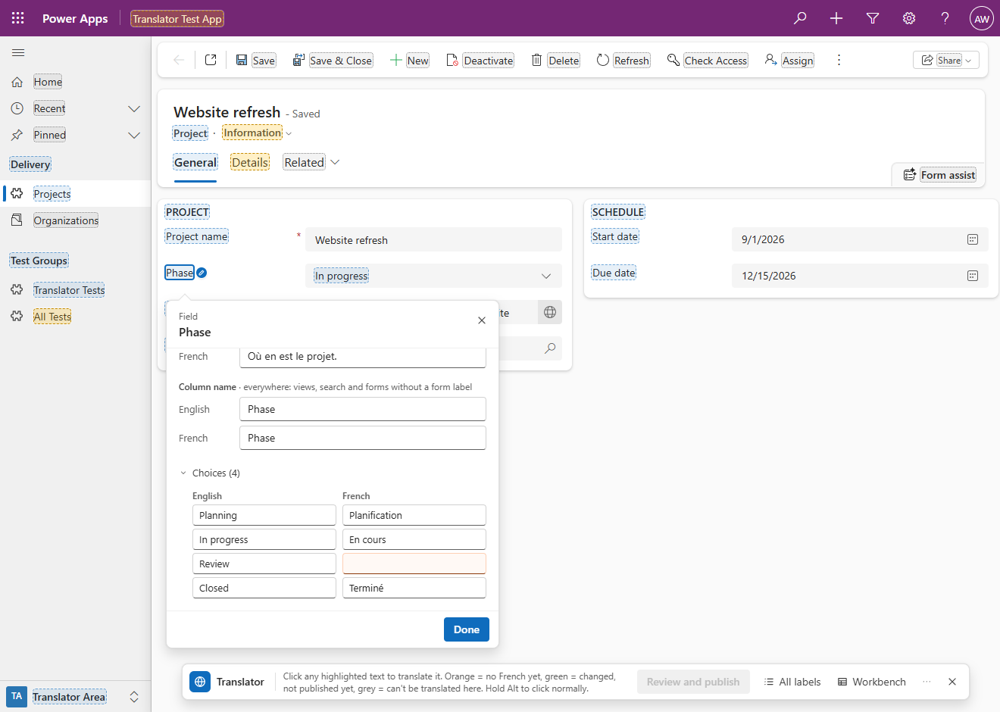

**The caret.** `focusInitial` puts the caret at the end of an input's text:

1. the input the host asked for (`focusKey`: a choice value), in the language asked for (`focusLcid`, from **Fix** in
   the Publish dialog), else in the language the page is shown in, else in the target language;
2. else, when the *Choices* list is open, its focused option, or its first pending one except in a popup that has a
   column's name (a form field's, a column header's): there the list still opens by itself, and the caret goes to the
   first text (below);
3. else the first text, in the language asked for, else in **the language the page is shown in**: the one
   `<html lang>` names, else the user's Dynamics language (`shownLanguage` in `src/core/uilang.ts`). On an English
   page that is the English text, on a French page the French text: the text the user was reading, not the target
   language. Where the first text has no input in that language that takes typing (that language isn't loaded), its
   first one that does;
4. else the first input that takes typing.

The first text is the first block that takes typing, except in a form field's popup, whose blocks keep their order
([9.20](#920-what-the-popup-shows-inspectordescribets)). There it is always the *Form label*, the text the page shows,
whether or not the form has a label of its own (`focusKeys`; while it is empty, its placeholder says what the page
shows instead, the column's name); the *Column name* gets the caret only where the *Form label* can't be typed in at
all (read-only: a form from a managed solution). A column header's popup starts with its *Column name*, its first
block. What the host asks for still comes first: the choice value clicked, the language of **Fix**.

`src/ui/callout.ts`, `focusKeys`:

```ts
export function focusKeys(store: Pick<Store, 'get'>, blocks: readonly Block[]): string[] {
  for (const b of blocks) {
    const s = store.get(b.key);
    if (s?.kind !== 'field' || s.prop !== 'Label') continue;
    const ck = fallbackKey(s);
    return ck && blocks.some((x) => x.key === ck) ? [s.key, ck] : [];
  }
  return [];
}
```

With nothing to type in yet (the labels are loading), the dialog itself takes the focus, so its title is read out, and
the first input takes it as soon as it is there.

**Undo changes.** When it opens, the popup records every text it shows, in every language, as it is then (`snapshot`:
the value, the staged edit if any, and that edit's base). A text shown later (its labels loading) keeps its first
state. **Undo changes** puts every recorded text back as it was, in one store step: its earlier staged edit, measured
against its own base (so a reload that brought another text meanwhile is still a conflict at save, never overwritten),
or none. Server texts that move underneath (the other languages of a form loading) are not changes made here.

**Closing.** **Done**, ✕, Esc, Enter and a pointer down outside the popup all close it and keep what was typed,
staged. First `tidy` trims the texts changed in this popup: spaces and line breaks at either end are never meant (an
Enter typed into a tooltip once saved *"text\n"*); line breaks inside a text stay.

`src/ui/callout.ts`, the popup's `keydown` listener:

```ts
el.addEventListener('keydown', (e) => {
  if (dead || e.isComposing) return;
  const t = e.composedPath()[0];
  if (e.key === 'Escape') {
    e.preventDefault(); // the app's Esc handler skips handled events
    done();
  } else if (e.key === 'Enter' && !e.altKey && !e.shiftKey && (e.ctrlKey || e.metaKey || isText(t))) {
    // Enter in any text box, Ctrl+Enter anywhere. A new line in a multi-line text is Shift+Enter: people press
    // Enter to finish, and a line break at the end of a tooltip would be saved with it.
    e.preventDefault();
    done();
  } else if (e.key === 'Tab' && !e.altKey && !e.ctrlKey && !e.metaKey) {
    // The focus stays in the popup: Tab past the last control goes to the first input, Shift+Tab before the
    // first control to the last one.
    const f = focusables();
    if (!f.length) return;
    const a = active(el);
    if (!e.shiftKey && a === f[f.length - 1]) {
      e.preventDefault();
      (inputs()[0] || f[0]).focus();
    } else if (e.shiftKey && (a === f[0] || a === el)) {
      e.preventDefault();
      f[f.length - 1].focus();
    }
  }
});
```

The pointer down outside is caught on the document in the capture phase. A press in one of the translator's own layers
(a menu, a dialog, a tooltip, a toast) is not outside, and nothing closes while a dialog is open. A click on another
label's text never gets there: the overlay, listening on `window`, takes it first, and the controller opens that
label's popup instead. Nor does one the overlay swallows beside the text of a label that acts: the popup stays open.
A click beside the text of a label whose zone doesn't act is the page's, and closes the popup.

**The focus afterwards** goes back to where it was before the popup opened (a label reached with F2, a list row, the
bar: `giveBack`), but only when the focus was in the popup, and never to a Dynamics text field the user had clicked
before the label. A label click doesn't move the focus, and in that field Ctrl+Z would undo the field's typing instead
of the staged edit ([9.23](#923-undo-and-redo-in-translation-mode)). An item of a selector's list reached with the
keyboard leaves the page with its list as the popup takes the focus: on **Done**, ✕, Esc or Enter the focus then goes
to the button that opens that list (`host.refocus()`, `focusOpener` in `lists.ts`), so the keyboard goes on from
there; never after the secondary button, which moves on
([9.22](#922-open-change-area-form-or-view-show-tab-and-show-stage)).

**Placement.** `placeCallout(z, w, h, vw, vh, dock, beside, side)` is a pure function:

* next to a label: below it, starting at its left edge, 16 px away (an 8 px gap and the beak, a 12 px square turned
  45°); above it when there is not enough room below and there is above; else on the side with more room; at least 160
  px of room even in a very small window (`MIN_ROOM`), where it may then cover the label and loses its beak;
* once shown (`side`: where it is now), below or above its label it keeps that side while it nearly fits there: it
  moves only when it lacks more than 48 px of room on its side and fits on the other, or, fitting on neither, when the
  other side has more than 48 px more room (`STICK`). So a label that moves a little (a scroll) or a text that grows (a
  message under an input) never sends it to the other side and back; where it lacks room, its body scrolls;
* always 8 px inside the viewport (`M`); the body scrolls when the popup is taller than the room;
* without a label (`z` null): docked next to the bar, 12 px above a bar at the bottom (`BAR_GAP`), or below a bar
  moved to the top, without a beak;
* a label scrolled out of view: at the nearest edge of the viewport, without a beak;
* next to a row of the list sheet (`beside`: the sheet's box, which `host.beside()` gives while the popup points at a
  row, docked on the right or floating where it was dragged): to the left of the sheet when there is room, else to its
  right (a sheet floating near the left edge), at the row's height, with the beak on the side facing the sheet (`left`,
  `right`; `.co.is-right` in `callout.css` draws it on the popup's left side), so it doesn't cover the list. With
  room on neither side, it is placed as next to a label, over the list.

`reposition` (`place`) keeps the bar visible: next to a label the popup uses only the room on the other side of the
bar. It moves only when its place changed, and never while a pointer is pressed in it (`pressed`, until the pointer is
released): a label that leaves with its menu as the popup is pressed must not move the button out from under the
pointer.

**Opening without a jump.** The popup is laid out, filled and focused before anyone sees it: it opens with the class
`is-wait` (`opacity:0`, no animation, no pointer events), is placed again on every animation frame, and shows only once
its place has held for two frames in a row (`STEADY`). While it opens, its side is chosen afresh on each frame: it never
keeps a side it was only laid out on. While the label it opened at is gone (`host.rect()` gives nothing: it would be
docked) it keeps waiting. An option of Dynamics' open dropdown list leaves with the list, which closes as the popup
takes the focus, and the controller points the popup at the field a moment later, when it reads the page's changes (in
batches 90 ms apart, [9.5](#95-following-the-page)): the popup shows once, at the field, never first at the option and
then elsewhere. After 300 ms (`WAIT_MAX`) it shows wherever it is. A popup that opens docked (nothing to point at) shows
there once its place holds. It then fades in over 0.12 s, coming out of its label: down under a label, up over one,
sideways beside a row of the list sheet (`co-in` in `callout.css`; no animation with *Reduce motion*).

`src/ui/callout.ts`, `settle`:

```ts
export function settle(held: number, same: boolean, lost: boolean, waited: number): { held: number; show: boolean } {
  const n = same && !lost ? held + 1 : 0;
  return { held: n, show: n >= STEADY || waited >= WAIT_MAX };
}
```

**Re-rendering.** The popup listens to the store and to `dxt-prefs`. A `slots` event re-reads the model and renders
again only when the model or the slots it shows changed; otherwise only the inputs' values, placeholders and colours
are updated. An `edit` event updates the inputs of that text only. A render keeps the focus, the caret, the scroll
position, the *Choices* disclosure and the copies' checkbox. Its root carries `data-us`, so an input a render replaces
keeps its undo history by its `data-k` (`<slot key>#<lcid>`).

### 9.22 Open, Change area, form or view, Show tab and Show stage

The popup's secondary button acts on the page, and only where that does something (`actionFor`,
[9.20](#920-what-the-popup-shows-inspectordescribets)). The controller runs it.

`src/inspector/mode.ts`, `runAction`:

```ts
export function runAction(action: Action | '', a: Anchor, fx: ActFx): boolean {
  switch (action) {
    case 'Open': {
      if (a.role !== 'nav') return false;
      if (a.sw) return !!a.sw.id && fx.pick(a.sw);
      const id = navIdOf(a.el);
      return (!!id && fx.nav(a, id)) || fx.click(a);
    }
    case 'Change area':
    case 'Change form':
    case 'Change view':
      return !!a.sw && !a.sw.id && `Change ${a.sw.list}` === action && fx.list(a.sw);
    case 'Show stage':
      return a.role === 'stage' && fx.stage(a);
    case 'Show tab':
      return a.role === 'tab' && fx.tab(a);
    default:
      return false;
  }
}
```

Only navigation items, the selectors of the area, the form and the view and the items of their lists, stages and tabs
are acted on, never a command, a value or an option, which could change data.

| Action | Effect (`actFx`) |
| --- | --- |
| **Open** on an area, a form or a view in its selector's list | `pick`: `switchTo` in `src/inspector/lists.ts` (below). The list has closed by then, so the item is never clicked as it was |
| **Open** on a related menu item, or the tab of the view one opened | `Xrm.Page.ui.navigation.items.get(<nav id>).setFocus()` (`focusNav`), which opens the item's view without an element: the related menu closes as soon as the popup is used (verified in a test environment, LIVE-FINDINGS 87). Never for an item in a side pane, whose navigation API is the page form's: such an item, and one the API doesn't find, gets the click of the next row |
| **Open** on anything else with role `nav` | A click like the user's (`clickPage`): a site map entry, Home, Recent or Pinned, the Related tab (which opens the related menu) |
| **Change area**, **Change form**, **Change view** | `list`: `openList` in `src/inspector/lists.ts` (below), a click like the user's on the selector's button, which opens its list |
| **Show tab** | For the page form's tabs, `Xrm.Page.ui.tabs.get(<name>).setFocus()` (`focusTab`), which needs no element and still works after the *More tabs* flyout has closed; for a side pane's tab, or one the API can't show, a click on the tab or on a copy of it in the same form |
| **Show stage** | A click on the stage's chip, which opens its flyout. When the flyout is open already, nothing is clicked (that would close it) and the popup just closes |

`clickPage` clicks the element's button, link, tree item, menu item or tab (`.click()`): a synthetic click, which the
overlay lets through. `act` tries the label the popup points at, then the one the action was offered for (gone with
the menu that showed it). When it acted, the popup closes, its typed text staged and trimmed as by **Done**, and the
focus goes back as after **Done**, unless the action moved it (a tab the form API focused) or what had the focus left
with its list (an item of a selector's list: **Open** moves on). When nothing could be done, the popup stays open and
says *Couldn't do that from here. Alt+click it on the page.*

These details come from a test in a live environment (LIVE-FINDINGS 87): on the mouse-down on **Open**, the related
menu light-dismissed and its items were removed; the popup re-anchored at once, so the mouse-up was no longer over
**Open**, and nothing happened. The popup now stays where its label was (`restRect`), never moves while pressed, and
opens the item through the navigation API.

**Switching the area, the form and the view: `inspector/lists.ts`.** How the three lists the page is switched with
are recognised, how their labels are marked and what each keeps in `anchor.sw` (`Switch`) to act on later are in
[9.12](#912-the-navigation-the-command-bar-processes-and-views). The popup offers **Change area**, **Change form** or
**Change view** on a selector's label, and **Open** on an item other than the current one (`listAction`,
[9.20](#920-what-the-popup-shows-inspectordescribets)). When it can act, the popup closes first, its text staged as by
**Done**, and the page is acted on a tick later.

`src/inspector/lists.ts`, `switchTo`:

```ts
export function switchTo(sw: Switch, fx: ListFx): boolean {
  if (!sw.id) return false;
  if (sw.list === 'form') {
    const f = formItem(fx.xrm, sw.id);
    if (!f) return false;
    fx.later(() => {
      try {
        f.navigate();
      } catch {
        fx.fail(NOT_SHOWN.form);
      }
    }, 0);
    return true;
  }
  const b = openerOf(sw, fx);
  if (!b) return false;
  fx.later(() => {
    if (!b.isConnected) return fx.fail(NOT_SHOWN[sw.list]);
    if (!expanded(b)) fx.click(b);
    const until = fx.now() + PICK_WAIT;
    const look = (): void => {
      const it = fx.find(sw.item);
      if (it?.closest(LIST)) return fx.click(it);
      if (fx.now() >= until) return fx.fail(NOT_SHOWN[sw.list]);
      fx.later(look, PICK_EVERY);
    };
    look();
  }, 0);
  return true;
}
```

**Change …** (`openList`) clicks the selector's button a tick later (`later(…, 0)`), once the popup has closed and the
focus is back where it was: a list opened before that would close as the focus leaves it. It never clicks a button
whose list is open already (`aria-expanded="true"`): that would close it. **Open** (`switchTo`) switches, also a tick
later:

* **A form** through the page form's API: the form selector's item of that id (`Xrm.Page.ui.formSelector.items`),
  then its `navigate()`. Dynamics asks about unsaved changes itself.
* **An area or a view** from its list: its button (the one kept with the item while it is on the page, else found
  again by `find`) is clicked to open the list again, and the item is looked for every 100 ms (`PICK_EVERY`) and
  clicked as soon as it shows, for 3 seconds at most (`PICK_WAIT`).

When nothing can be started (no such form on the page's form API, no button on the page), the action returns `false`
and the popup stays open with its *Couldn't do that from here* line. When the switch fails afterwards (the button gone,
the item not shown in time, the form API refusing), a warning toast says so (`NOT_SHOWN`):

| List | Toast |
| --- | --- |
| Areas | *Couldn't change the area: the list of areas didn't show it. Pick it from that list on the page.* |
| Forms | *Couldn't change the form. Pick it from the list of forms on the page.* |
| Views | *Couldn't change the view: the list of views didn't show it. Pick it from that list on the page.* |

`listActs(app, live)` in `mode.ts` gives `runAction` its `list` and `pick`: the page's form API (`app.ctx.xrm`, read
when used), the document's first element a selector finds, a click like the user's (`.click()`, a synthetic click the
overlay lets through), timers that do nothing once translation mode has stopped, and the app's warning toast.

**Keyboard.** An item reached with the keyboard and opened with F2 leaves with its list as the popup takes the focus.
When that popup closes (**Done**, ✕, Esc or Enter), the focus goes to the button that opens the list
(`CalloutHost.refocus`, `focusOpener`, [9.21](#921-the-popup-uicalloutts)), so the keyboard goes on from there rather
than from the top of the app; never after the popup's secondary button, which moves on (**Open** switches the page).

### 9.23 Undo and redo in translation mode

Ctrl+Z, Ctrl+Y and Ctrl+Shift+Z (⌘ on a Mac keyboard) are handled by `bindUndo` in `src/ui/undo.ts`, installed by
`createApp` on the app's layer and, in translation mode, on the page: `bindUndo(L, { store, dialog: modalOpen, page:
() => cur === 'page' && !destroyed })`. The browser's own undo never runs in the translator: Chromium keeps one undo
stack for the whole page, so Ctrl+Z in a box undid the page's last edit wherever it was (a box a re-render had
replaced, a Dynamics field); in a popup's input it took back the typed text and the staged edit with it (verified in a
test environment, LIVE-FINDINGS 93).

| Where the focus is | Ctrl+Z / Ctrl+Y |
| --- | --- |
| A text box of the translator (a popup's input, the list's search) | Undo and redo what was typed in that box only: a run of typing or deleting at the caret is one step, and so is an input method composition, at most 100 steps a box |
| A popup's input reopened on a staged text, nothing typed in it yet | Ctrl+Z goes back to the server text (the edit is no longer staged); Ctrl+Y stages it again (`whenEmpty`) |
| Elsewhere in the translator (the popup's buttons, the bar, the list's rows) | Undo and redo the staged edits in the store; never while a dialog is open or a save runs |
| On the page | Undo and redo the staged edits whenever there is a step to take, wherever the focus is (the body, a link, a tab, a menu item, the button the focus went back to), except in a control that keeps the keys; never while a dialog is open or a save runs, and never a key Dynamics already handled |

A control that keeps the keys (`ownsKeys`) is left alone with its own undo: an input that holds text (number, date and
time included), a textarea, a select, editable content, an element whose role is textbox, searchbox, combobox,
spinbutton or slider, and anything in a grid cell whose editor is open. The focus is followed through open shadow
roots. A checkbox, a radio button or a range has no undo of its own, and leaving the key there would let Chromium's
undo revert the page's last text edit wherever it was. The keys go by the letter, and by the key's place only for a
letter of a script without Latin letters; never with Alt (AltGr) or while composing.

**The store's steps.** A run of typing in one text (the same label and language, each keystroke within 1.2 seconds of
the last) is one step; a run that ends on the text it began from leaves none. **Undo changes**, a copies' checkbox and
`tidy` are one step each (`store.group`). The store keeps 500 steps. The marks, the bar's count and an open popup
follow each step.

### 9.24 The bar and the ⋯ menu: `ui/bar.ts`

`createBar(app, mode, hooks)` draws the bar of translation mode: a slim floating Fluent toolbar, 48 px high, in the
app's layer, by default at the bottom of the page, centred in the room right of Dynamics' left navigation. It has no
window chrome and holds, left to right:

| Item | What it is |
| --- | --- |
| The logo | The handle to drag the bar by; a double click puts the bar back in its default place |
| *Translator* | The title |
| The languages | *English → French*: the base and the target language, a button with the language menu. Only when three or more languages are installed: with two or one the bar leaves it out, since there is nothing to choose and the popup shows every language anyway. Its tooltip: *Translating from English into French* |
| The status | One text at a time (below) |
| **Review and publish** | Opens the Publish dialog for every staged change ([chapter 8](#8-the-publish-dialog-history-and-undo)). Without changes it looks disabled (`aria-disabled="true"`) but still answers: *Nothing to publish yet* |
| **All labels** | Opens or closes *All labels on this page*, where it was left: docked on the right or floating where it was dragged ([9.25](#925-all-labels-on-this-page-inspectorpagelistts)) |
| **Workbench** | Opens the Workbench window ([chapter 10](#10-the-workbench-and-files)). Tooltip: *Every label of a table or solution in a spreadsheet*. Opened from here, the window's ✕ (*Back to page (Alt+1)*) comes back to translation mode, as Alt+1 does, and leaves the translator open (`winClose`, [9.3](#93-how-the-app-runs-it-uiappts)) |
| ⋯ | *More options*: the menu below |
| ✕ | *Close the translator* ([9.3](#93-how-the-app-runs-it-uiappts)) |

**The status.** `status(loading, notes, n)` says one thing, the first that applies:

1. *Loading translations…*, with a spinner, while the page's loads run or a cold form is being rebuilt;
2. *Couldn't load some labels.*, in red, with **Try again** when a failed load can be retried; its tooltip lists the
   loader's messages;
3. the number of staged changes (*3 changes*), as a link that opens the Publish dialog too;
4. else the hint, muted and two lines at most.

`src/ui/bar.ts`, `hintText`:

```ts
export function hintText(target: string | null): string {
  return `Click any highlighted text to translate it.${target ? ` Orange = no ${target} yet,` : ''}${target ? ' green' : ' Green'} = changed, not published yet, grey = can't be translated here. Hold Alt to click normally.`;
}
```

With French as the target the hint reads *Click any highlighted text to translate it. Orange = no French yet, green =
changed, not published yet, grey = can't be translated here. Hold Alt to click normally.* With the base language as
the target (one language installed), the orange part is left out. The status is a live region; it is written only when
it changes. The count is the store's (`counts().pending`): every staged change counts, also those of other pages and
of the Workbench, because one publish publishes them all.

**The ⋯ menu.**

`src/ui/bar.ts`, `moreMenu`:

```ts
function moreMenu(): void {
  menu(moreB, [{ label: 'Recent publishes', icon: 'history', run: () => o.history() }, ...dynamicsItems(app), '-', { head: `Dynamics Translator ${__VERSION__}` }], { end: true });
}
```

* **Recent publishes**: the history of this user's publishes in this environment and browser, with **Undo** ([chapter
  8](#8-the-publish-dialog-history-and-undo)). Each entry holds only the texts its publish wrote, never one it found
  on the server already from someone else.
* **Refresh page** (*Clear the Dynamics caches and reload*): clears the caches Dynamics keeps its labels and language
  in and loads the page again, so it shows the labels and the language Dynamics has now (`refreshPage` in
  `src/ui/refresh.ts`, [chapter 11](#11-refreshing-the-page-and-switching-the-language)). It asks first while changes
  are staged, and on a record that has unsaved changes or whose state Dynamics can't tell (*This record may have
  unsaved changes. Refresh anyway and lose them?*).
* **Show Dynamics in** each installed language but the one on screen: sets the user's Dynamics language for good and
  refreshes the page in it. The language on screen is what the page renders (`<html lang>`), not the context's: after
  a change made elsewhere the page context already says the new language while the page still shows the old one
  (verified in a test environment, LIVE-FINDINGS 78), and the new one must be offered. `dynamicsItems` is shared with
  the Workbench's **More** menu.
* The version, *Dynamics Translator 1.0.0*, as the menu's last heading.

**The ⋯ menu.** The bar's ⋯ menu: *Recent publishes*, *Refresh page*, *Show Dynamics in* the other language, and the
version.

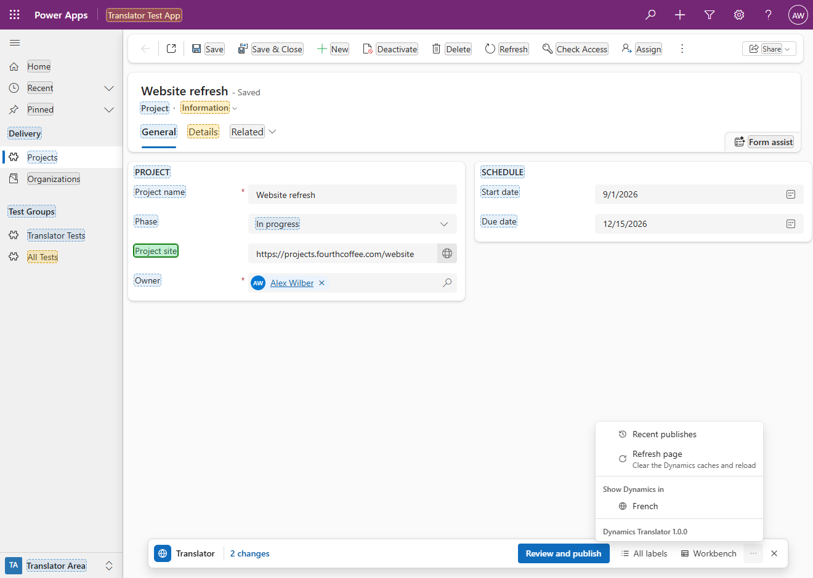

**The language menu** (`app.langMenu`, three or more languages): *Translate into* (one of the other languages, as
radio items) and *Show languages* (which other languages get a row in the popup; the base and the target are always
shown). The choice is saved in the preferences, `dxt:prefs:<org id>` in local storage, and announced with a
`dxt-prefs` event: the bar, the controller (looks depend on the target) and an open popup follow it.

**Its place.** The bar's place is kept in `prefs.bar` as fractions of the free room (`{ x, y }`, 0 to 1, three
decimals), so it follows the viewport as the window changes size. Its room across is `barSpan`: right of Dynamics'
left navigation, so that it never covers the area switcher at the navigation's foot, and left of the *All labels*
sheet while that is docked on the right. Without a saved place it sits centred in that room, 16 px above the bottom.
It stays 8 px inside its room and the viewport, and is at most 1,040 px wide (and 32 px narrower than its room, 280 px
at least).

`src/ui/bar.ts`, `barSpan` and `clearOf`:

```ts
export function barSpan(W: number, sheetLeft: number | null, nav: Box | null): [number, number] {
  const hi = sheetLeft !== null && sheetLeft > 360 ? sheetLeft : W;
  const lo = nav && nav.left <= M && nav.right > 0 && nav.right < W / 2 && hi - nav.right >= NAV_ROOM ? nav.right : 0;
  return [lo, hi];
}

/**
 * The bar's top, raised above the area switcher (`sw`) when the bar would cover it: a window too narrow to keep the
 * bar right of the navigation, or a bar dragged over it.
 */
export function clearOf(top: number, h: number, left: number, w: number, sw: Box | null): number {
  if (!sw || left >= sw.right || left + w <= sw.left || top >= sw.bottom || top + h <= sw.top) return top;
  return Math.max(M, sw.top - h - M);
}
```

* **The navigation** is `[data-id="navbar-container"]`, counted while it is on screen at the left edge (its left at
  most 8 px from it) and narrower than half the window. While the area switcher's list of areas is open
  (`[data-lp-id="sitemap-area-switcher-flyout"]`), which is wider than a collapsed navigation, the navigation's box
  takes it in (`navWith`), so the bar moves right while the list is open and back once it closes.
* **When the bar is placed.** On every render (a store change, a controller change, the preferences), when the window
  changes size, and when the navigation narrows or widens with the window as it is (its ☰ button): a
  `ResizeObserver` watches the navigation element.
* **A narrow window.** Where the navigation would leave less than 480 px beside it (`NAV_ROOM`), the bar's room
  starts at the window's left edge (and still ends at the *All labels* sheet while that is docked), and `clearOf`
  lifts the bar 8 px above the area switcher (`#areaSwitcherContainer`, `#areaSwitcherId`) where it would cover it.
  While the bar is dragged it follows the pointer; it is lifted once it is dropped.
* **Dragging.** A drag starts after the pointer moved 4 px with the button held on the logo (with pointer capture),
  and moves the bar within its room; a double click on the logo forgets the place.
* **The *All labels* sheet.** A full-height element at the right edge of the layer, narrower than 60% of it, is the
  docked sheet (`scanLayer`), and while it is there the bar uses only the room to its left (when that room is wider
  than 360 px). A floating sheet is never full height (at most 640 px, and 32 px less than the window), so the bar
  takes its usual room again; the floating sheet lies over the bar (`z-index` 12, the bar's layer 11), where the user
  put it. The sheet floats and docks by changing its class, not the layer's children, so `scanLayer` also watches the
  `class` and `hidden` attributes of each element of the layer (one `MutationObserver`, which does nothing while the
  bar is hidden, the Workbench window shown). The bar is laid out again as soon as the sheet floats or docks.

**Narrow bars.** The bar is a size container. Below 940 px the title goes and the languages show codes (*EN → FR*);
below 800 px **All labels** and **Workbench** show their icons only (their names stay for screen readers); below 640
px **Review and publish** reads **Publish**; below 480 px the divider goes.

**Keyboard.** The bar is a toolbar (`role="toolbar"`, *Dynamics Translator*) with one tab stop: ← and → move between
its buttons (wrapping around), Home and End go to the ends. When the focused **Try again** goes away, the focus stays
on the bar.

**The favourite clicked again.** While the translator runs, clicking the *Translator* favourite again shows it
(`AppHandle.show`): in translation mode the bar pulses twice (`pulse`, a ring of 0.65 s; a still ring with *Reduce
motion*).

### 9.25 All labels on this page: `inspector/pagelist.ts`

**All labels** opens a quiet side sheet, 360 px wide, docked on the right edge of the page like Dynamics' own side
panes; dragged by its header, it floats over the page instead, so that what it covered can be clicked (**Docked or
floating**, below). It lists every label of the page, including the ones not on screen (other tabs, hidden fields,
other stages), then the changes staged on other pages. A row finds its label on the page and opens its popup; nothing
is edited in the sheet.

**All labels on this page.** The sheet docked on the right, with a search for *date*: the search box, *All*, *Not
translated* and *Changed* with their counts, and the labels that match in their groups, each group a grey band with its
chevron, its name and its count (*Not on screen right now* closed), each row its base-language text, its kind where
its group doesn't say it and, under it, its French text or its state.

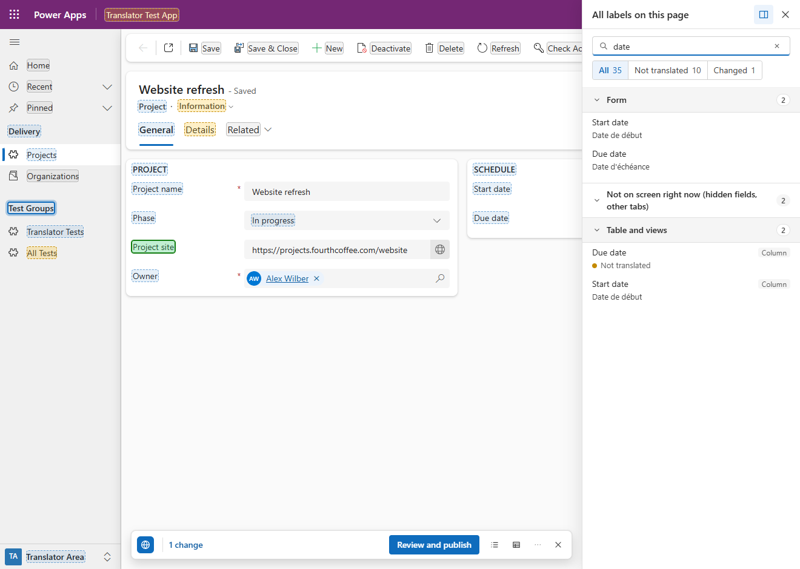

**Its parts**, top to bottom: the header, with the heading *All labels on this page*, the pin (*Dock to the right*,
pressed while the sheet is docked) and **Close (Esc)**; a red line *Couldn't load some labels.* with **Try again**
when loads failed (the details in its tooltip); the search box (*Search labels*); the filter, *All*, *Not translated*
and *Changed*, each with its count (*Not translated* is hidden with one language; it lists the rows whose look is
`missing`, [9.14](#914-looks-the-colour-of-a-label-inspectorstatusts), so a description stored empty on purpose is
never in it); the list. It is a non-modal `role="dialog"`. Esc in the search box clears the search first; the next Esc
closes the sheet.

**Groups.** The rows come in groups, in this order: *Form*, *Choices*, *Command bar*, *Navigation*, *Process*, *Table
and views* (`GROUPS` and `groupOf` in `status.ts`; a relationship's label counts as *Form*, as an item of the form's
Related menu). Each group starts with a grey band across the sheet (`.pl-gh` in `pagelist.css`, a heading of level 3)
that holds one button (`.pl-gb`): a chevron, the group's name in normal case, 14 px semibold, and its count in a badge
on the right. The band is sticky: it stays at the top of the list while its rows scroll by.

**Collapsing a group.** A click on its band, or Enter or Space on it, collapses a group, and the next one expands it
again (`toggle`). The band keeps its count, and says whether the group is open with `aria-expanded` and with its
chevron, which points right while the group is collapsed; the next band then follows right under it.

`src/inspector/pagelist.ts`, `toggle` and `group`:

```ts
/** Collapses or expands a group (its band's key): during a search, for that search only. */
function toggle(k: string): void {
  const s = q.length ? shutQ : shut;
  if (!s.delete(k)) s.add(k);
  rov = BAND + k;
  render();
  // Its band keeps the focus (render) and stays in view: collapsing a group scrolled far into brings it back.
  bandOf(k)?.scrollIntoView({ block: 'nearest' });
}
```

```ts
/**
 * A group: its band, a button with its name and count (`n`) that collapses and expands it (`key`), then while it is
 * open what `body` makes (its rows). Collapsed, the next band follows right under it.
 */
function group(key: string, name: string, n: number, body: () => Child): Child[] {
  const open = !isShut(key);
  const b = h(
    'button',
    { class: 'pl-gb', type: 'button', tabindex: '-1', 'aria-expanded': String(open), 'data-g': key, on: { click: () => toggle(key), focus: () => (rov = BAND + key) } },
    icon('chevron'),
    h('span', { class: 'pl-gn' }, name),
    h('span', { class: 'count' }, n.toLocaleString()),
  );
  return [h('div', { class: 'pl-gh', role: 'heading', 'aria-level': '3' }, b), open && body()];
}
```

* **While the translator runs.** The groups the user collapsed outside a search are kept per app (`SHUT`, a `WeakMap`
  keyed by the `AppApi`): across renders, filters and pages, and in every list opened again until the translator
  closes. A group inside *Not on screen right now* has a key of its own (`HID_KEY` before its name), so it collapses
  apart from the page's group of that name. *Changed on other pages* collapses the same way.
* **During a search.** A new search opens every group to show its hits (`shutQ`, emptied when a search starts, as
  *Not on screen right now* opens). A group collapsed during the search stays collapsed while the search is refined;
  once the search is cleared, every group is again as the user left it outside searches.

**No captions over the rows.** Inside a group, rows of one place stay together, in page order (`cluster`), without a
caption over them: the place (`whereOf`) is in the row's tooltip, as its breadcrumb, in its `aria-description`, and in
what the search matches. A process stage and a navigation group are a place of their own (`runOf`), so a stage comes
right before its steps and a navigation group before its sub-areas, the way a section comes with its fields. Only the
changes made on other pages have a heading per page (below).

`src/inspector/pagelist.ts`, `rowTag` and `runOf`:

```ts
/** Values of a column or a global choice: rows that read alike ("Allow", "Active") from one column to the next. */
const OF_CHOICE = new Set<Kind>(['option', 'status', 'state', 'boolean', 'globaloption']);
/**
 * The grey tag after a row's text: a choice value's column or global choice (its place, which no caption over the
 * rows says any more: without it "Allow" of one column looks like "Allow" of the next), else its kind.
 */
export const rowTag = (s: Slot): string => (OF_CHOICE.has(s.kind) && whereOf(s)) || rowKind(s.kind);

/**
 * The run a row is listed in (cluster): its place, and for a process stage or a navigation group its own name, so
 * that it heads its steps or sub-areas the way a section heads its fields.
 */
export const runOf = (s: Slot): string => (s.kind === 'stage' || s.kind === 'group' ? s.title : whereOf(s));
```

| Row | Its place (`whereOf`) |
| --- | --- |
| A form field | Its tab and section (*General › PROJECT*); a quick view's cells start with the quick view; *Header*, *Footer* |
| A section | Its tab and the section itself |
| A related menu item | *Related* |
| A choice | Its column's name |
| A global choice's option, a process step | The global choice; the step's stage |
| A site map entry | Its group |
| A column, a view, a chart | Its table |
| A tab, a stage, a table, a command… | None: it is a place of its own |

**Rows.** Each row has two lines. The first is the base-language text in 14 px (for a form cell without a label of its
own, its column's name, which is what the form shows), with a small grey tag on the right, on one line (at most 45% of
the row, else it ends with an ellipsis): for a choice value, its column or global choice (`rowTag`: *Allow* of one
column reads like *Allow* of the next); for anything else, its kind where the group doesn't say it (*Tab*, *Section*,
*Table*, *Column*, *View*, *Stage*, *Step*, *Related* for a related menu item…: `rowKind`). The second, under it in 13
px, is the target-language text, or its state.

`src/inspector/pagelist.ts`, `rowState`:

```ts
export function rowState(lk: Look, target: string): { text: string; cls: string } {
  const none = (lk === 'edited' || lk === 'error') && !target.trim();
  return {
    text: lk === 'missing' ? 'Not translated' : lk === 'ro' ? 'Read-only' : lk === 'builtin' ? 'Built-in' : none ? (lk === 'edited' ? 'Changed' : "Couldn't be published") : target,
    cls: CLS[lk] ?? '',
  };
}
```

A state is said by a coloured dot before the line, in the colour of the page's marks, and plain text, without italics
or icons (`CLS`, and the `::before` of `.pl-t` in `pagelist.css`): *Not translated* in grey after an amber dot; a
changed text in green after a green dot; a failed one in red after a red dot; *Read-only* and *Built-in* in grey
after a grey dot. A translated text has no dot. *Read-only* is the state of every label from a managed solution
(`readOnlyLook` gives `'ro'` for the `MANAGED` reason, even with every language there), so on Microsoft's own forms and
tables (account, contact…) almost every row says it. *Built-in* stays for Microsoft's own texts that are already there
in every installed language, the names Microsoft locks among them. A form cell whose target text is its column's
name in that language shows that name (`standsIn`). With one language a row is one line, except to say it is changed
or failed. Long texts wrap to two lines, then end with an ellipsis. Each text line carries its language (`lang`,
`dir`). A row's tooltip has both texts in full, the kind and the breadcrumb, the technical name, and what its colour
means; a grey row's says why it can't be translated here (the read-only reason: for a managed solution's label,
`MANAGED`). That last line, followed by the row's place, is also the row's `aria-description`, so that a screen reader
says where the row is: *Changed, not published yet. General › Request*.

**Not on screen right now.** Under *All* and *Not translated*, the labels of the page that aren't rendered now come
after the others, in a disclosure, *Not on screen right now (hidden fields, other tabs)*: a band like a group's, with
its count, that opens and closes, its rows grouped the same way inside it, each group collapsing apart from the page's
own. Outside a search it opens and closes as the user leaves it; during a search it is open unless the user closes it,
so a search shows its hits on other tabs too. It shows 300 rows at first (`HID_CAP`), then **Show all 512**.

**Under Changed.** *Changed* has no such disclosure: every change of the page is listed with the others, in its group
and with the rows of its place, also one on a tab not shown or on a hidden field (`inline` in `render`). A click on it
still finds it ([9.26](#926-finding-a-label-from-the-list-inspectorrevealts)).

**All labels under Changed.** The sheet under *Changed*: the changes of the *Project* record in the *Form* group,
*Goals*, on the *Details* tab, which isn't shown, listed with *Project site*.

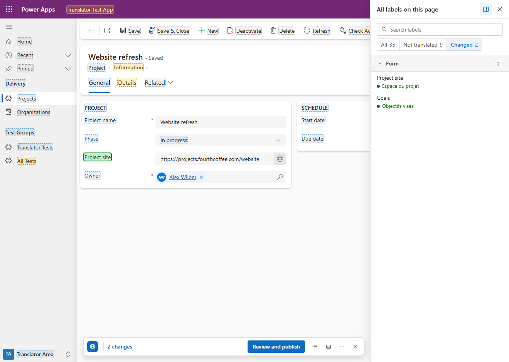

**Changed on other pages.** The changes staged (or failed to publish) whose label isn't on this page come last, in a
group of their own, which collapses like the others. Inside it, the changes of each page come under a heading with a
page icon and the name of the page they were made on (`awayTitle`; `.pl-pg`, 13 px semibold, a line between pages):
*Contact · Main form*, *Projects · Active Projects*, *Sales Hub · App navigation*; *Workbench* for a change that
wasn't made on a page in translation mode; *Another page* for a page without a name
([9.27](#927-changes-made-on-other-pages)). Their rows look like the page's changed rows. *All* and *Changed* count
them, *Not translated* never does, and the search looks in their page's name too. 300 rows at first, then **Show
all**. The group is left out when there are none.

**Search.** The search box matches every word typed, with case, accents, apostrophes and ligatures aside (`fold` in
`src/core/search.ts`, the same search as the Workbench's *Filter rows*): *tele* finds *Téléphone*, *l'action* finds
*l’action*. It looks in every language of the label's texts, staged and as on the server, its title, its breadcrumb
and technical name, its place, its kind and what its row shows (`searchText` in `status.ts`).

**While loading.** Skeleton rows show while the page's labels load (in the unfiltered list only). Empty states:
*Nothing left to translate* (*Everything on this page is translated into French.*), *No changes yet*, *No labels
match*, *No translatable labels found yet* while loading, *Nothing to translate here* on a page without labels.

**Keyboard and pointer.** The group bands and the rows are buttons in one tab stop (roving `tabindex`: the last one
used, else the first row, else the first band). ↓ in the search box goes to the first row, not to a band (a band only
when every group is collapsed), so that typing, ↓ and Enter opens the first hit; ↑, ↓, Home and End move between the
bands and the rows; ↑ on the first goes back to the search box; Enter and Space open a row, and collapse or expand a
band's group. A row under the pointer, or focused, flashes its marks on the page (`mode.flash`). A render keeps the
focus on the same row or band. When the sheet closes with the focus in it, the focus goes back to where it was when
the sheet opened (the bar's button).

**Docked or floating.** Docked, the sheet is the stylesheet's full-height panel at the right edge (`.pgl`, `z-index` 3
in the layer), and the bar keeps clear of it ([9.24](#924-the-bar-and-the--menu-uibarts)). Dragged by its header, it
floats: a panel over the page (`.pgl.is-float`, `z-index` 12: above the bar, below the popup and tooltips) with a
border, rounded corners and a shadow, like the Workbench window, so that what it covered (a field at the right of a
form) can be clicked. While it floats, the bar takes its usual room again.

**Floating.** The sheet dragged over the *Project* record: its pin no longer pressed, the *Form* group with the tabs,
sections and fields of the form, and on the right the values of *Start date* and *Due date*, which the docked sheet
covered. The bar has its full room again.

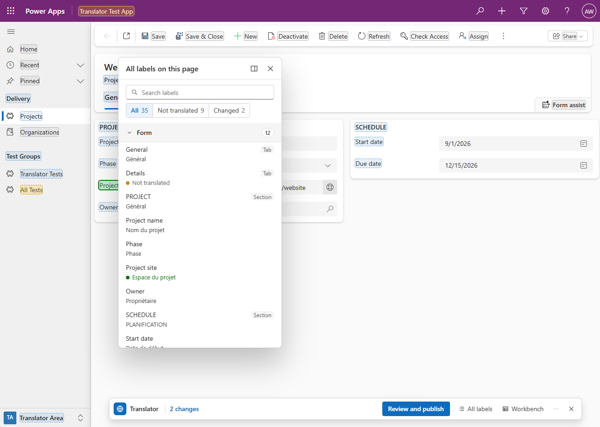

`src/inspector/pagelist.ts`, `floatBox`:

```ts
/**
 * The box of a floating sheet in a W×H viewport, at its place (`p`: fractions of the room around it, like the bar's
 * prefs.bar): always inside the viewport, however small it gets.
 */
export function floatBox(W: number, H: number, p?: { x?: unknown; y?: unknown }): { left: number; top: number; width: number; height: number } {
  const width = Math.max(0, Math.min(FLOAT_W, W - 2 * EDGE));
  const height = Math.max(0, Math.min(FLOAT_H, H - 32));
  return {
    left: Math.round(EDGE + frac(p?.x, 0) * Math.max(0, W - width - 2 * EDGE)),
    top: Math.round(EDGE + frac(p?.y, 0) * Math.max(0, H - height - 2 * EDGE)),
    width,
    height,
  };
}
```

* **Its box.** 360 px wide (`FLOAT_W`, the docked width; the window less 16 px when narrower) and 640 px high
  (`FLOAT_H`; the window less 32 px when lower), at least 8 px inside the window (`EDGE`). Its place is two fractions,
  0 to 1, of the room left around it (`x`, `y`, like the bar's), so it stays inside the window, at the same place, as
  the window changes size (the window's `resize` places it again). `frac` takes anything the preferences hold: a
  number out of range is brought into 0 to 1, anything else is 0.
* **Dragging.** A press of the primary button on the header, not on one of its buttons, captures the pointer. The
  sheet floats once the pointer has moved 4 px (across plus down), so a click or a double-click on the header never
  floats it; it then follows the pointer, kept inside the window (`floatPlace`, three decimals), and its place is
  saved when the button is released.
* **Docking.** The pin (*Dock to the right*, `aria-pressed="true"` while docked) docks a floating sheet, and floats a
  docked one at its last floating place (at first the top left, 8 px from the edges): it is also the keyboard's way to
  do both. A double-click on the header, not on its buttons, docks it. Docking keeps the floating place for the pin.

`src/inspector/pagelist.ts`, `placeSheet`, `dock` and `undock`:

```ts
/**
 * Docked, the stylesheet's full-height sheet; floating, a panel at its place. The bar keeps clear of the sheet only
 * while it is docked (ui/bar.ts scanLayer), and notices its class change.
 */
function placeSheet(): void {
  const fl = floating();
  el.classList.toggle('is-float', fl);
  pinB.setAttribute('aria-pressed', String(!fl));
  const b = fl ? floatBox(...view(), live ?? placeOf()) : null;
  Object.assign(el.style, b ? { left: b.left + 'px', top: b.top + 'px', width: b.width + 'px', height: b.height + 'px' } : { left: '', top: '', width: '', height: '' });
}
/** Back on the right edge (the pin, a double-click on the header); its floating place is kept for the pin. */
function dock(): void {
  if (!floating()) return;
  app.savePrefs({ list: { float: false, ...placeOf() } });
  placeSheet();
}
function undock(): void {
  app.savePrefs({ list: { float: true, ...placeOf() } });
  placeSheet();
}
```

**Its place in the preferences.** Docked or floating, and the floating place, are `list` in the preferences
(`Prefs.list` in `src/ui/types.ts`: `{ float?, x?, y? }`), saved with `app.savePrefs` in `dxt:prefs:<org id>` in local
storage ([9.24](#924-the-bar-and-the--menu-uibarts)). `readPrefs` in `src/ui/app.ts` keeps `list` when it is an object,
and the sheet checks its values: only `float: true` floats it. So the sheet opens again where it was left, docked or
floating, the next time **All labels** is pressed and after a reload.

**The popup of a row.** A row's popup points at its label when the sheet doesn't cover the label, wherever the sheet
is; else it points at the row and opens beside the sheet, to its left, or to its right when the sheet floats near the
left edge, so it doesn't cover the list; with room on neither side, it is placed as next to a label (`rowAnchor`,
[9.19](#919-opening-a-popup); `placeCallout`'s `beside`, [9.21](#921-the-popup-uicalloutts)).

**Following the page.** The sheet listens to the controller (`mode.on`): it renders again 120 ms after a change. On
another page it shows that page's labels; a row the new page shows too keeps its element, so the row of a change found
on its own page moves into the page's group and its popup stays next to it.

**A click on a row** calls `mode.open(comp, { from: row })`. When that returns `false` (the label is not on this page,
and its change was not made on a page in translation mode), `app.edit(comp)` opens the editor card in a dialog.

**Opening and closing it.** `toggleList` in `src/ui/app.ts` opens the sheet with `openPageList(app, mode, { close })`
and adds its element to the app's layer; `closeList` cancels a find still waiting (`mode.cancelFind()`), calls the
sheet's `close()` and removes its element. The sheet answers with a `PageListApi` (`src/inspector/types.ts`): `el`;
`refresh()`, which renders it again; `rowOf(comp)`, the row element of a component on the page, else `null`; and
`close()`, which stops its listeners (the window's `resize` among them) and gives the focus back to the bar's button
when it was in the sheet. Nothing in `src/` calls `refresh()` or `rowOf()` at present: the sheet follows the controller
by itself, and the unit tests use `rowOf`.

### 9.26 Finding a label from the list: `inspector/reveal.ts`

`mode.open(comp, o)` finds a component's label on the page, pulses its mark and opens its popup next to it. The list
and the Publish dialog's **Fix** use it. It first reads the page as it is now (`navigate()`: a click within a second
of a form switch would otherwise be decided on the page before), then finds a label of this page here, and a change
made on another page where it was made ([9.27](#927-changes-made-on-other-pages)).

`src/inspector/mode.ts`, `open` in the `PageMode`:

```ts
open(comp, o = {}) {
  if (!on || paused || !x || comp === bypass) return false;
  // The page as it is now: a click within a second of a navigation (a form switch keeps the URL) would otherwise be
  // decided on the page before, and a find gone from there would take this one for another page and give up.
  navigate();
  // A label of this page is found here, never by navigating; a change made on another page where it was made there.
  return onPage(comp) && !elsewhere(comp) ? openComp(comp, o) : goFind(comp, o);
},
```

**On this page** (`openComp`, `find`):

1. **Shown.** A label the overlay shows: its popup opens next to it, and its mark pulses.
2. **Rendered, off screen.** A label the page renders but that is scrolled away is scrolled into the middle
   (`scrollIntoView`), which shows it and changes nothing on the page; the popup opens two frames later, once the
   overlay has measured it.
3. **Not rendered.** `revealOf(m, ctx)` says what to open so the page renders it, when that changes nothing but the
   view.

`src/inspector/reveal.ts`, `revealOf`:

```ts
export function revealOf(m: Slot, c: RevealCtx): Reveal {
  if (!c.record) return NOTHING;
  if (m.kind === 'step') {
    const r = m.ref || {};
    return c.bpfId && guid(r.workflowId) === c.bpfId && r.stageId ? { by: 'stage', stageId: guid(r.stageId) } : NOTHING;
  }
  // A composite column's sub-field (Street 1 of an address) shows in its composite control's cell.
  let mm = m;
  if (m.kind === 'attribute') {
    const c0 = c.cellOf(m.comp);
    if (!c0) return NOTHING;
    mm = c0;
  }
  if (mm.kind !== 'field' && mm.kind !== 'section') return NOTHING;
  const r = mm.ref || {};
  // A quick view form's field shows where the page form's quick view control is; a side pane's form has none.
  const cell = guid(r.formId) === c.formId ? mm : mm.kind === 'field' ? c.quickHost(guid(r.formId)) : undefined;
  if (!cell) return NOTHING;
  const h = cell.ref || {};
  if (h.area === 'header') return cell === mm && h.controlId && c.shows({ ctl: String(h.controlId) }) !== false ? { by: 'header' } : NOTHING;
  if (h.area !== 'body' || !h.tabName) return NOTHING;
  const tab = String(h.tabName);
  const q: FormQuery = { tab, section: String(h.sectionName || ''), ...(cell.kind === 'field' && h.controlId ? { ctl: String(h.controlId) } : {}) };
  if (c.shows(q) === false) return NOTHING;
  // On the tab shown and not drawn yet: Dynamics draws it once it comes into view.
  return tab.toLowerCase() === c.tab.toLowerCase() ? { by: 'render' } : { by: 'tab', name: tab };
}
```

| Reveal | Opens | How |
| --- | --- | --- |
| `tab` | The form tab of a field or section (a quick view's field: its quick view control's; a composite column's sub-field: its composite control's) | `Xrm.Page.ui.tabs.get(<name>).setFocus()` (`focusTab`); for a tab the API can't show, a click on it |
| `render` | A field or section of the tab shown that Dynamics hasn't drawn yet | Its place is scrolled into view |
| `header` | The header's flyout, for a header field | A click on its expand button (`headerFieldsExpandButton`), only while the flyout is closed |
| `stage` | A process step's stage flyout (the active process only) | A click on the stage chip's button, only while that flyout is closed (a second click would close it) |
| `none` | Anything else: a tab's own label, navigation, choices, commands, footer fields, a side pane's fields, a label the form hides | Nothing |

`formShows` asks the form API whether the form hides the tab, the section or the control (`getVisible()` false; every
copy of a control counts). A label the form hides is not revealed. Never a menu (*More tabs*, the related menu, the
command overflow: they close as soon as the popup takes the focus), never another tab for a tab's own row, never
anything on the record.

**Fields drawn as they come into view.** Dynamics draws a tab's fields only as they come into view: until then a field
is an empty `div[data-id="<control>"]` in its section (verified in a test environment, LIVE-FINDINGS 96). For a field
or section the form shows but hasn't drawn, on the tab shown or on the tab just opened, `bodyPlace` and `placeholder`
find its place (the placeholder in its section, its container once drawn, else the section; never a side pane's or a
grid's) and bring it into view. Once the label is drawn it is put back in the middle, because drawing it drew the
fields around it, which moved it.

**Waiting.** After opening what hides it, the find looks at the page every 100 ms, bringing the place into view as soon
as it is on the page and again when another element stands there (the drawn field for its placeholder), for at most
2.5 seconds (`REVEAL_WAIT`). The label found pulses and the popup opens next to it. A label that doesn't show in time,
and one the form hides, open next to the list row, beside the sheet (`present` with `from`), or docked above the
bar. Closing the sheet cancels a find still waiting (`cancelFind`), and so do another row, a label clicked on the
page and the Workbench.

### 9.27 Changes made on other pages

The list shows the changes staged on other pages, and a click on one goes back to exactly where it was made: the same
record and form, the same tab or related view, the same flyout; the same list and view; the same dashboard.

**Where a change was made.** When an edit is staged, the controller records where (`notePlaces`, into `staged`):

`src/inspector/mode.ts`, `stagedAt`:

```ts
export function stagedAt(key: string, comp: string, page: Place | null, open: OpenSpot | null, onPage: (comp: string) => boolean, spot: () => Spot): Staged | null {
  const edits = !!open && open.keys.has(key);
  if (!page || !(onPage(comp) || (edits && onPage(open!.comp)))) return null;
  return { page, spot: edits ? open!.spot : spot() };
}
```

* **The page** (`Place`): the page loader's page while translation mode is on and not paused: its type, table, record,
  form, view and dashboard. Only for a label of that page, or a text the open popup edits with it (`modelKeys`: the
  popup's texts, the other copies of a field, its choices).
* **The place on it** (`Spot`): for a text the open popup edits, the popup's spot, taken when it opened (or moved to a
  label): the form tab shown (`selectedTab`), or the related view shown instead, and the flyout its label was in (the
  header's, or a process stage's, `flyoutOf`; a label in a side pane records none). A related view is told from a tab
  by its name: the page form has no tab of that name, and it starts with *nav* or is a nav item of the form XML
  (`spotOf`; an associated grid opened from the Related menu is shown as the tab `tablist-<nav id>`, LIVE-FINDINGS
  88). For a text the open popup doesn't edit (an older step redone with Ctrl+Y while a popup is open), its own
  label's place now.
* **Nowhere** (`null`): a change made in the Workbench, by an import, in the app's editor, before translation mode
  started, or in a docked popup for a label of no page here.

The record is kept in memory only, until the translator closes or the page reloads, and forgotten once the change is
no longer staged (published, undone, or dropped by a reload that brought the same text). A change first made elsewhere
and then changed on a page records that page.

**Listed where.** `items()` asks `awayItems` for every staged or failed change whose component isn't among the page's
own rows. One made on this page whose label isn't shown now (a quick view without its record, a sub-grid on another
tab) joins the page's labels (under *Changed* with the others, in its group with the rows of its place; under *All* in
*Not on screen right now*); the others go under *Changed on other pages*, named by `awayTitle`.
`elsewhere(comp)` covers one more case: a change made on another page whose label this page lists but doesn't show (a
column renamed through an associated view's header, looked for from a form of its table that only lists the column) is
listed, and found, where it was made (verified in a test environment, LIVE-FINDINGS 98).

**Going there.** `goFind(comp, o)` goes to the page with Dynamics' own navigation, then finds the label there as on
any page.

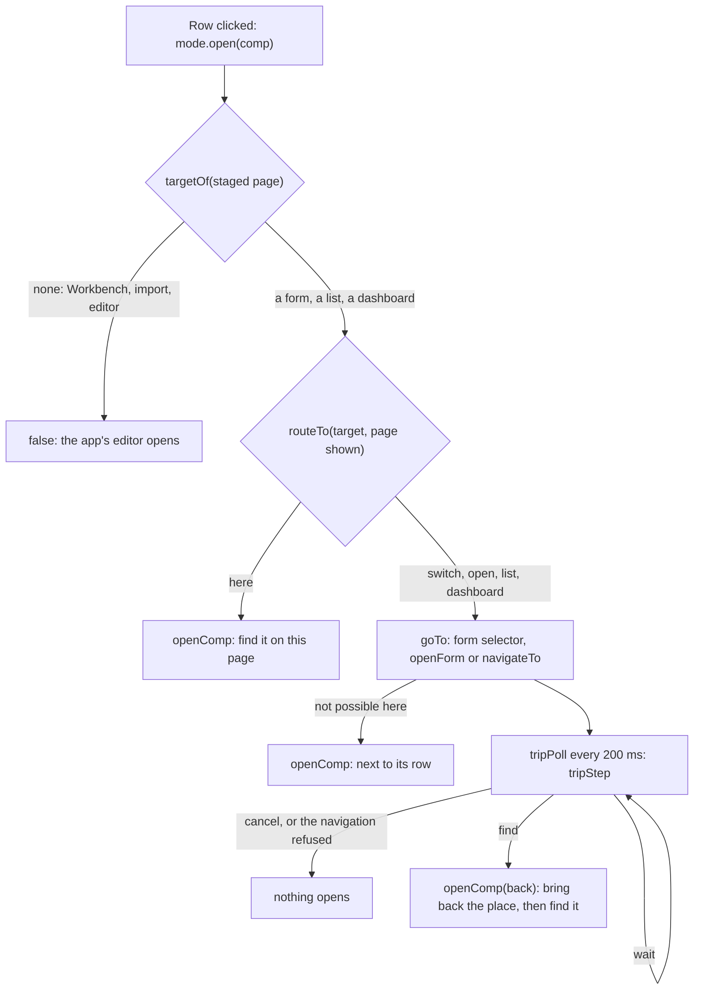

`src/inspector/reveal.ts`, `routeTo`:

```ts
export function routeTo(t: Target, p: Place | null): Go {
  switch (t.to) {
    case 'form':
      if (p?.type === 'entityrecord' && same(p.entity, t.entity) && (!t.recordId || t.recordId === p.recordId))
        return !t.formId || t.formId === p.formId ? HERE : { by: 'switch', entity: t.entity, recordId: p.recordId, formId: t.formId };
      return { by: 'open', entity: t.entity, recordId: t.recordId, formId: t.formId };
    case 'list':
      return p?.type === 'entitylist' && same(p.entity, t.entity) && (!t.viewId || t.viewId === p.viewId) ? HERE : { by: 'list', entity: t.entity, viewId: t.viewId, viewType: t.viewType };
    case 'dashboard':
      return p?.type === 'dashboard' && p.dashboardId === t.dashboardId ? HERE : { by: 'dashboard', dashboardId: t.dashboardId };
  }
}
```

| Route | `goTo` calls |
| --- | --- |
| `switch`: another form of this record | The form selector item's `navigate()` (the record stays). A form the selector doesn't list for this user: no navigation, and the popup opens next to the row. Without a form selector, `Xrm.Navigation.openForm` on this record |
| `open`: another record or table | `Xrm.Navigation.openForm({ entityName, entityId, formId })`; a change made on a new record's form opens a new record's form (`openForm({ entityName, formId })`), and nothing is saved unless the user saves |
| `list` | `Xrm.Navigation.navigateTo({ pageType: 'entitylist', entityName, viewId, viewType })` |
| `dashboard` | `Xrm.Navigation.navigateTo({ pageType: 'dashboard', dashboardId })` |

Always on the page's `Xrm`, read live, never a side pane's. Dynamics asks about unsaved changes as it always does, and
nothing gets around that. A navigation whose promise rejects (the user kept the unsaved changes) cancels the find.

**Arriving.** The find then looks at the page every 200 ms (`tripPoll`), and follows it at once (`navigate()`, rather
than waiting for the one-second tick). `tripStep` decides:

* **wait**: still on the page it left (Dynamics may be asking about unsaved changes), or on the way (a record of the
  target's table, a list of its table, a page that doesn't say what it is yet);
* **find**: the target page shows and its label is anchored; or the page has been ready (its index and loads in, its
  form rendered) for 0.5 seconds (`TRIP_SETTLE`: the label may be on another tab, in a flyout, or hidden, and the find
  on that page decides); or Dynamics opened another form of the record instead (the target form isn't available to the
  user) and that has been ready for 3 seconds (`TRIP_OTHER`); or the deadline came while it is there;
* **cancel**: the user went to another page, or 20 seconds passed without arriving (`TRIP_WAIT`).

A second click on the row while the find is on its way does nothing, unless it is still on the page it left one second
after it set out, with no Dynamics dialog open (`goAgain`): the user said no to the unsaved-changes question, whose
promise may never reject, and it goes again. Another row, a label clicked on the page, closing the sheet, the
Workbench and one of the translator's dialogs cancel it: nothing opens. The sheet keeps a row's element across pages,
so the popup opens next to it when the label doesn't show.

**Back to the place.** Before the label is looked for on its page, the place where the change was made is opened again
(`goBack`, `backStep`): its form tab (`Xrm.Page.ui.tabs.get(<name>).setFocus()`) or its related view
(`Xrm.Page.ui.navigation.items.get(<nav id>).setFocus()`), then, once the tab bar shows it selected, the flyout its
label was in (the header's expand button, the stage chip's button). Each part is opened once, because a second click
would close a flyout; a part that can't be opened, or isn't shown 2.5 seconds after it was opened (`BACK_PART`), is
left out. The page is looked at every 100 ms, and the label is found (`find`: it pulses and its popup opens next to
it) once it shows, once the place has shown with the page's loads in for 1.5 seconds (`BACK_SETTLE`: an associated
grid draws, then loads its view's query, before its headers are marked), or after 8 seconds (`BACK_WAIT`). Only the
view changes, never anything on the record.

This also happens on the page itself, for a change made there whose label doesn't show now (a column header changed in
an associated view while another tab is shown), and on another record shown with the same form: the tabs, related
views and flyouts belong to the form. Coming back from another page, the place is opened even when the label already
shows on arrival (a sub-grid on the default tab), so the user lands on the same tab or view; on the page itself
nothing moves while the label shows.

### 9.28 Timings

| Constant or value | Where | Value | What it is |
| --- | --- | --- | --- |
| The tick | `mode.ts`, `start` | 1,000 ms | Preferences and the page checked (form switches and process changes don't always change the URL) |
| `refreshSoon`, `navSoon`, `emitSoon` | `mode.ts` | 60, 350, 40 ms | Index rebuilt after new slots; page checked after the URL changed; bar and list told |
| Mutation batch | `overlay.ts`, `take` | 90 ms | Page changes collected before a rescan |
| Overlay re-measure | `overlay.ts`, `start` | 1,000 ms | One frame a second, for layout changes without an event |
| `PULSE_MS` | `overlay.ts` | 1,800 ms | A label found from the list pulses |
| `STEADY`, `WAIT_MAX` | `ui/callout.ts` | 2 frames, 300 ms | An opening popup's place holds this many frames in a row before it shows; the longest it stays hidden, then it shows wherever it is |
| `REVEAL_WAIT` | `mode.ts` | 2,500 ms | A label may take this long to render after its tab, flyout or stage was opened, or its place brought into view |
| `TRIP_EVERY` | `mode.ts` | 200 ms | A find gone to another page looks at the page |
| `TRIP_WAIT`, `TRIP_AGAIN`, `TRIP_SETTLE`, `TRIP_OTHER` | `reveal.ts` | 20,000, 1,000, 500, 3,000 ms | Give up; a second click may go again; a ready page may take to render the label; another form shown instead |
| `BACK_PART`, `BACK_SETTLE`, `BACK_WAIT` | `reveal.ts` | 2,500, 1,500, 8,000 ms | A part of the place may take to show; the place shown with its loads in; the whole of bringing it back |
| `wakeForm` | `mode.ts` | 500 ms, then 3,000 ms, every 100 ms | A cold form API given time to fill on its own, then reopened and waited for |
| `PICK_WAIT`, `PICK_EVERY` | `lists.ts` | 3,000, 100 ms | **Open** on an area or a view: how long the list opened again may take to show the item, and how often it is looked for |
| Command bar batch | `pageload.ts`, `request` | 150 ms | Buttons collected before their labels are read |
| `verifyAfterLoad` | `app.ts` | 1,500 ms, then up to 60 s | Before the check after a refresh, and the page's loads waited for |
| The list's render | `pagelist.ts` | 120 ms | After a change the controller reports |
| Store typing run | `core/store.ts` | 1,200 ms | Keystrokes in one text closer than this are one undo step |

### 9.29 Tests for translation mode

The unit tests run with `npm test` (`tools/test.mjs` bundles `tools/dev/unit.ts` with the test files and runs it in
Node.js, with a small fake DOM where a test needs one). Those for translation mode:

| File in `tools/dev/tests/` | Covers |
| --- | --- |
| `mode.ts` | The controller's pure helpers (label clicks, counts, notes, slot looks, re-anchoring, tab switching, the secondary action, where a change was staged, list rows, where a popup opened from a row points with the sheet docked or floating: `rowAnchor`, a clicked label taken again from a new scan by its element, role and part: `sameLabel`) and the controller itself on a fake page: a label the next page drew before the page tracker saw the navigation opening that page's popup, or none, never the previous table's column, and on a list page a grid naming another table mapping none of its headers to the index's table; finding a label from the list, also one staged on another page; **Change area**, **Change form**, **Change view** and **Open** on an item of their lists (`runAction`, `openList`, `switchTo`, `listActs`), and the focus given back to a list's button (`focusOpener`); the bar's hint, and its place right of the left navigation, clear of the area switcher (`barSpan`, `clearOf`, `navWith`) |
| `overlay.ts` | Mark geometry and clipping, the pencil badge, what a popup of the page leaves of a mark, which looks are left alone, which clicks inside a zone pass, when the pointer is on a label's text (`onText`), what acts beside it (`acts`, a `<label>` for a checkbox, `nested`), what only opens, closes or picks (`effect`: the navigation's groups, Recent and the area switcher, the lists' buttons and items, while a site map entry and every other menu still act), gestures swallowed beside the text, double clicks |
| `overlay-dom.ts` | The overlay against a fake DOM: what is taken over, what reaches the page, Alt, pause and stop, the marks one frame draws; a click on a label's text and beside it, in a passive zone and in one that acts (every role of `ACTIVE`, a button around a view's name, a menu item, a `<label>` for a checkbox), in the navigation (a group's header and chevron, Recent) and in the lists the page is switched with (the form and view selectors, the items of the areas, forms and views), the parts of one text, a label not marked yet, a label inside another, a press released beside the text; the hover ring, the pencil (none on a selector's own name) and the pointer cursor following the text |
| `scan.ts` | The page index, `fieldOf` and `ctlSlot` against a fake form API, and the page loader's helpers: the names of the forms and views in an open list read on demand, together and once; a form no read can complete (`ref.unreadable`) is no failed load |
| `panes.ts` | Side panes' forms, quick views, multi-select values on a form; the page loader's process load, which adds a record's stages and steps to the store once, with the names Dynamics keeps for them |
| `parts.ts` | Multi-select values, linked-table headers, the tables a grid's query reads, the form and grid ids in the DOM |
| `unmarked.ts` | Composite columns' sub-fields, the timeline's title, *Form assist*, Home, Recent and Pinned, site map entries showing a plural name; the area switcher, the form selector and view selectors with their lists open: each item marked by its id, the actions they get, a dialog's or side pane's list of forms without **Open**, never a personal view or *Manage and share views* |
| `placeholders.ts` | Site map items the app designer never named, and those of a site map from a managed solution, never named here |
| `navmenu.ts` | Related menu items in a language they have no title in |
| `coldload.ts` | Cold boots: when to open the record again, and what is scanned meanwhile |
| `describe.ts` | The popup's content, looks and the list's groups; a field's blocks in their order with their notes; the actions of the selectors and of their lists' items (`listAction`, `actionFor`); a built-in command of a managed solution's table, whose popup never says to translate its names here |
| `callout.ts` | The popup's helpers (Undo changes, placeholders, amber, problems, the copies' checkbox, never writing a copy on a form from a managed solution, placement, a field popup's first text: `focusKeys`, the *Form label* whether or not the form has a label of its own, the *Column name* only where the form's label is read-only) and the popup itself against a fake DOM; a shown popup keeping its side while it nearly fits (`STICK`); an opening popup shown once its place held for two frames, and while its label is gone waiting 300 ms at most (`settle`); one opened at an option of a dropdown list shown once, at the field, never at the option nor docked meanwhile; a translation emptied where Dataverse can't remove it, said under its input as the stand-in it becomes (`becomes`) and refused only where none is known, in the popup and in the editor card; the preview of an emptied form label; a popup opened from a row of the sheet, beside the sheet wherever it is (`beside`) |
| `pill.ts` | The pills' counting and wording, and which fields get one |
| `pagelist.ts` | Where a row is (read to screen readers and found by the search), row kinds and tags (a choice value's column), the rows of one place together (a stage before its steps, a navigation group before its sub-areas), row states, the search, and the sheet itself: no captions over the rows, the changes made elsewhere under a heading per page, groups collapsing by their band for the session and during a search, under *Changed* a change not on screen listed with the page's, without *Not on screen right now*; floating and docking (`floatBox`, `floatPlace`, the pin, a double-click on the header), its place kept in the preferences (`readPrefs`), and the bar keeping clear of it only while it is docked |
| `reveal.ts` | What to open so the page renders a label, the form API's visibility, the tab shown, the flyout openers; for a change made on another page, the way there, Dynamics' navigation calls, the find's steps while it goes, and the steps that bring the place back |
| `undo.ts` | Each text box's own history, the keys, and Ctrl+Z / Ctrl+Y on the store and on the page |
| `context.ts` | The page's `Xrm` read live (`liveXrm`): another table's form reached without a reload has its own, and while there is none, the last one seen, never the first page's (LIVE-FINDINGS 95); a frame of another site skipped while looking for it (`findXrm`) |
| `bpf.ts` | The stage and step names Dynamics keeps: how such a name looks in the popup and on the page, and an emptied one saved as the English text, besides reading and saving them; a read that misses nothing clearing an earlier read's misses (`ref.unread`) |
| `lockreasons.ts` | Why a table's or column's label can't be translated, in the same words in the popup and the list as in the Workbench and the Publish dialog; a managed solution's table, column, choice, relationship and global choice read-only with `MANAGED` as loaded and refused at save, its unmanaged custom column editable |
| `emptydesc.ts` | The descriptions saved empty (`keepsEmpty`): the rule, the saver and the journal, Undo, the metadata writers against a fake Dataverse, the loader keeping a stored `''` for descriptions only, the store and the looks (stored empty translated, missing missing), the popup's and the editor card's words and placeholders, the Workbench's cells and *Rows* filters, and an import still taking an empty cell for no change |

How translation mode behaves on Dynamics' real pages is checked by a live suite in a test environment:
`tools/e2e-page.js`, loaded with a development build (`dist/translator.debug.js`, built with `--dev`). It opens real
popups through the development handles (`app.dev.mode()`), types into their inputs, presses **Done**, publishes
through the Publish dialog, checks with independent reads that exactly the intended label changed, in exactly the
target language, and puts everything back. On the account form, which comes from a managed solution, it checks that
every field label is read-only with the managed reason, that the popup's inputs are disabled and say why, and that
nothing is staged on it. `app.dev.noRefresh` keeps the page from reloading after a successful publish. Its results
are in `window.__dxtPage`. [Chapter 14](#14-testing-your-changes) describes both suites and how to run them.

---

## 10. The Workbench and files

This chapter explains the Workbench, the translator's spreadsheet view, from its *Export options* screen to the grid,
the bulk tools and **Save and Publish**, and then the files it reads and writes: the Excel workbook in the layout of
Easy Translator, the CSV file, and the .xlsx and ZIP code under them. How to use the Workbench, step by step, is in the
[README](../README.md); this chapter says how it works and why.

### 10.1 What the Workbench is

The Workbench is the translator's second view, next to translation mode ([chapter 9](#9-translation-mode)). Where
translation mode works on the labels of the page in front of you, the Workbench works on whole tables, a solution or a
file: a window with one sheet per kind of label, the ids and names that say which label a row is, and one column per
language. It opens from the bar's **Workbench** button; on a page that shows no labels (anything other than a record, a
list or a dashboard) it is the only view.

Its sheets carry the names of the sheets of Easy Translator, a tool for XrmToolBox, and its Excel files use Easy
Translator's layout ([10.13](#1013-the-excel-workbook-format)), so a file can go from one tool to the other. The
Workbench adds sheets for the kinds of label Easy Translator does not cover (form navigation, apps, business process
flows, commands, classic ribbon labels, environment variables, custom APIs).

Four rules hold everywhere in the Workbench:

* **Nothing is written until Save and Publish.** Typing, pasting, filling, the bulk tools and imports only stage edits
  in the Store ([chapter 4](#4-code-architecture)). **Save and Publish** opens the Publish dialog, which saves through
  the saver with all its checks and publishes ([chapters 7](#7-saving-safely) and
  [8](#8-the-publish-dialog-history-and-undo)).
* **No suggestions.** The Workbench never proposes a translation: no machine translation, no translation memory. The
  one tool that fills cells, *Copy base language into empty cells*, copies the base-language text, and only when you
  run it.
* **Every pending edit stays reachable.** A row with a pending edit is always in the workbook, whatever the last
  extraction and the label options say, and a language that holds a pending edit is always a column, so the navigator
  ([10.11](#1011-the-pending-change-navigator)) can always reach it; when *Rows* or *Filter rows* hides the row, the
  navigator clears them.
* **Nothing from a managed solution is changed.** A label whose component comes from a managed solution (the
  component's own `ismanaged` or `IsManaged`: a form's for its tabs, sections and fields, a sitemap's for its items, a
  process's for its stages and steps) is read-only, whatever its managed properties allow: a translation would add an
  unmanaged layer on top of it. The grid greys it and does not open it, the bulk tools and imports skip it, the Store
  never stages it and the saver refuses it ([9.13](#913-microsofts-built-in-text-and-read-only-labels),
  [chapter 7](#7-saving-safely)). The reason is the same everywhere:

  `src/core/model.ts`, `MANAGED`:

  ```ts
  export const MANAGED = 'From a managed solution: a translation here would add an unmanaged layer on top of it. Translate it where its solution is developed.';
  ```

  Microsoft's own tables (`account`, `contact`…) and their forms and views are managed, so almost all of their labels
  are read-only. A managed solution's labels are translated in the environment where the solution is developed. Your
  own unmanaged components can be translated, also those on a managed table: an unmanaged custom column, form or view
  of a managed table is editable, while the table's own labels are not.

**The Workbench's options.** On the left, *Entities options*: where the tables come from (*All entities* or *From a
solution*), the filter and the list of tables to tick. On the right, *Global Options*, *Languages*, *Entity related
options* and *Label options*. **Extract translations** in the header loads what is ticked.

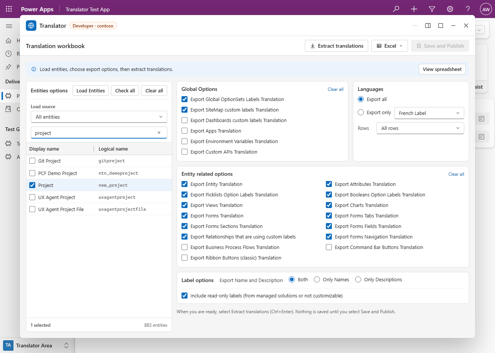

### 10.2 The files

| File | What it holds |
| --- | --- |
| `src/workbench/workbench.ts` | The view (`createWorkbench`): the header, the message bar, the top bar, the sheet tabs, **Extract translations**, **Read again**, the navigator, the **Excel** menu and **Save and Publish**. Also the pure helpers that decide what the workbook holds and says (`inBook`, `bookOf`, `columnLangs`, `pendingLocs`, `navStep`, `saveLine`, `nothingExtracted`, `unreadLine`, `skippedIntro`) and the grid's options (`gridOptions`), tested in `tools/dev/tests/workbook.ts` |
| `src/workbench/scope.ts` | The *Export options* screen (`createSetup`), the state the Workbench remembers (`loadState`, `saveState`), what an extraction loads (`scopeOf`), and which table list the ticks belong to (`listKey`, `waitsForList`) |
| `src/workbench/sheets.ts` | The sheets (`SHEETS`) and their key columns, the sheet of a slot (`sheetOf`), the row order (`sortSlots`), the *Rows* filter (`rowsTest`), the label options (`inLabelMode`), the text *Filter rows* searches (`searchText`) and the options of the *Export options* screen (`SETUP_GROUPS`). Pure: no DOM, no network |
| `src/workbench/grid.ts` | The grid (`createGrid`): drawing, editing, keyboard, mouse, clipboard. Its pure parts are exported for the tests: the cell looks (`langCell`, `edLook`, `rowState`), what a *Not loaded* cell says and offers (`unreadTip`, `rereadable`), the blank rules and stand-ins (`blankEdit`, `clearing`, `blockedWhy`, `standInTip`, `textOf`), the clipboard parsing (`parseTsv`, `toTsv`) and the paste checks |
| `src/workbench/tools.ts` | The bulk tools (`TOOLS`, `openTool`), and the guards of *Find and replace* against a search that could freeze the page (`riskyRegex`, `FIND_BUDGET`, `SEARCHING_AFTER`) |
| `src/workbench/regex.ts` | *Find and replace*'s regular expressions: the search in a Web Worker, stopped after `FIND_LIMIT` (`searcher`, `canSearchAside`), and, where the page allows no worker, the check of what may search on the page (`heavyRegex`) |
| `src/workbench/types.ts` | The contracts: `KeyCol`, `SheetDef`, `SetupOpt`, `WbState`, `SetupApi`, `GridApi`, `GridOptions` |
| `src/workbench/workbench.css`, `grid.css`, `setup.css` | The styles of the view, the grid and the *Export options* screen |
| `src/ui/shell.ts` | The window the Workbench lives in (`createShell`): docked, floating or maximized, and the pill it becomes when minimized. Its title bar and footer are built by `src/ui/app.ts` |
| `src/io/workbook.ts` | The Excel and CSV formats (`createIo`): the export layout, reading an imported file (`parse`) and staging its values (`apply`) |
| `src/io/xlsx.ts` | Writing and reading .xlsx files (`writeXlsx`, `readXlsx`), and the column letters of an index (`colName`) |
| `src/io/csv.ts` | Writing and reading CSV (`toCsv`, `parseCsv`, `unguard`) |
| `src/core/zip.ts` | Reading and writing ZIP packages (`openZip`, `unzip`, `zip`), CRC-32 and base64 helpers. Also used by the classic ribbon writer for its translation file ([chapter 6](#6-providers-reading-and-writing-each-kind-of-label)) |

`src/main.ts` hands `createWorkbench` to the app as `deps.views.workbench` and `createIo(ctx)` as `deps.io`. The view
is an object with `el`, `activate`, `deactivate`, `destroy` and `edit`, and `footer: false` (the Workbench has its own
**Save and Publish**, so the app's footer is not shown under it). `activate()` reads the table and solution lists the
first time (`setup.init()`), takes the language choices of the moment and redraws. `edit(comp, lcid)` is what the app
calls to open a component in the Workbench, for example from a **Fix** link of the Publish dialog: it picks the row
with the problem in that language (`fixSlot`), adds the language as a column if it is not shown, and brings the cell
into view.

How the pieces work together:

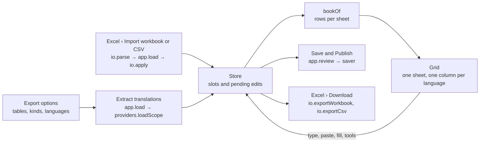

**The window.** The Workbench is the only view with a window; in translation mode the window and its pill are hidden
(`shell.hide`). `createShell(root, { key, onChange })` in `src/ui/shell.ts` gives the window three modes:

* `right`: docked to the right edge, at full height, and resized by its left edge. It is 440 pixels wide at first
  (`DOCK_W`), at least 360 (`MIN_W`), and leaves at least 120 pixels of the page where the viewport is wide enough.
* `float`: moved by its title bar and resized from its four edges and four corners, at least 360 × 400 pixels (`MIN_W`,
  `MIN_H`; less only in a smaller viewport).
* `max`: the whole viewport.

A drag starts once the pointer has moved 4 pixels. Dragging a docked or maximized window by its title bar floats it
under the pointer; dropping it with the pointer at the right edge of the viewport docks it, at the top edge maximizes
it. A double click on the title bar maximizes the window or restores it. **Minimize**, or Esc with no menu, dialog or
other layer open and the focus outside a text box or a drop-down list (in the grid, an Esc with a range selected only
reduces the selection to its active cell), turns the window into a round pill at the bottom right: the logo,
*Translator*, a spinner while something loads or saves, and that work or the number of pending changes (*3 changes*);
screen readers hear *Open the translator (3 pending changes)*. A click on the pill, or on the favourite, brings the
window back, and the focus with it.

`src/ui/app.ts`, `show`:

```ts
// The Workbench is a wide grid: it floats large (centred, min(1280px, 92vw) × min(860px, 92vh)) unless
// the user docked or maximized it; the shell keeps that size fitted to the viewport as it changes.
shell.use('workbench', { mode: 'float', w: 1280, h: 860, fill: 0.92 });
```

A floating window keeps what the user chose, not what it was squeezed to: its place and its size are each either the
user's or automatic, and every layout fits them to the viewport without overwriting them, so a window shrunk by a small
browser window grows back when the browser grows. Moving the window keeps an automatic size automatic; resizing it
makes the whole rectangle the user's. While it is dragged, and after, until the viewport or the mode changes, only 120
pixels of its width and its title bar need to stay on screen. The mode and the placement of each view, and the docked
width, are kept in local storage under `dxt:win:<organization id>`, as `{ ver: 2, dock, v: { workbench: { m, p } } }`;
of a layout stored by an earlier version, the floating placement is dropped and only the modes and the docked width
are kept.

**The title bar** (built in `src/ui/app.ts`) holds the logo, *Translator*, the environment badge (*Sandbox · contoso*,
from `envType` and `org` of the context, [4.3](#43-the-context-srccorecontextts); one colour for *Production*, another
for *Developer*, *Sandbox*, *Trial* and *Preview*, the plain badge for any other), the language button (with three
languages or more), then **More**, **Dock to the right** (pressed while docked; pressed again, it floats the window),
**Maximize** (**Restore down** while maximized), **Minimize** and ✕ (*Back to page (Alt+1)* or *Close*, below). There
is no separate button to go back to the page: the ✕ does it, and so does Alt+1.

As the window narrows, the title bar gives up its parts in steps (container queries on the window's width in
`src/ui/styles.css`; what goes is hidden visually only, so screen readers still read it):

| Window width | What changes |
| --- | --- |
| Below 670 pixels | The language names become codes (*EN → FR*) |
| Below 600 pixels | The title *Translator* goes |
| Below 520 pixels | The badge becomes a coloured dot; its text stays in the tooltip |
| Below 400 pixels | The language button's globe goes |
| Below 360 pixels | The language button shows the target's code only |
| Below 320 pixels | The logo goes |

The docked window (440 pixels at first) therefore shows the codes, the dot and the globe. Until its step, a longer
environment or language name is cut short with an ellipsis. The window's buttons always stay.

**More** holds **Recent publishes**, **Keyboard shortcuts** (a dialog that lists Ctrl+S, Ctrl+Z and Ctrl+Y, Ctrl+F,
Alt+1 and Esc), **Refresh page** and, under *Show Dynamics in*, one item per language other than the one Dynamics shows
(`dynamicsItems`, shared with the bar's ⋯ menu), *Settings* with **Show logical names** (`prefs.showNames`: the *Edit
translations* card then shows the component's `sub` under its title), and the version. A Workbench that throws while
it is created shows *The Workbench couldn't start* and the error in the window instead.

**The window's ✕** (`winClose`) depends on the page the translator was started on (`createApp` reads `pageType` once,
and the title bar is built from it). Started on a record, a list or a dashboard, where translation mode runs, it goes
back to the page, as Alt+1 does: its tooltip names the key, as those of **Undo** and **Redo** do, *Back to page
(Alt+1)*, and `aria-keyshortcuts` gives it to screen readers. The window goes away and translation mode comes back
(`show('page')`); the translator itself is closed with the bar's ✕ ([9.24](#924-the-bar-and-the--menu-uibarts)).
Started on any other page, where the Workbench is the only view, its tooltip is *Close* and it closes the translator
(`requestClose`, the close flow the bar's ✕ runs too, one at a time), asking *Close the translator?* first when changes
are pending, also after the user moves to a record. Alt+1 there only says *Open a record, a list or a dashboard to
translate on the page.*

`src/ui/app.ts`, `translatesOn` and `winClose`:

```ts
/** Translation mode needs a page with labels (pageInfo's type): a record, a list or a dashboard. Elsewhere only the Workbench. */
export const translatesOn = (pageType: string): boolean => pageType === 'entityrecord' || pageType === 'entitylist' || pageType === 'dashboard';

/**
 * The Workbench window's ✕ on a page of `pageType`. Where there is a page to go back to (translatesOn) it goes back to
 * it, as Alt+1 does: its name says so, with the shortcut as Undo's and Redo's do, "Back to page (Alt+1)" (the bar's ✕
 * closes the translator); a Workbench opened where there is no page to translate closes the translator.
 */
export function winClose(pageType: string, to: { page: () => void; close: () => void }): HTMLButtonElement {
  const back = translatesOn(pageType);
  const b = ibtn('close', back ? 'Back to page (Alt+1)' : 'Close', () => (back ? to.page() : to.close()), 'subtle', 20);
  if (back) b.setAttribute('aria-keyshortcuts', 'Alt+1');
  return b;
}
```

### 10.3 Setup: what to extract

The first screen, *Export options* (`createSetup` in `src/workbench/scope.ts`), only decides what to load. It never
reads labels itself: **Extract translations** in the header, or Ctrl+Enter anywhere in the screen, calls `scope()`,
and the view loads what it returns.

**Entities options.** *Load source* is *All entities* or *From a solution*.

* *All entities* lists every table that `providers.listTables` returns: one query,
  `EntityDefinitions?$select=...&$filter=IsIntersect eq false`. The display names are taken in the user's language,
  else the base language, else the first language that has one.
* *From a solution* first needs a solution from the *Solution* list (`providers.listSolutions`: visible solutions,
  without *Default* and *Active*, sorted by name; the tooltip of each gives its unique name, version and whether it is
  managed). Its tables come from `providers.solutionTables`: the solution's components of type 1 matched to the tables'
  `MetadataId`. A newly chosen solution starts with nothing ticked. Switching the load source keeps the ticks of the
  tables the new list shows.
* The ticks belong to the list they were made in: `tablesFor` holds its load source (`listKey`: `all`, or
  `solution|<id>`), set each time a list is in. Until the list of a newly chosen solution or load source is in, the
  ticks of the previous one are not known to be its tables, and **Extract translations** waits for it instead of
  extracting them (the table below): under a solution, those tables could lie outside it.
* A table is listed only when it has a display name, and, unless *Include read-only labels* is ticked, when it is
  customizable or unmanaged (`listable`). A customizable table from a managed solution stays listed: its own labels are
  read-only, but it can hold unmanaged columns, forms and views, which can be translated.
* **Load Entities** reads the list again (from a solution, it also unticks every table). **Check all** ticks every
  table the filter shows; **Clear all** unticks every table. *Filter entities* keeps the tables whose display or
  logical name holds every word typed, with case, accents, apostrophes and ligatures aside (`src/core/search.ts`, the
  search of every search box of the translator). The *Display name* column can be resized by dragging its edge or with
  the arrow keys on it.

**The option boxes.** *Global Options* and *Entity related options* hold one tick box per kind of translation, each
with the kinds of label it loads. Each box has a **Check all** or **Clear all** link.

`src/workbench/sheets.ts`, `SETUP_GROUPS`:

```ts
export const SETUP_GROUPS: { entity: SetupOpt[]; global: SetupOpt[] } = {
  entity: [
    opt('entity', 'Export Entity Translation', ['entity'], true, true),
    opt('attribute', 'Export Attributes Translation', ['attribute'], true, true),
    opt('option', 'Export Picklists Option Labels Translation', ['option', 'state', 'status', 'globaloption'], true, true),
    // ...
    opt('bpf', 'Export Business Process Flows Translation', ['bpf', 'stage', 'step'], true, false),
    // ...
  ],
  global: [
    opt('globaloptionset', 'Export Global OptionSets Labels Translation', ['globaloptionset', 'globaloption'], false, true),
    // ...
  ],
};
```

The arguments of `opt` are the option's id, its text, the kinds it loads, whether it needs at least one ticked table,
and whether it is ticked by default.

| Option | Kinds loaded | Ticked at first |
| --- | --- | --- |
| *Export Entity Translation* | `entity` | Yes |
| *Export Attributes Translation* | `attribute` | Yes |
| *Export Picklists Option Labels Translation* | `option`, `state`, `status`, `globaloption` | Yes |
| *Export Booleans Option Labels Translation* | `boolean`, `globaloption` | Yes |
| *Export Views Translation* | `view` | Yes |
| *Export Charts Translation* | `chart` | Yes |
| *Export Forms Translation* | `form` | Yes |
| *Export Forms Tabs Translation* | `tab` | Yes |
| *Export Forms Sections Translation* | `section` | Yes |
| *Export Forms Fields Translation* | `field` | Yes |
| *Export Relationships that are using custom labels* | `relationship` | Yes |
| *Export Forms Navigation Translation* | `navitem` | Yes |
| *Export Business Process Flows Translation* | `bpf`, `stage`, `step` | No |
| *Export Command Bar Buttons Translation* | `command` | No |
| *Export Ribbon Buttons (classic) Translation* | `ribbon` | No |
| *Export Global OptionSets Labels Translation* (Global Options) | `globaloptionset`, `globaloption` | Yes |
| *Export SiteMap custom labels Translation* (Global Options) | `area`, `group`, `subarea` | No |
| *Export Dashboards custom labels Translation* (Global Options) | `dashboard`, `dtab`, `dsection`, `dfield` | No |
| *Export Apps Translation* (Global Options) | `app` | No |
| *Export Environment Variables Translation* (Global Options) | `envvar` | No |
| *Export Custom APIs Translation* (Global Options) | `customapi` | No |

The first fifteen are the *Entity related options*: they need at least one ticked table. The slower kinds (processes,
commands, classic ribbon labels) and the global kinds other than global choices start unticked. Choice columns bound
to a global choice load as `globaloption` slots with the picklist and Yes/No options too, so they show on the *Global
OptionSets* sheet. Several options carry a hint, shown as a tooltip and read by screen readers; for form tabs and
sections it says that reading other languages switches the user's Dynamics language for about a second
([chapter 3](#3-dataverse-concepts-used-by-the-translator)).

**Languages.** *Export all* shows a column for every language of the environment; *Export only* with a language shows
the base language and that one. These are the same choices as the language menu of the title bar (`app.prefs.shown`
and `app.prefs.target`, kept per environment), so the two always agree. The *Rows* list here is the same filter as the
one above the grid ([10.6](#106-rows-filter-rows-and-languages)).

**Label options.** *Both*, *Only Names* or *Only Descriptions* (`inLabelMode`): names are the properties
`DisplayName`, `DisplayCollectionName`, `Label`, `Name` and `Title`; descriptions are `Description`, `Hint`,
`ToolTipTitle`, `ToolTipDescription` and `Alt`. The choice hides rows in the browser; nothing is loaded again. *Include
read-only labels (from managed solutions or not customizable)* asks the loaders for the labels that can't be changed
here; they show greyed, with their reason. Without it, the loaders leave out those labels, every label of a component
from a managed solution among them, so an extraction of a managed solution, or of one of Microsoft's own tables, often
brings only the unmanaged columns, forms and views added to its tables, or nothing
([10.4](#104-extracting-and-what-the-workbook-holds)).

**What `scope()` returns.** `scopeOf` turns the choices into a `Scope` ([chapter
6](#6-providers-reading-and-writing-each-kind-of-label)): the ticked tables, the kinds of the ticked options
(`kindsOf`), the solution when the source is a solution, `includeReadOnly`, and `allGlobals` when global choices are
asked for outside a solution, so that every global choice of the environment is loaded, as Easy Translator lists them.
In a solution, the global choices loaded are the solution's and those the ticked tables use. Or it returns one of
these texts, which the message bar shows in red, except those that start with *Wait for*: they are information
(`waitsForList`), and leave the message bar once the list is in:

| Text | When |
| --- | --- |
| *Select a solution, then click Load Entities.* | *From a solution* without a solution |
| *Choose at least one kind of translation to export.* | No option ticked |
| *Wait for the tables of &lt;solution&gt; to load, then check the entities to extract.* | A table or an entity option is ticked, the solution was just chosen, and its table list is still loading (*Wait for the entity list to load, then check the entities to extract.* after a switch to *All entities* with no table ticked). After a switch of the load source that kept ticks: *Wait for the tables of &lt;solution&gt; to load, then extract translations: the entities checked before may not be in this solution.*, or *Wait for the entity list to load, then extract translations: the entities checked before may not be in it.* |
| *Couldn't read the tables of &lt;solution&gt;. Select Try again under the entity list, then check the entities to extract.* | The same, when that list could not be read. With ticks kept from another load source: *Couldn't read the tables of &lt;solution&gt;, so the entities checked before can't be extracted from this solution. Select Try again under the entity list, then extract translations.* (*the entity list* and *from it* for *All entities*) |
| *&lt;solution&gt; has no tables. To extract its other components, clear Entity related options.* | An entity option ticked, a solution without tables |
| *Click Load Entities, then select at least one entity before extracting entity-related translations.* | An entity option ticked, no table ticked, the table list not loaded (not yet, or its loading failed) |
| *Select at least one entity before extracting entity-related translations.* | An entity option ticked, no table ticked |

`src/workbench/scope.ts`, `scopeOf` (ticks made in another list):

```ts
const needs = OPTS.some((o) => o.needsTable && (st.opts[o.id] ?? o.def));
if (listedFor !== listKey(st) && (checked.length || needs)) {
  const what = solution ? `the tables of ${st.solName || 'the solution'}` : 'the entity list';
  const it = solution ? 'this solution' : 'it';
  // A newly picked solution lists its tables unchecked (Setup list() clear): there is nothing left to extract then. A
  // switched load source keeps the checks it lists.
  const kept = checked.length > 0 && !(solution && listedFor.startsWith('solution|'));
  const then = kept ? 'extract translations' : 'check the entities to extract';
  if (list === 'loading') return `${WAIT}${what} to load, then ${then}${kept ? `: the entities checked before may not be in ${it}` : ''}.`;
  return `Couldn't read ${what}${kept ? `, so the entities checked before can't be extracted from ${it}` : ''}. Select Try again under the entity list, then ${then}.`;
}
```

### 10.4 Extracting and what the workbook holds

**Extract translations** (`extract` in `src/workbench/workbench.ts`):

1. Refuses while a load runs, and while a save runs (*Wait for the save to finish, then extract translations.*).
   Commits a cell being edited.
2. Calls `setup.scope()`. A text goes to the message bar and the *Export options* screen is shown. A text that asks to
   wait for the table list shows as information, and goes once the list is in (`fromSetup`); select **Extract
   translations** again then.
3. Shows *Extracting translations…* with a **Stop** link and a spinner, and calls `app.load(scope)`. `app.load` calls
   `providers.loadScope`, which runs every loader at once and keeps what the others loaded when one fails (the message
   then starts with *Loaded with problems*). Form tab and section labels in other languages are read with the
   temporary language switch when the environment has more than one language, and only for the forms whose tabs or
   sections are extracted. A language whose read failed, and a form a read did not bring, are read once more; a form
   that can't be read even in the user's language is left out, with a message that starts with *Loaded with
   problems*, instead of failing the other forms ([6.5](#65-formxmlts-form-and-dashboard-labels), and *Form labels
   not loaded* below). Every progress message goes to the message bar, with *n of m* when the loader counts. The
   slots go into the Store (`store.add`).
4. Stopped: *Extraction stopped. Nothing new was loaded.* Nothing loaded: the loader's message, or the line of
   `nothingExtracted`. Without read-only labels it says why a managed solution or one of Microsoft's own tables often
   brings nothing, never a bare "nothing":

   `src/workbench/workbench.ts`, `nothingExtracted`:

   ```ts
   export const nothingExtracted = (ro: boolean): string =>
     ro
       ? 'No labels were extracted. Choose other tables or options, then select Extract translations again.'
       : 'No labels to translate were extracted. Read-only labels (from managed solutions or not customizable) are left out unless “Include read-only labels” is selected. Choose other tables or options, then select Extract translations again.';
   ```

5. Remembers what was asked for (`loaded`: the kinds, the tables, read-only or not), clears *Filter rows* and rebuilds
   the workbook. When the related menu items of forms were loaded, it also reads, in the background, what those items
   show in a language they have no title in (`navSources`): their tables' relationships, then the plural names of the
   tables they list, as translation mode does (LIVE-FINDINGS 80, [chapter 9](#9-translation-mode)). Until those are
   in, such an item is never counted as missing.
6. Shows the workbook, on a sheet that has rows, and says *Extracted n rows in t.* (*830 ms* under a second, else
   *8.2 seconds*: `took`). When the *Rows* filter hides some of them it says how many show, with a **Show all rows**
   link; pending edits from before are kept and counted; a partial failure is added to the line, and so are the form
   labels that still could not be read, with a **Read again** link (`unreadLine`, below); the line then shows in red.
   When the options leave no extracted row to show, it shows *Export options* instead and says *None of the
   extracted labels can be shown with these options (label options, read-only labels). Change them, then extract
   again.*

An extraction never empties the Store. Pending edits survive it; one that now equals the server text is dropped by
`store.add`, which also keeps the text each edit was made on, so newer server text under a pending edit becomes a
conflict at save time ([chapter 7](#7-saving-safely)).

An extraction can take a while, and a save or another load can end while it reads. Its texts count as read when it
starts: `app.load` takes a tick of the Store's clock first and gives it to `store.add` with what it read
([4.5](#45-the-store-and-staged-changes)). A cell whose text the Store got after that tick (a save's result, a text
read again, a later load's) keeps that newer text, so a late answer never puts an older text back over a translation
just saved, nor drops an edit typed over the newer text because it matches the older one.

`src/ui/app.ts`, `load`:

```ts
// Its texts count as read when it starts: a save or page load that lands while it reads is newer, and keeps its text.
const since = store.tick();
// ...
store.add(mergeStored(ctx, slots, (k) => store.get(k)), since);
```

**Which slots are in the workbook.** The Store can hold more than the last extraction asked for: what translation mode
loaded for the page, an earlier extraction, an import. `inBook` decides.

`src/workbench/workbench.ts`, `inBook`:

```ts
export const inBook = (s: Slot, x: Extracted | null, edited: boolean, pinned = false): boolean =>
  edited || pinned || !x || (x.kinds.has(s.kind) && (!OWN.has(s.kind) || x.ents.has(s.entity)) && (x.ro || !s.readOnly));
```

* Before the first extraction (`x` is null), every slot of the Store is in: opening the Workbench on a record shows
  what translation mode loaded for it, read-only labels included.
* After it, a slot is in when its kind was extracted. For the kinds in `OWN` (table, column, choices, Yes/No, status,
  form and its parts, navigation items, views, charts), whose `entity` is always the table they were loaded for, also
  only when that table was ticked. A relationship, a global choice, a sitemap item and the others are not tied to the
  ticked tables that way.
* Read-only slots only when *Include read-only labels* was ticked. Every label from a managed solution is one:
  `store.add` gives such a slot the reason `MANAGED` when its loader left it editable.
* A slot with a pending edit is always in, and so is one a **Fix** link pointed at (`pinned`).

`bookOf` then sorts the slots that are in onto their sheets (`sheetOf`), leaves out rows that the label options hide
(never a row with a pending edit), sorts each sheet (`sortSlots`) and records where each row is: its sheet's index and
its row number (`place`), which the navigator and the tab dots use.

**Form labels not loaded.** A form's tab and section labels are read one language at a time, each other language with
the user's Dynamics language switched to it for a moment ([chapter 7](#7-saving-safely)). A form that
`RetrieveUnpublished` doesn't find is read through its published definition: its tabs and sections come in every
language that way, but its field labels and navigation items are known in the user's language only, by design, because
in another language that definition gives a cell without a label there its column's name (LIVE-FINDINGS 52). Every
label of such a form is read-only (`NO_UNPUB`), because the writer starts from `RetrieveUnpublished`, which does not
find the form ([6.5](#65-formxmlts-form-and-dashboard-labels)): its rows show only with *Include read-only labels*. A language not read for a label is unknown, not empty: its cell
shows *Not loaded* ([10.8](#108-how-a-cell-looks)), never a blank, it can't be edited, the paste, the bulk tools and
the import skip it, and it is never written. The loader tries a failed read once more before it gives up
([6.5](#65-formxmlts-form-and-dashboard-labels)), and puts the reason on the slot: `ref.unread`, per language, for a
read that failed, or `ref.unreadable` for a form read through its published definition, which no read can change:

`src/providers/formxml.ts`, `PUB_ONLY`:

```ts
export const PUB_ONLY = "This form has no unpublished definition in Dynamics, and its published one can't show the form's own field labels in other languages.";
```

`formNote` in `src/providers/formxml.ts` gathers the forms and languages of the workbook whose read failed (never those
of `ref.unreadable`), and `unreadLine` turns them into the words the message bar adds after an extraction or an import:
how many forms, in which languages, then the first reason in a sentence of its own.

`src/workbench/workbench.ts`, `unreadLine`:

```ts
export function unreadLine(n: FormNote, name: (l: Lcid) => string): string {
  const ls = n.langs.map(name),
    list = ls.length > 1 ? `${ls.slice(0, -1).join(', ')} and ${ls[ls.length - 1]}` : ls[0] ?? '',
    why = (n.why[0] ?? '').trim().replace(/[.\s]+$/, ''),
    more = n.why.length > 1 ? ` (and ${plural(n.why.length - 1, 'other reason')}: see the cells' tooltips)` : '';
  return `The ${list} labels of ${plural(n.forms.length, 'form')} could not be read, even when tried again.${why ? ` ${why}${more}.` : ''} Their cells show “Not loaded” until they are read.`;
}
```

For example: *The French labels of 2 forms could not be read, even when tried again. Dynamics did not return the form
in that language. Their cells show “Not loaded” until they are read.* A form that could not be read even in the user's
language brings no rows; the loader's own line says so, after *Loaded with problems.*: *The labels of the form
“&lt;name&gt;” could not be read:* and the reason, or *The labels of &lt;n&gt; forms could not be read:* and the first
reason.

**Read again**, the link beside that line (`reread` in `src/workbench/workbench.ts`), reads only those forms, and of
the other languages only the ones missing: `providers.loadFormXml` with the forms and languages of `formNote`, under
*Reading 2 forms again…* and a **Stop** link. `mergeReads` then keeps, for every language read before and not asked
for now, the text read then, and makes a label known in every language complete again; `store.add` keeps the pending
edits and, given the tick taken as the read started (as for an extraction), any text that came in meanwhile. The
message bar then says *Read 2 forms again: they are now loaded in every language.*, or the `unreadLine` of what is
still missing, with **Read again** once more. While a save runs it says *Wait for the save to finish, then read the
form labels again.*; with nothing left to read, *Every form label of the workbook is loaded.*; stopped, *Stopped.
Nothing new was read.* The link lasts until the message bar's next message; a *Not loaded* cell offers it again where
it would help ([10.7](#107-the-grid-drawing-and-editing)). **Extract translations** reads everything again in any
case.

### 10.5 Sheets and key columns

`SHEETS` in `src/workbench/sheets.ts` lists every sheet in tab order. A sheet has an id, a name (the tab's text and the
sheet name in the Excel file), the kinds it holds, an optional `match` (to split the relationships into one-to-many and
many-to-many), its key columns, the text of its *Type* column, and a line of help shown by the **?** button. A slot goes
to the first sheet of its kind whose `match` passes, else to *Other*, so nothing loaded is ever invisible.

`src/workbench/sheets.ts`, `sheetOf`:

```ts
export const sheetOf = (s: Slot): SheetDef => BY_KIND.get(s.kind)?.find((d) => !d.match || d.match(s)) ?? OTHER;
```

| Tab | Kinds | Key columns |
| --- | --- | --- |
| Entities | `entity` | Entity Id, Entity Logical Name |
| Attributes | `attribute` | Attribute Id, Entity Logical Name, Attribute Logical Name. *Type* reads *Description (tooltip)* for descriptions |
| Relationships | `relationship`, one-to-many | Relationship Id, Entity Logical Name, Schema Name. *Type* reads *AssociatedMenuLabel* |
| RelationshipsNN | `relationship`, many-to-many | Relationship Id, Entity Logical Name, Schema Name, Intersect Entity. One row per side: *Type* reads *Entity1AssociatedMenuLabel* or *Entity2AssociatedMenuLabel* |
| Global OptionSets | `globaloptionset`, `globaloption` | OptionSet Id, OptionSet Name, Value, Used By |
| OptionSets | `option`, `state`, `status` | Attribute Id, Entity Logical Name, Attribute Logical Name, Attribute Type, Value |
| Booleans | `boolean` | Attribute Id, Entity Logical Name, Attribute Logical Name, Value |
| Views | `view` | View Id, Entity Logical Name, ViewType |
| Charts | `chart` | Chart Id, Entity Logical Name |
| Forms | `form` | Form Id, Entity Logical Name, Form Type |
| Forms Tabs | `tab` | Form Id, Entity Logical Name, Form Name, Tab Name |
| Forms Sections | `section` | Form Id, Entity Logical Name, Form Name, Tab Name, Section Name |
| Forms Fields | `field` | Form Id, Entity Logical Name, Form Name, Tab Name, Section Name, Field Name, Control Id |
| Form Navigation | `navitem` | Form Id, Entity Logical Name, Form Name, Item Id |
| SiteMap Areas, SiteMap Groups, SiteMap SubAreas | `area`, `group`, `subarea` | SiteMap Name, SiteMap Id, then the ids down to the item: Area Id, Group Id, SubArea Id |
| Dashboards | `dashboard` | Dashboard Id, Dashboard Type |
| Dashboards Tabs, Dashboards Sections, Dashboards Fields | `dtab`, `dsection`, `dfield` | Dashboard Id, Dashboard Name, Tab Name, then Section Name and Component |
| Apps | `app` | App Id, Unique Name |
| Business Process Flows | `bpf` | Process Id, Entity Logical Name, Unique Name |
| BPF Stages | `stage` | Process Id, Process Name, Entity Logical Name, Stage Id |
| BPF Steps | `step` | Process Id, Process Name, Stage Name, Step Id, Attribute |
| Commands | `command` | Command Id, Entity Logical Name (blank for a global command), Location |
| Ribbon Labels | `ribbon` | Entity Logical Name (*(application ribbon)* for the application ribbon), LocLabel Id |
| Environment Variables | `envvar` | Variable Id, Schema Name |
| Custom APIs | `customapi` | Custom API Id, Unique Name, Bound Entity |
| Other | Anything else | Key, Kind, Component |

After the key columns every sheet has *Type* (by default the slot's property, for example `DisplayName`), then one
column per language, headed *&lt;language&gt; Label* (*English Label*, *French Label*).

**Key columns** (`KeyCol` in `src/workbench/types.ts`) read their text from the slot: its `ref`, `entity`, `path` and
`sub` ([Appendix A](#appendix-a-reference-tables)). Id columns (`G`) are 120 pixels wide, in a small grey monospace
font, cut with an ellipsis, and their full value is the tooltip; ids are shown in lower case without braces. Name
columns (`N`) are 160 pixels unless the sheet says otherwise. A column marked `keep` stays in view when the grid
scrolls sideways ([10.7](#107-the-grid-drawing-and-editing)).

**Forms Fields and the Control Id.** A column can be placed on a form more than once, and the copies can carry the same
control id in the form XML. At run time Dynamics names them `<id>`, `<id>1`, `<id>2` in form order (LIVE-FINDINGS 41).
`controlNames` gives every copy its own name the same way, skipping a number that is already another control of the
form: if a form has `contoso_client` three times and also a control of its own named `contoso_client1`, the copies are
`contoso_client`, `contoso_client2` and `contoso_client3`. That Dynamics skips exactly the taken numbers is inferred
from what the page showed, not verified. Each copy is its own row, so each copy's label can be translated on its own.

**Row order.** `sortSlots` sorts by table, then by container (the component key without its last segment, so the
fields of one form stay together), then by the natural order (form order, option order), then by component, then by
property in a fixed rank (`DisplayName`, `DisplayCollectionName`, `Label`, `Name`, `Title`, `ToolTipTitle`,
`ToolTipDescription`, `Alt`, `Description`, `Hint`). A global choice's own rows sit right above its values. The Excel
export uses the same order, except for that last rule.

**The sheet tabs** are at the bottom, *Attributes (84)*: the count is the rows the filters leave. A sheet with no rows
is hidden; one filtered down to nothing stays, dimmed. A dot on a tab marks a sheet with pending edits. Tabs that
don't fit scroll sideways with their scrollbar or the mouse wheel, and the arrow keys, Home and End move between them.
Each sheet remembers where the cursor was when you left it.

**A Workbench sheet.** The *Attributes* sheet of the *Project* table: the id and the logical names on the left,
*Type*, then *English Label* and *French Label*, the column being translated, headed like the others. A French cell
changed and not saved yet is light green with a green line on its left edge; the navigator above the grid counts it,
and the sheet's tab has a dot. In the title bar, ✕ goes back to the page.

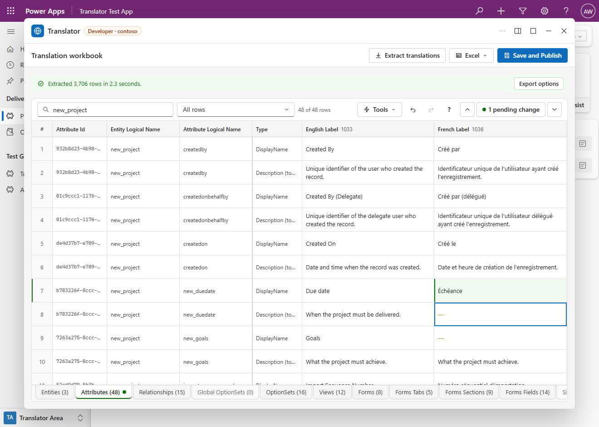

### 10.6 Rows, Filter rows and languages

The top bar holds *Filter rows*, the *Rows* list, a count (*12 of 84 rows* while *Filter rows* or *Rows* is in use),
the size of the selection (*3 rows × 2 columns selected*), **Tools**, **Undo** and **Redo**, **?** (*Colors and keys*:
what each cell look means and the keys) and the navigator.

**Rows** (`rowsTest` in `src/workbench/sheets.ts`) works on the current values, pending edits included:

| Choice | Keeps |
| --- | --- |
| *All rows* | Every row |
| *French matches English* | Rows whose target-language text equals the base text (probably never translated) |
| *French matches English or is blank* | The same, or the target text is blank (not a description stored empty on purpose) |
| *French is blank* | Rows with base text and no target text. A metadata description stored empty on purpose, or emptied in a pending edit that saves it so, is not blank: its users see no tooltip, as chosen (`Store.emptyOnPurpose`) |
| *Pending changes* | Rows with a pending edit |
| *Save problems* | Rows with a save conflict or error, or a blank Dataverse refuses: an emptied translation it can't remove and nothing can stand in for, or only spaces ([10.8](#108-how-a-cell-looks)) |

The three comparisons need a target language other than the base language; without one they are disabled in the top
bar's list, and a remembered choice counts as *All rows*. They leave out read-only rows, and a language that was not
loaded (a form label whose language was not read, [10.4](#104-extracting-and-what-the-workbook-holds)) is unknown,
never blank. *Pending changes* and *Save problems* do count read-only rows: a row can turn read-only after it was
edited (a later extraction found it locked), and that edit is still pending until it is undone. A translation emptied
where Dataverse can't remove it is saved as its stand-in ([10.8](#108-how-a-cell-looks)), for most labels the
base-language text, so once saved such a row is listed by *French matches English* too; an emptied metadata
description is saved empty, and is listed by none of the three.

**Filter rows** searches every sheet at once, 150 ms after the last key, for rows holding every word typed (the same
folding as every search box). It searches what the row shows and more (`searchText`): the sheet name, the slot key,
the *Type* text and the property's name, the title, the grey secondary name (`sub`, a logical or schema name), the
path, the table's display name, every key column, every language's text and the pending edits. The tab counts follow
the filter. Enter or the down arrow moves into the rows; Ctrl+F, in the Workbench or in the title bar, goes to the box.

Rows are not filtered again after each edit: a row that stops matching stays until the filter changes or the workbook
is rebuilt, so a row never disappears under the cursor.

**Language columns** (`columnLangs`): the base language, the target language, the other shown languages in the
environment's order, and every language that holds a pending edit, so the navigator never points at a hidden column.
A language added because of a pending edit stays until the shown languages or the target language are changed. The
target language's column and its header look like every other; only the header's tooltip tells it apart: *French
Label (1036), the language you are translating into. Click to select the column.*

### 10.7 The grid: drawing and editing

`createGrid` in `src/workbench/grid.ts` draws the active sheet. It is built for sheets of thousands of rows:

* **Only the rows in view exist.** Rows are 52 pixels high (`RH`), two lines of text. The grid draws the rows in view
  and 8 more on each side (`OVER`); rows that scroll out are kept in a pool and reused, moved with `translateY`.
* **Widths are CSS variables.** Each column's width is a custom property on the grid (`--w<n>`), so resizing a column
  changes one property and never touches the rows.
* **Pinned columns.** Key columns marked `keep` stay in view while the grid scrolls sideways, when there is room for a
  language column beside them: at least 220 pixels left (`ROOM`), and the pinned columns take at most 60% of the width.
  Otherwise only the row number stays.
* **Narrow grids.** Below 720 pixels (`COMPACT`), *Type* is 90 pixels wide by default and a language column is never
  wider than the room beside the pinned columns, so the cell being edited is always fully in view. At any width, room
  left over on the right goes to the language columns.
* **Column widths** are changed by dragging a header's right edge: key and *Type* columns at least 60 pixels, language
  columns at least 140, at most 1,000. They are remembered per sheet for key columns and *Type* (`<sheet>:<column>`),
  and for all sheets for languages (`l<lcid>`).
* **Scrollbars always show** where there is more to scroll, in the grid and everywhere else in the Workbench
  (`src/workbench/workbench.css`): a 12-pixel bar with a grey thumb, so the grid's bottom scrollbar is there without
  hovering (Edge's overlay scrollbars appear only under the pointer). Firefox gets its own thin bar.
* **Accessibility.** The grid has the role `grid`, rows and cells their roles and indexes, and the active cell is
  announced through `aria-activedescendant`.

**Selecting.** A click selects a cell, a drag selects a range, Shift+click extends it. A click on a row number selects
the row (Shift extends), a click on a header selects the column, the corner selects everything, and so does Ctrl+A.
The arrow keys move (Ctrl+arrow to the edges), Page Up and Page Down move a page, Home and End go to the first and
last column (with Ctrl, also the first and last row), Tab and Shift+Tab move sideways and leave the grid at its edges.

**Editing.** A click on a language cell (without dragging), Enter, F2 or typing a character opens the cell editor, a
text box over the cell. Typing replaces the text; Enter, F2 and a click keep it, with the caret at the end. On a key or
*Type* cell, Enter, F2, a double-click or typing edits the row's target-language cell instead: those columns say
which label a row is, and are never written. In the editor:

| Key | Does |
| --- | --- |
| Enter, Shift+Enter | Keeps the text and moves down, or up |
| Tab, Shift+Tab | Keeps the text and moves right, or left |
| Alt+Enter | A line break |
| Esc | Drops the text |
| Ctrl+S | Keeps the text, then **Save and Publish** |
| Ctrl+Z, Ctrl+Y | Undo and redo what was typed in the cell; in an editor with nothing typed yet, they close it and undo or redo the workbook's last change |

A click elsewhere keeps the text too, and so does switching to another window; then the grid takes the focus back, so
a paste on return lands on that cell. While you type, the editor already looks the way its cell will once the text is
kept (`edLook`): green from the first character that makes the text differ from the server text, with the same tooltip
as a changed cell; green as well for a translation emptied where Dataverse can't remove it but a stand-in can take its
place, with the tooltip of such a cell (`standInTip`, [10.8](#108-how-a-cell-looks)), and for a metadata description
emptied, which is saved empty (`emptyTip`); red where saving would be refused; marked past the slot's maximum length.

**What keeping the text does** (`commit`). Nothing, when the text is what the cell held. A blank base-language text
where the label requires one is refused with a message (*The English label can't be blank.*). Otherwise the text goes
into the Store as a pending edit: the pending count, the green line on the row number and the tab's dot follow. A
blank that the save will refuse (`blankEdit` gives `'blocked'`, [10.8](#108-how-a-cell-looks)) is staged too, and a
message says why at once (`blockedWhy`), with **Undo**. When a load replaced the slot while the editor was open, the
edit is still measured against the server text the editor opened on, so saving it over newer text is a conflict, never
an overwrite; an editor left untouched stages nothing.

A read-only cell does not open; a message gives the reason. A cell whose language was not loaded does not open either
([10.4](#104-extracting-and-what-the-workbook-holds)): a notice says why, in the words of the cell's tooltip
(`unreadTip`), with a **Read again** button where a read would bring the cell (`rereadable`): its form's read failed in
that language. There is no button where no read can bring it (`ref.unreadable`), nor for a language the load was not
asked to read, which only a new extraction reads.

`src/workbench/grid.ts`, `rereadable`:

```ts
export const rereadable = (s: Slot, l: Lcid): boolean => !s.ref?.unreadable && !!formNote([s])?.langs.includes(l);
```

The button runs the Workbench's **Read again** (`GridOptions.readAgain`, which `gridOptions` passes in), and the
notice then points to it: *Not loaded: this form could not be read in French, even when tried again. &lt;reason&gt;
Select Read again to try once more, or Extract translations again.* Without the button it ends *Select Extract
translations again to read it, or Read again where the message bar offers it.* A label of a form read through its
published definition says *Not loaded in &lt;language&gt;.* and `PUB_ONLY`; a label with no reason on it says
`UNREAD`: *Not loaded: form tab and section labels in other languages are read by switching your Dynamics language for
a moment. Select Extract translations again to read them.* A cell in conflict opens the conflict chooser instead
([10.8](#108-how-a-cell-looks)); typing still edits it.

**Undo and redo** outside an editor (Ctrl+Z, Ctrl+Y, the **Undo** and **Redo** buttons) undo and redo the workbook's
changes in the Store. A paste, a fill, a cleared range, a tool's change and an import are each one step.

### 10.8 How a cell looks

`langCell` gives each language cell its look and its tooltip, from the Store alone; `rowState` does the same for the
row number. The **?** button shows the legend.

| Look | Class | Meaning |
| --- | --- | --- |
| Grey, lock on the row number | `is-ro` | Read-only: the tooltip gives the reason, for a label from a managed solution the text of `MANAGED` ([10.1](#101-what-the-workbench-is)). A cell that turned read-only after it was edited says its change can't be saved |
| Light orange, an orange line on the left edge, **?** | `is-cf` | Changed on the server by someone else since it was loaded: a choice to make. The tooltip gives both texts |
| Light red, a red line on the left edge, **!** | `is-er` | The save failed: the tooltip gives the saver's message and the server's text |
| Grey italic *Not loaded* | `is-ro is-nl` | A form label in a language that was not read ([10.4](#104-extracting-and-what-the-workbook-holds)): the tooltip says why (`unreadTip`, [10.7](#107-the-grid-drawing-and-editing)) |
| Light red, *Can't be removed — type the text* | `is-er is-nc` | A translation emptied where Dataverse can't remove one and nothing can stand in for it: its base text is empty (for a form or dashboard field label that shows a column: its column has no name in either language), or a text the stand-in is made of is not loaded. The tooltip says why, and what to load where a text is missing (`blockedWhy`) |
| Light red, *Only spaces — type the text* | `is-er is-nc is-sp` | Only spaces where there is no translation, on a kind that can't be cleared |
| Light green, the text that takes its place in grey italics | `is-ed is-si` | A translation emptied where Dataverse can't remove one: saving writes its stand-in, the text that language shows without a translation, which the cell shows. The tooltip says why (`standInTip`) |
| Light green, a muted *(empty)* in grey italics | `is-ed is-em` | A metadata description emptied (`blankEdit` gives `'empty'`): saving saves it empty, and users of that language then see no tooltip or description there. The tooltip says so (`emptyTip`): *Saved empty when you save: French users then see no tooltip. Was “Tapez le nom.”.* (*It was blank.* where there was no text) |
| A muted *(empty)* in grey italics | `is-em` | A metadata description stored empty on purpose (`Store.emptyOnPurpose`): translated, never missing. Loaded stored empty, the tooltip says *Saved empty: French users see no tooltip.*; just saved empty (`is-sv is-em`), it keeps the check mark and *Saved and verified on the server.* |
| Old text struck through | `is-ed is-rm` | A translation emptied that saving will remove: users of that language then see the base text |
| Light green, a green line on the left edge | `is-ed` | Changed, not saved yet. The tooltip gives the old text |
| Check mark | `is-sv` | Saved, read back from Dataverse, and it matches |
| Amber dash | `is-mi` | No translation yet: the base language has text, this language has none. The amber is the page's colour for a missing translation ([9.14](#914-looks-the-colour-of-a-label-inspectorstatusts)) |

The text of a tinted cell keeps its usual colour; read-only and *Not loaded* cells are a neutral grey. The row number
matches (`rowState`): a green line on its left edge for a row with a pending edit, light red with a red line for a row
with a conflict, a failed save or a blank Dataverse refuses, a lock for a read-only row. In Windows' high contrast
mode, which drops tints and shadows, the lines become borders. The **?** popover's colour key shows the same looks.

**The blank rules.** `blankEdit` follows the saver's rules ([chapter 7](#7-saving-safely)), so the grid and the bulk
tools mark exactly what the save will write in place of a blank, or refuse. Translation mode's popup, editor card and
page preview use the same rule (`standIn` in `src/core/model.ts`, through `store.standIn`), and the Publish dialog runs
the saver's own (`app.saver.validate`, `app.saver.prepare`).

`src/workbench/grid.ts`, `blankEdit`:

```ts
export const blankEdit = (s: Slot, l: Lcid, base: Lcid, before: string, after: string, text: TextOf): Blank =>
  l === base || s.readOnly || after === before || after.trim()
    ? ''
    : savesEmpty(s, l, base)
      ? 'empty'
      : !canClear(s, l)
        ? standIn(s, l, base, before, after, text)?.text
          ? 'standin'
          : 'blocked'
        : isRemoval(base, l, before, after)
          ? 'remove'
          : '';
```

A blank (empty, or only spaces) in another language is:

* `'remove'` where Dataverse can remove a translation of that kind (`canClear`: the names and descriptions written
  through `SetLocLabels`, such as those of views, forms, charts, dashboards and apps, and related menu items and app
  navigation titles, which are removed with their element; LIVE-FINDINGS 33, 38) and there was one to remove: users of
  that language then see the base text.
* `'empty'` for a metadata description (`savesEmpty`: a table's, column's, choice option's, global choice's, Yes/No
  option's, status's or status reason's description), emptied or left only spaces, over a translation or where there
  was none: saved empty, so that users of that language see no tooltip or description there (LIVE-FINDINGS 32).
* `'standin'` where it can't, and a stand-in is known. Dataverse merges the labels of tables, columns, choices, Yes/No
  and status values, relationships and global choices, form tab, section and field labels (dashboards are taken to
  behave like forms), and classic button labels per language: a write or an import can add or change a language, never
  remove one (LIVE-FINDINGS 31, 37, 39, 67). Dynamics keeps a process stage or step translation once it is stored
  (`stays`, LIVE-FINDINGS 83). And an empty label written to a metadata name shows as a blank label, not as the base
  text (LIVE-FINDINGS 32). So the save writes the stand-in, the text that language shows where the label has no
  translation of its own, and the page looks as it would without one.
* `'blocked'` where it can't and no stand-in is known; and where only spaces were typed where there is no translation,
  on a kind that can't be cleared: stored, they would show as a blank label instead of the base text (LIVE-FINDINGS
  32). Spaces typed where there is none change nothing on a kind that can be cleared.

**The stand-in** (`standIn`, one rule for the saver, the popup, the editor card, the page preview, the Publish and Undo
dialogs and the Workbench). A form or dashboard cell that shows a column (`columnOf` in `src/core/column.ts`: the
cell's control is the column's own, a numbered copy of it, or one of those in the header or footer) gets the column's
name in that language, else the column's base-language name: a cell without a label in the user's language shows its
column's name in that language (LIVE-FINDINGS 42). Every other label, a process stage or step included, gets its own
base-language text. A stand-in that is the text it replaces already (`same`, only spaces counting as no text) changes
nothing, and nothing is written.

`src/core/model.ts`, `standIn`:

```ts
export function standIn(s: Slot, l: Lcid, base: Lcid, before: string, after: string, text: TextOf, untranslated?: boolean): StandIn | undefined {
  if (l === base || after.trim() || (before === '' && !untranslated) || canClear(s, l) || savesEmpty(s, l, base, untranslated)) return undefined;
  const got = (x: StandIn): StandIn => (bare(x.text) === bare(before) ? { ...x, same: true } : x);
  const k = columnKey(s);
  if (k) {
    const own = text(k, l);
    const b = text(k, base);
    if (own === undefined || b === undefined) return { text: '', from: 'column', why: "its column's names aren't loaded", unloaded: true };
    if (own.trim()) return got({ text: own, from: 'column' });
    return b.trim() ? got({ text: b, from: 'columnBase' }) : { text: '', from: 'columnBase', why: `its column has no ${lcidName(base)} name` };
  }
  const b = text(s.key, base);
  if (b === undefined) return { text: '', from: 'base', why: `its ${lcidName(base)} text isn't loaded`, unloaded: true };
  return b.trim() ? got({ text: b, from: 'base' }) : { text: '', from: 'base', why: `its ${lcidName(base)} text is empty` };
}
```

`columnKey` names the column's `DisplayName` slot (`attribute|<table>.<column>|DisplayName`), which the Workbench
holds once the table's columns are extracted (*Export Attributes Translation*). `text` (`TextOf`) reads the texts the
stand-in is made of, `undefined` for one not loaded. In the grid it is `textOf`, the Store's current values with the
pending edits, so a base text or a column name changed in the same edits counts; the bulk tools read the texts as
their planned edits leave them ([10.10](#1010-bulk-tools)). The save measures the stand-in again by the texts as its
run leaves them on the server, reads the texts it is made of again before writing it, and writes one made of a text
the same save sends in another write only once that text is saved ([10.12](#1012-save-and-publish),
[chapter 7](#7-saving-safely)).

**How a stand-in cell looks.** The cell's value stays blank: the blank is what is pending. `langCell` puts the
stand-in in `CellLook.to`, the grid writes it to the cell's `data-to`, and the style shows it in grey italics, as
decoration that screen readers do not announce as the value:

`src/workbench/grid.css`:

```css
.g-c.is-si .g-v::before{content:attr(data-to);content:attr(data-to) / '';color:var(--fg3);font-style:italic}
```

**How a description saved empty looks.** The same way, with the muted *(empty)* (`EMPTY`) as the decoration, in the
class `is-em`; the cell counts as translated, and **Copy base language into empty cells**, *French is blank* and
*French matches English or is blank* leave it alone:

`src/workbench/grid.css`:

```css
.g-c.is-em .g-v::before{content:attr(data-to);content:attr(data-to) / '';color:var(--fg3);font-style:italic}
```

The tooltip of a stand-in cell (`standInTip`) says what saving writes, and why, in the words of the popup's line:
*Becomes “Name” when you save: Dataverse can't remove a translation here, so French gets the English text. Was “Nom”.*
A form field gets *… so French gets the column's French name.* (or *the column's English name*), a stage *Becomes
“Stage 1” when you save: Dynamics keeps a stage's translation, so French gets the English text. Was “Étape 1”.*, and a
cell whose stand-in is its text already *Already the English text: Dataverse can't remove a translation here, so
nothing changes.*

Where no stand-in is known, the cell is red and its tooltip says why, and what would bring the stand-in (`blockedWhy`,
through `noStandIn` of `src/core/model.ts`): *Dataverse can't remove this translation, and its English text is empty:
type the text instead.*, for a field whose column has no name in either language *Dataverse can't remove this
translation, and its column has no English name: type the text instead.*, *Dataverse can't remove this translation,
and its column's names aren't loaded: load its table's columns to put the column's name in its place, or type the
text.* For a tab or section whose base text was not read it ends *load its labels in all languages to put that text
in its place, or type the text.*

**Missing.** `missing` is true when the base language has text and the language has none, except where the text is
unknown (not loaded, or a related menu item whose relationship text is not loaded yet), where it is a description
stored (or saved) empty on purpose (`Store.emptyOnPurpose`: its users see none, as chosen), or where a fallback stands
in for it on the page: a form field label worded like its column shows the column's name, and a related menu item
worded like its relationship shows that text (LIVE-FINDINGS 42, 80; `standsIn` in `src/inspector/status.ts`).

**The saved check mark** stays only while the server still holds the text that was saved. `noteSaved` records that
text right after each save; a later extraction that brings other text (someone else's) removes the mark.

**Conflicts** open a small chooser next to the cell (Enter or a click on it): *Changed on the server by someone else*,
the server's text and yours, **Use server value** and **Keep mine** (*Keep mine saves your text over theirs the next
time you save.*); without an edit of yours, only the server's text and **Use server value**. It calls `store.resolve`.
The primary button has the focus: **Keep mine** when you have an edit, because **Use server value** drops it, and that
has no undo.

### 10.9 Copy, paste and fill

The clipboard speaks Excel's language: tab-separated text, rows ended by line breaks, a cell that holds a tab or a
line break (or starts with a quote) quoted with doubled quotes inside (`parseTsv`, `toTsv`, `tsvCell`).

**Copy** (Ctrl+C) puts the selection on the clipboard, key and *Type* columns included, so ids can be pasted into
Excel. A cell whose language was not loaded comes out blank, and the grid notes which cells of its copy those were.
**Cut** (Ctrl+X) copies, then clears.

Some pages swallow clipboard events on elements that can't be edited: when no clipboard event arrives within 80 ms of
the keys, the grid uses the browser's asynchronous clipboard instead (`viaApi`), and says *The browser blocked the
clipboard. Allow clipboard access for this site, then try again.* when that is refused too. Its answer can come much
later (a permission prompt can take a while), so the grid takes a snapshot of the selection when the keys are pressed
(`snap`: the range, its rows' keys, its columns' ids, the sheet, and a counter that every move of the cursor, every
sheet switch and every change of the columns raises) and acts on those cells only:

* A paste lands only while they are still the selection, with no cell editor open; otherwise nothing is pasted:
  *Nothing was pasted: the selection changed while the browser was reading the clipboard. Select the cells again, then
  paste.*
* A copy or a cut copies those cells while they are still in their places (the same sheet, rows and columns), else
  nothing: *Nothing was copied: the rows changed before the browser could copy them. Select the cells again, then try
  again.* (*Nothing was cut…*).
* A cut clears them only while they are still the selection: *Copied, but nothing was cleared: the selection changed
  while the browser was copying. Select those cells again and press Delete to clear them.*

So a paste or a cut never lands on cells the user has moved on to, nor in a language column that took the place of
the one chosen.

`src/workbench/grid.ts`, `createGrid`, `there` and `still`:

```ts
/** The snapshot's cells are still where they were: the same sheet, rows and columns at the same places. */
const there = (x: Snap) => x.sheet === sheet && x.keys.every((k, i) => rows[x.at[0] + i]?.key === k) && x.ids.every((id, j) => cols[x.at[1] + j]?.id === id);
/** ...and still the selection, with no cell editor open: a late paste or cut may change them. */
const still = (x: Snap) => x.gen === gen && !edKey && there(x);
```

**Paste** (Ctrl+V):

* **One cell** goes into every selected cell. Pasted on key or *Type* cells only, it changes nothing and says so.
* **Several cells** land with their top-left cell on the selection's top-left cell, and are refused, with nothing
  pasted, when they would put translations on other labels (`misfit`):
  * the first row is a header row (a cell equals the name of the column it would land on or, on a language column, a
    language header such as *French Label* or `1036`): every translation would land one row too low;
  * there are more columns, or more rows, than the sheet has from there;
  * a key or *Type* cell of the block differs from the row it would land on. Key cells are compared with case,
    surrounding spaces and GUID braces aside (`keyNorm`), so ids copied from an Easy Translator file match:

    `src/workbench/grid.ts`, `keyNorm`:

    ```ts
    export const keyNorm = (v: string): string => v.trim().replace(/^\{([^{}]*)\}$/, '$1').toLowerCase();
    ```

  The message says which. When the rows are too many or don't line up, it points to **Excel** › **Import workbook or
  CSV…**, which matches rows by their ids instead of their order.
* Read-only cells, cells of a language not loaded and a blank where the base text is required are skipped, and the
  message counts them. So are the cells of the grid's own copy (`sameClip`) that came from a language not loaded,
  pasted several at a time: their blank stands for a text nobody has seen, not for an empty one (*Skipped 2 cells whose
  source cell is not loaded (its text is unknown, not empty).*). A blank where Dataverse can't remove a translation is
  pasted. With a stand-in it turns green and shows the stand-in ([10.8](#108-how-a-cell-looks)), and when several
  cells changed the message says what they get (`standInsSaid`), for example *2 emptied translations get the English
  text in their place when you save: Dataverse can't remove them.* Without one it is marked red, and the message gives
  the cell's reason, or for more than one *Dataverse can't remove 2 of the translations you emptied, and they have no
  text to put in their place (marked in red) — type the text instead, or undo.* A blank on a metadata description is
  pasted too, and shows *(empty)*: it is saved empty. For more than one the message says so: *2 emptied descriptions
  will be saved empty when you save: users of those languages see none there.*

**Paste into an open editor.** Cells copied from a spreadsheet (the clipboard has an HTML table, the text has tabs, or
it is what the grid copied last) and pasted into an editor with nothing typed yet go to the grid, as in Excel. Text
with line breaks from a document stays in the one cell. A single cell from Excel loses its quoting and the line break
Excel adds after it; a label quoted in a document keeps its quotes.

**Fill down** (Ctrl+D) copies the row above into the selected cells of one row, or the first row of a selection into
the rows below it. A language the source row was not loaded in (and holds no pending edit in) is skipped for that
column: its text is unknown, and copying its blank would empty the translations below, which saving would then remove
or replace with their stand-in. The message says so: *Skipped 3 cells whose source cell is not loaded (its text is
unknown, not empty).*

`src/workbench/grid.ts`, `createGrid`, `fillDown`:

```ts
const fillDown = () => {
  const [r0, c0, r1, c1] = rng(),
    src = rows[r0 === r1 ? r0 - 1 : r0];
  if (src) each((_, l) => (unread(src, l) ? null : store.value(src.key, l)), r0 === r1 ? r0 : r0 + 1, c0, r1, c1, 'Filled');
};
```

**Delete** and **Backspace** clear the selected language cells, but never a base-language cell (`each` with `strict`).

Every paste, fill and clear is one undo step (`store.group`), and all three count and report blanks the same way
(`each`); the message that follows a change of several cells offers **Undo**.

### 10.10 Bulk tools

**Tools** in the top bar (`src/workbench/tools.ts`) works on the rows the active sheet shows, after *Rows* and *Filter
rows*. Each tool opens a dialog, previews what will change and applies it as one undo step.

| Tool | Does | Languages |
| --- | --- | --- |
| *Copy base language into empty cells* | Fills the missing cells (`missing`) with the base-language text: for names that stay the same in every language | One language other than the base |
| *Find and replace* | *Match case*, *Whole word* (word edges that know letters such as *é*, *ß*, *ö*), *Regular expression* (then `$1` and the like work in the replacement; otherwise the replacement is literal) | One language, or *All shown languages*, the base language included |
| *Trim spaces* | Runs of spaces and tabs become one space, spaces around line breaks go, and the text is trimmed. No-break spaces stay: they are intentional (French *Nom :*) | One language, or *All shown languages*, the base language included |

The tools skip read-only rows (every label from a managed solution among them) and languages that were not loaded, and
never leave a required base-language text blank.

**A search that could freeze the page.** JavaScript can't stop a regular expression once it runs on a text: with
repeats that can split the text in many ways, it tries every one before it gives up on a label (`^(a+)+$` on a label
of 30 letters takes about a minute, and `^a*a*a*a*a*a*a*a*a*a*$` takes several seconds on 28 letters, far past the
limits). *Find and replace* guards against that in three ways: some regular expressions are refused before they run,
the others search in the background where a time limit can stop them, and where the page allows no background search,
only those that can't keep the page busy search on the page.

**Refused before it runs** (`riskyRegex` in `src/workbench/tools.ts`), wherever the search would run: a regular
expression is refused, in red in the preview with nothing to change, when it repeats a group (any count above one)
that

* holds a repeat or an optional part of its own, at any depth: `(a+)+`, `(\w*\s)*`, `(ab?)+`, `(x{1,3}){2}`. The
  preview says *This regular expression repeats a group that holds a repeat or an optional part of its own, like (a+)+
  or (ab?)+, which can freeze the page on some labels. Write it without repeating the group, for example a+ instead of
  (a+)+.*
* holds a choice inside it, or is a choice whose alternatives don't each start with a plain character of their own:
  `(a|ab)+`, `(\w|_)*`, `(Mr|Mrs)+`. The preview says *This regular expression repeats a choice whose alternatives can
  match the same text, like (a|ab)+, which can freeze the page on some labels. Start each alternative with a different
  character, or repeat a character class such as [ab]+ instead.*

`(foo|bar)+`, `( |\t)+`, fixed counts such as `(ab){3}` and everything outside a repeated group keep working.

*Whole word* puts the pattern in a group between two look-arounds (`(?<![\p{L}\p{N}_])(?:…)(?![\p{L}\p{N}_])`). The
pattern is first compiled on its own, so one that is valid only inside that group, such as `a)(?:a*a*$`, whose `)`
would close the group, is refused as *That regular expression is not valid.*: no check reads only a part of what
runs.

**In the background** (`src/workbench/regex.ts`). A regular expression that passes `riskyRegex` searches in a Web
Worker, so the page stays usable while it runs. `searcher` starts one worker per dialog, at its first search, from a
`blob:` address (its code, `CODE`, is plain ES5 text, as it is not bundled), and sends it the expression's source and
flags, the replacement and the texts; the worker answers with the texts it changes, by index. A search still running
1.5 s after the worker started running (`FIND_LIMIT`) is stopped with its worker, and nothing changes: *This search
took too long, so it was stopped and nothing will change. Write the regular expression more simply, with fewer
repeats in a row that can match the same text (such as .\*.\*).* One that throws in the worker says *This search could
not run, so nothing will change. Write the regular expression more simply.* A newer search stops the one running (a
worker can take no other search before its search ends), and closing the dialog stops it and frees the worker and its
address (`close`). Dynamics' pages let such a worker run (checked in a test environment in October 2026), so there
the search runs in the background.

`src/workbench/regex.ts`, `FIND_LIMIT` and `canSearchAside`:

```ts
/** How long (ms) a search in the background may take before it is stopped. The page stays usable meanwhile. */
export const FIND_LIMIT = 1500;
```

```ts
/** Whether searches may run in the background: false without workers, or once one could not start on this page. */
export const canSearchAside = (): boolean => typeof Worker === 'function' && refused !== Worker;
```

**On the page, where no worker runs** (`heavyRegex` in `src/workbench/regex.ts`). On a page whose policy forbids
`blob:` workers, `new Worker` throws (then `run` gives null at once), or the worker fails as it loads or never says it
runs within `FIND_LIMIT` (then the search answers `'unavailable'`): either way no worker is tried again on that page,
and the search runs on the page instead. There, `heavyRegex` first refuses what it can't prove quick:

* two repeats that can match the same characters, where one of them can end anywhere: what follows it can start with a
  character it matches too, so each place it stops is tried (`a*a*`, `.*x.*`, `(.*)\1`, `.*\d+x`). The preview says
  *This regular expression has two repeats that can match the same text, like a\*a\* or .\*x.\*, which can freeze the
  page on some labels: this page does not let the search run in the background. Keep one of them, or put a character
  they can't match between them, as in \w+ \w+.*
* optional parts, bounded counts and choices that can combine more than 32 ways (`WAYS`; a count above 16, `BIG`,
  counts as unbounded), such as `a?a?a?a?a?a?aaaaaa`: *This regular expression has too many optional parts or choices
  that can match the same text, like a?a?a?aaa, which can freeze the page on some labels: this page does not let the
  search run in the background. Write it with fewer of them.*

Plain text, classes, anchors, a choice of words, and repeats that a character they can't match ends (`\w+ \w+`) or that
end the expression (`^Nom .*$`) keep working there.

`src/workbench/tools.ts`, `openTool` (`plan`):

```ts
// One that could search a single label for minutes is refused before it runs (riskyRegex); so is, where it
// would search on the page, one that could keep the page busy for long (heavyRegex).
const risk = rx.checked ? riskyRegex(fi.value, !mc.checked, ww.checked) || (bg ? '' : heavyRegex(fi.value, !mc.checked, ww.checked)) : '';
if (risk) return done(risk);
```

`bg` is true for a regular expression of *Find and replace* while `canSearchAside()` holds. A plain-text search and a
regular expression where no worker runs plan on the page, label after label, as the other two tools do. Whatever the
pattern, such a search that has run for more than 400 ms (`FIND_BUDGET`) stops between two labels and changes
nothing: *This search took too long, so it stopped after 1,200 labels and nothing will change.*, then *Write the
regular expression more simply, with fewer repeats in a row that can match the same text (such as .\*.\*).*, or, for
a plain search, *Filter the rows first, then search again.*

`src/workbench/tools.ts`, `FIND_BUDGET`:

```ts
/**
 * How long (ms) Find and replace may plan on the page before it stops, which nothing can interrupt: plain text, and
 * regular expressions where no worker can search in the background (regex.ts).
 */
export const FIND_BUDGET = 400;
```

**While a search runs in the background** (`update` in `openTool`). The preview stays as it is until the answer comes.
After 200 ms without one (`SEARCHING_AFTER`), the preview gives way to *Searching…*, its list is hidden, and the button
reads **Change**, greyed with `aria-disabled` rather than `disabled`, so that it keeps the focus: a click on it then
does nothing. Each plan has a number (`gen`), so an answer for a plan a newer one replaced, or one that comes after
the dialog closed, is dropped.

`src/workbench/tools.ts`, `SEARCHING_AFTER`:

```ts
/**
 * How long (ms) a search in the background may take before the dialog says "Searching…": a quicker answer replaces the
 * preview at once, without "Searching…" and a greyed Change flashing (and a screen reader saying it) after each pause
 * in typing.
 */
export const SEARCHING_AFTER = 200;
```

The preview lists up to 20 changes (*…and 280 more*) with the old text struck through, says how many cells will
change, and says what saving will do with a translation that becomes empty (*Find and replace* with nothing, *Trim
spaces* on a text of only spaces), by the grid's `blankEdit` rule ([10.8](#108-how-a-cell-looks)):

| Saving | The row shows | The preview adds |
| --- | --- | --- |
| Removes it | *(translation removed)* | *2 translations will be removed when you save (users of that language then see the English text).* |
| Writes its stand-in | *(becomes “Name”)*, or *(already “Name”: nothing changes)* | *2 translations would become empty, but Dataverse can't remove them: they get the English text in their place when you save.* |
| Saves it empty: a metadata description | *(saved empty)* | *2 descriptions will be saved empty when you save: users of those languages see none there.* (*that language* for one) |
| Refuses it: no stand-in | *(empty — Dataverse can't remove this translation, and nothing can stand in for it)*, in red | *1 translation would become empty, but Dataverse can't remove it and there is no text to put in its place: it is marked in red until you type a text.* |
| Refuses it: only spaces where there is no translation | *(only spaces — Dataverse would show a blank label)*, in red | *1 cell would hold only spaces, which Dataverse would show as a blank label: it is marked in red until you type a text.* |

The stand-ins are measured by the texts as the planned edits leave them (`text` in `openTool`), so a base text or a
column name the same tool changes counts with its new text, as the save will measure it. **Change *n* cells** applies
exactly the plan the preview shows, at once when nothing was typed since, without searching again. Text typed within
the preview's 150 ms delay is planned at the click (`dirty`), and if that changes any cell or new text, the preview
shows the new plan and the next click applies it. A click while a search in the background runs, before *Searching…*
shows, waits for its answer (`busy`, `next`) and applies it only when it is the plan shown. Text typed meanwhile
drops that click (`typed` clears `next`, as a changed option does through `update`), so the dialog stays open and
previews the new text instead of applying the earlier plan and closing. Its message names the
cells left red, for example *3 cells changed. Dataverse can't remove 1 translation that became empty and there is no
text to put in its place (marked in red in the grid) — type the text instead, or undo.*

`src/workbench/tools.ts`, `openTool` (`go`):

```ts
const go = () => {
  if (goBtn.getAttribute('aria-disabled') === 'true') return;
  const was = shown;
  const then = () => {
    if (edits.length === was.length && edits.every(([s, l, v], i) => s === was[i][0] && l === was[i][1] && v === was[i][2])) apply(edits);
  };
  if (dirty) update(then);
  else if (busy) next = then;
  else apply(was);
};
```

### 10.11 The pending-change navigator

**↑ *n* pending changes ↓** at the right of the top bar visits every pending edit of the workbook, in workbook order:
sheet (tab order), row, then language column. **↓** and the middle button go to the next one, **↑** to the previous,
and both wrap around. It starts from the grid's cursor when the cursor is on the active sheet, else from the change
visited last (`navStep`), so it goes on from where you are.

Before it moves, an edit made outside the workbook (on the page, or brought back by an undo) joins it. To show the cell
it switches to its sheet, and clears what hides the row (`unhide`): *Rows* goes back to *All rows*, *Filter rows* is
emptied, and the message bar says so. The cell becomes the active cell, with the selection's 2-pixel blue ring, which
fades over a second (`FLASH_MS`, 1,000 ms; `.is-fl` in `src/workbench/grid.css`) into the active cell's own outline:
grey while the focus is elsewhere, as on the navigator's buttons, so the cell stays easy to find on any tint. With
reduced motion the ring stays for that second without fading. The message bar says *Pending change 3 of 7:
Attributes row 12, French Label.*

### 10.12 Save and Publish

**Save and Publish** (or Ctrl+S anywhere in the Workbench) commits the cell being edited, then:

1. While labels load: *Wait for the labels to finish loading, then save.* With nothing pending: *No pending translation
   changes to save.*
2. Opens the Publish dialog (`app.review()`, [chapter 8](#8-the-publish-dialog-history-and-undo)), which validates,
   checks for other people's unpublished work, saves, reads back, publishes and checks. The Workbench never refreshes
   the page by itself: when all went well, its dialog ends with *Done. Published n changes.*, **Refresh page** and
   **Close**.
3. When the dialog closes, `saveLine` turns the report of its last run into the message bar's line: *Saved 3 changes
   and published them in 8.2 seconds. Every change was read back from Dataverse and matches.*, or, with problems, how
   many were saved and why the others were not, in red, with **Show problems** (*Rows* › *Save problems*). Changes still
   pending that the last run did not count (the dialog's **Try again** saves only the failed ones) are said too, with
   **Show pending changes**: the line never claims everything is saved while something is not.

The cells follow the Store: saved ones get the check mark, failed ones turn red with the message as tooltip, conflicts
turn orange with a **?**. **Save and Publish** stays enabled while a cell editor holds typed text, so the very first
translation can be saved straight from the cell.

**Emptied translations Dataverse can't remove.** The saver writes each one's stand-in in its place (`withStandIns` in
`src/core/saver.ts`), measured by the texts as the run leaves them on the server, and the Publish dialog's row shows
the old text and the stand-in, with a note such as *English text: Dataverse can't remove a translation*
([chapter 8](#8-the-publish-dialog-history-and-undo)). Before writing, the saver reads the texts the stand-in is made
of again: one that changed on the server since it was loaded is not written, and the cell turns red with *Its English
text changed on the server since it was loaded (now “…”), so nothing was written: Try again to put the new text in its
place.*; the Store takes the new text, so the next save measures that. A stand-in that is the text it replaces already
is read from the server first, in the same reads: while the server still holds that text, nothing is written nor
published; another text there is a conflict, as a writer would find it, never a silent "unchanged" over someone
else's newer text.

A stand-in can be made of a text the same save writes: a form field label emptied while its column's name changes in
the same edits. Sent in the same write as that text, the two succeed or fail together. Sent by another writer (the
column's name goes through the metadata writer, the form label through the form writer), the job that holds the
stand-in runs after the other jobs of the writers' lanes, and the stand-in is written only once that text is saved,
and only when the text saved still gives it. Otherwise it is held back, never written, with *Its column's French name
wasn't saved, so nothing was written here either: Try again to save both.* (or the `sourceMoved` text above, when the
saved text gives another stand-in); the rest of its job is written, and its edit stays pending. An undo of a publish
does the same ([8.12](#812-undoing-a-publish-the-run-and-its-checks)).

`src/core/model.ts`, `sourceUnsaved`:

```ts
export const sourceUnsaved = (s: Slot, src: { key: string; lcid: Lcid }): string =>
  `${sourceName(s, src)} wasn't saved, so nothing was written here either: Try again to save both.`;
```

Once saved, the cell holds the stand-in, with the check mark: the blank pending edit is dropped
(`Change.standIn.typed`).

**Emptied descriptions** have no stand-in: the save writes them empty
([6.3](#63-metadatats-tables-columns-choices-and-relationships)), the Publish dialog shows them as *(empty)* with the
note *Saved empty: French users see no tooltip.*, and once saved the cell shows the muted *(empty)* with the check
mark, a translation stored empty.

**What no check closes.** Two short windows are left, which the platform gives no way to close
([7.5](#75-the-read-in-the-same-batch-before-each-write)). A save by another maker that lands between a writer's last
check and its write can still be replaced by the translator's write; for most writers that window is the step from
the read to the write inside one `$batch`. It holds for every writer, process definitions included. And the write of
a status value's label (`state`, written with `UpdateStateValue`) sends the status's default status reason as read
just before it, because Dataverse resets the default when it is not sent: a default someone else changes in that
moment is set back. Avoid customizing the same component in two places at once while translating.

### 10.13 The Excel workbook format

**Excel** › **Download workbook (.xlsx)** writes every row of the workbook, on every sheet (*Rows* and *Filter rows*
don't limit it), in the shown languages. **Download this sheet (.xlsx)** writes the rows the active sheet shows. Both
carry the pending edits, so a file can be shared before saving; the message says so. The file is named *Translations
&lt;environment&gt; &lt;date&gt;.xlsx*, with the sheet's name before the date for one sheet, for example *Translations
contoso 2026-10-19.xlsx*.

`layout` in `src/io/workbook.ts` builds the sheets from `SPECS`, one entry per sheet. The sheets up to *Dashboards
Fields* reproduce the layout of Easy Translator's workbook: sheet names, headers, column order, ids in braces, language
columns headed by their LCID as text. The other sheets hold what Easy Translator does not cover.

`src/io/workbook.ts`, `SPECS` (the first entry):

```ts
{
  n: 'Entities',
  c: ['Entity Id', ENT, 'Type'],
  k: ['entity'],
  t: ['DisplayName', 'DisplayCollectionName', 'Description'],
  o: (s, q) => [B(s.ref?.metadataId), q[1]],
  m: (g, p) => `entity|${g(ENT)}|${p}`,
},
```

`n` is the sheet name, `c` the columns before the languages (*Type* last when the sheet has one), `k` the kinds, `t`
the values of the *Type* column (a sheet without `t` holds the `Label` property only and has no *Type* column), `o`
the id cells of a slot (or null when it does not belong there), and `m` the slot key of an imported row.

| Sheet | Columns before the languages | Kinds |
| --- | --- | --- |
| Entities | Entity Id, Entity Logical Name, Type | `entity` |
| Attributes | Attribute Id, Entity Logical Name, Attribute Logical Name, Type | `attribute` |
| Relationships | Entity, Relationship Id, Relationship Name, Relationship entity | `relationship`, one-to-many |
| RelationshipsNN | Entity, Relationship Id, Relationship Intersect Entity | `relationship`, many-to-many, one row per side |
| Global OptionSets | OptionSet Id, OptionSet Name, Value, Type | `globaloptionset` (rows without a Value), `globaloption` |
| OptionSets | Attribute Id, Entity Logical Name, Attribute Logical Name, Attribute Type, Value, Type | `option`, `state`, `status` |
| Booleans | Attribute Id, Entity Logical Name, Attribute Logical Name, Value, Type | `boolean` |
| Views | View Id, Entity Logical Name, ViewType, Type | `view` |
| Charts | Chart Id, Entity Logical Name, Type | `chart` |
| Forms | Form Unique Id, Form Id, Entity Logical Name, Form Type, Type | `form` |
| Forms Tabs | Tab Id, Entity Logical Name, Form Name, Form Unique Id, Form Id | `tab` |
| Forms Sections | Section Id, Entity Logical Name, Form Name, Form Unique Id, Form Id, Tab Name | `section` |
| Forms Fields | Label Id, Entity Logical Name, Form Name, Form Unique Id, Form Id, Tab Name, Section Name, Attribute, Display name | `field` |
| SiteMap Areas | SiteMap Name, SiteMap Id, Area Id, Type | `area` |
| SiteMap Groups | SiteMap Name, SiteMap Id, Area Id, Group Id, Type | `group` |
| SiteMap SubAreas | SiteMap Name, SiteMap Id, Area Id, Group Id, SubArea Id, Type | `subarea` |
| Dashboards | Form Unique Id, Form Id, Type | `dashboard` |
| Dashboards Tabs | Tab Id, Form Name, Form Unique Id, Form Id | `dtab` |
| Dashboards Sections | Section Id, Form Name, Form Unique Id, Form Id, Tab Name | `dsection` |
| Dashboards Fields | Label Id, Form Name, Form Unique Id, Form Id, Tab Name, Section Name, Attribute | `dfield` |
| Form Navigation | Item Id, Entity Logical Name, Form Name, Form Id | `navitem` |
| Apps | App Id, Unique Name, Type | `app` |
| Business Process Flows | Process Id, Entity Logical Name, Type | `bpf` |
| BPF Stages | Process Id, Entity Logical Name, Process Name, Stage Id | `stage` |
| BPF Steps | Process Id, Entity Logical Name, Process Name, Step Id, Attribute | `step` |
| Commands | Command Id, Location, Entity Logical Name, Type | `command` |
| Ribbon Labels | Entity Logical Name, LocLabel Id | `ribbon` |
| Environment Variables | Variable Id, Schema Name, Type | `envvar` |
| Custom APIs | Custom API Id, Unique Name, Type | `customapi` |
| Other | Key, Type, Table, Component, Property | Any slot that fits no sheet above |
| Translator | Two columns of information | Marks the file as the translator's |

The first twenty sheets are Easy Translator's, the next nine are the translator's own. The grid shows *Form Navigation*
right after *Forms Fields*; the file keeps it after Easy Translator's sheets. Rules of the layout:

* **Where a slot goes.** The first sheet whose kinds include the slot's kind and whose *Type* values include its
  property, and whose `o` gives id cells. Otherwise *Other*, by slot key, with the kind, table, place and property in
  words. Sitemap items without an id of their own and the second side of a relationship of a table to itself go there,
  because Easy Translator's sheets can't address them.
* **Id cells.** Ids are written in braces, in lower case (`{…}`). An id the translator does not have stays an empty
  cell, never an empty text. The *Form Unique Id* column gets the form id. *ViewType* and *Form Type* use Easy
  Translator's names (*Public view*, *Quick Find Search view*, *Main*, *Quick Create*…) where it has one, else the
  number.
* **Missing translations** are empty cells, and so are descriptions stored empty on purpose. On the three choice
  sheets (*Global OptionSets*, *OptionSets*, *Booleans*, marked `b` in `SPECS`) they are empty text cells instead, for
  Easy Translator's importers of those sheets.
* **Rows** are sorted as in the grid ([10.5](#105-sheets-and-key-columns)). Sheets without rows are left out.
* **The Translator sheet** comes last: *Dynamics Translator · Translation workbook*, the environment, the base language,
  the languages, the export time in UTC, the version, and a note that empty cells never clear a label on import.
* **The header row** is bold on a light blue fill and frozen. Column widths come from the content
  ([10.16](#1016-reading-and-writing-xlsx-files)).

### 10.14 CSV

**Excel** › **Download CSV (.csv)** writes every row of the workbook in one file (`exportCsv`): the columns
*Key (Dynamics Translator CSV)*, *Type*, *Table*, *Component*, *Property*, then one column per language headed by its
LCID. The file is UTF-8 with a byte order mark, comma-separated, with Windows line endings (CR LF), so Excel opens it
with a double-click.

**Keeping spreadsheets safe.** Excel runs a cell that starts with `=`, `+`, `-`, `@`, a tab or a carriage return as a
formula. `toCsv` puts an apostrophe in front of such a text, also when the text already starts with apostrophes, and
the import removes exactly one again, so `=Total`, `'=Total` and `-- None --` come back unchanged.

`src/io/csv.ts`, `RISKY` and `unguard`:

```ts
const RISKY = /^'*[=+\-@\t\r]/;
export const unguard = (s: string): string => (/^'+[=+\-@\t\r]/.test(s) ? s.slice(1) : s);
```

The header *Key (Dynamics Translator CSV)* (`CSV_KEY` in `src/io/workbook.ts`) is what tells the import that a file
is the translator's own, and so that its apostrophes are its own. Only such a file is unguarded, also Excel's copy of
it, saved as CSV with any delimiter or as a workbook. In any other CSV a leading apostrophe is text. A keyed CSV without
the header may be an export of an earlier version, which put the apostrophe in without saying so: a cell that differs
from the label only by such an apostrophe is not staged, and is listed with the skipped rows. The same holds for a
keyed sheet of a workbook that has neither a *Translator* sheet nor the header.

`parseCsv` reads a byte order mark, any line ending, and a comma, semicolon (Excel in many European languages) or tab
as the delimiter, whichever occurs most often in the header line outside quotes.

**Damaged quoting.** A quoted field that never closes, or that has more than spaces or tabs after its closing quote,
makes the file damaged: a file cut short, or a quote typed or deleted by hand. Read on, it would take the rows after it
into one field, so the import is refused, naming the line (counted with the line breaks inside quoted fields):
*Couldn't import &lt;file&gt;: The CSV file is damaged (the quoted text that starts on line 2 has no closing quote).
Check the quotes there, then import again.* The other two cases say *(line 3 has more text after the closing quote of
a quoted field)* and *(the quoted text that starts on line 2 ends on line 4 with more text after its closing quote)*.

`src/io/csv.ts`, `parseCsv`:

```ts
const damaged = (what: string) => new Error(`The CSV file is damaged (${what}). Check the quotes there, then import again.`);
// ...
if (q) throw damaged(`the quoted text that starts on line ${from} has no closing quote`);
```

### 10.15 Importing a file

**Excel** › **Import workbook or CSV…** takes an .xlsx or .csv file (`imp` in `src/workbench/workbench.ts`). It never
saves: it stages edits, which **Save and Publish** then saves like any other.

1. **Read the file** (`io.parse`). A file that starts with the ZIP signature (`PK`) or whose name ends in `.xls`,
   `.xlsx` or `.xlsm` is read as a workbook; anything else as CSV, decoded as UTF-16 when it starts with the
   little-endian UTF-16 byte order mark (Excel's *Unicode Text*), else as UTF-8, else as Windows-1252 (Excel's
   *CSV (Comma delimited)*).
2. **Recognize the sheets.** In a workbook, a sheet named like one of `SPECS` is read with that sheet's columns, a sheet
   with a *Key* column (or the CSV header) by key, the *Translator* sheet marks the file as the translator's own, and
   any other sheet with rows is listed as *Unknown sheet (ignored)*. A CSV with a *Key* column is read by key;
   otherwise it must have every column of one of the sheets of `SPECS` (*Display name* may be missing; when several
   fit, the one with the most columns), or the import stops: *This CSV file has no "Key" column and does not match an
   Easy Translator sheet, so it cannot be imported.* A file with nothing recognizable stops with *Nothing to import:
   the file has no sheets in the Easy Translator or Translator layout.* In the message bar, each text that stops the
   import follows *Couldn't import &lt;file&gt;:*.
3. **Read the rows.** Language columns are those whose header is a number of four or five digits (an LCID). Columns
   are found by their header text, case aside; on a sheet of `SPECS` a column whose header is not found is taken by
   its position, as Easy Translator's own importer does, unless a language column stands there. A row without any
   translation is skipped silently. On a sheet of `SPECS` with a *Type* column, its cell must name one of that sheet's
   properties (`DisplayName` or *Display name*, case aside), else the row is skipped with *Unknown Type*.

   Two columns for one language stop the import: which one holds the translation is not known, and either could
   silently win. The message names the columns by their letters (`colName`): *Couldn't import &lt;file&gt;: Sheet
   "Other" has two columns for language 1036 (F and G). Keep one of them, then import again.* (*The file has two
   columns…* for a CSV).

   A workbook's cell that holds an Excel error (a formula that failed: *#N/A*, *#DIV/0!*, *#VALUE!*…; `Sheet.errors`,
   [10.16](#1016-reading-and-writing-xlsx-files)) is not a translation: it is never staged, and it is listed with the
   skipped rows, while the row's other languages are read as usual. Text typed as *#N/A* and the result of a formula
   that works import like any other text.

   `src/io/workbook.ts`, `parse` (`read`):

   ```ts
   // An Excel error (#N/A, #DIV/0!, … a formula that failed) is not a translation: reported, never staged.
   const excel: Array<[Lcid, string]> = [];
   for (const [c, l] of lc) {
     if (failed.has(`${r}:${c}`)) excel.push([l, str(cells[c])]);
     else if (str(cells[c])) values[l] = str(cells[c]);
   }
   if (excel.length) {
     const [ls, es] = [excel.map((x) => String(x[0])), excel.map((x) => x[1])];
     const reason =
       excel.length === 1
         ? `Not imported: column ${ls[0]} holds the Excel error ${es[0]}, not a translation. Correct the cell, then import again`
         : `Not imported: columns ${and(ls)} hold Excel errors (${es.join(', ')}), not translations. Correct the cells, then import again`;
     rows.push({ sheet, row: r + 1, spec: si, id: {}, values: Object.fromEntries(excel), prop: 'Label', reason });
   }
   ```

4. **Drop languages not installed here.** The message names them. A file with no column for a language of the
   environment stops: *Couldn't import &lt;file&gt;: it has no columns for the languages of this environment (English,
   French).*
5. **Load what the file names** (`app.load(parsed.scope)`): the tables of its *Entity Logical Name*, *Entity* or
   *Table* columns, the kinds of its sheets (and of its keys), every global choice when it has a *Global OptionSets*
   row (or a key of a global choice), and the global choices behind choice columns. Read-only labels are loaded too
   (`includeReadOnly: true` in the scope `parse` returns), so that a row that would change a label from a managed
   solution, or any other label that can't be changed, is skipped with its reason, never as *No matching component in
   this environment*. A **Stop** link ends it: *Import of &lt;file&gt; stopped. Nothing was staged.*
6. **Stage the values** (`io.apply`), in one `store.group`, so one **Undo** takes the whole import back. Each row's
   key comes from its sheet's `m` (or its *Key* cell), matched exactly, else with case aside, but only when that finds
   one label: ids typed by hand or by other tools may differ in case, and classic command bar ids can differ only in
   case, so of several labels spelled alike but for case, the one taken would be whichever loaded last. Such a row
   stages nothing and is listed with why, in its own terms: on a sheet, the column whose text matches only with case
   aside, with each label's text there; in a keyed file, or when no one column tells the labels apart, the id and the
   keys (`Ambiguous`, `ambiguous`): *Not imported: the LocLabel Id matches more than one label when case is ignored
   (new.Button.Label and new.button.label), and none exactly. Write it exactly as the one it is for, then import
   again*.

   `src/io/workbook.ts`, `indexStore` (`find`):

   ```ts
   // Exact key first; ids typed by hand or by other tools may differ in case. Ignoring case, a key must match one label
   // only: of several, the one taken would be whichever loaded last.
   const find = (k: string) => {
     if (store.slots.has(k)) return k;
     const f = k.toLowerCase();
     const several = cased.get(f);
     if (several) throw new Ambiguous([...several].sort(cmp));
     return lower.get(f) || '';
   };
   ```

   A choice value is looked for as a local choice, a status, a state or a Yes/No value, then through the global choice
   the column uses; a many-to-many row by its relationship id or intersect table and its side. Before anything is
   staged, `apply` looks for rows that give one label a text in the same language (two rows, from a merge or an edit,
   on one sheet or on two): the same text counts once, on its first row; different texts stage none of them, whichever
   row comes last, because which one is meant is not known, and each such row is listed with where the others are:
   *Not imported: the file has different texts for this label in column 1036 (here and on row 4). Keep one, then import
   again* (*on rows 4 and 9*, or *on row 12 of Forms Fields* for a row of another sheet). The row's other languages
   are staged as usual. A cell is staged only when it differs from the current value. **Empty cells never clear a
   label**: they are not read at all, so an import never empties a translation, nor saves a description empty: that
   is done in the grid ([10.8](#108-how-a-cell-looks)) or on the page. A read-only label stages nothing: its differing
   cells are listed as skipped with the reason, and a label from a managed solution is skipped with `MANAGED` even
   where its slot says it is editable:

   `src/io/workbook.ts`, `apply`:

   ```ts
   // A read-only label (one from a managed solution included, whatever its slot says) is skipped with the reason.
   const ro = slot.readOnly || (isManaged(slot) ? MANAGED : '');
   if (ro) {
     if (put.length) skip(key, put, `Read-only: ${ro}`);
   } else
     for (const l of put) {
       store.set(key, l, r.values[l]);
       res.staged++;
     }
   ```

7. **Show the result.** The languages of the file are added to the shown languages, the workbook is rebuilt, the first
   staged cell is shown, and the message bar says *12 changes staged from &lt;file&gt; (2 rows skipped). Nothing is
   saved until you select Save and Publish.*, with **Show skipped rows**. When form labels of the workbook could not be
   read in some language, that line (or *No changes in &lt;file&gt;…*) adds their `unreadLine` and a **Read again**
   link, and shows in red ([10.4](#104-extracting-and-what-the-workbook-holds)).

**Show skipped rows** opens the *Skipped rows* dialog: up to 500 entries with their sheet, row number and reason. A row
is listed when it matched no label, and also for the languages of a matched row that were not imported (an Excel
error, different texts for one label, a read-only label…) while its other languages were; a row is listed once per
reason. Its first line says so:

`src/workbench/workbench.ts`, `skippedIntro`:

```ts
export const skippedIntro = (n: number, file: string): string => `${plural(n, 'row')} of ${file} ${n === 1 ? 'was' : 'were'} not imported, or not in full:`;
```

| Reason a row is skipped | Why |
| --- | --- |
| *No matching component in this environment* | Its ids name nothing loaded: the component is not in this environment, or its id differs |
| *Not imported: column 1036 holds the Excel error #DIV/0!, not a translation. Correct the cell, then import again* | A workbook's cell holds an Excel error, a formula that failed (several: *Not imported: columns 1033 and 1036 hold Excel errors (#N/A, #DIV/0!), not translations…*) |
| *Not imported: the file has different texts for this label in column 1036 (here and on row 4). Keep one, then import again* | Two or more rows give the label different texts in that language: none of them is staged |
| *Not imported: the LocLabel Id matches more than one label when case is ignored (new.Button.Label and new.button.label), and none exactly. Write it exactly as the one it is for, then import again* | The row's id matches no label exactly and several with case aside (*the id* and the keys for a keyed file, or when no one column tells the labels apart): which one is meant is not known, so none is staged |
| *Read-only: &lt;reason&gt;* | The label can't be changed here. For a label from a managed solution: *Read-only: From a managed solution: a translation here would add an unmanaged layer on top of it. Translate it where its solution is developed.* |
| *Unknown Type "…"* | The *Type* cell names no property |
| *This language could not be read for form tabs and sections…* | A form label whose language was not read ([10.4](#104-extracting-and-what-the-workbook-holds)): a tab or section label, and also, despite the wording, a field label or navigation item of a form read through its published definition |
| *Not changed: the only difference is an apostrophe in front…* | An older CSV export's formula guard ([10.14](#1014-csv)) |
| *Not a table's logical name: "…"* | The row's table cell holds something that can't be a logical name (once lower-cased: only the letters a to z, digits and `_`, at most 128 characters); that table is never asked for |
| *Unknown sheet (ignored)* | A sheet the import does not know |

An import made after an extraction adds its kinds and tables to what the workbook shows, but not its read-only labels:
`loaded.ro` is kept, so they show only when the extraction asked for read-only labels (before any extraction, the
workbook shows every slot of the Store, those included). Reading a large file runs on the browser's main thread, and
**Stop** does not cover that part.

### 10.16 Reading and writing .xlsx files

`src/io/xlsx.ts` writes and reads the parts of an .xlsx package that a translation workbook needs, on top of
`src/core/zip.ts`.

**Writing** (`writeXlsx`):

* One part per sheet, plus the workbook, the relationships, the content types and one style sheet (style 1, the
  header: bold on a light blue fill).
* Text is written as inline strings (`t="inlineStr"`, `xml:space="preserve"`), so no shared-string table is needed;
  numbers as numbers. `null` writes no cell at all, `''` an empty text cell (some importers treat the two differently).
* Characters XML 1.0 can't carry are dropped; a carriage return is written as Excel's escape `_x000D_` (XML parsers
  turn CR LF into LF), and a literal `_xHHHH_` in the text is protected as `_x005F_xHHHH_`. A cell holds at most 32,767
  characters, Excel's limit.
* Column widths come from the first 300 rows: the longest text plus two, between 10 and 60 characters.
* Sheet names are made valid for Excel (`sheetNames`): at most 31 characters, none of `: \ / ? * [ ]`, unique with case
  aside, never *History*.

**Reading** (`readXlsx`) accepts what Excel, EPPlus (which Easy Translator uses) and LibreOffice write: shared strings,
inline strings, rich text runs (phonetic hints left out), numbers, booleans (*TRUE* and *FALSE*) and the cached results
of formulas. A cell that holds an Excel error (`t="e"`: *#N/A*, *#DIV/0!*, *#VALUE!*…, a formula that failed) keeps
the error's text in the sheet's rows, but is also listed apart, by row and column (`Sheet.errors`), so that the import
never takes it for a translation ([10.15](#1015-importing-a-file)). It finds the workbook part through the package's
relationships, then each sheet through the workbook's. The rules that keep a damaged or hostile file from doing harm:

* Only the parts the workbook uses are unpacked (relationships, workbook, shared strings, sheets), never pictures or
  other parts, and one import may unpack at most 512 MB (`MAX_UNPACKED`).
* Part names count with case aside: two parts of one name make the file damaged, not a choice between them.
* A sheet is named in these messages by its tab, as the user sees it (*the Attributes sheet*; a name longer than
  Excel's 31 characters is cut, with *…*), not by its part, whose number Excel keeps when tabs move; a part without a
  tab name, and any other part, is named by its path.
* A part that is not well-formed XML makes the file damaged (*The workbook is damaged (the Attributes sheet could not
  be read).*).
* Sheets come back as sparse arrays: a cell far down or far right allocates nothing before it, and empty but formatted
  cells add nothing.
* A cell is read at the whole address its reference gives (`r="E3"`: column E, row 3), which must be inside its row:
  read at its column only, a cell naming another row would put its text on the label of the row it sits in. So a cell
  whose address names another row, an address outside Excel's grid (rows 1 to 1,048,576, columns A to XFD), or one
  that is not an address makes the file damaged: *The workbook is damaged (the Attributes sheet has cell E3 in row
  2).*, *… has a cell outside the sheet, at B1048577*, *… has a row outside the sheet, at row 1048577*, *… has a cell at
  "3E", which is not a cell address*, *… has a row at "1.5", which is not a row number*. What a damaged file holds there
  is cut after 20 characters. A reference that gives only the column takes its row's number, and rows and cells without
  a reference follow the previous ones, as Excel writes them.
* A row or a cell written twice at one address makes the file damaged: Excel writes each once, and a second one would
  silently replace the first. *The workbook is damaged (the Attributes sheet holds row 2 twice).*, or *holds cell B2
  twice*.

  `src/io/xlsx.ts`, `readSheet`:

  ```ts
  if (ref) {
    // Column letters, then the row number (a reference giving only the column takes its row's).
    const m = /^([A-Z]+)(\d*)$/i.exec(ref);
    if (!m) throw damaged(`has a cell at "${cut(ref)}", which is not a cell address`);
    c = m[1].length > 3 ? MAX_COLS : colIndex(m[1]);
    const n = m[2] ? Number(m[2]) : r + 1;
    if (c >= MAX_COLS || n < 1 || n > MAX_ROWS) throw outside('cell', cut(ref.toUpperCase()));
    if (n !== r + 1) throw damaged(`has cell ${colName(c)}${n} in row ${r + 1}`);
  } else if (++c >= MAX_COLS) throw outside('cell', `${colName(c)}${r + 1}`);
  if (at.has(c)) throw twice(`cell ${colName(c)}${r + 1}`);
  ```

* A file that is not a ZIP package: *This file is not an Excel workbook (.xlsx). Older .xls files are not supported;
  save it as .xlsx or .csv and try again.*

### 10.17 ZIP packages

`src/core/zip.ts` reads and writes ZIP packages with the browser's own `DecompressionStream` and `CompressionStream`
(`deflate-raw`): no library.

**Reading** (`openZip`) starts from the end-of-central-directory record, looked for in the last 65,557 bytes (22 bytes
of record and the longest comment), and lists the entries of the central directory: local headers may carry zero
sizes. It reads the classic ZIP fields only (no ZIP64). Nothing is unpacked until an entry's `read()` is called.

`src/core/zip.ts`, `openZip` (the `read` of an entry):

```ts
async read() {
  if (method !== 0 && method !== 8) throw new Error(`Unsupported ZIP compression (${method}) in ${name}.`);
  if ((used += size) > limit)
    throw new Error(`The file is too large to open here: it unpacks to more than ${Math.round(limit / 2 ** 20)} MB. Split it into smaller files and import them one at a time.`);
  // ...
  if (!data || crc32(data) !== crc) throw new Error(`The file is damaged (${name} is not intact). Save or export it again, then use the new file.`);
  return data;
},
```

* Only stored (method 0) and deflated (method 8) entries are read.
* `limit` is a budget for all reads together: each entry's declared size is counted before it is unpacked.
* A deflated entry is unpacked into a buffer of exactly the size the directory declares (`inflate`): a stream that
  gives more is stopped, one that gives less or fails is refused. A stored entry's two sizes must agree.
* The CRC-32 must match. That catches accidental damage only; a CRC proves nothing about a file changed on purpose.

`unzip` reads every entry, with no budget; the translator's code reads imports through `openZip` only.

**Writing** (`zip`) deflates every entry (or stores it, with `store`), flags names as UTF-8, dates the entries with the
local time, and writes the central directory and its end record. `src/io/xlsx.ts` uses it for workbooks, and the
classic ribbon writer for the translation file it imports (`CrmTranslations.xml` and `[Content_Types].xml`, sent as
base64 with `bytesToB64`).

### 10.18 What the Workbench remembers

The Workbench keeps its choices per environment in the browser's local storage, under `dxt:wb2:<organization id>`
(`WbState` in `src/workbench/types.ts`; `loadState` and `saveState` in `src/workbench/scope.ts`):

| Field | What it is |
| --- | --- |
| `source`, `sol`, `solName` | *All entities* or *From a solution*, and the solution's id and name |
| `tables` | The ticked tables |
| `tablesFor` | The load source whose table list they were ticked in (`listKey`: `all`, or `solution\|<id>`, [10.3](#103-setup-what-to-extract)). Missing in an entry saved by an earlier version: the ticks then belong to the remembered source |
| `opts` | The option boxes, by option id |
| `labelMode`, `ro` | *Label options* and *Include read-only labels* |
| `rows` | The *Rows* choice |
| `widths` | Column widths: `<sheet>:<column>` for key columns and *Type*, `l<lcid>` for languages, `setup:dn` for the *Display name* column of the table list |
| `sheet` | The active sheet |
| `setup` | Whether *Export options* or the spreadsheet was shown last |

`loadState` gives every missing or malformed field its default, so an old or damaged entry never stops the Workbench;
storage that is full or blocked only means the choices are not remembered. A remembered solution that is gone is
forgotten when the solution list loads. The shown languages and the target language are not here: they are the app's
preferences (`dxt:prefs:<organization id>`), shared with the title bar's language menu. The pending edits are not kept
at all: they live in the Store, in memory, until they are saved or the page is reloaded.

---

## 11. Refreshing the page and switching the language

The translator's ⋯ menu, and **More** in the Workbench's title bar, have two items that act on Dynamics itself:
**Refresh page**, which clears the caches Dynamics keeps its labels and the user's language in and loads the page
again, and **Show Dynamics in**, which changes the user's Dynamics language for good, then refreshes the page in it.
This chapter explains why a plain reload is not enough, what each step does, what the purge clears and what it never
touches, and how the language change keeps out of the way of the translator's own short language switches.

### 11.1 Why a plain reload is not enough

After a publish, or after the user's language was changed (in Personal options, through the Web API, with another
tool), Dynamics goes on showing the old labels, or the old language, for minutes. A plain reload does not help, nor
does deleting the page's CacheStorage caches and local storage. Verified in a test environment, the old texts come
from several places at once (LIVE-FINDINGS 50, 78, 82, 84):

* UCI's service worker keeps the label metadata in CacheStorage caches whose names carry the metadata versions and no
  language, and serves the boot answer (with the user's language and the metadata versions that pick the label cache)
  from a copy while it refreshes it in the background.
* main.aspx starts from a saved copy of the app's state (a "warm boot"), kept in local storage, in CacheStorage and in a
  shared worker, `uci-state-persistence`, which outlives a reload while another Dynamics tab is open.
* Local storage keeps the UI strings of the language Dynamics started in (`UCI_RESOURCE_STRINGS`), cached command bars
  and controls; IndexedDB keeps metadata for offline use.
* The label metadata answers carry `Cache-Control: max-age=31536000`, and their addresses name only the metadata
  versions. After a language switch with no publish in between, the next start asks for the same addresses, and the
  browser's HTTP cache, which no script can clear, answers in the previous language: two switches in a row stayed in
  the first one's language.

The translator clears all of it before every reload it makes (`src/ui/refresh.ts`): after a publish in translation
mode that went through, from the **Refresh page**, **Refresh anyway** and **Refresh again** buttons of its dialogs and
messages, and from **Refresh page** and **Show Dynamics in** in its menus ([11.3](#113-the-two-menu-items)). So
**Refresh page** also shows at once a publish made elsewhere, or a language change made in Personal options.

### 11.2 What it is made of

| File | What it holds |
| --- | --- |
| `src/ui/refresh.ts` | The purge and the fresh reload (`purge`, `pageEnv`, `reloadFresh`, `refreshNow`), the note at the top of the page (`showNote`), the translator's refresh with its questions (`refreshPage`), the language change before it (`switchLanguage`), what was published, for the check after the reload (`verifyKey`, `readVerify`), and what that check says when the page doesn't show it yet (`notShowing`) |
| `src/core/uilang.ts` | Reading and setting the user's language (`readUiLanguage`, `setUiLanguage`), the language on screen (`shownLanguage`), and the names of the translator's locks and repair marker (`langLock`, `windowLock`, `markerKey`) |
| `src/core/langsession.ts` | `LangSession.adoptLanguage`, which makes the new language the one the translator keeps, and `restore`, which makes sure nothing is left switched before the reload |
| `src/core/context.ts` | `recordDirty`: whether the record on the page has unsaved changes, or `null` when Dynamics can't tell ([4.3](#43-the-context-srccorecontextts)) |
| `src/ui/app.ts` | `refresh` and `showIn`, the app's `refreshPage` and `showDynamicsIn`: what a refresh needs, one refresh at a time, and why **Show Dynamics in** is refused; the check after the reload (`verifyAfterLoad`) |
| `src/ui/bar.ts` | `dynamicsItems`: the two items, in the bar's ⋯ menu and in the Workbench's **More** menu |

### 11.3 The two menu items

`src/ui/bar.ts`, `dynamicsItems`:

```ts
export function dynamicsItems(app: AppApi, shown = shownLanguage(app.ctx.langs.map((l) => l.lcid), app.ctx.user)): MenuItem[] {
  const others = app.ctx.langs.filter((l) => l.lcid !== shown);
  const show: MenuItem[] = others.map((l) => ({ label: langName(app, l.lcid), icon: 'globe', run: () => void app.showDynamicsIn(l.lcid) }));
  return [
    { label: 'Refresh page', icon: 'refresh', hint: 'Clear the Dynamics caches and reload', run: () => void app.refreshPage() },
    ...(show.length ? ['-' as const, { head: 'Show Dynamics in' }, ...show] : []),
  ];
}
```

* **Refresh page** (*Clear the Dynamics caches and reload*) runs `app.refreshPage()`
  ([11.4](#114-refresh-page-step-by-step)).
* Under the heading *Show Dynamics in*, every other language installed in the environment, by name: each runs
  `app.showDynamicsIn(lcid)` ([11.7](#117-show-dynamics-in-step-by-step)). With one language, the heading and its
  items are left out.

The language left out is the one on screen (`shownLanguage` in `src/core/uilang.ts`): the one `<html lang>` names when
it is one of the environment's, else the page context's. After a change made elsewhere, the server and the page
context already name the new language while the page still shows the old one (LIVE-FINDINGS 78), and the new one must
be offered. [9.24](#924-the-bar-and-the--menu-uibarts) shows the menu.

Both items go through `src/ui/app.ts`, which runs one refresh at a time: a click while one runs starts nothing new
(`refreshing`), and nothing happens once the translator is closed.

### 11.4 Refresh page step by step

`refreshPage` in `src/ui/refresh.ts`, which also runs after a publish ([8.8](#88-refreshing-the-page-refreshts)):

1. **The questions.** With staged changes: *Refresh the page?* *You have 2 unpublished changes. Refreshing the page
   discards them.* **Refresh anyway** or **Not now**. Then the record on the page (`recordDirty`): with unsaved
   changes, *This record has unsaved changes. Refresh anyway and lose them?*; when Dynamics can't tell whether it has
   any, *This record may have unsaved changes. Refresh anyway and lose them?* A page without a record, such as a list
   or a dashboard, asks nothing. **Not now** says *Refresh the page later to see your changes.*
2. **The language change**, for **Show Dynamics in** only (`prepare`, [11.7](#117-show-dynamics-in-step-by-step)).
   When it fails, its message is shown and nothing is reloaded.
3. **The translator closes** (`teardown`), which removes its *Leave site?* guard. During a save it cannot, and the
   refresh stops with *Saving is in progress. Refresh the page once it has finished.*
4. **The note.** `showNote` puts a small dark note, *Refreshing the page…*, at the top centre of the page, in a shadow
   root of its own on `<html>` (page styles can't reach it, and Dynamics re-rendering the body can't remove it).
5. **The user's language back.** The translator reads and saves form tab and section labels of another language by
   switching the user's Dynamics language for about a second
   ([chapter 3](#3-dataverse-concepts-used-by-the-translator)). A reload in that second would start the page, and cache
   its labels, in the wrong language. So `LangSession.restore` waits for a switch still running and puts the language
   back if it was left switched; the refresh waits for it at most 3 seconds. The translator does not take the switch
   window ([7.11](#711-the-language-lock-and-the-switch-window)) for its own reload: it is the one that switches, and
   it has just put the language back.
6. **What was published** since this start of the translator is stored under `dxt:verify:<organization id>` (an
   earlier entry is removed when nothing was), so the next start can say when the page doesn't show it yet, with
   **Refresh again**; a page that shows it says nothing ([8.8](#88-refreshing-the-page-refreshts)).
7. **The purge and the reload** (`refreshNow`): the purge ([11.5](#115-what-is-cleared-and-what-never-is)), then the
   fresh reload ([11.6](#116-the-reload)). Whatever the purge does, the page is reloaded: an error in it is caught, and
   every step that waits is raced against a time limit.

Step 1 in detail: `recordDirty(xrm)` in `src/core/context.ts` ([4.3](#43-the-context-srccorecontextts)) answers from
`Xrm.Page.data.getIsDirty()`, else from the record's own `getIsDirty()` (`Xrm.Page.data.entity`). It answers `false`
where there is no record: no client API, a page context of another page type, no form data, or form data without a
record. It answers `null` when there is a record but no yes or no comes back: the call throws, answers something else,
or neither function exists. The refresh asks on `true` and on `null` alike, since a reload throws away whatever the
record has unsaved. The `Xrm` it asks is the page's at that moment (`ctx.xrm`): the window's own, else that of a frame
of the same site; a frame of another site can't be looked into and is skipped, never the end of the search.

`src/ui/refresh.ts`, `refreshPage`, the questions:

```ts
export async function refreshPage(o: RefreshOptions): Promise<boolean> {
  if (o.pending > 0) {
    const n = o.pending;
    const go = await o.confirm({
      title: 'Refresh the page?',
      body: `You have ${plural(n, 'unpublished change')}. Refreshing the page discards ${n === 1 ? 'it' : 'them'}.`,
      ok: 'Refresh anyway',
      cancel: 'Not now',
      danger: true,
    });
    if (!go) return false;
  }
  // Asked also when Dynamics can't tell (null): the reload would lose whatever the record has unsaved.
  const dirty = recordDirty(o.xrm);
  if (dirty !== false) {
    const body = dirty ? 'This record has unsaved changes. Refresh anyway and lose them?' : 'This record may have unsaved changes. Refresh anyway and lose them?';
    const go = await o.confirm({ title: 'Refresh the page?', body, ok: 'Refresh anyway', cancel: 'Not now', danger: true });
    if (!go) {
      o.toast('Refresh the page later to see your changes.', 'info');
      return false;
    }
  }
  // ...
```

### 11.5 What is cleared, and what never is

`purge` in `src/ui/refresh.ts` runs its steps in this order. Every step is wrapped in its own `try`/`catch`, and every
step that waits is raced against a time limit: one that fails or hangs never stops the others, and the reload always
comes. Cache names, keys, worker commands and flags are UCI's internals; if a future version of Dynamics ignores all of
it, the worst case is a plain reload.

1. **Fetch the label metadata again** (`reprime`). Every request to the environment's own site that the service worker
   cached for label metadata (the caches named `gcm_<digits>…`) is fetched once more with its own headers,
   `cache: 'reload'` and `x-ms-sw-skipcache: 1`: the server's answer, in the user's language of the moment, replaces
   the browser's HTTP cache entry. Anything else in those caches is never sent, to anywhere. Eight at a time, at most 5
   seconds; whatever is not sent by then is skipped. It runs first because the service worker's commands delete the
   list it reads.
2. **The service worker's purge commands**, sent with `postMessage({ name })` to the page's service worker (the
   registration's active worker after a hard reload), in this order. The worker answers none of them. The purge waits
   at most 0.25 seconds for them to go out before step 4.
3. **Local storage keys** of the warm start, the cached command bars and controls, the UI strings and the process bar's
   cache, removed meanwhile, while the service worker is being found.
4. Then, together, for at most 2.5 seconds: **every CacheStorage cache except the code caches**, **`clearState` to the
   state worker** (its answer waited for at most 1 second), and **the metadata stores of the environment's IndexedDB
   database**. The service worker gets at least 0.3 seconds to act on its commands.
5. **Session storage**, cleared.

Step 1 in detail (`reprime`): the requests are the entries of the caches whose names match `LABEL_CACHE` (`gcm_` and a
digit) whose address is on the page's own origin (`sameOrigin`), each address once. Each is sent again with the
headers it was cached with, less those the browser sets itself and a script can't (`OWN_HEADER`: `sec-…`,
`user-agent`, `cookie`, `host`, `content-length`, `connection`, `origin`, `referer`), with `credentials:
'same-origin'`, and its answer's body is read to the end: the HTTP cache keeps an answer only once its body is read.
`PurgeReport.primed` counts those answered with success, those that failed or were answered with an error, and those
skipped at the time limit.

`src/ui/refresh.ts`, `KEEP_CACHES`, `dropKey`, `SW_PURGE`, `metaStore` and `FRESH_FLAGS`:

```ts
export const KEEP_CACHES = /^(CDN_Resources|clientsdk|WebResources|sw-feature-status)/;
// ...
export const dropKey = (k: string): boolean => /^(uci-state|Form:|ActualControls\/|UCI_RESOURCE_STRINGS|Microsoft\.Crm\.BusinessProcessClientCache)/.test(k);
// ...
export const SW_PURGE = ['PurgeUserContextGcmCacheEntry', 'PurgeUserSettingsCollectionDataCacheEntry', 'PurgeGcmCache', 'PurgeDataCache', 'PurgeMainAspxCache'];
// ...
export const metaStore = (n: string): boolean =>
  /^(usercontext|entitymetadata|attributemetadata|applicationmetadata|metadataversionstamp|navigationdata|userpersonalization)$/i.test(n) || /^temp/i.test(n);
/** main.aspx's feature flags that turn its warm boot from a persisted state off (`flags=FCB.<name>=true|false`). */
export const FRESH_FLAGS: Record<string, boolean> = { 'FCB.PersistReduxStore': false, 'FCB.PersistReduxStoreV2': false };
```

| Cleared | Never touched |
| --- | --- |
| The label metadata in the browser's HTTP cache, replaced by a fresh answer (step 1) | The rest of the HTTP cache: no script can clear it |
| The service worker's label, data, boot and main.aspx copies, through its own commands (`SW_PURGE`) | `PurgeWebResourceCache` and `PurgeCache` are never sent: by their names they drop code too, which holds no labels |
| Every CacheStorage cache but the code caches: `mainaspx` (it carries the boot settings), the `gcm_…` label and boot caches, `DATA_…`, `https://uci-state/…` and any cache a future version adds | The code caches `CDN_Resources`, `clientsdk`, `WebResources` and `sw-feature-status`: the next start still loads its scripts locally |
| The state worker's copy of the app's state (`clearState`, for every app) | The service worker itself: it stays registered |
| Local storage keys starting with `uci-state`, `Form:`, `ActualControls/`, `UCI_RESOURCE_STRINGS` or `Microsoft.Crm.BusinessProcessClientCache` (`dropKey`) | Every other local storage key, among them every `dxt:` key of the translator: undo journal, preferences (with where the bar and the *All labels on this page* sheet are), the language repair marker |
| The IndexedDB stores `usercontext`, `entitymetadata`, `attributemetadata`, `applicationmetadata`, `metadataversionstamp`, `navigationdata`, `userpersonalization` and those starting with `temp` (`metaStore`) | Every other IndexedDB store (offline records and lists), and the database itself: one that does not exist is never created |
| Session storage | Cookies and the sign-in; the user's settings in Dataverse; any other site |

The state worker's `clearState` goes to the worker UCI started (`window.__uciStatePersistenceWorker`), else to a new
connection to the same script and name, which reaches the running worker of the environment. Opening the IndexedDB
database by the page's origin would create it when it does not exist; `clearDb` aborts that creation and reports
nothing to clear.

The translator's preferences, `dxt:prefs:<organization id>`, are never touched: after a refresh it starts again with
the same languages, the bar where it was, and the *All labels on this page* sheet docked on the right or floating
where it was left (`prefs.list`, [9.25](#925-all-labels-on-this-page-inspectorpagelistts)). The groups collapsed in
that sheet are not stored: `SHUT` in `src/inspector/pagelist.ts` keeps them for as long as this start of the
translator runs, and the translator closes for the reload, so they are open again.

### 11.6 The reload

`reloadFresh` loads the same page again. When the page is main.aspx, the address gets `FRESH_FLAGS` merged into its
`flags` parameter (`withFlags`): `flags=FCB.PersistReduxStore=false,FCB.PersistReduxStoreV2=false`, keeping every other
flag it had, and the page is replaced by that address in the browser's history (`location.replace`). main.aspx then
starts from the server instead of the saved state. Any other page, and a main.aspx address that the merge leaves as
it is (one an earlier fresh reload made), is reloaded with `location.reload()`: going to the same address with a `#`
fragment would only scroll.

If the page is still there 8 seconds later (`STAYED`), the navigation was cancelled: Dynamics asked *Leave site?* and
the user chose to stay. The note then goes away. The translator was already closed for the reload (step 3 of
[11.4](#114-refresh-page-step-by-step)): click its favourite to start it again.

### 11.7 Show Dynamics in step by step

`app.showDynamicsIn(lcid)` (`showIn` in `src/ui/app.ts`) runs `switchLanguage` in `src/ui/refresh.ts`:

1. **Refused** while a publish runs, while a switch of the translator whose answer was lost may still run on the
   server ([7.13](#713-a-switch-whose-answer-was-lost)), and while the language is switched for a moment or could not
   be put back, each with its own message (`busy`). Nothing is changed.
2. **The questions** of **Refresh page** ([11.4](#114-refresh-page-step-by-step)).
3. **The change**, with the toast *Switching Dynamics to French…*. `LangSession.adoptLanguage` runs it under the
   translator's language lock `dxt:lang:<org>:<user>` and its switch window `dxt:langwin:<org>:<user>`, both
   exclusive, after an earlier switch is confirmed back ([7.11](#711-the-language-lock-and-the-switch-window)): so the
   change never lands between a switch of the translator, in this tab or another, and its switch back, which would set
   the old language again. `setUiLanguage` sends a `PATCH` of `usersettingscollection(<user id>)` with `uilanguageid`
   and `helplanguageid`, as Personal options sets them (the locale, for dates and numbers, is left alone); on a 400
   answer (a help language that can't be chosen), `uilanguageid` alone. Then the language is read back from the
   database up to five times, 0.25, 0.5, 0.75 and 1 second apart, until it shows
   ([7.14](#714-changing-the-language-for-good-uilangts)). Once it is changed, the new language is the one the
   translator keeps, so none of its switches goes back to the old one, and the repair marker is removed, so nothing
   puts the old language back, now or at the next start ([7.12](#712-putting-the-users-language-back)).
4. **The refresh**: the rest of **Refresh page** ([11.4](#114-refresh-page-step-by-step)), from the translator
   closing on.

A change that was sent but not read back (`NotConfirmed`) counts as made, and the page is refreshed anyway: it then
shows whatever language Dataverse has. When the change fails (for example with an error from Dataverse), its message
is shown, nothing is reloaded, and the translator stays open.

`src/ui/app.ts`, `showIn`:

```ts
function showIn(l: Lcid): Promise<boolean> {
  if (destroyed) return Promise.resolve(false);
  const web = { get: (p: string, headers: Record<string, string>) => ctx.http.get(p, { headers }), patch: (p: string, b: unknown) => ctx.http.patch(p, b) };
  return (refreshing ??= switchLanguage({
    ...refreshOpts(),
    name: langName(api, l),
    busy: () =>
      store.busy
        ? 'Publishing is in progress. Switch the language once it has finished.'
        : lang.waiting
          ? 'The translator is waiting to be sure an earlier request finished. Try again in a minute or two.'
          : lang.active
            ? 'Your Dynamics language is switched for a moment while form labels are read or saved. Try again in a few seconds.'
            : '',
    // Sent but not read back: the refresh shows whatever language Dataverse has.
    adopt: () =>
      lang.adoptLanguage(l, () =>
        setUiLanguage(web, ctx.userId, l).catch((e) => {
          if (!(e instanceof NotConfirmed)) throw e;
        }),
      ),
  }).finally(() => (refreshing = null)));
}
```

### 11.8 Messages

The texts of **Refresh page** and **Show Dynamics in**, word for word. *Italic* parts are filled in.

| Message | Where | Cause |
| --- | --- | --- |
| "Refresh the page?" "You have *2 unpublished changes*. Refreshing the page discards them." | Confirmation, **Refresh anyway** or **Not now** | Staged changes |
| "Refresh the page?" "This record has unsaved changes. Refresh anyway and lose them?" | Confirmation, **Refresh anyway** or **Not now** | The open record has unsaved changes |
| "Refresh the page?" "This record may have unsaved changes. Refresh anyway and lose them?" | Confirmation, **Refresh anyway** or **Not now** | Dynamics can't tell whether the open record has unsaved changes (`recordDirty` answers `null`) |
| "Refresh the page later to see your changes." | Toast | **Not now** to either question about the record |
| "Saving is in progress. Refresh the page once it has finished." | Toast | A save runs: the translator can't close |
| "Refreshing the page…" | Note at the top of the page | The purge and the reload |
| "*2 changes* aren't showing yet" ("*1 change* isn't showing yet") | Toast, **Refresh again** | At the next start, once translation mode has loaded the page: texts published since the translator started that the page doesn't show yet ([8.8](#88-refreshing-the-page-refreshts)). A page that shows them all says nothing |
| "Publishing is in progress. Switch the language once it has finished." | Toast | **Show Dynamics in** while a publish runs |
| "The translator is waiting to be sure an earlier request finished. Try again in a minute or two." | Toast | **Show Dynamics in** while a switch is in doubt |
| "Your Dynamics language is switched for a moment while form labels are read or saved. Try again in a few seconds." | Toast | **Show Dynamics in** while the language is switched, or could not be put back |
| "Switching Dynamics to *language*…" | Toast | The change |
| *The error's message* | Toast | The change failed: nothing is reloaded |

---

## 12. Building and packaging

The product is TypeScript in `src/`, with one entry point, `src/main.ts`. `tools/build.mjs` turns it into the three
files that [2.4](#24-build) lists: a readable bundle, the minified code, and the favourite's address, a `javascript:`
link that carries the minified code compressed. All three are committed to the repository in `dist/` and attached to
each release ([16.6](#166-tag-and-publish)). This chapter follows the build step by step, then explains each tool it
uses, the loader in the link, the page's script policy, the size limit, the release files and the version.

Run the build from the repository's root, after `npm ci` has installed the packages at the versions of
`package-lock.json` ([2.3](#23-install-the-npm-packages)):

```powershell
npm ci
npm run build
```

### 12.1 `tools/build.mjs` step by step

The comment at the top of the script sums it up.

`tools/build.mjs`, the first lines:

```js
// Builds the translator's bookmarklet from its entry point, src/main.ts.
//   entry --esbuild--> bundle --terser--> minified --deflate-raw--> base85 --> javascript: loader
```

`pack(entry)` turns the entry point into the three files ([12.8](#128-the-release-files)) in six steps:

1. **The readable bundle.** esbuild bundles the entry point and everything it imports into one script, not minified,
   with `__DEV__` set by `--dev` ([12.2](#122-bundling-with-esbuild)). It becomes `translator.debug.js`.
2. **The minified bundle.** esbuild does the same once more, minified, with `__DEV__` always `false`.
3. **terser** minifies that bundle a second time; the smaller of the two results is kept
   ([12.3](#123-minifying-with-terser)). It becomes `translator.min.js`.
4. **Compress.** zopfli and zlib each compress the code (raw deflate); the smaller result is kept, and it must unpack
   to exactly the code ([12.4](#124-compressing-with-zopfli)).
5. **Encode.** The compressed bytes become base-85 text. The text is decoded again exactly as the loader will decode it
   in the browser, and must give back the same bytes ([12.5](#125-the-base-85-loader)).
6. **The loader.** The text goes into a `javascript:` link with a small loader that unpacks and runs it
   ([12.5](#125-the-base-85-loader), [12.6](#126-decompressionstream-eval-and-the-pages-script-policy)). It becomes
   `translator.bookmarklet.txt`.

When the files are written, the script prints one line of sizes, checks the link against the limit
([12.7](#127-the-size-limit)) and, when it is under, says how far ([2.4](#24-build)).

### 12.2 Bundling with esbuild

The source is about 65 TypeScript files and 8 style sheets. esbuild follows the imports from the entry point and
writes one script that holds all of them.

`tools/build.mjs`, `pack`, the two bundles:

```js
const common = {
  entryPoints: [join(root, entry)],
  bundle: true,
  format: 'iife',
  platform: 'browser',
  target: ['chrome110', 'edge110', 'firefox115', 'safari16'],
  charset: 'utf8',
  legalComments: 'none',
  write: false,
  plugins: [cssText],
  define: { __VERSION__: JSON.stringify(pkg.version), __DEV__: args.has('--dev') ? 'true' : 'false' },
};

const debug = await build({ ...common, minify: false, sourcemap: false });
const debugCode = debug.outputFiles[0].text;

const prod = await build({ ...common, minify: true, define: { ...common.define, __DEV__: 'false' } });
const esMin = prod.outputFiles[0].text;
```

| Setting | Why |
| --- | --- |
| `bundle: true`, `format: 'iife'` | One script that is a single function run at once: the code adds no global names of its own. What it leaves on `window` it sets itself, such as `window.__dxTranslator` |
| `target` | Newer syntax is rewritten for these browsers. Edge 110 is the oldest Edge the code is compiled for |
| `charset: 'utf8'` | Texts with characters such as “ ” … › stay as they are instead of becoming `\u` escapes: shorter, and the loader reads the unpacked code as UTF-8 |
| `legalComments: 'none'` | No license comments of packages: `src/` imports none anyway |
| `write: false` | esbuild hands the result to the script, which goes on with it in memory |
| `define` | Writes the version from `package.json` into `__VERSION__` ([12.9](#129-the-version)), and `true` or `false` into `__DEV__`. With `false`, minifying drops the code behind `if (__DEV__)` |

`src/env.d.ts` declares both constants for TypeScript. The style sheets are imported as text: a small esbuild plugin
minifies each `.css` file and turns it into a module whose default export is that text, which the code puts into its
shadow roots ([12.6](#126-decompressionstream-eval-and-the-pages-script-policy)).

`tools/build.mjs`, `cssText`:

```js
// Imports of *.css return the minified stylesheet as a string.
const cssText = {
  name: 'css-text',
  setup(b) {
    b.onLoad({ filter: /\.css$/ }, async (a) => {
      const src = readFileSync(a.path, 'utf8');
      const { code } = await transform(src, { loader: 'css', minify: true, target: ['chrome110', 'firefox115', 'safari16'] });
      return { contents: `export default ${JSON.stringify(code.trim())};`, loader: 'js' };
    });
  },
};
```

esbuild removes the types from TypeScript without checking them. A type error never stops the build: run
`npm run check` ([2.8](#28-checks-before-you-commit)).

### 12.3 Minifying with terser

esbuild's minified bundle goes through terser, which compresses expressions further and shortens the name of every
variable and function, the top level included; the names of properties and methods stay as they are.

`tools/build.mjs`, `pack`, terser:

```js
const ters = await minify(esMin, {
  ecma: 2020,
  module: false,
  toplevel: true,
  compress: { passes: 3, pure_getters: false, unsafe_arrows: true, unsafe_methods: true, keep_fargs: false, drop_debugger: true },
  mangle: { toplevel: true },
  format: { comments: false, ascii_only: false, wrap_func_args: false },
});
let code = ters.code;
if (code.length > esMin.length) code = esMin; // keep whichever is smaller
```

`ascii_only: false` keeps non-ASCII characters as they are, as esbuild's `charset: 'utf8'` does, and
`drop_debugger: true` removes any `debugger;` statement left in the source. What counts in the end is the size of the
link, so the size of the code compressed. `tools/dev/terser-try.mjs` compares other terser settings by that measure:
it builds the minified bundle and prints, for each set of settings, the length of terser's output and its size
compressed with zlib.

### 12.4 Compressing with zopfli

The minified code is compressed with raw deflate, the format the browser's `DecompressionStream('deflate-raw')`
unpacks. zopfli finds a smaller deflate stream than zlib at its highest level, at the cost of time; the browser
unpacks both the same way.

`tools/build.mjs`, `pack`, the compression:

```js
const raw = Buffer.from(code, "utf8");
// Zopfli finds a smaller DEFLATE stream than zlib -9; the browser still inflates it natively.
const zlibPacked = deflateRawSync(raw, { level: 9, memLevel: 9, windowBits: 15, strategy: constants.Z_DEFAULT_STRATEGY });
const zop = await new Promise((res, rej) => zopfli.deflate(raw, { numiterations: args.has("--fast") ? 5 : 60 }, (e, r) => (e ? rej(e) : res(Buffer.from(r)))));
const packed = zop.length < zlibPacked.length ? zop : zlibPacked;
if (!inflateRawSync(packed).equals(raw)) throw new Error("Compression round-trip failed.");
```

For the translator of version 1.0.0, zlib gives about 215 KB and zopfli, with 60 tries, about 208 KB (the build's
*deflated* figure): zopfli's result is kept. `--fast` gives zopfli 5 tries ([2.4](#24-build)): the build is quicker
and the translator's link a few dozen characters longer. The last line checks that the result unpacks
to exactly the code, byte for byte.

### 12.5 The base-85 loader

A `javascript:` address is text, so the compressed bytes must become text. Base 64 would take 4 characters for each 3
bytes; base 85 takes 5 characters for each 4 bytes. For the translator of version 1.0.0 that is about 17,000
characters fewer than base 64 would need.

The 85 characters are the printable ASCII characters from `!` to `~` without nine that would cause trouble: `%`,
because the browser decodes `%`-escapes in a `javascript:` address before it runs it; `#`, which starts the fragment
of an address; `'` and `\`, which would end or escape the quoted text in the loader; and `"`, `<`, `>`, `` ` `` and
`^`, which may be escaped when the address is stored or copied. With these left out, the data comes out of every step
unchanged.

`tools/build.mjs`, `UNSAFE` and `ALPHA`:

```js
// Base-85 text with an alphabet that is safe inside a javascript: URL and a single-quoted JS string:
// printable ASCII without " # % ' < > \ ` ^ (percent-decoding, URL query/fragment encoding, quoting).
const UNSAFE = new Set(['"', '#', '%', "'", '<', '>', '\\', '`', '^']);
const ALPHA = [...Array(94)].map((_, i) => String.fromCharCode(33 + i)).filter((c) => !UNSAFE.has(c)).join('');
if (ALPHA.length !== 85) throw new Error("alphabet");
```

The bytes are padded to a multiple of 4. Each group of 4 bytes is read as one 32-bit number, written as 5 digits in
base 85, most significant first. Right after, the build decodes the text with the same steps the loader will take, and
stops when that does not give back the compressed bytes.

`tools/build.mjs`, `pack`, the encoding:

```js
const pad = (4 - (packed.length % 4)) % 4;
const padded = Buffer.concat([packed, Buffer.alloc(pad)]);
let enc = "";
for (let i = 0; i < padded.length; i += 4) {
  let v = padded.readUInt32BE(i);
  const g = [];
  for (let j = 0; j < 5; j++) { g.unshift(ALPHA[v % 85]); v = Math.floor(v / 85); }
  enc += g.join("");
}
```

The favourite's address holds the loader with the alphabet, the data and the length of the compressed code.

`tools/build.mjs`, `pack`, the loader:

```js
const loader =
  "javascript:void(async()=>{try{const A='" + ALPHA + "',d='" + enc + "',T=[],u=new Uint8Array(d.length/5*4);" +
  "for(let i=0;i<85;i++)T[A.charCodeAt(i)]=i;for(let i=0,k=0;i<d.length;i+=5,k+=4){let v=0;for(let j=0;j<5;j++)v=v*85+T[d.charCodeAt(i+j)];" +
  "u[k]=v>>>24;u[k+1]=v>>>16&255;u[k+2]=v>>>8&255;u[k+3]=v&255}" +
  "const t=await new Response(new Blob([u.subarray(0," + packed.length + ")]).stream().pipeThrough(new DecompressionStream('deflate-raw'))).text();" +
  "try{(0,eval)(t)}catch(e){if(!(e instanceof EvalError))throw e;const s=document.createElement('script');" +
  "s.src=URL.createObjectURL(new Blob([t],{type:'text/javascript'}));s.onerror=()=>alert('This page does not allow the translator to run.');" +
  "document.head.appendChild(s)}}catch(e){alert('The translator could not start: '+(e&&e.message||e))}})()";
```

What it does when the favourite is clicked:

1. `T` maps each character of the alphabet back to its digit. Each group of 5 characters becomes 4 bytes in `u`.
2. `u.subarray(0, <length>)` leaves out the padding. The browser's `DecompressionStream('deflate-raw')` unpacks the
   bytes, and `Response(...).text()` reads the result as UTF-8 text.
3. The text runs with an indirect `eval` ([12.6](#126-decompressionstream-eval-and-the-pages-script-policy)).
4. Any error on the way shows an alert, for example "The translator could not start: *message*".

`void` makes the whole expression give `undefined`: a `javascript:` address that gives a value would replace the page
with it. The loader adds about 840 characters to the data, and contains no `%` either. The build writes the link as it
is, without escaping anything: the data and the loader are printable ASCII. `npm test` runs the built link's loader in
Node.js, after decoding the address as a browser does, and checks that it hands exactly the content of
`translator.min.js` to `eval` ([2.8](#28-checks-before-you-commit)).

### 12.6 DecompressionStream, eval and the page's script policy

The favourite runs inside the page it is clicked on, so the page's Content Security Policy decides what it may do.

* **`DecompressionStream`.** The link carries no code to unpack itself: the browser does it. A browser without
  `DecompressionStream` or its `deflate-raw` format stops at step 2 above, with the alert "The translator could not
  start:" followed by the browser's message.
* **`eval`.** The loader runs the code with an indirect `eval`, `(0,eval)(t)`, which runs it in the page's global
  scope rather than inside the loader's function. On a page whose policy allows `eval`, or that has no policy, this is
  what runs.
* **A page that forbids `eval`** throws an `EvalError`. The loader then puts the code into a `blob:` address and adds a
  `<script>` element that loads it, which a policy that allows `blob:` scripts runs.
* **A page that forbids both** fires the script's error event: "This page does not allow the translator to run."
  Pasting `dist/translator.min.js` into the developer tools' console still works there
  ([2.5](#25-install-your-build-in-edge)): code typed into the console is not subject to the page's policy.

Once running, the translator builds everything it shows with DOM calls (`h()` in `src/ui/dom.ts`, `textContent`,
attribute setters). `src/` never uses `innerHTML`, so a label that holds markup is shown as text and can never run in
the page. Its window, bar, popups and dialogs live in a shadow root on `<html>` (`src/ui/app.ts`), whose style sheets
are adopted into it (or put in a `<style>` element where the browser cannot adopt them), and its marks in a shadow
root of their own with a `<style>` element (`src/inspector/overlay.ts`). So the page's styles do not reach the
translator, and its styles do not reach the page, but for one rule: in translation mode, a style sheet adopted into
the page shows the pointer cursor while the pointer is on a label's text or its pencil badge (`CURSOR` in
`src/inspector/overlay.ts`, [9.16](#916-clicks-alt-and-f2)).

### 12.7 The size limit

Edge runs a favourite's address up to a length that was measured, and the build stops a margin below it.

`tools/build.mjs`, the header and `LIMIT`:

```js
// Target browser: Microsoft Edge. Measured in Edge 155: javascript: favorites run up to 2,040,060 characters and
// silently do nothing at 2,100,060 (Chromium caps URLs at 2 MiB = 2,097,152 characters when they cross processes).
// The build fails at 2,000,000 characters, leaving a margin below that cap.
// ...
const LIMIT = 2_000_000;
```

`tools/build.mjs`, the check at the end:

```js
if (r.loader.length >= LIMIT) {
  console.error(`FAIL: the translator bookmarklet is ${r.loader.length} characters; Edge needs it under ${LIMIT}.`);
  process.exit(1);
}
```

The link is checked, and the build ends with exit code 1 when it is too long; the files are written before the check
([2.4](#24-build)). `npm test` checks the link once more ("under the 2,000,000-character Edge limit").

Version 1.0.0 is far below the limit: the translator's link is about 267,000 characters (about 261 KB), some
1,733,000 characters under the limit. Each kilobyte of minified code costs about 0.42 KB of link. Comments and long
names of variables and functions cost nothing (the minifiers remove and shorten them); names of properties and
methods, new texts, style sheets and code do. The project's rule (`docs/ARCHITECTURE.md`, principle 10) is that below
the limit size is no design constraint: correctness, safety and clear texts are never traded for bytes.

Three tools in `tools/dev/` show where the size goes. Run them from the repository's root.

| Command | What it prints |
| --- | --- |
| `node tools/dev/size.mjs` | Each source file of the translator with the bytes it adds to esbuild's minified bundle and its share, largest first, and the total |
| `node tools/dev/strs.mjs [file] [n]` | The texts in the minified code (by default `dist/translator.min.js`): how many, their length and their size compressed, for style sheets, SVG paths and readable texts apart; with `n`, the `n` longest readable texts |
| `node tools/dev/terser-try.mjs` | Five sets of terser settings compared by the size of their output compressed ([12.3](#123-minifying-with-terser)) |

### 12.8 The release files

The build writes three files into `dist/`, named after the translator:

| File | What it is | What it is for |
| --- | --- | --- |
| `translator.bookmarklet.txt` | The favourite's address: `javascript:` and the loader that carries the minified code compressed ([12.5](#125-the-base-85-loader)) | Pasted as the address of a favourite in Edge |
| `translator.min.js` | The minified code the link carries, without the loader | Pasted into the developer tools' console where `javascript:` favourites are blocked ([12.6](#126-decompressionstream-eval-and-the-pages-script-policy)) |
| `translator.debug.js` | The same code as one readable script, not minified | Reading the code, and running it in a page while you develop ([2.6](#26-the-development-loop)) |

A release holds these three files and `SHA256SUMS.txt`, their checksums ([16.6](#166-tag-and-publish),
[16.7](#167-checksums)); GitHub also attaches the source code of the tagged commit, as a zip and a tar.gz file, to
every release. Installing is creating a favourite in Edge (Favourites, **Ctrl+Shift+O**) and pasting the content of
`translator.bookmarklet.txt` as its address ([2.5](#25-install-your-build-in-edge)). A favourite keeps the link it was
made with: for a new version, paste the new link into it.

### 12.9 The version

`package.json` holds the one version number. The build writes it into the code through esbuild's `define`
([12.2](#122-bundling-with-esbuild)).

`src/env.d.ts`:

```ts
// Build-time constants injected by tools/build.mjs.
declare const __VERSION__: string;
declare const __DEV__: boolean;
```

| Where | How |
| --- | --- |
| The bar's **⋯** menu | The last line: *Dynamics Translator 1.0.0* |
| The Workbench's **More** menu | The last line, the same text |
| An exported workbook | The *Translator* sheet, row *Version* ([chapter 10](#10-the-workbench-and-files)) |

The bar's menu writes the version as its last heading, `` { head: `Dynamics Translator ${__VERSION__}` } `` in
`moreMenu` (`src/ui/bar.ts`), which [9.24](#924-the-bar-and-the--menu-uibarts) shows with a screenshot of the menu.

The build's output does not print the version. The unit tests are built with the version `test` and the live suite's
bundle with `dev`, so neither can be mistaken for a release.

---

## 13. Customization recipes

Each recipe gives the goal, the files to change, and how to check the result. After any change to `src/`, run
`npm run check` and `npm test` ([chapter 14](#14-testing-your-changes)), then `npm run build`
([chapter 12](#12-building-and-packaging)), and paste the new `dist/translator.bookmarklet.txt` as your favourite's
address: a favourite keeps the code it was made with.

### 13.1 Add a language beyond English and French

**Goal:** translate into a third language, for example German or Spanish.

**Nothing to change in the code, usually.** The translator has no list of languages of its own. At every start
`createCtx` in `src/core/context.ts` asks the environment for its languages (`RetrieveProvisionedLanguages()`) and
keeps them in `ctx.langs`, the base language first, the others by name. Everything else follows that list: the popup's
inputs, the Workbench's columns, the Excel and CSV columns, the language menu and *Show Dynamics in*.

1. **Install the language in the environment**: in the Power Platform admin center, the environment's **Settings** ›
   **Product** › **Languages**.
2. **Start the translator again** (reload the page, click the favourite): the language list is read at start only.
3. **Choose it.** The language menu (*Translate into*, *Show languages*) is in the bar and in the Workbench's title bar
   when the environment has three languages or more; the Workbench's *Languages* box (*Export all*, *Export only*)
   changes the same settings. They are kept per environment in `dxt:prefs:<organization id>`. The target language is
   the one the marks, the *Not translated* filter of *All labels* and the Workbench's *Rows* comparisons are about.

**What it costs.** Form tab and section labels (dashboards' too) are read and saved one language at a time, under a
temporary switch of the user's language ([chapter 3](#3-dataverse-concepts-used-by-the-translator)). Forms are read in
every installed language, so each language added means one more switching `$batch` for each group of forms read (up to
40 at a time, 10 for forms Dynamics has only a published definition of), one more again for a read that failed and is
tried once more ([13.5](#135-change-a-limit-or-a-timing)), and a save of tab or section labels in that language one
more per form. In a test environment a reading batch took 0.25 to 0.43 seconds, a writing one about 1 second
(LIVE-FINDINGS 49). Every other kind of label carries all its languages in one read, with one exception: on a record
with a business process flow, the stage and step names Dynamics keeps in a language the process's definition has none
in are read one language at a time under the same switch (`loadBpfStored` in `src/providers/bpf.ts`, LIVE-FINDINGS 83,
85).

**When the code needs a change** (`src/core/lcid.ts`):

* **The language's LCID is not in `TAGS`.** `TAGS` maps each LCID to its BCP 47 tag (`1031: 'de'`). The tag gives the
  language's name in the browser's language (`lcidName`, through `Intl.DisplayNames`), the short code of narrow
  columns (`lcidShort`), the `lang` attribute that picks the spell-checker of an input, and the language read from
  `<html lang>` (`tagLcid`). Without it the language shows as its number. Add one entry: `<lcid>: '<tag>'`.
* **The language is written from right to left** and is not Arabic (1025) or Hebrew (1037): add its LCID to `isRtl`,
  which sets `dir="rtl"` on the inputs and cells of that language.

**Check:** the language menu lists the language; a popup shows an input for it; the Workbench has a *&lt;language&gt;
Label* column; a downloaded workbook has a column headed by its LCID; on a form, extracting tab labels reads that
language too. The live suite ([14.6](#146-the-live-suite)) is written for English and French and still runs.

### 13.2 Add a new kind of label

**Goal:** a label the translator does not cover yet, for example the description of a web resource (a localizable
column, LIVE-FINDINGS 6), becomes translatable in the Workbench, in the Excel files and, where it shows on a page, in
translation mode.

**First, choose the key.** Every label is a slot ([chapter 4](#4-code-architecture)) with a key
`<kind>|<component id>|<property>`; `comp`, the key without its property, names the component, and `group` the
components written together in one server operation. [Appendix A.1](#a1-kinds-and-keys) lists the existing ones. Ids
are lower-case GUIDs without braces, tables and columns logical names. The property must be one of `Prop`; a new one
also needs an entry in `PROP_NAMES`.

**The places to change:**

| File | Change | Needed when |
| --- | --- | --- |
| `src/core/model.ts` | Add the kind to `Kind` and to `KIND_NAMES` (singular and plural name); to `NO_CLEAR` when Dataverse can't remove a translation of it (an emptied one is then written as its stand-in, below); to `METADATA` for a metadata kind whose `Description` is saved empty when emptied (`keepsEmpty`), as every other metadata description is | Always |
| `src/inspector/describe.ts`, `src/inspector/status.ts`, `src/ui/review.ts`, `src/ui/widgets.ts` | Add the kind to `KIND_LABEL` (the popup's header) and `ICONS` (its icon), `GROUP` (its group in *All labels*), `WORD` (the Publish dialog's word for it), `KI` (its icon in the editor card). These maps are typed `Record<Kind, …>`: `npm run check` names every one that lacks the new kind | Always |
| `src/providers/*.ts` | A loader (a `Loader`: `(ctx, scope, o) => Promise<Slot[]>`) and a writer (a `Writer`) | Always |
| `src/providers/index.ts` | Add the loader to `loaders` and the writer to the list `writers` is built from | Always |
| `tools/dev/e2e-entry.ts` | Add the writer to its own copy of that list (and import a new provider file) | For the live suite's providers-only build ([14.6](#146-the-live-suite)) |
| `src/workbench/sheets.ts` | A sheet in `SHEETS` (else its rows go to *Other*), and an option in `SETUP_GROUPS` with the kinds it loads | For the Workbench |
| `src/workbench/workbench.ts` | Add the kind to `OWN` | When `slot.entity` is always the table it was loaded for |
| `src/io/workbook.ts` | A `Spec` in `SPECS`, after Easy Translator's sheets: its sheet name, columns, kinds, *Type* values, the id cells of a slot (`o`) and the key of an imported row (`m`) | For a sheet of its own in the Excel files (else it goes to *Other*, by key) |
| `src/ui/review.ts` | `whereOf`: where the Publish dialog says the label is | When the default place is not right |
| `src/ui/review.ts` | Add the kind to `NAMED` when the Publish dialog should call its `Name` or `DisplayName` *&lt;word&gt; name* (*View name*) | For a component with a name of its own |
| `src/inspector/pagelist.ts` | Add the kind to `KINDS`, the short word a row of *All labels* shows as a small grey tag beside its text, where its group's band doesn't say what it is; to `OF_CHOICE` when its rows are the values of a column or a global choice, whose tag is then that column or choice (`rowTag`); to `runOf` when its row should head the rows of the labels inside it, as a stage heads its steps | When its rows need it |
| `src/inspector/pageload.ts`, `src/inspector/scan.ts`, `src/inspector/describe.ts` | What a page loads, how a page element maps to the slot, the popup's content ([chapter 9](#9-translation-mode)) | When the label shows on pages |

`KINDS` and `NAMED` are a partial map and a set, `OF_CHOICE` a set and `runOf` a function: `npm run check` does not
name them. The icons of `ICONS` and `KI` are an `IconName`, a key of `P` in `src/ui/dom.ts`; a new icon is one more
entry of `P`, the `d` of one SVG path drawn with strokes in a 20 × 20 box.

**`src/core/model.ts`, `KIND_NAMES`** (a few entries)**, `canClear` and `NO_CLEAR`:**

```ts
export const KIND_NAMES: Record<Kind, [string, string]> = {
  entity: ['Table', 'Tables'],
  attribute: ['Column', 'Columns'],
  // ...
  envvar: ['Environment variable', 'Environment variables'],
  customapi: ['Custom API', 'Custom APIs'],
};
// ...
export const canClear = (s: Slot, l?: Lcid): boolean => !NO_CLEAR.has(s.kind) && !stays(s, l);
const NO_CLEAR = new Set<Kind>(['entity', 'attribute', 'relationship', 'option', 'globaloptionset', 'globaloption', 'boolean', 'state', 'status', 'tab', 'section', 'dtab', 'dsection', 'field', 'dfield', 'ribbon']);
```

**A kind in `NO_CLEAR`: its stand-in.** Dataverse has no way to remove a translation of such a kind, so the translator
never sends one blank. Where a user empties a translation of it (or leaves only spaces), the saver writes its
**stand-in** in its place: the text that language shows where the label has no translation of its own, so that the
page looks as it would without one (`standIn` in `src/core/model.ts`, [3.1](#31-where-each-kind-of-label-is-stored);
the saver's side in [7.19](#719-emptying-a-translation-dataverse-cant-remove-the-stand-in): it reads every text a
stand-in is made of again from the server before writing it, and a stand-in made of a text the same save writes in
another write, such as a form label emptied while its column's name changes, is written after that write, and only
once that text is saved). For most kinds that is the label's own base-language text, and a new kind gets it with
nothing more to write. A form or dashboard cell that shows a column gets the column's name in that language, else in
the base language, as the page shows it (LIVE-FINDINGS 42): a new kind whose language shows another text where it has
none needs a branch of its own in `columnKey`, which `standIn` and `standInSources` (the texts the saver reads again,
and waits for when the same save writes them) both follow. Its writer still refuses a blank translation with
`CANT_CLEAR_TEXT`, as a last guard (the writer's contract, below). A metadata kind in `METADATA` gets no stand-in for
its `Description`: an emptied one is saved empty (`keepsEmpty`, `savesEmpty`), its loader keeps a stored `''` there,
and its writer sends that `''` ([6.3](#63-metadatats-tables-columns-choices-and-relationships)).

`src/core/model.ts`, `columnKey` and `standInSources` (`columnOf` is in `src/core/column.ts`, which
`src/inspector/column.ts` re-exports):

```ts
/** The column's DisplayName slot whose name a form or dashboard cell's label stands in for (standIn); '' for any other label. */
const columnKey = (s: Slot): string => {
  const c = (s.kind === 'field' || s.kind === 'dfield') && s.prop === 'Label' ? columnOf(s) : null;
  return c ? `attribute|${c.entity}.${c.attr}|DisplayName` : '';
};

/**
 * The texts a stand-in (`from`) is made of, as `key`/`lcid`: the label's own base-language text, or its column's name
 * in that language, and for one from the column's base-language name, that one too (its name in that language is
 * empty, which a later text would change). The saver reads them again before writing (core/saver.ts): a stand-in made
 * of a text that changed on the server since it was loaded is never written; one made of a text the same save writes in
 * another write (a form label of its column's new name) is written after it, and only once that text is saved.
 */
export function standInSources(s: Slot, l: Lcid, base: Lcid, from: StandInFrom): Array<{ key: string; lcid: Lcid }> {
  const k = columnKey(s);
  if (from === 'base' || !k) return [{ key: s.key, lcid: base }];
  return from === 'column' ? [{ key: k, lcid: l }] : [{ key: k, lcid: l }, { key: k, lcid: base }];
}
```

**`src/providers/index.ts`**, how writers and loaders are registered:

```ts
const writers = new Map<Kind, Writer>();
for (const w of [...metadataWriters, recordsWriter, formXmlWriter, sitemapWriter, bpfWriter, ribbonWriter]) for (const k of w.kinds) writers.set(k, w);

const loaders: Loader[] = [loadMetadataScope, loadRecordsScope, loadFormsScope, loadSitemapsScope, loadBpfScope, loadRibbonScope];
```

**Components from a managed solution are read-only.** The translator never adds an unmanaged layer on top of a
managed solution's component, whatever its managed properties allow
([9.13](#913-microsofts-built-in-text-and-read-only-labels)). A new loader reads the component's own `ismanaged`
(`IsManaged` in the metadata), sets `ref.managed` from it (for the parts of a component, the component's own flag: a
form's for its tabs, sections and cells, a sitemap's for its items, a process's for its stages and steps), and gives
such a slot the reason `MANAGED` as its `readOnly`. It leaves read-only slots out unless `scope.includeReadOnly` is
set: the Workbench's *Include read-only labels (from managed solutions or not customizable)*, and every import, which
loads them only to skip their rows with the reason. `Store.add` makes a slot whose `ref.managed` is true read-only
with `MANAGED` whatever its loader said, and `Store.set` stages nothing on it.

`src/core/model.ts`, `MANAGED` and `isManaged`:

```ts
export const MANAGED = 'From a managed solution: a translation here would add an unmanaged layer on top of it. Translate it where its solution is developed.';
// ...
export const isManaged = (s: Slot): boolean => s.ref?.managed === true;
```

**The writer's contract** (`Writer` in `src/providers/types.ts`, [chapter
6](#6-providers-reading-and-writing-each-kind-of-label) and [chapter 7](#7-saving-safely)): `kinds`; `lane`, how the
saver schedules its writes (`'metadata'` one at a time, `'records'` a few at once, `'xml'` one form at a time, `'doc'`
one after another once those are done, `'ribbon'` last, one at a time); `save(ctx, changes, o)` for the changes of one
`group`; and, optionally, `read(ctx, changes, o)`, the read its save makes right before writing, which Recent
publishes › Undo shows. `save` must refuse a change whose slot comes from a managed solution (`isManaged`: an `error`
with the message `MANAGED`, nothing written), read the current server text right before writing and check in that
read that the component is still not from a managed solution (its `ismanaged` or `IsManaged`, refused with `MANAGED`
too), report a conflict (never overwrite) where the text differs from `change.before` and is not already
`change.after`, unless the user chose to write it anyway (`o.force`), write only the languages that changed, read back
and report an error for anything that did not stick, add what needs publishing to `o.publish` (also after a write that
failed but may have run), and never resend a write built from an earlier read. Whether a failed write ran is told by
`turnedAway` and `mayHaveRun` in `src/core/http.ts`: a write Dataverse turned away unrun (429, a 503 with
`Retry-After`, the customization lock) is tried again from a new read; one answered 503 without `Retry-After` counts as
one that may have run, as one whose answer was lost does (a gateway gives up with that answer while Dataverse goes
on), so it is never taken for turned away and its component is published with the rest. A writer of a kind whose
translations Dataverse can't remove (`canClear` false) refuses a blank translation with `CANT_CLEAR_TEXT` and writes
nothing: the saver never sends it one, as it writes the stand-in instead, so this is a last guard. The saver skips
read-only and managed slots before they reach a writer; the writer's own checks are for a slot that slipped through as
editable and for a component that came under a managed solution after it was loaded. A new writer that breaks one of
these rules breaks the promises of the README.

What no writer can do is close the moment between the read in its write's batch and the write itself: Dataverse offers
no way to make the check and the write one step, so a save someone else makes in that moment can still be overwritten;
and a status label's write sends the state's default status reason as it was read just before, which replaces a
default someone else sets in that moment. Both are accepted limits
([7.5](#75-the-read-in-the-same-batch-before-each-write)); a new writer puts its read in the same `$batch` as its
write, as the writers there do, so that moment stays as short as theirs.

**The short way for a localizable column.** A column that Dataverse declares localizable is read with
`RetrieveLocLabels` and written with `SetLocLabels`, which is what `src/providers/records.ts` already does for views,
charts, forms, dashboards, apps, processes, commands, environment variables and custom APIs. A new kind of that sort
needs a `RecKind` and an entry in `DEFS`; `recordsWriter` and `loadRecordsScope` then cover it (`KINDS` is built from
`DEFS`).

`src/providers/records.ts`, `DEFS` (the environment variables' entry):

```ts
envvar: {
  table: 'environmentvariabledefinition',
  set: 'environmentvariabledefinitions',
  pk: 'environmentvariabledefinitionid',
  sel: 'environmentvariabledefinitionid,schemaname,displayname,iscustomizable,ismanaged',
  props: [
    ['DisplayName', 'displayname', 100],
    ['Description', 'description', 2000],
    ['Hint', 'hint', 2000],
  ],
},
```

`table` is the table's logical name (also the type in `SetLocLabels`' `EntityMoniker`), `set` its entity set, `pk` its
key column, `sel` the columns read when listing, `ent` (when there is one) the column holding the related table's
logical name, `filter` an optional filter, and `props` each property with its column and maximum length (0 when
unknown). Then:

* keep `ismanaged` in `sel`, as every entry does: `locked` reads it, so a record from a managed solution loads
  read-only with `MANAGED` and its `ref.managed` set, and `loadRecordsScope` leaves it out unless read-only labels are
  asked for. `recordsWriter.save` reads the record's `ismanaged` again right before its first write (`fromManaged`)
  and writes nothing to one that reads as managed, or whose read fails;
* add the kind to `SOLUTION_AWARE` when a solution should narrow it;
* say what to publish at the end of `recordsWriter.save` (`o.publish`): the records writer publishes the table of
  views, charts and forms, and dashboards and apps by id; it publishes nothing for commands (live as soon as
  `SetLocLabels` answers, LIVE-FINDINGS 16), environment variables and custom APIs; a process whose name was written is
  updated after the publish ([chapter 7](#7-saving-safely)). Check with a live test what the new kind needs: a label
  read back as written may still not show in the app until it is published;
* `canClear` is true for it unless it is added to `NO_CLEAR`: `SetLocLabels` with `''` removes a translation
  (LIVE-FINDINGS 33), so an emptied one is removed. Add it to `NO_CLEAR` only where a live test shows that Dataverse
  keeps such a translation: the saver then writes its base-language text in its place.

**Check:** `npm run check` passes (it lists every `Record<Kind, …>` map that misses the kind); a unit test of the
loader's slots and of the writer on a fake Dataverse ([14.5](#145-writing-a-test)), including a component from a
managed solution: loaded read-only with `MANAGED`, and refused by the writer as loaded and as read right before the
write (as `tools/dev/tests/records.ts` does for records); in a test environment, extract the kind in the Workbench,
change one French label of an unmanaged component, **Save and Publish**, and check with an independent read that only
that language changed; empty that French label and publish again: the translation is removed, or, for a kind in
`NO_CLEAR`, its English text is written in its place, as the cell's tooltip said (*Becomes “…” when you save:
…*); download a workbook and import it back (*No changes in …*); undo the publish from Recent publishes. Where the
label shows on a page, its mark hugs its text and a click on that text opens its popup.

### 13.3 Change a text

There is no separate file of texts: every text is written where it is used, in plain English. Search the source for
the text and change it there. Keep the style of the others: plain words, sentence case, a sentence that says what
happened and what to do.

**Texts that something else depends on.** Change both sides together, or not at all:

| Text | Written in | Depends on it |
| --- | --- | --- |
| Sheet names (*Entities*, *Forms Fields*, …) and column headers of `SPECS` | `src/io/workbook.ts` | Easy Translator's files: an import finds a sheet by its name and a column by its header (by its position in Easy Translator's sheets when no header matches). Changing them breaks both directions |
| The grid's tab names (`SHEETS`) | `src/workbench/sheets.ts` | Kept equal to the file's sheet names, so the tab people see is the sheet in the file |
| *Translator* (the info sheet's name, `INFO`) | `src/io/workbook.ts` | An import recognizes the translator's own workbook by it |
| *Key (Dynamics Translator CSV)* (`CSV_KEY`) | `src/io/workbook.ts` | An import recognizes the translator's own CSV by it ([10.14](#1014-csv)): a file exported with another header is no longer unguarded |
| *From a managed solution: …* (`MANAGED`) | `src/core/model.ts` | One constant, given by every loader and writer, the saver, the Store and an import. `readOnlyLook` in `src/inspector/status.ts` compares a slot's `readOnly` with it to show *Read-only* rather than *Built-in*; `tools/e2e-suite.js` and `tools/e2e-page.js` look for its start, *From a managed solution:* |
| *Loaded with problems*, *could not be loaded* | `src/providers/index.ts` and the loaders (`metadata.ts`, `records.ts`, `bpf.ts`, `sitemap.ts`, and `formxml.ts` for a form it leaves out) | `src/ui/app.ts` recognizes a partial failure by a message that starts with *Loaded with problems*; `src/workbench/workbench.ts` by that start, or by *could not be loaded* anywhere in it, and keeps it for its result line ([6.1](#61-the-registry-providersindexts)); its **Read again** (`reread`) by that start |
| *Form label*, *Tooltip*, *Column name* (the blocks of a field's popup, `field` and `FIELD_NOTES`) | `src/inspector/describe.ts` | The Publish dialog names a change after the block it was typed in: *Column name (everywhere)* and *Tooltip (everywhere)* (`whatOf` in `src/ui/review.ts`), *Form label* (`WORD.field` there). The Workbench's sheet of form fields keeps Easy Translator's name, *Forms Fields* |
| What an emptied translation Dataverse can't remove becomes, and why one is refused (*Becomes “…”: Dataverse can't remove a translation here, so French gets the English text.*, *English text: Dataverse can't remove a translation*, *Dataverse can't remove this translation, and its English text is empty: type the text instead.*, *Its English text changed on the server since it was loaded …*, *Its column's French name wasn't saved, so nothing was written here either: Try again to save both.*): `standInWhat`, `standInText`, `standInSays`, `standInTag`, `standInsSaid`, `noStandIn`, `sourceMoved`, `sourceUnsaved`, `sourceUnread`; for a metadata description, what saving it empty says (*No French tooltip*, *Saved empty: French users see no tooltip.*, *Saved empty when you save: French users then see no tooltip.*): `noneText`, `savedEmptyText`, `savesEmptyText` | `src/core/model.ts` | Written once for the saver's messages, the popup and the editor card, the Publish dialog and the Undo question, and the Workbench's cells, paste and bulk tools (`src/ui/review.ts` and `src/workbench/grid.ts` build sentences of their own around them, such as *… this publish added gets the English text in its place: Dataverse can't remove it.*): a change shows in all of them. `tools/dev/unit.ts`, `callout.ts`, `grid.ts`, `recent.ts` and `savepath.ts` compare them word for word |
| Messages checked by the tests | Everywhere | `tools/dev/tests/*.ts` compare many texts word for word (the Workbench's result line, the Publish dialog's sentences, skip reasons, errors): run `npm test` and change the test with the text |

Dataverse's own texts are matched too (`0x80071151`, *Cannot start another*, *CustomizationLock* in `src/core/http.ts`
and `src/core/publish.ts`, among others). They come from Dataverse and must not be changed.

The note that **Refresh page** and *Show Dynamics in* show at the top of the page while it reloads (*Refreshing the
page…*) is in a shadow root of its own on the page, outside the translator's window; its text is in
`src/ui/refresh.ts`.

**Check:** `npm test`, then open the screen that shows the text and check that nothing cuts it off: buttons, tab names
and the message bar have room for one line.

### 13.4 Change the look

**Where:**

| File | What it styles |
| --- | --- |
| `src/ui/styles.css` | The design tokens (custom properties on `.app`: `--brand`, `--fg1` to `--fg4`, `--bg1` to `--bg4`, `--s1` to `--s3`, `--red`, `--green`, `--amber` with their backgrounds and strokes, the shadows, `--mono`), the window, the shared widgets (buttons, inputs, menus, dialogs, toasts), and the title bar (`.top`), which stays one row in a narrow window by `@container` rules on the window's `.panel`: below 670 pixels the language names become codes (the language button shows in an environment with three languages or more), below 600 the title hides, below 520 the organization's name becomes a dot, below 400 the language button's globe hides, below 360 only the target language's code shows, below 320 the logo hides (the comment above those rules gives the width each step needs) |
| `src/workbench/grid.css` | The grid and its cell looks: `--g-rob`, `--g-rot` (read-only and *Not loaded*), `--g-mi` (the dash of a missing translation), `--g-cf` (conflict), on `.g`. A changed cell and a problem take the window's `--green`, `--green-bg`, `--red` and `--red-bg`, a conflict's background `--amber-bg`; a revealed cell's ring (`.is-fl`) is the selection's `--brand`. A cleared cell that is saved as its stand-in (`.is-si`, on a changed cell) shows that text from its `data-to` in italics, in `--fg3`, and so does a description saved or stored empty its muted *(empty)* (`.is-em`) |
| `src/workbench/workbench.css`, `src/workbench/setup.css` | The Workbench's header, message bar, top bar, tabs, the colour key of its **?** popover (`.wb-sw`), its scrollbars, and the *Export options* screen |
| `src/inspector/overlay.css` | The marks on the page: per look, `--c` (state colour), `--f` (fill), `--b` and `--s` (border colour and style), `--r` (flash ring) on `.g` and its `is-*` classes |
| `src/ui/callout.css`, `src/ui/bar.css`, `src/inspector/pagelist.css` | The popup (with the muted line under an emptied input that says what it becomes, `.co-m.is-note`; while it opens, `.co.is-wait`, invisible and not clickable until its place holds; then its fade-in, `co-in`, from its label's side, `--co-dx` and `--co-dy` per side), the bar, the *All labels* sheet: docked on the right edge, or floating where it was dragged (`.pgl.is-float`, above the bar and below the popup), with its group bands, each a button with a chevron (`.pl-gb`) |
| `src/ui/review.ts` (`CSS`) | The Publish dialog and Recent publishes (a stylesheet written in the code) |
| `src/ui/refresh.ts` | The note at the top of the page (a stylesheet written in the code) |

The window's colours follow Fluent 2. The grid's cell looks keep the old workbook's meaning (green for changed, red for
a problem) in the window's tokens: a light tint with a 2-pixel line on the cell's left edge, the text in its usual
colour; a conflict the same in Fluent's warning orange; read-only and *Not loaded* cells a neutral grey. The column
being translated is not set apart: its header looks like every other one, and only its tooltip says *the language you
are translating into* (`headCell` in `src/workbench/grid.ts`, which gives that header the class `is-tg`, styled by no
rule). A stylesheet is imported as a string (`tools/build.mjs` minifies it with esbuild) and added to the translator's
shadow root by `app.adoptStyles`; the marks have a shadow root of their own. The translator's windows have one colour
scheme, light.

* **Respect reduced motion.** Each stylesheet turns its animations off under `@media (prefers-reduced-motion:reduce)`,
  except the one of the note at the top of the page (`showNote` in `src/ui/refresh.ts`), whose spinner always turns;
  add any new animation to that rule. A cell the pending-change navigator reveals then keeps its ring for the second
  without fading.
* **Forced colours.** The marks have rules for Windows' high-contrast mode (`@media (forced-colors:active)` in
  `src/inspector/overlay.css`); `src/inspector/pagelist.css` has one for the state dots of *All labels* (not
  translated, changed, couldn't be published, read-only, built-in), drawn in the text colour there. High contrast drops
  tints and box shadows, so `src/workbench/grid.css` turns the line of a changed, problem or conflict cell, and of its
  row number, into a 3-pixel left border in the system's colours; `src/workbench/workbench.css` draws the scrollbars in
  `Canvas` and `CanvasText`.
* **Colours that are not tokens.** Three are written as values where they are used. The amber of a missing
  translation, `#c48a00`: the marks' *missing* look in `overlay.css`, the amber dot of *All labels* in
  `src/inspector/pagelist.css`, the dash of a missing cell (`--g-mi` in `grid.css`) and its swatch in the Workbench's
  colour key (`.wb-sw.c-mi` in `workbench.css`). The conflict's orange, `#bc4b09`: `--g-cf` and the conflict chooser's
  icon in `grid.css`, `.wb-sw.c-cf` in `workbench.css`. A mid grey, `#a8a8a8`: the grey dot of *All labels* and the
  thumb of the Workbench's scrollbars. The green and red dots take `--green` and `--red`. Change each one everywhere
  it is written.
* **Never by colour alone.** A state that differs from another only by colour gets a second sign: the **!** of
  problems and the **?** of conflicts, the check mark of saved cells, the double border of a mark whose publish failed,
  the dotted border and missing pencil of a grey mark, and in *All labels* the state in words after the dot (*Not
  translated*, *Read-only*, *Built-in*) or, where the row shows its target text instead, the row's tooltip.
* **Scrollbars.** The Workbench's scrollbars always show, without hovering: Edge's overlay scrollbars appear only under
  the pointer, a styled one never overlays. The `::-webkit-scrollbar` rules on `.wb` draw a 12-pixel bar with an
  8-pixel thumb; `.wb` sets `scrollbar-color` back to `auto`, as a value inherited from the page would make Edge ignore
  them. A browser without `::-webkit-scrollbar` gets a thin bar in the same colours.
* **Class names.** Every view shares one shadow root with `src/ui/styles.css`, whose widgets use short bare classes
  (`.sel`, `.ed`, …). A state class a view toggles uses the `is-` prefix. `npm test` fails when a toggled class is also a
  bare global class, when a component stylesheet restyles a global class, or when the shared dialogs use a class a
  view's stylesheet styles bare ([14.2](#142-how-the-unit-tests-run)).

**Check:** `npm test`, then build and go through the states: the marks (translated, missing, changed, failed,
read-only, built-in) and their hover, which follows the text only, the popup (also a read-only one, its inputs
disabled, and one with an emptied translation and the line that says what it becomes; opened at a label and at an
option of a dropdown list, each time shown once, where it stays, fading in from its label's side), the bar (right of
Dynamics' navigation, collapsed and expanded), *All labels* (each dot, a group's band pinned at the top while its rows
scroll, a group collapsed, the sheet docked and floating, and the bar beside it in both), the Publish dialog, the
Workbench's *Export options*, a sheet with every cell look of [10.8](#108-how-a-cell-looks) and its **?** popover's
colour key, a cell revealed by the pending-change navigator, the Workbench's scrollbars, a narrow window (the title bar
at each of its steps), Windows' high-contrast mode, and Windows' animation effects turned off.

### 13.5 Change a limit or a timing

The limits and timings are constants in the file that uses them, most with a comment that says why they have their
value; [Appendix A.4](#a4-timings-and-limits) lists them. The ones most likely to be changed:

* **Concurrency** (`src/core/http.ts`, `Http`): `reads = new Gate(8)` and `writes = new Gate(4)`. Dataverse's service
  protection limits allow 52 requests at once per user (Microsoft's figure), shared with every other tab and tool of
  that user. Metadata writes never run two at a time whatever this says: Dataverse allows one customization operation
  at a time (LIVE-FINDINGS 4), and the saver runs them one after another.
* **Retries** (`Http.req`): reads after a network failure (3 times, 0.4, 0.8 and 1.6 s apart); throttled answers, a
  429 or a 503 with `Retry-After`, and for reads the gateway errors 502 and 504 (up to 5 times, after `Retry-After`, at
  most 30 s, or 1, 2, 4, 8, 16 s). A write sent `once` is never retried by `Http`: its writer reads again first. A
  write answered 503 without `Retry-After` is not retried either: it may have run (`mayHaveRun`).
* **Publishing** (`src/core/publish.ts`, `publishXml`): customization-lock retries after 5, 10, 20 and 40 seconds.
* **Waits for a lagging read** (`src/providers/metadata.ts`): `SETTLE_WAITS` (1, 2, 4 and 8 s) and `MINE_MS` (60 s).
  Both come from what one environment showed (LIVE-FINDINGS 66): shorter waits report writes as not confirmed that
  would have shown a moment later, and a shorter `MINE_MS` takes the old text of a read that still lags behind this
  page's write for someone else's.
* **The undo journal** (`src/core/history.ts`): `MAX` (50 publishes), `BUDGET` (about 400,000 characters), `CEILING`
  (1,500,000 for one huge save), `MAX_AGE` (90 days). The journal shares the browser's local storage with Dynamics.
  Every change of it (`change`) runs under a Web Lock named by its storage key,
  `dxt:history:<organization id>:<user id>`, so two tabs of one user never write back a list read before the other's
  write; without Web Locks it is read again right before it is written, and a list another tab changed in between is
  edited again from that one, three times at most (written in `change`).
* **The Workbench grid** (`src/workbench/grid.ts`): `RH` (row height, 52 pixels; it must match `.g-r` and `.g-c` in
  `grid.css`), `LANG_W` (260), `TYPE_W` (110), `COMPACT` (720), `ROOM` (220), `FLASH_MS` (1000: how long a cell the
  pending-change navigator reveals keeps `.is-fl`, whose animation in `grid.css` fades its ring over that second).
* **Form reads after a failure** (`src/providers/formxml.ts`, `again`): every language and every form whose read
  failed is read once more, each read waiting for the language lock afresh; when that batch fails as a whole too, the
  forms are read one at a time, and that stops after three failures in a row (the forms left keep the last error). The
  three is written in `again`: a larger number reads longer when the cause is not one form.
* **Find and replace** (`src/workbench/regex.ts`, `src/workbench/tools.ts`): `FIND_LIMIT` (1,500 ms), how long a
  regular expression may search in the background before its worker is stopped (*This search took too long, so it was
  stopped and nothing will change. …*); `SEARCHING_AFTER` (200 ms), how long the dialog waits for that answer before
  it says *Searching…*; `FIND_BUDGET` (400 ms), how long a search on the page (plain text, or a regular expression
  where no worker runs) may keep the page busy: past that time it stops between two labels, says *This search took
  too long, so it stopped after n labels and nothing will change.* and changes nothing. A search inside one label
  can't be stopped on the page, so a regular expression that could take minutes on one (`riskyRegex`: a repeated
  group holding a repeat or an optional part of its own, such as `^(a+)+$`, or a repeated choice whose alternatives
  can match the same text, such as `(a|ab)+`) is refused before it runs, with the reason, and where no worker runs, so
  is one `heavyRegex` can't prove quick (`WAYS`, 32 combinations; `BIG`, 16, the count above which a repeat counts as
  unbounded).
* **Imports** (`src/io/xlsx.ts`): `MAX_UNPACKED` (512 MB).
* **Clicks on a label's text** (`src/inspector/overlay.ts`): `SLOP` (2 pixels), how far past a label's marks the
  pointer still counts as on its text. Beside that, a click in the label's zone goes to the page, or is swallowed where
  the zone acts ([9.16](#916-clicks-alt-and-f2)), unless all that acts there only opens or closes part of the
  navigation, opens the list of areas, forms or views, or picks an item of one (`effect`); a larger value takes clicks
  meant for the page.
* **The popup's opening** (`src/ui/callout.ts`): `STEADY` (2 frames), `WAIT_MAX` (300 ms) and `STICK` (48 pixels). An
  opening popup is laid out, filled and focused while invisible, and shows once its place has held for `STEADY` frames
  in a row (`settle`). While the label it opened at is gone it waits: an option of a dropdown list leaves with the
  list, which closes as the popup takes the focus, and the popup is pointed at the field once the page's changes are
  read (90 ms apart, in `src/inspector/overlay.ts`), so a `WAIT_MAX` shorter than that would show it elsewhere first,
  then move it; past `WAIT_MAX` it shows wherever it is. Once shown, it stays below (or above) its label while it lacks
  at most `STICK` pixels there, or, fitting on neither side, until the other side has `STICK` pixels more room
  (`placeCallout`'s `side`), so a scroll or a message that grows it doesn't move it to the other side and back.
* **Switching from a list** (`src/inspector/lists.ts`): `PICK_WAIT` (3 seconds), how long the list of areas or views
  that an item's **Open** opens again may take to show that item, looked for every `PICK_EVERY` (100 ms); after that a
  toast asks the user to pick it from the list on the page.
* **The bar beside the navigation** (`src/ui/bar.ts`): `NAV_ROOM` (480 pixels), the least room the bar keeps right of
  Dynamics' left navigation (`barSpan`); with less its room starts at the window's left edge, and a bar that would
  cover the area switcher rises above it (`clearOf`). `MAX_W` (1040) is its widest.
* **The floating *All labels* sheet** (`src/inspector/pagelist.ts`, `floatBox`): `FLOAT_W` (360 pixels, the docked
  width), `FLOAT_H` (640 pixels, less where the window doesn't leave 16 pixels above and below it) and `EDGE` (8
  pixels), the least gap between the sheet and the window's edges. Its place is kept in the preferences as fractions of
  the room around it (`prefs.list`), so a smaller window keeps it inside, at the same place.
* **The bookmarklet size** (`tools/build.mjs`, `LIMIT`): 2,000,000 characters, below the 2 MiB address Edge accepts
  ([chapter 12](#12-building-and-packaging)).

Some timings are not a choice: `LOST_MS` in `src/core/langsession.ts` (150 s) follows Dataverse's 2-minute request
limit; shortening it lets a lost language switch run after the translator has stopped waiting for it.

**Check:** `npm test` (several tests use these constants: the fake clocks of `tools/dev/tests/lang.ts` and
`langdoubt.ts` among others), then a live check of what the limit is about: the **Network** tab for concurrency, a
bulk publish for the journal, a large file for imports.

---

## 14. Testing your changes

A change is tested in three layers: the type check and the offline unit tests, which every change must pass; the live
suites, which run the providers and the saver against a real environment; and checks by hand in Edge. Test against a
development or test environment where you may change customizations, never in production: the live suites write
labels, publish and restore them.

### 14.1 The two checks: npm run check and npm test

```powershell
npm run check
npm test
```

* **`npm run check`** runs `tsc --noEmit -p .`: TypeScript in strict mode over `src/` (`tsconfig.json` includes
  `src/**/*.ts` only). It compiles nothing; it finds type errors, and with `noUnusedLocals` unused names. The tests and
  the build scripts are not type-checked: the build scripts are plain JavaScript (`.mjs`), and esbuild strips the
  tests' types without checking them.
* **`npm test`** runs `node tools/test.mjs`: the unit tests, three checks of the stylesheets, and a check of the built
  bookmarklet ([14.2](#142-how-the-unit-tests-run)). It needs no environment, no browser and no network, and ends with
  exit code 1 when anything failed.

Run both before every commit. Run `npm run build` first when you want the bookmarklet checks: without `dist/`, `npm
test` says *(no dist/translator.bookmarklet.txt yet: run npm run build first to test its loader)* and skips them.

The tests use only what `npm ci` installs: esbuild to bundle them, `@xmldom/xmldom` as the XML parser. The test bundle
targets Node.js 20 (`target: 'node20'`), but the tests need Node.js 21.2 or later ([2.1](#21-tools)): they use the
global `navigator` and the `File`, `Blob`, `Response`, `CompressionStream` and `DecompressionStream` that Node.js has
built in.

### 14.2 How the unit tests run

`tools/test.mjs`, step by step:

1. **A browser's XML parser in Node.js.** The code parses form, sitemap and ribbon XML with the browser's `DOMParser`.
   `@xmldom/xmldom` stands in for it, with the properties the code uses and xmldom lacks (`children`,
   `firstElementChild`, `lastElementChild`, `nextElementSibling`) added to its elements, and malformed XML reported as
   browsers do, with a `<parsererror>` element. `XMLSerializer` too.
2. **One bundle.** esbuild bundles `tools/dev/unit.ts`, and everything it imports from `src/`, into one ES module,
   `node_modules/.cache/dxt-unit-<process id>.mjs` (one per run, so two runs at once never load each other's file),
   with `__DEV__` false, `__VERSION__` `"test"`, and `.css` files loaded as text.
3. **Run.** The bundle's `run()` runs every registered test in order, awaiting the ones that return a promise. A test
   passes when it does not throw; one that returns a text starting with `skipped` is marked skipped. The output is one
   line per test (`✓`, `-` or `✗` with the first lines of the error's stack), then *n/m passed*. The bundle is deleted.
4. **The stylesheets.** Every view shares one shadow root with `src/ui/styles.css`, whose widgets use short bare
   classes. Three checks keep them apart:
   * no class that a view toggles (`classList.toggle`, `add`, `remove`) is also a bare global class of
     `src/ui/styles.css` (the inspector's selected row once took the select box's size from `.sel`);
   * no component stylesheet has a rule that starts with a bare global class (it would restyle that widget
     everywhere);
   * the shared dialogs of `src/ui/` use no class that a view's stylesheet styles bare (the Workbench's root `.wb` once
     turned the Publish dialog's difference into a column). Stylesheets of views with a shadow root of their own (the
     marks) can't reach the dialogs and are left out.
5. **The bookmarklet.** When `dist/translator.bookmarklet.txt` exists, the link is run in a Node.js sandbox whose
   `eval` records what it receives. The checks: the loader decodes to exactly `dist/translator.min.js`; the packed data
   uses only characters that are safe in a `javascript:` address and a quoted string; the link is under 2,000,000
   characters. A failure here usually means `dist/` holds files of two different builds: build again.

`tools/dev/unit.ts` holds a few tests of its own (labels, XML, ZIP, CSV, .xlsx, LCIDs, `canClear`, `standIn` with
its words and the texts it is measured by, `saveText` and `withStandIns` of the saver, the Store, the mapping of a form
field placed more than once) and registers each area's test file:

`tools/dev/unit.ts` (the registration):

```ts
for (const reg of [scanTests, describeTests, calloutTests, sheetsTests, gridTests, workbookTests, modeTests, overlayTests, overlayDomTests, savePathTests, langTests, storeTests, coldloadTests, partsTests, panesTests, ribbonTests, pillTests, navMenuTests, layersTests, bpfTests, contextTests, undoTests, pageListTests, revealTests, unmarkedTests]) reg({ test, eq, ok, slot: (k, key, l) => slot(k, key, l) });
// ...
hardeningTests({ test, eq, ok, slot: (k, key, l) => slot(k, key, l) });
```

### 14.3 The test files

The files of `tools/dev/tests/`, by area. Each has a comment at its top that says what it covers.

| Area | Files | What they cover |
| --- | --- | --- |
| Workbench | `workbook.ts`, `sheets.ts`, `grid.ts`, `gridedit.ts`, `bulk.ts` | Which slots the workbook holds (a managed solution's labels only when read-only labels were asked for), the navigator, *Filter rows*, language columns, the result line (also of an extraction that brought nothing), the message bar's line for form labels not read (how many forms, which languages, then why) and its **Read again**, handed to the grid; the sheets, key columns, *Rows* and the *Export options* state; Extract waiting while a newly chosen solution's tables are read, and refused after that read failed, never extracting the entities checked in another load source, also after a reopen (`sheets.ts`); the grid's pure parts (clipboard, paste checks, cell looks, what a *Not loaded* cell says, with **Read again** only where a read would bring it, a cleared cell whose translation Dataverse can't remove shown green with its stand-in, red only where it has none); the cell editor when a load replaces the slot under it; Fill Down (Ctrl+D) skipping a source cell whose language isn't loaded, and saying so; the clipboard fallback, which the browser may answer late, acting on the cells selected when the keys were pressed: it copies those, pastes on them or clears them only while they are still the selection with no cell editor open, and copies nothing once the rows were sorted otherwise (`gridedit.ts`); the bulk tools changing exactly the cells their preview showed, never a managed solution's label; Find and replace refusing a regular expression that could take minutes on one label, and stopping a search that keeps the page busy too long with nothing changed; with a worker, a regular expression searched in the background and stopped after `FIND_LIMIT` with nothing changed, *Searching…* only past `SEARCHING_AFTER`, **Change** applying only the plan shown and doing nothing while *Searching…* shows, a newer search or the dialog's closing stopping the one running; without one (the constructor throwing, or the worker failing to load), `heavyRegex` refusing at once what could keep the page busy while simple expressions work, and *Whole word* letting no expression past it (`bulk.ts`); the window's ✕, back to the page wherever translation mode runs, its name and tooltip *Back to page (Alt+1)*, closing the translator elsewhere; the first line of Skipped rows (`workbook.ts`) |
| Files | `fileio.ts`, `csvmark.ts` | Damaged, oversized and unusual files refused or read without allocating what they don't hold: a workbook holding a row or a cell twice, a cell whose address names another row, lies outside the sheet or is no address (the sheet named by its tab), a CSV quote that never closes, two columns for one language; an id matching labels only with case aside staging its label when it is the only one, and none of several (classic ribbon ids), saying why; which CSV files lose their export apostrophes; the rows of a managed solution's labels skipped with the reason, never staged; a cell holding an Excel error reported, never staged, while the same text typed as text and a formula that worked are staged; rows giving one label different texts in a language staging none of them, each reported with the others, the same text twice staged once (`fileio.ts`) |
| Saving | `savepath.ts`, `records.ts`, `metarace.ts`, `metafuzz.ts`, `statedefault.ts`, `layers.ts`, `docwrites.ts`, `docrace.ts`, `ribbon.ts`, `bpf.ts`, `procname.ts`, `pubscope.ts`, `store.ts`, `lockreasons.ts`, `placeholders.ts` | The publish path from the Store to the journal, and the refresh after it (only changes the page doesn't show yet are said); each writer against a fake Dataverse that behaves as the real one was seen to (merges by language, runs a `$batch` in order, stops at a failed part, lags, drops writes, loses answers); someone else saving in the middle of a write; `metafuzz.ts` replays seeded random sequences of saves (registered by `savepath.ts`) and checks the save path's promises after each one. A translation emptied where Dataverse can't remove it: written as its stand-in, never blank, measured by the texts as the save leaves them on the server, refused where it has none, held back where it waits for a text to be loaded, and never written when a text it is made of changed on the server since it was loaded (`savepath.ts`, `store.ts`); one made of a text the same publish or undo writes in another write (a form label of its column's new name) written after it, and held back, saying so, where that write failed or was a conflict; one that is the text it replaces already read first, someone else's newer text there a conflict, never *unchanged* (`savepath.ts`). A label someone else saved as asked before the publish reported already as asked and never journaled, so its Undo never puts it back, also on a Try again after an attempt whose read or write was refused or never sent, while one after a write whose answer was lost is journaled (`savepath.ts`); each writer naming in `SaveOptions.ran` the changes whose write ran or may have run, never one refused, turned away or not sent (`metarace.ts`, `records.ts`, `docwrites.ts`, `ribbon.ts`). A load answered after the Store got a newer text (a save, a later load, a text read again) never putting its older text back, nor dropping an edit typed over the newer one (`store.ts`). Components from a managed solution: every kind loaded read-only with `MANAGED` whatever its managed properties allow, nothing staged on it, and every writer refusing it as loaded and as read right before the write (`lockreasons.ts`, `records.ts`, `docwrites.ts`, `ribbon.ts`, `bpf.ts`, `procname.ts`, `placeholders.ts`, `store.ts`) |
| Languages | `lang.ts`, `langdoubt.ts` | The temporary language switch, its locks and repair marker across two "tabs"; a language chosen for good (*Show Dynamics in*); a switch whose answer was lost; a form or dashboard from a managed solution read-only, its save refused with no switch; form labels read through the switch: a language or a form whose read failed read once more, then one form at a time, stopping after three failures in a row, what is still not read kept *Not loaded* with why; a form the user's language can't read left out and reported; a form RetrieveUnpublished doesn't find read from its published definition, its tabs and sections in every language, its field labels in the user's language only |
| Publish dialog and history | `recent.ts`, `journal.ts`, `undo.ts` | Recent publishes and Undo (which writes the stand-in of a translation the publish added that Dataverse can't remove, leaves it only where it has none, skips it while its column's names aren't loaded, and skips a managed solution's label with the reason); the journal per environment and user, changed under one Web Lock so two tabs keep every change, or, without Web Locks, read again before it is written; the journal kept per environment by an earlier version removed unread; a save too large to keep with its places kept without them (`journal.ts`); Ctrl+Z and Ctrl+Y in every text box and outside them |
| Translation mode | `scan.ts`, `describe.ts`, `callout.ts`, `mode.ts`, `overlay.ts`, `overlay-dom.ts`, `pagelist.ts`, `reveal.ts`, `parts.ts`, `panes.ts`, `pill.ts`, `navmenu.ts`, `unmarked.ts`, `coldload.ts` | Mapping the page to labels, the popup (also a read-only one; its copies checkbox never writing a form from a managed solution; a field's *Form label*, *Tooltip* and *Column name* in that order, the focus in *Form label* whether or not the form has a label of its own, in *Column name* only where the form label is read-only; the line under an emptied input that says what it becomes, and the same text shown in place on the page; shown once its place held for two frames, waiting at most 300 ms while the label it opened at is gone, as an option of a dropdown list is, never shown docked meanwhile, and staying on its side while it nearly fits: `callout.ts`), the marks, which clicks are on a label's text and which ones beside it reach the page or are swallowed (in the navigation, what only opens or closes reaches it), *All labels* (its groups collapsing, the sheet floating where it is dragged and docked again, the bar keeping clear of it only while it is docked) and a popup opened from one of its rows (at its label unless the sheet covers it, else beside the sheet: `mode.ts`, `callout.ts`), finding a label, side panes, quick views, grids, related menus, cold starts; a label the next page drew before the page tracker saw the navigation, taken again from a new scan: that page's popup or none, never the previous table's column of the same name, and a list's grid naming another table mapped to none of the index's columns (`mode.ts`); the lists the page is switched with (`scan.ts`, `unmarked.ts`, `describe.ts`, `callout.ts`, `mode.ts`, `overlay.ts`, `overlay-dom.ts`): the areas, forms and views marked, **Change area**, **Change form**, **Change view** and **Open**, a click beside an item's text picking it, no pencil on a selector's own label, the keyboard back on the list's button; the bar keeping clear of the navigation and its area switcher (`mode.ts`) |
| The environment and requests | `context.ts` | The page's `Xrm`, read live and found past frames of other sites; whether the record shown has unsaved changes (from its form data, else its entity; *can't tell* is never *no*), which **Refresh page** asks about before reloading, **Not now** reloading nothing; `Http.all` throwing on an answer that isn't a list of rows (no array of rows, a nextLink of another site or one followed before), never reading it as no rows; a write answered 503 without `Retry-After` counted as one that may have run, never as turned away |
| Descriptions saved empty | `emptydesc.ts` | The rule (`keepsEmpty`, `savesEmpty`, `storedEmpty`) and every place it reaches: the saver and the journal (`empty`), Undo (the English text put back where the publish gave a description its first text, saved empty again where it was stored empty), the real metadata writers against a fake Dataverse (only `''` for that language, every other one as it is; an empty write that wasn't kept reported, never saved), the loader keeping a stored `''` for descriptions only, the store and the looks (stored empty translated, missing missing), the popup's and the editor card's words and placeholders, the Workbench's cells, *Rows* filters and bulk tools, and an import still taking an empty cell for no change |
| Inputs | `hardening.ts` | Text from a file, the page's address or the browser's storage never changes what a request asks for: logical names and ids checked before they go into an address, control characters refused in a `$batch` part, only the environment's own label requests sent again by the refresh |
| Tools | `devserver.ts` | The development server serves only its folder, only to requests addressed to this machine, to Dynamics pages only |

### 14.4 The fakes

Nothing in the unit tests talks to Dataverse or opens a browser. The tests use these stand-ins:

* **`Kit`** (`tools/dev/tests/kit.ts`): what `tools/dev/unit.ts` hands each test file.

  `tools/dev/tests/kit.ts`, `Kit`:

  ```ts
  export interface Kit {
    /** Registers a test; return a string starting with 'skipped' to mark it skipped. */
    test(name: string, fn: () => unknown): void;
    /** Deep equality by JSON. */
    eq(a: unknown, b: unknown, msg?: string): void;
    ok(c: unknown, msg?: string): void;
    /** A minimal slot: kind, key (default `${kind}|x|Label`), labels (default {1033:'Name',1036:'Nom'}). */
    slot(kind: string, key?: string, labels?: Record<number, string>): Slot;
  }
  ```

  `eq` compares by `JSON.stringify`, so key order and `undefined` matter.
* **`fakedom.ts`**: a tiny DOM for the scanner's tests. Elements with attributes, their own text node, parents,
  `closest`, `contains`, `querySelectorAll` with selectors of a tag, an id (`#x`) and attribute tests (`[a]`,
  `[a="v"]`, `^=`, `$=`, `*=`, with the ` i` flag), and `withDom(body, fn)`, which installs a `document` with a text
  tree walker while `fn` runs.
* **The popup's fake DOM** (`callout.ts`, exported as `FEl`, `install`, `fire`, `typeIn`): enough of the DOM for the
  popup, the editor card, the Workbench's cell editor, bulk tools and window ✕, and the *All labels* sheet, with
  events (the sheet's drag by pointer events) and focus, in a window of 1000 × 800 pixels (`innerWidth`,
  `innerHeight`). `install()` puts the fake globals in place and returns the function that removes them, so other
  files never see them. Its `requestAnimationFrame` never calls back, so a popup opened there stays in its opening
  state (`is-wait`, laid out and focused, not shown); the tests of a popup's opening put a queue of callbacks in its
  place, which they run one frame at a time, and replace `performance.now` with a clock of their own.
* **The overlay's fake DOM** (`overlay-dom.ts`): elements with boxes and text nodes with their line boxes, `matches`
  with selectors of a tag, an id and attribute tests (`[k]`, `[k="v"]`, `^=`, `$=`), and pointer events at a point,
  for what the marks draw and whether a click is on a label's text or beside it.
* **Fake Dataverse.** Each saving test builds a small in-memory server with the behaviour Dataverse was seen to have
  live (`docs/LIVE-FINDINGS.md`; reads that lag were seen in one environment only, LIVE-FINDINGS 66). `records.ts`
  exports `batchOf`, which turns a fake's `get`, `post`, `patch` and `put` into a `$batch` that runs its parts in order
  and, sent with `stop`, gives no answer to the parts after a failed one. `savepath.ts` exports `rig(t)`: a Store, an
  app, the real saver and journal, and a writer like the real ones on an in-memory server, with switches for failures
  (`failOnce`, `landOnce`, `publishFails`).
* **Fake clocks and locks.** The language tests run two "tabs" that share one stand-in for Web Locks and local
  storage, and replace the waits with a fake clock, or shorten them (`fast` in `lang.ts` divides waits of a second or
  more by 100). `journal.ts` has a stand-in of its own (`fakeLocks`), which grants locks in the order they were asked
  for, only when the test says (`grant()`), or refuses them, and an in-memory local storage.

**The fuzz test of the metadata save path** (`tools/dev/tests/metafuzz.ts`, registered by `savepath.ts`). It runs the
real metadata writers in a small world: a column (display name and description, written with a PUT), a many-to-many
relationship (both menu labels, its whole definition) and a local choice value (label and description,
`UpdateOptionValue`); two tabs, A and B, each with its own `ctx`, sharing one local storage, one server and Web Locks
as in Edge; a fake clock. While it runs it replaces `Date.now`, `setTimeout`, `localStorage` and `navigator.locks`
(`withFakes`), and puts them back after. Reads lag for stretches (a read then answers a state one to three writes old,
never one replaced more than 30 seconds ago), and now and then at random; a write is applied, dropped (204 with
nothing applied), answered 504 after or before it was applied, or turned away by the lock; someone else edits
languages, also while a save runs; **Stop** may come during a pause. After every save it checks five invariants, `I1`
to `I5`, worded at the top of the file: what a tab wrote or confirmed still holds unless someone else changed it later;
*saved* and *unchanged* only when the server holds that text at the end of the save; no refusal and no wait unless a
read lags behind a write of this page or one of its writes was dropped; with fresh reads and nothing else going on, two
reads, one write and no wait; a text someone else saved between a save's read and its write is written back, or the
save says something, unless no read could have shown it. It runs 400 seeded sequences (`SEQS`) and 7 fixed seeds that
once showed a bug (`EXTRA`), of 20 steps each (`STEPS`); the column's solution layers answer in four seeds out of five.
Then it runs the scripted cases of `REGRESSIONS`, each named after what once went wrong, with and without the column's
solution layers. On a failure the test's message names each broken invariant with the seeds that broke it, the first
violation, and the shortest sequence that still breaks that invariant (steps dropped one at a time, `shrink`), with its
log. To look at one seed by hand, print what `trace(seed, 'I2')` returns from a test of your own (a third argument
`true` adds the page's record of its own writes after each save); `script(steps, layers)` runs steps written out.

### 14.5 Writing a test

1. **Pick the file** of the area, or create `tools/dev/tests/<area>.ts` with `export function register(t: Kit)`, and
   register it in `tools/dev/unit.ts` (an import and a line at the end).
2. **Test the pure parts.** The modules export their pure helpers for that reason (`inBook`, `navStep`, `saveLine`,
   `blankEdit`, `parseTsv`, `rowsTest`, `scopeOf`, `settle`, `focusKeys`, `riskyRegex`, `recordDirty`…). Build slots
   with the shapes the providers make
   ([Appendix A.1](#a1-kinds-and-keys)); `t.slot(kind, key, labels)` gives a minimal one.
3. **Name the test by what it promises**, in a sentence, prefixed with the area: *workbook navigator: wraps around and
   starts at the first (down) or last (up) change*.
4. **Say why it failed.** The third argument of `eq` and the second of `ok` are printed on failure: pass the value
   that tells what went wrong.
5. **For a DOM**, use one of the fakes and remove its globals afterwards (`install()` returns the function that does).
6. **For a save**, use a fake Dataverse and check what was written (the requests), not only the report.

An example, a test that the *Rows* filter's *French is blank* leaves out the row of a managed solution's column, which
the Store makes read-only (new code, to show the shape):

```ts
import { MANAGED } from '../../../src/core/model';
import { Store } from '../../../src/core/store';
import { rowsTest } from '../../../src/workbench/sheets';
import type { Kit } from './kit';

export function register(t: Kit): void {
  const { test, eq, ok } = t;
  test('rows: "is blank" leaves read-only rows out', () => {
    const store = new Store();
    const blank = { ...t.slot('attribute', 'attribute|contoso_project.contoso_budget|DisplayName', { 1033: 'Budget' }) };
    const managed = { ...t.slot('attribute', 'attribute|account.name|DisplayName', { 1033: 'Account Name' }), ref: { entity: 'account', attribute: 'name', managed: true } };
    store.add([blank, managed]);
    eq(managed.readOnly, MANAGED, 'a label from a managed solution is read-only');
    const isBlank = rowsTest('blank', store, 1033, 1036, [1033, 1036]);
    ok(isBlank(blank), 'a row without French is listed');
    ok(!isBlank(managed), 'a read-only row is not');
  });
}
```

Run `npm test`; the new test appears in the list with its name.

**What the tests share.** Every test file runs in one bundle, in one Node.js process, one test after another in the
order of registration. There is no time limit: a test whose promise never settles ends `npm test` there, after the line
of the test before it. Node.js then either waits for ever, or, with nothing left to wait for, stops with exit code 13
(*Detected unsettled top-level await*), without the summary line or the checks after the unit tests, and leaves its
bundle in `node_modules/.cache`. `npm test` takes no option to run one file or one test; while you work on one area,
leave the other registrations out of `tools/dev/unit.ts` for a moment. Module state lasts from one test to the next:
the write log (`src/providers/writelog.ts`), the cells a classic ribbon save still owes (`RIBBON_OWED`, which the
ribbon tests clear in their rig), `RIBBON_DRY_RUN`, whether the ribbon reads fall back to the published rows
(`noUnpublished`, never set back), and the record of the page's own metadata writes, kept per `ctx` and in local
storage under `dxt:mine:<organization id>` (use a new `ctx` and storage). Node.js 22, which the tests were run with,
has no `localStorage` and no Web Locks, and `tools/test.mjs` adds neither: a test that needs local storage puts a
stand-in on `globalThis` and puts the old property back afterwards, as `rig` in `savepath.ts` does; without Web Locks,
`alone()` in `metadata.ts` runs a save at once, the language session keeps to its in-tab locks, and the journal
(`change` in `src/core/history.ts`) is changed at once, read again right before it is written. A test of what two tabs
do with the journal puts a stand-in for Web Locks on `navigator` and puts the old one back afterwards, as `withLocks`
in `journal.ts` does.

### 14.6 The live suite

The unit tests fake Dataverse; the live suite checks the real thing. `tools/e2e-suite.js` runs in a signed-in tab of a
test environment and saves through the translator's own providers and saver: for each kind of label it covers, it
changes one label in French (two descriptions in English), checks with independent reads that exactly that language
changed and nothing else, then puts the label back. Where it empties a French translation, it checks that the
translation is removed, or, where Dataverse can't remove one, that its stand-in is what the save writes (or would
write, for a process stage and a classic ribbon title). Three steps undo a save from its journal entry as Recent
publishes' **Undo** does, for a form label, a process step and a classic ribbon title, and one makes a publish fail on
purpose and checks that saving again (the Publish dialog's **Try again**) publishes it. One step, `managed read-only`,
writes nothing: it checks that
labels of Microsoft's account table and of one of its main forms, which come from managed solutions, load read-only and
are refused, and that the test components load editable. It is not part of `npm test`.

It needs the translator's internals on the page, which only a development build exposes (`window.__dxtDev`,
[15.2](#152-the-handles-on-window)). Two builds provide them:

| Build | Command | What `window.__dxtDev` holds |
| --- | --- | --- |
| Providers and saver only | `node tools/dev/build-e2e.mjs` (run from the repository's root) | `ctx`, `store`, `lang`, `providers`, `app: { saver }`, `ready: true`. Built from `tools/dev/e2e-entry.ts` into `dist/e2e-bundle.js`, with no window and no marks |
| The whole translator | `npm run build -- --dev` | `ctx`, `store`, `lang`, `providers`, `app` (the app's API), from `dist/translator.debug.js`, which `--dev` builds with `__DEV__` true. `translator.min.js` and the bookmarklet never are |

`tools/dev/build-e2e.mjs` also copies `tools/e2e-suite.js`, `tools/e2e-page.js` and `tools/dev/bridge.html` into
`dist/`.

### 14.7 Test components for the live suite

The suite works on components made for it, in a test environment whose base language is English (1033) with French
(1036) installed. Their names are written in `tools/e2e-suite.js`; with a publisher whose prefix is `new`, the names
below match the file as it is. Make them in that environment, unmanaged: a component imported with a managed solution
is read-only to the translator, so every step that writes it would fail, and step `managed read-only` checks that the
test table and the test app's sitemap load as unmanaged.

| Component | What the suite needs | Used by the steps |
| --- | --- | --- |
| Table `new_dxttest` | A custom table | `metadata`, `metadata2`, `records`, `undo`, `formxml`, `undo after publish: form`, `managed read-only`, `ribbon`, `ribbon publish fails, Try again, undo` |
| Its primary column `new_name` | The conflict check writes its French description; its field on the main form is the one `formxml` and `undo after publish: form` edit | `metadata`, `formxml`, `undo after publish: form` |
| Column `new_priority` | A local choice with the values 100000000, 100000001 and 100000002; value 100000000 with an English description (else the step leaves *Lowest urgency* there); value 100000002 with a French label other than its English one (else the check that clearing it writes the English label is left out) | `metadata`, `metadata2`, `undo` |
| Column `new_approved` | A Yes/No column | `metadata2` |
| Status and status reason | The table's own: state 0, status reason 1 | `metadata2` |
| Relationship `new_dxttest_parent` | A one-to-many relationship of `new_dxttest` whose related menu item uses its own label (**Use custom label**) | `metadata2` |
| Global choice `new_dxtglobal` | A value 100000000 | `metadata2` |
| The table's main form | A form of type *Main* with the field `new_name` and a tab | `records`, `formxml`, `undo after publish: form` |
| A view and a modern command | Any view of the table, and a command bar button made in the app designer | `records`, `undo` |
| An app's sitemap | A subarea with a title, whose `Id` is the one step `sitemap` names | `sitemap`, `managed read-only` |
| A business process flow on Account | With stages, and steps in them | `bpf`, `bpf preservation`, `undo after publish: bpf` |
| An account | Using that process, with a step that shows a French name of its own (not its English text), and a step (or stage) whose French name only Dynamics keeps (none in the definition, not containing *E2E*); the steps look it up by the name written in the file | `bpf preservation`, `undo after publish: bpf` |
| An app | Optional: the steps look it up by name, and its id goes into the process metadata request | `bpf preservation`, `undo after publish: bpf` |
| Classic ribbon labels | On `new_dxttest`, a button whose label and tooltip title have the LocLabel ids the step names (`LT` and `TT`); on the application ribbon, a label no button uses, with the id and the English text that step `ribbon app` checks | `ribbon`, `ribbon app`, `ribbon publish fails, Try again, undo` (only when asked for) |
| Table `account` and a main form of it | Nothing to make: Microsoft's own, from managed solutions. Only read, never written; without a managed main form of account the form check is left out | `managed read-only` |

**Ids and names written in the file.** Four components are named by their id in `tools/e2e-suite.js`: the view and the
command (the list in step `records`, and the view again in `undo`), the sitemap (`SM` in step `sitemap`, and again in
step `managed read-only`) and the process (`WF` in steps `bpf`, `bpf preservation` and `undo after publish: bpf`). The subarea, the account, the
app and the classic ribbon labels are named by their `Id`, name or LocLabel id in their steps. Give your components
those names, or change them in the file, and replace the ids with your own components' ids. Copy them from the address
bar of the maker portal, or from the Web API
(`savedqueries?$select=savedqueryid,name&$filter=returnedtypecode eq 'new_dxttest'`, for example).

**Creating them.** In the test environment, in the maker portal: a solution with that publisher (unmanaged, as every
solution made there is); the table, its columns, choices and relationship; the global choice; a model-driven app with
the table in its navigation and the subarea; a view; a command made in the command designer; a business process flow
on Account with a few stages and a step in each, and the account record that uses it. French texts can then be added
with the translator itself. The classic ribbon labels are made with the import of an unmanaged solution that carries
the button's `RibbonDiffXml`, or with a ribbon editor tool: a label a managed solution defines is read-only. Publish
everything.

### 14.8 Running the live suite

1. **Build**: `node tools/dev/build-e2e.mjs` (and `npm run build -- --dev` for the whole translator).
2. **Serve `dist/`**: `node tools/serve.mjs` serves the folder on `http://127.0.0.1:8765` (another port as its argument;
   [chapter 2](#2-getting-set-up) describes the server). It listens on 127.0.0.1 only, answers files inside `dist/`
   only, lets only `https` pages under `.dynamics.com` read them, and sends `Cache-Control: no-store`.
3. **Load it in the signed-in tab** of the test environment. Either paste `dist/e2e-bundle.js`, then
   `dist/e2e-suite.js`, into the console (F12, **Console**), or open
   `http://127.0.0.1:8765/bridge.html?f=e2e-bundle.js,e2e-suite.js&back=<address of a page of the test environment>`.
   `dist/bridge.html` (copied there from `tools/dev/bridge.html` by `tools/dev/build-e2e.mjs`) fetches the files named
   in `f` from the server, joins them, puts the code into `window.name` after the prefix `dxt-dev:`, and opens `back`,
   which must be an `https` address under `.dynamics.com`. Nothing runs it from there by itself: on that page, run
   `(0, eval)(window.name.slice(8))` in the console. With the whole translator, use
   `f=translator.debug.js,e2e-suite.js`.
4. **Wait.** The suite waits up to 20 seconds for `window.__dxtDev`, then runs its steps one after another. It keeps its
   results in `window.__dxtE2E`: `running` (false at the end), `log` (one entry per check: `name`, `pass`, and `info`
   for a failure) and `progress` (the saver's progress messages). In the console:

   ```js
   window.__dxtE2E.running
   console.table(window.__dxtE2E.log.filter((x) => !x.pass))
   ```

5. **The classic ribbon steps** take about four minutes and run only when asked for: set `window.__dxtE2EWithRibbon =
   true` before loading the suite. The whole suite then takes about six minutes.

`tools/e2e.js` is an earlier, shorter set of the same kind of checks on the same table; it returns its log instead of
filling `window.__dxtE2E`. It is not copied into `dist/`, so the bridge page can't load it: paste it into the console of
a tab where a development build already runs (`dist/e2e-bundle.js` or `dist/translator.debug.js`). It does not wait
for `window.__dxtDev`: without it, its promise is rejected with *Load the dev build first.* Its four steps work on
`new_dxttest`: the French display name of `new_priority`, the table's French plural name, the French labels of choice
value 100000001 and of the No value of `new_approved`, and a conflict on the French description of `new_name`, written
behind the translator's back with a PUT and resolved with *Use theirs*. It saves without publishing and puts each
label back with another save, except the conflict's *Theirs*. A French choice or Yes/No label that was not there
before can't be removed by Dataverse: the save that puts it back, of an empty text, writes its English label in its
place (its stand-in). A display name or plural name that had no French text gets *Priorité* or *Tests du
traducteur*. Its reads send `Consistency: Strong` and `If-None-Match: null` but neither `x-ms-sw-skipcache` nor
`cache: 'no-store'`, which `tools/e2e-suite.js` adds so that a cached answer is never taken for a fresh read
([14.9](#149-what-the-live-suite-checks-and-restores)): prefer `tools/e2e-suite.js`. The console shows the promise the
pasted code returns; its value is the log, one `{ name, pass, info }` per check.

### 14.9 What the live suite checks and restores

Every check reads the server with its own requests, not the translator's: `fetch` with `Consistency: Strong`,
`If-None-Match: null`, `x-ms-sw-skipcache: 1` and `cache: 'no-store'`, because the browser's HTTP cache can answer a
language-dependent read with the other language's body. Two exceptions: the names Dynamics shows in each language
(`bpf preservation`) are read in a `$batch` under the translator's language switch, and `managed read-only` checks what
the translator's own loaders, saver and Store say, as it writes nothing. Saves are made without
publishing, except the classic ribbon's, which can only save by publishing, and those of the `undo after publish`
steps. A form counts as published when the published form's `versionnumber` is the unpublished one, the Publish
dialog's own check. A label's original French text is never
taken from a leftover of an earlier failed run: a text containing *E2E* counts as a leftover, and the step's fallback
text is restored instead.

| Step | Checks | Restores |
| --- | --- | --- |
| `metadata` | A column's French display name is saved and its English one untouched; a choice value's French label is saved; clearing a French choice label writes its English label in its place (its stand-in: Dataverse can't remove it), the English label untouched, and saving the French label again puts it back; a description changed behind the translator's back is a conflict, and the server keeps the other text | The display name and the choice labels. The conflict check leaves the French description of `new_name` as the text it wrote (*Theirs* and a time stamp) |
| `metadata2` | The table's two names saved in one write; Yes/No, status reason, status, global choice value and global choice name round trips; a description-only change of a choice value and of a status (state) leaves their labels, and the state's default status reason, as they were; the relationship's menu label round trip leaves its other settings (behaviour, group, order, cascades) unchanged | Each one |
| `records` | For the view, the form and the command: French saved, English untouched; clearing removes the French translation | The French text, when there was one |
| `undo` | Typed spaces remove the French translation, and undoing that puts it back without a false conflict; text typed during a save stays pending, measured against the text just saved; undoing a save that added a removable and a non-removable translation (a view's French name, a column's French display name) removes the first, writes the column's English name in place of the second (nothing to write where its French name already reads as its English one), and marks the publish undone with nothing kept | The view's French name, and the column's French display name the undo replaced; the journal entry it writes itself for the mixed undo is taken out again; its saves' entries stay in the journal |
| `formxml` | A field label's French text saved and English kept; clearing it writes what the field shows without a label of its own, its column's French name (else its English name), or, where the column's names aren't loaded, is refused with nothing written; a tab label saved through the language switch, the user's language back afterwards, English kept; clearing a tab label writes its English text (refused where that isn't loaded) | Both labels |
| `undo after publish: form` | A field label's French text saved and published (the published form's version is the unpublished one), journaled with the text before and after; undone from that entry with publishing on (`saver.undo`, as Recent publishes' **Undo** runs it): the French text back and published, every other label of the form as it was, the entry marked undone with nothing kept, the undo journaled and published as an entry of its own (its **Redo**) | The French text, by the undo; else read again and saved and published; the form published if a failed publish left it unpublished |
| `sitemap` | A subarea's French title saved; clearing removes it; English kept | The French title |
| `bpf` | A stage's French label saved in the definition's XAML and client data; the XAML identical outside French labels; a stored stage translation, emptied, would be written as the stage's English text, which the checks accept (checked without saving: Dynamics keeps a stored stage translation, so restoring the definition wouldn't take it back) | The definition: its XAML byte for byte, the test text gone from its client data, which Dataverse compiles again (a copy is kept in local storage under `dxt:test:bpfOriginal` until it is restored) |
| `bpf preservation` | Saving one step's French is exactly one `$batch` [read, PATCH, read] sent without continue-on-error; every other stage and step label of the definition, in every language, and every name Dynamics shows (read through `GetClientMetadata` in each language) is unchanged | The step's French name, then the definition (its XAML byte for byte, the test text gone from its client data); every name Dynamics shows as before |
| `undo after publish: bpf` | A step whose French name only Dynamics keeps, loaded as a record's page loads it (with that name, `loadBpfStored`): a French name saved, live at once (no publish), journaled with the kept name as the text before; its undo writes the kept name back in the XAML and client data, and Dynamics shows it again. The same step loaded as the Workbench loads it (the definition only, so no French name): a French name saved, journaled as a first one; its undo can't remove it (Dynamics keeps a step's translation once it is stored), so it writes the step's English name in its place, which Dynamics then shows. Both entries marked undone with nothing kept; every other label, in the definition and in what Dynamics shows, in every language, as it was | The kept French name, written as a step label after reading again what Dynamics shows (a write whose answer was lost commits nothing to the Store), then the definition, its XAML byte for byte; every name Dynamics shows as before |
| `managed read-only` | The account table's three labels load read-only from a managed solution, its description's reason starting with *From a managed solution:*; `saver.validate` refuses a French description for it (*Read-only: From a managed solution…*) and the Store stages nothing on it; every label of a managed main form of account loads read-only with that reason; the test table's labels load editable, and the test sitemap reads as unmanaged with some of its items editable | Nothing: it writes nothing |
| `ribbon` (when asked) | Two classic labels saved in one import; only those two French titles changed in every ribbon row and command of the table; under 60 seconds; the temporary solution deleted; an emptied title would be written as its English title, which the checks accept (checked without another import) | Both titles, exactly |
| `ribbon app` (when asked) | The application ribbon's test label saved; nothing else changed; the temporary solution deleted | The French title |
| `ribbon publish fails, Try again, undo` (when asked) | The import's publish (the save's second `PublishXml`) answered 503: the French title is imported but not published, the save says so (*…was imported but not published (Dataverse returned HTTP 503)…*), journals nothing and keeps the edit, and the published ribbon is unchanged. Saving again on the same saver, as **Try again** does: published, journaled as this save's own (not as found on the server), only that title changed. Its undo: the title back exactly, the entry marked undone, no temporary solution left | The title, by the undo; else the table is published (an import left unpublished would go out with the next save) and the title saved back |

### 14.10 The translation mode suite

`tools/e2e-page.js` tests translation mode the way a user works: it opens real popups through the development handles,
types into them, stages the edits, publishes them through the Publish dialog, and checks with independent reads that
exactly the intended label changed, in exactly the target language, then restores it the same way. It needs the whole
translator built with `--dev`, and runs on one of three pages, chosen by what it finds:

* a record of `new_dxttest`: a field label and tooltip, Undo changes and Esc, text typed after **Publish**; a publish
  that fails (one `PublishXml` answered 503: the dialog's *Saved, but not published*, its reason and **Publish again**,
  the form left unpublished and the save listed as not published, then **Publish again** publishing it); a write
  whose answer is lost (the form label's `$batch` sent, then its answer dropped: *Some changes weren't published*,
  *Sent to Dataverse, but the result could not be checked*, nothing journaled, then **Try again** publishing it and
  journaling it as its own), each put back with **⋯** › **Recent publishes** › **Undo**; a tab label, the table name,
  the values of a multi-select, a quick view's field, a linked-table column header, a side pane's form, the related
  menu;
* the `new_dxttest` list in the test app: a modern command and a classic ribbon button, the button's title put back
  with Recent publishes' **Undo** (another translation import);
* an account with a business process flow: first the account form, which comes from Microsoft's managed solutions
  (every field label of it read-only with *From a managed solution: …*, its popup's inputs disabled with the reason
  shown, nothing staged on it), then a stage and a step of the process, which is the environment's own and stays
  editable; the step's publish and then the stage's are undone in Recent publishes, which writes back the French names
  the page showed (Dynamics keeps them: they are replaced, never removed).

Its comments, above each group of steps, list the fixtures the steps need on top of those of
[14.7](#147-test-components-for-the-live-suite) (among them a second table, `new_dxtlinked`, a multi-select column, a
quick view, a sub-grid showing columns of the second table, a many-to-many relationship of the table to itself).
`app.dev.noRefresh` keeps the page from reloading after a publish. Load it as `f=translator.debug.js,e2e-page.js`;
results are in `window.__dxtPage`.

The suite waits up to 40 seconds for `app.dev.mode()` (translation mode started), sets `app.dev.noRefresh` itself (and
back to `false` at the end), and edits in the translator's target language (`app.prefs.target`). The tab label step
runs only while the user's Dynamics language is that target language, because the unpublished form holds tab labels in
the user's language only; otherwise it is logged as *tab label (skipped: UI language is not the target)*. Its last
check, *nothing left pending*, fails while edits are staged, a save runs or a dialog is open; `window.__dxtPage.running`
is `false` at the end.

### 14.11 Checks by hand

Some behaviour depends on Edge and on Dynamics' own page, and is checked by hand, with the developer tools open.

| Test | Expected |
| --- | --- |
| Workbench: extract one table, change a French cell | The cell light green with a green line on its left edge, the row number's green line, the tab's dot, *1 pending change* |
| Workbench: the *pending changes* button, then the arrows beside it | Each selects a pending change with a blue ring that fades within about a second; the cell keeps a grey outline while the focus stays on the buttons |
| Workbench: a sheet wider and longer than the window | Both scrollbars show without hovering |
| Workbench: Enter on a *Not loaded* cell, where one shows | Why it isn't loaded, with **Read again** where reading its form again can bring it |
| **Save and Publish** | The Publish dialog lists the change; after it, the cell has a check mark and the result line says it was read back |
| Copy two rows with their key columns, sort differently, paste | Refused: *Nothing was pasted: the rows don't line up…* |
| Paste a copied header row | Refused: *…the first row you copied holds column headers…* |
| **Excel** › **Download workbook (.xlsx)**, open it in Excel | Easy Translator's sheets first, LCID headers, a frozen bold header, the *Translator* sheet last |
| Import that file unchanged | *No changes in …: n cells already match* |
| Import a CSV saved by Excel with semicolons | The same as the comma-separated one |
| **⋯** › **Refresh page** on a list page | The note *Refreshing the page…*, then the page again with `flags=FCB.PersistReduxStore=false,FCB.PersistReduxStoreV2=false` in its address |
| **⋯** › *Show Dynamics in* › the other language, in an environment with two languages | The page again, in that language |
| The same while the translator saves a tab label in another tab | The language changes once that tab's switch is over, then the page reloads in it |
| Translation mode on a record of an unmanaged table: point at a text field's label, then beside its text in its container | The ring, the pencil and the hand pointer over the text only; a click on the text opens the popup, a click beside it is the page's |
| Click a text field's label | The popup's blocks *Form label*, *Tooltip*, *Column name*, in that order; the caret in *Form label*, in the page's language, whether or not the form has a label of its own; where the *Form label* is read-only (a form from a managed solution) and the column is not, in *Column name* |
| On a record, open a choice field's list of options, then click an option's text | One popup, shown once, under (or over) the field: never first at the option or by the bar, then moved |
| Click beside the text of a command button or a tab, on the button or the tab | Nothing happens: no popup, no command, the tab not switched |
| In the navigation, click beside a group's title (its chevron), then beside the text of an entry that opens a page | The group opens or closes; the entry's click does nothing |
| On a list page, click the view selector's chevron | The list of views opens; its system views marked, a personal view and *Manage and share views* not |
| In that list, click beside a view's text; then open the list again, click another view's text and press **Open** in its popup | Each time, the page switches to that view |
| On a record, the form selector's popup › **Change form**, then a form's popup › **Open** | The list of forms opens; the record opens in that form (Dynamics asks first when there are unsaved changes) |
| The area switcher's popup › **Change area**, then an area's popup › **Open** | The list of areas opens, its areas marked; the app switches to that area |
| The bar, with the navigation collapsed, expanded and with the list of areas open; then a narrow window | Centred right of the navigation, never over the area switcher, moving right while the list of areas is open; in the narrow window across the whole width, above the area switcher |
| Alt+click on a marked label | Dynamics does what it does without the translator |
| Translation mode on an account record (a form from Microsoft's managed solutions) | The form's marks grey; the popup of a field of a Microsoft column (*Account Name*) shows the lock and *From a managed solution: …* at the top, every input disabled; *All labels* says *Read-only* on those rows |
| Change a label on one tab of a form, show another tab, then *All labels* › *Changed* | The change listed in its group with the others, its place (*Tab › Section*) in its tooltip, no caption over it; no *Not on screen right now* section there |
| *All labels*: click a group's band (*Form*), then press Enter on it; collapse it again, search for one of its labels, then clear the search | The group collapses to its band, its chevron turned, then opens again; the search shows its match in the group, which is collapsed again once the search is cleared |
| *All labels*: drag the sheet by its header to the left of the page, reload the page and open the sheet again; then its pin (*Dock to the right*), and a double-click on its header after another drag | It floats over the page, 360 px wide, what it covered can be clicked, and the bar takes its usual room; after the reload it opens where it was; the pin and the double-click dock it on the right edge again |
| With the sheet docked over a field at the right of a form, click that field's row; then drag the sheet away and click the row again | First the popup opens beside the sheet, its beak on the row; then it points at the field's label |
| In the popup of a field (*Start date*), empty the French *Column name*; **Review and publish** | Under the input a muted line, *Becomes “Start date”: Dataverse can't remove a translation here, so French gets the English text.*, and no *Shows …* placeholder; the mark green; in the Publish dialog, the row goes from the French name to *Start date* with the note *English text: Dataverse can't remove a translation* |
| In the popup of another field whose column has a French name, empty only the field's French *Form label* | *Becomes “…”: Dataverse can't remove a translation here, so French gets the column's French name.*; in the Publish dialog the note *The column's French name: Dataverse can't remove a translation* |
| **⋯** › **Recent publishes**, a publish that added a French tooltip to a column (it had none before) › **Undo** | The question says *1 translation this publish added gets the English text in its place: Dataverse can't remove it.*, its row going from the French tooltip to the English one with the same note; after the undo the row says *Undone*, the column's French tooltip is its English text, and the publish is marked *Undone* |
| Workbench: clear the French cell of a column's display name, then of a column description that has French text | The first green, the English name in muted italics, its tooltip *Becomes “…” when you save: Dataverse can't remove a translation here, so French gets the English text. Was “…”.*; the second green, a muted *(empty)*, its tooltip *Saved empty when you save: French users then see no tooltip. Was “…”.*, whatever the English text is |
| The popup of a field whose column has a French tooltip: empty the *Tooltip*'s French input, **Done**, then **Review and publish** › **Publish**, and open the popup again | Under the emptied input, *Saved empty: French users see no tooltip.*; the Publish dialog's row *“…” → (empty)* with the same note; after the publish, the input empty with the placeholder *No French tooltip*, not orange, and with the page in French the field shows no tooltip. Put the French tooltip back afterwards |
| Translation mode › **Workbench**, then the ✕ of the Workbench's title bar; then the same from a page that is not a record, a list or a dashboard | The title bar has no **Back to page** button; the ✕ (*Back to page (Alt+1)*) goes back to the page, as Alt+1 does, the translator still running; on the other page the ✕ (*Close*) closes the translator |
| Workbench, in an environment with three languages or more (the title bar then has the language button): make the translator's window narrower step by step, down to its smallest | The title bar stays one row, its window buttons always shown: the language names become codes, then the title hides, the organization's name becomes a dot, the language button's globe hides, only the target language's code shows, the logo hides |
| On a list page, open another table's list from the navigation and click a column header's label as soon as it shows | The popup of that table's column, or nothing; never the previous table's column of the same name |
| In Excel, type `=1/0` in a French cell of a downloaded workbook, save it, then import it | *No changes in …: … 1 row skipped.*; **Show skipped rows** lists that row under *1 row of … was not imported, or not in full:*, with *Not imported: column 1036 holds the Excel error #DIV/0!, not a translation. Correct the cell, then import again* |
| Workbench: extract Account without, then with, *Include read-only labels (from managed solutions or not customizable)* | Without it, only the labels of its unmanaged components, or a message that says read-only labels are left out; with it, its own labels' cells read-only. An import that changes one of them skips that row with *Read-only: From a managed solution: …* |

---

## 15. Debugging and troubleshooting

When something does not work, start with Edge's developer tools (F12): the console, where a development build leaves
its internals, and the network log, which shows every request the translator sends. This chapter says what to look at
in each, lists common problems with their causes, and ends with how to start again and how to report a problem.

### 15.1 The console

**What a published build writes.** Almost nothing. Three places write to the console in every build, all with the
prefix `[translator]`:

* an error thrown by a view that listens to the Store (`Store.emit` in `src/core/store.ts`): the other listeners still
  run;
* an error thrown by a progress or result callback that a save reports to, or by the function that names a label for
  the journal (`safe` and `named` in `src/core/saver.ts`): the save goes on, and never loses its journal entry;
* `[translator] safety check diff near:` with the two documents around their first difference, when the check that an
  XML edit changes nothing but the edited labels refuses it (`assertOnlyChanged` in `src/core/xml.ts`). The user sees
  *Safety check failed: the change would have modified more than the translated labels, so nothing was saved.*

Errors that escape the code show as ordinary errors from a script that is not one of the project's files: the loader
runs the code with `eval`, or, where the page forbids it, as a `blob:` script
([chapter 12](#12-building-and-packaging)). An error thrown while `eval` runs the code is caught by the loader and shown
as *The translator could not start: …*.

**What a development build writes.** `dist/translator.debug.js`, built with `npm run build -- --dev`, has `__DEV__`
true and writes more, all prefixed `[translator]`: the report of every save with the request counts
(`[translator] save`, with `ctx.http.stats`: requests, failures and milliseconds), the purge report of a refresh
(`[translator] refresh`, written as the reload starts: the console's **Preserve log** keeps it), a `$batch` that failed
and was sent again request by request, a metadata change not confirmed after the waits, a process not updated after a
save (`[translator] process update`, with the reason, for example *The process … was not updated. From a managed
solution: …* when the read of its `ismanaged` right before the update shows that it comes from one), and the errors
that translation mode, the popup, the bar, the window and the Workbench catch to keep going (a step of closing the
translator that failed says `[translator] teardown: …`). With the classic ribbon writer's dry run on
(`RIBBON_DRY_RUN.on` in `src/providers/ribbon.ts`; the providers-only bundle of [chapter 14](#14-testing-your-changes)
exposes it as `window.__dxtDev.providers.RIBBON_DRY_RUN`), a save stops before the import and
`[translator] ribbon dry run` shows the translation file it would have imported. Paste the development build into the
console of a Dynamics page to run it ([15.5](#155-starting-again) says how to remove a translator already running).

### 15.2 The handles on window

**`window.__dxTranslator`**, in every build: the running instance, which a second click of the favourite finds.

| Member | What it is |
| --- | --- |
| `key` | The page's host: a click on another host's page starts a new instance |
| `starting`, `since` | Whether the start is still running, and since when. A start running for more than 30 seconds (`STUCK_MS`) counts as stuck, and the next click starts over |
| `recovering` | True while the start checks for, and puts back, a user language that an interrupted save left switched. A click then says so, and never starts over, however long it takes |
| `show()` | Shows the running translator again; false once it was torn down. Set when the start has finished |
| `destroy()` | Tears it down (the window, the marks, the bar, the `beforeunload` guard); false, and nothing removed, while a save runs. Set when the start has finished |

**`window.__dxtDev`**, in development builds only (`src/main.ts`), removed when the translator is closed. Its members,
`ctx`, `store`, `lang`, `providers` and `app` (with `app.dev` for translation mode, the bar, the list and `noRefresh`),
are listed in [4.7](#47-the-dev-hooks-window__dxtdev).

A few uses:

```js
const d = window.__dxtDev
d.ctx.langs                                                       // the environment's languages, base first
d.store.pendingCount()                                            // staged changes
d.store.changes().map((c) => [c.slot.key, c.lcid, c.before, c.after])
d.store.get('attribute|contoso_project.contoso_budget|DisplayName')
d.store.get('attribute|account.name|DisplayName').readOnly        // why it can't be translated here ('' = it can)
d.store.get('attribute|account.name|DisplayName').ref.managed     // true: the column comes from a managed solution
d.store.standIn('attribute|contoso_project.contoso_budget|DisplayName', 1036, d.ctx.base)
d.app.saver.prepare(d.store.changes()).written.filter((c) => c.standIn).map((c) => [c.slot.key, c.lcid, c.after, c.standIn.from])
d.app.prefs.list                                                  // where the All labels sheet floats
d.ctx.http.stats                                                  // requests, failures, milliseconds so far
await d.providers.loadTables(d.ctx, ['contoso_project'], new Set(['attribute']), { signal: new AbortController().signal, progress: console.log })
```

The two lines about `account.name` work on a page that loaded that column, such as an account record. A slot's
`ref.managed` is set by its loader from the component's own `ismanaged` (`IsManaged` in the metadata); when it is
true, `readOnly` holds `MANAGED` (`Store.add` sets it where a loader left it empty), or a reason that came first, such
as Microsoft's lock on renaming a system column ([4.4](#44-keys-and-slots)).

`d.store.standIn(key, lcid, base)` says what a staged change that empties a translation Dataverse can't remove is saved
as: its stand-in (`text`, and `from`: `base`, `column` or `columnBase`), or with `text` empty, why it has none (`why`,
and `unloaded` where loading a text would give it); `undefined` for any other cell
([3.1](#31-where-each-kind-of-label-is-stored)). `d.app.saver.prepare(changes)` works changes out as a save of them
does, and sends nothing: `written` holds each change as it would be written, an emptied translation as its stand-in
(`standIn`), and `issues` the checks' errors and warnings ([7.2](#72-checks-before-anything-is-sent)).
`d.app.prefs.list` is `undefined` until the *All labels* sheet is first floated, then `float` (true while it floats)
and `x`, `y`, its place as fractions of the room around it, kept while it is docked
([9.25](#925-all-labels-on-this-page-inspectorpagelistts)).

`d.app.saver.save(changes, options)` saves **without any dialog**, and `d.app.saver.undo(entry, options)` undoes a
publish without asking: use them in a test environment only, as the live suite does.

The live suites keep their results in `window.__dxtE2E` and `window.__dxtPage` ([chapter 14](#14-testing-your-changes)).

### 15.3 The requests to look at

Developer tools, **Network**, filter `api/data`. Most of the translator's reads are batched and most of its writes go
inside a `$batch` behind a read of what they replace ([chapter 5](#5-the-request-layer)): open a `$batch` request and
look at its **Payload** (each part's method and address, in order) and its **Response** (each part's status and
answer). [Appendix A.5](#a5-web-api-requests) lists every request. The filter matches a request's own address only: a
name below that is in a part of a `$batch` is found in that request's **Payload**, not with the filter.

| What | Look for |
| --- | --- |
| The start | `WhoAmI`, `RetrieveProvisionedLanguages`, `RetrieveCurrentOrganization`, `organizations`, `usersettingscollection` |
| Table, column, choice and relationship labels | `EntityDefinitions`, `GlobalOptionSetDefinitions`, `RelationshipDefinitions`, `UpdateOptionValue`, `UpdateStateValue` |
| Their solution layers | `msdyn_componentlayers` |
| Whether a component comes from a managed solution | `IsManaged` in the metadata reads above, `ismanaged` in the reads of `systemforms`, `sitemaps`, `workflows`, `ribbondiffs`, `savedqueries`, `appmodules` and the other components. The read right before each write asks again: before the name of a view, a chart, an app or another such row is written, `<entity set>(<id>)?$select=ismanaged` ([3.6](#36-records-with-localizable-columns-retrieveloclabels-and-setloclabels)), and before a process is updated, `workflows(<id>)?$select=ismanaged` |
| Names of views, charts, forms, apps, processes, commands (in translation mode also those of the forms and views an open list shows) | `RetrieveLocLabels`, `SetLocLabels` |
| Form labels | `systemforms`, `RetrieveUnpublished`. A form that `RetrieveUnpublished` answers 404 for is read from `systemforms(<id>)`, its published definition, in each language |
| Temporary language switches | `$batch` whose first parts are a `GET` and a `PATCH` of `usersettingscollection` |
| Sitemap labels | `sitemaps` |
| Process stage and step labels | `workflows`, `GetClientMetadata` |
| Classic ribbon labels | `ribbondiffs`, `ImportTranslation`, `importjobs`, `AddSolutionComponent`, `solutions` |
| Others' unpublished work | `RetrieveUnpublishedMultiple` with `componentstate eq 1` |
| The texts a stand-in is made of, read again before a save writes anything; the label's own text where its stand-in is that text already | The read each writer makes before its write, the one Recent publishes › **Undo** makes before its question too (`current` in `src/core/saver.ts`), for those texts alone and before the first write (`sources`): for a column's name `EntityDefinitions`, for a tab's or section's base-language text `RetrieveUnpublished`. The same reads take the text of each label whose stand-in is the text it replaces already (`same`): nothing is written for it only while the server still holds that text ([7.19](#719-emptying-a-translation-dataverse-cant-remove-the-stand-in)) |
| Publishing | `PublishXml` |

A failed request's **Response** holds Dataverse's `error.message`, which the translator shows in its own words or as
it is. The response header `x-ms-service-request-id` identifies the request for Microsoft support.

### 15.4 Common problems and their causes

The [README](../README.md) covers what users meet. For developers and administrators, also:

| Symptom | Cause | What to do |
| --- | --- | --- |
| A click on the favourite does nothing | The favourite's address does not start with `javascript:`, it was cut when saved, or a browser policy blocks `javascript:` favourites | Paste the whole content of `translator.bookmarklet.txt` as the favourite's address again ([2.5](#25-install-your-build-in-edge)); under such a policy, paste `translator.min.js` into the console |
| "The translator could not start: …" | From the loader: the code could not be unpacked (the link's text was altered, or the browser has no `DecompressionStream`), or it failed as it was run. From the start itself: a first request to Dataverse failed, and the message says why | Paste the content of `translator.bookmarklet.txt` as the favourite's address again; use a current Edge; reload the page |
| "This page does not allow the translator to run." | The page forbids `eval` and `blob:` scripts | Start from another page of the environment, or paste the code into the console |
| "Open a Dynamics 365 / Power Apps model-driven app (https://&lt;org&gt;.crm.dynamics.com/main.aspx…), then click the bookmark again." | Not a Dynamics page: no client API and an address outside `dynamics.com`, `dynamics.us`, `microsoftdynamics.us`, `dynamics.cn` and `appsplatform.us` | Open the environment. For another address, change the check in `src/main.ts`; to develop there, also `corsOrigin` in `tools/dev/devserver.mjs` and the check of `back` in `tools/dev/bridge.html`, which accept `.dynamics.com` only ([2.6](#26-the-development-loop)) |
| "The translator is still starting. Wait a moment." | A second click within 30 seconds of a start that has not finished. While the start puts back a language left switched, the message says so instead, and a click never replaces it | Wait; a start stuck for 30 seconds is replaced by the next click |
| "The translator is still saving. Wait until it has finished, then click the bookmark again." | A click that would replace an instance while it saves | Wait for the save |
| At start: "Your Dynamics language is French. A translator save that was interrupted earlier had switched it from English. Switch it back to English? Cancel keeps French." | A repair marker more than 10 minutes old (`MARKER_AGE`): a save that switched the language was interrupted, and the user may have chosen this language since | Answer as the user wants; the marker is then handled |
| The page still shows the old labels, or the old language, after a publish or a language change; after the refresh that follows a publish, "1 change isn't showing yet" (or "*n* changes aren't showing yet") | Dynamics' own caches ([chapter 11](#11-refreshing-the-page-and-switching-the-language)). The start after that refresh compares the page with what was published (`dxt:verify`, `verifyAfterLoad` in `src/ui/app.ts`), and says nothing when the page shows all of it | **Refresh again** beside the message, or **⋯** › **Refresh page** |
| **Refresh page** asks *This record may have unsaved changes. Refresh anyway and lose them?*, though nothing was typed in the record | Dynamics could not tell whether the record has unsaved changes. `recordDirty` in `src/core/context.ts` answers neither yes nor no when `getIsDirty` throws or answers something other than true or false, or when the page shows a record (`Xrm.Page.data.entity`) but neither `Xrm.Page.data.getIsDirty` nor `data.entity.getIsDirty` exists. The reload would throw away whatever the record has unsaved, so it asks as if it had ([11.4](#114-refresh-page-step-by-step)) | **Refresh anyway** when nothing in the record needs saving. **Not now** leaves the page as it is and says *Refresh the page later to see your changes.* |
| Every label of your own solution is grey, its popup saying *From a managed solution: a translation here would add an unmanaged layer on top of it. Translate it where its solution is developed.* | The solution is installed as managed in this environment (a test or production environment): each label's component reads as from a managed solution (`ismanaged`, `IsManaged` in the metadata), and the translator never adds an unmanaged layer on top of one ([4.4](#44-keys-and-slots)). Microsoft's own tables and forms (*account*, *contact*…) are managed too, so on their pages almost every label is grey | Translate in the environment where the solution is developed, where its components are unmanaged. Each component decides for its own labels, so an unmanaged form or custom column added to a managed table can be translated. To check one label, look at its component's read ([15.3](#153-the-requests-to-look-at)) or at its slot ([15.2](#152-the-handles-on-window)) |
| A click beside a label's text opens nothing, and the tab, button or link under it does not act either | Only a label's text opens its popup: its marks and 2 px around them (`onText` and `SLOP` in `src/inspector/overlay.ts`); only a label not marked yet, alone in its zone, keeps the whole zone. Beside the text the click goes to the page, except where it would act (a tab, a command, a navigation entry that opens a page, a column header, a link, a menu item, a form control: `ACTIVE`, `CONTROLS` and `effect`), where it is swallowed so that a near miss never runs a command ([9.16](#916-clicks-alt-and-f2)). What only opens, closes or picks gets the click as usual (`harmless`): in the navigation, a group's header or its chevron, *Recent*, *Pinned*, the ☰ button and the area switcher; the form and view selectors, which open their lists; an item of the list of areas, forms or views, which it picks | Click the text itself: the ring, the pencil and the pointer cursor show only there (a selector's own name gets the ring but no pencil, which would lie over its chevron). Alt+click uses the page as usual |
| Right after going to another page, a click or F2 on a label opens nothing | Dynamics draws the next page's labels before the translator's page tracker sees the navigation, and a label marked in that moment was matched against the previous page's index (a column of the same name in the previous table). A click or F2 therefore reads the page first (`navigate()` in `onLabel`, `src/inspector/mode.ts`): after a page change the popup opens for the label the new scan found on the same element (`sameLabel`), and where it found none, nothing opens rather than a popup for the previous page. A list's grid that names another table than the index's is matched to no table until the index follows (`gridTable` in `src/inspector/scan.ts`), so its column headers get no marks meanwhile ([9.5](#95-following-the-page)) | Click the label again once its mark shows |
| In an open list of areas, forms or views, a click on an item opens its popup instead of switching to it, or the popup has no **Open** | The item's text is a label like any other (the rule for `ITEM` in `src/inspector/scan.ts`): a click on it opens its popup, and a click beside it picks the item (`effect` answers `'pick'`). The popup leaves **Open** out for the current item (`aria-checked="true"`, `listAction` in `src/inspector/describe.ts`). An area item whose element names no id gets no switch from the scanner (`itemSwitch` in `src/inspector/lists.ts`), nor does a form in a list that the page form's own selector did not open (a dialog's or a side pane's: the rule for `ITEM` leaves it out, since a form is switched through the page's form API); such an area keeps its kind's **Open**, which `actionFor` drops for a label in a menu, and a form's name has no action of its own ([9.12](#912-the-navigation-the-command-bar-processes-and-views), [9.22](#922-open-change-area-form-or-view-show-tab-and-show-stage)) | Click beside the item's text, or Alt+click it |
| In an open list of forms or views, an item has no mark | A personal view has no system view behind it (no `savedquery`: its name is the user's own, not a label), and Microsoft's *Manage and share views* is no view: neither is ever marked. A form or a view is marked only where the item's text is that form's or view's name, which is read when a list first shows it (`WANT_FORM_NAME` and `WANT_VIEW_NAME` in `src/inspector/pageload.ts`); a name the read does not find is never asked for again | Wait for the names to load. For a form or a view that should have a mark, look at its read in the network log: `systemforms` or `savedqueries` filtered on its id ([15.3](#153-the-requests-to-look-at)) |
| "Couldn't change the view: the list of views didn't show it. Pick it from that list on the page." (or the same for the area); "Couldn't change the form. Pick it from the list of forms on the page." | **Open** on an item of one of those lists (`switchTo` in `src/inspector/lists.ts`). The list closed as the popup took the focus, so for a view or an area the translator clicks the list's button again and then the item as soon as it shows, for 3 seconds at most (`PICK_WAIT`): the item never showed, or the button had left the page. A form is switched through the form API (`Xrm.Page.ui.formSelector.items`, `navigate()`), which threw | Open the list on the page and click beside the item's name. When it keeps happening, compare the list's markup with the selectors of `src/inspector/lists.ts` (`OPENER`, `LIST`, `ITEM`), whose header comment records the markup they were written for |
| The popup says *Couldn't do that from here. Alt+click it on the page.* | Its secondary button (**Open**, **Show tab**, **Show stage**, **Change area**, **Change form** or **Change view**) found nothing to act on (`runAction` in `src/inspector/mode.ts` returned false): a menu that closed with its item, a selector no longer on the page, a form the page's form API does not list. The popup stays open | Alt+click it on the page |
| The bar moves right while the list of areas is open, or sits higher than usual, over the navigation | The bar keeps clear of Dynamics' left navigation, so that it never covers the area switcher at its foot: it is centred in the room right of the navigation and left of the *All labels* sheet while that is docked on the right (`barSpan` in `src/ui/bar.ts`; `scanLayer` counts only a sheet as high as the window at its right edge, so a floating one leaves the bar its usual room), which the open list of areas narrows (`navWith`). In a window that leaves less than 480 px (`NAV_ROOM`) beside the navigation, the bar's room starts at the window's left edge, and a bar that would cover the area switcher rises above it (`clearOf`) ([9.24](#924-the-bar-and-the--menu-uibarts)) | Nothing: it is by design. In a wider window, or with the navigation collapsed by its ☰ button, the bar stays at the bottom, right of the navigation |
| The *All labels* sheet opens over the middle of the page, not on the right | It was dragged by its header, so it floats: 360 px wide and up to 640 px high, always inside the window (`floatBox` in `src/inspector/pagelist.ts`), where it was left. Floating or docked, and the place, are kept in the preferences (`list` in `dxt:prefs:<organization id>`, [15.5](#155-starting-again)), so they survive a reload | Its pin (*Dock to the right*) or a double-click on its header docks it again; the place it floated at is kept for the pin, which floats it there again |
| A popup opened from an *All labels* row opens beside the sheet, not at its label | The label is not shown, or lies under the sheet's box, docked or floating (`rowAnchor` in `src/inspector/mode.ts`): the popup then points at the row, left of the sheet's box where there is room, else right of it (`beside` in `placeCallout`, `src/ui/callout.ts`), so that it does not cover the list | Drag the sheet by its header off the label, then click the row again |
| A choice value's popup opened from an option of the field's open list shows under the field, not at the option; or a popup is in the page (`.co.is-wait`) but invisible and takes no clicks | An opening popup is laid out, filled and focused while invisible (the class `is-wait`: opacity 0, no pointer events), placed again at each frame, and shown once its place has held for two frames in a row (`STEADY`), or after 300 ms (`WAIT_MAX`) wherever it is (`settle` in `src/ui/callout.ts`). While the label it opened at is gone, it waits: Dynamics' open list closes as the popup takes the focus, its options with it, and the popup then points at the field. The frames are those of `requestAnimationFrame`, which the browser does not run in a tab in the background, so there a popup stays hidden until the tab shows ([9.21](#921-the-popup-uicalloutts)) | Nothing: it is by design. In a test, wait until `is-wait` has left before clicking in the popup |
| A popup below its label scrolls its body instead of moving above it (or the other way round) | Once shown, a popup keeps its side of the label while it lacks at most 48 px of room there (`STICK` in `src/ui/callout.ts`, the `side` of `placeCallout`): its body scrolls that much instead, so a scroll of the page or a message growing under an input never makes it jump to the other side and back. While it fits on neither side, it moves only once the other side has more than 48 px more room | Nothing: it is by design. Close the popup and open it again to place it afresh |
| A field's *Column name* was changed and published, and the form still shows the old text | By design: a form shows its own form label for a field where it has one, and the column's name only where it has none (LIVE-FINDINGS 42). The form designer usually saves a copy of the column's name as the field's label when the field is added, and that copy does not follow a later change to the column's name. The *Column name* changes views, search and the forms without a label of their own for the field; what this form shows is its *Form label*, the first block of the field's popup (`field` and `FIELD_NOTES` in `src/inspector/describe.ts`), which takes the caret, in the language the page is shown in (`focusKeys` and `focusInitial` in `src/ui/callout.ts`). The *Column name* gets the caret only where the *Form label* can't be typed in (read-only, for example on a form from a managed solution) | Edit the field's *Form label* in its popup, then publish |
| A group of the *All labels* sheet shows only its band, without rows | It was collapsed by a click on its band, or Enter or Space there. That holds for as long as this start of the translator runs and is not stored (`SHUT` in `src/inspector/pagelist.ts`). A search opens the collapsed groups to show its hits; a group collapsed during a search stays so until the search is cleared | Click the band again |
| The bar says *Couldn't load some labels.*, its tooltip *Could not load the form labels in every language.* (or *dashboard*) | The page's form (or dashboard) could not be read in one of the other languages, even when the loader tried again: the labels that were read are kept, the others are *Not loaded* (`PageLoader.form` in `src/inspector/pageload.ts`). The field labels and related menu items of a form that has no unpublished definition do not count: they are known in the user's language only (`ref.unreadable`, `PUB_ONLY`), and no read can bring the others ([6.5](#65-formxmlts-form-and-dashboard-labels)) | **Try again** beside the message reads the form again. For the cause, look at the `$batch` requests that switch the language ([15.3](#153-the-requests-to-look-at)) |
| "Your Dynamics session has expired. Reload the page and sign in again." | Dataverse answered 401 | Reload the page. With changes staged, sign in again in another tab and save again instead, so they stay (a save may say so: "… Sign in again in another tab, then save again; your edits are kept here.") |
| "Dataverse is busy with another customization. …" | Another import or publish holds the customization lock; the translator tried again and gave up | Save or publish again in a few minutes: changes not saved stay staged, and when only the publish failed the message says the translations are saved |
| "Dataverse answered OK but didn't apply this change: …" | A metadata write answered 204 that the solution layers show was not applied (LIVE-FINDINGS 81) | Try again; if it keeps happening, **Copy details** in the Publish dialog and report it |
| "Not saved: Dataverse doesn't show your last change to this column yet, and saving now could undo it. Try again in a minute." (or table, choice option …) | A read that lags behind a save just made (LIVE-FINDINGS 66): writing from it would undo that save | Try again in a minute |
| "Dataverse sent an answer that could not be read (not a list of rows)." | A read of a list was answered with success, but not with a list of rows: no `value` array, or a next link that is empty, of another site or followed before (`Http.all` in `src/core/http.ts`). It counts as a failed read, never as "no rows": a load says it failed, and the publish's check for others' unpublished work does not take it as none ([5.1](#51-one-client-for-every-request-http)) | Try again. If it keeps happening, look at that request's **Response** in the network log ([15.3](#153-the-requests-to-look-at)) |
| A translation emptied in the popup, the editor card or the Workbench is published as the English text, or as the column's name for a form field label, instead of being removed | Dataverse can't remove a translation of that label: table, column, choice and relationship names (LIVE-FINDINGS 31, 67; an empty text written there shows as a blank label, LIVE-FINDINGS 32), form and dashboard tab, section and field labels (LIVE-FINDINGS 37), classic button labels (LIVE-FINDINGS 39), and a process stage or step translation that Dynamics keeps (LIVE-FINDINGS 83). `canClear` in `src/core/model.ts` is false for them, and the saver writes the translation's stand-in instead, the text that language shows without one (`standIn`; `withStandIns` in `src/core/saver.ts`): for a field label whose cell shows a column, the column's name in that language, else its base-language name (LIVE-FINDINGS 42); for everything else, its own base-language text ([3.1](#31-where-each-kind-of-label-is-stored)). Where Dataverse can remove one (the names of views, forms, charts, apps and the other rows of `SetLocLabels`, related menu items and the app's navigation titles; LIVE-FINDINGS 33, 38), it is removed | Nothing: the page looks as it would without a translation. The stand-in is stored as that language's text, so a later change of the base-language text or of the column's name does not reach it: empty the translation again then |
| A column's French tooltip (or another table, column or choice description) emptied in the translator shows nothing to French users, instead of the English tooltip | That is the rule for metadata descriptions: an emptied one is saved empty, `''` for that language (`keepsEmpty`, `savesEmpty` in `src/core/model.ts`), and Dataverse shows a blank label (LIVE-FINDINGS 32). Dataverse can't remove the language, so it can't go back to showing the English text by itself ([7.19](#719-emptying-a-translation-dataverse-cant-remove-the-stand-in)) | Type the English text as the French one, or undo the publish in Recent publishes where it had no French text before: the undo writes the English text in its place |
| "Its English text changed on the server since it was loaded (now “…”), so nothing was written: Try again to put the new text in its place." (or "Its column's French name changed …") | Before the first write, a save reads again every text a stand-in is made of (`sources` in `src/core/saver.ts`, the texts `standInSources` in `src/core/model.ts` names). One that changed since it was loaded would make the stand-in the old text, so that change is not written (`sourceMoved`), and the store takes the text read (`Store.seen`) | **Try again** in the Publish dialog: it measures the stand-in by the new text |
| "Its English text couldn't be read to check it before writing (…), so nothing was written. Try again." | That read failed (`sourceUnread`): the brackets hold its reason | **Try again**. For the cause, look at the read in the network log ([15.3](#153-the-requests-to-look-at)) |
| "Its column's French name wasn't saved, so nothing was written here either: Try again to save both." | A stand-in made of a text the same save (or undo) writes in another write: a form field label emptied while its column's French name changes stands in for the new name. Its job is set aside (`after`) and written in a second round: one of the `metadata`, `records` or `xml` lanes once those three lanes have ended, a `doc` or `ribbon` one after the other jobs of its lane ([7.3](#73-groups-order-and-what-runs-at-the-same-time)); before it, each stand-in whose text was not saved (an error, a conflict, a change skipped) is held back with this message (`deps`, `apart`, `ready` and `gate` in `run`, `src/core/saver.ts`; `sourceUnsaved` in `src/core/model.ts`). One the texts saved no longer give as it was measured is held back too, with the message *… changed on the server since it was loaded …* above. It is `skipped` and stays staged, so the label never gets a text the server doesn't have ([7.19](#719-emptying-a-translation-dataverse-cant-remove-the-stand-in)) | Deal with the column name's own row first (it says why it wasn't saved), then **Try again**, which writes both |
| "Dataverse can't remove this translation, and its English text is empty: type the text instead." (or "…, and its column has no English name: …"; a process stage or step: "Dynamics keeps a stage's translation once it is stored, and …") | An emptied translation without a stand-in: `standIn` gives `why` instead of a text, and the saver refuses the change with it (`noStandIn`). The popup and the editor card say it under the input, and the Workbench's cell is red with it as its tooltip | Type the text. Or give the label (or its column) a base-language text in the same save: a text that save writes counts |
| "Dataverse can't remove this translation, and its column's names aren't loaded: load its table's columns to put the column's name in its place, or type the text." (or "…, and its English text isn't loaded: load its labels in all languages to put that text in its place, or type the text.") | The stand-in is unknown only because a text it is made of is not in the store: the column's names (the slot `attribute\|<table>.<column>\|DisplayName`), or a tab's or section's base-language text read without a language switch (`ref.partial`, `notLoaded` in `src/core/model.ts`). The save holds the change back (`StandIn.unloaded`, `Issue.unloaded`): it is `skipped` and stays staged | Load that text, then save again: in the Workbench, extract the table with *Export Attributes Translation*; in the *Edit translations* dialog, **Load all languages** |
| The Publish dialog shows an emptied translation with *Already the English text: nothing changes*, and nothing is written or published for it | Its stand-in is the text it replaces already (`StandIn.same`), for example a French translation that was the English text. Before the first write, the save reads that label's text along with the texts the stand-ins are made of (`sources` in `src/core/saver.ts`): while the server still holds it, the change is `unchanged` without a write; another text there is a conflict, *Someone changed this label after you loaded it.*, never a silent "unchanged"; a read that failed leaves the change to its writer, which reads it again. One made of a text the same save writes is decided once that text has its result ([7.19](#719-emptying-a-translation-dataverse-cant-remove-the-stand-in)) | Nothing. Dataverse can't remove that translation, and its text already is what that language would show without one. For a conflict, **Keep mine** or **Use theirs** ([7.7](#77-conflicts)) |
| Recent publishes › **Undo**: *Stays: Dataverse can't remove it, and its English text is empty* | A translation the publish added where Dataverse can't remove one, and that has no stand-in: an empty base-language text, or a column with no name in that language nor in the base language. Every other such translation gets its stand-in (*1 translation this publish added gets the English text in its place: Dataverse can't remove it.*). Of these, only those without one count as kept (`HistoryEntry.kept`, the badge *Undone · 1 kept*) ([8.12](#812-undoing-a-publish-the-run-and-its-checks)) | Change it in the editor if needed |
| Recent publishes › **Undo**: *Its column's names aren't loaded here: load its table's columns, then undo again* (or *Its English text isn't loaded here: load its labels in all languages, then undo again*) | The label is loaded, but not a text its stand-in is made of (`unloadedWhy` in `src/ui/review.ts`). The undo skips it, never counts it as kept, and the publish stays undoable | Load that text, as above, then **Undo** again |
| The Publish dialog ends with *Done. Published 2 changes. 1 change was already on the server, so Undo of this publish leaves it alone.* (or *Done. 1 change was already on the server: nothing was written.*) where the publish does not refresh the page (in the Workbench, for example), and Recent publishes does not list that change | The save found the text already on the server, and no write of this translator may have put it there: someone else's text (`found` on its result, `tried` in `src/core/saver.ts`). A journal entry holds only the texts its run wrote, so an Undo never puts back what that publish did not write. A text whose write this translator sent before and Dataverse didn't refuse, with its answer lost (not confirmed, then **Try again**), is journaled as that run's; one whose earlier attempt never sent its write, or had it refused or turned away, is not (`SaveOptions.ran`, [8.9](#89-the-journal-historyts)) | Nothing |
| Publishes made with an earlier version of the translator are missing from Recent publishes | Earlier versions kept one journal for the whole environment (`dxt:history:<organization id>`), which says nothing of whose publishes it holds. It is removed without being read the first time the journal is read (`dropShared` in `src/core/history.ts`), so another account signed in to the same browser profile never sees those texts or their Undo ([15.5](#155-starting-again)) | Nothing: those publishes can no longer be undone from the translator. Change their labels back in the editor or the Workbench if needed |
| A change fails with "From a managed solution: …", or the Publish dialog skips it as *Read-only*; an Undo skips one with "Read-only: From a managed solution: …" | The component reads as from a managed solution now, though the page loaded it otherwise: the read right before each write checks `ismanaged` again and the writer sends nothing; a reload since then made the label read-only (`Store.add`), and an Undo goes through the same checks as a save | Nothing can be written to it here: translate it where its solution is developed. **⋯** › **Refresh page** shows the label grey |
| "Safety check failed: the change would have modified more than the translated labels, so nothing was saved." | An XML edit that would change more than the labels | The console holds the two documents around the difference: report it with them |
| A change another maker saved at the same moment as a translator save is gone, and nothing said so; or a default status reason someone set at the moment a status label was saved is back to the one before | An accepted limit, not fixed: no read shows a save that lands between the translator's last check and its write, so such a save can still be overwritten, and Dataverse offers no way to make the check and the write one step. That holds for every writer, process definitions included. A status label's write also sends the default status reason read just before it (without it Dataverse could reset the default), so a default someone else changes in that moment is set back ([7.5](#75-the-read-in-the-same-batch-before-each-write)) | Avoid customizing the same component in two places at once while translating it. Check the component, and change it again where needed |
| The Workbench window's ✕ goes back to the page instead of closing the translator | On a record, a list or a dashboard, where translation mode runs, the ✕ goes back to the page, as Alt+1 does: its tooltip says *Back to page (Alt+1)* (`winClose` in `src/ui/app.ts`, [10.2](#102-the-files)). The title bar has no other button back to the page. Only on a page without translation mode, where the Workbench is the only view, is it *Close* | Close the translator with the bar's ✕ |
| The Workbench window's title bar shows language codes, a dot instead of the environment's name, or no title | The window is narrow: the title bar's parts collapse with the window's width (container queries in `src/ui/styles.css`). Below 670 px the language button shows codes instead of names, below 600 px the title *Translator* hides, below 520 px the environment's name becomes a dot, below 400 px the language button's globe hides, below 360 px only the target language's code shows, and below 320 px the logo hides. The language names, the title and the environment's name are hidden visually only, so screen readers still read them | Widen or maximize the window. The language button's tooltip names the languages (*Translating from English into French*), and the dot's tooltip the environment |
| Workbench: cells *Not loaded*, and the message bar says "The French labels of 2 forms could not be read, even when tried again. … Their cells show “Not loaded” until they are read." | Form labels whose language could not be read. After the first pass, each language whose read failed and each form a read left out is read once more, with a fresh wait for the language lock, and one form at a time when a batch fails as a whole again, stopping after three failures in a row (`again` in `src/providers/formxml.ts`). What still could not be read stays *Not loaded*, never shown as empty and never written; the reason is on its slots (`ref.unread`) and in the cell's tooltip (`unreadTip` in `src/workbench/grid.ts`) | **Read again**, the link beside that line, reads only those forms in those languages ([10.4](#104-extracting-and-what-the-workbook-holds)); the notice that Enter, F2 or a click on such a cell, once selected, shows offers it too where it would help (`rereadable`). **Extract translations** again reads everything. When it keeps failing, the reason says why, and the form's `$batch` requests show Dataverse's answers ([15.3](#153-the-requests-to-look-at)) |
| Workbench: cells *Not loaded* whose tooltip says *Not loaded in French. This form has no unpublished definition in Dynamics, and its published one can't show the form's own field labels in other languages.* | The field labels and related menu items of a form that `RetrieveUnpublished` does not find (404) are known in the user's language only (`ref.unreadable`, `PUB_ONLY`). The translator reads such a form's published definition, which carries them in the reading language only: read in another language, it gives a cell without a label there its column's name, as if it were its label (LIVE-FINDINGS 52). Its tab and section labels are read in every language (`readOther` in `src/providers/formxml.ts`) | Nothing in the translator brings them: **Read again** is not offered for them, and nothing is written in those languages |
| Workbench: "Loaded with problems. The labels of the form “…” could not be read: …" (or "… The labels of 3 forms could not be read: …") | A form that could not be read even in the user's own language, after the same second attempt: it is left out, and the other forms load (`loadFormXml` in `src/providers/formxml.ts`; when no form could be read, the load fails with the first reason). After the colon comes Dataverse's reason, or *The form definition returned by Dataverse could not be read.* when its definition was missing or could not be parsed | **Extract translations** again. When it keeps failing, look at the form's read in the network log (`RetrieveUnpublished`, [15.3](#153-the-requests-to-look-at)) |
| Workbench: "No labels to translate were extracted. Read-only labels (from managed solutions or not customizable) are left out unless “Include read-only labels” is selected. …" | Every label of the chosen tables and options is read-only: it comes from a managed solution (Microsoft's own tables among them) or its component is not customizable. Without read-only labels the loaders leave them out (`nothingExtracted` in `src/workbench/workbench.ts`) | Choose tables or a solution of your own, unmanaged here, or select *Include read-only labels (from managed solutions or not customizable)* to see them read-only |
| Workbench: "None of the extracted labels can be shown with these options (label options, read-only labels). …" | *Only Names* or *Only Descriptions*, or read-only labels not included | Change the *Label options*, or select *Include read-only labels (from managed solutions or not customizable)*, then **Extract translations** again |
| Workbench: "Wait for the entity list to load, then extract translations: the entities checked before may not be in it." (or "Wait for the tables of … to load, then check the entities to extract."); "Couldn't read the entity list, so the entities checked before can't be extracted from it. Select Try again under the entity list, then extract translations." | **Extract translations** right after the load source or the solution was changed: the entities checked before were checked in another list (`tablesFor` in the Workbench's state, [10.18](#1018-what-the-workbench-remembers)), and extracting them under a solution would load tables outside it, so nothing that needs them is extracted until the new list is in, or after its read failed (`scopeOf` in `src/workbench/scope.ts`). A newly chosen solution lists its tables unchecked. The wait is information, not an error, and its line goes once the list is in | Wait for the list, check the entities, then **Extract translations**. After a failed read, **Try again** under the entity list first ([10.3](#103-setup-what-to-extract)) |
| Workbench, Find and replace: "This regular expression repeats a group that holds a repeat or an optional part of its own, like (a+)+ or (ab?)+, which can freeze the page on some labels. …" (or "… repeats a choice whose alternatives can match the same text, like (a\|ab)+ …"); "This search took too long, so it stopped after … and nothing will change. …" | JavaScript tries every way a repeat can split a text before it gives up on a label, so such a pattern can take minutes on a single label (`^(a+)+$` on a label of 30 letters takes about a minute), and on the page nothing can stop it. `riskyRegex` in `src/workbench/tools.ts` refuses, before the search and wherever it would run, a group repeated more than once that holds a repeat or an optional part of its own, or that holds a choice, unless it is one choice whose alternatives each start with their own plain character, like `(foo\|bar)+`. A search on the page (plain text, or a regular expression where no worker runs) that still runs longer than 400 ms (`FIND_BUDGET`) stops, and nothing changes ([10.10](#1010-bulk-tools)) | Write the expression without repeating the group (`a+` instead of `(a+)+`), or repeat a character class (`[ab]+`). For a plain search that took too long, filter the rows first |
| Workbench, Find and replace: "This search took too long, so it was stopped and nothing will change. …" (or "This search could not run, so nothing will change. …") | The regular expression searched in the background (`searcher` in `src/workbench/regex.ts`) and was still running after 1.5 s (`FIND_LIMIT`), so its worker was stopped; or the search threw in the worker | Write the expression more simply, with fewer repeats in a row that can match the same text |
| Workbench, Find and replace: "This regular expression has two repeats that can match the same text, like a\*a\* or .\*x.\*, … this page does not let the search run in the background. …" (or "… has too many optional parts or choices …") | No worker can search in the background on this page: `new Worker` on a `blob:` address threw (the page's policy), or the worker failed as it loaded or never ran within `FIND_LIMIT` (`canSearchAside` is false from then on, for the page). The search runs on the page, and `heavyRegex` refuses what it can't prove quick ([10.10](#1010-bulk-tools)). Dynamics' own pages allow the worker | Keep one of the repeats, or put a character they can't match between them (`\w+ \w+`); use fewer optional parts |
| Workbench, Find and replace: *Searching…*, and **Change** does nothing | The search in the background has taken more than 200 ms so far (`SEARCHING_AFTER`): **Change** is `aria-disabled` until the new preview shows (`update` in `src/workbench/tools.ts`) | Wait for the preview; a search past 1.5 s is stopped with the message above |
| Workbench: "Skipped 1 cell whose source cell is not loaded (its text is unknown, not empty)." | Fill Down (Ctrl+D) from a row whose language was not loaded (*Not loaded*), or a paste of this grid's own copy of such cells: their blank stands for a text nobody has seen, and copied it would empty a translation (`unread` and `each` in `src/workbench/grid.ts`) | Load that language (**Read again** where the message bar offers it, or **Extract translations**), then fill or copy again ([10.9](#109-copy-paste-and-fill)) |
| Workbench: rows skipped as "No matching component in this environment" | The file's ids name components this environment does not have, or that were not loaded | Check the ids. The import loads the tables the file names itself; when that load had problems, its message says so: import the file again |
| Workbench: rows skipped as "Read-only: From a managed solution: …" | Rows of labels whose component comes from a managed solution. The import loads the read-only labels its file names too (`includeReadOnly` in the scope `parse` returns, `src/io/workbook.ts`), so their rows are skipped with the reason, never as not matching | Import the file in the environment where the solution is developed |
| Workbench: an imported file empties no translation, though some of its cells are empty | On import an empty cell is no change: it never clears a label (`src/io/workbook.ts`) | Empty the cells in the grid. Where Dataverse can't remove the translation, the cell then shows its stand-in in grey italics, a description's a muted *(empty)* (saved empty), and only a cell without a stand-in is red ([10.8](#108-how-a-cell-looks)) |
| Workbench: the *Skipped rows* dialog lists a row whose other languages were imported | The dialog lists each row that matched no label, and also the languages of a matched row that were not imported (an Excel error, a text another row contradicts, a language not read for a form's tabs and sections…) while its others were. Its first line says so, for example *3 rows of Translations.xlsx were not imported, or not in full:* (`skippedIntro` in `src/workbench/workbench.ts`), and each row says why ([10.15](#1015-importing-a-file)) | Nothing: read the reason on each row |
| Workbench, *Skipped rows*: "Not imported: column 1036 holds the Excel error #DIV/0!, not a translation. Correct the cell, then import again" (or "… columns 1033 and 1036 hold Excel errors (#N/A, #DIV/0!) …") | A cell holds an Excel error, the result of a formula that failed (`#N/A`, `#DIV/0!`, `#VALUE!`…: a cell of type `e`). `readXlsx` lists such cells apart (`Sheet.errors` in `src/io/xlsx.ts`), and the import never stages their text as a translation; the row's other languages import as usual. Literal text and formulas that work import as before | Correct the cell in Excel, then import the file again |
| Workbench, *Skipped rows*: "Not imported: the file has different texts for this label in column 1036 (here and on row 4). Keep one, then import again" | Two rows of the file give one label different texts in one language (from a merge, or an edit): which one is meant is not known, so neither is staged, and each row is listed with where the others are (`apply` in `src/io/workbook.ts`). Rows that give it the same text import once | Keep one of the rows, or give them the same text, then import again |
| Workbench: "Sheet "Other" has two columns for language 1036 (F and G). Keep one of them, then import again." (for a CSV, "The file has two columns …") | Two columns whose headers name the same language: either could win silently, so the file is refused and nothing is staged (`read` in `parse`, `src/io/workbook.ts`) | Delete one of the columns, then import again |
| Workbench: "The workbook is damaged (the Attributes sheet holds row 2 twice)." (or "… holds cell B2 twice.") | The sheet's XML holds a row, or a cell address, twice (`readSheet` in `src/io/xlsx.ts`). Excel writes each once, and a second one would silently replace the first, so the file is refused | Save or export the file again |
| Workbench: "The workbook is damaged (the Attributes sheet has cell E3 in row 2)." (or "… has a cell outside the sheet, at …", "… has a row outside the sheet, at row …", "… has a cell at "…", which is not a cell address", "… has a row at "…", which is not a row number") | A cell's reference names another row than the one it sits in, a row or a cell lies outside Excel's grid, or a reference is not an address (`readSheet` in `src/io/xlsx.ts`, [10.16](#1016-reading-and-writing-xlsx-files)). Read at its column only, such a cell would put its text on another label, so the file is refused | Save or export the file again |
| Workbench, *Skipped rows*: "Not imported: the LocLabel Id matches more than one label when case is ignored (…), and none exactly. Write it exactly as the one it is for, then import again" (or "the id", with the keys, for a keyed file or when no one column tells the labels apart) | The row's id matches no loaded label exactly, and several with case aside: classic command bar ids can differ only in case (`indexStore` and `ambiguous` in `src/io/workbook.ts`, [10.15](#1015-importing-a-file)) | Write the id exactly as the label it is for, then import again |
| Workbench: "The CSV file is damaged (the quoted text that starts on line 2 has no closing quote). Check the quotes there, then import again." (or "… line 3 has more text after the closing quote of a quoted field …") | A quoted field that never closes, or text other than spaces after its closing quote: a file cut short, or a quote typed or deleted by hand. Read on, it would take the rows after it into one field, so the file is refused, naming the line (`parseCsv` in `src/io/csv.ts`, [10.14](#1014-csv)) | Correct the quotes on that line (a quote inside a quoted text is written twice: `""`), then import again |
| Workbench: "This CSV file has no "Key" column and does not match an Easy Translator sheet, so it cannot be imported." | A CSV of another layout | Export from the translator or Easy Translator |
| Workbench: "This file is not an Excel workbook (.xlsx). Older .xls files are not supported; …" | An .xls file, or a file that is not a ZIP package | Save it as .xlsx or .csv |
| Workbench: "The file is damaged (… is not intact). …" or "The file is too large to open here: …" | A part whose CRC-32 or size does not match, or more than 512 MB unpacked | Save or export the file again; split a huge one |
| Workbench: "Nothing was pasted: the rows don't line up. …" | A paste that would land on other labels ([10.9](#109-copy-paste-and-fill)) | Paste rows in the sheet's order, or import the file |
| Workbench: "The browser blocked the clipboard. …" | The page and Edge refused the clipboard | Allow clipboard access for the site |
| Workbench: "Nothing was pasted: the selection changed while the browser was reading the clipboard. Select the cells again, then paste." (or "Copied, but nothing was cleared: …", "Nothing was cut: the rows changed before the browser could copy them. …") | Where the page swallows the clipboard events, Ctrl+V, Ctrl+X and Ctrl+C go through the browser's Clipboard API, whose answer comes later (a permission prompt can take a while). They act on the cells selected when the keys were pressed, and change them only while those are still the selection, in the same places, with no cell editor open (`snap`, `still` and `viaApi` in `src/workbench/grid.ts`), so a paste or a cut never lands on cells the user has moved on to ([10.9](#109-copy-paste-and-fill)) | Select the cells again, then paste, cut or copy again. After *Copied, but nothing was cleared*, select the cells and press Delete |
| Build: "FAIL: the translator bookmarklet is *n* characters; Edge needs it under 2000000." | The link grew past the limit | Remove code. To find what grew, run `node tools/dev/size.mjs` (the bytes each source file adds to the minified bundle) and `node tools/dev/strs.mjs` (the texts in the minified code), on this code and on the last release's, to compare ([12.7](#127-the-size-limit)); the readable code is in `dist/translator.debug.js` |
| `npm test`: "✗ no toggled state class is also a global class (…)" | A view toggles a class that `src/ui/styles.css` also styles bare | Rename the state class with the `is-` prefix |
| `npm test`: "✗ decodes to exactly translator.min.js" | `dist/` holds files of two builds | `npm run build` |

### 15.5 Starting again

* **The translator misbehaves:** close it with the bar's ✕ (the Workbench window's ✕ closes it only on a page without
  translation mode; on a record, a list or a dashboard it goes back to the page), reload the page, click the favourite.
* **A translator still on the page** (for example before pasting a development build into the console):
  `window.__dxTranslator.destroy()`, once its start has finished (until then it has no `destroy`, see
  [15.2](#152-the-handles-on-window)). It returns false, and removes nothing, while a save runs.
* **The user's language is left switched** after a tab was closed in the middle of a save, or of a read of form tab and
  section labels in another language: the next start of the translator puts it back (and asks first when the switch is
  more than 10 minutes old).
* **A temporary solution `dxt_ribbon_…` left behind** by a classic ribbon save: safe to delete. The translator deletes
  those its user created more than an hour ago at the next classic ribbon save.

**What the browser keeps.** Local storage of the environment's site, all under `dxt:`. Remove a key in the developer
tools (**Application**, **Local storage**) to forget it.

| Key | What it holds | Before removing it |
| --- | --- | --- |
| `dxt:prefs:<organization id>` | Shown and target languages, logical names, the bar's place, and whether the *All labels* sheet floats and where (`list`) | Nothing to lose but the choices |
| `dxt:win:<organization id>` | The window's place and size, and whether it is docked, floating or maximized | Nothing to lose |
| `dxt:wb2:<organization id>` | The Workbench's choices ([10.18](#1018-what-the-workbench-remembers)) | Nothing to lose but the choices |
| `dxt:history:<organization id>:<user id>` | The journal of Recent publishes: the texts each publish or undo sent ([8.9](#89-the-journal-historyts)) | Removing it removes every Undo |
| `dxt:history:<organization id>` | Only from an earlier version: its journal, one for every account of the browser profile. The translator removes it without reading it the next time it reads the journal (`dropShared` in `src/core/history.ts`) | Nothing to lose: its publishes can no longer be undone from the translator |
| `dxt:mine:<organization id>` | This browser's metadata writes of the last minute, to recognize a read that lags behind them | Removing it lets a lagging read go unrecognized for that minute, after a reload or in another tab |
| `dxt:verify:<organization id>` | What was published before a reload, checked by the next start (ignored after an hour) | Nothing to lose |
| `dxt:langrestore:<organization id>:<user id>` | The repair marker of a temporary language switch | Never while a switch may still run: the translator would no longer put the language back, or wait out a switch whose answer was lost |
| `dxt:test:bpfOriginal` | Only after a live suite run that could not restore its test process: the definition to put back | Restore the process first |

The Web Locks `dxt:lang:<organization id>:<user id>`, `dxt:langwin:<organization id>:<user id>`,
`dxt:meta:<organization id>` and `dxt:history:<organization id>:<user id>` (named like the journal's key, held while a
tab changes the journal, `change` in `src/core/history.ts`) belong to the tabs that hold them and end with them. The
groups collapsed in the *All labels* sheet are kept nowhere: they last as long as that start of the translator (`SHUT`
in `src/inspector/pagelist.ts`).

### 15.6 Reporting a problem

Open an issue on the repository with: the version (the last line of the **⋯** menu, *Dynamics Translator 1.0.0*),
Edge's version, the kind of page (record, list, dashboard, Workbench), the steps, and the messages word for word. For a
metadata change that failed, **Copy details** on its row in the Publish dialog copies this page's last writes of that
component: each request, its status and `x-ms-service-request-id`, the text read before, written and read back, what
the solution layers showed, and the outcome. The copy holds the environment's address, component names and label texts,
never a token or a cookie: remove what you would rather not share.

---

## 16. Releasing a new version

This chapter is about publishing a release of the project, or of your own fork. To offer a change instead, open an
issue or a pull request and say what you changed and how you tested it ([chapter 14](#14-testing-your-changes)).

### 16.1 Version numbers

`package.json` holds the version ([12.9](#129-the-version)). Use the third number for fixes, the second for new
features, and the first for changes that alter how the translator is used. Change it before the build, with:

```powershell
npm version 1.0.1 --no-git-tag-version
```

`npm version` writes the new number into `package.json` and `package-lock.json`; `--no-git-tag-version` keeps it from
making a commit and a tag of its own, which you make yourself in [16.6](#166-tag-and-publish).

### 16.2 Build and test

```powershell
npm ci
npm run check
npm run build
npm test
```

Build a release after `npm ci`, not `npm install`: `npm ci` installs exactly the packages of `package-lock.json` and
does not change the lock file, so the release is built by the same esbuild, terser and zopfli as the one before it, and
anyone can build it again with the same packages ([2.3](#23-install-the-npm-packages)). To move to a newer package,
update it on purpose (for example `npm install terser@<version> --save-dev`), check the link size, and commit
`package.json` and `package-lock.json` with the build.

`npm run build` writes `dist/` ([chapter 12](#12-building-and-packaging)); build a release without `--dev` and without
`--fast`. Then:

1. Install the new link in Edge ([2.5](#25-install-your-build-in-edge)), and go through
   [chapter 14](#14-testing-your-changes) in a test environment, the live suites included. The live suites run on a
   `--dev` build or on `dist/e2e-bundle.js` ([2.6](#26-the-development-loop)): after a `--dev` build, run
   `npm run build` again, so that the files you commit are a release build.
2. Commit the source, `package.json` and `package-lock.json`, `dist/` and `CHANGELOG.md` ([16.5](#165-the-changelog))
   together.

### 16.3 Check the link size

The build's first line gives the length of the translator's link, for example
`bookmarklet 267,280 bytes (261.0 KB)`, and its last line how far it stays under the limit
([12.7](#127-the-size-limit)). The file has one byte per character:

```powershell
(Get-Item dist\translator.bookmarklet.txt).Length
```

The build fails at 2,000,000 characters, and `npm test` checks the same limit. Compare the size with the last
release: a jump of many kilobytes without a change to match can mean an import that brought in more code than
intended. `node tools/dev/size.mjs` lists the bytes each source file adds to the minified bundle, largest first: run
it on both versions and compare.

### 16.4 Check the built files

Before every release:

1. `npm test` passed, with a ✓ on each of the three loader checks of the translator's link: "decodes to exactly
   translator.min.js", "data uses only URL- and quote-safe characters" and "under the 2,000,000-character Edge
   limit". The link then runs exactly the code in `dist/translator.min.js`.
2. The readable bundle, `dist/translator.debug.js`, which is a release file too, is not a `--dev` build. In a release
   build, the line of `src/main.ts` that decides on the test handles comes out as
   `const devWin = false ? window : null;`:

   ```powershell
   Select-String -Path dist\translator.debug.js -SimpleMatch 'const devWin = false ? window : null;'
   ```

   It must find the line. A `--dev` build has `true` there.

The build writes no date and nothing else that changes from one run to the next. Built twice from the same source
with the packages of `package-lock.json`, every file the build writes came out the same byte for byte (checked for
version 1.0.0 with Node.js 22). So anyone can build a release again from its tag and compare the checksums
([16.7](#167-checksums)).

### 16.5 The changelog

Describe the changes of each version in `CHANGELOG.md` at the root of the repository, newest first, for the people who
use the translator, in plain words. Each version is a `##` heading (with the month for a release) and a short
paragraph, and its changes are bullets under bold group names: for 1.0.0, **What is in it** and **Security and privacy
review**. A bullet about a feature starts with its name in bold.

`CHANGELOG.md`, the start of the 1.0.0 entry and two of its bullets:

```markdown
## 1.0.0 (October 2026)

...

**What is in it**

...
* **Review and publish** shows every change before anything is written, saves, and publishes only the components that
  changed. In translation mode it then refreshes the page, and when you start the translator again within the hour it
  checks that the page shows the new text (it speaks up only when the page doesn't show it yet, with **Refresh
  again**). In the Workbench it offers **Refresh page** instead.
...
* **No suggestions.** The translator never proposes a translation: what you type is what is published.
```

### 16.6 Tag and publish

Gather the release files in a folder of their own, here `release-files`, and do not commit it:

```powershell
New-Item -ItemType Directory -Force release-files | Out-Null
Copy-Item dist\translator.bookmarklet.txt, dist\translator.min.js, dist\translator.debug.js release-files\
```

Add `release-files\SHA256SUMS.txt` ([16.7](#167-checksums)). Then tag the commit with the version and create the
release from the tag on the repository's **Releases** page, or with the GitHub CLI:

```powershell
git tag v1.0.0
git push origin v1.0.0
gh release create v1.0.0 (Get-ChildItem release-files).FullName --title "Dynamics Translator 1.0.0" --notes-file release-notes.md
```

| File | Use |
| --- | --- |
| `translator.bookmarklet.txt` | The translator's link: create a favourite in Edge and paste the content of this file as its address |
| `translator.min.js` | The translator's minified code, to paste into the console of a Dynamics page where favourites are blocked |
| `translator.debug.js` | The same code, readable: the bundle before it is minified |
| `SHA256SUMS.txt` | The checksums, one line per file ([16.7](#167-checksums)) |

GitHub adds the source code of the tagged commit to every release by itself, as *Source code (zip)* and *Source code
(tar.gz)*. The Word documents are not release files: they stay in the repository's `docs/` folder.

The release notes (`release-notes.md` in the command, a file you write for the release and do not commit) are the
version's changelog entry and the table of files.

### 16.7 Checksums

Publish the SHA-256 checksum of each file, so that people can check what they downloaded. Write
`release-files\SHA256SUMS.txt` with the checksums of the other files in `release-files`, one line per file ending in LF
alone: `sha256sum -c` before GNU coreutils 9.0 reads a line ending in CR LF as the name of a file that does not exist,
and `Set-Content` on its own ends each line with CR LF:

```powershell
$sums = Get-FileHash release-files\* -Algorithm SHA256 | Where-Object { (Split-Path $_.Path -Leaf) -ne 'SHA256SUMS.txt' } |
  ForEach-Object { '{0}  {1}' -f $_.Hash.ToLower(), (Split-Path $_.Path -Leaf) }
-join ($sums | ForEach-Object { "$_`n" }) | Set-Content -NoNewline -Encoding ascii release-files\SHA256SUMS.txt
```

On macOS or Linux, from the `release-files` folder: `sha256sum $(ls | grep -v SHA256SUMS.txt) > SHA256SUMS.txt` (on a
Mac without `sha256sum`, `shasum -a 256` does the same). People check a file with
`Get-FileHash <file> -Algorithm SHA256`, or all of them with `sha256sum -c SHA256SUMS.txt`.

The three program files of a release are copies of the files of the same name in `dist/` of the tagged commit, so
their checksums are those of the repository's files. Because the build gives the same files every time
([16.4](#164-check-the-built-files)), anyone can also run `npm ci` and `npm run build` on the tag and compare.
`SHA256SUMS.txt` does not list the source archives, which GitHub makes itself from the tag.

---

## Appendix A. Reference tables

The tables below collect, for looking things up, what the chapters describe one piece at a time: the kinds of label
and their keys, the fields of a slot, the outcomes of a save, the timings and limits, and every Web API request.

### A.1 Kinds and keys

Every label is a slot whose key is `<comp>|<property>` (`slotKey` in `src/core/model.ts`). `comp` names the component;
slots with the same `group` are written together in one server operation. Ids are lower-case GUIDs without braces;
tables and columns are logical names.

| Kind | Name (`KIND_NAMES`) | `comp` | Properties | `group` |
| --- | --- | --- | --- | --- |
| `entity` | Table | `entity\|<table>` | `DisplayName`, `DisplayCollectionName`, `Description` | = `comp` |
| `attribute` | Column | `attribute\|<table>.<column>` | `DisplayName`, `Description` | = `comp` |
| `relationship` | Relationship | One-to-many: `relationship\|<schema name>`. Many-to-many: `relationship\|<schema name>\|1` and `\|2`, one per side | `Label` | `relationship\|<schema name>` |
| `option` | Choice option | `option\|<table>.<column>\|<value>` (local choices and multi-selects) | `Label`, `Description` | = `comp` |
| `status` | Status reason | `status\|<table>.statuscode\|<value>` | `Label`, `Description` | = `comp` |
| `state` | Status option | `state\|<table>.statecode\|<value>` | `Label`, `Description` | = `comp` |
| `boolean` | Yes/No option | `boolean\|<table>.<column>\|<0 or 1>` (local) | `Label`, `Description` | = `comp` |
| `globaloptionset` | Global choice | `globaloptionset\|<name>` | `DisplayName`, `Description` | = `comp` |
| `globaloption` | Global choice option | `globaloption\|<name>\|<value>` (global Yes/No too, values 0 and 1) | `Label`, `Description` | = `comp` |
| `view` | View | `view\|<savedqueryid>` | `Name`, `Description` | = `comp` |
| `chart` | Chart | `chart\|<savedqueryvisualizationid>` | `Name`, `Description` | = `comp` |
| `form` | Form | `form\|<formid>` | `Name`, `Description` | = `comp` |
| `dashboard` | Dashboard | `dashboard\|<formid>` | `Name`, `Description` | = `comp` |
| `app` | App | `app\|<appmoduleid>` | `Name`, `Description` | = `comp` |
| `bpf` | Business process flow | `bpf\|<workflowid>` | `Name`, `Description` | = `comp` |
| `command` | Command button | `command\|<appactionid>` | Buttons: `Label`, `ToolTipTitle`, `ToolTipDescription`, `Alt`. Groups: `Title` | = `comp` |
| `envvar` | Environment variable | `envvar\|<environmentvariabledefinitionid>` | `DisplayName`, `Description`, `Hint` | = `comp` |
| `customapi` | Custom API | `customapi\|<customapiid>` | `DisplayName`, `Description` | = `comp` |
| `tab`, `section`, `field` | Form tab, Form section, Form field | `tab\|<formid>\|<tab id>`, `section\|<formid>\|<section id>`, `field\|<formid>\|<cell id>` | `Label` | `formxml\|<formid>` |
| `navitem` | Form navigation item | `navitem\|<formid>\|<NavBarItem Id>` | `Label` | `formxml\|<formid>` |
| `dtab`, `dsection`, `dfield` | Dashboard tab, section, component | As `tab`, `section`, `field`, with the dashboard's form id | `Label` | `formxml\|<formid>` |
| `area`, `group`, `subarea` | Sitemap area, group, subarea | `area\|<sitemapid>\|<Id>`, `group\|…`, `subarea\|…`; an item without an `Id`, or with one an item before it has, gets `\|#<n>` added and is read-only | `Title`, `Description` | `sitemap\|<sitemapid>` |
| `stage`, `step` | Process stage, Process step | `stage\|<workflowid>\|<stage id>`, `step\|<workflowid>\|<step id>` | `Label` | `bpfxaml\|<workflowid>` |
| `ribbon` | Command button (classic) | `ribbon\|<table or _app>\|<LocLabel Id>` (`_app`: the application ribbon) | `Label` | `ribbon\|<table or _app>` |

Where each kind is written, published, shown, whether a translation of it can be removed (and where it can't, what
an emptied one is written as), and which component's `ismanaged` (`IsManaged` in the metadata) makes it read-only:

| Kind | Writer | What is published | Translation removable (`canClear`); if not, the stand-in written (`standIn`) | Read-only when from a managed solution (`ref.managed`) | Workbench sheet |
| --- | --- | --- | --- | --- | --- |
| `entity`, `attribute` | `src/providers/metadata.ts` | The table | No: the base-language text; a `Description` is saved empty | The table's, the column's | Entities, Attributes |
| `relationship` | `metadata.ts` | The tables it joins | No: the base-language text | The relationship's | Relationships, RelationshipsNN |
| `option`, `status`, `state`, `boolean` | `metadata.ts` | The table | No: the base-language text; a `Description` is saved empty | The column's or its own choice's: either one | OptionSets, Booleans |
| `globaloptionset`, `globaloption` | `metadata.ts` | The global choice (`<optionset>`) | No: the base-language text; a `Description` is saved empty | The global choice's | Global OptionSets |
| `view`, `chart`, `form` | `src/providers/records.ts` | The table | Yes | The record's | Views, Charts, Forms |
| `dashboard` | `records.ts` | The dashboard | Yes | The record's | Dashboards |
| `app` | `records.ts` | The app (`<appmodule>`) | Yes | The record's | Apps |
| `bpf` | `records.ts` | Nothing; a process whose name was written is updated after the publish, once a read of its `ismanaged` says it is not from a managed solution | Yes | The record's | Business Process Flows |
| `command`, `envvar`, `customapi` | `records.ts` | Nothing | Yes | The record's | Commands, Environment Variables, Custom APIs |
| `tab`, `section`, `field` | `src/providers/formxml.ts` | The table | No: the base-language text; a field label whose cell shows a column, the column's name in that language, else the column's base-language name | The form's, for every label in it | Forms Tabs, Forms Sections, Forms Fields |
| `navitem` | `formxml.ts` | The table | Yes | The form's | Form Navigation |
| `dtab`, `dsection`, `dfield` | `formxml.ts` | The dashboard | No: as `tab`, `section`, `field` | The dashboard's | Dashboards Tabs, Dashboards Sections, Dashboards Fields |
| `area`, `group`, `subarea` | `src/providers/sitemap.ts` | The sitemap | Yes | The sitemap's, for every item in it | SiteMap Areas, SiteMap Groups, SiteMap SubAreas |
| `stage`, `step` | `src/providers/bpf.ts` | Nothing | No, once Dynamics has stored one (`stays`): the base-language text | The process's | BPF Stages, BPF Steps |
| `ribbon` | `src/providers/ribbon.ts` | The table (or every table's command bar, `<ribbons>`), before the import and after each import, put-backs included | No: the base-language text | Any managed row of its LocLabel `Id`, also under an unmanaged row that wins for its texts | Ribbon Labels |

A translation emptied where the table says "Yes" is removed: `SetLocLabels` with `''` deletes it (LIVE-FINDINGS 33),
and a navigation item's or sitemap item's title goes with its element (LIVE-FINDINGS 38). Where it says "No", a write
can change a translation but never remove it (LIVE-FINDINGS 31, 32, 37, 39, 67, 83), so the saver writes the
translation's **stand-in** instead, the text that language shows without a translation of its own, so that the page
looks as it would without one; a field label's stand-in is its column's name because a cell without a label in the
user's language shows that (LIVE-FINDINGS 42). `standIn` in `src/core/model.ts` is the rule, `columnOf` in
`src/core/column.ts` says whether a cell shows a column, and the texts a stand-in is made of count as the save leaves
them, else as they are on the server ([3.1](#31-where-each-kind-of-label-is-stored)). A stand-in made of a text the
same save (or undo) writes in another write, a field label's stand-in made of its column's new name, is written after
that write and only once it saved that text; otherwise it is held back (`skipped`, `sourceUnsaved`: **Try again**
saves both, [7.19](#719-emptying-a-translation-dataverse-cant-remove-the-stand-in)). Where no stand-in is known (an
empty base-language text, or a column with no name in that language nor in the base language), the emptied translation
is refused, saying why (`noStandIn`); where it is unknown only because a text it is made of isn't loaded (a column's
names, a tab's or section's base-language text), the change is held back (`skipped`), saying what to load. The
`Description` of the metadata kinds (`entity`, `attribute`, `option`, `status`, `state`, `boolean`, `globaloptionset`,
`globaloption`) gets no stand-in: an emptied one is saved empty, `''` for that language, so that its users see no
tooltip or description there (`keepsEmpty`, `savesEmpty`,
[7.19](#719-emptying-a-translation-dataverse-cant-remove-the-stand-in)).

A label whose component comes from a managed solution is read-only with the reason `MANAGED` of `src/core/model.ts`
(*From a managed solution: a translation here would add an unmanaged layer on top of it. Translate it where its
solution is developed.*), whatever its managed properties allow ([4.4](#44-keys-and-slots)). Each component decides
for itself: an unmanaged form of a managed table, or an unmanaged custom column of one, can be translated, and a
managed column shown on an unmanaged form keeps its name and description read-only while the form's own label of
that cell (the popup's *Form label*) can be translated. Two kinds of Microsoft text keep their own reason and look
built-in once every language has its text: the names of a system table or column whose renaming Microsoft locks for
good, and an item of an app's navigation that shows Microsoft's own text
([9.13](#913-microsofts-built-in-text-and-read-only-labels)).

### A.2 Slot fields

`Slot` in `src/core/model.ts`:

| Field | What it holds |
| --- | --- |
| `key` | `<comp>\|<property>`: unique and stable across reloads |
| `kind` | The kind ([A.1](#a1-kinds-and-keys)) |
| `prop` | Which text of the component: `DisplayName`, `DisplayCollectionName`, `Description`, `Label`, `Name`, `Title`, `ToolTipTitle`, `ToolTipDescription`, `Alt` or `Hint` (shown as *Display name*, *Plural name*, …, `PROP_NAMES`) |
| `entity` | The table the component belongs to; empty for global choices, sitemap items and others |
| `comp` | The component; slots of one `comp` are edited together in one card |
| `group` | The save group: changes with the same group are written in one server operation |
| `title` | The component's name in the user's language |
| `path` | Where it is, from the outermost container: for a form field, the table, the form, the tab and the section |
| `sub` | A secondary identifier shown in grey: the logical or schema name, a control id, a view type |
| `labels` | The text per language as it was on the server when loaded, or as a save from this page left it (`Store.commit`), or as a conflict showed it once resolved (`Store.resolve`), or as the saver read it again before writing a stand-in made of it (`Store.seen`). A load that started before a newer text came in (a save's, one read again, a later load's: `Store.tick`) leaves that text in place when its answer arrives (`Store.add` with `since`). A missing language means no label there; a label stored as `''` is loaded as missing, but in a metadata description, where it is kept as stored empty (`keepsEmpty`). On a slot with `ref.partial`, a missing language means not loaded, and `''` marks one read without a label. Pending edits are never here: they are in the Store |
| `readOnly` | Empty when the label can be changed, else the reason, in words the user can act on: `MANAGED` for a label of a component from a managed solution (its loader sets it, and `Store.add` where a loader left the slot editable), except Microsoft's own texts, which keep their own reason ([A.1](#a1-kinds-and-keys)) |
| `baseRequired` | True when the base-language text can't be blank (metadata labels other than descriptions, record labels, sitemap titles, process stage and step labels, classic ribbon labels) |
| `max` | The longest text Dataverse accepts; 0 when unknown |
| `order` | The natural order inside the component type (form order, option order) |
| `ref` | The provider's own locator, below |

`ref`, by provider (the main fields; other modules rely on these). `managed` is true when the component comes from a
managed solution, as the second table of [A.1](#a1-kinds-and-keys) says whose; `isManaged` in `src/core/model.ts`
reads it, and such a label is never staged, saved, published or undone:

| Kinds | `ref` |
| --- | --- |
| `entity` | `entity`, `metadataId`, `managed`, `custom` |
| `attribute` | `entity`, `attribute`, `metadataId`, `odataType` (for example `Microsoft.Dynamics.CRM.StringAttributeMetadata`), `managed`, `custom` |
| `option`, `status`, `state`, `boolean` | `entity`, `attribute`, `value`, `attributeMetadataId`, `optionMetadataId`, `cast`, `managed` |
| `globaloptionset` | `name`, `metadataId`, `boolean`, `usedBy` (the columns that use it, `table.column`), `managed` |
| `globaloption` | `name`, `value`, `optionMetadataId`, `setId`, `usedBy`, `boolean`, `managed` |
| `relationship` | `schemaName`, `metadataId`, `type` (`OneToMany` or `ManyToMany`), `side`, `entity1`, `entity2`, `intersect`, `referenced`, `referencing`, `menu` (`label`, `plural` or `none`: what the related menu shows), `managed` |
| `view`, `chart`, `form`, `dashboard`, `app`, `bpf`, `command`, `envvar`, `customapi` | `id`, `table`, `entitySet`, `column`, `entity`, `type` (view type, form type, command location), `managed`, `app` (an app-scoped command's app) |
| `tab`, `section`, `field`, `navitem`, `dtab`, `dsection`, `dfield` | `formId`, `elId`, `formType`, `area` (`body`, `header`, `footer`, `nav`), `tag`, `tabName`, `sectionName`, `controlId`, `datafield`, `classid`, `quickForms`, `relationship`, `managed`; `partial` on a label not known in every language (a tab or section label while a language was not read for its form; a cell or navigation item of a form read from its published definition, known in the user's language only), with `unread` (per language whose read failed, even when tried again: why) or `unreadable` (`PUB_ONLY`: why no read can bring the other languages) |
| `area`, `group`, `subarea` | `sitemapId`, `id`, `entity`, `areaId`, `groupId`, `managed`, `plural`, `resource`, `unnamed`, `placeholder` |
| `stage`, `step` | `workflowId`, `labelId`, `attribute`, `stageId`, `primary`, `managed`; `stored` and `unread` for the names Dynamics keeps ([chapter 6](#6-providers-reading-and-writing-each-kind-of-label)) |
| `ribbon` | `entity` (`_app` for the application ribbon), `locLabelId`, `managed` |

### A.3 Outcomes

A writer reports one outcome per change (`Outcome` in `src/core/model.ts`); `Store.commit` applies them, and the
Workbench and the Publish dialog show them. The saver gives some itself: before any writer runs, and, for a stand-in
made of a text another write of the same save or undo writes, once that write has ended. A change written as a
stand-in ([A.1](#a1-kinds-and-keys)) carries `Change.standIn`: where the text comes from (`from`: `base`, `column` or
`columnBase`) and the blank text the staged edit held (`typed`); its `after` is the stand-in, and the results, the
Store and the journal carry that text.

| Outcome | Meaning | In the Store after the save | In the Workbench |
| --- | --- | --- | --- |
| `saved` | Written and read back as asked | The text becomes the server text; the edit goes (for a stand-in, the emptied edit it was written for, `typed`; a newer edit typed during the save stays pending) | Check mark, while the server holds that text |
| `unchanged` | The server already held the text asked for. It may be a write the translator sent earlier, since it started, whose answer was lost: its component is published with the rest, and the journal keeps it. One it did not send, on a label edited from another text, counts as someone else's (`ChangeResult.found`): the journal leaves it out, so the Undo of that publish leaves it alone, and the Publish dialog's *Done* line says so (*1 change was already on the server, so Undo of this publish leaves it alone.*). A stand-in that is already the text it replaces is neither written nor published, once a read before any write shows the server still holds that text (another text there is a `conflict`), and, when it is made of a text the same save writes in another write, once that one is saved | As `saved` | Check mark |
| `conflict` | Someone else changed the label since it was loaded, or saved at the same moment; theirs is on the server. Also an emptied translation whose stand-in is its text already, when the read before any write finds another text, and an edit with text, made where a metadata description had no label at all, that finds it stored empty since (`Change.beforeMissing`; a blank one finds it already as asked) | The edit stays, with the server's text next to it, until **Keep mine** or **Use theirs** (**Use server value** in the Workbench) | Orange with **?**; the conflict chooser |
| `error` | Not saved, or saved but not confirmed: the message says which. A writer that finds the component from a managed solution, as loaded or in its read right before the write, writes nothing and gives `MANAGED`. From the saver, nothing written: an emptied translation Dataverse can't remove that has no stand-in (`noStandIn`), and a stand-in made of a text that changed on the server since it was loaded (`sourceMoved`: the Store takes the new text, `Store.seen`, so **Try again** writes the new stand-in) or that couldn't be read again (`sourceUnread`) | The edit stays, with the message, while the cell still holds that text | Red with **!**; the message as tooltip |
| `skipped` | Left out: the label is read-only (one from a managed solution among them, also in an undo: the saver never hands it to a writer), the save was stopped (**Stop**; the message says when a write may already have run), an undo names a component that is not loaded, or an emptied translation's stand-in waits for a text to be loaded (the column's names, a form label's base-language text not read: the message says what to load). Also a stand-in made of a text the same save or undo writes in another write, held back when that write did not save it (`sourceUnsaved`: *Its column's French name wasn't saved, so nothing was written here either: Try again to save both.*) or did not give the text it was measured by (`sourceMoved`) | The edit stays, with the reason | Still pending (green), the reason in the tooltip (an emptied cell written as its stand-in shows the stand-in's tooltip instead); an emptied translation whose stand-in waits for a text stays red, its tooltip saying what to load |

### A.4 Timings and limits

The constants, with their value and the file and name to look for. [13.5](#135-change-a-limit-or-a-timing) says which
can be changed and what to watch.

| What | Value | Where |
| --- | --- | --- |
| Requests at once: reads, writes | 8, 4 | `src/core/http.ts`, `Http.reads`, `Http.writes` |
| A read tried again after a network failure | 3 times, after 0.4, 0.8 and 1.6 s | `Http.req` |
| A request tried again after 429 (or 503 with `Retry-After`), not sent `once`; a read after 502 or 504 | Up to 5 times, after `Retry-After` or 1, 2, 4, 8 and 16 s (at most 30 s each). A write answered 503 without `Retry-After` is not tried again, and counts as one that may have run | `Http.req`, `turnedAway`, `mayHaveRun` |
| Parts per `$batch` of reads | `paths ÷ 8`, between 10 and 100 | `src/core/batch.ts`, `batchGet` |
| Forms per bulk read of form XML; forms per batch of single reads; forms read the quick way on a page | 40; 10; 10 | `src/providers/formxml.ts`, `readForms`, `readOther`, `QUICK_MAX` |
| A form read again after a failed read (a language whose read failed, a form a read did not bring) | Once, each read waiting for the language lock afresh: all together, then, should that fail as a whole, one form at a time, stopping after three failures in a row | `formxml.ts`, `again` |
| Records per listing request; record ids per request | 20 tables; 50 ids | `src/providers/records.ts`, `loadRecordsScope`, `loadRecords` |
| Tables per request of the check for others' unpublished work | 20 | `src/core/saver.ts`, `pendingWork` |
| The writers' reads that write nothing (the Undo question; the texts the stand-ins of a save or an undo are made of) | 4 save groups at once | `saver.ts`, `current`, `sources` |
| A metadata write turned away (throttled, customization lock) | Again from a new read after 2, 4, 8 and 16 s | `src/providers/metadata.ts` |
| A record, form, sitemap or process write turned away | Again from a new read after 2, 4 and 8 s | `records.ts`, `formxml.ts`, `sitemap.ts`, `bpf.ts`, `repair.ts` |
| A metadata read that still shows the old text | Read again after 1, 2, 4 and 8 s | `metadata.ts`, `SETTLE_WAITS` |
| A metadata write that still reads as before after those reads | Written once more from a new read: 2 writes at most | `metadata.ts`, `LOST_TRIES` |
| This browser's own metadata writes remembered | 60 s | `metadata.ts`, `MINE_MS` |
| Repair writes after someone else's save in a whole document | 3 | `src/providers/repair.ts`, `ROUNDS` |
| Classic ribbon put-back imports | 3 | `src/providers/ribbon.ts`, `PUT_BACKS` |
| A classic ribbon import Dataverse was too busy to run | Again from a new read after 5 and 10 s | `ribbon.ts`, `RETRY_WAITS` |
| The temporary ribbon solution: its removal while Dataverse is busy; the user's own ones left behind | Again after 2, 4, 8 and 16 s; removed by a later classic command save once more than 1 hour old | `ribbon.ts`, `deleteSolution`, `dropStale` |
| `PublishXml` on the customization lock | Again after 5, 10, 20 and 40 s | `src/core/publish.ts`, `publishXml` |
| The process update: a read of the name still behind this save's write; putting someone else's name back, turned away | Read again after 1, 2, 4 and 8 s; sent again after 2 and 4 s | `publish.ts`, `rebuildProcess` |
| A request whose answer was lost may still run | 150 s | `src/core/langsession.ts`, `LOST_MS` |
| A repair marker older than this is acted on only after asking | 10 minutes | `langsession.ts`, `MARKER_AGE` |
| A switch whose answer was lost, watched | The user's language read every 1.5 s until the switch is seen to end, or can no longer run | `langsession.ts`, `doubtful` |
| `LangSession.run`'s check that its switch took | Up to 8 probe reads, each one that does not show the language followed by a wait of 0.25, 0.5, … 2 s | `langsession.ts`, `confirm` |
| Putting the user's language back after a switch | Up to 4 reads, with a PATCH back after each of the first 3 that shows another language (0.4, 0.8 and 1.2 s apart after a request that failed) | `langsession.ts`, `settle` |
| Read-backs after the user's language is set | 5 reads, 0.25, 0.5, 0.75 and 1 s apart | `src/core/uilang.ts`, `setUiLanguage` |
| The Publish dialog's wait for the check of others' work | 15 s | `src/ui/review.ts`, `CHECK_MS` |
| The Publish dialog's check that a form is published | A form whose two version numbers differ is asked again after 1 s | `review.ts`, `unpublishedForms` |
| The Publish dialog's **Stop** | Ignores clicks in its first 0.6 s, and the second click of a double-click | `review.ts`, `stopButton` |
| The word difference of a line of the Publish dialog | Words are matched while the two texts make at most 40,000 pairs of pieces (words and spaces); past that, every old word is struck and every new one marked | `review.ts`, `diff` |
| Groups drawn in the Publish dialog | 300 | `review.ts`, `CAP` |
| Rows under *Not on screen right now* (under *All* and *Not translated*; under *Changed* every change of the page is listed in its group) or *Changed on other pages* before **Show all** | 300 | `src/inspector/pagelist.ts`, `HID_CAP` |
| The *All labels* sheet | Docked: 360 px wide (at most the window's width), the window's height (`pagelist.css`). Floating: 360 px wide and 640 px high, less where the window can't hold that with 8 px on each side and 16 px above and below; never closer than 8 px to the window's edges; its place kept in `prefs.list` as fractions of the room around it, to 3 decimals. A press on its header floats it once the pointer has moved 4 px; collapsed groups are remembered until the translator is closed | `pagelist.ts`, `FLOAT_W`, `FLOAT_H`, `EDGE`, `floatBox`, `floatPlace`, `SHUT` |
| Where a pointer is on a label (its hover, pointer cursor and click) | On one of its marks (a line of its text with 2 px added left and right and 1 px above and below), within 2 px of one, or on its drawn pencil badge; beside that, in its zone, it is not (only a label alone in its zone with no mark yet keeps the whole zone) | `src/inspector/overlay.ts`, `PAD_X`, `PAD_Y`, `SLOP` (`onText`) |
| How long a label may take to show after its tab or flyout is opened | 2.5 s | `src/inspector/mode.ts`, `REVEAL_WAIT` |
| An opening popup | Hidden (laid out, filled and focused) until its place has held for 2 frames in a row (an option of a dropdown list leaves the page as the list closes: it waits for the field it is pointed at next), at most 300 ms, then shown wherever it is; once shown below or above its label, it stays on that side while it lacks at most 48 px of room there, or, fitting on neither side, until the other side has 48 px more | `src/ui/callout.ts`, `STEADY`, `WAIT_MAX`, `STICK` (`settle`, `placeCallout`) |
| How long a list opened again by an item's **Open** (an area, a view) may take to show that item | 3 s, looked for every 0.1 s; then a warning toast | `src/inspector/lists.ts`, `PICK_WAIT`, `PICK_EVERY` |
| The journal | 50 publishes, about 400,000 characters (one save alone up to 1,500,000), 90 days. Changed by one tab at a time, under a Web Lock named like its key (`dxt:history:<organization>:<user>`); read again right before each write, and edited again from a list another tab wrote meanwhile, 3 times at most | `src/core/history.ts`, `MAX`, `BUDGET`, `CEILING`, `MAX_AGE`, `change` |
| Metadata writes kept for **Copy details** | 30 | `src/providers/writelog.ts`, `MAX` |
| Undo steps per text box | 100 | `src/ui/undo.ts`, `MAX` |
| Typing that is one Store undo step | Edits of one cell less than 1.2 s apart | `src/core/store.ts`, `apply` |
| Store undo steps kept | 500 (a save empties them) | `store.ts`, `apply`, `commit` |
| A start counted as stuck | 30 s | `src/main.ts`, `STUCK_MS` |
| Messages (toasts) | 5 s; 8 s with an action or a warning; 10 s for an error; at most 4 at once | `src/ui/widgets.ts`, `toast` |
| Tooltips; a dialog's scrim | After 0.45 s; a click on the scrim in a dialog's first 0.3 s does not close it | `widgets.ts`, `tooltip`, `modal` |
| The app's status line after a load | 8 s | `src/ui/app.ts`, `load` |
| The editor card's character counter | From 80% of the slot's `max` | `src/ui/editor.ts` |
| The Workbench window | At least 360 × 400 px, or the viewport when smaller (`MIN_W`, `MIN_H`); docked 440 px wide until resized (`DOCK_W`); floating and sized automatically, at most 92% of the viewport (`FILL`) | `src/ui/shell.ts` |
| Its title bar, as the window narrows | Below 670 px the language button shows codes instead of names; below 600 the title *Translator* is hidden; below 520 the environment badge becomes a coloured dot, its text in the tooltip; below 400 the language button's globe is hidden; below 360 it shows only the target language's code; below 320 the logo is hidden. Hidden texts stay readable by screen readers | `src/ui/styles.css`, the `@container` rules of `.panel` |
| The bar | At most 1,040 px wide (`MAX_W`), 16 px above the bottom by default (`GAP`), at least 8 px inside the viewport (`M`); centred in the room right of Dynamics' left navigation and left of the *All labels* sheet (a docked one: a floating sheet goes over the bar) while that room is at least 480 px (`NAV_ROOM`); else that room starts at the window's left edge, and a bar that would cover the area switcher is raised above it | `src/ui/bar.ts`, `barSpan`, `clearOf` |
| The purge: label requests fetched again | 8 at a time, at most 5 s | `src/ui/refresh.ts`, `reprime`, `purge` |
| The purge: caches, state worker, IndexedDB | At most 2.5 s together; the state worker 1 s; the service worker at least 0.3 s | `refresh.ts`, `purge` |
| A page still there after the reload was asked for | 8 s | `refresh.ts`, `STAYED` |
| The check of what was published, after a reload | Entries less than 1 hour old | `refresh.ts`, `VERIFY_MAX_AGE` |
| The refresh: wait for the user's language to be put back | 3 s | `refresh.ts`, `refreshPage` |
| The Workbench grid | Rows 52 px (`RH`), 8 rows beyond the view (`OVER`), narrow below 720 px (`COMPACT`), *Type* 110 px (`TYPE_W`), languages 260 px (`LANG_W`), 220 px of room beside pinned columns (`ROOM`), a revealed cell's ring for 1 s (`FLASH_MS`) | `src/workbench/grid.ts` |
| Column widths | Key and *Type* columns at least 60 px, languages 140 px, at most 1,000 px | `grid.ts`, `buildCols`, `resize` |
| *Filter rows*, the bulk tools' preview | 150 ms after the last key | `src/workbench/workbench.ts`, `src/workbench/tools.ts` |
| *Filter entities* | 100 ms after the last key | `src/workbench/scope.ts` |
| The table list's *Display name* column | 185 px, at least 130 px | `scope.ts`, `DN_DEF`, `DN_MIN` |
| Changes listed in a bulk tool's preview | 20 | `tools.ts` |
| Find and replace's search in the background | 1,500 ms from when the worker runs: a regular expression's search still running is stopped with its worker, and nothing changes | `regex.ts`, `FIND_LIMIT` |
| *Searching…* in the Find and replace dialog | 200 ms without an answer from the background search; a quicker answer replaces the preview at once | `tools.ts`, `SEARCHING_AFTER` |
| Find and replace's search on the page | 400 ms (plain text, or a regular expression where no worker runs): a search that takes longer stops and changes nothing, saying after how many labels. A regular expression that repeats a group holding a repeat, an optional part or a choice of its own, or a choice whose alternatives don't each start with a character of their own (`(a+)+`, `(ab?)+`, `(x(a\|b))+`, `(a\|ab)+`), is refused before it runs; where no worker runs, so is one with two repeats that can match the same text (`a*a*`, `.*x.*`), or with more than 32 ways its optional parts, bounded counts and choices can combine (a count above 16 counting as unbounded) | `tools.ts`, `FIND_BUDGET`, `riskyRegex`; `regex.ts`, `heavyRegex`, `WAYS`, `BIG` |
| Skipped rows listed after an import | 500 | `workbench.ts`, `skippedRows` |
| Unpacked size of one import | 512 MB | `src/io/xlsx.ts`, `MAX_UNPACKED` |
| Excel's grid | 1,048,576 rows, 16,384 columns | `xlsx.ts`, `MAX_ROWS`, `MAX_COLS` |
| Text written per cell | 32,767 characters | `xlsx.ts`, `sheetXml` |
| Column widths written | From the first 300 rows, 10 to 60 characters | `xlsx.ts`, `sheetXml` |
| A download's temporary address | Freed after 60 s | `workbench.ts`, `download` |
| The bookmarklet | Under 2,000,000 characters | `tools/build.mjs`, `LIMIT` |

### A.5 Web API requests

Paths are relative to `<environment address>/api/data/v9.2/` (`v9.0` or `v9.1` when the page's client reports that
version). Every request but the few that [5.8](#58-requests-that-do-not-go-through-http) lists goes through `Http` in
`src/core/http.ts` ([chapter 5](#5-the-request-layer)), with the page's sign-in (`credentials: 'same-origin'`),
`cache: 'no-store'`, `Accept: application/json`, `OData-MaxVersion` and `OData-Version: 4.0`, and
`x-ms-sw-skipcache: 1` (so the service worker answers none of them). A listing (`Http.all`) follows `@odata.nextLink`
only to an address of the same site that it has not followed before; an answer that is not a list of rows (no `value`
array), or names a next link it can't follow, is an error (*Dataverse sent an answer that could not be read (not a
list of rows).*), never a list with no rows. Many go as parts of a `$batch` (`POST $batch`); a label write goes in a
`$batch` behind a read of what it replaces (all but the classic ribbon's translation import): only a save that lands
between the two parts escapes that read, and the write replaces it, an accepted limit
([7.5](#75-the-read-in-the-same-batch-before-each-write)). Those batches are sent without continue-on-error, so a read
that fails stops the batch before the write, except the form writes: they go through `LangSession`
(`src/core/langsession.ts`), whose batches always carry continue-on-error. Every writer's read before a write also
says whether the component comes from a managed solution (`IsManaged` or `ismanaged`), and a component that does is
not written; for record labels, and for the update of a process after its name is saved, that is a request of its own.
Recent publishes › **Undo** first makes each writer's own read (`Writer.read`), the same reads of the texts as before
a write, and writes nothing. A save or an undo with a stand-in in it ([A.1](#a1-kinds-and-keys)) makes the same reads,
before anything is written, of every text that stand-in is made of: the label's own base-language text, or its
column's name in that language (and the column's base-language name too where the stand-in is that one); with them,
the label's own text where the stand-in is that text already (`sources` in `src/core/saver.ts`).

**Start and languages**

| Method and address | When | Where |
| --- | --- | --- |
| GET `WhoAmI()` | Every start | `src/core/context.ts`, `createCtx` |
| GET `RetrieveProvisionedLanguages()` | Every start | `createCtx` |
| GET `RetrieveCurrentOrganization(AccessType=Microsoft.Dynamics.CRM.EndpointAccessType'Default')` | Every start: the environment's name and type | `createCtx` |
| GET `organizations(<id>)?$select=languagecode,name` | Every start: the base language | `createCtx` |
| GET `usersettingscollection(<user>)?$select=uilanguageid` | Every start; after every temporary switch; the read-backs of **Show Dynamics in** | `createCtx`, `src/core/langsession.ts`, `src/core/uilang.ts` |
| `$batch` [GET `usersettingscollection(<user>)?$select=uilanguageid`, PATCH `usersettingscollection(<user>)` `{uilanguageid}`, GET `EntityDefinitions(LogicalName='systemuser')?$select=DisplayName` (the probe), the work, PATCH back], with continue-on-error | Form tab and section labels in another language, read or written; the process stage and step names Dynamics keeps, read in another language | `langsession.ts` |
| PATCH `usersettingscollection(<user>)` `{uilanguageid}` on its own | Around the work of `run`, when the user's language is not the one it needs (switched, the probe read on its own until it shows that language, the work, switched back): a sitemap, stage or step label Dataverse dropped or did not remove, saved again in its language, and the process update in the base language. Also to set the user's own language back when a read after a switch shows another one (`settle`, and `recover` at the next start), and, sent with `keepalive` outside `Http`, when the page goes away while `run` has the user switched | `langsession.ts`, `run`, `confirm`, `settle`, `recover`, `restoreOnUnload` |
| PATCH `usersettingscollection(<user>)` `{uilanguageid, helplanguageid}`, else `{uilanguageid}` alone when Dataverse refuses that help language (400) | **Show Dynamics in** | `uilang.ts`, `setUiLanguage` |

**Lists for the Workbench and the page**

| Method and address | When | Where |
| --- | --- | --- |
| GET `EntityDefinitions?$select=LogicalName,SchemaName,DisplayName,DisplayCollectionName,IsCustomizable,IsRenameable,IsManaged,IsCustomEntity,IsIntersect,IsActivity,ObjectTypeCode&$filter=IsIntersect eq false` | *Export options*: the tables | `src/providers/metadata.ts`, `listTables` |
| GET `EntityDefinitions?$select=LogicalName&$filter=IsIntersect eq false`, beside the solution's tables (`solutioncomponents`, type 1, below) | *Export options* with a solution: which tables are in it | `metadata.ts`, `solutionTables` |
| GET `solutions?$select=solutionid,uniquename,friendlyname,ismanaged,version&$expand=publisherid($select=friendlyname)&$filter=isvisible eq true and uniquename ne 'Default' and uniquename ne 'Active'` | *Export options*: the solutions | `src/providers/records.ts`, `listSolutions` |
| GET `solutioncomponents?$select=objectid…&$filter=_solutionid_value eq <id>…` (by component type where it matters: 1 tables, 9 global choices, 29 processes, 60 forms, 62 sitemaps, 80 apps) | A solution's tables, global choices, dashboards, sitemaps, processes, records | `metadata.ts`, `records.ts`, `src/providers/formxml.ts`, `src/providers/sitemap.ts`, `src/providers/bpf.ts` |
| GET `appactions?…&$filter=name eq '…' or …` | Translation mode: the modern commands of the page | `records.ts`, `findCommands` |
| GET `systemforms(<id>)?$select=formid,name,type,objecttypecode` | Translation mode: the page's form | `records.ts`, `getForm` |
| GET `savedqueries(<id>)?$select=fetchxml`, else `userqueries(<id>)…` | Translation mode: a grid's query | `records.ts`, `viewQuery` |

**Table metadata**

| Method and address | When | Where |
| --- | --- | --- |
| GET `EntityDefinitions(LogicalName='<table>')?$select=…&$expand=Attributes(…),OneToManyRelationships(…),ManyToOneRelationships(…),ManyToManyRelationships(…)` | Loading a table | `metadata.ts`, `load` |
| GET `EntityDefinitions(LogicalName='<table>')/Attributes/Microsoft.Dynamics.CRM.<Picklist, MultiSelectPicklist, Boolean, Status, State>AttributeMetadata?…&$expand=OptionSet(…)` | Loading a table's choices, one per type | `metadata.ts`, `load` |
| GET `GlobalOptionSetDefinitions?$select=MetadataId,Name`, then GET `GlobalOptionSetDefinitions(<id>)` (batched) | Every global choice of the environment | `metadata.ts`, `everyGlobalSet` |
| GET `GlobalOptionSetDefinitions(<id>)`, one request per global choice | A solution's global choices that no loaded table uses | `metadata.ts`, `load` |
| GET `EntityDefinitions?$select=LogicalName,DisplayName&$filter=LogicalName eq '…' or …` | Table names for places and paths | `records.ts`, `formxml.ts`, `src/providers/ribbon.ts` |
| GET the component with `Consistency: Strong` (the table, the column, the global choice, the column's or the global choice's options, the relationship), with its `IsManaged` (and its choice's) | Right before each metadata write and while that read lags (a component it shows from a managed solution is not written, `guard`); after the write, again after 1, 2, 4 and 8 s while it does not show the text; **Undo**'s read; the read of a column's name or a base-language text a stand-in is made of, before a save or an undo writes it; before and after putting back a status's default status reason someone else set at the same moment | `metadata.ts`, `flowOnce`, `settle`, `reader`, `keepDefault` |
| `$batch` [GET the component (`Consistency: Strong`), GET `msdyn_componentlayers?$filter=(msdyn_componentid eq '<id>' and msdyn_solutioncomponentname eq '<Entity, Attribute or OptionSet>')&$select=msdyn_solutionname,msdyn_order,msdyn_changes` (tables, columns, global choices), the write] | Every metadata write | `metadata.ts` |
| PUT `EntityDefinitions(LogicalName='<table>')`, PUT `EntityDefinitions(LogicalName='<table>')/Attributes(LogicalName='<column>')`, PUT `GlobalOptionSetDefinitions(<id>)`, PUT `RelationshipDefinitions(<id>)`, all with `MSCRM.MergeLabels: true` | Writing table, column, global choice and relationship labels | `metadata.ts` |
| POST `UpdateOptionValue`, POST `UpdateStateValue` | Writing option labels: `UpdateOptionValue` for choice, global choice, Yes/No and status reason options, `UpdateStateValue` for status options. `UpdateStateValue` with a label also sends the state's default status reason as read before its batch, since Dataverse could reset it otherwise: one someone else set between the read in the batch and the write is replaced by that one, unseen (an accepted limit, [7.5](#75-the-read-in-the-same-batch-before-each-write)) | `metadata.ts`, `saveOption` |
| GET `EntityDefinitions(LogicalName='<table>')/Attributes(LogicalName='statuscode')/Microsoft.Dynamics.CRM.StatusAttributeMetadata?$select=LogicalName&$expand=OptionSet($select=Options)` | The names of the status reasons, for the message when someone else changed a status's default status reason during a save of its label | `metadata.ts`, `reasonNames` |
| GET `msdyn_componentlayers?…` on its own | A read after a write that still shows the old text; a read before a write that may be behind this page's own earlier write; before and after putting someone else's text back | `src/providers/layers.ts`, `readLayers`; `metadata.ts`, `byLayers`, `dbBehind`, `putBack` |

**Record labels** (views, charts, forms, dashboards, apps, processes, commands, environment variables, custom APIs)

| Method and address | When | Where |
| --- | --- | --- |
| GET `<entity set>?$select=…&$filter=…` | Listing the records of a scope; translation mode: the page's records by id, the views and forms a selector's list shows among them | `records.ts`, `loadRecordsScope`, `loadRecords` |
| GET `RetrieveLocLabels(EntityMoniker=@p0,AttributeName=@p1,IncludeUnpublished=@p2)?…` (batched by up to 100) | Reading every language of a label | `records.ts` |
| GET `<entity set>(<id>)?$select=ismanaged` with `Consistency: Strong` | Once per record in a save, before its first write: a record from a managed solution, or one this read fails for, is not written | `records.ts`, `recordsWriter` |
| `$batch` [GET `RetrieveLocLabels(…)`, POST `SetLocLabels` with the edited languages only, GET `RetrieveLocLabels(…)`] | Writing (`''` removes a language) | `records.ts`, `setLabels` |

**Forms and dashboards**

| Method and address | When | Where |
| --- | --- | --- |
| GET `systemforms/Microsoft.Dynamics.CRM.RetrieveUnpublishedMultiple()?$select=formid,name,type,objecttypecode,iscustomizable,ismanaged&$filter=…` | Listing the forms of a scope (one from a managed solution, or not customizable, only with read-only labels) | `formxml.ts`, `loadFormsScope` |
| GET `systemforms/Microsoft.Dynamics.CRM.RetrieveUnpublishedMultiple()?$select=formid,formxml,…&$filter=formid eq … or …` (40 forms), else GET `systemforms(<id>)/Microsoft.Dynamics.CRM.RetrieveUnpublished()?$select=…` (ten forms to a batch; in the user's own language, with GET `systemforms(<id>)?$select=…`, the published definition, for a form that one does not find) | Reading form XML, once per language (other languages inside a switch), always through `LangSession`, behind its probe; once more for a language or a form whose read failed (`again`); the Workbench's **Read again**, for the forms and languages not read | `formxml.ts`, `readForms`, `again`, `loadFormXml` |
| GET `systemforms(<id>)?$select=formid,formxml,versionnumber` | Tab and section labels in another language: the quick read, when the published form is the unpublished one (10 forms at most); the read of a form `RetrieveUnpublished` does not find, ten forms to a batch | `formxml.ts`, `quickOther`, `readOther` |
| `$batch` [GET `RetrieveUnpublished` (`formxml,versionnumber,ismanaged`: a form from a managed solution is not written), GET `systemforms(<id>)?$select=formid,versionnumber` (the published etag)], then `$batch` [GET `RetrieveUnpublished` (the probe), PATCH `systemforms(<id>)` `{formxml}` with `If-Match`, GET `RetrieveUnpublished`] | Writing form labels, in the language of the labels, through `LangSession` (behind its probe, with continue-on-error) | `formxml.ts`, `writePass` |
| GET `systemforms(<id>)?$select=versionnumber` and GET `systemforms(<id>)/Microsoft.Dynamics.CRM.RetrieveUnpublished()?$select=versionnumber` | The Publish dialog's check that a form is published | `src/ui/review.ts`, `unpublishedForms` |

**Sitemaps**

| Method and address | When | Where |
| --- | --- | --- |
| GET `appmodules(<id>)?$select=name,uniquename,appmoduleidunique`, GET `appmodulecomponents?$select=objectid&$filter=componenttype eq 62 and …`, GET `RetrieveAppComponents(AppModuleId=@p)`, else GET `sitemaps/Microsoft.Dynamics.CRM.RetrieveUnpublishedMultiple()?$select=sitemapid&$filter=sitemapnameunique eq '<the app's unique name>'` | An app's sitemap | `sitemap.ts`, `appSitemapId` |
| GET `appmodules?$select=appmoduleid,appmoduleidunique,name,uniquename`, GET `appmodulecomponents?$select=objectid,_appmoduleidunique_value&$filter=componenttype eq 62`; for apps without a sitemap component, GET `sitemaps/Microsoft.Dynamics.CRM.RetrieveUnpublishedMultiple()?$select=sitemapid,sitemapnameunique` | The Workbench: the apps' sitemaps | `sitemap.ts`, `loadSitemapsScope` |
| GET `sitemaps/Microsoft.Dynamics.CRM.RetrieveUnpublishedMultiple()?$select=sitemapid,sitemapname,sitemapnameunique,sitemapxml,versionnumber,ismanaged&$filter=sitemapid eq <id>`, and GET `sitemaps(<id>)?$select=sitemapid,sitemapname,sitemapnameunique,sitemapxml,ismanaged` (the published etag) | Reading a sitemap, to load it and right before each write (a sitemap from a managed solution is not written, and none of its placeholders named) | `sitemap.ts`, `read` |
| `$batch` [GET the unpublished sitemap (the probe), PATCH `sitemaps(<id>)` `{sitemapxml}` with `If-Match`, GET the unpublished sitemap] | Writing | `sitemap.ts`, `post` |

**Business process flows**

| Method and address | When | Where |
| --- | --- | --- |
| GET `workflows?$select=workflowid,primaryentity,ismanaged,iscustomizable,businessprocesstype&$filter=category eq 4 and type eq 1` | Listing processes | `src/providers/bpf.ts` |
| GET `workflows(<id>)?$select=name,primaryentity,ismanaged,iscustomizable,xaml,clientdata,versionnumber` | Reading a definition, to load it and right before each write (a process from a managed solution is not written) | `bpf.ts` |
| GET `GetClientMetadata(ClientMetadataQuery=@q)?@q=…` with `x-ms-metadatareductionlevel: 5` and `ClientHost: Browser`, once per language, through `LangSession` (other languages inside a switch) | The stage and step names Dynamics keeps, on a record page | `bpf.ts`, `clientMetadataPart`, `loadBpfStored` |
| `$batch` [GET `workflows(<id>)…` (the probe), PATCH `workflows(<id>)` `{xaml, clientdata}` (`clientdata` when it changed) without `If-Match`, GET `workflows(<id>)…`] | Writing stage and step labels | `bpf.ts`, `post` |
| GET `workflows(<id>)?$select=ismanaged` with `Consistency: Strong` (nothing more when it says the process is from a managed solution, or does not say it is not), then GET `RetrieveLocLabels` of the name on its own (before the switch when the save changed the base-language name, and inside it), then `$batch` [GET `RetrieveLocLabels` of the name, PATCH `workflows(<id>)` `{name}`, GET `RetrieveLocLabels`], in the base language | After the publish, for a process whose name was saved: the process update | `src/core/publish.ts`, `rebuildProcess` |

**Classic ribbon**

| Method and address | When | Where |
| --- | --- | --- |
| GET `ribbondiffs?$select=diffid,entity,rdx,ismanaged,difftype&$filter=difftype eq 3 and …` | Reading the labels | `ribbon.ts`, `readDiffs` |
| GET `ribbondiffs/Microsoft.Dynamics.CRM.RetrieveUnpublishedMultiple()?$select=diffid,entity,rdx,ismanaged,difftype,componentstate&$filter=difftype eq 3 and …`, else GET `ribbondiffs?…` | The writer's reads, before and after each import (a label a managed solution defines is not written, nor put back) | `ribbon.ts`, `latestDiffs` |
| GET `ribbondiffs?$select=rdx,entity&$filter=difftype eq 0 and …` | The buttons of the page's command bar | `ribbon.ts`, `fetchControls` |
| GET `ribboncustomizations?$select=ribboncustomizationid&$filter=… and ismanaged eq false` | The unmanaged ribbon row a translation file names | `ribbon.ts`, `layerId` |
| GET `publishers?…`, POST `solutions`, GET `EntityDefinitions(LogicalName='<table>')?$select=MetadataId`, POST `AddSolutionComponent` | The temporary solution `dxt_ribbon_…` | `ribbon.ts`, `createSolution`, `addRoot` |
| POST `ImportTranslation` `{TranslationFile, ImportJobId}`, GET `importjobs(<id>)?$select=data` | Writing the labels | `ribbon.ts` |
| DELETE `solutions(<id>)`; GET `solutions?…&$filter=startswith(uniquename,'dxt_ribbon_') and ismanaged eq false and _createdby_value eq <user> and createdon lt …` | Removing the temporary solution, and the user's old ones | `ribbon.ts` |

**Publishing**

| Method and address | When | Where |
| --- | --- | --- |
| GET `systemforms/Microsoft.Dynamics.CRM.RetrieveUnpublishedMultiple()`, `savedqueries/…RetrieveUnpublishedMultiple()`, `savedqueryvisualizations/…RetrieveUnpublishedMultiple()`, each `?$select=…&$filter=componentstate eq 1 and (…)` | Before publishing: others' unpublished forms, views and charts on the tables | `src/core/saver.ts`, `pendingWork` |
| POST `PublishXml` `{ParameterXml}` | Once per save, with everything it touched, and again on **Publish again** in the Publish dialog or **Publish** of an unpublished entry of Recent publishes; the classic ribbon writer also publishes the table's command bar (or the application ribbon) before its import and after each import, put-backs included | `src/core/publish.ts`, `publishXml`; `src/ui/review.ts`, `publishAgain`; `ribbon.ts`, `publishScope` |

**Outside the translator's own requests.** The purge fetches again the label metadata requests that UCI's service
worker cached (`reprime` in `src/ui/refresh.ts`): UCI's own `GetClientMetadata` addresses on the environment's site,
from its `gcm_<versions>_…` caches, with their own headers, `cache: 'reload'` and `x-ms-sw-skipcache: 1`.

---

## Appendix B. Glossary

The terms of this guide, with the meaning it gives them. Texts of the screens, such as *Export options*, are explained
where the screens are described.

| Term | Meaning |
| --- | --- |
| **Base language** | The environment's base language (the organization's `languagecode`), English (1033) in this guide's examples. The other languages fall back to it where they have no label, and many labels can't be blank in it |
| **`$batch`** | One Web API request that carries several requests, its parts. Dataverse runs them one after another, in order. Sent with `Prefer: odata.continue-on-error`, every part runs; without it, a part that fails stops the ones after it |
| **Bookmarklet** | A favourite whose address is `javascript:` code. Clicking it runs the code on the open page, with the page's sign-in |
| **Built-in text** | Microsoft's own text from the language packs, already shown in every installed language. Marked grey and dotted on the page; there is nothing to translate. A label read-only because it comes from a managed solution is not built-in, even with a text in every language: *All labels* says *Read-only* |
| **Classic ribbon** | The classic command bar, defined in ribbon customizations. Its button texts are LocLabels, saved through a translation import |
| **`comp`** | The component part of a slot's key: the key without its property. Slots with the same `comp` are edited together |
| **Conflict** | A change whose label someone else changed since it was loaded, or saved at the same moment. Once found, never overwritten: the user keeps theirs or the server's. A save that lands between the read in a write's batch and the write itself can't be found, and the write replaces it: an accepted limit ([7.5](#75-the-read-in-the-same-batch-before-each-write)) |
| **Customization lock** | Dataverse runs one customization operation (a publish, an import, a metadata write) at a time in an environment; another one is refused with `0x80071151 Cannot start another [...]` |
| **Dataverse** | The data platform behind Dynamics 365 and Power Apps model-driven apps |
| **Development build** | `dist/translator.debug.js` built with `npm run build -- --dev` (`__DEV__` true), or `dist/e2e-bundle.js`: they leave `window.__dxtDev` on the page and write more to the console |
| **Easy Translator** | A tool for XrmToolBox that exports an environment's translations to an Excel workbook and imports them back. The Workbench's sheets and its Excel files follow its layout |
| **Extraction** | **Extract translations** in the Workbench: loading the labels the *Export options* screen asks for |
| **Favourite** | Edge's word for a bookmark. The translator is one: a favourite named *Translator* whose address is the content of `translator.bookmarklet.txt` |
| **Global choice** | A choice (option set) defined once and used by several columns. Changing one of its labels changes it in every column that uses it |
| **Group** (save group) | `slot.group`: the changes written together in one server operation (one metadata write, one form update, one sitemap update) |
| **Key** | `slot.key`, the name of a slot: its `comp` and its property, for example `attribute\|account.name\|DisplayName`. The same in every part of the translator, its files and its journal ([4.4](#44-keys-and-slots)) |
| **Key column** | A Workbench column that says which label a row is (ids, logical names). Never written |
| **Kind** | The type of a label's component: `entity`, `attribute`, `view`, `tab`, `ribbon`… ([A.1](#a1-kinds-and-keys)) |
| **Label** | Any translatable text of an app: a name, a description, a tooltip, a button's text |
| **LCID** | A language's number in Dataverse: 1033 English, 1036 French |
| **Loader** | A provider function that reads labels and returns slots |
| **LocLabel** | A label of the classic ribbon, named by an id such as `contoso.contoso_project.Approve.LabelText` |
| **Managed component** | A component that comes from a managed solution (its own `ismanaged`, `IsManaged` in the metadata). The translator never writes one, since a translation would add an unmanaged layer on top of it: all its labels are read-only with the reason `MANAGED` (Microsoft's own texts keep theirs), to be translated in the environment where its solution is developed, where its components are unmanaged. Microsoft's own tables and forms (*account*, *contact*…) are managed ([A.1](#a1-kinds-and-keys)) |
| **Mark** | The box translation mode draws around the text of a label on the page, coloured by the label's state ([9.15](#915-the-overlay-marks-on-the-page-inspectoroverlayts)). The marks are also where the label is pointed at and clicked: beside them, the pointer is not on the label ([9.16](#916-clicks-alt-and-f2)) |
| **Missing** | A label with text in the base language and none in the target language |
| **Not loaded** | A language of a form label that was not read: a tab or section label whose form was not read in it (the read failed, even when tried again, or the load did not ask for that language), or a cell or navigation item of a form read from its published definition, in any language but the user's (`ref.partial`, [A.2](#a2-slot-fields)). Its text is unknown, not empty: it is never shown as missing and never written, and Fill Down or a paste of the grid's own copy skips it as a source, saying so. The popup's input for it is disabled (*Not loaded yet*); the Workbench's cell shows *Not loaded*, its tooltip says why, and **Read again** reads it where a read can help ([10.4](#104-extracting-and-what-the-workbook-holds)) |
| **Pending change** | An edit staged in the Store, not saved yet. Also called a staged change |
| **Popup** | The small window next to a label whose text was clicked in translation mode, with one input per language shown for each text of the label, disabled on a read-only label and in a language not loaded. It stays hidden until its place has held (at most 300 ms), then shows there, so it doesn't open at one place and jump to another; the popup of a form field that shows a column puts the caret in its *Form label* (in its *Column name* when the form label is read-only), unless what opened it named another text ([9.21](#921-the-popup-uicalloutts)) |
| **Probe** | The read placed right before a write in the same `$batch`: it shows what the write replaces, short of a save that lands between the two ([7.5](#75-the-read-in-the-same-batch-before-each-write)). Also `PROBE` in `src/core/langsession.ts`, the read in each batch of the language session (form XML, process stage and step names) that proves which language Dataverse answered in, and that `LangSession.run` reads on its own to confirm its switch ([7.10](#710-switching-the-dynamics-language-for-a-moment)) |
| **Property** (`prop`) | Which text of a component a slot holds: `DisplayName`, `Description`, `Label`, `Name`, `Title`… |
| **Provider** | The code that reads and writes one family of labels (`src/providers/*.ts`): a loader and a writer |
| **Publish** | `PublishXml` with exactly the components a save touched, never everything. Publishing a component also publishes whatever else is unpublished on it |
| **Publish dialog** | The dialog that **Review and publish** (and the Workbench's **Save and Publish**) opens: every staged change, then the save, the publish, the check and, in translation mode, the refresh ([chapter 8](#8-the-publish-dialog-history-and-undo)) |
| **Purge** | What the refresh clears before it reloads: the label caches of the service worker, CacheStorage, the state worker, local storage, IndexedDB and session storage ([chapter 11](#11-refreshing-the-page-and-switching-the-language)) |
| **Read-only label** | A label that can't be changed here (from a managed solution, not customizable, renaming locked, Microsoft's own text); `slot.readOnly` says why. On Microsoft's own tables and forms, which are managed, almost every label is read-only |
| **Recent publishes** | The journal of this user's publishes in this environment and browser, each with the texts it sent (never one it found on the server already and did not send), kept for 90 days, with **Undo** ([8.10](#810-recent-publishes)) |
| **Removable translation** | A translation Dataverse can delete, so that its language falls back to the base text (`canClear`). Table, column and relationship labels, the labels of choice options, of global choices and of their options (Yes/No, status and status reason options too), form and dashboard tab, section and field labels, and classic ribbon labels can't be removed, only changed; nor can a process stage or step translation once Dynamics has stored it. Emptying one of those writes its **stand-in** instead, but for a table's, column's or choice's description, which is **saved empty** ([A.1](#a1-kinds-and-keys)) |
| **Repair marker** | `dxt:langrestore:<organization>:<user>` in local storage: written before a temporary language switch, with the user's language, the language switched to and until when the switch may still run |
| **Reprime** | The purge's first step: fetching the cached label metadata again past the browser's HTTP cache |
| **Rows** | The Workbench's filter on what the cells hold: *All rows*, *French is blank*, *Pending changes*, *Save problems*… |
| **Saved empty** | A metadata description (a table's, a column's, which is the field's tooltip, a choice option's, a global choice's, a Yes/No option's, a status's or status reason's) emptied in a language other than the base language: written as `''` for that language, so that its users see no tooltip or description there, whatever the base-language text is (`savesEmpty` in `src/core/model.ts`, [7.19](#719-emptying-a-translation-dataverse-cant-remove-the-stand-in)). Once stored, it is **stored empty** (`storedEmpty`): it counts as translated, its input says *No French tooltip* and its Workbench cell *(empty)*; a missing description shows its users the base text and counts as missing |
| **Selector** | A button that opens one of the three lists the page is switched with: the area switcher at the foot of the navigation (the app's areas), the form selector in a record's header (its forms) and a view selector above a grid (its views). In translation mode a click beside its text opens the list, and so does its popup's **Change area**, **Change form** or **Change view**; the items of the open list are marked like any other label (a personal view gets no mark), a click beside an item's text picks it, and an item's popup has **Open** unless it is the current one (a form's only in the list of the record's own form selector) (`src/inspector/lists.ts`, [9.12](#912-the-navigation-the-command-bar-processes-and-views), [9.22](#922-open-change-area-form-or-view-show-tab-and-show-stage)) |
| **Sheet** | One tab of the Workbench and one worksheet of the Excel file: one kind of label (a few related kinds on OptionSets and Global OptionSets), its key columns and one column per language. Also the *All labels on this page* sheet of translation mode, docked at the right edge or, dragged by its header, floating over the page ([9.25](#925-all-labels-on-this-page-inspectorpagelistts)) |
| **Slot** | One translatable text of one component, in every language ([A.2](#a2-slot-fields)) |
| **Solution layers** | `msdyn_componentlayers`: what each solution, and the unmanaged layer, sets for a component. Read from the database, they confirm a metadata write that a lagging read does not show yet |
| **Stand-in** | What a translation emptied where Dataverse can't remove it is written as: the text that language shows where the label has no translation of its own, so that the page looks as it would without one. A form or dashboard field label whose cell shows a column gets the column's name in that language, else its base-language name; any other label, its own base-language text (`standIn` in `src/core/model.ts`, [A.1](#a1-kinds-and-keys), [3.1](#31-where-each-kind-of-label-is-stored)). A metadata description has none: it is **saved empty**. Where none is known, the emptied translation is refused, saying why; where it waits only for a text that isn't loaded, the change is held back. One made of a text the same save writes in another write (a field label of its column's new name) is written only once that text is saved, else held back too |
| **Store** | The translator's state in memory: the loaded slots, the pending edits with their undo and redo, the outcome of each saved cell |
| **Switch in doubt** | A temporary language switch whose answer was lost: it may not have run yet, or may be running. Nothing language-sensitive starts until it is seen to end or can no longer run (`LOST_MS`, 150 s) |
| **Switch window** | The Web Lock `dxt:langwin:<organization>:<user>`, held exclusively while the user's language is switched for a moment |
| **Target language** | The language being translated into: the one the marks, *Missing* and the *Rows* comparisons are about |
| **Temporary language switch** | The translator switches the user's Dynamics language for about a second, inside one `$batch` that switches back, to read or write form tab and section labels in another language, or to read the process stage and step names Dynamics keeps in it. The rare second try of a sitemap, stage or step label in its language, and the process update in the base language, switch instead with requests of their own around the work (`LangSession.run`) |
| **Translation mode** | The translator on the page: labels marked on their text, and a popup next to a label whose text is clicked; a click beside the text reaches the page, or does nothing where the label's zone acts, unless it only opens or closes something or picks from a list the user opened ([chapter 9](#9-translation-mode)) |
| **UCI** | Unified Interface, the client of model-driven apps (main.aspx) |
| **Warm boot** | main.aspx starting from a saved copy of the app's state instead of the server; the refresh turns it off for one load |
| **Web Lock** | A lock of the browser (`navigator.locks`) shared by every tab of one origin (the environment's address) in one browser profile. The translator holds them for language-sensitive work and its language switches (`dxt:lang:<organization>:<user>`, `dxt:langwin:<organization>:<user>`, [7.11](#711-the-language-lock-and-the-switch-window)), for its metadata writes, one at a time across its tabs (`dxt:meta:<organization>`), and while it changes the journal of Recent publishes (`dxt:history:<organization>:<user>`, [8.9](#89-the-journal-historyts)) |
| **Workbench** | The translator's spreadsheet view ([chapter 10](#10-the-workbench-and-files)); the *workbook* is its set of sheets |
| **Writer** | A provider object that saves the changes of one save group: a fresh read, the conflict check, the write (which changes only the edited languages), the read-back. It writes nothing to a component from a managed solution, as loaded or as that read shows it |
| **Zone** | The element that holds a label for hover and clicks in translation mode (`zone ?? el`: a field label's container, a section header, a tab, a button). In it, the pointer is on the label only on its text (a label alone in its zone with no mark yet: the whole zone); beside the text a click goes to the page, except where the zone acts (a button, a link, a tab, a menu item, a column header, a control…), where it does nothing. Where all that acts there only opens or closes part of the navigation (a group's header or its chevron, *Recent*, *Pinned*, the area switcher, the **☰** button), opens the list of a selector, or picks an item of one, the click goes to the page too (`effect` in `src/inspector/overlay.ts`). Alt+click always reaches the page ([9.16](#916-clicks-alt-and-f2)) |
